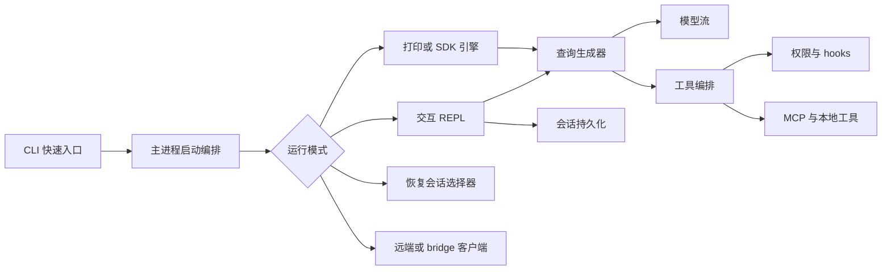

# Claude Code 仓库架构导航

> 适用路径：`/home/fishandrice/Backend/claude-code/claude-code-2.1.88-source`
>
> 最后核对：2026-10-17。此目录是 2.1.88 TypeScript 源码快照，没有 `package.json` 或构建配置，只能静态阅读。

## 一句话模型

Claude Code 的交互主体是一个 React/Ink 终端应用。CLI 启动层完成参数解析、配置、认证、MCP 和会话选择后，把控制权交给 REPL；REPL 维护消息与 UI 状态，并通过一个可中断的异步生成器执行“模型 → 工具 → 模型”的主循环。

## 新会话建议阅读顺序

1. 先读本文的“运行平面”和“主调用链”。
2. 查模型/工具循环看 `src/query.ts`，不要从 `scripts/` 或 `vendor/` 开始。
3. 查命令或 UI 行为先看 `src/commands/`、`src/screens/REPL.tsx`，再追到 `src/services/`。
4. 查状态先分清 `bootstrap/state.ts` 的进程级状态与 `state/AppStateStore.ts` 的 UI 状态。
5. 所有 `rg` 必须加 `--no-ignore`。

## 顶层目录

| 路径 | 职责 |
|---|---|
| `src/entrypoints/` | CLI、MCP、SDK、初始化入口 |
| `src/main.tsx` | 完整 CLI 的参数定义、启动编排与模式分派 |
| `src/screens/` | REPL、恢复会话等顶层屏幕 |
| `src/components/` | 终端 UI 组件 |
| `src/ink/` | 自带的 Ink/终端渲染实现 |
| `src/query.ts` | 交互式 agent 主循环 |
| `src/QueryEngine.ts` | SDK/非交互调用对主循环的封装 |
| `src/Tool.ts`、`src/tools.ts`、`src/tools/` | 工具协议、工具池和具体工具 |
| `src/commands/` | 斜杠命令实现 |
| `src/services/` | 压缩、MCP、API、记忆、设置、插件、遥测等后台能力 |
| `src/state/`、`src/bootstrap/` | UI 状态与进程级会话状态 |
| `src/tasks/`、`src/coordinator/` | 后台任务、多代理与协调者模式 |
| `src/remote/`、`src/bridge/`、`src/server/` | 远端会话、CCR/bridge、直连服务器 |
| `src/utils/` | 大量共享运行时、权限、持久化与消息处理逻辑 |

## 运行平面



交互路径与无头/SDK 路径共享大部分模型、工具、压缩和权限逻辑，但入口和输出层不同：

- 交互式模式依赖 `REPL` 组件、Ink 渲染和本地命令系统。
- `QueryEngine` 为 SDK/打印模式维护可变消息、工具上下文和会话输出事件。
- `/resume` 可以在进程内切换会话；CLI `--resume` 则在启动阶段加载目标会话。

## 主调用链

### CLI 到 REPL

```text
src/entrypoints/cli.tsx
  → 处理 version、MCP server、daemon、bridge、后台会话等快速路径
  → src/main.tsx::main
  → Commander 参数解析
  → 配置、认证、信任、MCP、插件、hooks 初始化
  → launchRepl / launchResumeChooser / print.ts
  → src/replLauncher.tsx
  → src/screens/REPL.tsx
```

### 一轮模型与工具

```text
用户提交提示
  → REPL 更新消息状态并调用 query()
  → REPL 传入的提示与上下文被 query.ts 组装成模型请求
  → 调用模型流
  → 解析 assistant/tool_use
  → 权限检查与 hooks
  → services/tools/toolOrchestration.ts 执行工具
  → tool_result 回到消息数组
  → 继续下一轮，直到停止或达到限制
```

`query()` 是一个异步生成器，向外持续产生流事件、消息、工具摘要和终止结果；REPL 消费这些事件并更新界面。压缩、重试、token budget、记忆预取、技能发现和 stop hooks 都嵌入这条生成器链，而不是散落在 UI 事件回调中。

### SDK / 非交互

```text
entrypoints/agentSdkTypes.ts 或 cli/print.ts
  → QueryEngine::ask / submitMessage
  → 同一套 query、工具与压缩逻辑
  → 转成 SDKMessage 或 print 输出
```

## 主要模块分工

| 层 | 主要路径 | 职责 |
|---|---|---|
| 启动 | `entrypoints/cli.tsx`、`main.tsx` | 快速分派、参数、配置、认证、启动模式 |
| 交互 UI | `screens/REPL.tsx`、`components/`、`ink/` | 输入、消息列表、权限对话框、任务面板、渲染 |
| Agent 循环 | `query.ts`、`QueryEngine.ts` | 模型调用、工具循环、重试、压缩、停止条件 |
| 工具 | `Tool.ts`、`tools.ts`、`tools/*` | 工具 schema、池装配、执行 |
| 权限与 hooks | `hooks/useCanUseTool.ts`、`utils/permissions/`、`utils/hooks/` | 权限判定、审批、生命周期 hooks |
| 状态 | `bootstrap/state.ts`、`state/AppStateStore.ts`、`screens/REPL.tsx` | 会话级全局状态、不可变 UI 状态、任务与权限上下文；消息数组是 REPL 本地状态 |
| 命令 | `commands.ts`、`commands/*` | 斜杠命令注册与实现 |
| 上下文 | `context.ts`、`constants/prompts.ts`、`utils/systemPrompt.ts` | 系统/用户上下文与提示组装 |
| 服务 | `services/*` | MCP、API、压缩、记忆、插件、设置同步、遥测 |
| 持久化 | `utils/sessionStorage.ts`、`history.ts`、`utils/fileHistory.ts` | JSONL 会话、输入历史、文件回退 |
| 多代理 | `tasks/`、`coordinator/`、`tools/AgentTool/` | 后台任务、团队成员、子代理 |
| 远端 | `remote/`、`bridge/`、`server/` | CCR、远程控制、直连会话、WebSocket |

## 工具与权限边界

工具不是写死在循环里，而是先装配成工具池：

1. `tools.ts` 按模式、deny rules、REPL 模式和 feature gate 选出内置工具；
2. MCP 连接把远端工具加入同一池；
3. `assembleToolPool` 负责合并、去重并保持稳定的 prompt-cache 顺序；
4. `query.ts` 只消费最终工具列表；
5. 执行前的权限判断、hooks、UI 审批和沙箱逻辑由 `ToolUseContext` 串联。

研究某个工具行为时，至少同时看三处：

- 工具自身目录中的 schema 与 `call`；
- `tools.ts` 中是否被默认启用、是否被模式过滤；
- `query.ts` / `toolOrchestration` 中如何并发、串行、取消和回传结果。

## 状态边界

Claude Code 有两套很容易混淆的状态：

| 状态层 | 位置 | 典型内容 |
|---|---|---|
| 进程级会话状态 | `src/bootstrap/state.ts` | session id、cwd、模型、成本、token、遥测、缓存 |
| UI/运行时状态 | `src/state/AppStateStore.ts`、`src/screens/REPL.tsx` | 工具权限、MCP、任务、插件、团队、远端连接；消息数组由 REPL 本地管理 |

此外还有：

- 会话文件：`~/.claude/projects/.../<session-id>.jsonl`；
- 输入历史：`~/.claude/history.jsonl`；
- 文件回退：`~/.claude/file-history/`；
- 活跃进程登记：`~/.claude/sessions/<pid>.json`；
- 配置和设置：`~/.claude` 下的 settings、plugins、skills 等。

不要用“消息数组在 React state 中”推导出“会话恢复只恢复 React state”；实际恢复会重建消息链、文件检查点、工具结果替身和多种会话元数据。

## 扩展点

- **斜杠命令**：`commands.ts` 注册，具体实现在 `commands/*`；有本地 JSX 命令与提示型命令两类。
- **技能与插件**：`skills/`、`plugins/`、`services/plugins/`；通过资源发现与命令/工具注入进入 REPL。
- **Hooks**：`utils/hooks/` 与 `utils/sessionStart.ts` 等；覆盖 SessionStart、PreToolUse、PostToolUse、Stop、Compact 等阶段。
- **MCP**：`services/mcp/` 管理连接、工具、资源和 elicitation；工具层在 `tools/MCPTool/`。
- **Agent 定义**：`tools/AgentTool/loadAgentsDir.ts` 与 agent frontmatter；可影响工具、模型和提示。
- **远端模式**：`bridge/`、`remote/`、`server/` 是独立通信面，不应与本地 REPL 的会话持久化混在一起。

## 容易走错的地方

- 没有 `package.json`，不要把这里当可构建项目。不要尝试安装、构建或运行测试。
- 必须用 `rg --no-ignore`，否则根目录的忽略规则会让整棵源码树不可见。
- 很多文件尾部带内嵌 `sourceMappingURL`，直接 `cat` 或大范围输出会产生巨量无关内容；用局部 `sed -n` 或 `rg`。
- `feature('...')` 是构建期开关，`tengu_*` 常见于 GrowthBook 远端开关。仓库只能证明代码分支存在，不能证明线上默认值。
- `"external" === 'ant'`、`USER_TYPE === 'ant'` 下常有内部专用逻辑；不要把内部行为当成外部发行版必有的行为。
- `screens/REPL.tsx` 很大，先找事件入口、state hook 和 `query()` 调用点，不要顺序通读。
- `QueryEngine` 与 `query` 不是两套独立 agent；前者是面向 SDK 的封装，后者是共同循环。

## 问题到目录

| 想研究的问题 | 首先看 |
|---|---|
| CLI 参数和启动模式 | `src/main.tsx`、`src/entrypoints/cli.tsx` |
| 交互界面主循环 | `src/screens/REPL.tsx` |
| 模型/工具迭代 | `src/query.ts` |
| SDK 调用 | `src/QueryEngine.ts`、`src/entrypoints/agentSdkTypes.ts` |
| 工具注册与过滤 | `src/tools.ts`、`src/Tool.ts`、`src/tools/*` |
| 权限与审批 | `src/hooks/useCanUseTool.ts`、`src/utils/permissions/` |
| 会话恢复 | `src/commands/resume/`、`src/screens/ResumeConversation.tsx`、`src/utils/sessionStorage.ts` |
| 压缩 | `src/services/compact/` |
| 记忆 | `src/services/SessionMemory/`、`src/services/extractMemories/` |
| MCP | `src/services/mcp/`、`src/tools/MCPTool/` |
| 后台任务 | `src/tasks/`、`src/hooks/useScheduledTasks.ts` |
| 多代理/团队 | `src/tools/AgentTool/`、`src/coordinator/`、`src/utils/swarm/` |
| 远端与 bridge | `src/bridge/`、`src/remote/`、`src/server/` |

## 源码锚点

| 路径 | 入口 |
|---|---|
| `src/entrypoints/cli.tsx` | CLI 快速分派 |
| `src/main.tsx` | `main`、Commander action、模式分派 |
| `src/replLauncher.tsx` | 挂载 App + REPL |
| `src/screens/REPL.tsx` | 交互状态、命令、查询调用 |
| `src/query.ts` | `query`、query loop |
| `src/QueryEngine.ts` | `ask`、`submitMessage` |
| `src/tools.ts` | `getTools`、`assembleToolPool` |
| `src/Tool.ts` | `ToolUseContext` 与工具契约 |
| `src/state/AppStateStore.ts` | `AppState` |
| `src/bootstrap/state.ts` | 进程级会话状态 |
| `src/utils/sessionStorage.ts` | JSONL 会话读写与恢复 |
| `src/commands/resume/resume.tsx` | 交互式 `/resume` |
