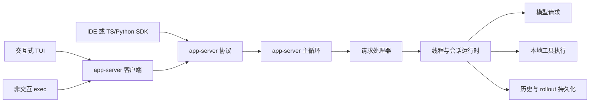

# Codex 仓库架构导航

> 适用路径：`/home/fishandrice/Backend/codex`
>
> 最后核对：2026-10-17。本文是研究导航，不是行为结论；具体机制仍以源码和测试为准。

## 一句话模型

Codex 是一个 Rust workspace。交互式 TUI、非交互式 exec、IDE/SDK 都通过 **app-server 协议**进入同一个 agent 后端；真正的主状态在 `codex-core` 的 thread/session/turn 运行时中，会话记录由 rollout JSONL 和本地状态索引保存。

## 新会话建议阅读顺序

1. 先读本文的“运行平面”和“主调用链”。
2. 要查某个机制时，按文末“问题到目录”表定位，不要先遍历 100 多个 crate。
3. 先看 crate 的 `src/lib.rs` 导出，再看 `Cargo.toml` 依赖，最后进入主实现文件。
4. 公开文档只作背景；`README` 和实现可能不同步。

## 顶层目录

| 路径 | 职责 |
|---|---|
| `codex-rs/` | Rust workspace，核心实现都在这里 |
| `codex-cli/` | npm 包与启动包装脚本，主要是分发层 |
| `sdk/typescript/`、`sdk/python/` | 面向 app-server 的 SDK |
| `docs/` | 安装、配置、sandbox、execpolicy、skills 等公开文档 |
| `bazel/`、`BUILD.bazel`、`MODULE.bazel` | Bazel 构建与依赖 |
| `.github/`、`scripts/`、`tools/` | CI、发布、辅助工具 |
| `third_party/`、`vendor/`、`MODULE.bazel.lock` | 第三方与生成/锁定内容，通常不是研究入口 |

## 运行平面



关键事实：

- TUI 和 exec 都是 app-server 客户端。TUI 可以连接共享 daemon、嵌入式 app-server 或远端端点；exec 默认启动进程内 app-server。
- 独立 app-server 进程提供 stdio、Unix socket 或 WebSocket 等传输，供 IDE、SDK 和远端控制使用。
- `codex-core` 不直接写 stdout/stderr；用户可见输出必须经 TUI、exec 事件处理器或 tracing 层。
- app-server 协议是前端与后端之间的主要集成缝，新增客户端能力通常先体现在协议类型，再落到请求处理器和 core。

## 主调用链

### 交互式入口

```text
codex-rs/cli/src/main.rs
  → codex-rs/tui/src/main.rs
  → codex-rs/tui/src/lib.rs::run_main
  → 选择 app-server 目标并建立 AppServerSession
  → 发送 ThreadStart / ThreadResume / TurnStart 等请求
```

根 CLI 还承载 `exec`、`app-server`、`resume`、`mcp`、`plugin`、`sandbox`、`doctor`、`apply` 等子命令，先看 `codex-rs/cli/src/main.rs` 的 `Subcommand` 分发。

### 非交互入口

```text
codex-rs/exec/src/main.rs
  → codex-rs/exec/src/lib.rs::run_main
  → 启动 InProcessAppServerClient
  → ThreadStart / ThreadResume
  → TurnStart
  → 将事件转换为人类可读输出或 JSONL
```

### app-server 入口

```text
codex-rs/app-server/src/main.rs
  → run_main_with_transport_options
  → MessageProcessor
  → request_processors/*
  → codex-core
```

app-server 内部大致分成“请求处理循环”和“出站消息循环”：前者处理 JSON-RPC 与线程生命周期，后者负责可能较慢的连接写回。具体线程在 `message_processor.rs`、`outgoing_message.rs` 和 `thread_state.rs`。

### core 内的 turn 链

```text
ThreadManager
  → CodexThread
  → Session
  → session/turn.rs::run_turn
  → 构造模型请求
  → 流式接收响应
  → 解析工具调用
  → 路由并执行工具
  → 写回结果与 rollout
```

研究 turn 行为时，优先读：

- `codex-rs/core/src/session/turn.rs`：一轮内的主循环、模型调用、工具调用和停止条件。
- `codex-rs/core/src/session/session.rs`：会话级状态、历史、配置快照和服务组合。
- `codex-rs/core/src/codex_thread.rs`：线程级提交、steer、resume、flush、配置与事件接口。
- `codex-rs/core/src/thread_manager.rs`：线程创建、恢复、子代理树和生命周期。

## 主要 crate 分工

| 类别 | 主要 crate / 路径 | 用途 |
|---|---|---|
| 前端与集成 | `cli`、`tui`、`exec` | 根命令、交互 TUI、非交互运行 |
| 协议与连接 | `app-server`、`app-server-client`、`app-server-protocol`、`app-server-transport`、`app-server-daemon` | JSON-RPC 协议、传输、进程内/远端连接、daemon |
| Agent 核心 | `core`、`core-api`、`protocol`、`agent-identity`、`agent-roles` | 线程、会话、turn、事件、代理身份与角色 |
| 历史持久化 | `history`、`rollout`、`thread-store`、`state`、`message-history` | rollout 事件、会话索引、线程存储与查询 |
| 模型与供应商 | `model-provider`、`model-provider-info`、`models-manager`、`codex-api`、`codex-client`、`responses-api-proxy`、`ollama`、`lmstudio` | 模型目录、供应商适配、Responses API 与代理 |
| 工具执行 | `tools`、`core/src/tools`、`apply-patch`、`shell-command`、`exec-server`、`unified_exec` | 工具定义、路由、执行器、补丁与 shell |
| 沙箱与策略 | `sandboxing`、`linux-sandbox`、`windows-sandbox-*`、`execpolicy`、`network-proxy`、`process-hardening` | 平台沙箱、命令策略、网络策略 |
| 扩展机制 | `ext/*`、`hooks`、`skills`、`memories/*`、`plugin` | agent 扩展、hooks、技能、记忆、插件 |
| 配置与运行时 | `config`、`config-schema`、`codex-home`、`login`、`aws-auth`、`keyring-store` | 配置层级、家目录、认证与密钥 |
| 可观测性 | `analytics`、`otel`、`diagnostics`、`feedback` | 指标、追踪、诊断与反馈 |
| 代码模式 | `code-mode`、`code-mode-host`、`code-mode-protocol`、`code-mode-runtime` | 宿主进程、沙箱脚本与工具调用协议 |

## 状态与持久化边界

Codex 的“会话”至少分布在四层：

| 层 | 内容 | 入口 |
|---|---|---|
| 进程/连接 | 连接、订阅、请求 id、线程句柄 | `app-server` |
| 线程/会话 | thread id、resume、配置快照、turn 状态、审批状态 | `core/src/codex_thread.rs`、`core/src/session/` |
| 历史日志 | rollout JSONL，可回放、压缩、归档、fork | `rollout/src/recorder.rs`、`rollout/src/list.rs` |
| 本地索引 | 线程/会话搜索、元数据、状态数据库 | `rollout/src/state_db.rs`、`thread-store`、`state` |

rollout 写入有后台 writer task、显式 flush/shutdown 和写锁协调；不要把它简化成“每轮同步写文件”。会话恢复与历史投影的边界要从 `rollout`、`history` 和 app-server 的 thread resume 处理器共同确认。

## 扩展点

- **功能开关**：`codex-rs/features` 是统一注册表，分为 stable、experimental、under-development、deprecated、removed。源码中出现开关不代表线上默认开启。
- **协议扩展**：`app-server-protocol` 定义请求、事件和导出 schema；大量内容是生成的，生成 schema 目录不应当作手写源码研究。
- **Agent 扩展**：`codex-rs/ext/*` 通过 extension API 注入工具、上下文、记忆、目标、审查、连接器等能力。
- **MCP**：`codex-mcp`、`rmcp-client` 与 core 的 MCP 管理共同组成客户端链路。
- **hooks / skills / plugins**：分别在 `hooks`、`skills`、`plugin` 与 core 的运行时钩子中接入。
- **代码模式**：`code-mode` 是对外工具入口，`code-mode-host` 是独立宿主，`code-mode-runtime` 是执行沙箱。

## 容易走错的地方

- 不要从 crate 名称直接推断职责。`core` 仍包含大量 session、工具、MCP、实时会话和安全代码。
- `app-server-protocol/schema/` 和 Bazel 生成物不是机制事实的第一来源；优先看 Rust 类型、处理器和测试。
- 不要默认 README 与实现一致。研究具体机制时先确认路径和导出是否仍存在。
- `tui` 不只是渲染层，它也负责选择本地 daemon/嵌入式/远端 app-server 目标。
- `exec` 与 TUI 共享 app-server 语义，但输出层和生命周期不同；比较行为时要区分两者。
- 许多能力受 feature 或远端配置控制。结论要写清“结构上存在”还是“默认开启”。
- 记忆流水线的运行时编排**不在** `core/src/memories/`（该目录不存在，`memories/README.md` 未同步）：第一阶段与第二阶段都在 `codex-rs/memories/write/src/`，由 app-server 的回合启动路径派发。

## 问题到目录

| 想研究的问题 | 首先看 |
|---|---|
| 根命令如何分派 | `codex-rs/cli/src/main.rs` |
| 交互 TUI 如何启动 | `codex-rs/tui/src/main.rs`、`tui/src/lib.rs` |
| 无头模式如何运行 | `codex-rs/exec/src/main.rs`、`exec/src/lib.rs` |
| IDE/SDK 如何接入 | `codex-rs/app-server/`、`app-server-client`、`sdk/` |
| 一轮 agent 如何运行 | `codex-rs/core/src/session/turn.rs` |
| 线程与 resume | `codex-rs/core/src/codex_thread.rs`、`thread_manager.rs` |
| 工具定义与执行 | `codex-rs/tools/src/`、`core/src/tools/` |
| 会话历史与回放 | `codex-rs/rollout/src/`、`history`、`thread-store` |
| 沙箱与审批 | `codex-rs/sandboxing/`、`execpolicy/`、`core/src/session/` |
| 配置系统 | `codex-rs/config/`、`config-schema/`、`codex-home/` |
| 扩展与插件 | `codex-rs/ext/`、`hooks/`、`skills/`、`plugin/` |
| 长期记忆的生成与提取 | `codex-rs/memories/write/src/`（`start.rs` 派发）、`state/src/runtime/memories.rs`（作业与水位线） |
| 长期记忆的消费与引用 | `codex-rs/memories/read/src/` |
| 模型供应商 | `model-provider/`、`models-manager/`、`codex-api/` |

## 源码锚点

| 路径 | 入口 |
|---|---|
| `codex-rs/cli/src/main.rs` | `main`、`Subcommand` 分发 |
| `codex-rs/tui/src/main.rs` | TUI 二进制入口 |
| `codex-rs/tui/src/lib.rs` | `run_main`、app-server 目标选择 |
| `codex-rs/exec/src/lib.rs` | `run_main`、进程内 app-server |
| `codex-rs/app-server/src/main.rs` | app-server 二进制入口 |
| `codex-rs/app-server/src/lib.rs` | `run_main_with_transport_options` |
| `codex-rs/app-server/src/message_processor.rs` | JSON-RPC 请求与连接处理 |
| `codex-rs/core/src/session/turn.rs` | `run_turn` |
| `codex-rs/core/src/codex_thread.rs` | `CodexThread` API |
| `codex-rs/core/src/thread_manager.rs` | `ThreadManager` |
| `codex-rs/rollout/src/recorder.rs` | rollout 写入任务 |
| `codex-rs/rollout/src/list.rs` | 会话列表与查找 |
| `codex-rs/features/src/lib.rs` | 功能注册表 |
