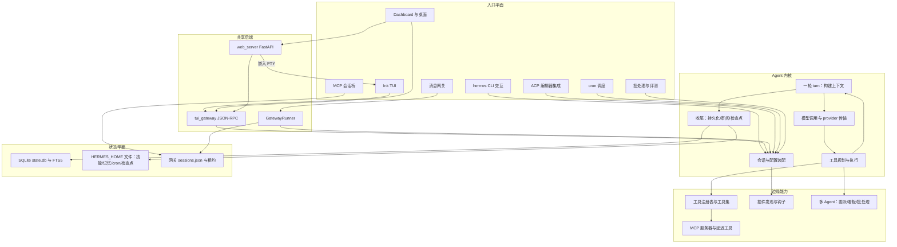
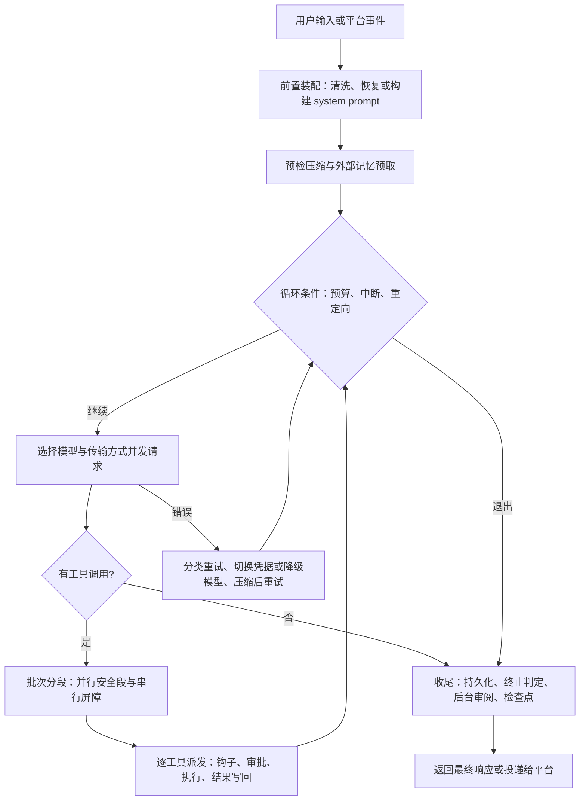

# Hermes Agent 仓库架构导航

> 适用路径：`/home/fishandrice/Backend/hermes-agent`
>
> 最后核对：2026-10-28，`main` 分支 `baa344dee7`（2026-08-28），`pyproject.toml` 版本 `0.20.6`。
>
> 仓库形态：Python 3.11–3.13 主程序（约 1250 个非测试 `.py`、约 3460 个 pytest 文件）+ npm workspaces TypeScript 工作区（`apps/*`、`ui-tui`、`ui-tui/packages/*`、`web`、`tests-js`，约 2600 个 `.ts/.tsx`）。工作区约 1.6G，其中 `.git` 约 1.4G（历史很长），所以整体 `rg` 前先按目录缩小范围。
>
> **只读研究**：`hermes`、`hermes gateway`、`pytest`、`uv sync` 都会写 `~/.hermes/`（`state.db`、`logs/`、`skills/`、cron 目录）、安装依赖并联网调用模型；`hermes` 启动时还会做字节码清理、半成品安装自愈和更新检查。不要在这个仓库里运行它们，也不要 `npm install`。研究只做静态阅读 + 在 `/tmp` 写脚本。

## 一句话模型

Hermes 是「**一套 Agent 内核 + 一圈 I/O 外壳 + 一条自我改进闭环**」：内核是 `AIAgent`（同步的多轮工具调用循环）、一张全局工具注册表、一个 SQLite 会话库；外壳是经典 CLI、Ink TUI、消息网关（22 个平台插件）、Web dashboard、Electron 桌面、ACP、MCP 桥、批处理与 cron；闭环是每轮结束后分叉一个 agent 审阅「该不该写技能/记忆」、后台 curator 维护技能生命周期、FTS5 会话检索，以及可选的 Honcho 用户建模。

两条设计红线决定了几乎所有结构（仓库 `AGENTS.md` 开篇明写）：

1. **会话级 prompt cache 神圣**：system prompt 每个会话只构建一次并持久化，工具集在会话内不切换，技能斜杠命令注入为 **user 消息**而不是 system prompt；唯一允许改写历史的路径是上下文压缩。
2. **内核是窄腰，能力在边缘**：每个模型工具都要在每次 API 调用时随请求发送，所以新增核心工具的门槛极高；新能力优先走「CLI 子命令 + 技能」「服务门控工具」「插件」「MCP」。

和本工作区其它对象相比，Hermes 的特点是**入口特别多、共享同一个内核**，而且**同一个能力往往有 3~5 个安装点**（CLI / TUI / 网关 / dashboard / 桌面 / ACP）。

## 新会话建议阅读顺序

1. 先读本文「运行平面」和「主调用链」，建立「多入口 → 一个内核 → 多存储」的模型。
2. 追一轮对话：`hermes_cli/main.py::cmd_chat` → `hermes_cli/cli_agent_setup_mixin.py::_init_agent` → `run_agent.py::AIAgent` → `agent/conversation_loop.py::run_conversation` → `agent/turn_context.py::build_turn_context` → `model_tools.py::handle_function_call`。
3. 查工具：`tools/registry.py`（注册与发现）→ `toolsets.py`（哪些工具进 schema）→ `model_tools.py::get_tool_definitions`（延迟暴露）。
4. 查状态：`hermes_state_common.py`（SQLite schema）→ `hermes_state.py`（`SessionDB`）。
5. 查某个外壳：CLI 在 `cli.py`，TUI 在 `ui-tui/` + `tui_gateway/`，消息平台在 `gateway/run.py` + `plugins/platforms/`，dashboard/桌面在 `hermes_cli/web_server.py` + `web/` + `apps/desktop/`。
6. 不要从 README 的模块清单直接下结论：根目录的那些「god file」已经被拆成 mixin 与子模块，文件行数会误导（见文末「容易走错的地方」）。

## 顶层目录职责

| 路径 | 职责 |
|---|---|
| `run_agent.py` | `AIAgent` 类与 `hermes-agent` console script。**大量方法只是转发**到 `agent/` 下的模块；`run_conversation` 的实体在 `agent/conversation_loop.py` |
| `cli.py` | `HermesCLI`（prompt_toolkit + Rich）：交互循环、流式渲染、斜杠命令分发、单次问答（`-q`）。约 2.2 万行，逻辑分散在 `hermes_cli/cli_*_mixin.py` |
| `hermes_cli/` | 全部 `hermes <子命令>`（约 40 个 parser，在 `subcommands/`）、配置默认值与迁移、setup 向导、模型目录与切换、插件加载、dashboard 服务器、profile 管理、更新流水线 |
| `agent/` | 内核内部：`conversation_loop`、`turn_context`、`tool_executor`、`system_prompt`/`prompt_builder`、`context_compressor`、`memory_manager`、`curator`、`background_review`、`auxiliary_client`、provider transports、`moa_*`、`delegate` 相关 |
| `model_tools.py` | 工具编排门面：`get_tool_definitions`（schema 剪裁 + tool_search 折叠）、`handle_function_call`（唯一派发入口，含中间件与钩子） |
| `toolsets.py` + `toolset_distributions.py` | 工具集定义（`TOOLSETS` 58 项）与「按场景采样工具集」的分布定义（批处理/评测用） |
| `tools/` | 工具实现（约 140 个文件，含共享基础设施）+ `tools/registry.py`（注册表、发现、check_fn 缓存）+ `tools/environments/`（终端后端） |
| `hermes_state.py` / `_common` / `_schema` / `_search` / `_portability` | SQLite 会话库 `SessionDB`：schema、写入、FTS5 检索、导入导出、压缩链与租约 |
| `gateway/` | 消息网关：`run.py`（`GatewayRunner`）、`session.py`（`SessionStore`）、投递/审批/排空/重启、`platforms/`（内建少数适配器） |
| `plugins/platforms/` | **22 个消息平台适配器**（telegram、discord、slack、whatsapp、matrix、feishu、dingtalk、wecom、irc、line、teams、sms、email、a2a …）——不是 `gateway/platforms/` |
| `tui_gateway/` | TUI/桌面/dashboard 共用的 Python JSON-RPC 后端（方法表、session 生命周期、事件流、slash worker、MCP OAuth） |
| `ui-tui/` | Ink（React）终端 UI，`hermes --tui` 启动；`packages/` 内含自带 Ink 分支 |
| `web/` | Dashboard 的 React 前端（Vite）；聊天页其实是一个 xterm.js + PTY，跑真正的 `hermes --tui` |
| `apps/desktop/` | Electron 桌面：有自己的 composer/transcript，连 `hermes serve` 的 `/api/ws`；`apps/shared` 提供 JSON-RPC 客户端 |
| `acp_adapter/` | ACP 服务端（Zed/JetBrains/VS Code 集成） |
| `mcp_serve.py` | 反向桥：把「消息会话」暴露成 MCP 工具，给 Claude Code / Cursor 等调用 |
| `cron/` | 调度器：`jobs.py`（任务存储、加锁）、`scheduler.py`（`tick()` 派发、不活跃超时硬中断、错过补跑、事件与告警） |
| `plugins/` | 通用插件、记忆 provider、模型 provider、上下文引擎、kanban、observability、image/video gen 等（含前端资源） |
| `skills/` / `optional-skills/` | 随包技能（82 个 `SKILL.md`）与默认不激活的重型技能（118 个） |
| `providers/` | `ProviderProfile` 基类与 profile 注册表；具体 provider 在 `plugins/model-providers/<name>/` |
| `native/fts5_cjk/` | C 扩展：给 SQLite FTS5 补中日韩分词（会话检索用） |
| `batch_runner.py` / `mini_swe_runner.py` / `trajectory_compressor.py` | 研究平面：并行轨迹生成、SWE 风格 runner、训练用轨迹压缩 |
| `evals/`、`datagen-config-examples/` | 小型评测与数据生成样例 |
| `tests/` | 约 3460 个 pytest 文件（含集成与 e2e）；`tests-js/` 是前端侧 |
| `website/`、`docs/` | Docusaurus 文档站（含 `developer-guide/architecture.md` 等）与设计/RFC 文档 |

## 运行平面



要点：**除网关外，所有交互面最终都汇到同一个 `AIAgent` 构造与 `run_conversation`**；网关只是多了一层「平台事件 → 会话键 → 常驻 agent 缓存 → 投递」的适配。TUI、桌面、dashboard 三者共享 `tui_gateway` 的 JSON-RPC 方法表，但**协议传输不同**（stdio / WebSocket）。

## 主调用链

### 1. 入口与子命令分发

```text
hermes（脚本或 console script）
  → hermes_cli/main.py::main
  → 轻量快路径（_try_fast_chat_launch / Termux 专用路径；避开 40 个 parser 的 argparse 开销）
  → build_top_level_parser() + subcommands/*.py 注册的 parser
  → args.func(args)
```

主要分支：

| 子命令 | 落到 |
|---|---|
| `hermes` / `hermes chat` | `cmd_chat` → `cli.main()` 或 `_launch_tui()` |
| `hermes gateway …` | `hermes_cli/gateway.py::gateway_command` → 前台跑 `gateway.run.start_gateway`，或装/控 systemd、Windows 服务、多 profile |
| `hermes dashboard` / `hermes serve` | 同一个 `cmd_dashboard`：`serve` 置 `headless_backend`，不构建/不挂 SPA，只留 JSON-RPC/WS/REST |
| `hermes acp` / `hermes mcp serve` | `acp_adapter.entry:main` / `mcp_serve.py` |
| `hermes cron|kanban|skills|model|tools|plugins|…` | 各自 `hermes_cli/<模块>.py` |
| `hermes-agent`（另一个 console script） | `run_agent.py::main`：无会话的极简单次运行（研究/演示用） |

`main()` 在 argparse 之前还会做一串「自愈」：进程标题、agent 环境变量广播、Windows UTF-8 stdio、清理隔离的 `hermes.exe.old.*`、按 checkout 变化清理 `__pycache__`、中断安装恢复、待重启提醒。这些不是业务逻辑，但会影响观测到的启动行为。

### 2. 会话建立（经典 CLI）

```text
cmd_chat
  → 解析 --in/--resume/--continue（含 @claude/@codex 外部会话导入）
  → 视情况恢复 session 记录的 cwd、yolo、model
  → 不是 --tui：from cli import main → cli.main(**kwargs)
  → HermesCLI.__init__（config、skin、session_db 懒加载）
  → HermesCLI.run()
       → banner / 首启向导 / 恢复历史展示
       → 后台预热 agent 运行时的 import
       → 输入循环
            ├─ 斜杠命令 → process_command（COMMAND_REGISTRY 解析别名后按 canonical 分发）
            └─ 普通消息 → _init_agent() 后才真正构建 agent
```

`_init_agent()`（`hermes_cli/cli_agent_setup_mixin.py`）是「第一次用到才建 agent」的关键点：

1. 等后台技能预加载完成；
2. 等 MCP 工具发现（有界等待，dead server 不阻塞）；
3. 建/复用 `SessionDB`；
4. 若是 resume：校验会话、沿压缩链走到 tip、载入消息、恢复 cwd/yolo/model；
5. 构造 `AIAgent(...)`，`__init__` 参数近 80 个（凭据、路由、预算、回调、会话 id、平台、检查点、记忆、工具集…）；
6. 把 CLI 的回调（流式增量、工具进度、审批、clarify）挂到 agent 上。

### 3. 一轮 turn（所有入口共用）



细节锚点：

- **前置装配**在 `agent/turn_context.py::build_turn_context`：用户消息净化、system prompt「恢复或构建」、预检压缩、`pre_llm_call` 插件钩子、外部记忆预取（后台线程，有超时）、崩溃可恢复的持久化。
- **system prompt 的三层缓存**在 `agent/system_prompt.py::build_system_prompt_parts`：`stable`（身份、通用行为准则）→ `context`（工作区快照、AGENTS.md/SOUL.md 等项目上下文）→ `volatile`（技能索引、记忆快照、用户画像、时间戳）。只构建一次并持久化（会话行的 `system_prompt` + 按内容哈希去重的 `system_prompts` 表），后续 turn 校验 runtime 标识（模型/provider/cwd/platform）是否漂移，漂移才重建。
- **循环**在 `agent/conversation_loop.py::run_conversation`：每次迭代检查中断、重定向、预算宽限、评审预算、检查点；模型调用、错误分类与重试、压缩重试、`codex_app_server` 旁路都在同一个 while 里。
- **工具批次**在 `run_agent.py::_execute_tool_calls` → `agent/tool_executor.py`：先由 `agent/tool_dispatch_helpers.py::_plan_tool_batch_segments` 把一批 tool call 切成「并行安全段」（只读工具、路径不重叠的文件操作、声明可并行的 MCP 工具）与「串行屏障」（交互、写操作、未知工具），混合批次按发射顺序分段执行；并发/串行/分段三条路径共享同一个授权门与超时控制。
- **单工具派发**在 `model_tools.py::handle_function_call`：参数类型纠正 → tool_search 桥接（`tool_call` 会被解包成真实工具并递归）→ `pre_tool_call` 钩子与中间件（超时 **fail-closed**）→ 审批/危险命令判定 → `tools.registry.dispatch` → 结果规范化（统一 JSON 字符串）→ `post_tool_call` 钩子。
- **收尾**在 `agent/turn_finalizer.py::finalize_turn`：判定是否因预算/验证/中断结束、丢弃脚手架消息、记录看板预算耗尽，并触发 `_spawn_background_review`（分叉 agent 复盘是否写技能/记忆）与检查点快照。

### 4. 模型接入

```text
ProviderProfile（providers/base.py + plugins/model-providers/<name>/ 的注册）
  → hermes_cli/runtime_provider.py：解析 provider → api_mode + 凭据 + base_url（含自动探测与回退）
  → agent/transports/{chat_completions, anthropic, codex, codex_app_server, bedrock}.py
  → agent/chat_completion_helpers.py：请求构造、流式解析、错误分类、usage 归一化、prompt cache 策略
```

`api_mode` 目前至少有 `chat_completions`、`anthropic_messages`、`codex_responses`、`codex_app_server`、`bedrock_converse` 五类；`codex_app_server` 是「把整轮交给外部 codex app-server 子进程」的旁路，会在 `run_conversation` 开头直接分流。侧任务（起标题、视觉、压缩摘要、会话检索摘要等）走 `agent/auxiliary_client.py`，可按 `config.auxiliary.<task>` 单独指定 provider/model。

### 5. 消息网关

```text
hermes gateway run → gateway/run.py::start_gateway
  → 单实例锁与 PID/接管标记（HERMES_HOME 作用域）
  → GatewayConfig + SessionStore + 平台适配器（plugins/platforms 注册 → platform_registry.create_adapter）
  → GatewayRunner.start()
       → 连接适配器、启动 cron ticker、kanban 通知/派发 watcher、空闲缩容 watcher
       → 每个平台事件 → GatewayRunner._handle_message
            → 内部事件/忽略频道/启动恢复队列/profile 路由/插件 pre_gateway_dispatch
            → 授权（配对）→ 斜杠命令 → 忙时转向（busy steer）→ 会话键
            → _handle_message_with_agent：SessionStore 取/建会话、worker 线程跑 run_conversation
            → 流式消费（stream_consumer）→ 投递（delivery）→ 投递台账
```

网关的最特殊之处是**agent 常驻缓存**：同一 `session_key` 复用已构建的 `AIAgent`（有 LRU 上限、跨进程驱逐、配置变化失效），并把 `max_iterations`、fallback 链按当前配置刷新；这是为了保住 prompt cache，而不是性能微调。

## 状态与持久化

| 层 | 位置 | 内容 |
|---|---|---|
| 进程内 | `AIAgent` 实例 | 消息列表、缓存 system prompt、工具名集合、压缩器、记忆管理器、预算与中断标志 |
| 会话库 | `$HERMES_HOME/state.db`（`hermes_state*.py`） | `sessions`、`messages`、`system_prompts`、`session_model_usage`、`gateway_routing`、`async_delegations`、`compression_locks`、`session_turn_leases`、`gateway_heartbeats`；FTS5 索引（`native/fts5_cjk` 补 CJK 分词） |
| 压缩链 | `sessions.parent_session_id` + `compression_locks` | 压缩后生成子会话，`resolve_resume_session_id` 沿链走到真正持有 transcript 的 tip |
| 网关路由 | `gateway/session.py` + `gateway_routing` 表 | `session_key → session_id`、会话元数据、恢复与路由代数 |
| 用户目录 | `$HERMES_HOME/`（`hermes_constants.get_hermes_home`） | `config.yaml`、`.env`（仅密钥）、`skills/`、`memories/{MEMORY.md,USER.md}`、`cron/`、`logs/`、`checkpoints/`（影子 git 仓库）、`profiles/<name>/` |
| 看板 | `hermes_cli/kanban_db.py`（独立 SQLite） | 任务、评论、附件、认领/心跳、事件；看板是硬隔离边界，租户是软命名空间 |
| 轨迹 | `save_trajectories` 路径 | `from/value` 格式 JSONL，供 `trajectory_compressor.py` 压缩和训练使用 |

`SessionDB` 有两个值得注意的机制：

- **写入是增量的**：一轮里工具结果随产生随落库（`append_message` / `append_messages_batch`），失败只影响当前回合并记录原因（`locked` / `disk` / `unknown`）。
- **多进程串行化**：`session_turn_leases` + `compression_locks` 让 CLI resume、网关、桌面、后台投递共享同一个 `state.db` 时不会交错写同一会话；压缩有独立租约和失败冷却（`compression_failure_cooldown_until`）。

## 扩展面

| 扩展类型 | 安装点 | 关键机制 |
|---|---|---|
| 通用插件 | `hermes_cli/plugins.py` + `plugins/<name>/` + `~/.hermes/plugins/` + pip entry points | `register(ctx)` 里注册工具、CLI 子命令、生命周期钩子；`pre_tool_call` 超时 fail-closed |
| 记忆 provider | `agent/memory_provider.py`（ABC）+ `agent/memory_manager.py` + `plugins/memory/<name>/` | 内置 + 最多一个外部 provider；`prefetch` 前台有界/后台线程、`sync_turn` 串行后台写、`shutdown` 有排空预算 |
| 模型 provider | `providers/base.py` + `plugins/model-providers/<name>/` | 模块加载时 `register_provider(ProviderProfile(...))`；懒扫描，独立于通用插件系统 |
| 平台适配器 | `plugins/platforms/<name>/` + `gateway/platform_registry.py` | 支持延迟注册；适配器负责 `build_source()`（含 profile 路由）与收/发 |
| 技能 | `skills/`、`optional-skills/`、`~/.hermes/skills/` | `SKILL.md` frontmatter 控制平台/环境/配置；索引进 system prompt volatile 层；`/skillname` 注入为 user 消息；`hermes skills install` 装 optional/hub |
| MCP | `tools/mcp_tool.py` + `hermes_cli/mcp_*.py` + `tools/tool_search.py` | MCP/插件工具默认可「延迟暴露」：schema 只在 `tool_search`/`tool_describe`/`tool_call` 桥里出现 |
| 终端后端 | `tools/environments/` | local、docker、ssh、singularity、modal、managed modal、daytona、vercel sandbox；统一启动/进程注册表/文件同步 |
| 浏览器后端 | `tools/browser_*.py` + `agent/browser_registry.py` | 多后端（CDP、browser-use、扩展路由）与 supervisor 生命周期 |
| 钩子 | `hermes_cli/lifecycle.py` + `gateway/hooks.py` | 会话/LLM/工具/命令生命周期，以及网关投递前后钩子 |
| 上下文引擎 | `agent/context_engine.py`（ABC）+ `agent/context_compressor.py` + `plugins/context_engine/` | 可替换的压缩/治理实现；默认是「摘要 + 锚定使用量」的压缩器 |
| 斜杠命令 | `hermes_cli/commands.py::COMMAND_REGISTRY` | 单一 registry 派生出 CLI、网关帮助、Telegram 菜单、Slack 路由、补全 |
| 皮肤/主题 | `hermes_cli/skin_engine.py` + `~/.hermes/skins/*.yaml` | 纯数据主题，CLI/TUI/桌面共享调色板 |

多 Agent 不是独立框架，而是三种既有机制的组合：`delegate_task`（子 agent，默认后台、叶子/编排者两种角色、并发与深度上限、完成结果回灌对话）、看板（跨 profile 的持久工作队列 + 网关内派发循环）、MoA（`agent/moa_loop.py`，多个顾问模型 → 聚合者）。

## 容易走错的地方

- **`run_agent.py` 是门面，不是内核**：`run_conversation`、`_execute_tool_calls`、`_spawn_background_review` 等大量方法在 `run_agent.py` 里只是转发到 `agent/*.py`。仓库 `AGENTS.md` 也承认 god file 正在被持续拆出（`cli.py` → `cli_*_mixin.py`，`run_agent.py` → `agent/*`）。
- **两套「gateway」**：`gateway/` 是消息平台网关（Telegram/Discord…）；`tui_gateway/` 是 TUI、桌面、dashboard 共用的 JSON-RPC 后端。名字相近、职责完全不同。
- **平台适配器不在 `gateway/platforms/`**：那里只剩内建少数几个（signal、api_server 等），22 个主流平台在 `plugins/platforms/`，通过 `gateway/platform_registry.py` 按名字创建。
- **dashboard 内嵌的是真 TUI**：`web/src/pages/ChatPage.tsx` 用 xterm.js 接 `/api/pty`，PTY 里跑 `hermes --tui`；而 Electron 桌面**不用** PTY，直接连 `hermes serve` 的 `/api/ws` 并自己渲染 composer/transcript。两条路径不要混着理解。
- **`serve` 与 `dashboard` 是同一后端的两种外壳**：`serve` 只是 `headless_backend`，不构建/不挂 SPA；桌面为兼容旧运行时才会回退成 `dashboard --no-open`。
- **增加一个工具很「贵」**：`get_tool_definitions` 会把会话所有工具 schema 塞进每次请求，所以仓库反复做 schema 精简，并用 `tool_search` 只对 **MCP/插件工具**做延迟暴露；核心工具仍然常驻。
- **三个配置加载路径**：`cli.py::load_cli_config`（CLI）、`hermes_cli/config.py::load_config`（子命令/工具）、网关直接读 YAML（`gateway/run.py` + `gateway/config.py`）。同一 key 在 CLI 生效而网关不生效，通常就是走错了 loader。
- **配置/密钥分离**：非密钥进 `config.yaml`（`DEFAULT_CONFIG`），密钥只进 `.env`（`OPTIONAL_ENV_VARS` 元数据）。代码里出现的环境变量多半是「config → env 桥」，不是权威来源。
- **默认值与开关分散且会变**：记忆 provider、工具集、kanban 派发（默认在网关内）、cron、检查点、压缩阈值、审批模式分别由 `config.yaml` 的不同 section 控制；本仓库没有远端开关系统，但很多能力受 `check_fn`（密钥/二进制是否存在）门控，结构上存在 ≠ 默认可跑。
- **cron 不是独立守护进程**：`cron/scheduler.py::tick` 由网关进程内的 ticker 或独立 daemon 调用，靠 `~/.hermes/cron/.tick.lock` 互斥；cron 会话启用记忆但**跳过**每轮后的背景 review（`skip_memory=False`、`skip_background_review=True`），并按「不活跃超时」（`HERMES_CRON_TIMEOUT`，默认 600 秒）请求硬中断，而不是总时长硬上限。
- **后台「自我改进」会真的写盘**：`agent/background_review.py` 在每轮后分叉 agent 写记忆/技能，`agent/curator.py` 会归档 agent 创建的技能（不删除，只 archive）。研究「技能从哪来」时别只看 `/learn`。
- **文档与代码有漂移**：`AGENTS.md` 写 `run_agent.py` ~12k 行，实际 9.3k（已拆走）、写 cron 「3 分钟硬中断」与「默认 `skip_memory=True`」，源码里是「不活跃 600s 硬中断」+「`skip_memory=False`、跳过背景 review」；`website/docs/developer-guide/architecture.md` 的「3 API 模式 / 28 工具集」也是旧数（transport 与 toolset 都更多）。以源码为准。
- **测试面巨大**：约 3460 个测试文件，且仓库明确要求测试不得写 `~/.hermes`；不要在源码目录跑全量 pytest。研究时挑单文件静态读，需要行为证据时读测试的断言，不要读测试里的源码字符串（仓库禁止「测试里读源码」）。
- **搜索**：`.git` 1.4G 不必进；`website/`（含 Docusaurus 站与 i18n）、`contributors/`、`package-lock.json`/`uv.lock`、`docs/*.pdf` 一般跳过；`tests/`（约 3460 文件）只在需要行为证据时定点读。

## 问题到目录

| 想研究的问题 | 首先看 |
|---|---|
| 命令入口与子命令 | `hermes_cli/main.py`、`hermes_cli/_parser.py`、`hermes_cli/subcommands/` |
| 经典 CLI 交互与斜杠命令 | `cli.py`、`hermes_cli/commands.py`、`hermes_cli/cli_*_mixin.py` |
| 会话首次装配 / resume | `hermes_cli/cli_agent_setup_mixin.py::_init_agent`、`hermes_state.py::resolve_resume_session_id` |
| Agent 主循环 | `agent/conversation_loop.py`、`agent/turn_context.py`、`agent/turn_finalizer.py` |
| 模型调用与错误重试 | `agent/chat_completion_helpers.py`、`agent/transports/`、`agent/error_classifier.py` |
| provider / 模型目录 / 切换 | `hermes_cli/runtime_provider.py`、`hermes_cli/model_catalog.py`、`hermes_cli/model_switch.py`、`plugins/model-providers/` |
| 工具注册与发现 | `tools/registry.py`、`tools/*.py` 里的 `registry.register()` |
| 哪些工具进 schema / 延迟暴露 | `toolsets.py`、`model_tools.py::get_tool_definitions`、`tools/tool_search.py` |
| 单工具派发、审批、钩子 | `model_tools.py::handle_function_call`、`tools/approval.py`、`hermes_cli/plugins.py` |
| 并行工具批次 | `agent/tool_dispatch_helpers.py`、`agent/tool_executor.py` |
| 工具护栏 / 死循环 / 预算 | `agent/tool_guardrails.py`、`agent/iteration_budget.py`、`tools/budget_config.py` |
| system prompt 与项目上下文 | `agent/system_prompt.py`、`agent/prompt_builder.py`、`agent/prompt_cache_boundary.py` |
| 上下文压缩 | `agent/context_compressor.py`、`agent/conversation_compression.py`、`agent/context_engine.py`、`hermes_cli/partial_compress.py` |
| 会话存储 / 检索 / 导入导出 | `hermes_state*.py`、`tools/session_search_tool.py` |
| 记忆（内置 + 外部） | `tools/memory_tool.py`、`agent/memory_manager.py`、`plugins/memory/`、`hermes_cli/memory_setup.py` |
| 技能系统与自我改进 | `agent/skill_commands.py`、`agent/skill_utils.py`、`tools/skills_tool.py`、`agent/background_review.py`、`agent/curator.py`、`tools/skill_usage.py` |
| 子 agent / 委派 | `tools/delegate_tool.py`、`tools/async_delegation.py`、`agent/subagent_lifecycle.py` |
| 消息网关与平台适配 | `gateway/run.py`、`gateway/session.py`、`gateway/platform_registry.py`、`plugins/platforms/` |
| 网关授权 / 配对 / 审批 | `gateway/authz_mixin.py`、`gateway/pairing.py`、`hermes_cli/approval_transport.py` |
| TUI 与桌面 RPC | `tui_gateway/server.py`、`tui_gateway/methods_*.py`、`ui-tui/src/gatewayClient.ts`、`apps/desktop/src/app` |
| Dashboard / PTY 桥 | `hermes_cli/web_server.py`、`hermes_cli/pty_bridge.py`、`web/src/pages/ChatPage.tsx` |
| ACP / 编辑器集成 | `acp_adapter/` |
| 把会话暴露给别的 Agent | `mcp_serve.py`、`hermes_cli/subcommands/mcp.py` |
| cron 调度 | `cron/jobs.py`、`cron/scheduler.py`、`hermes_cli/cron.py` |
| 看板多 agent | `hermes_cli/kanban*.py`、`tools/kanban_tools.py`、`gateway/kanban_watchers.py`、`plugins/kanban/` |
| 终端后端 / 沙箱 | `tools/environments/`、`tools/terminal_tool.py`、`tools/process_registry.py` |
| 检查点 / 回滚 | `tools/checkpoint_manager.py`、`hermes_cli/checkpoints.py` |
| 辅助模型任务（起标题/视觉/摘要） | `agent/auxiliary_client.py`、`agent/title_generator.py`、`agent/vision_tools.py` |
| MoA | `agent/moa_loop.py`、`hermes_cli/moa_cmd.py`、`hermes_cli/moa_config.py` |
| profile 多实例 | `hermes_cli/profiles.py`、`hermes_constants.py::get_hermes_home` |
| 批处理 / 轨迹 / 训练数据 | `batch_runner.py`、`mini_swe_runner.py`、`trajectory_compressor.py`、`agent/trajectory.py`、`toolset_distributions.py` |

## 源码锚点

| 路径 | 入口 |
|---|---|
| `hermes_cli/main.py` | `main()`（子命令分发与自愈）、`cmd_chat()`、`cmd_dashboard()`、`_launch_tui()` |
| `cli.py` | `HermesCLI`、`process_command()`、`run()`、`main()` |
| `hermes_cli/cli_agent_setup_mixin.py` | `_init_agent()`（构造 `AIAgent` 的唯一 CLI 路径） |
| `run_agent.py` | `AIAgent`、`run_conversation()`（转发）、`_execute_tool_calls()`、`_spawn_background_review()` |
| `agent/conversation_loop.py` | `run_conversation()`（真实主循环）、压缩重试、错误分类 |
| `agent/turn_context.py` | `build_turn_context()`（前置装配、预检压缩、记忆预取） |
| `agent/turn_finalizer.py` | `finalize_turn()` |
| `agent/tool_executor.py` | `execute_tool_calls_concurrent/sequential/segmented()` |
| `agent/tool_dispatch_helpers.py` | `_plan_tool_batch_segments()` |
| `agent/system_prompt.py` / `prompt_builder.py` | `build_system_prompt_parts()`、项目上下文与行为准则 |
| `agent/context_compressor.py` | 默认 `ContextEngine` 实现（摘要、锚定 usage、失败冷却） |
| `agent/memory_manager.py` / `memory_provider.py` | `MemoryManager`、`MemoryProvider` ABC |
| `agent/background_review.py` | `spawn_background_review_thread()`（自我改进闭环） |
| `agent/curator.py` | `run_curator_review()`（技能生命周期维护） |
| `model_tools.py` | `get_tool_definitions()`、`handle_function_call()` |
| `tools/registry.py` | `discover_builtin_tools()`、`ToolRegistry`、`check_fn` 缓存 |
| `toolsets.py` | `_HERMES_CORE_TOOLS`、`TOOLSETS`、`resolve_toolset()` |
| `hermes_state_common.py` / `hermes_state.py` | SQLite schema、`SessionDB.append_message()`、`get_messages_as_conversation()` |
| `gateway/run.py` | `GatewayRunner`、`_handle_message()`、`start()`、`start_gateway()`、`_start_cron_ticker()` |
| `gateway/session.py` | `SessionStore`、`SessionEntry`、路由持久化 |
| `gateway/platform_registry.py` | 平台适配器注册/实例化 |
| `tui_gateway/server.py` / `entry.py` | `dispatch()`、`_make_agent()`、stdio 入口 |
| `hermes_cli/web_server.py` | FastAPI `app`、`/api/pty`、`/api/ws`、`mount_spa()` |
| `cron/scheduler.py` | `tick()`（锁 + 派发 + 中断） |
| `tools/delegate_tool.py` | 子 agent 的构造与生命周期（子 `AIAgent` 在约 1965 行构造） |
| `acp_adapter/entry.py` | `hermes-acp` / `hermes acp` 入口 |
| `mcp_serve.py` | 消息会话 MCP 桥 |

## 官方自述文档（可当索引用，结论仍需回源）

| 位置 | 内容 |
|---|---|
| `AGENTS.md` | 贡献准则、footprint ladder、结构总览、agent 循环、CLI/TUI 架构、工具/插件/技能、delegation、curator、cron、kanban、profile、测试规约 |
| `website/docs/developer-guide/architecture.md` | 子系统地图（部分数字已过时） |
| `website/docs/developer-guide/agent-loop.md` | 一轮循环的官方叙述 |
| `website/docs/developer-guide/context-compression-and-caching.md` | 压缩与 prompt cache 的约束 |
| `website/docs/developer-guide/prompt-assembly.md`、`session-storage.md`、`tools-runtime.md`、`gateway-internals.md`、`cron-internals.md` | 各子系统内部说明 |
| `docs/middleware/`、`docs/rfcs/`、`docs/design/` | 中间件、插件架构经验、profile-builder 等设计文档 |
| `apps/desktop/AGENTS.md` | 桌面端的专属架构与状态约定 |
