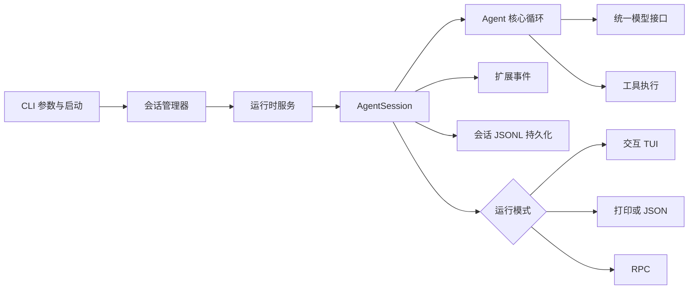

# Pi 仓库架构导航

> 适用路径：`/home/fishandrice/Backend/pi`
>
> 最后核对：2026-10-17。此仓库有完整 `package.json` 和测试配置；研究时默认只读，不运行会写缓存或构建产物的命令。

## 一句话模型

Pi 是一个 npm monorepo。`pi-ai` 负责统一模型与供应商接口，`pi-agent-core` 提供可复用的 Agent 循环，`pi-coding-agent` 把模型、工具、扩展、会话树和三种 I/O 模式组合成 CLI；`pi-durable` 是另一条独立的持久化运行时产品线，不是当前 CLI 的必需依赖。

## 新会话建议阅读顺序

1. 先读本文的“运行平面”和“主调用链”。
2. 查 Agent 循环进入 `packages/agent`；查 CLI 行为进入 `packages/coding-agent/src/main.ts`。
3. 查会话恢复或分支进入 `packages/coding-agent/src/core/session-manager.ts`。
4. 查供应商或模型数据进入 `packages/ai`。
5. 不要一开始读 `dist/`、`node_modules/` 或生成的模型文件。

## 包的职责

| 包 | 名称 | 职责 |
|---|---|---|
| `packages/ai` | `@earendil-works/pi-ai` | 多供应商模型 API、流式接口、OAuth、模型目录、图片模型 |
| `packages/agent` | `@earendil-works/pi-agent-core` | 有状态 Agent、低层 agent loop、工具调用、消息队列 |
| `packages/coding-agent` | `@earendil-works/pi-coding-agent` | Pi CLI、会话管理、工具池、扩展、交互/打印/RPC 模式 |
| `packages/tui` | `@earendil-works/pi-tui` | 终端 UI 组件、差分渲染、键绑定与布局 |
| `packages/mcp` | `@earendil-works/pi-mcp` | 独立 MCP 客户端、OAuth、stdio/HTTP 传输 |
| `packages/codemode` | `@earendil-works/pi-codemode` | 只暴露注入工具的沙箱 JavaScript 执行 |
| `packages/durable` | `@earendil-works/pi-durable` | 持久化 conversation/task/document 运行时，支持内存、JSONL、SQLite 存储 |
| `packages/chord` | `@earendil-works/chord` | 插件宿主、契约、复制状态与 JSON link RPC |
| `packages/env` | `@earendil-works/pi-env` | Durable 的远程执行环境与 SSH daemon 客户端 |
| `packages/telemetry` | `@earendil-works/pi-telemetry` | 供应商无关遥测契约与 schema |
| `packages/evals` | `@earendil-works/pi-evals` | 评测工具 |

`coding-agent` 的直接依赖包括 `agent-core`、`ai`、`codemode`、`mcp`、`tui`；它当前**不依赖** `durable`。研究 CLI 时不要把 `durable` 的存储模型自动套到 `SessionManager` 上。

## 运行平面



三个运行模式共享同一个 `AgentSession`：

- **interactive**：TUI 渲染与键盘交互；
- **print/json**：非交互执行并输出文本或 JSON 事件；
- **rpc**：通过 JSON-RPC 暴露会话控制和事件流。

## 主调用链

### CLI 启动

```text
packages/coding-agent/src/cli.ts
  → setupCli()
  → main(process.argv.slice(2))
  → packages/coding-agent/src/main.ts::main
  → 认证/包管理/配置子命令与快速路径
  → parseArgs
  → 选择 cwd、agentDir、sessionDir
  → SessionManager.create/open/continueRecent
  → createAgentSessionRuntime
  → createAgentSessionServices
  → createAgentSessionFromServices
  → 按模式进入 InteractiveMode / runPrintMode / runRpcMode
```

`main.ts` 同时负责首次设置、项目信任、迁移、扩展加载、模型选择和会话 cwd 处理。它不是纯粹的参数解析器。

### AgentSession 组合

```text
packages/coding-agent/src/core/sdk.ts::createAgentSession
  → 构建 ModelRuntime、SettingsManager、ResourceLoader
  → 从 SessionManager 恢复模型、思考级别和消息
  → 创建 pi-agent-core 的 Agent
  → 注入 streamFn、convertToLlm、工具与扩展 hooks
  → 创建 AgentSession
```

`AgentSession` 是 CLI 的核心抽象：

- 持有 `Agent` 和 `SessionManager`；
- 订阅 Agent 事件；
- 在 `message_end` 时把消息写入会话；
- 处理手动/阈值/溢出压缩；
- 处理重试、缓存预热、模型切换、思考级别；
- 桥接扩展事件和工具调用；
- 提供 fork、switch、import/export 等会话操作。

### 一轮模型循环

```text
AgentSession.prompt
  → Agent.prompt / run
  → packages/agent/src/agent-loop.ts
  → 将 AgentMessage 转为模型 Message
  → pi-ai streamSimple
  → 解析工具调用
  → 执行工具并产生 tool result
  → 继续循环
  → 发出 message/tool/turn 事件
```

`pi-agent-core` 自己不知道“coding agent”的文件工具、MCP 或 UI；它只维护消息、工具、队列和循环。具体工具和扩展由 `coding-agent` 注入。

## 会话与持久化

默认目录：

```text
~/.pi/agent/sessions/--<编码后的 cwd>--/<session-file>.jsonl
```

会话文件不是一条线性数组，而是一棵以 `parentId` 连接的追加式树：

| 记录 | 作用 |
|---|---|
| 会话头 | 版本、session id、cwd、父会话 |
| `message` | 用户、助手、工具结果等 |
| `model_change` | 模型切换 |
| `thinking_level_change` | 思考级别 |
| `compaction` | 摘要、保留起点、压缩前 token 与完整提示状态 |
| `branch_summary` | 从旧分支切出时的摘要 |
| `custom` / `custom_message` | 扩展私有状态或注入模型上下文的消息 |
| `context_edit` | 对早期条目在模型视图中的替换或删除 |
| `session_info` / `label` | 会话名与书签 |

`SessionManager` 维护当前 leaf，追加新记录时把它接到当前 leaf 之后；切换分支只移动 leaf，不改写旧历史。恢复时 `buildSessionContext()` 从根走到当前 leaf，投影出真正发给模型的上下文，并应用压缩、分支摘要和 context edit。

持久化是同步追加，消息在 `message_end` 时落盘；读取时会跳过损坏行，并在文件末尾缺少换行时补齐。这个实现与 `pi-durable` 的事务式存储是两套不同机制，研究时要分开。

## 工具、扩展和资源

Pi 的扩展面很宽，但都围绕 `ResourceLoader` 和 `ExtensionRunner` 汇合：

| 扩展类型 | 入口 |
|---|---|
| 扩展程序 | `packages/coding-agent/src/extensions/`、`core/extensions/` |
| 技能 | `core/skills.ts`、`skills/` |
| 提示模板 | `core/prompt-templates.ts` |
| 主题 | `modes/interactive/theme/` |
| MCP | `extensions/mcp/`、`packages/mcp` |
| 自定义工具 | `core/sdk.ts` 的 `customTools`、`tools/` |
| Codemode | `extensions/codemode/`、`packages/codemode` |
| 自定义供应商 | `core/model-runtime.ts`、`packages/ai/providers/` |

扩展不仅能加工具，还能监听 `before_agent_start`、`message_start`、`message_end`、`tool_execution_*`、`session_before_switch`、`session_before_fork`、`session_before_compact` 等事件。很多“看起来是内建行为”的功能，实际可能由 `extensions/` 下的 built-in extension 实现。

## 状态边界

| 状态层 | 主要位置 | 内容 |
|---|---|---|
| Agent 内存状态 | `packages/agent/src/agent.ts` | 当前消息、模型、工具、流式状态、队列 |
| 会话状态 | `coding-agent/src/core/session-manager.ts` | 树形条目、leaf、标签、cwd |
| AgentSession | `coding-agent/src/core/agent-session.ts` | 压缩、重试、扩展、模型切换、持久化桥接 |
| 服务 | `*services.ts`、`settings-manager.ts`、`model-runtime.ts` | 设置、模型、资源、认证 |
| I/O 模式 | `modes/interactive/`、`modes/print-mode.ts`、`modes/rpc/` | 渲染、输出协议、会话控制 |

`AgentSessionRuntime` 负责在切换 cwd 或会话时重建 cwd 相关服务，并保留可复用的全局配置；不要把它当成简单包装器。

## 容易走错的地方

- `packages/durable` 是独立运行时，不是 `coding-agent` 当前的会话实现。比较两者前先确认依赖关系。
- `packages/ai/src/models.generated.ts` 是生成文件，不能直接修改；生成脚本在 `packages/ai/scripts/`。
- `dist/`、`.artifacts/`、`node_modules/` 不是源码入口。
- 根 `AGENTS.md` 禁止随意运行 `npm run build`、完整 `npm test` 或全量 vitest；研究时优先静态阅读和定向测试。
- `coding-agent/src/main.ts` 同时处理启动、迁移、信任、包管理和会话选择，不能只按文件名理解。
- 会话恢复既依赖 JSONL 树投影，也会恢复模型和思考级别；不要只看消息数组。
- `packages/tui` 是可复用库，业务状态主要在 `AgentSession`，不要把 UI 组件当业务核心。

## 问题到目录

| 想研究的问题 | 首先看 |
|---|---|
| CLI 参数与启动 | `packages/coding-agent/src/main.ts`、`src/cli/args.ts` |
| 交互模式 | `src/modes/interactive/interactive-mode.ts` |
| 打印/JSON/RPC | `src/modes/print-mode.ts`、`src/modes/rpc/` |
| Agent 循环 | `packages/agent/src/agent.ts`、`agent-loop.ts` |
| 模型与供应商 | `packages/ai/src/`、`providers/`、`api/` |
| 会话树与恢复 | `src/core/session-manager.ts` |
| 会话运行时 | `src/core/agent-session.ts`、`agent-session-runtime.ts` |
| 工具定义 | `src/tools/`、`src/core/sdk.ts` |
| 扩展系统 | `src/core/extensions/`、`src/extensions/` |
| MCP | `src/extensions/mcp/`、`packages/mcp/src/` |
| TUI 渲染 | `packages/tui/src/` |
| Durable 存储 | `packages/durable/src/storage/`、`session/`、`harness/` |

## 源码锚点

| 路径 | 入口 |
|---|---|
| `packages/coding-agent/src/cli.ts` | CLI 二进制入口 |
| `packages/coding-agent/src/main.ts` | `main`、会话与服务创建 |
| `packages/coding-agent/src/core/sdk.ts` | `createAgentSession` |
| `packages/coding-agent/src/core/agent-session.ts` | `AgentSession` |
| `packages/coding-agent/src/core/agent-session-runtime.ts` | 会话替换与运行时重建 |
| `packages/coding-agent/src/core/session-manager.ts` | `SessionManager`、会话树投影 |
| `packages/agent/src/agent.ts` | 有状态 `Agent` |
| `packages/agent/src/agent-loop.ts` | 低层循环 |
| `packages/ai/src/index.ts` | 模型/流式 API 导出 |
| `packages/durable/src/index.ts` | Durable 运行时导出 |
| `packages/tui/src/index.ts` | TUI 库导出 |
