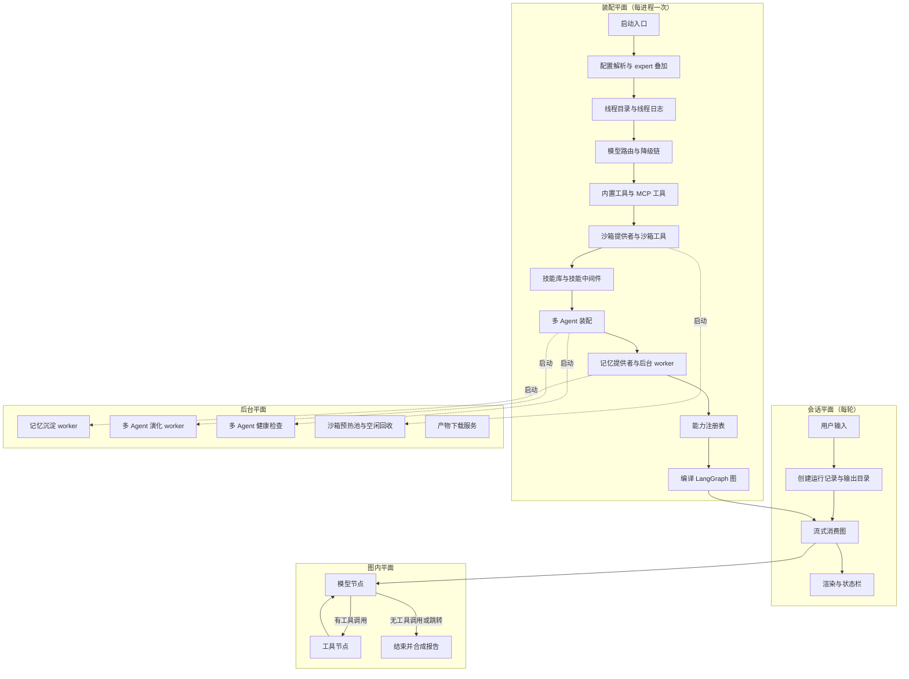

# Poirot 仓库架构导航

> 适用路径：`/home/fishandrice/Backend/poirot`
>
> 最后核对：2026-10-27，`master` 分支 `86bf279`。仓库形态是 Python 3.12+ 包（`pyproject.toml` + setuptools），没有前端构建链；`poirot/backend/` 下约 560 个 `.py`、6.9 万行（含 221 个 pytest 文件），文档是根目录 `README.md` + `USAGE.md` + `resource/USAGE.{zh-CN,ja}.md`。
>
> 研究时只读：`pip install -e .`、`poirot`、`poirot run …`、`pytest` 都会写 `.poirot/` 或 `skills/`，并且会联网调用模型 / 拉起 Docker，不在源码目录里执行。
>
> 仓库里**没有** `design_docs/`、`openspec/`、`skills/`、`.poirot/`（都被 `.gitignore` 排除），但源码注释大量引用 `design_docs/53-…` 这类编号文档。设计原委只能从代码与 docstring 里的转述反推。

## 一句话模型

Poirot 是「**一个 Leader ReAct 图 + 一长串横切中间件**」的单进程研究 Agent：LangGraph 的 `create_agent` 把模型节点和工具节点编译成循环图，记忆召回、技能注入、沙箱生命周期、MCP 审计、多 Agent 委派、上下文治理全部作为 `AgentMiddleware` 挂在图上，而不是写进 Agent 循环；外圈 `AppRuntime` 只做一次性装配（模型路由、工具、SQLite、后台线程），CLI / TUI / 单次运行都只是它的消费者。

持久化分三层，互不替代：进程内 checkpointer（thread 的对话状态，进程退出即丢）、`.poirot/` 文件目录（journal、外化文本、报告、记忆 Markdown）、各模块自己的 SQLite（技能库、多 Agent 指标）。

各能力默认值**很不一致**，读代码前先确认开关：记忆 / 沙箱 / MCP / 技能默认关闭，多 Agent 默认开启；`poirot` 进 default 模式，`poirot run "问题"` 进 expert 模式。

## 新会话建议阅读顺序

1. 先读本文「运行平面」与「主调用链」，建立「装配一次、每轮跑图」的模型。
2. 进 `poirot/backend/app/bootstrap.py` 的 `bootstrap_runtime`：它是唯一的装配点，谁被装上、按什么顺序装，全在这一个函数里。
3. 进 `poirot/backend/agents/leader/factory.py` 的 `make_lead_agent`：它是唯一的图定义点，`create_agent(...)` 的参数（模型、工具、中间件、状态 schema、checkpointer）决定图的行为。
4. 读 `poirot/backend/agents/state/types.py` + `reducers.py`：图上流动的所有字段和合并规则。
5. 再按「问题到目录」进具体模块，回到源码确认行为。
6. 不要从 README 的模块清单直接下结论：README 与代码有若干偏差，见文末「容易走错的地方」。

## 顶层目录职责

| 路径 | 职责 |
|---|---|
| `poirot/backend/app/bootstrap.py` | 装配总入口 `bootstrap_runtime`；`AppRuntime` 数据类（config/registry/run_manager/leader_agent/各 manager）+ 运行时重建（切模式、切模型、重载 MCP） |
| `poirot/backend/app/cli/` | 默认 TUI 之外的滚动 CLI：参数解析、`/` 命令注册表与补全、流式渲染、首启配置向导、状态栏 |
| `poirot/backend/app/tui/` | Textual 全屏 TUI（默认启动方式）：欢迎态/对话态、侧栏、MCP 面板、设置页、命令面板、帮助请求弹窗 |
| `poirot/backend/app/services/` | `PoirotStreamClient`：把 LangGraph 的双模式流翻译成前端事件（thinking/answer/tool/budget/sandbox/done…）；`app/gateway/`、`app/schemas/` 目前是空包 |
| `poirot/backend/agents/leader/` | Leader Agent：`make_lead_agent` 装配图，`LeaderAgent.run` 跑一次非流式问答，`prompts.py` 拼系统提示词 |
| `poirot/backend/agents/middlewares/` | 20+ 个横切中间件：上下文标签化、注入、沙箱、工具账本、todo、反思、报告、停滞检测等 |
| `poirot/backend/agents/context_engineering/` | 上下文治理：策略注册表、`StrategyMiddleware` 适配器、`DefaultStrategy`（P1–P5 分段舍弃） |
| `poirot/backend/agents/memory/` | 五层长期记忆：schema / 策略（衰减、遗忘）/ Markdown store + BM25 / 后台沉淀 worker |
| `poirot/backend/agents/skill/` | 三层技能：SQLite 存储与版本 DAG、选择与注入、自进化、评测、Hub 安装；`builtin_skills/` 是随包技能正文 |
| `poirot/backend/agents/multiagent/` | 多 Agent：specialist 委派（pi/codex/claude）、自身副本子 Agent、编排中间件、L2 演化、L3 评测、指标库、给 specialist 用的 MCP 沙箱桥 |
| `poirot/backend/agents/sandbox/` | 沙箱三组件（运行时 / 路径翻译 / 安全守卫）+ Local / Docker 两套 provider + 工具包装 + 产物 HTTP 服务 |
| `poirot/backend/agents/mcp/` | MCP 管理：YAML 配置、连接生命周期、工具注册表与熔断、环境变量过滤与描述扫描、凭证脱敏审计 |
| `poirot/backend/agents/state/` | `ThreadState` 定义、字段合并 reducer、初始状态 |
| `poirot/backend/agents/runtime/` + `journal/` | 一次运行的生命周期（run 记录、输出目录）与结构化事件日志 |
| `poirot/backend/agents/reporting/` | 报告合成：`MarkdownReporter`（三级兜底）、从 thread 状态合成报告 |
| `poirot/backend/agents/observability/` | 停滞信号、活动跟踪、求助时的情境报告 |
| `poirot/backend/agents/config/` | 配置层：默认配置 + expert 叠加层、provider 路由与降级链、能力注册表 |
| `poirot/backend/agents/prompts/` | `PromptManager` + `system/` 下的分段 Markdown（identity/constraints/mode/reflection/todo/reporter…） |
| `poirot/backend/tests/v1/` | 单元测试（按模块分目录）+ 集成测试（CLI、会话、最小循环、MCP 加载、治理 e2e）；`_fake_model.py` 是假模型 |
| `Dockerfile`、`docker-compose.yml` | 镜像内装 Python 3.12 + Node 20（MCP stdio 与 pi specialist）；默认 Local 沙箱，挂载 `.poirot/` 与 `skills/` |

## 运行平面



四个平面的关系是单向的：装配平面产出图；会话平面驱动图；图内中间件在 hook 里读写状态并可能触发后台任务；后台平面只通过 SQLite / 文件 / 共享对象回写，不反过来改图。

## 主调用链

### 装配：`bootstrap_runtime`

```text
poirot（console script）→ app/cli/main.py::main
  → setup_wizard.ensure_config        # 无 .env 且环境变量里没有 provider key 时走交互向导
  → bootstrap_runtime(expert_mode, provider, model, cli_overrides)
```

`bootstrap_runtime` 内部顺序固定，前一步的产物是后一步的输入：

1. **配置**：`load_config` 从内置 `DEFAULT_CONFIG` 出发，expert 模式再深合并 `EXPERT_PROFILE`；随后把 `logs_root`、外化目录、记忆目录等相对路径锚到项目根。
2. **线程**：生成 `thread-<时间戳>-<随机>`，建 `.poirot/logs/threads/<thread_id>/`，写线程级 `thread-events.jsonl`（后续 LLM、MCP、技能、Agent 装配事件都进这里）。
3. **模型**：不带 `--provider` 时 `ModelRouter` 按角色（researcher / reporter）构造降级链，DeepSeek 固定压链尾；带 `--provider` 时只构造单 provider，reporter 复用 researcher。
4. **工具**：先注册内置工具（联网搜索、快照读取、技能检索、求助；按 core/deferred 分组，求助属 deferred），再判断 `npx` 是否存在——存在才尝试加载 MCP，失败只记事件不阻塞。
5. **沙箱**：仅当 `POIROT_SANDBOX_USE` 有值才反射加载 provider；同时构造沙箱工具、启动产物 HTTP 服务、注册退出时释放容器。
6. **技能**：`build_skill_manager` 读环境变量，关闭或无扫描目录就直接返回空；开启则扫描用户目录 + 随包核心技能，建 SQLite 库、选择器与两个注入/打点中间件，可再叠加演化层与评测层。
7. **多 Agent**：默认开启；逐个反射加载 specialist，凭证缺失就跳过并给出安装提示；同时构造编排中间件、可选的 L2 演化与 L3 评测，并启动各自的守护线程。
8. **记忆**：先把配置同步到全局单例，再懒加载 provider（Markdown + BM25），最后启动沉淀 worker 并注册 `atexit` 关闭。
9. **注册表与图**：把模型、工具、报告器、产物库、沙箱、技能库、specialist、子 Agent、记忆提供者塞进能力注册表，交给 `make_lead_agent` 编译图。

装配失败是分级的：MCP、技能、多 Agent 的单点失败都只写 journal，主流程继续；模型、配置、图编译失败才抛异常。

### 一次问答（TUI / CLI 流式）

```text
用户输入
  → 意图树先判一次（如“出报告”这类命中就不进图）
  → run_manager.create_run         # 建 run_id、输出目录、run 级 events.jsonl、record.json
  → mark_running
  → PoirotStreamClient.stream(question)
      → graph.astream(stream_mode=["values", "messages", "custom"])
      → messages 模式产出 token 增量与工具事件
      → values 模式产出上下文预算快照与沙箱状态
      → custom 模式产出压缩、沙箱获取等事件
  → 渲染器 / TUI 消费事件
  → mark_success 或 mark_failed
```

`LeaderAgent.run` 是同一件事的非流式版本：`asyncio.run(graph.ainvoke(...))` 后取最终状态。expert 模式优先用报告中间件写回的 `final_report` 字段，缺失时再让报告器合成；default 模式只取最后一条 AI 消息，不落报告文件，需要用户用 `/report` 显式触发。

### 图内循环

图由 `create_agent(model, tools, middleware=[...], system_prompt=..., state_schema=ThreadState, checkpointer=...)` 编译，本质是「模型节点 ↔ 工具节点」循环，直到模型不再发起工具调用。中间件在这些节点周围按 hook 切开：

- `before_agent` / `after_agent`：整轮开始与结束（治理初始化、报告合成、标题、沙箱释放）。
- `before_model` / `after_model`：每次模型调用前后（上下文标签化、记忆召回、技能注入、预算追踪、todo 提醒、反思与停滞判定、dispose 工具调用）。
- `wrap_model_call`：改写真正发给模型的请求（消息归一、标签化上下文、策略层请求覆盖）。
- `wrap_tool_call`：包住工具执行（沙箱获取、审计与熔断、结果外化、证据沉淀、工具账本、多 Agent 打点）。

想强制模型「不许退出」或「立刻收尾」，中间件会返回 `jump_to="model"` 或 `Command(goto=END)`，而不是改循环代码。

### 三条「运行时重建」路径

`AppRuntime` 是不可变语义的，切换都返回新实例：

| 触发 | 重建什么 | 保留什么 |
|---|---|---|
| `/expert`、`/default` | 配置 + 运行管理器 + 整张图（参数化的中间件与提示词） | 线程目录、线程日志、能力注册表、checkpointer 里的 thread 状态 |
| `/model <provider> [model]` | 单 provider 模型 + 新能力注册表 + 新图（不再有降级链） | 同上，外加 MCP / 技能 / 沙箱实例 |
| `/mcp reload` | 只重建图，把新加载的 MCP 工具带进去 | 其余全部 |

三条路径都靠「同一 checkpointer 单例 + 同一 thread_id」让对话状态跨重建延续；checkpointer 是进程内内存实现，所以跨进程并不延续。

## 中间件链（挂载顺序即外层到内层）

`_build_middlewares` 里按固定顺序拼装；括号内是开关条件。

| # | 中间件 | 主要 hook | 行为 |
|---|---|---|---|
| 1 | 标签化上下文 | `wrap_model_call` / `after_model` | 把系统提示、目标、计划、反思、摘要、日期渲染成扁平 XML 标签块；消息按轮次分组；`after_model` 写一份渲染快照供审计 |
| 2 | 消息归一 | `wrap_model_call` | 把多条系统消息合并成一条前导消息，适配严格后端 |
| 3 | 治理策略适配器 | 6 个 hook | 把 hook 转成治理上下文交给策略 bundle（默认策略见下节） |
| 4 | 系统上下文 | `before_model` | 注入时区与 Agent 身份元数据 |
| 5 | 技能注入 | `before_model` | 选出本轮技能，注入系统消息，记录“被选中”，写 provenance |
| 6 | 技能打点 | `wrap_tool_call` / `after_agent` | 命中技能允许的工具就算“应用”，轮末归因完成 / 回落 |
| 7 | 技能建议 | `before_model` | 关键词匹配候选技能，写建议字段（不强制） |
| 8 | 标题 | `after_agent` | 用研究问题截断成标题 |
| 9 | 运行日志 | 全 hook | 把 agent/model/tool 生命周期写进 `events.jsonl` |
| 10 | MCP 审计 | `wrap_tool_call` | 全工具统一熔断、审计、错误凭证脱敏、外化标记 |
| 11 | 沙箱 | `before_model` / `wrap_tool_call` / `after_agent` | 首次用到沙箱工具才获取；从状态恢复 `sandbox_id`（子 Agent 复用父沙箱）；`present_files` 后复制产物并注册下载 |
| 12 | 记忆召回 | `before_model` / `after_model` | 检索并注入一条隐藏的用户消息；设置/清除轮次标识 |
| 13 | 记忆沉淀 | `after_model` | 每 N 个用户轮次把任务丢进后台队列，立即返回 |
| 14 | 求助 | `wrap_tool_call` | 拦截求助工具，格式化问题并 `goto=END` 暂停 |
| 15 | 悬空工具补全 | `before_model` | 为没有结果的工具调用补 error 结果，避免恢复时 400 |
| 16 | 工具账本 | `wrap_tool_call` | 成败都记账、失败分类、失败摘要递进注入；预算当前被放宽到 999 |
| 17 | 多 Agent 编排 | `wrap_tool_call` | 拦 `delegate_to_*`，写指标与产物，失败转错误工具消息 |
| 18 | 证据沉淀 | `wrap_tool_call` | 白名单证据类工具的结果旁路写进 observations/sources |
| 19 | 停滞检测 | `after_model` / `wrap_tool_call` | 连续失败、错误复现、待办停滞 → 暂停图等用户介入 |
| 20 | 待办清单 | `before_model` / `after_model` | 上下文丢失检测、完成度强制（仅 expert）、双阈值催办 |
| 21 | 反思 | `after_model` | 模型想退出时判断证据是否充分；expert 用 LLM 充分性策略，default 恒放行 |
| 22 | 报告 | `after_agent` | expert 模式单独调一次模型合成结构化报告 |

全部开关打开时最多 22 层（README 说 21）。`LoopDetectionMiddleware` 代码与测试都在，但已被注释掉、不再挂载；`SummarizationMiddleware` 是 no-op 且没有挂载。

## 上下文治理（DefaultStrategy）

治理层把「当前上下文占模型窗口的比例」当一等运行时指标：分母是每次调用时解析出的**真实窗口**（穿透降级链取活跃 provider 的模型名，再查表，未知时回落 128k），不是配置里的固定值。

| 阈值 | 阶段 | 行为 |
|---|---|---|
| 0.40 | P1 外化历史 | 按 FIFO 把旧的、超过字符阈值的工具结果写到磁盘，消息里换成正文件预览 + 路径；最近 2 轮整轮豁免，更早的轮次每轮只保留最新 1 条、其余可外化；执行后把下次触发点推高 0.10 作为间隔抑制 |
| 0.50 | P2 推理标记 | 预算层会置这个待办标记，但没有消费者；推理内容的打标实际在每次 `after_model` 无条件执行 |
| 0.60 | P3 观察裁剪 | 只设置一个上限标记，当前没有消费方（实际 no-op） |
| 0.80 | P4 摘要 | 先给当前状态拍快照，把较早消息（默认保留最近 6 条）交给摘要模型，失败时写“压缩失败，保留最近对话”；用“删除全部 + 摘要 + 保留段”整体替换消息 |
| 0.90 / 0.99 | P5 收尾 | 剥掉最后一条 AI 消息的工具调用（复用原 id 替换，保持配对），注入隐藏的“停止调用工具”提示，并跳回模型节点；只触发一次 |

`wrap_tool_call` 里还有一条**逐条外化**路径：任何工具结果超过阈值（有 MCP 元数据时按典型 token 数放大阈值）就立刻外化。摘要与外化都会先修一次工具调用配对，避免严格后端 400。

治理状态放在 `governance.<策略名>.*` 命名空间里，随 checkpointer 持久化；每次运行开始时初始化，结束时清掉预算与待办标记。

## 长期记忆（五层）

| 层 | 位置 | 机制 |
|---|---|---|
| L1 契约 | `memory/schema.py`、`memory_manager.py`、`memory_store.py`、`retriever.py` | 冻结的记忆痕迹（内容、类型、强度、访问次数、关联、操作日志等）+ 三类记忆（情景/语义/程序）+ 四个原子操作；**工具层不含 LLM**，合并文本由外部传入 |
| L2 策略 | `strategies/default/{decay,forget,manager}.py` | 艾宾浩斯衰减：基准强度 × 衰减率^小时 + log(1+访问次数)×0.1 + 重要性×0.05，惰性计算；遗忘用 TTL + 强度双规则；编码 id 取内容哈希，天然去重 |
| L3 存储与检索 | `strategies/default/{store,retriever}.py` | 单文件 `traces.md` 作真相源，`<!-- trace: id -->` 分隔 + YAML frontmatter，内存索引可重建；检索是纯 BM25 复合分数（相似度 0.7 + 强度 0.3），命中后回写强化，检索时过滤已遗忘项；store 的增删改被装饰器包装，增量同步索引 |
| L4 注入 | `middlewares/memory_recall_middleware.py` | 每次模型调用前检索，注入一条 `hide_from_ui` 的用户消息（刻意不写系统提示，保护提示缓存前缀），按 token 预算截断；状态里只留 id/分数/强度 |
| L5 沉淀 | `middlewares/memory_consolidation_middleware.py` + `memory/worker.py` | 每次模型回复后统计“人类消息条数”（含召回注入的隐藏消息），是 N 的倍数就非阻塞提交最近 2N 条消息；守护线程用 LLM 抽取记忆条目 → 按内容哈希去重编码；当未遗忘情景记忆总数达阈值时，取最旧 10 条让 LLM 合并成一条语义记忆；任何失败只记日志、不重试，进程退出时队列里未处理的任务丢弃 |

召回与沉淀的挂载位置在沙箱之后、求助与工具配对之前，理由是记忆可能引用沙箱产物但不该进工具配对。轮次标识通过 ContextVar 传给记忆管理器，用来标注操作来源。

## 技能（三层 + Hub）

技能是**过程知识包**（Markdown 提示），不是可执行函数；工具才是执行能力。

| 层 | 位置 | 机制 |
|---|---|---|
| L1 基础 | `skill/store.py`、`selector.py`、`injector.py` | SQLite（WAL）存索引与四个计数器，正文仍是 `SKILL.md` 文件（内容/索引分离）；每个名字只有一个 active 指针，回滚只切指针；版本 DAG 记父子关系；选择器先做质量过滤（样本够多且有效率低才淘汰），候选超上限时让 LLM 选，失败回落按有效率排序；用户显式指定的技能强制入选 |
| L2 演化 | `skill/evolution/` | 指标监控 + 捕获两类触发；聚焦器把失败分成“根本性/实现性”；变异器让 LLM 产出有行数预算的新版本；分数增量门控决定接受；Git 棘轮在退化时回滚 |
| L3 评测 | `skill/eval/` | 三层：执行判定（技能是否被应用、是否偏离）、任务质量（四维加权 0.50/0.35/0.05/0.10）、响应契约（从候选技能文本编译规则，硬失败短路）；趋势跟踪把前后窗口的“应用率差”判成改善/退化/稳定，退化信号回流 L2 |
| Hub | `skill/hub/` | 四个来源（内置、GitHub、well-known、Claude 市场）+ 安装/卸载/更新；安装前扫描提示注入、敏感路径、可疑 URL，记录 provenance 与审计日志；可疑内容进隔离区 |

启动时只自动发现 `core/` 下的核心技能；其余分类（研究、软件开发、创意、效率，共 37 个 `SKILL.md`）留在文件系统里，靠 `/skill search` 或技能检索工具按需安装使用。

## 多 Agent

两类委派共用 `delegate_to_<name>(goal, success_criteria, sandbox_id?)` 这一层薄工具，工具内部固定四步：压缩上下文 → 调 specialist → 压缩结果 → 返回 JSON。

**外部 specialist（pi / codex / claude）**：各自是一个独立 CLI 进程，自带模型与自己的 ReAct 循环；Poirot 只传目标、成功标准与上下文摘要。凭证缺失或 CLI 未安装时该 specialist 直接不注册，并在日志里给出安装指引。它们的沙箱不另建：Poirot 起一个 stdio MCP 服务，把 8 个沙箱接口（命令、读写、列目录、替换、glob、grep、下载）暴露给 specialist，`sandbox_id` 通过命令行参数传入，因此三方操作的是同一挂载目录。

**自身副本子 Agent**：在进程内复用 lead agent 工厂，但角色是叶子——看不到委派工具，也不再挂编排中间件，因此不会递归 spawn；上下文是全新的（只带目标与摘要），沙箱却复用父级 id（沙箱中间件从状态里恢复 ContextVar）。

**L2 演化**（默认关）：四类触发（周期、失败聚焦、specialist 降级、成本/时延告警）→ 单线程队列串行消费 → 指标视图 → 失败聚焦 → 变异 → 晋升门控（候选与基线各跑抽样任务，用 Wilson 置信区间比较，命中历史版本哈希则直接拒绝）→ 版本 DAG。日预算守卫在工具调用前检查 token/成本/次数。

**L3 评测**（默认关）：三类适配器（程序化、纵向配对、LLM 评判）+ 编排桥 + 运行时趋势跟踪 + 决策日志；退化时向 L2 队列投递演化请求，而不是直接改版本。

## 沙箱与路径

沙箱不是一个大类，而是**运行时 + 路径翻译 + 安全守卫**的组合体，`Sandbox` 只负责编排「校验 → 翻译 → 执行 → 反向遮蔽」。

- **Local**：本机进程执行，按 `(用户, 线程)` 的哈希取确定性 id，LRU 缓存 256 个；可选禁止宿主机 bash。
- **Docker**：宿主起容器（all-in-one 镜像，容器内 HTTP 运行时），三层缓存（进程内 → 预热池 → 跨进程发现）；释放只回预热池不销毁；空闲超时回收；并发实例用文件锁协调；WSL2 下把 Windows 路径翻译成 `/mnt/<盘>/…`。
- **写保护**：写文件与 bash 重定向目标必须落在 `/mnt/poirot/user-data/` 挂载区内，否则拒绝——目的是让产物落到持久卷，而不是随 `--rm` 丢在容器内。
- **产物**：`present_files` 之后，把虚拟路径解析成宿主路径、复制到 `.poirot/outputs/`、注册到本地下载服务（默认 18080 起自动避让端口），并把下载链接追加到工具结果。

沙箱工具在第一次被调用时才获取沙箱（懒初始化），获取到的 id 写入状态，后续轮次与子 Agent 都从这里恢复。

## MCP

MCP 走配置文件（默认 `.poirot/mcp_servers.yaml`，支持 `${VAR}` 插值），三种传输：stdio / sse / http。加载流程是：环境变量过滤 → 连接 → 发现工具 → 描述扫描 → 注册。注册表按 `builtin > mcp > sandbox` 的优先级去重，工具分 core / deferred / sandbox 三组，可为同名工具配降级链；每个工具一个熔断器（连续 3 次失败打开，60 秒后放半开探针）。审计中间件对**所有**工具统一记录、脱敏错误信息，并把工具的典型输出 token 数交给外化层调阈值。

启动时只 eager 加载核心工具，其余按需；`/mcp reload` 会重建图把新工具带进去。

## 状态、持久化与产物边界

`ThreadState` 继承 LangGraph 的 `AgentState`（消息用追加 reducer），其余字段各自有合并规则：观察、来源、引用、产物、错误、待办、治理、沙箱、编排、记忆召回/更新等。冻结值对象（观察、来源、引用、产物、反思项、错误）散在 `state/types.py` 里。

| 位置 | 内容 |
|---|---|
| `.poirot/logs/threads/<thread_id>/thread-events.jsonl` | 线程级事件：LLM 构造、工具加载、MCP/技能/多 Agent 装配、模式切换 |
| `.poirot/logs/threads/<thread_id>/runs/<run_id>/events.jsonl` | 运行级事件：模型/工具生命周期、压缩、预算、技能选择等 |
| `…/runs/<run_id>/record.json` | 运行记录（状态、起止时间、token、错误） |
| `…/runs/<run_id>/artifacts/final_report.md` | expert 模式最终报告 |
| `…/runs/<run_id>/compaction.jsonl` | 治理压缩的全流程 trace（路径在代码里写死为相对当前目录的 `.poirot/logs/...`，不走 `logs_root` 配置） |
| `.poirot/externalized/` | 被外化的工具结果原文 |
| `.poirot/snapshots/` | 压缩前状态快照 |
| `.poirot/memory/traces.md` | 长期记忆真相源 |
| `.poirot/skills.db` | 技能索引、版本、计数、评测、演化记录 |
| `.poirot/multiagent.db` | specialist 选择/调用/完成/回落计数与决策日志 |
| `.poirot/outputs/` | `present_files` 复制出的用户产物 |
| `.poirot/sandbox/{local,aio_docker}/<sandbox_id>/` | 沙箱工作区（宿主侧挂载源） |
| `.poirot/mcp_servers.yaml` | MCP 配置（TUI 面板写回） |

进程内状态只有三类：`RunManager` 的运行记录与上下文（只增不删）、`CapabilityRegistry`（冻结，重建时替换）、checkpointer 单例里的 thread 状态。后台线程各有自己的队列与状态（记忆 worker、L2 worker、L3 健康检查、Docker 空闲检查），彼此不共享状态。

## 问题到目录

| 想研究的问题 | 首先看 |
|---|---|
| 启动装配顺序、谁被装上 | `poirot/backend/app/bootstrap.py`（`bootstrap_runtime`） |
| 图的定义、工具与中间件怎么挂 | `poirot/backend/agents/leader/factory.py`（`make_lead_agent`、`_build_middlewares`） |
| 非流式运行与最终报告取值 | `poirot/backend/agents/leader/agent.py`（`LeaderAgent.run`） |
| 流式事件协议 | `poirot/backend/app/services/stream_service.py` |
| 系统提示词分层 | `poirot/backend/agents/leader/prompts.py`、`agents/prompts/system/leader/*.md` |
| 默认 / expert 差异 | `agents/config/defaults.py`、`agents/prompts/system/leader/mode_expert.md`、`factory._build_middlewares` |
| 状态字段与合并规则 | `agents/state/types.py`、`agents/state/reducers.py` |
| 上下文预算、外化、摘要 | `agents/context_engineering/strategies/default/`、`strategy_middleware.py` |
| 窗口大小怎么解析 | `agents/context_engineering/utilities.py` |
| 记忆编码/衰减/遗忘 | `agents/memory/strategies/default/{manager,decay,forget}.py` |
| 记忆落盘格式与检索 | `agents/memory/strategies/default/{store,retriever}.py` |
| 记忆注入与沉淀时机 | `agents/middlewares/memory_recall_middleware.py`、`memory_consolidation_middleware.py`、`agents/memory/worker.py` |
| 技能库 schema 与版本 | `agents/skill/store.py`、`agents/skill/types.py` |
| 技能怎么被选中/注入/打点 | `agents/skill/selector.py`、`injector.py`、`middlewares/skill_*` |
| 技能自进化闭环 | `agents/skill/evolution/manager.py` 及各子目录 |
| 技能评测与退化检测 | `agents/skill/eval/runtime_tracker.py`、`analyzers/` |
| 技能安装与安全扫描 | `agents/skill/hub/installer.py`、`hub_store.py`、`sources/` |
| specialist 怎么被调用 | `agents/multiagent/tools.py`、`runtimes/*`、`specialists/*` |
| specialist 与沙箱怎么共享 | `agents/multiagent/mcp/specialist_mcp_server.py` |
| 自身副本子 Agent | `agents/multiagent/runtimes/subagent_runtime.py`、`middlewares/sandbox_middleware.py` |
| 多 Agent 指标与编排打点 | `agents/multiagent/metrics.py`、`middleware.py` |
| 多 Agent 演化（L2） | `agents/multiagent/evolution/{trigger_manager,worker,evolution_mutator,promotion_gate,version_dag,budget_guard}.py` |
| 多 Agent 评测（L3） | `agents/multiagent/eval/{bootstrap,registry,bridge,runtime_tracker}.py`、`adapters/` |
| 沙箱编排与路径翻译 | `agents/sandbox/sandbox.py`、`translators/`、`guards/` |
| Local / Docker 提供者 | `agents/sandbox/{local,docker}/`、`runtimes/` |
| 沙箱工具与产物导出 | `agents/sandbox/integration/tools.py`、`middlewares/sandbox_middleware.py`、`agents/artifacts/server.py` |
| MCP 配置、加载、熔断 | `agents/mcp/{config,loader,registry,health}.py` |
| MCP 安全守卫与审计 | `agents/mcp/guards/`、`agents/mcp/audit.py` |
| 工具账本与失败分类 | `agents/middlewares/tool_call_middleware.py` |
| 待办 / 反思 / 报告 / 停滞 | `agents/middlewares/{todo,reflection,report,stall_detection}_middleware.py`、`agents/observability/` |
| CLI 命令与热切换 | `app/cli/commands.py`、`app/cli/main.py`、`app/bootstrap.py` 的三个 `switch_*`/`reload_*` |
| TUI 布局与设置 | `app/tui/app.py`、`settings_screen.py`、`mcp_panel.py` |
| 模型路由与降级 | `agents/config/model_router.py`、`fallback_model.py`、`provider_config.py` |
| 报告结合 thread 历史 | `agents/reporting/thread_report.py`、`markdown_reporter.py` |
| 配置项全集 | `.env.example`、`agents/config/loader.py`，以及各模块自己的 `config.py`（memory / skill / mcp / multiagent / sandbox） |
| 测试怎么造场景 | `tests/v1/_fake_model.py`、`tests/v1/integration/test_minimum_agent_loop.py` |

## 源码锚点

| 路径 | 入口 |
|---|---|
| `poirot/backend/app/cli/main.py` | `main`、`run_chat`、`_run_chat_async`、`_build_stream_config` |
| `poirot/backend/app/bootstrap.py` | `bootstrap_runtime`、`AppRuntime.run_question`、`switch_expert_mode`、`switch_model`、`reload_mcp_tools`、`_load_sandbox_provider`、`_load_memory_provider` |
| `poirot/backend/app/services/stream_service.py` | `PoirotStreamClient.stream`、事件归一化 |
| `poirot/backend/app/tui/app.py` | `PoirotTUI`、`_run_research`、命令与面板处理 |
| `poirot/backend/app/cli/commands.py` | `_cmd_*`、模块级 `_registry` 注册 |
| `poirot/backend/agents/leader/factory.py` | `make_lead_agent`、`_build_middlewares` |
| `poirot/backend/agents/leader/agent.py` | `LeaderAgent.run`、`_resolve_actual_model_name` |
| `poirot/backend/agents/leader/prompts.py` | `apply_prompt_template`、`_build_specialist_routing_section` |
| `poirot/backend/agents/state/types.py` | `ThreadState`、值对象 |
| `poirot/backend/agents/context_engineering/strategy_middleware.py` | `StrategyMiddleware`（hook → 策略适配） |
| `poirot/backend/agents/context_engineering/strategies/default/strategy.py` | `DefaultStrategy.before_model` / `after_model` / `wrap_tool_call` |
| `poirot/backend/agents/context_engineering/strategies/default/{externalizer,summarizer,budget}.py` | 外化、摘要、预算与阶段标记 |
| `poirot/backend/agents/context_engineering/utilities.py` | `token_counter`、`resolve_window_size` |
| `poirot/backend/agents/memory/strategies/default/manager.py` | `DefaultMemoryManager` 四操作、`set_turn_id` |
| `poirot/backend/agents/memory/strategies/default/store.py` | `MarkdownFileStore`、分隔符解析 |
| `poirot/backend/agents/memory/strategies/default/retriever.py` | `HybridRetriever.retrieve`（BM25 + 强化写回） |
| `poirot/backend/agents/memory/worker.py` | `MemoryWorker._process`、抽取与合并提示 |
| `poirot/backend/agents/memory/bootstrap.py` | `get_memory_provider`、`start_memory_worker`、`_wrap_store` |
| `poirot/backend/agents/middlewares/memory_recall_middleware.py` | `MemoryMiddleware.abefore_model` |
| `poirot/backend/agents/middlewares/memory_consolidation_middleware.py` | `MemoryConsolidationMiddleware.aafter_model` |
| `poirot/backend/agents/skill/__init__.py` | `SkillManager.load_startup`、`build_skill_manager` |
| `poirot/backend/agents/skill/store.py` | `SQLiteSkillStore`（schema 迁移、版本、计数、评测表） |
| `poirot/backend/agents/skill/selector.py` | `SkillSelector.select_for_task` |
| `poirot/backend/agents/skill/evolution/manager.py` | `EvolutionManager.run_cycle` |
| `poirot/backend/agents/skill/eval/runtime_tracker.py` | `RuntimeTracker.health_report`、`degraded_skills` |
| `poirot/backend/agents/multiagent/bootstrap.py` | `setup_multiagent`、`_load_specialist` |
| `poirot/backend/agents/multiagent/tools.py` | `make_specialist_tool`、`make_subagent_tool` |
| `poirot/backend/agents/multiagent/middleware.py` | `OrchestrationMiddleware` |
| `poirot/backend/agents/multiagent/mcp/specialist_mcp_server.py` | 8 个沙箱接口的 stdio MCP 服务入口 |
| `poirot/backend/agents/multiagent/evolution/bootstrap.py` | `setup_l2`、`L2Setup` |
| `poirot/backend/agents/multiagent/eval/bootstrap.py` | `setup_l3`、`L3Setup` |
| `poirot/backend/agents/sandbox/sandbox.py` | `Sandbox` 编排方法 |
| `poirot/backend/agents/sandbox/local/local_sandbox_provider.py` | `acquire`、LRU |
| `poirot/backend/agents/sandbox/docker/docker_sandbox_provider.py` | 三层缓存、预热池、空闲回收 |
| `poirot/backend/agents/sandbox/integration/tools.py` | `make_sandbox_tools` 与各工具包装 |
| `poirot/backend/agents/middlewares/sandbox_middleware.py` | 懒获取、ContextVar 恢复、产物注册 |
| `poirot/backend/agents/mcp/__init__.py` | `McpManager`、`build_mcp_manager` |
| `poirot/backend/agents/mcp/loader.py` | `load_startup`、单 server 连接与守卫应用 |
| `poirot/backend/agents/mcp/registry.py` | `ToolRegistry`（优先级、分组、降级链） |
| `poirot/backend/agents/middlewares/tool_call_middleware.py` | `wrap_tool_call` 账本与失败摘要 |
| `poirot/backend/agents/config/model_router.py` | `ModelRouter.build_model` / `build_single` |
| `poirot/backend/agents/runtime/run_manager.py` | `create_run`、`mark_*`、记录落盘 |
| `poirot/backend/agents/journal/run_journal.py` | `RunJournal.append` |
| `poirot/backend/agents/reporting/thread_report.py` | `generate_report_from_thread` |

## 容易走错的地方

- **默认值不统一**：记忆、沙箱、MCP、技能都要显式打开；多 Agent 反而是默认开的。Docker 镜像又用环境变量把记忆与多 Agent 默认打开。判断「某能力是否存在」要看开关与装配条件，不能看 README 的特性列表。
- **`poirot` 与 `poirot run` 的默认模式相反**：`poirot` 进 default（轻量对话），`poirot run "问题"` 的 `--expert` 默认是 True（`--no-expert` 才关）。同一份代码，两条入口的中间件参数、工具组、报告行为都不同。
- **工具分组过滤只对内置工具生效，且会"漏掉"求助工具**：`make_lead_agent` 先按 core/deferred 过滤内置工具，随后又把能力注册表里的**全部**工具补回去，所以 default 模式照样能看到 MCP 与沙箱工具。但求助工具属于 deferred，注册表里也没有它，结果只有 expert 模式才真正拥有求助工具（`ask_help`）；default 模式的求助中间件因此没有触发入口。
- **README 说的 21 层中间件是近似值**：全开关时最多 22 层，且层数随能力开关变化。`LoopDetectionMiddleware` 已经注释掉不挂载（代码与测试还在），`SummarizationMiddleware` 是空实现且未挂载。
- **`multiagent/config.py` 的 docstring 与代码相反**：docstring 写「enabled=false 默认（opt-in）」，实际 `MultiAgentConfig.enabled` 默认 True，`.env.example` 也是 true。
- **配置里的模型名是占位符**：`DEFAULT_CONFIG` 写 `fake-researcher` / `fake-reporter`，真实模型来自 `ModelRouter` 的降级链或 `--provider`；`config.models.*` 基本只作为标签。
- **`/model` 切换会拆掉降级链**：切到单 provider 后 reporter 复用 researcher，只剩一个模型；原来的多 provider 链要重启进程（或反向再切）才恢复。
- **checkpointer 是进程内的**：`InMemorySaver` 单例，`thread_id` 每次启动新生成，所以「跨模式保留对话」只在同一进程内成立；进程退出后 thread 状态不可恢复。想要跨进程续聊，需要换持久化 checkpointer 并固定 thread id。
- **记忆的「工具层无 LLM」是真约束**：编码、合并、再巩固都只接受外部传入的文本；LLM 调用只在中间件或后台 worker 里。
- **记忆的遗忘/关联/再巩固没有调用方**：`should_forget`、`associate`、`reconsolidate` 只有定义与测试，运行时链路是「后台抽取 → 内容哈希去重入库 → 最旧 10 条合并」加上「每次模型调用 BM25 召回」；记忆只增不减，且向量/图适配器只有协议定义。
- **技能注入走系统消息，记忆注入走用户消息**：记忆刻意用 `hide_from_ui` 的用户消息保护提示缓存；技能是 `before_model` 注入系统消息，缓存前缀会变——两者设计取舍不同，不要混为一谈。
- **压缩 trace 与快照路径绕过配置**：`DefaultStrategy._get_run_dir` 硬编码相对当前目录的 `.poirot/logs/threads/...`，快照目录默认也是 CWD 相对的 `.poirot/snapshots`（启动时只锚定了外化目录与记忆目录）。当 `logs_root` 或启动目录改变时，`events.jsonl` 与 `compaction.jsonl` 会分家。
- **`run_journal` 不是严格 JSONL**：每条事件用 `indent=2` 写入并在末尾加空行；按行解析需要跳过空行。
- **`agents` 声称不依赖 `app`，但有例外**：`sandbox_middleware` 懒加载了 `app/bootstrap.py` 的项目根常量。
- **设计文档不在仓库里**：`design_docs/`、`openspec/` 被 gitignore，但大量注释按编号引用它们；遇到「承接 53/54/46 文档」这类注释，只能从代码反推设计。
- **测试数字与 README 不同**：README 说 2400+ 测试、36 个内置技能；实际 pytest 文件 221 个，`builtin_skills/` 下 37 个 `SKILL.md`（core 12 / research 11 / software-development 8 / creative 4 / productivity 2）。
- **技能安装虽然分两条路，落点都是项目内 `skills/`**：本地路径走 `parser.install`；远程标识（`github:` / `well-known:` / `claude-marketplace:` / `builtin:`）走 Hub。Hub 的 `Installer` 自己默认写 `~/.poirot/skills`，但 `/skill install` 显式传了 `dest_root=Path("skills")`，所以两条路都写当前工作目录下的 `skills/`（CWD 相对，不是项目根锚定）。排查「装完找不到」时先看启动目录。
- **多 Agent 的 L2/L3 CLI 是骨架**：`multiagent/evolution/cli.py` 与 `eval/cli.py` 的动词直接抛 `NotImplementedError`，能力只能通过代码/中间件触发。
- **接口面比名字小**：`app/gateway/`、`app/schemas/` 是空包，没有 HTTP/API 服务；对外只有 CLI、TUI、stdio MCP 桥与本地产物下载服务。
