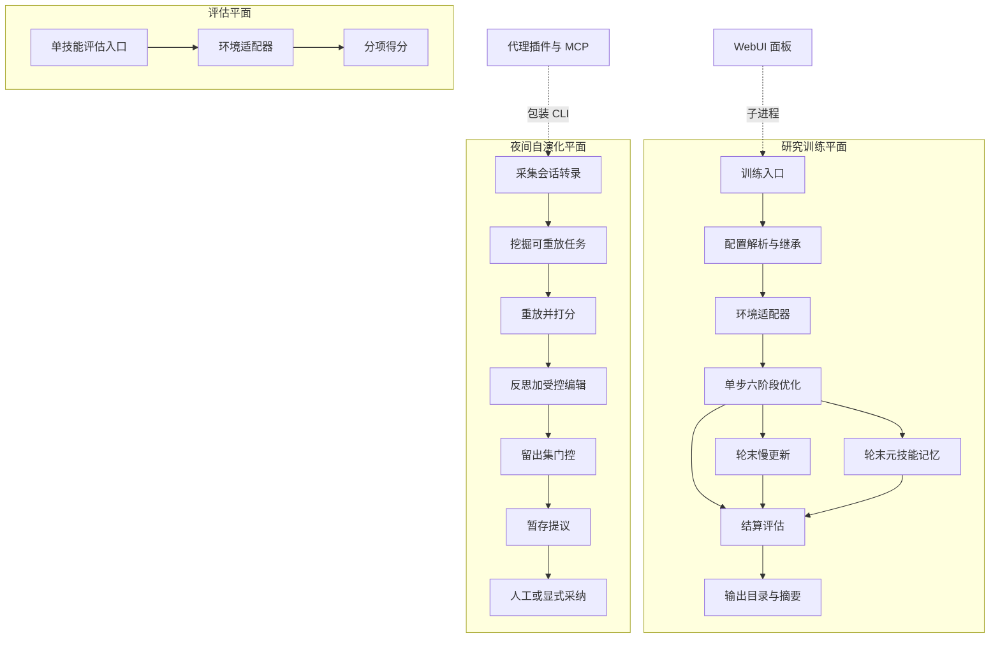

# SkillOpt 仓库架构导航

> 适用路径：`/home/fishandrice/Backend/SkillOpt`
>
> 最后核对：2026-10-27，`main` 分支 `e2edfa9`。仓库形态是 Python 包（`pyproject.toml`，Python ≥3.10），有 `docs/`（mkdocs）与 102 个 pytest 文件，没有 Node 构建链。
>
> 研究时只读：`pip install -e`、`pytest`、`scripts/train.py`、`scripts/eval_only.py`、`python -m skillopt_webui.app` 都会写盘或联网调用模型，不在源码目录里执行。

## 一句话模型

SkillOpt 把一份 Markdown「技能文档」当作可训练参数：目标模型照这份文档跑任务，优化器模型读轨迹产出有界编辑，编辑经过合并、排序裁剪、写回文档，再由留出集门控决定是否接受；`skillopt_sleep` 把这套「有界编辑 + 门控」搬到本地编码代理的夜间复盘上，`skillopt_webui` 只是训练过程的浏览器外壳。

它不是一个 Agent Harness，而是一个**离线优化器**：训练期大量调用模型，部署产物只有一份 `best_skill.md`。

## 新会话建议阅读顺序

1. 先读本文的「运行平面」与「单步六阶段」，建立"技能文档 = 权重、一次 step = 一次前向+反向+验证"的模型。
2. 查训练主循环进 `skillopt/engine/trainer.py`；它是最长、也是唯一的编排点（约 2500 行）。
3. 查某个阶段的行为，先看对应小模块（`gradient/`、`optimizer/`、`evaluation/`），再看 trainer 如何调用它们。
4. 查基准或数据形状进 `skillopt/envs/<name>/` 与 `skillopt/datasets/base.py`。
5. 查模型/供应商进 `skillopt/model/`；查夜间自演化进 `skillopt_sleep/`（它与 `skillopt/` 无代码依赖）。
6. 不要从 `index.html`、`docs/guideline.html`、`blog/` 开始——那是渲染后的静态页。

## 顶层目录职责

| 路径 | 职责 |
|---|---|
| `skillopt/` | 研究引擎：训练循环、基准环境、反思/合并/裁剪、门控、模型后端、配置 |
| `skillopt_sleep/` | 部署侧「夜间自演化」独立包：采集、挖掘、重放、门控合并、暂存与采纳 |
| `skillopt_webui/` | Gradio 面板：起 `train.py` 子进程、解析日志、展示产物 |
| `scripts/` | CLI 入口（`train.py`、`eval_only.py`）、SearchQA 物化、离线可复现性审计 |
| `configs/` | 结构化 YAML，通过 `_base_` 继承；`_base_/default.yaml` 是全部默认值 |
| `data/` | 六个基准的**轻量 split 清单**（只有 ID 或路径，不是可跑数据） |
| `ckpt/` | 论文 Table 1 的六个 GPT-5.5 技能产物；数据物化后可交给评估入口复现 |
| `plugins/` | 七个编码代理集成壳（Claude Code / Codex / Cursor / Copilot / Devin / DSH / OpenClaw）；前六个包装 `skillopt_sleep` 的 CLI 或 MCP，OpenClaw 是独立参考适配 |
| `tests/` | 单元测试 + fixture 驱动的 CLI/转录/暂存测试；部分 live 测试靠环境变量开关 |
| `docs/` | mkdocs 站；`guide/` 与 `reference/` 是方法的一手说明，但可能与 `main` 代码有版本差 |

## 运行平面



四个平面各自写自己的输出目录，只在设计上共享"有界编辑 + 留出集门控"：训练平面按 epoch/step 组织，夜间平面按"一晚"组织，评估平面不产生新技能。

## 单步六阶段

一个 step 的输入是当前技能文档，输出是"新的当前技能"与"是否接受"：

| 阶段 | 谁在做 | 关键行为 |
|---|---|---|
| ① 试跑 | 目标模型 + 基准环境 | 用当前技能跑一批任务，每个任务留下轨迹文件与 `hard`/`soft` 两个分数 |
| ② 反思 | 优化器模型 | 失败轨迹按小批分组，成功轨迹也参与（除非只反思失败）；每批产出至多 L 条编辑建议，多批并行 |
| ③ 合并 | 优化器模型 | 失败组合并、成功组合并、两者再合并；失败优先；按批大小做多级层次合并 |
| ④ 裁剪 | 优化器模型 + 调度器 | 按"每步最多改几处"的预算排序取前 L；预算由学习率调度器、或由模型自行决定 |
| ⑤ 写入 | 本地确定性代码 | 把编辑套用到文档；受保护区域只读；失败状态逐条记录 |
| ⑥ 门控 | 本地确定性代码 + 选择集 | 在留出选择集上评分，严格优于当前分数才接受；优于历史最好则同时更新"最好"快照 |

几个容易忽略的机制细节：

- **日志精确到阶段**：每个 step 目录分别保存合并结果、排序结果、候选文档、写入报告、选择集评估和一条 step 记录；token 记账也按阶段累计。
- **重复候选不重跑**：候选文档按内容哈希缓存选择集分数，回到同一份文档时直接命中。
- **没有编辑就跳过**：一个 step 若既无失败编辑也无成功编辑，直接记为 skip，不改动技能文档。
- **技能感知反思（可选）**：把失败分成"技能本身有缺陷"与"执行时没照做"两类，后者写入文档尾部的受保护附录区，不进入常规编辑。默认关闭。

## 主调用链

### 训练入口与配置

```text
scripts/train.py::main
  → parse_args                    # 大量 --cfg-options 之外的单键覆盖
  → load_config                   # YAML + _base_ 继承 + 覆盖合并 + 扁平化
  → 解析优化器/目标两个角色后端
  → get_adapter                   # 懒加载注册表，按 env 名实例化适配器
  → ReflACTTrainer(cfg, adapter).train()
```

配置有两条路径但只有一种运行形态：结构化 YAML 会先被**扁平化**成一层 dict 交给训练器与适配器，所以源码里看到的 `edit_budget`、`minibatch_size`、`env`（字符串）都是扁平后的名字，不是 YAML 里的 `optimizer.learning_rate`、`gradient.minibatch_size`、`env.name`。

训练池与步数在启动时一次算定：每 epoch 步数 = 训练集大小 ÷（批大小 × 累积轮数），向上取整；"批"由确定性种子定义，epoch 内只做种子洗牌，因此同一 seed 可复现。

### 单步之后的轮末

- **慢更新**：第 1 轮只在文档尾部注入空的慢更新占位区；第 2 轮起在同一批训练样本上分别跑"上一轮末技能"和"当前技能"，按"变好/变坏/持续失败/稳定成功"分类，让优化器写一段纵向指导，替换受保护的慢更新区。是否经过选择集门控由开关决定，默认**不门控**（直接注入当前技能，不改"最好"快照）。已完成的一轮会落盘标记，断点续训时跳过。
- **元技能记忆**：从第 2 轮末开始，比较相邻两轮末技能，写一份优化器侧的跨轮记忆；后续的反思、合并、排序、整篇改写、学习率决策都会把它作为上下文。它不修改目标技能文档。
- **结算评估**：最后对"最终技能"再跑一次选择集，若超过历史最好则提升为最好；然后对测试集（`valid_unseen`）分别评估初始技能、最好技能、最终技能，写入摘要。

### 评估入口

`scripts/eval_only.py` 只做"给定技能 → 跑一个 split → 出分"，不进入训练循环、不调优化器。split 名映射是固定的：`valid_seen` 是选择集（`val/`），`valid_unseen` 是测试集（`test/`）。

### 夜间自演化入口

```text
skillopt-sleep run | dry-run | status | adopt | harvest | schedule | evalkit
  → run_sleep_cycle
  → 采集（本地只读转录）→ 挖掘（规则或模型）→ 重放（目标后端）
  → 门控合并（反思 → 受控编辑 → 留出集评分）
  → 暂存（提案目录 + 报告 + 诊断 + 证据链）→ 可选自动采纳
```

它与研究引擎的关键差异：一次只训"一轮"，样本是用户自己的任务；编辑数量、token/时间预算、重放深度都可限；所有采纳走"暂存 + 显式选择"的失败即关闭路径；门控是**拷贝**进 `skillopt_sleep` 的，两处实现需人工保持同步。

后端是统一抽象：`mock`（零网络，测试与实验用）、`handoff`（把模型调用写成待答提示，由交互会话回答）、各 CLI 后端（Claude Code、Codex、Cursor、Copilot、Pi、OpenCode）以及 Azure 系接口。也可以把"试跑"和"反思/打分"拆到两个不同后端。

## 双角色模型层

整套机制依赖两个角色分离：

| 角色 | 做什么 | 可用后端 |
|---|---|---|
| 目标 | 在基准环境里执行任务，产生轨迹和分数 | 所有 chat 后端，以及 exec 后端（在临时工作区写技能文件并跑编码代理 CLI） |
| 优化器 | 只读轨迹与文档，产出编辑、合并结果、排序、整篇改写、慢更新指导、元记忆、学习率决策 | chat 类后端，外加 `codex_exec` / `claude_code_exec`（它们同样能返回文本）；`cursor_exec` / `copilot_exec` 不被接受 |

角色解析顺序：配置里显式写死的角色 > 高层 `--backend` 标签的映射（只覆盖仍停留在默认值的角色）> 默认 `openai_chat`。所以"选了 `claude_code_exec` 但优化器还是 `openai_chat`"是设计行为，不是漏配：只有目标需要产生 Claude Code 的轨迹。

## 状态与产物边界

输出根目录（`out_root`）是唯一持久状态，训练器本身不维护数据库：

| 位置 | 内容 |
|---|---|
| `config.json` | 解析后的运行时配置（密钥脱敏） |
| `best_skill.md` | 验证集最优技能，最终交付物 |
| `skills/skill_vNNNN.md` | 每一步的当前技能快照 |
| `history.json` | 逐步记录：分数、动作、时间、token、来源 |
| `runtime_state.json` | 续训指针：最后完成步、当前/最优技能路径与分数 |
| `steps/step_NNNN/` | 该步的全部中间产物与 `step_record.json` |
| `slow_update/epoch_NN/` | 纵向对照样本、配对结果、慢更新结果 |
| `meta_skill/epoch_NN/` | 优化器侧跨轮记忆 |
| `summary.json` | 结算摘要：三次测试得分、接受/拒绝/跳过计数、轮级统计 |

进程内状态只有四组：当前技能与分数、最好技能与分数及来源步、epoch 内的步骤缓冲区（失败模式 + 被拒编辑，作为后续反思的上下文）、候选哈希到选择集分数的缓存。

环境适配器另外有状态：数据加载器、小批反思参数（编辑预算、小批大小、并行度）都通过构造函数从扁平配置取值；`setup` 只做一次性初始化。

## 问题到目录

| 想研究的问题 | 首先看 |
|---|---|
| 训练脚本参数与配置合并 | `scripts/train.py`、`skillopt/config.py` |
| 单步六阶段编排 | `skillopt/engine/trainer.py` |
| 反思（小批分组、并行、提示词选择） | `skillopt/gradient/reflect.py` |
| 层次合并与失败优先 | `skillopt/gradient/aggregate.py` |
| 排序裁剪与预算回退 | `skillopt/optimizer/clip.py` |
| 学习率调度与自主预算 | `skillopt/optimizer/scheduler.py`、`lr_autonomous.py` |
| 编辑套用与受保护区域 | `skillopt/optimizer/skill.py`、`slow_update.py`、`appendix.py` |
| 整篇改写 / 整篇候选 | `skillopt/optimizer/rewrite.py`、`update_modes.py` |
| 门控判定与指标 | `skillopt/evaluation/gate.py` |
| 轮末纵向对照 | `skillopt/optimizer/slow_update.py` |
| 优化器跨轮记忆 | `skillopt/optimizer/meta_skill.py` |
| 角色后端与 CLI 路径解析 | `skillopt/model/backend_config.py`、`skillopt/model/__init__.py` |
| 编码代理执行外壳 | `skillopt/model/codex_harness.py` |
| 基准适配器契约 | `skillopt/envs/base.py`、`skillopt/datasets/base.py` |
| 某个具体基准 | `skillopt/envs/<name>/`，最简单参考是 `searchqa/` |
| 提示词分层与覆盖 | `skillopt/prompts/__init__.py`、`skillopt/prompts/*.md`、`skillopt/envs/<name>/prompts/` |
| 夜间循环编排 | `skillopt_sleep/cycle.py` |
| 会话采集（各来源） | `skillopt_sleep/harvest*.py` |
| 任务挖掘与切分 | `skillopt_sleep/mine.py` |
| 重放与多目标奖励 | `skillopt_sleep/replay.py`、`dream.py` |
| 夜间门控合并 | `skillopt_sleep/consolidate.py`、`gate.py` |
| 暂存与采纳事务 | `skillopt_sleep/staging.py`、`__main__.py` |
| 证据链与脱敏 | `skillopt_sleep/evidence.py`、staging 内的脱敏函数 |
| 配对 A/B 统计 | `skillopt_sleep/evalkit.py` |
| WebUI 启停与日志解析 | `skillopt_webui/app.py` |
| 代理插件安装 | `plugins/`、`plugins/README.md` |

## 源码锚点

| 路径 | 入口 |
|---|---|
| `scripts/train.py` | `main`、`load_config`、`_register_builtins`、`get_adapter` |
| `scripts/eval_only.py` | 单技能评估入口与 split 处理 |
| `skillopt/config.py` | `load_config`、`flatten_config`、`apply_overrides`、`_FLATTEN_MAP` |
| `skillopt/engine/trainer.py` | `ReflACTTrainer.train`（六阶段、轮末机制、结算） |
| `skillopt/envs/base.py` | `EnvAdapter`（四个抽象方法 + 共享 `reflect`） |
| `skillopt/datasets/base.py` | `BatchSpec`、`BaseDataLoader`、`SplitDataLoader` |
| `skillopt/gradient/reflect.py` | `run_minibatch_reflect`、失败/成功分析师 |
| `skillopt/gradient/aggregate.py` | `merge_patches`、层次合并 |
| `skillopt/optimizer/clip.py` | `rank_and_select` |
| `skillopt/optimizer/scheduler.py` | `build_scheduler` 与四种调度器 |
| `skillopt/optimizer/skill.py` | `apply_patch_with_report`、受保护区域检查 |
| `skillopt/optimizer/slow_update.py` | `build_comparison_pairs`、`run_slow_update` |
| `skillopt/optimizer/meta_skill.py` | `run_meta_skill`、上下文渲染 |
| `skillopt/evaluation/gate.py` | `evaluate_gate`、`select_gate_score` |
| `skillopt/model/__init__.py` | `chat_optimizer`、`chat_target`、token 记账、各后端配置入口 |
| `skillopt/model/backend_config.py` | 角色白名单与 exec 后端配置 |
| `skillopt/model/codex_harness.py` | 临时工作区准备、技能渲染、exec 执行 |
| `skillopt_sleep/cycle.py` | `run_sleep_cycle` |
| `skillopt_sleep/consolidate.py` | `consolidate`（一轮夜间优化 + 门控） |
| `skillopt_sleep/staging.py` | 提案写入、重入保护、采纳 |
| `skillopt_sleep/backend.py` | `Backend` 协议、`DualBackend`、各 CLI/HTTP 后端 |
| `skillopt_sleep/__main__.py` | 子命令分发（run/dry-run/status/adopt/harvest/schedule/unschedule/evalkit） |
| `skillopt_webui/app.py` | `build_ui`、训练子进程管理 |

## 容易走错的地方

- **PyPI 版本落后于 `main`**：`docs/reference/cli.md` 顶部有一份明确的版本差说明（通用 OpenAI 兼容后端、Sleep handoff、Pi/OpenCode 采集、Cursor 目标后端等只在 `main`）。判断"某能力是否存在"要看源码，不要看包版本。
- **`data/` 不是可跑数据**：检出的是 ID/路径清单，真跑要先物化到 `split_dir`。`configs/searchqa/default.yaml` 指向的是物化产物目录，仓库里并没有那个目录。
- **注册表里有不存在的基准**：环境注册表还登记了若干未随开源仓库发布的适配器（懒加载失败就静默跳过），`Available:` 列表因此会随安装的可选依赖变化。
- **配置扁平化会改键名**：`env.name` 扁平后是键 `env`（字符串），`optimizer.learning_rate` 变成 `edit_budget`。只读 YAML 或只读训练器都会漏掉映射关系。
- **门控关闭不等于没有验证**：关闭门控时选择集照常评分并记录，但候选被强制接受；"最好"快照仍在跟踪，可能和最终技能不同。论文里的严格门控路径下两者才始终相同。
- **论文产物与当前默认不一致**：`ckpt/README.md` 说明参考技能是用"慢更新也过门控"的配置产出的，而 `main` 默认不门控慢更新；按当前默认重训会得到不同结果。
- **摘要里的版本号是遗留常量**：`summary.json` 的 `version` 固定写着 0.1.0，与包版本无关。
- **两份门控实现**：`skillopt_sleep` 故意不依赖 `skillopt`，门控与部分工具是拷贝；只改一边不会同步。
- **历史设计文档不作数**：`docs/superpowers/specs/` 明确标注为历史提案，安装与配置以 `docs/sleep/README.md`、`docs/reference/cli.md`、`plugins/README.md` 为准。
- **静态页不是源码**：`index.html` 与 `skillopt.html` 是同一份项目页拷贝，`docs/guideline.html`、`blog/*/index.html` 是渲染结果。
- **测试分三类成本**：纯单元、fixture 驱动、以及靠环境变量开启的 live 测试（真实 CLI/转录）。CI 拆成主测试、Gradio 版本矩阵、文档严格构建三个 job，读测试时要先确认属于哪类。
