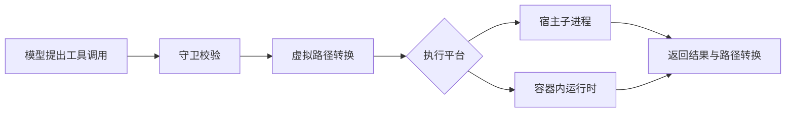

# agent-comparison - Comparison - 01 - JadeCode 与 Poirot：执行隔离、代理协作与长期记忆

---

用户提问：

`research-notes/sandbox/poirot/01-sandbox-isolation-and-tool-surface.md`
`research-notes/multi-agent/poirot/03-delegation-only-no-team.md`
`research-notes/memory-system/poirot/01-long-term-memory-pipeline.md`

阅读下这三篇研究笔记。`poirot` 跟 JadeCode 一样，是一个非成熟 Agent，是网上一个人开源的自己的学习项目。我希望能对比一下 JadeCode 和它在哪些方面有优劣。

---

**比较范围与证据边界**

本轮先阅读指定的三篇笔记，再对照两边实际源码核对关键结论。基线为 2026-10-27 本地 checkout：JadeCode `355ebb0`，Poirot `86bf279`。结论只覆盖执行隔离、代理协作、长期记忆，不评价整个项目的成熟度，也不根据模块数量、框架或文件数量排名。

本轮没有安装依赖、启动 Agent、运行测试、启动 Docker 或调用模型。下文的“已接通”指静态调用链接通；任务成功率、吞吐量、真实安全性与记忆质量都没有在本轮做对照实验。原笔记中的历史实验数据与本轮源码核对分开说明。

**1. 主要结论**

Poirot 有值得借鉴的执行环境分层和外部 Agent 适配；JadeCode 则在原生团队机制、记忆来源控制和存储失败保护上更完整。两者分别存在不同的短板：JadeCode 缺少操作系统执行隔离与协作代码集成；Poirot 的若干高级设计尚未连成可用闭环，并且存在关键执行或数据保护问题。

| 比较维度 | JadeCode 当前实现 | Poirot 当前实现 | 判断 |
|---|---|---|---|
| 命令执行环境 | 宿主子进程，应用内权限检查 | 本地子进程或 Docker 运行时 | Docker 路径是 Poirot 的独立优势；本地模式都没有操作系统沙箱 |
| 权限交互 | 四种档位、显式规则、用户/模型审批、授权后重判 | 安全守卫、路径规则、危险命令分级 | JadeCode 对用户授权的表达更细；这不能代替容器隔离 |
| 原生子代理 | 独立历史、受限工具、有限轮数、返回父流程 | 设计了自身副本，但生产工厂返回对象与调用方法不匹配 | JadeCode 的原生子代理调用链更完整 |
| 常驻团队 | Leader、最多三个队友、任务依赖、派工编号、消息、正式报告 | 一次性 specialist 委派，没有相应团队实体 | 在已检查的原生团队能力上，JadeCode 更丰富 |
| 外部 Agent 接入 | 当前这组实现使用自己的运行时与模型客户端 | 有 Pi、Codex、Claude Code CLI 适配及 MCP 沙箱桥 | Poirot 的异构执行者适配值得借鉴；实跑依赖外部 CLI |
| 记忆召回 | 任务入口由辅助模型选择目录，失败时关键词降级 | 每次模型调用前做 BM25 与强度排序 | 各有成本取舍，不能只凭检索方法判断质量 |
| 记忆来源与发布 | 有参考消息来源标记、候选校验、文件锁与事务恢复材料 | 隐藏 HumanMessage 注入、单文件更新、后台抽取 | 已检查路径中，JadeCode 的来源处理和失败保护更稳妥 |
| 协作代码隔离 | 团队共用工作区，未见专门的 worktree/补丁集成机制 | 父子共用线程沙箱与持久卷 | 两者都不能据此声称已经解决并行改代码的冲突与集成 |

**2. 沙箱：Poirot 在执行环境上领先，但必须区分本地档与容器档**

用户此前问的“Harness 沙箱是什么”，可以放在这里一起理解：模型决定要调用什么工具，Harness 决定这些工具在哪个环境中执行、允许接触哪些资源。权限检查回答“这次调用是否获准”；执行隔离约束“获准的程序实际能够碰到什么”。两者可以叠加。

例如，一个测试命令本身看起来正常，但测试依赖可能执行任意代码。命令字符串的审批不能证明依赖执行时不会访问其他文件。容器则把测试进程放到另一个文件系统和进程环境中，只通过配置的挂载等通道接触宿主资源。容器仍依赖宿主内核及运行配置，不是绝对安全保证。

Poirot 的分层很清楚：每次沙箱操作先经过守卫校验，再把模型看到的虚拟路径转换成执行环境路径，调用运行时，最后对返回文字中的路径做反向转换。运行时、路径翻译、安全守卫可以分别替换。

这种组织方式的优势是，换执行平台时不必重写每个工具；虚拟路径让工具描述与宿主路径解耦；生成文件还能经过导出流程变成可下载产物。容器获取采用按需创建、复用、空闲回收等生命周期管理，也体现了处理真实执行资源的考虑。

但两档的能力不同：

- **本地档**直接使用宿主子进程和文件 API。路径白名单、命令黑名单是应用逻辑；命令检查主要审查绝对路径参数，运行时继承启动目录。相对路径及程序内部的文件访问没有因此被操作系统限制，不能当成强隔离。
- **Docker 档**确实把工具执行移入容器，并挂载持久目录，这是 JadeCode 当前执行链没有的能力。不过该启动代码显式使用 `seccomp=unconfined`，没有显式设置 CPU、内存或出站网络限制。宿主另行施加什么限制、镜像内部用什么用户运行，本轮无法确认。

JadeCode 的强项在另一层：它区分权限档位和 allow/ask/deny 规则，能够解释部分命令与目标路径，审批后重新核对状态和目标，避免旧批准直接套用到变化后的调用。文件路径解析也处理符号链接。

但 JadeCode 实际运行命令时使用宿主上的 `setsid` 与 `/bin/sh`。进程组用于超时和退出清理，不提供文件系统、网络或资源配额隔离；权限档位本身也明确不是操作系统沙箱。

因此，准确判断是：**Poirot 的 Docker 执行环境值得 JadeCode 借鉴；JadeCode 的授权与审批机制也有自己的优势。两者解决的是不同层面的问题。**

还有一个对 Coding Agent 很实际的差异：JadeCode 对正常结束但退出码非零的命令，会返回失败标记以及保留下来的 stdout/stderr；Poirot 本地运行时抛出的非零退出异常只有退出码，不带这两段输出。后者会让模型缺少定位编译或测试错误的重要材料。这一比较仅针对 Poirot 本地档。

**3. 多 Agent：JadeCode 的原生团队更完整，Poirot 的外部执行者适配更有特色**

Poirot 的主要协作形态是：主 Agent 把目标和成功标准作为一次工具调用传给 specialist，输入转换器选择部分上下文，外部 CLI 执行，输出转换器把结果变成受限摘要及结构化字段，再交回主 Agent。

这一层有值得学习的点：

- 为不同执行者准备不同上下文，而不是复制主 Agent 全部历史。
- 显式传递目标和成功标准。
- 给外部 Agent 统一结果格式，限制返回内容大小。
- 通过 MCP 桥复用同一线程的执行环境，减少重复实现工具适配。

这是异构 Agent 的适配能力。它适合“把一项工作交给另一个现成 Agent 产品”的场景；没有常驻团队也不自动构成缺陷。

但本地代码中，自身副本路径确实存在阻断：子代理运行时调用 `agent.invoke(...)`；装配闭包返回的是 `LeaderAgent`；工厂也是返回这个封装对象，而这个类提供 `run(...)` 并持有图对象，没有 `invoke(...)`。所以不能把已写好的自身副本模块算成已经可工作的原生子代理。

外部 specialist 路径的可运行性，还取决于相应 CLI、凭据、协议和运行环境。本轮没有实际启动，不能说已经验证外包成功。

JadeCode 在这条轴线上已有更多实体与状态：

1. 一次性子代理有独立消息列表、受限工具、独立轮数，父流程等待它返回。
2. 常驻队友有身份、忙闲状态和自己的会话历史，可以被重复派工。
3. 持久任务具有依赖、负责人和状态；派工另有编号，旧派工不能更新新派工。
4. Leader 与队友通过邮件及 Inbox 交接；队友返回普通文本不自动等于任务完成，正式结果必须另行提交。
5. 有队友关闭、失败/阻塞报告、失败任务重新打开与消息重试等入口。

这使 JadeCode 更适合继续研究长期协作，而不是重新从“调用外部 CLI”开始。不过，当前团队能力也有明确限制：最多三个常驻队友；通信以 Leader 为中心，队友不能直接给另一队友派活或发信；大家共用工作区和权限状态；成员会话没有因此形成进程间安全隔离。任务存储的实例锁也不等于跨进程抢占队列。

Team 邮件正文和派工记录虽然保存到文件，当前仍不能据此承诺进程重启后恢复整个团队、在途执行和投递。任务完成状态也只是系统接受的完成声明，不是代码质量已经被独立验证。

两边还有共同短板：**共享工作区或共享容器，都不能解决多个 Agent 改同一份代码时的版本冲突、接口契约冲突和结果集成。** 容器隔离宿主，worktree 隔离工作副本，任务图约束依赖；这三种机制的职责不同。

Poirot 的演化模块同样要按接线评价。在检查的委派点中，`version_dag` 被接收但没有参与上下文生成，输入转换器的 `template` 参数也没有使用。不能据此宣称派工策略已经通过这些模板持续自我改进。

原笔记把团队拆成五个要件，有助于检查当前项目，但它不是所有 Multi-agent 系统的统一定义。没有去中心化通信、自动抢任务或租约，也不意味着一个系统一定不属于多 Agent。对本轮有意义的结论是：Poirot 没有 JadeCode 已有的那些常驻团队实体与操作。

**4. 长期记忆：Poirot 的机制设想更丰富，JadeCode 的来源控制与失败保护更完整**

两者都没有必须依赖向量数据库。Poirot 使用 Markdown 文件与 BM25；JadeCode 使用多份 Markdown 记录与目录，由辅助模型选择。Markdown 存储并不决定检索只能采用词法匹配，检索与存储是两项选择。

| 环节 | JadeCode | Poirot | 主要取舍 |
|---|---|---|---|
| 召回时机 | 每项任务入口一次，查询来自已捕获的当前任务 | 每次主模型调用前，从消息尾部找 HumanMessage | 前者减少重复；后者有持续调整的潜力，但更依赖查询来源正确 |
| 相关性选择 | 目录分页交辅助模型选择，最多五条；失败时关键词降级 | 空格分词 BM25，结合衰减强度，取前五条 | 前者增加模型请求；后者无需模型判断但存在词汇和语言局限 |
| 注入 | 稳定 system 边界说明，参考消息附内部来源 | 隐藏的 HumanMessage 追加到历史 | 内部来源必须在后续查询、提取等环节被识别，不能只在 UI 隐藏 |
| 提取 | 任务真正结束后，最近十二条候选消息、尾部八千字符，最多三条新记录 | 人类消息数量达间隔后，后台队列抽取近期消息 | 前者时机清楚但窗口窄、同步收尾；后者减少主流程等待但有队列生命周期成本 |
| 记忆类型 | user / feedback / project / reference | episodic / semantic / procedural | 分类轴不同，不能按名字判断谁更高级 |
| 去重 | 同名记录跳过新增 | 相同内容与类型的哈希去重 | 都不是语义去重，也都没有自动解决事实冲突 |
| 整理 | 有新增且库至少十条才尝试，完整候选校验后替换 | 达阈值合并最旧一批情景记忆，旧记录标记 forgotten | 前者有较多失败保护；后者保留演变关系但当前合并保护不足 |
| 存储保护 | 文件锁、快照核对、备份与事务清单、恢复 | 单文件追加及覆盖式重写 | 当前已检查路径中，前者对中断和坏候选的保护更完整 |

Poirot 的积极设计包括后台沉淀、内容哈希、访问强化、按类型衰减以及合并关系记录。它尝试表达“经验怎样形成更稳定知识”，这有研究价值。

但当前实现有几条会影响基本可用性的路径：

- **查询来源回流。** 召回注入的是 HumanMessage，下一次查询又取最后一条 HumanMessage，没有排除记忆来源，因而可能用上一段记忆检索记忆，重复注入。其他使用同类消息的中间件也可能影响查询。
- **中文匹配弱。** 分词是转小写后按空格切分。没有空格的中文整句会成为单个词项，不同表述很难匹配。原笔记的中文例子返回零条，不代表所有中文输入必定零召回。
- **召回包含写放大。** 每条命中都会强化并更新，而每次更新都会覆盖重写整个记忆文件。命中五条就可能重写五次；这段同步调用发生在异步钩子里，能阻塞调用推进。笔记记录的“300 条记忆约 1.2 秒”是此前复现数据，本轮没有重跑，不能拿它与 JadeCode 比速度。
- **空合并没有拒绝。** 合并路径可能新增空语义记忆，再把选中的旧情景记忆标记 forgotten，导致这批知识退出正常检索。准确说法是逻辑可检索性损失，旧文件条目仍存在；不能一概说全库物理销毁。
- **触发与关闭不可靠。** “人类消息数”也会统计内部注入消息，且同一计数可以在多次模型回复后重复触发；退出路径设置停止标志，没有完成队列排空。注释所说的用户轮次和 drain，均不能替代实际控制流。
- **部分机制没有生产调用方。** 自动遗忘判定、关联、再巩固在检查的 Agent 路径中没有调用入口，因此不能把这些设计当成已经持续运行的生命周期治理。

JadeCode 对其中几类问题有更明确的处理：查询直接使用任务入口保存的请求，不反向从注入历史中猜；参考消息带 `MEMORY_REFERENCE` 来源，提取时先排除；只有 Leader 装配自动记忆，避免队友与一次性子任务直接把内部推断写入公共库；坏回复或记忆 IO 故障会告警并保留主任务结果。

整理时拒绝空数组、空字段、非法数量等候选，发布前核对原快照，保存旧库与新库恢复材料，恢复遇到未知外部内容则拒绝覆盖。它仍不是可以证明知识不会丢失的系统：格式合法的摘要可能遗漏真实事实，文件保护也不等于语义正确。

JadeCode 自己的不足同样需要承认：

1. 只在任务入口召回，长任务方向变化后不会自动重新选择长期记忆。
2. 任务入口与收尾需要辅助模型；库较大时目录分页增加调用成本，整理输入超预算会跳过。
3. 最近十二条候选消息、尾部八千字符，可能漏掉长任务开头的关键反馈。
4. 同名新候选被跳过，纠正旧记忆没有及时、明确的定向更新闭环。
5. 没有时间衰减或有效期机制，旧知识何时失效仍主要依赖模型整理与人工复核。
6. 来源字段排除了召回消息，但其他摘要或 synthetic user 消息的来源未必完整；它不等于彻底解决来源污染。

因此，“JadeCode 更稳”的结论限定在来源与存储失败语义；**哪边记得更准、召回更有帮助，需要任务实验才能判断。**

**5. 对两份原笔记的几个必要限定**

第一，沙箱笔记里“同容器调用会串行化”，应限定在共享同一运行时实例及其锁的调用。外部 specialist 各自启动 MCP 服务，实例锁不会自然变成跨进程全局锁；不能据此推断所有外部 Agent 的文件更新都已串行协调。

第二，确定性的沙箱编号和发现已有容器，可以帮助重连执行环境，但不等于恢复 Agent 对话、在途任务、审批和副作用记录。

第三，记忆笔记提到“子 Agent 也会写记忆”，从装配看确实给叶子工厂传入了记忆服务；但本轮确认自身副本执行链先在方法调用处断开，所以应表达为“该设计接线存在后续污染风险”，不能说已经观察到这个子代理完成记忆写入。

这些限定不否定笔记的主要发现，而是避免把局部代码、设计意图与完整运行效果合并成一个结论。

**6. 对 JadeCode 下一步的启发**

最值得借鉴 Poirot 的是执行平台分层：让工具通过统一运行时访问本地或容器环境，并明确路径、挂载与产物交付规则。现有权限门仍有作用，应与执行隔离组合。

Multi-agent 则应沿 JadeCode 已有的团队继续深化：把共享工作区推进到明确基线的工作副本，把文字报告推进到版本明确的补丁与执行证据，把“状态 completed”推进到受控验证后的任务验收。Poirot 的输入/输出转换与成功标准可以作为其中的交接设计参考。

记忆方面，优先解决 JadeCode 的长任务提取遗漏、旧记忆纠正与按需重新召回，再决定是否需要衰减或关联。将已知问题放入复杂的认知术语体系，不会自动改善当前行为。

这些只是基于本轮比较提出的方向，没有修改或授权实施任何新能力。

**7. 源码依据**

以下锚点对应本轮 checkout。绝对链接便于在当前工作区打开；行号随后续修改可能漂移。

| 主题 | Poirot 依据 | JadeCode 依据 |
|---|---|---|
| 沙箱编排与宿主执行 | [Sandbox](/home/fishandrice/Backend/poirot/poirot/backend/agents/sandbox/sandbox.py:14)：守卫、翻译、运行时组合 | [ShellCommand](/home/fishandrice/Backend/JadeCode/src/main/java/com/jadecode/process/ShellCommand.java:15)：宿主执行、输出与进程组清理 |
| 容器边界 | [容器启动](/home/fishandrice/Backend/poirot/poirot/backend/agents/sandbox/docker/local_container_backend.py:193)：挂载、端口、seccomp 参数 | [PermissionProfile](/home/fishandrice/Backend/JadeCode/src/main/java/com/jadecode/safety/PermissionProfile.java:3)：档位不等于操作系统沙箱 |
| 权限与路径 | [本地守卫](/home/fishandrice/Backend/poirot/poirot/backend/agents/sandbox/guards/local_security_guard.py:84)：命令分词与路径白名单 | [PermissionGate](/home/fishandrice/Backend/JadeCode/src/main/java/com/jadecode/safety/PermissionGate.java:64)：规则、审批、重判；[PathResolver](/home/fishandrice/Backend/JadeCode/src/main/java/com/jadecode/util/PathResolver.java:11)：路径解析 |
| 子代理实际调用 | [调用 invoke](/home/fishandrice/Backend/poirot/poirot/backend/agents/multiagent/runtimes/subagent_runtime.py:43)、[叶子工厂](/home/fishandrice/Backend/poirot/poirot/backend/app/bootstrap.py:593)、[LeaderAgent](/home/fishandrice/Backend/poirot/poirot/backend/agents/leader/agent.py:65) | [SubagentRuntime](/home/fishandrice/Backend/JadeCode/src/main/java/com/jadecode/subagent/SubagentRuntime.java:185)：独立历史与循环 |
| 团队与工作区 | [specialist 工具](/home/fishandrice/Backend/poirot/poirot/backend/agents/multiagent/tools.py:91)：一次委派参数与结果 | [TeamManager](/home/fishandrice/Backend/JadeCode/src/main/java/com/jadecode/team/TeamManager.java:75)、[共享工作区装配](/home/fishandrice/Backend/JadeCode/src/main/java/com/jadecode/bootstrap/JadeCodeFactory.java:249)、[TeamMailbox](/home/fishandrice/Backend/JadeCode/src/main/java/com/jadecode/team/TeamMailbox.java:13) |
| 输入输出适配 | [Codex 输入选择](/home/fishandrice/Backend/poirot/poirot/backend/agents/multiagent/summarizers/context/codex_context_summarizer.py:32)、[结果转换](/home/fishandrice/Backend/poirot/poirot/backend/agents/multiagent/summarizers/result/base.py:38)：规则提取与截断，不能视为完整验收 | [正式报告入口](/home/fishandrice/Backend/JadeCode/src/main/java/com/jadecode/team/TeamManager.java:166)、[普通返回入口](/home/fishandrice/Backend/JadeCode/src/main/java/com/jadecode/team/TeamManager.java:306) |
| MCP 共用执行环境 | [MCP 沙箱构造](/home/fishandrice/Backend/poirot/poirot/backend/agents/multiagent/mcp/specialist_mcp_server.py:268)：Docker 与空映射本地分支 | 本轮检查的团队与子代理直接使用 JadeCode 运行时，没有同类外部 CLI 桥 |
| 记忆查询与注入 | [召回钩子](/home/fishandrice/Backend/poirot/poirot/backend/agents/middlewares/memory_recall_middleware.py:70)、[查询提取](/home/fishandrice/Backend/poirot/poirot/backend/agents/middlewares/memory_recall_middleware.py:127) | [任务入口](/home/fishandrice/Backend/JadeCode/src/main/java/com/jadecode/session/SessionRuntime.java:679)、[来源类型](/home/fishandrice/Backend/JadeCode/src/main/java/com/jadecode/messages/Message.java:27) |
| 召回策略 | [BM25 与强化](/home/fishandrice/Backend/poirot/poirot/backend/agents/memory/strategies/default/retriever.py:90)、[分词](/home/fishandrice/Backend/poirot/poirot/backend/agents/memory/strategies/default/retriever.py:165) | [目录选择与降级](/home/fishandrice/Backend/JadeCode/src/main/java/com/jadecode/memory/MemoryRecallService.java:79) |
| 抽取时机与生命周期 | [计数投递](/home/fishandrice/Backend/poirot/poirot/backend/agents/middlewares/memory_consolidation_middleware.py:53)、[worker 关闭](/home/fishandrice/Backend/poirot/poirot/backend/agents/memory/worker.py:91) | [任务收尾](/home/fishandrice/Backend/JadeCode/src/main/java/com/jadecode/session/SessionRuntime.java:699)、[提取窗口](/home/fishandrice/Backend/JadeCode/src/main/java/com/jadecode/memory/MemoryExtractionService.java:179)、[Leader 接线](/home/fishandrice/Backend/JadeCode/src/main/java/com/jadecode/bootstrap/JadeCodeFactory.java:314) |
| 整理与发布 | [空内容可进入合并](/home/fishandrice/Backend/poirot/poirot/backend/agents/memory/strategies/default/manager.py:274)、[覆盖重写](/home/fishandrice/Backend/poirot/poirot/backend/agents/memory/strategies/default/store.py:247) | [候选校验](/home/fishandrice/Backend/JadeCode/src/main/java/com/jadecode/memory/MemoryConsolidationService.java:65)、[快照替换](/home/fishandrice/Backend/JadeCode/src/main/java/com/jadecode/memory/MemoryStore.java:275)、[恢复材料](/home/fishandrice/Backend/JadeCode/src/main/java/com/jadecode/memory/MemoryTransaction.java:35) |

指定研究笔记：

- [沙箱隔离与工具面](../../sandbox/poirot/01-sandbox-isolation-and-tool-surface.md)
- [单层委派与团队边界](../../multi-agent/poirot/03-delegation-only-no-team.md)
- [长期记忆流水线](../../memory-system/poirot/01-long-term-memory-pipeline.md)

本轮只新增本文。三篇原笔记与两个项目源码未修改；研究工作区已有的其他改动不暂存、不提交、不推送。
