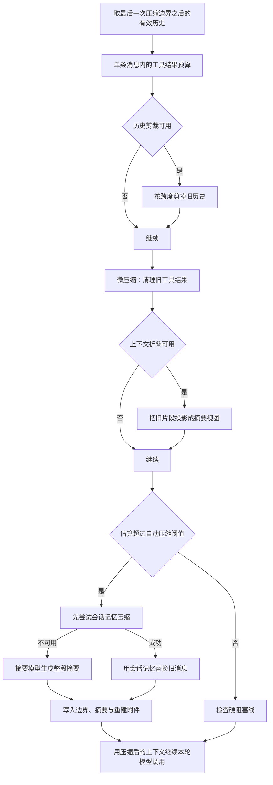
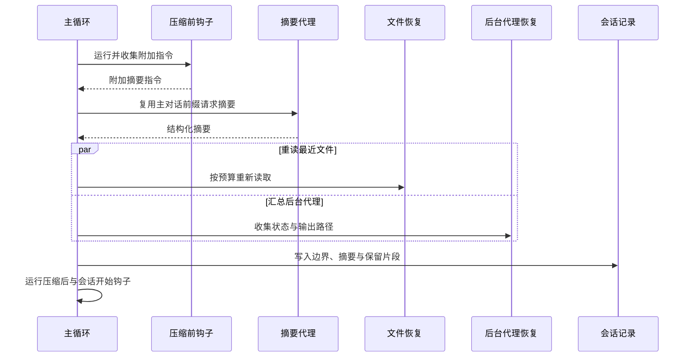

# Context compaction - Claude Code - 02 - Context compaction mechanism

---

Claude Code 是怎么做上下文压缩的?

---

## 结论先行

Claude Code 的上下文压缩不是单一动作，而是嵌在每次模型调用之前的一条分层流水线。便宜、局部、信息损失小的手段先跑；只有它们不够时，才调用模型生成整段摘要。

默认情况下，一次完整的自动压缩大致是：

1. 如果启用了单条消息的聚合预算，先把过大的工具结果转存到磁盘，只在上下文里留下预览；
2. 如果启用了历史剪裁，先尝试按跨度删掉一段旧历史（具体实现不在快照中）；
3. 再做微压缩，清理旧的工具结果；
4. 如果启用了上下文折叠，把旧片段投影成更短的摘要视图；
5. 估算仍然超过自动压缩阈值时，先尝试用后台维护的会话记忆替换旧消息；
6. 会话记忆不可用时，fork 一个只跑一轮的摘要代理，复用主对话的提示缓存，把当前有效历史压成一份结构化摘要；
7. 写入压缩边界，重新注入最近文件、计划、技能、后台代理状态、工具与 MCP 说明；
8. 自动压缩不结束当前回合，主循环直接用压缩后的消息继续调用模型。

几个关键数字（默认 200K 上下文模型，且模型最大输出不低于 20K）：

- 压缩摘要本身预留最多 20K 输出 token，因此“有效上下文窗口”约为 180K；
- 自动压缩阈值约为 167K（有效窗口再减 13K 余量）；
- 上下文警告线约为 147K（阈值再减 20K）；
- 约 177K 处还有一道硬阻塞线（有效窗口减 3K），在有效窗口内再留 3K 给用户执行手动 `/compact`。

full compaction（整段压缩）不保留最近消息的原文，而是把当前边界之后的消息都交给摘要模型（图片和文档替换成文本标记，部分会被重新注入的技能附件会先过滤掉）；摘要消息、边界和重新注入的附件共同构成新的上下文。手动 `/compact` 与自动压缩共用这条摘要路径，但手动命令结束回合，不会自动继续提问。

另有一条“会话记忆压缩”变体：它不调用摘要模型，而是用后台已经维护好的会话记忆替换旧消息，并保留最近一段原文。它受两个默认关闭的远端开关控制。

源码快照里还有几条受构建开关控制的路径：缓存微压缩、历史剪裁、上下文折叠、响应式压缩。它们只有调用点和部分 API 形状可读，实现文件不在快照中，因此只能确认“存在这条路径”，不能确认内部算法。

## 场景

用户让 Claude Code 改一个设置页，随后跑测试、读日志、修失败用例。每一步工具输出都在累积：读文件、搜索、跑测试、看构建日志。上下文逐渐逼近模型窗口。

如果没有压缩，只有两种结局：请求被服务端拒绝，或者用户手动清空历史、重新解释任务。Claude Code 的目标是让这条长任务在用户几乎无感的情况下继续：先丢掉最容易重新获得的东西（旧工具输出、旧文件内容），再在必要时把整段历史换成一个“交接摘要”，同时把继续工作真正需要的文件、计划和工具状态重新放回去。

## 机制展开

### 1. 压缩在什么位置发生

压缩检查位于主循环的每一轮模型调用之前，而不是只在用户提交新消息时发生。一次用户回合里如果发生了多轮“模型调用 → 工具执行 → 再调用”，每一轮都会重新经过这条流水线。

顺序大致是：

这里有两个容易误解的点：

- 自动压缩成功后会直接继续当前回合。它不会停下来问用户，也不会要求用户重新发送上一条消息。
- 如果前面的历史剪裁、微压缩或上下文折叠已经把估算降到阈值以下，整段摘要就不会发生；这些层的意义正是尽量用更小的代价避免一次全局摘要。
- 这条流水线只处理“消息数组”。系统提示、工具 schema 和每次请求前重新拼装的用户上下文（例如项目指令）本来就不在消息数组里，它们不会被摘要，也不会被删除；它们仍然每轮重新发送，并计入 token。

### 2. 先计量，再决定要不要压缩

token 统计不是把整段文本重新精确编码，而是“最近一次真实 API 响应的 usage + 之后新增消息的粗略估算”：

- 最近一次真实助手回复会带回输入、缓存读取、缓存写入和输出 token，这些数相加就是那次请求的完整上下文规模；
- 这次回复之后新增的消息，用字符数除以约 4 来估算；图片和文档按约 2000 token 计；
- 如果找不到任何真实 usage，就退化为对全部消息做粗略估算；
- 历史剪裁已经释放的 token 会从估算里减掉，否则剪裁后仍会被旧 usage 误判为超限。

自动压缩的阈值由模型上下文窗口推导：

- 先从窗口里减去“摘要最多需要多少输出”，默认预留 20K，且不超过模型自身的最大输出；
- 再减去 13K 的自动压缩余量，得到自动压缩阈值；
- 警告线是阈值再减 20K；硬阻塞线是有效窗口再减 3K。

以 200K 模型为例：有效窗口约 180K，自动压缩阈值约 167K，警告线约 147K，硬阻塞线约 177K。如果模型自身的最大输出低于 20K，或者输出上限被远端配置压到 8K，摘要预留会减少，这些阈值会相应上移。1M 上下文模型按同一公式放大；也可以通过环境变量把自动压缩窗口压到更小。

这版代码里，警告线和错误线使用了相同的 20K 余量，所以数值上重合，界面会同时进入警告与错误状态。这个“重合”是否是设计意图，源码没有说明，只能算合理推断。

硬阻塞线的源码注释说它“只在自动压缩关闭时生效”，但实际条件并没有显式检查自动压缩开关。它依赖自动压缩先于阻塞线触发；如果自动压缩被关闭、连续失败，或者由响应式路径接管，这道检查才真正成为兜底。这是注释与实现条件的一处不一致。

### 3. 最便宜的一层：限制单条消息里的工具结果

在压缩历史之前，Claude Code 先处理“同一轮并行工具调用把所有结果塞进一条用户消息”的情况。

聚合预算由远端开关控制，默认关闭。开启后，每个用户消息里的工具结果有一个聚合字符预算，默认约 200K 字符。超过预算时，系统会把其中最大的新结果转存到磁盘，把上下文里的内容替换成“输出过大、完整内容在某个文件、这里是预览”的提示。已经处理过的结果会被冻结，后续轮次不会重新选择，避免同一段前缀在两次请求之间变化而破坏提示缓存。

即使聚合预算关闭，单条工具结果仍有一条持久化阈值：大多数工具超过约 50K 字符就转存磁盘，只保留预览和文件路径。读取工具是一个例外，它有自己的读取 token 上限，不再套这层预算。

这一层不是“摘要”，而是把大块内容换成可重新读取的引用；模型仍然知道结果存在、在哪里，只是不再每轮携带全文。

### 4. 微压缩：只清理工具结果

微压缩只针对一组“可压缩工具”的结果：读文件、Shell、搜索、Glob、网页抓取、网页搜索、编辑和写入。它不会动用户消息、助手文本、思考块或普通附件。

快照里能看到两条微压缩路径。

**时间触发的清理。** 如果距离上一次主线程助手回复已经超过配置的间隔（默认 60 分钟），说明服务端提示缓存大概率已经过期，下一次请求本来就要重写整段前缀。此时系统会直接改本地消息，把最近 N 条可压缩工具结果之外的旧结果替换成固定文本“旧工具结果内容已清除”，默认保留最近 5 条。这样下一次请求重写的前缀更短，又不会额外制造一次缓存失效。

这条路径默认关闭，由远端配置控制；只对主线程生效，子代理不参与。清理后会重置缓存微压缩的状态，并通知缓存断点检测器“这次缓存读取下降是我造成的，不是异常”。

**缓存编辑式微压缩。** 这是内部构建的路径，依赖服务端的缓存编辑能力。它不在本地改写消息，而是在请求里附加“删除这些工具结果”的编辑指令，并把被删除结果在缓存前缀中的引用标记出来。这样服务端仍然能命中原有缓存前缀，只是把其中一部分工具结果从模型可见上下文中去掉。

实现上，客户端会先收集可压缩工具的调用编号，按用户消息分组注册；达到配置的数量阈值后，选出要删除的旧结果，生成缓存编辑块。编辑块会插到最后一条用户消息的工具结果之后，并在后续请求中固定在原来的位置重复发送，保证前缀字节稳定。删除边界消息则等到 API 返回后再写，因为只有服务端会告诉我们实际删除了多少缓存输入 token。

这条路径的实现文件不在快照中，因此“具体什么时候触发、保留多少条”的默认值无法确认；但客户端侧的收集、编辑块形状、插入位置和缓存引用标记是可以确认的。

旧的“本地直接清理工具结果”微压缩路径已经被移除。外部构建在没有时间触发配置、也没有缓存编辑能力时，这一层基本是空操作，主要依靠后面的整段摘要。

### 5. 会话记忆压缩：不调用摘要模型的变体

在整段摘要之前，系统会先尝试一条更便宜的路径：如果后台会话记忆里已经有足够内容，并且知道“哪些消息已经被记忆覆盖”，就直接用会话记忆作为交接材料，保留最近一段原文，丢掉已被覆盖的旧消息。

它的行为大致是：

1. 等待正在进行的会话记忆提取完成，最多等 15 秒；超过 1 分钟的提取视为过期，不再等待；
2. 读取会话记忆文件；文件不存在或只有空模板时，退回整段摘要；
3. 用“最后一条已被记忆覆盖的消息编号”定位切点；
4. 从切点之后开始保留消息，并向前扩张，直到至少保留约 10K token 和 5 条含文本的消息；最多保留约 40K token；
5. 扩张时不能拆散工具调用与工具结果，也不能拆散共享同一个响应编号的思考块与工具块；
6. 用会话记忆内容作为摘要消息，保留最近消息原文，重新跑会话开始钩子；
7. 如果压缩后的估算仍然高于自动压缩阈值，放弃这条路径，改用整段摘要。

这条路径不会调用摘要模型，因此没有摘要 API 成本；代价是摘要质量取决于后台会话记忆的维护质量，而且只重新注入计划文件，不重新读取最近文件、技能和工具状态附件。

它受两个远端开关同时控制，默认关闭；手动 `/compact` 只有在没有自定义指令时才会先尝试它。

### 6. 整段摘要压缩：真正调用模型的那一层

当上面的低成本手段都不够，或者用户显式要求压缩时，系统会生成一份新的对话摘要。

#### 摘要请求怎么构造

摘要请求是一个单独的、只允许一轮的 fork 代理调用。它复用主对话的系统提示、工具 schema、用户上下文和消息前缀，只在最后追加一条“请总结对话”的用户消息。这样做的核心目的是复用主对话的提示缓存：前缀完全相同，摘要请求只需要为新增的总结指令和输出付费。

摘要代理继承完整工具列表是为了保持缓存键一致，但工具调用权限被全部拒绝；同时提示词开头就明确要求“只输出文本，不要调用任何工具”。如果模型仍然试图调用工具，这一轮就拿不到文本，系统会退回普通流式摘要路径。

普通流式路径使用一个单独的系统提示“你是一个负责总结对话的助手”，关闭思考，最多输出约 20K token；如果远端开关允许，流式失败时最多尝试 2 次（即 1 次重试）。

#### 摘要提示要求什么

摘要提示不是一句“总结一下”，而是一份固定的交接清单。它要求模型先在一个 `<analysis>` 草稿区按时间顺序梳理对话，再输出 `
` 正式摘要。正式摘要要求覆盖：

1. 用户的明确请求和意图；
2. 关键技术概念；
3. 涉及的文件、代码片段和修改原因；
4. 遇到的错误与修复；
5. 问题解决过程；
6. 所有非工具结果的用户消息；
7. 待办任务；
8. 当前正在做的工作；
9. 可选的下一步，并尽量引用最近对话原文，防止语义漂移。

草稿区在插入上下文前会被删掉，只保留正式摘要。用户通过 `/compact` 提供的附加指令，以及压缩前钩子返回的附加指令，会追加到提示末尾。

#### 摘要消息怎么进入上下文

摘要不是作为系统提示插入的，而是作为一条用户消息插入。它的开头固定说明“本会话是从一段超出上下文的对话继续而来的，下面是较早部分的摘要”，并附上完整会话记录的文件路径，告诉模型如果确实需要精确代码或错误原文，可以去读完整记录。

自动压缩还会在这条消息末尾追加“直接继续，不要向用户提问，不要复述摘要，不要说我继续”这类指令；手动压缩不会追加，因为用户可能只是想先看一眼摘要。

#### 全量、部分与保留最近消息

整段压缩会把当前边界之后的消息都交给摘要模型，不保留最近消息的原文。图片和文档会先被替换成文本标记；会被压缩后重新注入的技能发现附件也会先被过滤。所谓“保留最近工作”靠的是摘要提示要求它重点写当前工作和下一步，而不是靠原文。

如果用户从消息选择器里选择“从这里开始总结”或“总结这之前的内容”，则走部分压缩：

- “从这里开始”：保留切点之前的消息原文，总结切点之后的内容；摘要放在保留消息之后，前缀缓存可以保留；
- “总结这之前”：总结切点之前的内容，保留切点之后的消息原文；摘要放在保留消息之前，前缀缓存会失效，旧边界和旧摘要会从保留区里剔除。

部分压缩还会把用户填写的反馈作为附加指令，传给摘要模型。

#### 摘要请求自己超长怎么办

如果摘要请求本身也触发了“提示过长”，系统不会立刻失败，而是按 API 轮次分组，从最旧的一组开始丢弃消息，直到补上服务端报告的超出量；如果服务端没有给出可解析的超出量，就丢弃约 20% 的组。最多重试 3 次，并且至少保留一组消息用于总结。丢弃后如果消息以助手消息开头，会补一条合成的用户标记，满足 API 的角色要求。

一次成功压缩的时序大致是：

### 7. 压缩之后重新放回什么

压缩结果不是“边界 + 摘要”两项。全量压缩和会话记忆压缩使用下面这个固定顺序；部分压缩会根据方向调整摘要与保留消息的先后：

1. 压缩边界标记；
2. 摘要消息；
3. 被保留的消息（全量压缩没有这一项）；
4. 重新注入的附件；
5. 压缩后钩子和会话开始钩子产生的消息。

部分压缩里，“从这里开始”是保留消息在前、摘要在后；“总结这之前”是摘要在前、保留消息在后。两种情况下附件与钩子结果都排在最后。

附件重建是压缩后最关键的一步，因为摘要必然有损。当前实现会重新放入：

- **最近读取的文件**：按最近访问时间选最多 5 个文件，每个文件最多约 5K token，总额最多约 50K token；已经在保留消息里出现过的文件不重复注入，计划文件和记忆文件也排除；
- **计划文件**：如果当前会话有计划，重新附上计划路径和内容；
- **计划模式指令**：如果当前处于计划模式，重新附上计划模式提醒，避免压缩后模型忘记仍处于计划模式；
- **已调用技能**：只重新注入本会话真正调用过的技能，按最近调用排序，每个技能最多约 5K token，总额最多约 25K token；超出部分保留开头并附加“已截断，可读取完整文件”的提示；
- **后台代理状态**：仍在运行或已经完成但结果尚未取回的后台代理，会重新附上任务编号、描述、状态和输出文件路径，避免主模型重复派生；
- **工具与代理清单的增量**：压缩会吃掉之前的增量附件，因此从当前状态重新宣告延迟加载的工具、可用代理列表和 MCP 指令；
- **会话开始钩子**：以“压缩”为来源重新执行，允许钩子重新注入项目上下文。

文件附件和后台代理附件是并行生成的；计划、技能和工具增量在它们之后串行补齐。压缩还会清空已读文件缓存、嵌套记忆路径缓存、系统提示分段缓存、分类器审批、推测检查、记忆文件缓存和会话消息缓存。已调用技能的内容不会被清空，正是为了下一次压缩还能重新注入；技能列表也不会被重置，避免为了约 4K token 的技能清单重新制造缓存写入。

### 8. 响应式与实验路径

除了主动压缩，源码里还有几条“请求已经失败之后再补救”的路径。

**响应式压缩。** 当 API 返回“提示过长”或媒体过大错误时，主循环先不把错误抛给用户，而是尝试一次响应式压缩。它使用同一套缓存安全参数，成功后生成压缩结果，替换消息并重试当前请求；失败才把错误暴露出来。每个回合只尝试一次，避免压缩风暴。调用点注释说明媒体错误会走“剥离图片再重试”的路径，但实现文件不在快照中，内部如何选择保留内容无法确认。

**上下文折叠。** 它把完整历史保留在界面上，但在模型可见侧维护一个“折叠视图”：旧片段被提交为摘要，摘要存在单独的折叠存储里，每次进入主循环时重放提交日志生成视图。它排在自动压缩之前，如果折叠已经把上下文降到阈值以下，自动压缩就不再触发，从而保留更细的上下文。源码注释提到它大致在 90% 提交、95% 阻塞；这是注释证据，不是可执行实现证据。

**历史剪裁。** 它在微压缩之前运行，按某种跨度成段删除消息，返回释放的 token 数和一条边界消息。它和微压缩不是互斥关系。具体按什么条件选择被剪掉的历史，实现文件不在快照中，无法确认。

**API 侧上下文编辑。** 这是一条服务端能力，不是本地改写消息。启用思考时，客户端会请求“保留所有历史思考块”；如果距离上一次 API 完成已经超过 1 小时（服务端缓存 TTL），则改为只保留最近一轮思考。内部构建还可以请求服务端清理旧的工具结果或工具调用，触发阈值默认约 180K 输入 token，目标保留约 40K。外部构建中可见的主要是思考块保留/清理这一项，而且还需要第一方 API 与支持该能力的模型。

### 9. 用户看到什么

自动压缩时，界面会把转圈提示改成“正在压缩对话”，并在压缩前钩子、压缩本身、压缩后钩子和会话开始钩子之间切换提示文字。手动 `/compact` 成功后显示“已压缩”，并提示可以用快捷键查看历史。

上下文接近阈值时，界面显示“距离自动压缩还有 N%”；自动压缩关闭时则显示“上下文不足 N%，运行 /compact 继续”。压缩成功后会暂时抑制这条警告，因为下一次真实 token 数要等 API 返回后才准确；下一次微压缩尝试时会解除抑制。

非全屏界面在收到压缩边界时会把消息列表替换成边界之后的新列表；全屏界面会保留压缩前的滚动历史，只把模型可见视图切到新边界之后。

## 条件与边界

| 条件 | 实际行为 |
|---|---|
| 默认自动压缩 | 用户配置默认开启；受 `DISABLE_COMPACT`、`DISABLE_AUTO_COMPACT` 和配置项控制 |
| 默认上下文窗口 | 200K；模型能力或 1M 开关可放大；可用环境变量压低自动压缩窗口 |
| 200K 模型的默认阈值 | 有效窗口约 180K，自动压缩约 167K，警告约 147K，硬阻塞约 177K |
| 自动压缩关闭 | 不主动摘要；达到硬阻塞线时返回“提示过长”，在有效窗口内再留约 3K token 让用户手动 `/compact` |
| 手动 `/compact` | 先试会话记忆压缩（仅无自定义指令），否则先跑微压缩再走整段摘要；命令结束后不自动继续提问 |
| 会话记忆压缩 | 两个远端开关同时开启才生效；默认关闭；压缩后估算仍高于阈值则退回整段摘要 |
| 单条消息工具结果预算 | 远端开关控制，默认关闭；开启后每用户消息约 200K 字符；单条结果仍有约 50K 字符的持久化阈值 |
| 时间触发微压缩 | 默认关闭；主线程且距上次助手回复超过 60 分钟才触发；保留最近 5 条工具结果 |
| 缓存编辑式微压缩 | 内部构建、第一方 API、主线程、受支持模型、远端开关同时满足才生效；外部构建通常没有这一层 |
| 历史剪裁 | 构建开关控制；在微压缩之前执行；实现文件不在快照 |
| 上下文折叠 | 构建开关控制；在自动压缩之前执行；实现文件不在快照 |
| 响应式压缩 | 构建开关控制；只在提示过长或媒体过大时尝试一次；实现文件不在快照 |
| 响应式独占模式 | 远端开关开启时，主动自动压缩被抑制，改由 API 错误触发响应式路径 |
| 摘要请求超长 | 最多丢弃最旧的分组重试 3 次；仍失败则报错 |
| 摘要流式失败 | 远端开关允许时最多尝试 2 次（1 次重试）；否则报“压缩被中断” |
| 自动压缩连续失败 | 连续 3 次失败后，本会话不再尝试自动压缩 |
| 摘要没有有效文本 | 视为失败；手动压缩会弹错误通知，自动压缩静默计入失败并在后续回合重试 |
| 压缩后仍超阈值 | 可能在后续循环再次触发压缩；会话记忆路径会主动放弃并退回整段摘要 |
| 旧历史 | 消息数组被替换，但会话 JSONL 仍保留旧行；恢复时从最后一个边界重建视图 |
| 压缩代理/会话记忆代理自身 | 这两类查询不会再触发自动压缩，避免递归死锁；普通子代理不受这条限制 |
| 图片与文档 | 摘要请求前会替换成 `[image]` / `[document]` 文本标记，避免摘要请求自己被媒体撑爆 |
| 外部构建与内部构建 | 缓存编辑、工具清理策略、响应式、折叠、剪裁等能力存在明显差异；不能把内部路径当成外部默认行为 |

## 设计取舍

**便宜的手段优先，尽量保留粒度。** 工具结果预算、时间微压缩、缓存编辑都不需要额外模型调用，信息损失也更局部；上下文折叠被刻意放在自动压缩之前，就是为了在折叠已经足够时不要退化成一份整段摘要。整段摘要放在最后，因为它是唯一会改变全局语义、产生额外模型调用并制造缓存失效的手段。

**摘要不是“保留最近 N 条”，而是“生成一份可交接的工作状态”。** 全量压缩会把所有消息都交出去，包括上一次的摘要；它依赖提示词要求模型写清当前工作、待办和下一步，再通过文件、计划、技能和工具状态附件补回可重新获得的内容。代价是精确代码、错误原文和工具输出不会原样保留，只能靠会话记录路径回读。

**缓存稳定性贯穿整套设计。** 摘要代理复用主对话前缀；时间微压缩只在缓存大概率已经过期时动手；缓存编辑式微压缩只删除引用、不改写前缀；压缩后故意不重置技能列表；已经做过的工具结果替换会被冻结。这些选择都在避免“为了省 token 反而制造一次昂贵的缓存重建”。

**追加式历史与视图边界分离。** 磁盘上的会话记录仍然是追加式 JSONL，压缩只写入一个边界，并让恢复逻辑从边界之后重建当前视图。好处是旧历史仍可追溯、崩溃后仍能保留前缀；代价是文件持续增长，恢复时要处理边界、保留片段和父子链修复。

**失败要能降级，不能把用户卡死。** 摘要请求自己超长时丢弃最旧分组重试；摘要代理没有文本时退回普通流式摘要；API 报提示过长时尝试响应式压缩或折叠排空；自动压缩连续失败后熔断；提示过长时不再执行停止钩子，避免“错误 → 钩子注入更多 token → 再错误”的死循环。

**外部构建与内部构建不是同一套默认行为。** 快照里大量分支由构建开关或远端开关控制。源码只能证明“这条路径存在”，不能证明线上默认开启。尤其是缓存编辑、工具清理策略、响应式压缩、上下文折叠和历史剪裁，报告里的描述必须区分“结构上存在”和“生产默认可用”。

## 证据分级

**已证实**

- 压缩检查位于每次模型调用之前，顺序是工具结果预算、历史剪裁、微压缩、上下文折叠、自动压缩、硬阻塞检查；
- 自动压缩阈值、警告线、硬阻塞线和摘要输出预留的具体计算方式与默认数值；
- 全量压缩会用一轮摘要代理生成结构化摘要，摘要代理继承完整工具列表但拒绝工具调用；
- 摘要提示包含分析草稿区和九个固定交接部分，草稿区在插入前被删除；
- 压缩后的消息顺序是边界、摘要、保留消息、附件、钩子结果；
- 最近文件、计划、计划模式、已调用技能、后台代理、工具/代理/MCP 增量会被重新注入，且有明确的数量和 token 预算；
- 会话记忆压缩的开关条件、保留区间计算、工具对修复和阈值回退；
- 摘要请求超长时按 API 轮次从最旧分组丢弃并重试；
- 自动压缩连续失败 3 次后熔断；
- 压缩边界在会话记录里以空父链、逻辑父链和保留片段元数据写入；
- 时间触发微压缩的 60 分钟、保留 5 条和固定清除文本；
- 缓存编辑式微压缩的客户端收集、编辑块插入、缓存引用标记和延迟边界消息；
- API 侧思考清理在超过 1 小时空闲后只保留最近一轮；
- 硬阻塞线的注释声称只在自动压缩关闭时生效，但实际条件没有显式检查自动压缩开关。

**合理推断**

- 警告线与错误线使用相同的 20K 余量，可能是为了让两个状态同时触发、界面直接以错误色呈现；源码没有说明意图；
- 全量压缩不保留最近消息原文，是因为摘要提示已经要求重点写“当前工作”和“下一步”，并用附件补回可重新读取的内容；这是从实现和注释推出的设计取向；
- 缓存编辑式微压缩的具体触发阈值和保留条数由远端配置决定，客户端只负责执行；源码快照缺少实现文件，无法看到默认值；
- 压缩后仍超阈值时，系统可能在同一回合或后续回合再次压缩；源码只提供了“会重触发”的遥测字段和阈值回退，没有保证只压缩一次。

**无法确认**

- 响应式压缩、历史剪裁、上下文折叠、缓存编辑式微压缩的内部算法、选择条件和默认参数；
- 各远端开关和构建开关在生产发行版中的真实取值；
- 服务端缓存编辑、上下文管理和提示缓存的真实执行语义；
- 摘要模型在不同模型、不同任务下的摘要质量与信息损失程度；
- 外部构建是否通过其他未出现在快照中的路径提供等价能力。

## 源码依据

以下路径相对于 Claude Code 2.1.88 源码快照根目录。

| 机制 | 源码位置 | 关键函数/行 |
|---|---|---|
| 主循环中的压缩顺序、自动压缩调用、压缩后继续 | `src/query.ts` | 396-466、470-560、611-650、1084-1175、1524-1530 |
| 自动压缩阈值、警告线、阻塞线、开关与熔断 | `src/services/compact/autoCompact.ts` | 30-145、147-240、241-350 |
| token 统计与粗略估算 | `src/utils/tokens.ts` | `tokenCountWithEstimation` 226-260、`tokenCountFromLastAPIResponse` 55-66 |
| 模型上下文窗口与摘要输出上限 | `src/utils/context.ts` | 9-97、`COMPACT_MAX_OUTPUT_TOKENS` 12 |
| 单条消息工具结果预算 | `src/utils/toolResultStorage.ts` | `enforceToolResultBudget` 769-922、`applyToolResultBudget` 924-936 |
| 工具结果大小常量 | `src/constants/toolLimits.ts` | 13、49 |
| 微压缩入口与时间触发 | `src/services/compact/microCompact.ts` | 253-420、422-530 |
| 时间微压缩默认配置 | `src/services/compact/timeBasedMCConfig.ts` | 30-39 |
| 缓存编辑式微压缩客户端逻辑 | `src/services/compact/microCompact.ts` | 41-130、305-420 |
| 缓存编辑在 API 层的插入与固定 | `src/services/api/claude.ts` | 1531-1532、3127-3205 |
| API 侧上下文管理策略 | `src/services/compact/apiMicrocompact.ts` | 16-145 |
| 整段压缩主流程 | `src/services/compact/compact.ts` | 387-760、1136-1410 |
| 部分压缩与两个方向 | `src/services/compact/compact.ts` | 772-1105 |
| 摘要提示与摘要格式化 | `src/services/compact/prompt.ts` | 19-140、145-270、311-374 |
| 压缩后文件、计划、技能、代理附件 | `src/services/compact/compact.ts` | 1415-1608 |
| 压缩后缓存清理 | `src/services/compact/postCompactCleanup.ts` | 31-77 |
| 会话记忆压缩 | `src/services/compact/sessionMemoryCompact.ts` | 40-120、232-400、514-630 |
| 压缩边界与有效历史切片 | `src/utils/messages.ts` | 4530-4656 |
| 压缩边界的会话持久化与保留片段 | `src/utils/sessionStorage.ts` | 1026-1042、1843-1885、3525-3585 |
| 手动 `/compact` 命令 | `src/commands/compact/compact.ts` | 40-230 |
| 手动压缩结果替换消息数组 | `src/utils/processUserInput/processSlashCommand.tsx` | 679-705 |
| 部分压缩的界面入口 | `src/screens/REPL.tsx` | 4918-4990 |
| 压缩进度与消息列表切换 | `src/screens/REPL.tsx` | 2497-2510、2586-2600 |
| 压缩前后钩子 | `src/utils/hooks.ts` | 3961-4089 |
| 压缩后会话开始钩子 | `src/utils/sessionStart.ts` | 35-160 |
| 按 API 轮次分组 | `src/services/compact/grouping.ts` | 22-63 |
| 受构建开关控制的响应式、剪裁、折叠入口 | `src/query.ts` | 15-19、396-440、1084-1175 |
