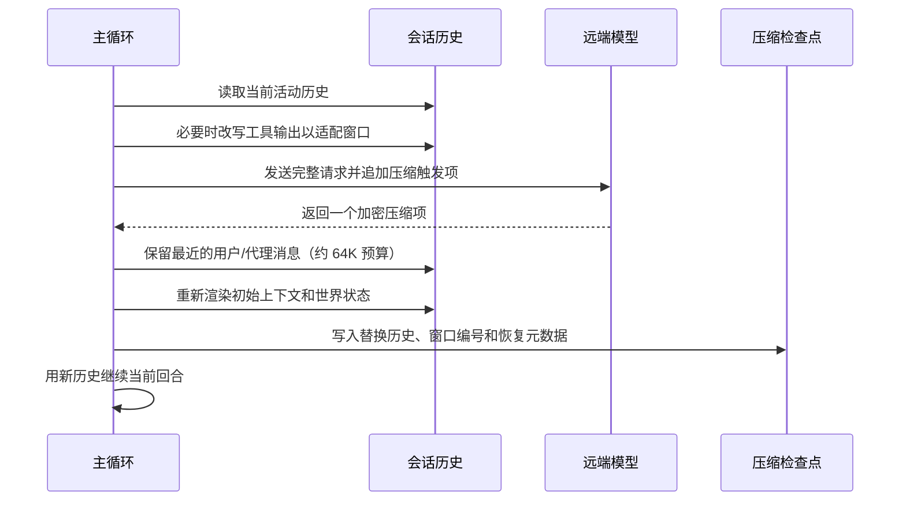

# Context compaction - Codex - 02 - Default remote compaction path

---

Codex 的上下文压缩机制又是怎么做的?

---

## 结论先行

Codex 的默认压缩路径不是“客户端生成摘要”，而是**把压缩请求交给模型供应商，由服务端返回一个加密的压缩项**。

在默认配置下：

- 默认模型供应商是 OpenAI；
- OpenAI、Azure Responses 和 Bedrock 的供应商能力是远端压缩 V2；
- 因此默认路径走远端压缩 V2，而不是本地摘要；
- 自动压缩阈值默认是模型解析出的上下文窗口的 90%；
- 模型默认可用于推理的窗口是完整窗口的 95%；
- 自动压缩计数范围默认是完整活动上下文；
- 预采样和回合中都会检查压缩，回合结束后的压缩默认关闭；
- token 预算压缩、异步后台压缩默认关闭；
- 远端压缩会保留最近的用户消息和部分代理消息，总数最多约 64K token；
- 客户端不生成可读摘要，服务端返回的压缩项是加密内容；
- 压缩后客户端会重新渲染初始上下文和世界状态，并写入压缩检查点。

一句话概括：

> 默认 Codex 在上下文接近 90% 时，把“带 compaction_trigger 的完整请求”发给供应商；服务端返回一个不透明的压缩项，客户端把最近的用户/代理消息、这个压缩项和新渲染的上下文拼成新的历史。

## 场景

用户用默认 OpenAI 配置做一个长时间的重构任务。Codex 读文件、跑测试、修失败用例，工具输出和助手消息不断累积。

当活动上下文接近模型窗口的 90% 时，下一次模型请求之前会先触发压缩。Codex 不会在本地调用一个“总结代理”写一份人类可读的摘要，而是把当前完整请求（包括工具定义、基础指令和历史）发给供应商，并在末尾附加一个压缩触发项。服务端完成压缩后返回一个加密压缩项；Codex 保留最近的用户消息和部分代理消息，重建基础上下文，然后继续工作。

## 机制展开

### 1. 默认路径总览

这条路径有几个关键特征：

- 压缩请求与普通模型请求共享同一个模型、工具定义、基础指令和大部分历史；
- 压缩的“摘要”不是客户端可见的文本，而是服务端生成的加密项；
- 客户端只负责决定保留哪些消息、如何重建上下文、如何持久化；
- 压缩成功后继续当前回合，不需要用户重新发送请求。

### 2. 默认什么时候触发

默认检查点有三处，另有一个手动入口：

| 时机 | 默认行为 |
|---|---|
| 回合开始前 | 如果活动上下文达到自动压缩阈值或完整窗口上限，先压缩再开始采样 |
| 回合中一次采样之后 | 如果还需要继续（工具调用或待处理输入），且达到阈值或请求了新窗口，压缩后继续 |
| 回合结束后 | 只有配置了“回合结束压缩百分比”才触发；默认是 0，即关闭 |
| 手动 `/compact` | 通过 app-server 的线程压缩请求进入同一套压缩任务 |

此外，如果模型发生切换，或者两次模型声明的压缩兼容哈希不同，Codex 会在新回合采样前用**上一个模型**压缩旧窗口，避免把旧模型产生的历史直接交给不兼容的新模型。

自动压缩的阈值来自模型元数据：

- 默认自动压缩上限 = 模型上下文窗口的 90%；
- 在默认的完整上下文计数范围下，用户配置只能把这个上限调低（实现取配置值与 90% 上限的较小值）；
- 默认可用于推理的窗口 = 上下文窗口的 95%；
- 实际触发取两者中更早的一个；
- 计数范围默认是完整活动上下文，而不是只计算某个前缀之后的增量。

所以默认没有固定的“多少 K token”数字；同一个 Codex 版本在不同模型上会有不同的绝对阈值。以 200K 窗口为例，大约是 180K 触发自动压缩、190K 触及完整窗口上限。

### 3. 为什么默认走远端 V2

压缩实现由供应商能力决定，而不是由用户选择一个“压缩器”：

- 默认供应商标识是 `openai`；
- OpenAI 和 Azure Responses 供应商默认声明远端压缩 V2；
- Bedrock 运行时也声明远端压缩 V2；
- 其他供应商默认不支持远端压缩，走本地摘要；
- 自定义供应商可以通过能力覆盖改为 V2 或不支持。

这里有一个容易误读的点：feature 注册表里有一条 `remote_compaction_v2`，但它的 stage 是 removed，默认值也是 false；实际选择压缩实现时看的是供应商能力，不是这个 feature 条目。因此不能把 feature 注册表的状态直接当成“默认不走 V2”。

### 4. 远端压缩请求发什么

远端 V2 请求不是单独构造一份“请总结对话”的提示，而是复用当前回合的模型请求：

- 沿用当前模型、基础指令、工具定义、工具路由和大部分历史；
- 在输入末尾追加一个压缩触发项；
- 保留请求的路由、认证、推理强度和供应商元数据；
- 在发送之前，如果完整历史仍然超过模型上下文窗口，就按从新到旧的顺序逐组把工具输出替换成固定的“输出超出可用上下文，已截断”文本，直到估算能放进窗口。

这一步的取舍是：**保留消息结构，先改写工具输出的正文**。默认没有开启“保留客户端工具输出”的 feature，所以这些输出会被改写；开启该 feature 后，这些输出会被当作保留边界，压缩请求会以不同方式处理。

### 5. 服务端返回什么

服务端必须返回恰好一个压缩输出项。这个项的内容是加密的，客户端不解密，也不生成可读摘要；它只保存这个项，并在后续请求中把压缩项放在历史的末尾。

客户端对返回值的约束很严格：

- 没有收到完成事件，视为流式失败；
- 压缩项数量不是恰好一个，视为致命错误；
- 流式错误按供应商的重试上限和压缩专用的较小上限重试，远端压缩最多重试 2 次（总尝试次数最多 3 次，受供应商上限约束）；
- 如果第一次尝试失败且当前模型与备选模型不同，可能改用当前模型再试一次；这不是“远端失败改本地摘要”的回退。

### 6. 压缩后保留什么

压缩后的历史核心是**保留的最近消息**和**加密压缩项**；随后客户端还会把重新渲染的初始上下文插到合适位置。

默认保留规则：

| 内容 | 默认是否保留 | 说明 |
|---|---|---|
| 用户消息 | 是 | 只保留真实用户消息和 hook 提示；按最新优先装入预算 |
| 代理消息 | 部分 | 保留非最终回答、非子代理进度消息；单条最多约 10K token |
| 工具输出 | 否 | 默认 feature 关闭；压缩前可能已被截断，压缩后不再保留 |
| 客户端开发者消息 | 否 | 默认 feature 关闭；基础开发者指令会通过初始上下文重新渲染 |
| 图片 | 计入预算 | 图片预算 feature 默认开启；保留消息里的图片占用约 64K 总预算，过大时可能被截断或丢弃 |
| 加密压缩项 | 是 | 服务端返回的压缩结果，作为新历史的最后一项 |

保留消息的总预算约 64K token。装入顺序是从最新往旧；如果某条消息放不下，会截断消息文本；如果遇到保留的工具输出放不下，会停止继续装入更旧的内容，避免破坏工具输出的完整性。

压缩之后，客户端还会：

- 重新渲染基础指令、开发者指令、用户上下文和世界状态；
- 把这些初始上下文插入到最后一条真实用户/代理消息或压缩项之前，保证压缩项仍在最后；
- 重新计算 token 使用量；
- 发出压缩 turn item，并执行压缩后 hooks；
- 把 `SessionStart` 的来源记为“压缩”，让后续会话启动钩子知道这是一次压缩后的继续。

### 7. 持久化与恢复

压缩不是只改内存。客户端会写入一个压缩检查点，包含：

- 替换后的完整历史；
- 压缩窗口编号；
- 首个窗口、上一个窗口和当前窗口的 ID；
- 最近的 token 使用记录；
- 压缩请求的响应 ID；
- 模型兼容哈希；
- 恢复所需的运行时版本、上一个回合设置、模型和权限程序。

恢复时会从最新的、同时带有“替换历史”和“窗口编号”的压缩检查点开始，只读取它之后的记录，重建当前上下文窗口；更旧的、缺少这些字段的压缩记录会迫使恢复逻辑回放更多历史。

### 8. 失败与边界

| 情况 | 默认行为 |
|---|---|
| 压缩前钩子返回停止 | 压缩中止，回合按中止处理 |
| 压缩请求流式失败 | 按压缩专用重试预算重试；远端 V2 最多重试 2 次（总尝试次数最多 3 次，受供应商上限约束） |
| 服务端没有返回压缩项 | 视为流式失败 |
| 返回多个压缩项 | 视为致命错误 |
| 预采样压缩失败 | 保留用户输入，向客户端报告错误 |
| 回合中压缩失败 | 结束当前回合并报告错误，不再继续工具循环 |
| 回合结束压缩失败 | 保留已完成的回答，只记录警告 |
| 手动压缩失败 | 向客户端报告错误 |
| 远端压缩失败 | 不会自动退回本地摘要；只可能换当前模型再试 |
| 压缩请求自身超出窗口 | 发送前按从新到旧的顺序改写工具输出；本地摘要路径会逐条移除最旧历史项后重试 |
| 压缩后仍接近上限 | 下一次预采样或回合中检查可以再次触发压缩 |

### 9. 其他实现只作边界说明

- **token 预算压缩**：feature 处于 under-development，默认关闭；它不生成摘要，直接开启新的上下文窗口，但仍走压缩生命周期和 hooks。
- **异步后台压缩**：feature 处于 under-development，默认关闭；它会在前台达到限制前提前准备压缩候选。
- **本地摘要压缩**：不在默认 OpenAI 路径上；当供应商不支持远端压缩时才会走。它由客户端调用模型生成可读摘要，并保留一部分用户消息。
- **手动压缩**：默认可用，但仍然按供应商能力选择 V2 或本地摘要；默认 OpenAI 用户手动 `/compact` 也会走远端 V2。

## 条件与边界

| 条件 | 默认值/行为 |
|---|---|
| 默认供应商 | OpenAI |
| 默认压缩实现 | 远端压缩 V2 |
| 自动压缩阈值 | 模型上下文窗口的 90% |
| 完整窗口上限 | 模型上下文窗口的 95% |
| 计数范围 | 完整活动上下文 |
| 回合结束压缩 | 关闭（百分比为 0） |
| 回合中压缩 | 需要继续且有工具调用/待处理输入时检查 |
| 模型切换/兼容哈希变化 | 采样前用上一个模型压缩旧窗口 |
| 保留消息预算 | 约 64K token |
| 单条代理消息预算 | 约 10K token |
| 工具输出保留 | 默认关闭 |
| 客户端开发者消息保留 | 默认关闭 |
| 图片预算 | 默认开启 |
| 远端压缩流式重试 | 最多重试 2 次（总尝试次数最多 3 次，受供应商上限约束） |
| 远端失败回退本地 | 默认没有 |
| token 预算压缩 | 默认关闭 |
| 异步后台压缩 | 默认关闭 |
| 手动压缩 | 默认可用，默认走 V2 |

## 设计取舍

**把摘要交给供应商，客户端只负责历史和状态。** 这样客户端不需要维护一套可读摘要格式，也不必让压缩摘要与模型内部表示对齐；代价是压缩结果不可读、不可在客户端审计，且强依赖供应商协议。

**默认阈值设在 90%，完整窗口设在 95%。** 两者之间留出余量给压缩请求本身、工具调用和下一轮上下文增长；代价是压缩会比硬上限更早发生，产生一次额外请求。

**保留用户消息而不是保留完整历史。** 用户意图和最近反馈比旧工具输出更重要；代理消息只保留非最终、非进度的部分，避免把大量多代理通信塞进新窗口。

**默认不保留工具输出和客户端开发者消息。** 这些内容要么可以重新执行/读取，要么会通过初始上下文重新渲染；保留它们会显著增加预算和缓存复杂度。

**默认不做回合结束压缩。** 回合结束压缩会增加每次回答后的延迟和成本；只有在配置了明确百分比时才启用。

**远端失败不退回本地摘要。** 这保持了实现和供应商协议的一致性，但降低了容错性：远端压缩不可用时，用户看到的是错误，而不是自动降级。

## 证据分级

**已证实**

- 默认供应商标识是 OpenAI；
- OpenAI/Azure Responses 和 Bedrock 的供应商能力是远端压缩 V2；
- 默认自动压缩上限是模型上下文窗口的 90%，默认计数范围下配置只能调低；
- 默认可用于推理的窗口是上下文窗口的 95%；
- 默认计数范围是完整活动上下文；
- 回合结束压缩默认关闭；
- 预采样和回合中都会检查压缩；
- 远端 V2 请求在输入末尾追加压缩触发项；
- 服务端必须返回恰好一个加密压缩项；
- 压缩后默认保留用户消息和部分代理消息，总预算约 64K token；
- 工具输出和客户端开发者消息默认不保留；
- 图片预算默认开启；
- 压缩检查点保存替换历史、窗口编号/ID、token 使用和恢复元数据；
- 远端压缩流式重试最多重试 2 次（总尝试次数最多 3 次，受供应商上限约束）；
- 默认没有远端失败转本地的回退；
- token 预算压缩和异步压缩默认关闭。

**合理推断**

- 普通默认用户的可见行为是“预采样/回合中远端压缩 + 加密压缩项 + 最近用户消息保留”；
- 默认 OpenAI 用户手动 `/compact` 也走远端 V2，因为手动任务同样按供应商能力选择实现；
- 压缩后模型看到的不是一份人类可读摘要，而是服务端可解释的加密压缩项；
- 保留消息预算和截断策略的主要目的是保住用户意图与最近工作，同时限制压缩请求和替换历史的规模。

**无法确认**

- 服务端实际如何生成加密压缩项、压缩粒度和信息损失；
- 生产模型元数据里各模型的实际上下文窗口和 90%/95% 绝对阈值；
- 自定义供应商是否正确覆盖远端压缩能力；
- feature 注册表中 removed/under-development 状态与实际发行配置的完整对应关系；
- 不同客户端（TUI、exec、IDE）对压缩 turn item 的展示细节。

## 源码依据

以下路径相对于 Codex 源码快照根目录。

| 机制 | 源码位置 | 关键函数/行 |
|---|---|---|
| 默认供应商回退到 openai | `codex-rs/core/src/config/mod.rs` | 3927-3933 |
| 供应商默认远端压缩能力 | `codex-rs/model-provider/src/capabilities.rs` | 16-50 |
| 远端压缩支持枚举 | `codex-rs/model-provider-info/src/capabilities.rs` | 17-27 |
| 自动压缩 90% 上限 | `codex-rs/protocol/src/openai_models.rs` | `auto_compact_token_limit` 524-537 |
| 默认可用于推理的 95% 窗口 | `codex-rs/protocol/src/openai_models.rs` | 392-395、524-525 |
| 自动压缩计数范围默认 Total | `codex-rs/protocol/src/config_types.rs` | 41-55 |
| token 状态与触发判定 | `codex-rs/core/src/session/context_window.rs` | 11-110 |
| 预采样压缩 | `codex-rs/core/src/session/turn.rs` | 1304-1330 |
| 模型切换/兼容哈希压缩 | `codex-rs/core/src/session/turn.rs` | 1346-1425 |
| 回合中压缩 | `codex-rs/core/src/session/turn.rs` | 560-660 |
| 回合结束压缩 | `codex-rs/core/src/session/turn.rs` | 700-760 |
| 本地/远端实现选择 | `codex-rs/core/src/session/turn.rs` | 1435-1505 |
| 远端 V2 主流程 | `codex-rs/core/src/compact_remote_v2.rs` | 128-370 |
| 远端 V2 请求与响应收集 | `codex-rs/core/src/compact_remote_v2.rs` | 399-565 |
| 压缩后保留策略 | `codex-rs/core/src/compact_remote_v2.rs` | 565-690 |
| 保留消息预算与截断 | `codex-rs/core/src/compact_remote_v2.rs` | 690-850 |
| 压缩前改写工具输出 | `codex-rs/core/src/compact_remote_history.rs` | 70-175 |
| 压缩触发项 | `codex-rs/core/src/compact_remote_v2_attempt.rs` | 200-230 |
| 加密压缩项结构 | `codex-rs/protocol/src/models.rs` | 1270-1284 |
| 初始上下文插入与替换历史 | `codex-rs/core/src/compact.rs` | 636-685 |
| 压缩后历史安装与持久化 | `codex-rs/core/src/session/mod.rs` | 4154-4345 |
| 压缩检查点结构 | `codex-rs/history/src/lib.rs` | 289-310 |
| 压缩检查点可用性 | `codex-rs/history/src/compaction_checkpoint.rs` | 1-60 |
| 恢复时按压缩边界扫描 | `codex-rs/rollout/src/model_context.rs` | 1-60 |
| 压缩恢复元数据 | `codex-rs/history/src/compaction_resume_metadata.rs` | 1-57 |
| 压缩前/后 hooks | `codex-rs/core/src/hook_runtime.rs` | 544-604 |
| 手动压缩入口 | `codex-rs/app-server/src/request_processors/thread_processor.rs` | 2461-2480 |
| 手动压缩任务分派 | `codex-rs/core/src/tasks/compact.rs` | 40-90 |
| 压缩 feature 默认值 | `codex-rs/features/src/lib.rs` | 1902-1925、2050-2070 |
