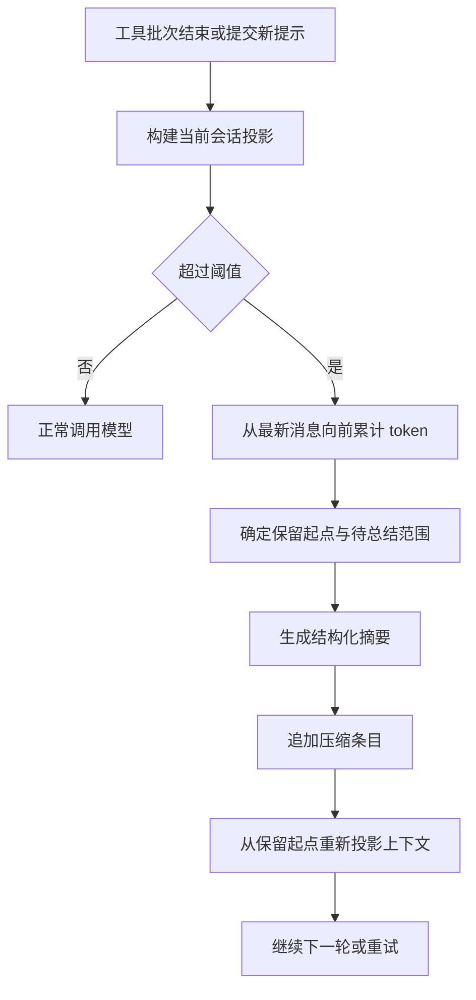

# Context compaction - Pi - 02 - Compaction and branch summary

---

Pi 的上下文压缩是怎么做的?

---

## 结论先行

Pi 的默认压缩不是“把旧消息删掉”，而是**在会话树里追加一条压缩记录，再从保留起点重新投影模型上下文**。

默认配置下：

- 自动压缩开启；
- 预留 16384 token 给模型输出；
- 保留最近约 20000 token 的消息；
- 当前上下文超过“模型窗口减去 16384”时触发；
- 压缩时把保留起点之前的消息总结成结构化摘要；
- 摘要写入会话树，原消息仍保留在 JSONL 里，但不再进入模型视图；
- 手动 `/compact` 默认可用，但它会先中止当前操作，压缩后不会自动继续被中止的回合；
- 上下文溢出或响应被截断时，最多做一次“压缩后重试”；
- 切换会话分支时的“分支摘要”是另一条路径，默认由用户选择是否生成。

`pi-durable` 是另一套独立的持久化运行时，不是当前 CLI 的压缩实现；它有自己的压缩任务和策略，本文只在边界处说明。

## pi-durable 是什么

`pi-durable` 是 Pi monorepo 里的一个实验性包，定位是“持久化的 Agent harness”：

- 对话、模型回合、工具调用和自定义状态先以原子提交写入存储，再显示给调用方；
- 进程中途崩溃后，可以用同一份存储恢复未完成的工作；
- 支持内存、JSONL 和 SQLite 存储；
- 提供任务图、子任务、对话分支和扩展机制；
- 有自己的压缩任务，按“选择切点 → 生成摘要 → 失败重试”的阶段执行，默认策略同样是预留 16384、保留最近 20000 token，并额外支持后台压缩预算。

但当前 CLI 的会话由 `coding-agent` 的 `SessionManager` 和 `AgentSession` 管理，`coding-agent` 不依赖 `pi-durable`。因此：

- 研究 CLI 的压缩时，应以 `coding-agent` 的压缩条目和会话投影为准；
- `pi-durable` 的压缩是相似但独立的实现，不能把它的任务图、叶子状态或存储语义套到 CLI 上。

## 场景

用户在一个长会话里让 Pi 修改多个文件、反复跑测试。工具结果和助手消息不断累积，模型上下文逐渐接近窗口上限。

Pi 不会把旧消息从 JSONL 里删掉，而是等到工具批次结束、下一次助手响应之前，检查当前投影是否超过阈值。超过后，它从最新消息往前累计 token，保留最近一段原文，把更早的消息交给摘要模型，生成一份结构化交接摘要。然后它追加一条压缩记录，下一次请求就从“摘要 + 保留起点之后的消息”重新开始。

## 机制展开

### 1. 默认路径总览

这条路径的关键是“追加记录 + 重新投影”，而不是原地重写消息数组：

- 旧消息仍然留在会话文件里；
- 当前模型视图只包含最新压缩条目、保留起点之后的消息和必要的系统消息；
- 恢复会话时，从当前叶子沿父链回到根，找到最新压缩记录，再按保留起点重建视图。

### 2. 什么时候触发

默认检查点有三处，另有一个手动入口：

| 时机 | 默认行为 |
|---|---|
| 工具批次结束后、下一次助手响应前 | 检查投影是否超过阈值；如果这批工具已经结束整个运行且没有排队消息，则跳过 |
| 提交新的用户提示前 | 检查上一次助手消息的上下文用量；即使上一次响应被中止，也会检查 |
| 运行结束后 | 识别上下文溢出或可恢复的截断响应，压缩并最多重试一次 |
| 手动 `/compact` | 先中止当前操作，再压缩；不会自动继续被中止的回合 |

默认阈值公式是：

> 当前上下文 token 数 > 模型上下文窗口 - 16384

这里的 16384 是预留给模型输出的空间。默认保留最近 20000 token 的消息；这两个值都可以通过全局设置或项目设置覆盖，也可以按模型覆盖。

token 统计优先使用最近一次有效助手响应的 usage；它之后新增的消息用本地估算补齐。图片按固定字符数近似，文本按约 4 字符/token 估算。若最近发生了压缩或上下文编辑，旧 usage 可能已经不能代表当前投影，此时改用投影后的完整估算。

### 3. 切点怎么选

切点选择只针对“当前模型可见的投影”，不是原始 JSONL。

大致过程：

1. 从最新一条消息向前累计估算 token；
2. 累加到保留预算（默认 20000）时，停在最近的合法切点；
3. 合法切点包括用户消息、助手消息、Bash 执行消息、自定义消息、分支摘要和压缩摘要；
4. **不能在工具结果处切**，因为工具结果必须和它对应的工具调用待在一起；切在带工具调用的助手消息处时，后续工具结果会一起保留；
5. 如果切点落在一条过长的用户消息内部，会形成“拆分回合”：保留点之前的同回合前缀单独再生成一份摘要，和主历史摘要合并。

重复压缩时，待总结范围从**上一次压缩的保留起点**开始，而不是从压缩条目本身开始。这样，上次压缩后保留下来的消息也会进入下一次摘要，不会因为多次压缩而丢失。若上一次压缩选择“不保留任何前文”，下一次压缩就从该压缩条目之后开始。

压缩前还会重新计算 `tokensBefore`，即从当前投影重建后实际被替换掉的上下文大小，而不是沿用上一次的旧数值。

### 4. 摘要怎么生成

默认摘要请求使用当前选中的模型和思考级别，支持虚拟模型的路由解析。

摘要请求有几个明显特征：

- **不写提示缓存**：摘要是一次性请求，缓存写入没有复用价值；
- **独立序列化对话**：把用户消息、助手文本、工具调用和工具结果转成文本，避免模型把摘要请求当成继续对话；
- **工具结果截断**：序列化时每条工具结果最多保留约 2000 字符；
- **省略思考内容**：摘要只依赖可见文本、工具调用和工具结果；
- **禁止工具调用**：摘要模型如果尝试调用工具，视为摘要失败；
- **限制输出长度**：历史摘要最多使用预留 token 的 80%，拆分回合的前缀摘要使用 50%；
- **复用会话重试策略**：临时流错误按配置重试；错误、截断或工具调用会直接判失败，不把不完整摘要写成检查点。

摘要格式固定覆盖：

1. Goal；
2. Constraints & Preferences；
3. Progress（Done / In Progress / Blocked）；
4. Key Decisions；
5. Next Steps；
6. Critical Context。

如果已经有上一份摘要，提示词会切换成“更新已有摘要”的版本，要求保留旧信息、合并新进展，并继续保留精确的文件路径、函数名和错误信息。用户还可以通过 `/compact [instructions]` 追加摘要重点。

摘要完成后，Pi 会追加文件操作清单：

- 从工具调用中提取读、写、编辑过的文件；
- 如果上一份压缩是 Pi 自己生成的，会把它的文件清单一起累积；
- 最终分成“只读文件”和“修改过的文件”两组，附在摘要末尾。

### 5. 写入什么，模型看到什么

压缩结果会变成一条新的会话树条目，包含：

- 摘要正文；
- 第一个保留条目的 ID；
- 压缩前 token 数；
- 摘要调用的 usage；
- 文件操作详情；
- 压缩时的系统消息快照；
- 是否由扩展提供。

模型视图重建时：

1. 从当前叶子回溯到根，找到路径上最新的压缩条目；
2. 从压缩条目开始，保留它携带的系统消息和摘要；
3. 找到第一个保留条目，把它和它之后的消息加入视图；
4. 跳过保留范围内的旧系统消息，避免重复；
5. 应用上下文编辑（替换或删除）后再形成最终消息列表。

因此，模型看到的是“系统提示快照 + 压缩摘要 + 保留消息”，而不是整棵会话树。原始历史仍在文件里，导出、检索或计费仍能看到被省略的条目。

### 6. 溢出与失败恢复

Pi 把上下文溢出和“输出被截断”当成可恢复错误：

1. 先把失败的助手尝试用上下文编辑标记为不可见；
2. 执行一次压缩；
3. 如果压缩成功且原回合还需要继续，就重试该回合一次；
4. 如果压缩失败或被取消，保留“失败尝试不可见”的编辑，但不追加压缩，也不自动重试。

这条恢复路径只允许一次尝试。第二次仍溢出时，会明确告诉用户“一次压缩重试后仍失败”，而不是无限循环。

阈值压缩失败不会重试已完成的回答；它只影响下一轮上下文。手动压缩失败会报告错误；扩展取消压缩时按取消处理，不写入检查点。

### 7. 扩展怎么介入

压缩前后有明确的生命周期：

- `session_before_compact`：可以看到准备结果、当前分支、触发原因、是否会在压缩后重试；扩展可以取消，也可以直接提供一份自定义压缩结果；
- `session_compact`：压缩成功并写入条目后触发；
- `session_compact_failed`：压缩失败或被取消时触发。

扩展提供的摘要会带上“来自扩展”的标记，并使用扩展自己的详情结构；Pi 不会自动继承扩展摘要里的文件清单。

### 8. 分支摘要是什么

分支摘要不是自动上下文压缩，而是**切换会话树分支时的上下文转移**。

使用 `/tree` 从当前分支跳到另一个历史位置时，Pi 会询问是否总结即将离开的分支：

- “No summary”：直接切换，新分支看不到旧分支的内容；
- “Summarize”：生成摘要并注入新分支；
- “Summarize with custom prompt”：用用户指令控制摘要重点。

默认会询问；如果把 `branchSummary.skipPrompt` 设为 true，则默认不总结。

分支摘要的行为：

1. 从旧叶子沿父链走到新旧位置的最近公共祖先；
2. 收集这条被放弃路径上的条目；
3. 从最新到最旧装入预算，预算约为“模型窗口减去 16384”；
4. 跳过工具结果，保留用户/助手消息、压缩摘要和分支摘要；
5. 生成一份比常规压缩更短的结构化摘要（Goal、Constraints、Progress、Key Decisions、Next Steps，不含 Critical Context）；
6. 摘要最多约 4096 token；
7. 把摘要作为 `branch_summary` 条目挂在**新分支的目标位置**，并把旧叶子记录在 `fromId` 里；
8. 同时累积文件读写清单。

所以它解决的是“我离开了另一条探索路径，但希望新分支知道那条路上做了什么”，而常规压缩解决的是“当前路径太长，需要腾出上下文”。两者共享摘要格式和文件跟踪，但不是同一个触发条件。

## 条件与边界

| 条件 | 默认值/行为 |
|---|---|
| 自动压缩 | 开启 |
| 预留 token | 16384 |
| 保留最近 token | 20000 |
| 阈值 | 当前投影 > 模型窗口 - 16384 |
| 手动 `/compact` | 可用；先中止当前操作，不自动继续 |
| 溢出恢复 | 一次压缩加重试 |
| 摘要输出上限 | 预留 token 的 80% |
| 拆分回合前缀摘要 | 预留 token 的 50% |
| 工具结果序列化上限 | 约 2000 字符/条 |
| 摘要缓存写入 | 关闭 |
| 分支摘要 | `/tree` 时由用户选择；默认会询问 |
| 分支摘要预留 | 16384 |
| 分支摘要输出上限 | 约 4096 token |
| 分支摘要默认跳过询问 | false |
| 扩展自定义压缩 | 可以取消或替换摘要 |
| 原始历史 | 保留在 JSONL，模型视图只取最新压缩边界之后 |
| `pi-durable` | 独立实验性运行时，不属于 CLI 默认路径 |

## 设计取舍

**树形会话 + 追加压缩条目。** 不重写 JSONL，而是追加一条压缩记录并改变模型视图。好处是旧历史可恢复、分支和压缩可以共存、恢复逻辑只需从最新边界重建；代价是投影、切点和上下文编辑逻辑更复杂。

**保留最近原文，而不是全部摘要。** 最近的用户反馈和工具上下文通常比旧历史更重要；保留 20000 token 让模型仍能看到细节。代价是压缩后的上下文仍然占用一定空间，阈值必须给输出预留足够余量。

**切点只能在消息边界，不能切工具结果。** 这保证工具调用与结果的配对关系不被破坏。切到回合内部时，额外生成回合前缀摘要，避免把半条工具链直接留给模型。

**摘要请求不写缓存。** 压缩是一次性请求，缓存写入的复用概率低；关闭缓存写入可以减少无谓的缓存创建。代价是摘要请求本身完全按普通请求计费。

**溢出恢复只重试一次。** 这能挽救大多数由临界超限引起的失败，同时避免“压缩 → 仍溢出 → 再压缩”的死循环。

**分支摘要由用户选择。** 切换分支不一定需要把旧分支带入新上下文；默认询问可以在“保留探索信息”和“保持新分支干净”之间让用户决定。

## 证据分级

**已证实**

- 默认自动压缩开启，预留 16384 token，保留最近 20000 token；
- 阈值判断是当前上下文超过模型窗口减预留值；
- 自动压缩在工具批次结束后、下一次助手响应前检查，也会在提交新提示前检查；
- 压缩会生成结构化摘要，并在已有摘要时使用更新提示；
- 摘要请求不写提示缓存，工具结果序列化会截断，思考内容被省略；
- 摘要切点不会落在工具结果上，切在回合内部时会额外生成前缀摘要；
- 压缩结果以会话树条目追加，包含保留起点、压缩前 token、usage、文件详情和系统消息快照；
- 恢复时从最新压缩条目和保留起点重建模型视图，原始历史仍保留；
- 溢出恢复最多压缩并重试一次；
- 分支摘要由 `/tree` 触发，默认询问用户，摘要挂在新分支目标位置；
- `pi-durable` 是独立包，当前 `coding-agent` 不依赖它。

**合理推断**

- 默认用户看到的压缩行为是“达到阈值后生成可读摘要”，而不是依赖供应商侧的不透明压缩；
- 保留最近 20000 token 与预留 16384 token 的组合，是为了在保留细节和给输出留空间之间取平衡；
- 文件清单的累积是为了让后续模型知道哪些文件已经读过或改过，减少重复探索；
- 分支摘要的默认询问是为了避免用户每次切换分支都承担一次摘要调用。

**无法确认**

- 不同 provider、模型和虚拟模型路由下的实际 token 估算偏差；
- 线上用户设置是否覆盖了默认阈值；
- 扩展安装后对默认压缩行为的实际影响；
- `pi-durable` 的压缩策略在生产环境中的默认配置和稳定性。

## 源码依据

以下路径相对于 Pi 源码快照根目录。

| 机制 | 源码位置 | 关键函数/行 |
|---|---|---|
| 默认压缩设置 | `packages/coding-agent/src/core/settings-defaults.ts` | 9-19 |
| 压缩阈值与默认值 | `packages/coding-agent/src/core/compaction/compaction.ts` | 122-130、267-270 |
| token 估算 | `packages/coding-agent/src/core/compaction/compaction.ts` | 196-260 |
| 切点选择 | `packages/coding-agent/src/core/compaction/compaction.ts` | 397-465、699-860 |
| 压缩准备与重复压缩 | `packages/coding-agent/src/core/compaction/compaction.ts` | 872-950 |
| 摘要生成 | `packages/coding-agent/src/core/compaction/compaction.ts` | 645-830、965-1119 |
| 文件跟踪与序列化 | `packages/coding-agent/src/core/compaction/utils.ts` | 1-180 |
| 会话投影与压缩边界 | `packages/coding-agent/src/core/session-manager.ts` | 440-590 |
| 压缩条目结构 | `packages/coding-agent/src/core/session-manager.ts` | 91-104 |
| 追加压缩条目 | `packages/coding-agent/src/core/session-manager.ts` | 1260-1290 |
| 手动压缩 | `packages/coding-agent/src/core/agent-session.ts` | 2794-2935 |
| 自动阈值/溢出压缩 | `packages/coding-agent/src/core/agent-session.ts` | 2957-3310 |
| 压缩前扩展钩子 | `packages/coding-agent/src/core/extensions/types.ts` | 784-815、1511-1528 |
| 分支摘要收集与生成 | `packages/coding-agent/src/core/compaction/branch-summarization.ts` | 108-380 |
| 分支切换与摘要挂载 | `packages/coding-agent/src/core/agent-session.ts` | 4025-4195 |
| 分支摘要设置 | `packages/coding-agent/src/core/settings-defaults.ts` | 14-17 |
| `pi-durable` 定位 | `packages/durable/package.json`、`packages/durable/README.md` | 包描述与 README |
| `pi-durable` 独立压缩任务 | `packages/durable/src/harness/compaction.ts` | 1-180 |
