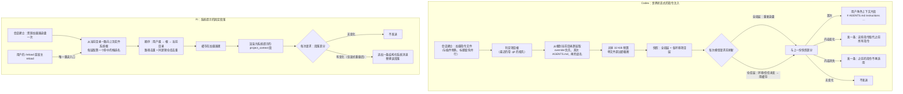

# instruction-files - comparison - 01 - AGENTS.md 这类文件的读入时机与强制性

---

Codex 和 Pi 有对 AGENTS.md 这种文件做特殊关照吗? 如果有, 它们都是在什么时候读入的? 读入是由 Harness 强制保证的吗?

（追问确认：连带看同一机制下的其他候选文件名；也看提示词里对模型的交代。）

---

## 一句话结论

两边都有专门为指令文件写的一套机制，但落点完全不同。

Codex 把它做成**运行时的、按需重取的上下文状态**：启动时读一次，之后每次模型请求前再校验一次，读到的内容作为"可被替换、可被撤回"的世界状态注入，改动会以"取代之前那份"的形式推给模型。哪份文件被读、读多少字节、项目是否被信任，全部由 harness 决定，模型没有选择权。

Pi 把它做成**系统提示的一个固定段落**：会话建立时读一次，把工作目录与所有祖先目录的指令文件拼成系统提示里的 `<project_context>` 段；此后除非显式重载，不会再看磁盘。渲染与重发由 harness 保证，但"什么时候重新读"的主动权不在模型也不在 harness，而在用户或宿主进程。

两边的共同点是：**"把已发现的文件放进上下文"这一步是 harness 强制的**；而"目录树更深处的指令文件"两边都没有自动发现，Codex 至少在提示词里明确要求模型自己去查，Pi 连这句话都没有。

## 场景：这件事要解决什么问题

指令文件机制要在四个地方做决定，两边的差异基本都出在这里：

1. **发现**：从哪个目录开始找、往上找还是往下找、什么时候停、认哪些文件名。
2. **注入**：读到的文本变成提示词里的哪一层，和内置提示、用户输入怎么排。
3. **预算**：读多少、超了怎么办、截断还是报错。
4. **生命周期**：读一次还是反复读，文件改了、删了、被移出信任范围之后模型怎么知道。

## Codex 的机制

### 阶段一：会话建立时的一次必然加载

会话一开始，创建流程里的三条异步任务并行跑：加载指令文件、预热插件与技能、查询会话标题。指令文件那条会先把宿主提供的用户级/线程级指令装进来，再依次读每个环境（本地或远端执行环境）的项目指令。这一步是**初始化路径上的硬步骤**：出错会中止会话创建，而不是悄悄降级（读文件被沙箱拒绝时会直接失败并给出"该环境的 AGENTS.md 加载失败"）。

### 阶段二：根目录判定决定了"往上找多远"

发现不是简单地从工作目录一路走到文件系统根，而是先找到**项目根**：从当前目录往上探测，找到第一个带"项目根标记"的目录就停。默认标记只有一个——存在 `.git`。这个标记列表可以被配置替换，也可以被配置成空列表（等于关闭向上遍历）。找不到任何标记时，只考虑当前工作目录本身。

确定根之后，收集的不是"任意祖先"，而是**从根到当前目录这条路径上的每一层**，父在前、子在后依次拼接。**不会越过根继续向上**，也不往下扫子目录。

### 阶段三：候选文件名与覆盖语义

每个目录里按固定顺序探测，先命中先得：`AGENTS.override.md` → `AGENTS.md` → 用户配置的兜底文件名列表（默认为空）。所以"同目录 override 优先"是硬编码语义，兜底名是给人配的。兜底项的校验很严格：含路径分隔符、等于 `.`/`..`、含空字节的名字会被直接丢弃，Windows 路径约定下还额外禁掉 `\` 和 `:`——原因是元数据探测本身在远端执行器上会发出网络请求，不能在探测期就把环境凭证带出去。

另外，同一套发现逻辑还有一个**用户级作用域**：在 Codex 主目录下按 `AGENTS.override.md` → `AGENTS.md` 找一个，第一个非空的胜出，取完即停（不是两个都读）。它排在所有项目文件前面。

### 阶段四：预算、截断与跳过

所有项目文件共享一个总预算，默认 32 KiB（可配置）。规则是：

- 按"根→当前目录"的顺序消费预算，剩余为 0 就停止读取后续文件；
- 单个文件超出剩余额度时**截断到剩余额度**并记一条警告，而不是整份丢弃；
- 整份只含空白字符的文件算作没读到，不占预算也不产生条目；
- 多个执行环境共享同一个总预算，先服务的环境先花。

会话级的线程指令是另一套规则：超过约一万 token 的估算量时**直接拒绝这次请求**，不做截断——因为那部分是宿主程序塞进来的，宁可显式失败也不让模型拿到半截指令。

### 阶段五：注入形态是"世界状态"，不是普通对话消息

读到的内容不会作为一条聊天记录贴进历史就完事，而是进入一个**世界状态**模型：每次组请求时，harness 把当前应可见的状态（基础指令、工具清单、环境、权限、以及这里的指令文件内容）渲染成一个快照，和"上一轮已经告诉模型的那份快照"做差分，只把变化的段落发出去。

指令文件这一段的具体形态是：

- 首次出现：一条用户角色的上下文片段，包裹在 `# AGENTS.md instructions for <目录>` 与 `<INSTRUCTIONS>…</INSTRUCTIONS>` 之间，用固定的包裹标记和"用户真的说的话"区分开；
- 内容变化：新消息前缀明确写着"这些 AGENTS.md 指令取代之前提供的所有 AGENTS.md 指令"；
- 内容消失：发出"之前提供的 AGENTS.md 指令不再适用"；
- 内容没变：什么都不发——不重复计费。

这条片段在权限判定上也被特殊对待：它属于"上下文片段"而不是用户输入，因此不会被当成用户授权（不会因为文件里写了什么就被视为用户同意了某个操作）。

多个执行环境各自贡献文件时，快照的渲染会切换成带环境标注的形态：每个环境一个 `for <环境> with root <目录>` 抬头，该环境的一串层级文件排在同一抬头下面，避免每份文件都重复一遍环境信息。

### 阶段六：什么时候重读

这是与 Pi 差异最大的一点。每次组请求（每个"步骤"，包括同一轮里工具调用之后的续跑）都会经过指令刷新，但刷新分两层：

- **宿主提供的用户级/线程级指令每次都重新取**：所以主目录里的 `AGENTS.md` 在会话中途被改了，下一次模型请求就能看到"取代"通知。已有测试专门覆盖"同一轮里工具调用之后刷新"这条路径。
- **项目目录的发现结果被缓存**，缓存键是"环境选择集合 + 项目信任级别"。工作目录不变、信任级别不变时，不会重新扫盘——也就是说，**仓库里的 AGENTS.md 在会话中途被编辑，当前会话看不到**，要等环境或信任级别变化（换目录、重新信任、冷启动、fork 出新会话）才重新发现。有测试正是断言"多环境下刷新全局指令但保留仓库快照"，也有测试覆盖"读取权限收紧时缓存作废"和"删除文件后冷恢复只失效一次"。

刷新本身用单许可信号量串行化，避免并发组请求时同一批文件被读两遍或产生两份不一致的快照。

### 阶段七：信任门与子代理

项目指令的发现有一个开关：如果项目被显式标记为"不信任"，**整个项目发现被跳过**（用户级指令仍然加载）。注意判定是"显式不信任"才跳过——信任级别未设置时照常加载。

子代理不重新扫盘，而是**继承父会话已经生效的那份快照**；委托式审查会话还可以显式固定（pin）一份快照，即使它是空的也照样跳过发现，以保证审查者看到的就是发起时的项目说明。

### 阶段八：提示词里对模型的交代

系统层提示词专门有一节讲 AGENTS.md 的语义，明确四件事：

- 一份文件的作用域是它所在目录下的整棵子树；
- 修改某个文件时必须服从覆盖该文件的 AGENTS.md；
- 嵌套更深的文件在冲突时优先；
- 直接的 system/developer/user 指令优先于 AGENTS.md。

然后给出关键的边界声明：**根目录到当前目录这条链上的文件已经随消息一起提供、不需要再读**；但**在工作目录的子目录或工作目录之外工作时，要自己去检查有没有适用的 AGENTS.md**。

也就是说：浅层链路由 harness 保证，深层文件由模型自愿承担。这里还有一处文字与实现的不一致——提示词说这些内容"随开发者消息一起提供"，实际注入的角色是用户。这一点在既有笔记里已单独记录过。

## Pi 的机制

### 阶段一：会话建立时读一次，之后靠显式重载

资源加载器在会话启动时加载一次，把指令文件列表解析好并缓存在加载器里（供系统提示构建与界面展示两处使用）。此后**没有任何自动重读**：既没有每轮刷新，也没有文件变更监听。会触发重新读取的只有显式动作——用户执行 `/reload`、或宿主通过 SDK 调 `session.reload()`（该动作同时重载设置、扩展与工具，属于"整会话重载"级别，而不是"重读指令文件"的专用按钮）。

工作目录在会话内是固定的（没有会话内切换工作目录的命令），所以也不存在"换目录要不要重扫"的问题。

### 阶段二：一路探到文件系统根

发现逻辑比 Codex 简单也更"贪"：从工作目录开始逐级向上，**一直走到文件系统根**，不找项目根、不认 `.git` 标记。每一层按固定候选顺序取第一个存在的普通文件：`AGENTS.override.md` → `AGENTS.md` → `AGENTS.MD` → `CLAUDE.md` → `CLAUDE.MD`。大小写变体与 `CLAUDE.md` 都是内建的候选名，不需要配置。

组装顺序是：**先放用户级（Pi 配置目录）那一份，再放祖先链（从根到当前目录，父在前）**。路径去重，同一份文件只出现一次。

override 的语义与 Codex 相同但作用域更窄，文档里写得很明确：`AGENTS.override.md` **只替换同一目录下的** `AGENTS.md`/`CLAUDE.md`，既不会压制用户级那份，也不会压制其他目录的文件。

还有一处专门的去重：在"主仓库里嵌套一个 linked worktree"的布局下，worktree 根目录自己的指令文件与主仓库的同名文件处于同一个逻辑仓库作用域，两份都加载等于把同一份约定应用两次。实现上先判断当前目录是否落在某个主仓库内的 linked worktree 里，再判断 worktree 根目录的指令文件是否"遮蔽"了主仓库那份同名文件——命中则跳过主仓库那一份，未命中则保持正常的祖先继承。判断用 realpath 而不是字面路径，因为 `git worktree add` 写进 `.git` 文件的目标是 realpath 形式，而工作目录本身可能是软链（例如 macOS 的 `/tmp`）。

### 阶段三：注入形态是系统提示的一个命名字段

读到的文件不会变成长上下文里的对话消息，而是拼进系统提示的一个固定段落：

- 段落名 `project_context`，正文先一行"项目特定指令与准则："
- 每份文件一段 `<project_instructions path="绝对路径">…</project_instructions>`
- 段落位置：内置前导（或自定义系统提示）、工具清单、规则、Pi 文档指引、追加提示之后，技能清单与工作目录之前。

系统提示本身是**有序、可独立替换的命名段落集合**，会话记录里保存的是这些结构化段落而不是一整段字符串。每次请求前，harness 用当前应有的段落重新算一遍，和"模型当前看到的那份"做差分，只把变化的段落作为一条系统消息补进历史（删掉的段落用空值表示）。所以：

- 文件没变 → 不发，零成本；
- 显式重载后文件变了 → 下一轮请求带一条 `project_context` 段落的更新；
- 恢复会话 → 新建加载器会重新读盘，与历史里保存的段落比对，有差异就发一次更新。

**这段内容没有任何体积预算**：既不截断单文件，也不设总量上限，读到多少就多少。压缩时它属于"当前系统消息"的一部分被保留并计入 token 估算，因此不会被压缩掉，而是随每轮请求稳定占位。

### 阶段四：开关与扩展点

- 命令行 `--no-context-files` / `-nc`：完全跳过指令文件发现，得到空列表。
- 扩展 API 提供 `agentsFilesOverride`，可以替换整个列表（这也是第三方做"指令文件加工"的入口）；而 `resources_discover` 钩子只能追加技能/提示模板/主题路径，**不能**给指令文件加路径。
- 项目信任与指令文件发现无关：文档明确写"指令文件发现不需要项目信任"。信任只影响项目 `.pi` 配置、项目扩展与包安装这些能执行代码的东西。

### 阶段五：提示词里对模型的交代

Pi 的系统提示里**没有** AGENTS.md 这一节：既没有说明作用域与冲突优先级，也没有"根到工作目录的已经给你了、更深的自己去查"这类指引。相关内容只出现在给仓库贡献者看的文档里，以及一个纯展示用的细节——读取工具在渲染"读了 AGENTS.md/CLAUDE.md 这类文件"时会给它打个资源标签。

所以 Pi 这边对"更深的指令文件"的处理，完全依赖模型自身的约定直觉，harness 与提示词都不介入。

## 强制性分析：谁是硬的、谁是软的

| 行为 | Codex | Pi |
|---|---|---|
| 启动时读取已发现的指令文件 | harness 强制（初始化硬步骤，失败可中止会话） | harness 强制（加载器必跑，失败只告警） |
| 内容进入模型上下文 | harness 强制（世界状态段，每次都渲染） | harness 强制（系统提示段，每轮都渲染） |
| 读取范围上界 | harness 决定（项目根标记，默认 `.git`） | harness 决定（文件系统根） |
| 每分子文件体量控制 | harness 强制（总预算 32 KiB + 截断） | 无 |
| 会话中途文件变更是否生效 | harness 决定：全局层每次重取；仓库层缓存到环境/信任变化 | 只有显式重载才重取 |
| 更深子目录里的指令文件 | **模型自愿**（提示词明确要求它自己去查） | **模型自愿**（连提示词都没有） |
| 与内置指令冲突时谁优先 | 提示词书面声明层级（代码不做裁决） | 无书面声明，靠位置（系统提示后段） |

一句话：**"已被发现的东西一定进上下文"是两边的硬保证；"还有什么东西应该被发现"在两边都不是硬保证。**

需要区分两种"强制"的强度差别：Codex 的仓库层发现虽然由 harness 执行，但它挂在缓存上，实际只在会话建立、环境/信任变化时发生一次，所以它更接近"harness 强制的**一次性**快照"；Pi 则是"harness 强制的**会话级**快照 + 人为重载"。两者都不是持续监视。

## 条件与边界速查

| 维度 | Codex | Pi |
|---|---|---|
| 候选文件名 | `AGENTS.override.md`、`AGENTS.md`，其余需配置 | `AGENTS.override.md`、`AGENTS.md`、`AGENTS.MD`、`CLAUDE.md`、`CLAUDE.MD` |
| 每目录取几份 | 一份（先命中先得） | 一份（先命中先得） |
| 向上边界 | 最近的带项目根标记的目录；无标记则只看当前目录；根标记列表可置空禁掉向上 | 文件系统根 |
| 是否扫子目录 | 否 | 否 |
| 组装顺序 | 根 → 当前目录 | 用户级 → 根 → 当前目录 |
| 用户级作用域 | `~/.codex/` 下两份候选取第一个非空 | Pi 配置目录下五份候选取第一个 |
| 总量预算 | 32 KiB，多环境共享 | 无 |
| 超限处理 | 单文件截断 + 警告；环境级预算耗尽即停 | 不适用 |
| 项目信任门 | 显式"不信任"即跳过项目发现 | 不涉及 |
| 沙箱读取限制 | 受限环境下读失败会向上冒泡（会话建立阶段即失败） | 不涉及（直接读盘） |
| 已读但为空白 | 视为未读到，不占预算 | 保留空内容 |
| 注入载体 | 世界状态段 → 用户角色上下文片段 | 系统提示的 `project_context` 段 |
| 变更通知 | "取代之前所有指令" / "不再适用" | 段落级覆盖（聚合到系统提示的结构化更新里） |
| 禁用开关 | 配置项控制预算与兜底名；无专用"关掉指令文件"开关 | `--no-context-files` |
| 扩展介入 | 宿主可提供用户级/线程级指令（线程级还有一万 token 上限） | `agentsFilesOverride` 可整体替换列表 |

## 设计取舍

**为什么 Codex 把指令文件建模成世界状态？** 因为它的上下文里有一批"当前环境应该长什么样"的东西（工具、权限、环境、模型、指令文件），这些东西会随会话演进变化，而且不应作为对话历史被压缩或摘要。用一个统一的"快照 + 差分 + 取代/撤回通知"框架，可以用同一套代码解决"变了怎么办""没了怎么办""恢复会话时会不会重复注入"三个问题。代价是概念重：指令文件不是一条消息，而是一个持续维护的状态段。这也顺带解释了为什么它需要"取代/不再适用"这种措辞——模型看到的是一串历史，必须显式告诉它哪一份还有效。

**为什么 Codex 要按项目根截断而不是走到文件系统根？** 走到根会带来两个实际后果：把主目录或容器根下无关的说明文件吸进来，以及让"项目"这个信任与沙箱的边界失去意义。用 `.git` 这类标记做边界，等于让"项目"的语义与其他机制（信任、沙箱、hooks）对齐。

**为什么 Codex 要有 32 KiB 预算与截断？** 指令文件是模型无法拒绝的内容，一份几千行的仓库说明书会直接吃掉上下文预算。截断而不是拒读，是为了"至少拿到前半段"，并留一条警告给用户。反过来看，Pi 没有预算——它把选择权交给了"真出问题再说"：内容过长会直接把上下文推到压缩阈值，由压缩机制处理。

**为什么 Pi 把指令文件放进系统提示、并且额外认 `CLAUDE.md`？** 放进系统提示是它的一般做法：系统提示是结构化段落集合，指令文件天然是"项目级常量"，放在这里可以走段落差分、不占对话历史、压缩时也不被摘要掉。认 `CLAUDE.md` 和大小写变体，是为了在同一台机器上与其他工具的既有约定共存、免去迁移成本。Codex 这边对应能力要靠配置项显式加兜底文件名，默认不认。

**Pi 无预算、无提示词指引会带来什么？** 两个结构性后果：一是"深层子目录的指令文件"实际上不会被遵守，除非模型自己想到去读（而提示词没有要求它这么做）；二是一份超长的 AGENTS.md 会静默地把系统提示撑大，没有警告也没有截断提示。

**Codex 缓存仓库快照的动机与代价**：动机是避免每个模型请求都去远端执行器上探测一遍祖先目录（探测本身有网络往返）。代价是"改了仓库里的 AGENTS.md，当前会话不生效"——这与"每次请求都刷新全局指令"形成不对称，用户在长会话里可能观察到同一份约定在主目录那份生效、仓库那份不生效。

**信任门的取舍**：Codex 让"不信任的项目"完全不贡献指令文件，思路是指令文件能影响模型行为，因此属于需要用户同意的输入。Pi 明确不走这条路：指令文件发现不需要信任，信任只留给能执行代码的东西（扩展、包）。这是两种不同的风险模型——前者担心"提示注入式的影响"，后者只防"代码执行"。

## 证据分级

**已证实（源码或测试可直接确认）**

- Codex 的候选名、每目录一份、根→当前目录拼接、不越过根、默认根标记为 `.git`、标记列表可配置可置空。
- Codex 的 32 KiB 默认总预算、单文件截断、空白文件跳过、多环境共享预算。
- Codex 显式"不信任"跳过项目发现；用户级目录下两份候选取第一个非空。
- Codex 在会话建立时加载，并在每次组请求（步骤）时刷新；仓库发现按"环境选择 + 信任级别"缓存；全局层每次重取。
- Codex 以用户角色的上下文片段注入，带固定包裹标记；变更时有"取代""不再适用"两类通知；该片段不被当作用户授权。
- Codex 子代理继承父会话快照；审查会话可固定快照。
- Codex 提示词声明"根到当前目录已提供、更深目录需自行检查"，并声明层级优先级；提示词说"随开发者消息提供"与实现（用户角色）不一致。
- Pi 的候选名（含 `CLAUDE.md` 与大小写变体）、一路走到文件系统根、用户级优先、路径去重、linked worktree 同逻辑作用域去重、override 仅替换同目录。
- Pi 只在加载器加载时读取（会话建立与显式重载），会话内工作目录固定；`--no-context-files` 与 `agentsFilesOverride` 的存在；`resources_discover` 不涉及指令文件。
- Pi 把内容作为一个命名的系统提示段落渲染，每请求差分、只在变化时追加一条结构化的系统消息；压缩时系统提示内容被保留并计入估算。
- Pi 文档明确"指令文件发现不需要项目信任"；系统提示中没有 AGENTS.md 语义一节。

**合理推断（结构与上下文支持，无直接断言）**

- Codex 缓存仓库快照的主要动机是避免在远端执行器上重复探测（探测有网络往返），这一点与并发探测常量、以及"保持快照"的测试意图相符，但没有注释直接写明。
- Pi 不设体积上限是"交给压缩机制兜底"的取向，而非疏忽——但代码里没有说明。
- "取代/撤回"措辞的存在是为了让模型在长历史里分辨哪一份指令仍然有效；这是从措辞与差分机制反推的设计意图。
- Codex 的信任门针对的是"提示注入式影响"，Pi 的信任模型只针对"代码执行"；两边文档与实现都一致指向这个差异，但没有一方明确与另一方对比说明。

**无法确认**

- 实际会话中模型对"深层 AGENTS.md 需自行检查"的遵守率（Codex 有提示词要求、Pi 没有），只能在真实模型上观察。
- 生产环境中项目信任级别的默认取值分布（取决于用户配置与客户端引导），仓库内无法判断。
- Telegram/远端执行环境下探测延迟对启动时间的具体影响量级（有并发上限常量，但没有测量数据）。

## 机制图

## 源码依据

### Codex

| 位置 | 关键内容 |
|---|---|
| `codex-rs/core/src/agents_md.rs` | 发现与装配主逻辑：`load_project_instructions`（先装宿主指令、按环境循环、共享剩余预算）、`read_agents_md`（缺失文件跳过、超预算截断并告警、空白视为未读到）、`agents_md_paths`（根判定 + 根到当前目录的目录列表 + 并行探测，并发上限 256）、`candidate_filenames`（override → AGENTS.md → 配置兜底名，含路径语法校验）、`LoadedAgentsMd`（拼接顺序与 `--- project-doc ---` 分隔、多环境标注） |
| `codex-rs/core/src/agents_md_manager.rs` | 刷新与缓存：单许可信号量串行化、缓存键为"环境选择集合 + 信任级别"、仓库层缓存与全局/线程层每次重取、线程级指令 1 万 token 上限（超限拒绝而非截断）、子代理继承与审查快照固定 |
| `codex-rs/core/src/context/world_state/agents_md.rs` | 世界状态段：`REPLACEMENT_NOTICE` / `REMOVAL_NOTICE` 两类通知、快照结构与差分渲染 |
| `codex-rs/core/src/context/user_instructions.rs` | 注入形态：用户角色、包裹标记 `# AGENTS.md instructions` / `</INSTRUCTIONS>`、`ContentItemKind` 标记 |
| `codex-rs/core/src/session/session.rs`（会话初始化） | 启动时与插件预热、标题查询并行加载，加载失败即中止 |
| `codex-rs/core/src/session/mod.rs`（`capture_step_context_inner`） | 每个步骤组请求前刷新指令，与工具准备并行 |
| `codex-rs/core/src/session/world_state.rs` | 指令段加入世界状态；多环境标注与环境指令组装 |
| `codex-rs/codex-home/src/instructions/mod.rs` | 用户级作用域：主目录下 override → AGENTS.md，第一个非空胜出；失败保留上次成功值并去重告警 |
| `codex-rs/config/src/config_toml.rs` | `DEFAULT_PROJECT_DOC_MAX_BYTES = 32 * 1024`、兜底名默认空、`ProjectConfig::is_untrusted` |
| `codex-rs/config/src/project_root_markers.rs` | 项目根标记的默认值（`.git`）与空列表语义 |
| `codex-rs/core/src/config/mod.rs` | 预算与兜底名的最终取值、空白名过滤 |
| `codex-rs/protocol/src/prompts/base_instructions/default.md`（AGENTS.md 一节） | 作用域、嵌套优先、三层指令优先于文件、"根到当前目录已提供、更深目录自行检查"、"随开发者消息提供"的书面声明 |
| `codex-rs/core/tests/suite/agents_md.rs` | 覆盖：override 优先、兜底名当目录存在时的回退、非法兜底名不影响有效名、根到 cwd 拼接、软链 cwd 用逻辑父目录、不信任项目排除、运行时信任变化刷新、受限环境无指令也能启动、被拒读取导致建会话失败、权限收紧使缓存失效、多环境共享预算、多环境刷新全局但保留仓库快照、fork 注入变更一次、冷恢复对缺失段落失效一次、线程指令上限 |
| `codex-rs/exec/tests/suite/agents_md.rs` | 端到端：请求里确实带上工作区 AGENTS.md，override 优先 |

### Pi

| 位置 | 关键内容 |
|---|---|
| `packages/coding-agent/src/core/resource-loader.ts` | `loadContextFileFromDir`（五个候选名、目录跳过、BOM 剥离）、`loadProjectContextFiles`（用户级在前、一路向上到文件系统根、`unshift` 得到根→cwd、路径去重）、`findShadowedContextFile`（linked worktree 同逻辑作用域去重、realpath 理由）、`reload` 内一次性计算并缓存 `agentsFiles`、`noContextFiles` 与 `agentsFilesOverride` |
| `packages/coding-agent/src/core/system-prompt.ts` | `renderProjectContext`（`Project-specific instructions and guidelines:` + 每份文件一个 `<project_instructions path>`）、`buildSystemPromptSections`（`project_context` 段位置：前导/工具/规则/文档/追加之后，技能与 cwd 之前；自定义系统提示下仍保留该段）、`diffSystemPromptSections`（段落级差分，删除用空值） |
| `packages/coding-agent/src/core/agent-session.ts` | `_rebuildSystemPrompt`（从加载器取 `contextFiles` 填入基础选项）、`_installAgentNextTurnRefresh` / 启动路径（每轮按基础选项重算段落并差分，只补变化）、`reload()`（唯一重读入口，同时重载设置/扩展/工具） |
| `packages/coding-agent/src/core/agent-session-services.ts`、`src/core/sdk.ts` | 会话建立时 `resourceLoader.reload()` 的调用点 |
| `packages/coding-agent/src/core/compaction/compaction.ts` | 压缩时把当前系统消息（含各段落）计入估算并保留 |
| `packages/coding-agent/src/cli/args.ts` | `--no-context-files` / `-nc` |
| `packages/coding-agent/src/core/tools/renderers/read.ts` | 读取工具把这些文件名标注为资源（纯展示） |
| `packages/coding-agent/docs/configuration.md` | 文档契约：用户级候选、override 只替换同目录、不压制其他目录、"指令文件发现不需要项目信任" |
| `packages/coding-agent/test/resource-loader.test.ts` | 覆盖：发现、逐目录 override 优先并保留祖先分层、候选为目录时跳过、`noContextFiles` 跳过、linked worktree 去重各情形（自身有文件、软链到主仓库、主仓库无文件时照常继承、不同文件名不跳过、bare 布局、submodule） |
| `packages/coding-agent/test/system-prompt.test.ts` | 系统提示段落的生成与位置 |
