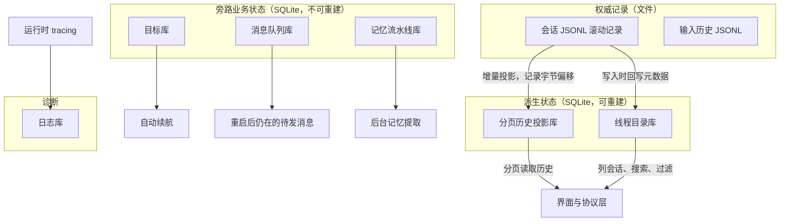

# local-state - Codex - 01 - SQLite 本地状态存储用在哪、记了什么

---

Codex 使用 SQLlite 了吗? 如果是, 都用这个记录了什么?

---

## 一句话回答

用了，而且不是"顺手加个缓存"，是把本地状态层整体搬到了 SQLite：七个独立的库文件，覆盖线程目录、分页历史投影、诊断日志、目标续航、用户消息队列、记忆流水线产物和一堆 UI/运维旁路状态。

但有一个关键前提必须先说清楚：**会话的权威记录仍然是 rollout JSONL 文件，SQLite 里的线程数据是可以从这些文件重建的索引与投影。** 所以准确的说法不是"Codex 用 SQLite 存会话"，而是"Codex 用 SQLite 替代了'每次翻文件'这件事"。

## 场景：为什么需要这一层

Codex 的历史模型是"一次会话一个 JSONL 文件，逐行追加"。这个模型有个天然优点：崩溃安全、人类可读、可以随便拷贝。但当会话数到几千、每个文件几 MB 时，它有三个致命问题：

1. **列会话列表**必须扫文件头。要排序、按来源/模型/目录过滤、按标题搜索，就得打开大量文件读元数据。
2. **恢复一条长会话**必须从头（或从尾反向）解析整个 JSONL，才能拼出回合和消息。
3. **跨进程共享**（TUI、exec、IDE、app-server daemon 同时在看同一批会话）没有共同的索引，只能各自扫盘。

SQLite 层就是为这三件事存在的：把"扫文件"换成"查表"，把"反向解析 JSONL"换成"按回合分页读表"。

## 机制展开

### 库文件放在哪、分成几个

默认目录是 `$CODEX_HOME`（通常是 `~/.codex`），可以用配置项 `sqlite_home`、环境变量 `CODEX_SQLITE_HOME` 或管理员下发的强制要求覆盖。目录下并排放着多个文件，各自有独立文件名和版本号：

具体是七个：线程目录库（`state_5.sqlite`）、日志库（`logs_2.sqlite`）、目标库（`goals_1.sqlite`）、记忆库（`memories_1.sqlite`）、记忆 v2 库（`memories_v2_1.sqlite`）、队列库（`queue_1.sqlite`）、分页历史库（`thread_history_1.sqlite`）。文件名里的数字是"不兼容变更时换新文件"的版本位——不是数据库内的 schema 版本，schema 版本另有一套迁移序列（线程目录库已经走到第 61 号迁移）。

顺带一个反直觉的细节：早期这些表全塞在线程目录库里，后来被拆出去了。日志表在第 23 号迁移里被删掉，搬去独立的日志库；记忆的提取产物表在第 35 号迁移里被删掉，搬去独立的记忆库；目标表也删过再独立。所以"哪个库有什么表"这件事本身是演进的产物。

### 一、线程目录库：会话列表的数据来源

这是最核心的一个库。主表一行一条会话，字段大致可以分成五组：

- **定位**：会话 ID、对应 JSONL 文件路径、创建/更新/最近活动时间（秒和毫秒两套）。
- **展示**：标题、名字、首条用户消息、预览文本、所属分组、是否置顶、未读位置、分组内排序位。
- **运行参数快照**：来源（交互/exec/子代理等）、模型供应商、模型名、推理力度、工作目录、沙箱策略、审批模式、CLI 版本、来源标识。
- **统计**：累计 token 用量、是否含用户事件、是否归档。
- **代码上下文**：git 提交、分支、远端地址。
- **多 Agent 与项目**：代理昵称与角色、代理路径、父/子会话派生边（带状态）、所属项目与项目根目录列表。

关键机制在于这些字段是**从 JSONL 提取出来的**，不是另开一套写入路径：会话记录器在追加记录的同时把元数据镜像进库；启动时如果发现库太旧或缺行，会跑一轮 backfill，按时间水位线把历史 JSONL 补进库（启动路径最多等 30 秒，超时就先用现有数据）。

列会话列表的实际顺序很值得注意，它是一次**混合路径**，不是纯查库：

也就是说，文件系统扫描仍然是"发现新会话"的手段（因为新文件可能还没进库），SQLite 负责排序、过滤和跨页的一致性。这是迁移中间态，代码里还留着 `TODO: sqlite migration phase 1` 这类标记。同样地，按 ID 找会话是"先查库、再拿库里的路径去打开文件、并校验文件里的 ID 与查询 ID 是否一致"——不一致或文件已不存在就回退到文件搜索，同时把这次不一致计入降级指标。

除了主表，这个库里还堆了相当多"看起来不属于会话目录"的东西：

- 分组（用户自定义的会话分区）与分组外观、项目与项目根路径、项目操作的幂等键。
- 会话附件（按"会话 + 类型 + 身份键"去重的载荷）。
- 已读回执（未读起点、修订号、最后发布的回合）。
- 每会话的动态工具清单（位置、名称、描述、输入 schema）。
- 从其它 Agent 导入配置的导入记录（成功/失败清单）。
- 远控接入登记（WebSocket 地址、账号、服务端身份）。
- 审查反馈记录（二进制载荷，有单条与每会话数量上限）。
- 运维水位：回填状态、历史迁移状态与被跳过的文件清单。

### 二、分页历史库：把"读会话"从扫文件变成查表

这是"SQLite 不只是索引"最明显的证据。它把 JSONL 的内容按回合和消息**投影**成三张表：

- 回合表：每条回合的状态、开始/结束时间、耗时、首条用户消息与末条助手消息的引用，以及在滚动记录中的位置（字节偏移、序号）。
- 消息表：每条消息的完整 JSON、序号、创建时间、完成时间、类型。
- 实时事件表：不属于正式回合的中间事件。
- 投影状态表：每会话"已经投影到第几个字节、第几个序号"的水位线。

投影是**增量**的：读取上次的字节偏移，只解析新追加的那部分，然后推进水位线。这样界面按页读历史时不必重新解析整个文件。

会话本身有个历史模式标记，默认是 `legacy`（直接读文件），另一档 `paginated`（走分页投影）。所以分页读历史是**按会话选择**的，不是全局开关；模型上下文重建（恢复会话时"模型看到过什么"）依然走 JSONL 的反向扫描，且会找最近一个带完整元数据的压缩标记作为停止点。

### 三、日志库：把 tracing 落到表里

诊断日志不再只写文件。运行时有一个 tracing 采集层，把事件格式化成结构化记录，送进一个有界后台队列，由后台任务**批量**插入日志库。有几个刻意的设计：

- SQLx 自身的事件被排除，否则"写数据库"会产生新的日志，再触发新的写入，形成自激。
- 日志库的事务是"先写后读"，因此可以开启后台空间回收，不会因为回收提交而让前台的读后写升级失败（这是逐库开关，不是全局）。
- 保留策略是双闸门：先按 10 天删，再按"占用页数"控制在 64 MiB 以内——不够就逐步缩短保留窗口，最极端保留最新 1 秒。这里算的是 `page_count - freelist_count`，即已占用而非文件大小，因为 SQLite 会复用空闲页而不缩文件。
- 每条日志有个"反馈用正文"字段，写的时候优先填它；查日志和反馈打包都读这一份，老字段只作兜底。

配套有个命令行小工具直接读这个库做过滤和 tail，排障不必先找到日志文件。

### 四、目标库：线程级"长期目标"的状态机

一行一个目标：目标 ID、自然语言目标、状态（活跃/暂停/受阻/用量受限/预算受限/完成）、token 预算与已用量、已耗时，以及一个记录"目标续航被推迟了多久"的附属表。它的价值是把"这条会话的目标是什么、还剩多少预算"从模型上下文里剥离出来，交给存储层维护，自动续航时由存储层结算。

### 五、队列库：进程重启后仍在的待发消息

用户在一个回合进行中继续输入时，消息进入持久队列而不是内存队列。表里存载荷 JSON、线程内顺序、创建/更新时间，并有 `(会话, 顺序)` 唯一索引，外加一个全局单条上限（100）。另有"会话修订号"表，配合 `PRAGMA data_version` 让其它连接能感知队列变化——这是多客户端（TUI、IDE、daemon）同时看同一会话时的同步手段。

### 六、记忆库：后台提取的产物与作业租约

存的是记忆流水线第一阶段的产物（每会话一份原始记忆与滚动记录摘要、生成时间、被引用次数、是否被选入下一阶段）和**作业表**（作业类型 + 键、状态、持有者、租约到期时间、重试时间与剩余重试次数、水位线）。作业表是关键：多进程会同时启动，靠库里的租约抢占来保证同一会话不被重复处理。v2 用独立文件，二者共享线程目录但不共享产物。

## 条件与边界

**开关状态**：历史上有一个 `sqlite` 特性开关，控制是否把会话元数据落到 SQLite。现在它的阶段是"已移除、默认开启"——也就是说开关字段还在（老配置能解析），但不再是分支条件，SQLite 是常态路径。

**失败即降级**，不会因此崩掉会话：初始化失败只是让状态层变成"不存在"，之后列表、查找、恢复全部回退到文件系统扫描，并记一次降级计数。降级原因分了若干种（库不可用、行缺失、库报错、路径过期、ID 不匹配），指标里能区分。

**损坏处理是"备份重建"而不是"修"**：除了分页历史库被设为"直接标记不可用"，其余库都配置成备份后重建——因为它们是派生数据，丢掉再 backfill 比尝试修复更划算。代码里用编译期断言强制内置 SQLite 版本足够新，理由是要包含 WAL 重置的损坏修复。

**并发模型**：WAL 日志模式 + 5 秒忙等超时 + `NORMAL` 同步级别。每库独立连接池，读取走多连接、写入走单连接。

**不在 SQLite 里的东西**（容易误以为在）：会话 JSONL 本身、输入历史（`history.jsonl`，单行一条的追加文件）、`config.toml`、认证凭据、会话索引文件（`session_index.jsonl`，用于快速列出名字）。判断标准很清楚：**需要随机访问和排序的进库，需要追加安全和人类可读的留在文件。**

**无法确认**：线上真实启用情况（例如远端是否对某些账号关掉分页历史模式、日志保留是否被远端策略覆盖）无法从仓库判断；本文只描述源码结构上必然成立的路径。

## 设计取舍

**为什么不把所有东西塞进一个库。** 三个理由在源码里都能看到：读写特征不同（日志是高频批量写，目录是随机读），维护策略不同（日志要激进裁撤，目录不能），损坏半径不同（日志库坏了不该让会话列表跟着废）。挤在一块的话，"日志库开启后台回收"这类优化就会波及前台写者。

**为什么保留 JSONL 而不是彻底搬进库。** 追加写的崩溃安全性比事务简单可靠；出问题时用户能直接看、能拷走、能手工修；这也让"删掉数据库"成为一次安全无痛的重建操作。代价是要维护两套写路径和一轮 backfill，以及处理"库说路径 A、文件说自己是会话 B"这类不一致——代码里对这些不一致的处理是全部回退到文件并上报，说明团队明确把文件当权威。

**为什么线程目录库还在做"扫文件 + 读修复 + 查库"。** 这是迁移中间态，而非最终设计：新会话的发现仍依赖文件，而排序/过滤/分页依赖库。好处是任何时刻库都是"可以慢一点、但不会错"的；坏处是列表操作的实际成本还是 O(扫描)。从代码里保留的迁移阶段标记和"读修复"这套逻辑看，方向是把发现也交给库，但当前版本还没走完。

**为什么队列和日志也进库。** 队列必须跨进程、跨重启一致，内存队列做不到；日志进库让"反馈打包"和"tail"有了统一读取接口，也让保留策略变成 SQL 而不是文件轮转。这两者是"旁路状态"，丢了就是功能损失而非数据损坏，正好符合它们被配置成可重建或可裁撤的定位。

## 证据分级

- **已证实**：七个库的文件名与职责划分、各表结构与迁移序列、特性开关已进入"移除"阶段、列表的扫描+读修复+查库混合路径、路径不一致时的回退与降级计数、日志的批量写入与 10 天/64 MiB 保留、队列的 100 条上限与修订号机制、WAL/忙等/同步级别配置、备份重建与版本断言。
- **合理推断**：拆分多库的动机（读写特征、维护策略、损坏半径）在源码注释中只部分提及，其余由结构推得；把文件定为权威而库为派生的取向，由回退逻辑与"可重建"配置反推。
- **无法确认**：线上默认值（分页历史模式的实际铺开比例、日志保留是否被远端覆盖）、backfill 在大规模历史下的实际耗时。

## 源码依据

| 位置 | 关键内容 |
|---|---|
| `codex-rs/state/src/sqlite.rs` | 七个库的文件名与逐库配置（后台回收、恢复模式、打开/迁移阶段）、忙等 5 秒、WAL 与同步级别 |
| `codex-rs/state/src/lib.rs` | crate 定位注释（"把 JSONL rollout 的元数据镜像进本地 SQLite"）、SQLite 版本断言、降级与日志相关指标常量 |
| `codex-rs/state/migrations/*.sql`（61 个） | 线程目录库 schema 演进：线程表字段累积、日志表与记忆表/目标表的迁出与删表、分组/项目/附件/已读回执/派生边/运维水位 |
| `codex-rs/state/thread_history_migrations/*.sql` | 分页历史库：回合、消息、实时事件、投影水位线（字节偏移+序号） |
| `codex-rs/state/logs_migrations/*.sql` | 日志库表结构与索引（按时间、会话、进程分区） |
| `codex-rs/state/goals_migrations/*.sql`、`queue_migrations/*.sql`、`memory_migrations/*.sql` | 目标状态机、消息队列与修订号、记忆产物与作业租约 |
| `codex-rs/state/src/runtime/logs_maintenance.rs` | 10 天保留 + 64 MiB 预算的双闸门裁剪、占用页计算 |
| `codex-rs/state/src/log_db.rs` | tracing 采集层：有界队列、批量插入、排除 SQLx 事件 |
| `codex-rs/state/src/runtime/queued_items.rs`、`thread-store/src/queue_store.rs` | 队列持久化与 `PRAGMA data_version` 变更感知 |
| `codex-rs/thread-store/src/local/thread_history_materialization.rs` | 从 JSONL 增量投影到分页历史库 |
| `codex-rs/thread-store/src/local/model_context.rs` | 恢复模型上下文仍走 JSONL 反向扫描 |
| `codex-rs/rollout/src/recorder.rs`、`rollout/src/list.rs` | 列会话的"扫文件 → 读修复 → 查库"混合路径、库不可用时的降级与计数 |
| `codex-rs/rollout/src/state_db.rs` | 状态运行时初始化入口、启动期 backfill 的轮询间隔与 30 秒等待上限 |
| `codex-rs/features/src/lib.rs` | `sqlite` 特性已标记移除、默认开启 |
| `codex-rs/core/src/config/mod.rs` | `sqlite_home` 解析顺序：配置项 → `CODEX_SQLITE_HOME` → `CODEX_HOME` |
| `codex-rs/cli/src/bin/logs_client.rs` | 直接查日志库的命令行工具 |
| `codex-rs/message-history/src/lib.rs` | 输入历史仍是独立追加文件，未进库 |
