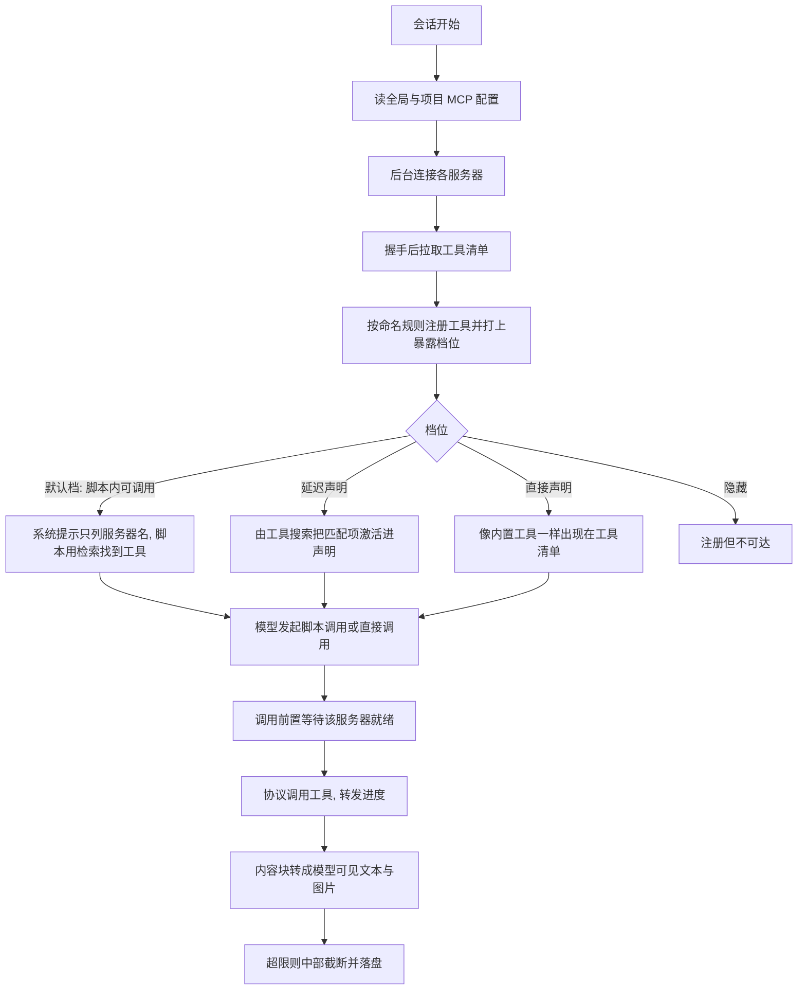

# MCP 工具接入 - Pi - 01 - 作为 MCP 客户端的工具发现、暴露与调用

---

那你现在顺带探索一下 Pi 的 MCP tools 是怎么做的吧

（范围确认后：只研究“作为 MCP 客户端的工具链路”，不涉及 resources / prompts / 采样回调，也不涉及 Pi 自己作为 MCP Server；OAuth 只当作连接前提一句带过；一份笔记，标准深度。）

---

## 场景

用户配了几个 MCP server（本地 stdio 的 `npx` 服务、远端的 streamable HTTP 服务），希望在会话里让模型用上它们的工具。

这里有一个 Pi 特有的前提：**它的模型工具清单是显式声明制**——只有“激活”的工具才会出现在模型请求里，默认只有读、shell、编辑、写四个。MCP server 往往一次提供几十个工具，如果全部声明，系统提示和工具 schema 会立刻膨胀，并且每连一个 server 都要重新排布请求前缀。所以 Pi 面对的第一个问题不是“怎么调用 MCP 工具”，而是“**怎么让模型知道这些工具存在、又不把它们全塞进声明里**”。

Pi 的答案是把工具暴露分成四档，默认档位是“不声明给模型，只能从沙盒脚本里调用”。

## 机制展开

### 1. 三层结构：客户端包 / 内置扩展 / 工具池

Pi 的 MCP 支持拆成三处，缺一不可：

- **独立客户端包**：只懂协议——连接、初始化、拉清单、调用工具、资源、传输、错误类型。它不知道 pi 的工具体系。
- **内置扩展**：把协议对象翻译成 pi 的工具定义，并管理连接生命周期、配置、暴露档位、`/mcp` 管理界面。
- **会话工具池**：决定哪些工具被声明给模型、哪些只能被其他工具调用、哪些不可达。

这层拆分带来一个可观察的结果：MCP 客户端代码**只在配置了服务器时才被加载**（会话启动后延迟一个事件循环再动态导入），没有 MCP 配置的会话完全不付这份启动成本。

### 2. 配置与连接

配置读两处：用户级 `mcp.json` 与项目级 `.pi/mcp.json`，后者只在项目被信任后读取。合并规则有几条值得注意：

- 项目条目**整体替换**同名用户条目；
- 但项目里只写 `enabled` / `exposure` / `toolExposure`（不带 `command` / `url` / `type`）时，被当作“覆盖”而不是“定义”：只改这三项，其余（含 `env`、`headers`、凭据）沿用用户级配置。这样仓库可以关掉某个服务器，却不能替换它指向的程序或写入凭据；
- 因此 `auth`（“用某个 pi 供应商的令牌”）被禁止出现在项目配置里；
- 名字规范化后相同的服务器（`a-b` 与 `a_b`）视为冲突，直接报错——因为它们会共享同一个工具命名空间。

传输只支持两种：stdio（命令 + 参数 + 环境变量，工作目录相对会话目录解析）与 streamable HTTP（URL + 头部，可选 OAuth）。旧的 SSE 传输被显式拒绝。

连接不是启动时同步完成的：会话启动后为每个启用的服务器起一个后台连接任务，界面先渲染。首次请求只等“有直接声明工具”的服务器（超时 10 秒），其他服务器由后续的脚本调用或工具搜索按需等待。HTTP 服务器在瞬时错误（408 / 429 / 5xx / 网络错误）上按 250ms、1s 重试两次；stdio 服务器不重试，但失败时把 stderr 尾部 2000 字符留作诊断。

每个服务器有一个统一的请求超时（默认 60 秒，按服务器可配），服务器的进度通知会重置这个计时器。

### 3. 发现与命名

握手完成后：

- 先看服务器能力：**没有工具能力（只提供资源或提示词）的服务器不会去请求工具清单**，避免方法不存在导致的报错；
- 拉到的工具注册名为 `mcp__<服务器>__<工具>`，除字母数字下划线外的字符全部替换成 `_`。之所以要做到“只有下划线和字母数字”，是因为**这个字符串同时也是沙盒脚本里调用它的标识符**；
- 名字超过 64 字符、或清洗后与另一个工具撞名时，截断并追加 8 位哈希后缀；且撞名组里所有成员都会带后缀，避免“谁保留干净名字”取决于清单顺序；
- 每个服务器同时注册一个命名空间（`mcp__<服务器>`，别名是原始服务器名），携带服务器描述与 `initialize` 返回的 instructions。这两个东西后面既用于系统提示里的一行摘要，也用于脚本里的按命名空间检索。

服务器若声明工具清单可变更，Pi 会监听清单变化通知并重新拉取：新工具按配置档位注册，**消失的工具无法真正注销，于是被重新注册为“隐藏”**；服务器再提供它时按原档位恢复。

### 4. 暴露：四档，默认不声明给模型

这是 Pi 与另外两个项目差别最大的一层。工具注册时就带一个暴露档位：

| 档位 | 模型能看到声明吗 | 怎么被调用 | 适用 |
|---|---|---|---|
| `codemode`（默认） | 不能 | 只能从沙盒脚本里调用，脚本用内置的检索函数按名字/命名空间找 | 工具多、偶尔用 |
| `deferred` | 初始不能，工具搜索命中后才进声明 | 工具搜索加载后直接调用 | 需要模型自己判断何时用 |
| `direct` | 能，与内置工具同级 | 直接调用（也能从脚本调用） | 少而常用的工具 |
| `hidden` | 不能 | 不可达 | 临时撤销 |

服务器级 `exposure` 给默认值，`toolExposure` 可以按工具名或通配模式逐个覆盖（精确名优先于模式，模式之间先匹配者胜）。于是“默认全隐藏、只放出几个”也是一个配置项。

默认档位带来的连锁设计是：**模型根本看不到 MCP 工具的名字**，所以系统提示里需要一段专门的说明——列出启用且属于“非直接声明”档的服务器，每行是命名空间加服务器摘要，并告诉模型“这类服务器的工具要从脚本里调用 / 要用工具搜索加载”。这一段有明确预算：整段不超过 4096 字符，每个服务器摘要不超过 250 字符，超了就按字符压缩摘要，再不够就省略尾部服务器并补一行“还有 N 个，用检索函数找”。

### 5. 激活与等待：谁在什么时候被推进工具清单

三个时机决定工具清单的形状：

- **会话开始**：根据配置里出现的档位，激活“脚本工具”或“工具搜索工具”——前者仅在 `autoEnableCodemode` 为真（默认）时。如果配置要求间接可达、但这两个工具都没激活，会提示一句“MCP 工具不可达”。
- **首个请求前**：等挂了直接声明工具的服务器连上（上限 10 秒），这样它们的工具能出现在第一条请求里；超时则提示“仍在连接，连上后可用”，不阻塞。
- **每次工具调用前**：按被调用工具声明的“可触及范围”决定要等哪些服务器——脚本工具的触及范围来自源码文本（用到了检索/枚举就用全部服务器，否则按脚本里出现的词匹配命名空间），工具搜索恒为全部，资源工具为全部，直接调用则只等自己那台。这条规则让等待是精准的，而不是“任何工具调用都等所有服务器”。

### 6. 调用与结果转换

调用走会话的统一工具管线，因此工具调用前置钩子、结果后置钩子、权限扩展对 MCP 工具与内置工具一视同仁。执行时的几个关键行为：

- **执行时重新解析目标**：定义注册时绑定的是“服务器名 + 工具名”，执行时才去找当前连接。若服务器已被禁用、已移除、或工具已不再提供，直接返回明确错误（“已禁用 / 仍在启动 / 不再可用”），而不是拿着过期连接去发请求。
- **超时与取消**：使用会话信号与每服务器超时；协议层对可取消的请求会发送取消通知（初始化请求按规范不可取消）。
- **进度**：服务器发来的进度通知被转成本次工具调用的中间输出，界面即时显示。
- **断连自愈**：会话过期（服务器重启/部署）时换新会话重试一次，因为服务器明确没有执行该请求；**工具调用本身不做瞬时错误重试**——它可能已经执行过。

结果转换按内容块类型逐个映射：

- 文本 → 文本；图片 → 图片；音频 → 一段占位说明；
- 资源链接 → 一段说明文字，包含 URI、标题、MIME、体积，并指出可以用资源读取工具（如果该服务器资源可达）；
- 内嵌资源：文本资源变成文本；图片资源变成图片；其他二进制落盘并给出路径；MIME 是文本类的 blob 直接当文本；
- 没有内容块但有结构化结果时，退化为 JSON 文本。

然后做体积控制：**模型可见文本超过 20KB 就从中部截断**（保留开头与结尾），完整文本落盘，并在结果里附上文件路径与原始 token 估算；图片保留在主文本之后。被截断的文本、二进制资源都走同一套落盘工具。

最后：`isError` 的结果变成“错误结果”，但仍保留结构化内容；同一份结果发给沙盒脚本时**不做任何截断**，保留服务器原样的内容块与结构化结果——脚本拿的是数据，模型拿的是修剪过的视图。

### 7. 失败与生命周期

服务器状态被建模成一组明确状态：连接中 / 已连接 / 已断开 / 需要登录 / 失败 / 已关闭。

- 需要登录时，第一次提示直接给出该跑哪条命令；登录发生在会话外（`/mcp` 或命令行登录）时，下一轮开始会自动检测到凭据变化并重连；
- 连接失败保留 stderr 尾部，状态里显示“失败 + 首行原因”；
- 运行中断连不主动重连，下一次请求时懒重连；
- 会话结束时统一关闭所有连接，并等待后台动作（登录、管理操作）收尾；
- 会话运行中被注册或注销的服务器立即连接或断开（外部扩展注册服务器的路径），注销或配置变化的服务器其工具被隐藏。

### 8. 权限与信任

Pi 没有为 MCP 工具内建审批环节：项目级配置以“项目是否被信任”为门，信任之后再谈工具可不可达；调用是否要确认由权限扩展通过工具调用钩子决定。为了让这类扩展能做出判断，服务器声明的 MCP 注解（只读、破坏性、幂等、开放式）被原样带到工具定义上，资源工具被标记为只读。

另外有一条容易被忽略的交互：`--tools` / `--exclude-tools` 这类允许清单在 MCP 工具上有特殊语义——未命中的 MCP 工具不会从注册表里删掉（脚本仍可能调用），只是不会被声明；而一旦允许清单开始点名 `mcp__` 前缀，就只保留命中的那些。

### 9. 同源的兄弟能力

同一个扩展还注册三个资源工具（列出资源、列出资源模板、读资源），它们对每个“有资源且未隐藏”的服务器生效，档位取这些服务器里最宽的一档。资源在连接时**不预先枚举**（大目录会很慢），而是按需分页拉取。这条线不属于本次主线，但它的档位与等待规则完全复用工具那一套。

## 条件与边界

- **默认档位是“脚本可达、模型不可见”**：不显式配置 `direct` 时，MCP 工具不会出现在模型工具清单里，模型只能通过脚本或工具搜索触达。
- **项目配置只能收窄**：只允许覆盖启用状态与档位，凭据与环境变量必须来自用户级配置；未信任的项目不读项目配置。
- **间接可达依赖两个内置工具**：脚本工具（默认随配置自动激活，可关闭）或工具搜索（按需激活）。两者都不可用时给出一次性警告，工具事实上不可达。
- **命名空间唯一**：规范化后同名的服务器直接报错；工具名清洗后撞名统一加哈希后缀；名字最长 64 字符。
- **体积上限**：模型可见文本 20KB 中部截断 + 落盘；系统提示中的服务器清单 4096 字符、单服务器摘要 250 字符。
- **超时与重试非对称**：统一默认 60 秒（进度通知会续期）；HTTP 连接失败重试两次；工具调用不重试，只在新会话过期时重试一次。
- **撤销靠隐藏**：工具无法注销，服务器掉线/被禁用/清单移除时改为隐藏；重新出现时按原档位恢复。

## 设计取舍

**为什么默认不声明给模型？** 从结构推断，动因是上下文经济性：MCP 服务器动辄提供几十个工具，全部声明会让每条请求都背着巨大的工具 schema 与系统提示，而且服务器一多、一变更，请求前缀就不稳定，缓存随之失效。把工具藏到脚本后面，模型只在真正需要时才通过检索拿到，工具清单保持恒定。

**为什么提供四档而不是二档？** 三种使用形态确实不同：高频少量（直接声明）、模型能自己判断（搜索加载）、工具很多而只偶尔用（脚本内调用）。`hidden` 则解决“无法注销”的工程现实。

**为什么把工具名做成脚本标识符？** 因为默认档位下唯一的调用路径是脚本。让注册名同时是合法标识符，脚本里就能直接按名字引用，不需要额外的映射层；代价是名字必须做字符清洗，并因此需要处理撞名。

**为什么脚本可达的工具不进入模型声明却能被脚本调用？** 这要求工具池区分“声明集合”与“可调用集合”两个概念。这种分离也是 `/tree`、恢复、分叉之后工具仍然可用的原因——脚本调用不依赖当前激活工具集。

**为什么不内建审批？** Pi 把权限当成可插拔的扩展能力，而不是 harness 的内置策略。它提供的是判断所需的原料（服务器注解、只读标记、可达档位）与统一管线，把“要不要问用户”留给策略层。

## 证据分级

- **已证实**：三层结构（独立客户端包 / 内置扩展 / 工具池）；仅在有服务器时加载 MCP 客户端；两处配置文件的合并与覆盖语义、项目信任门、`auth` 禁止出现在项目配置、服务器名规范化冲突检测；仅支持 stdio 与 streamable HTTP，SSE 被拒；后台连接、首个请求只等直接声明工具（10 秒上限）、HTTP 待连接重试（250ms/1s）、stdio 失败保留 stderr 尾部；默认请求超时 60 秒且进度通知可续期；无工具能力时不拉清单；工具命名规则（前缀、字符清洗、64 字符上限、撞名哈希后缀、命名空间别名）；四档暴露与按工具模式的覆盖规则、默认档为 `codemode`；系统提示服务器清单段及其 4096/250 字符预算与省略行；三个激活时机与按“可触及范围”精准等待；执行时重新解析连接、禁用/移除/工具消失的错误、会话过期重试一次而工具调用不重试瞬时错误；内容块到模型内容的映射、20KB 中部截断 + 落盘、二进制资源落盘、脚本侧不截断、`isError` 保留结构化结果；状态机与懒重连、清单变更时把消失的工具注册为隐藏；会话结束统一关闭并等待后台动作；`--tools` 对 MCP 工具的特殊语义；注解透传给权限扩展。
- **合理推断**：默认不声明的动机是上下文经济与缓存稳定（注释说明了“工具不进声明与 codemode 描述”，但未直接陈述动机）；“工具名即脚本标识符”是为了省掉一层映射；不内建审批是刻意把策略外置。
- **无法确认**：真实用户配置中 `direct` / `deferred` 的采用比例；某些服务器在 `tools/list` 上返回超大清单时对首次连接耗时的影响；生产环境是否默认启用脚本工具（默认值来自配置解析，但用户可能有分发层覆盖）。

## 源码依据

源码版本：Pi 工作区提交 `4954d7605`（2026-10-15），路径相对于 `/home/fishandrice/Backend/pi`。

| 相对路径 | 关键位置 | 证明内容 |
|---|---|---|
| `packages/coding-agent/src/extensions/mcp/index.ts` | 头注释 1-30、暴露说明 118-121、`configuredExposures` 140-150、`renderServersSection` 195-230（4096/250 上限）、`registerTools` 387-455、`hideTools` 457-466、`syncResourceTools` 480-495、`ensureDiscoveryActive` 501-535、`session_start` 1114-1155、`waitForDirectServers` 1156-1177、`before_agent_start` 1178-1189、`tool_call` 1191-1216、`mcp_servers_change` 1217-1251、`session_shutdown` 1252-1260 | 四档暴露、命名与注册、系统提示服务器清单、激活与等待时机、动态增删服务器、关闭清理 |
| `packages/coding-agent/src/extensions/mcp/config.ts` | 头注释 1-30、`readConfigFile` 91-143、`loadMcpConfig` 145-158、`updateMcpServerConfig` 168-200 | 两处配置文件、项目覆盖语义、信任门、`auth` 限制、命名冲突 |
| `packages/coding-agent/src/extensions/mcp/tools.ts` | `toToolExposure` 44-46、20KB 上限 51、`createMcpToolName` 84-95、`createMcpResultSchema` 159-178、`limitMcpContent` 180-210、`blockToContent`／`toModelContent` 224-260、`convertMcpResult` 266-290、`createMcpToolDefinition` 312-360 | 工具名规则、结果 schema、中部截断与落盘、内容块转换、执行时重新解析连接、注解透传 |
| `packages/coding-agent/src/extensions/mcp/runtime.ts` | 默认超时 48、重试延迟 50、`createDefaultTransport` 98-130、`McpServerConnection` 139-330、`withClient` 278-300、`open` 340-357、`connectOnce` 359-410、`refreshTools` 415-425、`close` 443-455 | 传输选择、状态机、超时、会话过期重试、断开与懒重连、清单变更刷新、关闭顺序 |
| `packages/coding-agent/src/extensions/mcp/resources.ts` | 头注释 1-15、资源工具定义 | 三个资源工具、按需分页、与工具共享档位 |
| `packages/coding-agent/src/core/mcp-servers.ts` | `isMcpToolName` 38-41、`McpExposure` 48-56、暴露别名 58-63、`mcpNamespace` 154-157、`getMcpToolExposure` 258-268、`validateMcpServerConfig` 273-340 | 档位定义与别名、命名空间、逐工具覆盖解析、配置校验 |
| `packages/coding-agent/src/core/agent-session.ts` | `getActiveToolNames` 1483-1488、`getCallableToolNames` 1490-1493、`_isAllowedTool` 1542-1552、`_isActivatable` 1554-1565、`_getCallableTools` 1567-1578、`_applyToolLoadout` 1580-1600、`_isDeclarable` 3626-3630 | 声明集合与可调用集合分离、允许清单对 MCP 的特殊语义 |
| `packages/coding-agent/src/core/extensions/types.ts` | `ToolExposure` 516、`ToolAnnotations` 522-531、`ToolNamespace` 533-540、`reachesTools` 621 | 档位类型、MCP 注解映射、命名空间、可触及范围声明 |
| `packages/coding-agent/src/extensions/tool-search/tool.ts` | `reachesTools: () => "all"` 229、`searchAndLoad` 195-210、描述 220-224 | 工具搜索按 BM25 命中并激活工具 |
| `packages/coding-agent/src/extensions/codemode/tool.ts` | `getCodemodeCallableTools` 159-170、`prepareCodemodeLoadout` 320-357、`getScriptReach` 361-370、`reachesTools` 385 | 脚本的触及范围来自源码文本，脚本可调用未声明的工具 |
| `packages/mcp/src/client.ts` | `callTool` 378-386、`requestInternal` 391-445 | 协议层调用、进度令牌、超时与取消 |
| `packages/mcp/src/protocol/content.ts` | `blockToLlmContent` 79-107、`toLlmContent` 112-118 | 内容块到文本/图片的兜底映射 |
| `packages/coding-agent/docs/mcp.md` | 1-60、189-268 | 权威表述：配置位置与信任、暴露档位语义、间接可达机制、注解供权限扩展使用 |
