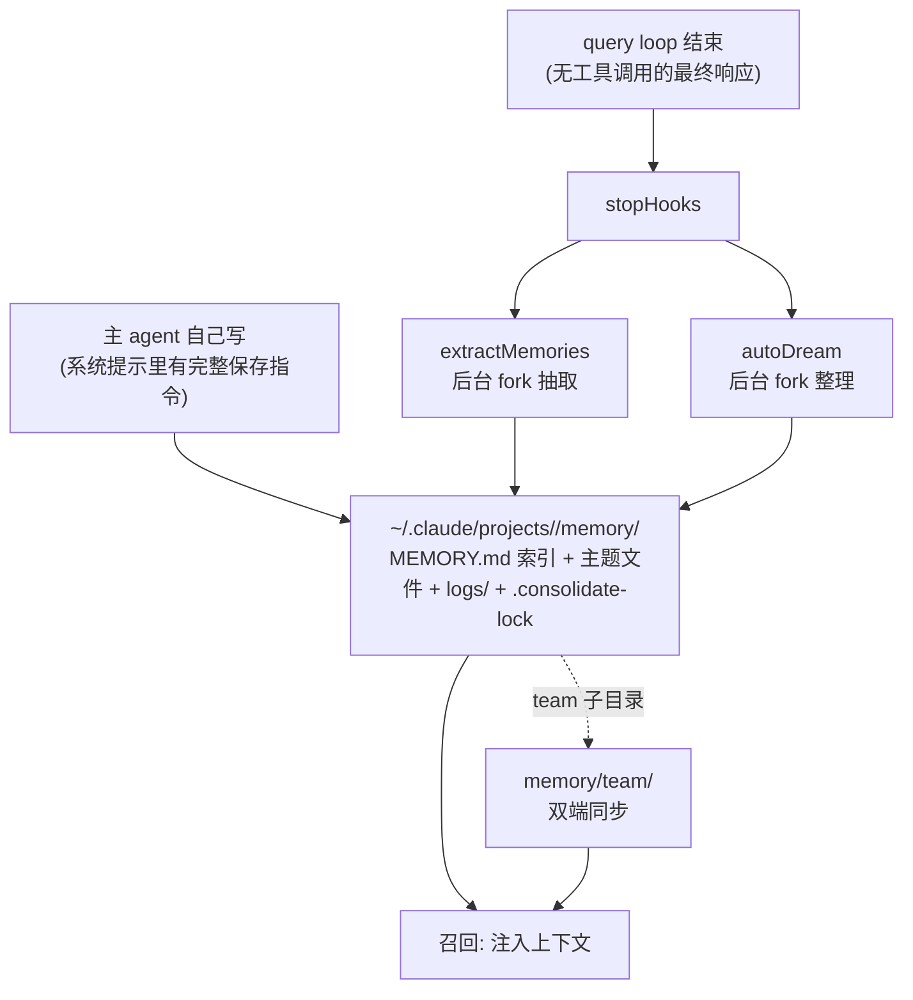
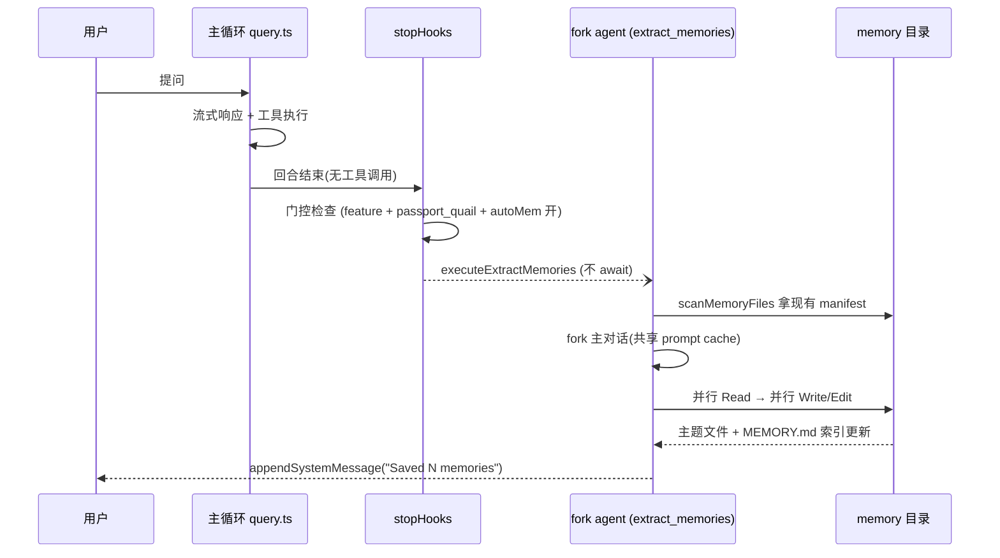
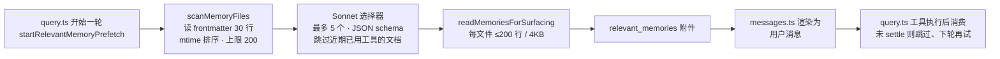

# Memory system - Claude Code - 01 - Memories

---

Claude Code 和 Codex 的 Memory 机制是怎么做的?
探究它们的召回, 提取与整理机制是怎么做的.

---

Claude Code 的自动记忆链路已经追踪完整。下面是完整讲解（Codex 的对应机制我留到下一轮，等你先把这部分问透）。

## 一、先建立整体理解：它不是"向量记忆"，而是"文件系统 + 索引 + LLM 检索"

Claude Code 的记忆机制有一个很鲜明的取向：**记忆就是磁盘上的一组 Markdown 文件，由模型自己用读写工具维护**，没有 embedding、没有向量库、没有数据库表。整个 harness 的职责只有三件事：给模型一套规范（怎么写、写什么、不写什么）、在合适的时机自动跑一个后台 agent 去补写、在每轮对话里把合适的记忆文件重新"塞回"上下文。

围绕这个核心，实际上有四套并存的东西，先分清楚，否则很容易混成一团：

| 机制                      | 作用域                        | 存储位置                                               | 本次是否重点 |
| ------------------------- | ----------------------------- | ------------------------------------------------------ | ------------ |
| Auto memory（`memdir`） | 与当前用户 + 当前仓库长期共存 | `~/.claude/projects/<slug>/memory/`                  | 重点         |
| Team memory               | 同组织共享（按 repo 划分）    | 上者下的`team/` 子目录，服务端同步                   | 重点         |
| Agent memory              | 单个 subagent 类型            | 三档 scope（user/project/local）                       | 简述         |
| Session memory            | 仅当前会话，供压缩使用        | `{projectDir}/{sessionId}/session-memory/summary.md` | 只点明边界   |

最后一项严格说属于上下文管理（它由 token 阈值触发、被 compact 消费），按你划的范围我只做边界说明，不展开。

关键位置：[memdir/paths.ts](/home/fishandrice/Backend/claude-code/claude-code-2.1.88-source/src/memdir/paths.ts) 负责路径与开关，[memdir/memdir.ts](/home/fishandrice/Backend/claude-code/claude-code-2.1.88-source/src/memdir/memdir.ts) 负责提示词与索引加载，[memdir/memoryTypes.ts](/home/fishandrice/Backend/claude-code/claude-code-2.1.88-source/src/memdir/memoryTypes.ts) 负责"记忆类型学"。

## 二、存储与分类：先约束"什么才算记忆"

四条类型构成一个封闭集（`memoryTypes.ts`）：`user`（用户是谁、偏好、专业背景）、`feedback`（用户对你工作方式的纠正**和**认可）、`project`（代码/git 里推导不出来的项目上下文：谁在做什么、为什么、截止日期）、`reference`（外部系统的指针，如 Linear 项目、Grafana 面板）。

类型学里更有意思的是**负向约束**（`WHAT_NOT_TO_SAVE_SECTION`）：代码模式、架构、文件结构不存（能读出来）；git 历史不存（`git log` 权威）；调试解法不存（修复在代码里）；CLAUDE.md 已有的不存；会话内临时状态不存。并且明确写了"即使用户让你保存也要遵守这些排除"——注释标了这是评测驱动（把"保存这周的 PR 列表"这类请求挡掉，避免记忆退化成活动流水账）。

文件格式是 frontmatter 三字段（`name` / `description` / `type`）+ 正文；`feedback` 和 `project` 类要求正文走"规则/事实 → **Why:** → **How to apply:**"结构，目的是让未来的自己能在边界情况上做判断，而不是机械照搬。

存储布局（`paths.ts`）：

- 基准目录：`CLAUDE_CODE_REMOTE_MEMORY_DIR` 优先，否则 `~/.claude`
- 记忆目录：`<base>/projects/<sanitized- git-root>/memory/`——注意用的是 **canonical git root**，所以同一仓库的多个 worktree 共用一份记忆
- 索引入口：`MEMORY.md`（约束：≤200 行且 ≤25KB，超出会被截断并附警告）
- KAIROS 助手模式下另有 `logs/YYYY/MM/YYYY-MM-DD.md` 追加式日志
- 团队记忆：`memory/team/`，有自己独立的 `MEMORY.md`

## 三、提取（extraction）：双通道 + 后台 fork

这是全系统设计感最强的部分。提取有两条路径，且**互斥**：

**通道 A：主 agent 直接写。** 它的系统提示里始终带着完整的保存指令（`loadMemoryPrompt` → `buildMemoryLines`，注入位置见 `constants/prompts.ts:495` 的 `systemPromptSection('memory', ...)`）。为了让模型真的能写，权限层给自动记忆目录开了个口子：`utils/permissions/filesystem.ts:1572` 对 `isAutoMemPath()` 的路径直接 allow（因为默认路径在 `~/.claude/` 之下，本来落在 DANGEROUS_DIRECTORIES 里）。有个细节值得注意——这个口子只对默认路径开，`settings.json` 的 `autoMemoryDirectory` 也享受，但环境变量 override 路径**没有**特权，必须走正常审批；而 `projectSettings`（仓库里提交的 `.claude/settings.json`）被刻意排除，防止恶意仓库把记忆目录指到 `~/.ssh`。

**通道 B：后台 fork 抽取器**（[extractMemories.ts](/home/fishandrice/Backend/claude-code/claude-code-2.1.88-source/src/services/extractMemories/extractMemories.ts)）。它在每次 query loop 正常结束（模型给出无工具调用的最终响应）后由 `stopHooks` fire-and-forget 触发：

几个设计点，都能在源码里看到明确动机：

- **完美 fork + 共享 prompt cache**：抽取 agent 用 `runForkedAgent`，系统提示和消息前缀与主对话完全一致，因此命中主对话的 prompt cache（代码里专门记录 cache read/create 的命中率）。
- **与主 agent 互斥**：`hasMemoryWritesSince()` 会扫描游标之后的 assistant 消息，如果发现主 agent 已经写了记忆目录里的文件，就直接跳过本轮 fork，并把游标推过去。否则两条通道会重复劳动。
- **游标 + 合并 + 尾随运行**：闭包内维护 `lastMemoryMessageUuid`（只处理新增消息）、`inProgress`（并发时把上下文 stash 起来，当前跑完再补一次 trailing run）、`turnsSinceLastExtraction`（`tengu_bramble_lintel` 节流，默认每轮）。
- **失败不影响主流程**：抛错只记日志；游标只在成功后推进，失败的消息下轮会重新考虑。
- **预算受限**：`maxTurns: 5`，prompt 里明确要求"turn 1 并行 Read 所有可能更新的文件，turn 2 并行 Write/Edit，不要交错"，并禁止在沙箱里再去 grep 源码验证。
- **能力受限**：`createAutoMemCanUseTool()` 只放行 Read/Grep/Glob、只读 Bash（`isReadOnly` 判定，明确排除 `rm`）、以及记忆目录内的 Edit/Write；其余全部 deny。这个函数被抽取器和 dream 共用。

抽取提示词（[extractMemories/prompts.ts](/home/fishandrice/Backend/claude-code/claude-code-2.1.88-source/src/services/extractMemories/prompts.ts)）还会预注入"现有记忆文件清单"（复用召回侧的 `scanMemoryFiles`），避免 agent 花一个回合去 `ls`。

## 四、整理（consolidation）：`dream` 与团队同步

**1）autoDream**（[services/autoDream/autoDream.ts](/home/fishandrice/Backend/claude-code/claude-code-2.1.88-source/src/services/autoDream/autoDream.ts)）——一套"记忆整理"的定期作业，同样由 `stopHooks` 每轮触发，但闸门从便宜到贵依次判断：

| 顺序 | 闸门     | 参数                                                                  | 状态存放                   |
| ---- | -------- | --------------------------------------------------------------------- | -------------------------- |
| 1    | 时间     | 距上次整理 ≥`minHours`（默认 24h）                                 | 锁文件 mtime               |
| 2    | 扫描节流 | 距上次扫描 ≥ 10min                                                   | 内存变量                   |
| 3    | 会话数   | 自上次整理后被 touch 的会话 ≥`minSessions`（默认 5，排除当前会话） | 扫描 transcript 目录 mtime |
| 4    | 锁       | 无其他进程正在整理                                                    | `.consolidate-lock`      |

这里有个挺巧的工程手法：**锁文件的 mtime 就是"上次整理时间"这个状态本身**，文件内容是持有者 PID；`tryAcquireConsolidationLock()` 先写 PID 再回读校验（两个进程抢占时后写者赢，输家自觉退出）；持有者超过 1h 或 PID 已死则视为可回收；fork 失败时 `rollbackConsolidationLock()` 把 mtime 回退到抢占前，于是"时间闸门会重新通过，扫描节流充当退避"。这样就不需要额外的状态文件或数据库。

整理 prompt（[consolidationPrompt.ts](/home/fishandrice/Backend/claude-code/claude-code-2.1.88-source/src/services/autoDream/consolidationPrompt.ts)）分四阶段：Orient（先看现有索引和主题文件）→ Gather（日更日志、已漂移的旧记忆、按需 grep transcript）→ Consolidate（合并进已有主题文件而非新建近似重复、相对日期转绝对日期、删除被证伪的事实）→ Prune and index（把 `MEMORY.md` 修剪回 200 行 / 25KB 以内，把过长索引行降级到主题文件、删除失效指针、解决互相矛盾的条目）。整个整理过程以一个前台可见的后台任务（`DreamTask`）呈现，用户可从后台任务面板 kill。

**2）KAIROS 助手模式是另一种范式**：会话长期存在，于是"新记忆"先 append-only 写入当日日志文件，`MEMORY.md` 改由夜间流程蒸馏维护，模型不被允许直接编辑索引。这也说明同一套存储可以承载两种写入范式（实时索引 vs 日志 + 离线蒸馏）。

**3）团队记忆同步**（[services/teamMemorySync/](/home/fishandrice/Backend/claude-code/claude-code-2.1.88-source/src/services/teamMemorySync/index.ts)）——同一个目录树接入服务端：

- 会话启动时 `setup.ts:367` 拉起 watcher，先做一次 pull，再启动 `fs.watch`
- pull 是 server-wins（服务端内容覆盖本地同 key 文件）；push 是**增量**的，只上传本地内容哈希与已知服务端哈希不一致的 key，服务端按 upsert 合并；**本地删除不会传播**（下次 pull 会把它恢复回来）
- 写入触发是双保险：文件系统 watch（2s debounce）+ 工具层 PostToolUse hook 显式 `notifyTeamMemoryWrite()`（应对同一 tick 内 watcher 来不及注册事件的情况）
- 上线前有秘密扫描（`secretScanner.ts`）；对"重试也没用"的失败（无 OAuth、无 repo、4xx 除 409/429）做抑制，避免无限重推（注释里记录了生产事故：一个设备 2.5 天发了 16.7 万次 push）

## 五、召回（recall）：两种模式，一条主线

召回是"每轮对话开始时如何把对的记忆拿回上下文"。Claude Code 在这里有**两套模式**，由 `tengu_moth_copse` 这个开关切换：

**模式 A（索引注入）**：`MEMORY.md` 通过 **user context** 注入（`context.ts:172`，`getClaudeMds(filterInjectedMemoryFiles(await getMemoryFiles()))`），和 CLAUDE.md / CLAUDE.local.md 走同一个通道，外层包一句"这些指令覆盖默认行为"。主题文件本身不注入——模型需要时自己去 grep（`buildSearchingPastContextSection` 会给出 `grep -rn ... memory/ --include="*.md"` 的具体命令建议，另有"transcript 搜索是最后手段"的降级路径）。

**模式 B（相关性预取）**：索引不再注入（`filterInjectedMemoryFiles` 会把 `AutoMem`/`TeamMem` 过滤掉，同时提示词改用 `skipIndex` 变体，不再要求维护索引行），改为每轮跑一次**异步预取**：

这里有几个很实际的取舍：

- **不阻塞**：预取在模型流式输出和工具执行期间并行跑，消费点只轮询 `settledAt`，没就绪就跳过（代码注释记录：这是把原来阻塞的 `assistant_turn` 路径换掉的结果）。`using` + `Symbol.dispose` 保证 generator 的任何退出路径都会 abort 请求并上报遥测。
- **预算三层**：单文件 4KB / 200 行（截断而非丢弃，因为 frontmatter + 开头通常就是重点）、单轮最多 5 个文件（≈20KB）、会话累计 60KB 后彻底停止预取。会话预算是**靠扫描历史消息里的附件算出来的**，好处是 compact 之后老附件不在上下文里了，计数器自然归零，重新召回是合理的。
- **去重**：选择器本身会收到 `alreadySurfaced` 路径集合，避免把 5 个名额浪费在已经展示过的文件上；读取前再过滤一次 `readFileState`（模型自己 Read/Write 过的文件）。最近使用过的工具的 API 文档类记忆会被排除，但**关于这些工具的警告/gotcha 仍然保留**——这条规则是从"关键词重合导致假阳性"的实际问题里总结出来的。
- **时间衰减 + 防漂移**：注入时带 `Memory (saved 47 days ago): <path>` 这类头部（`memoryAge.ts` 明确说"模型不擅长日期算术，`47 days ago` 比 ISO 时间戳更能触发陈旧性推理"），超过 1 天的记忆额外附一句"这是时间点快照，不是实时状态，断言前先核对代码"。提示词层面还有两条纪律：`## When to access memories`（用户说"忽略记忆"就完全别提）和 `## Before recommending from memory`（记忆里提到文件/函数/flag，推荐前先 grep 验证；注释记录了这两条是评测从 0/3 提到 3/3 的）。
- 另外，`FileReadTool` 读取记忆文件时也会带上同样的新鲜度提示（`memoryFreshnessNote`），说明"防陈旧"是贯穿读路径的，不只发生在召回入口。

## 六、值得注意的工程手法（与少数不确定处）

比较有意思的几处：把**状态放进文件系统**（锁文件 mtime 兼作时间戳、`MEMORY.md` 兼作索引与注入内容）；把**后台重活放在 fork 里**以复用 prompt cache，并严格限制其工具白名单；用**提示词做纪律约束**（负向清单、verify-before-recommend）而不用代码硬拦；用**开关分层**（env var / settings.json / GrowthBook）来控制行为差异，并保留 A/B 两套召回模式并存。

必须说明的边界：

- **已由源码证实**：以上所有路径、常量、门控链、互斥与去重逻辑，都能在指出的文件中直接读到。
- **无法从源码确定**：GrowthBook 开关（`tengu_*`）在生产上的实际取值——所以"线上默认走模式 A 还是 B"我无法判定；同理 `feature('...')` 是编译期常量，不同构建里哪些分支被 DCE 掉，源码层面看不出来。
- **属于合理推断**：各设计点的"动机"多数有注释自述（我尽量转述而非自创），但诸如"为什么选 Sonnet 而不是 Haiku 做选择器"这类没有注释的地方，我按无解释处理。
- 还看到一些尚未追完的相邻机制（agent memory 的三档 scope 与 snapshot 同步、`/remember` 技能做的跨层记忆整理、session memory 与 compact 的耦合），它们不属于本次主线，需要时我再单独展开。

