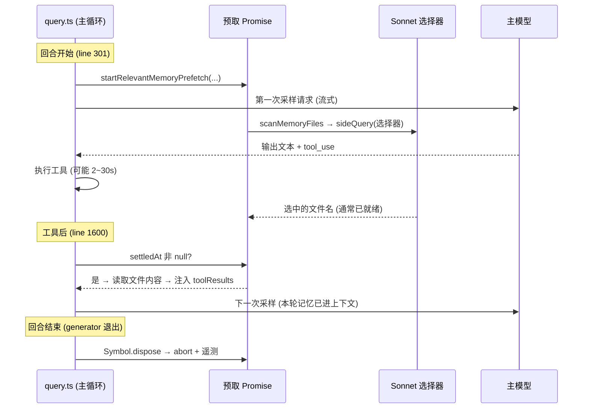

# Memory system - Claude Code - 02 - Memory recall

---

Recall 的相关性预取这部分我没有太懂是怎么做的.

---

这一段确实是整个记忆系统里最"绕"的，因为它跨越了"主循环 + 一个并行的小模型调用 + 回合内的消费时点"三个地方。我把它拆成"为什么预取 → 什么时候跑 → 内部三步 → 消费与渲染 → 预算去重 → 失败边界"来讲。

## 一、它要解决什么问题

正常情况下，"把相关记忆取回来"需要一次额外的 LLM 调用（判断哪些记忆跟当前问题相关）。如果放在主循环里同步做，每轮都要多等一次 API 往返。Claude Code 的做法是：**在用户提交提问的那一刻就把这次检索"发射"出去，让它在主模型流式输出和工具执行的这段时间里自己跑完**，等主循环跑到"工具结果都收齐、准备下一轮"的时候，如果已经跑完就顺手塞进去；没跑完就算了，下一轮再看。

源码里的动机写得很直白：以前的阻塞式版本放在 `getAttachmentMessages` 里（`utils/attachments.ts:873` 的注释：`relevant_memories moved to async prefetch`），相邻的技能发现也是同样的路子（注释记录阻塞版 97% 的调用什么都没找到）。

## 二、什么时候跑：一次用户回合 / 多次循环迭代

要理解这段，先分清两个时间尺度：

- **用户回合（user turn）**：用户提一次问 → 模型回答 + 可能多轮工具调用 → 结束。
- **循环迭代（iteration）**：回合内每一次"模型输出 → 工具执行"的往返。一个回合可能有 1 次或多次迭代（`turnCount` 每次迭代 `+1`，从 1 开始，见 `query.ts:276`、`query.ts:1679`）。

预取的启动点在**回合开始时、`while(true)` 之前**，只启动一次；消费点在**每次迭代的工具执行之后**，每次迭代都检查一遍：



关键语义有四个：

1. **零等待**：`settledAt === null` 就跳过，不做任何 await 等待（`query.ts:1600-1606`）。
2. **每回合最多消费一次**：`consumedOnIteration === -1` 才消费，消费后置为 `turnCount - 1`（第一次迭代记 0）。
3. **回合结束即作废**：`using` 绑定 + `Symbol.dispose`，generator 任何退出路径都会 abort 在途请求并打一条终态遥测（`hidden_by_first_iteration`、`consumed_on_iteration`、`latency_ms`）。这段注释解释了为什么不逐个 return 点手工处理——循环里有 ~13 个 return 点。
4. **与用户取消联动**：用的是 `createChildAbortController(toolUseContext.abortController)`，用户按 Escape 时子请求立即一起取消，而不是等到 dispose 才断。

## 三、预取内部的三步

入口是 `startRelevantMemoryPrefetch`（[attachments.ts:2361](/home/fishandrice/Backend/claude-code/claude-code-2.1.88-source/src/utils/attachments.ts:2361)），它先做几个廉价检查，再启动 `getRelevantMemoryAttachments`：

- `isAutoMemoryEnabled()` 且 `tengu_moth_copse` 打开（否则整条预取路径根本不存在——这正是"索引注入"与"相关性预取"两种召回模式的开关）
- 取**最后一条非 meta 的 user 消息**（`findLast(m => m.type === 'user' && !m.isMeta)`），因为注入的记忆自己是 `isMeta` 用户消息，不能被当成"用户提问"
- 纯单字 prompt 直接跳过（"缺少足够的上下文做词项判断"）
- 会话累计字节数已达上限（60KB）则跳过

**第 1 步：扫描（`memdir/memoryScan.ts`）**

```ts
const entries = await readdir(memoryDir, { recursive: true })
const mdFiles = entries.filter(f => f.endsWith('.md') && basename(f) !== 'MEMORY.md')
// 每个文件只读前 30 行，readFileInRange 顺带返回 mtimeMs
// Promise.allSettled 容错 → 按 mtimeMs 降序 → 取前 200 个
```

产出 `MemoryHeader[]`：`{ filename, filePath, mtimeMs, description, type }`。注意两个细节：`MEMORY.md` 被硬编码排除（它是索引不是内容），以及**读 30 行而不是先 stat**——注释说是为了把"N 个文件的两次系统调用"压成一次（先读后排序，而不是先 stat 排序再读）。

**第 2 步：选择（`memdir/findRelevantMemories.ts`）**

把上一步的头部格式化成一份文本清单，交给一次独立的 Sonnet 调用：

```
- [feedback] feedback_testing.md (2026-10-01T08:12:33.000Z): 集成测试必须打真实数据库，不能用 mock
- [project] project_merge_freeze.md (2026-09-28T02:40:11.000Z): 移动端发版冻结期自 2026-03-05 起
- [reference] reference_oncall.md (2026-08-14T11:05:00.000Z): oncall 延迟面板在 grafana.internal/d/api-latency
```

请求通过 `sideQuery` 发出（这是"主循环之外的一次性轻量 API 调用"的统一封装，会处理 OAuth 指纹头、attribution、beta 头等）。参数上能读到明确意图：模型取默认 Sonnet（一方 4.6、三方 4.5，见 `utils/model/model.ts:119`）、`max_tokens: 256`、`output_format` 用 JSON schema 约束成 `{ selected_memories: string[] }`、`querySource: 'memdir_relevance'` 便于成本归因。

系统提示的要点（`SELECT_MEMORIES_SYSTEM_PROMPT`）：**最多 5 个**；**不确定就不要选**；**宁可为空**；如果给了"近期用过的工具"清单，**不要**选这些工具的用法文档/API 参考（主对话里已经有可用样例了，那是关键词重合导致的假阳性），但**要**选关于这些工具的警告、坑和已知问题（正在用它们的时候恰恰最需要）。

返回后有一道防幻觉闸门：`selected_memories.filter(f => validFilenames.has(f))`——模型编出来的文件名会被丢掉。任何异常（包括 abort）都返回空数组，不影响主流程。

**第 3 步：读取与封装（`readMemoriesForSurfacing`）**

并行为每个选中的文件读取内容，受两道预算限制：`MAX_MEMORY_LINES = 200`、`MAX_MEMORY_BYTES = 4096`。截断策略是"保留前部 + 附一条提示"而不是丢弃整个文件——理由是既然它是相关性最高的，frontmatter 和开头通常就是有用的部分；提示里会告诉模型"想看完请用 Read 工具读完整路径"。

每条记忆附带一个预计算好的 header（`memoryHeader`）：新鲜的写 `Memory (saved 13 days ago): <path>:`，超过一天的老记忆换成一段陈旧性警告。这个 header 在**附件创建时就定死**，注释说明原因：渲染时再算 `memoryAge(mtimeMs)` 会调用 `Date.now()`，于是"3 天前"下一轮变成"4 天前"，字节变化会打掉 prompt cache。

## 四、怎么选目录：默认 auto memory，@agent 时隔离

`getRelevantMemoryAttachments` 会先看用户输入里有没有 @ 提及 agent（`extractAgentMentions`）：

- 有，且那个 agent 定义了 memory scope → 只搜该 agent 的记忆目录（**隔离**：避免把主记忆灌进子 agent 的上下文）
- 没有 → 搜 `getAutoMemPath()`

多个目录的结果会合并，然后再过滤一次 `readFileState`（模型自己读过/写过的文件）和 `alreadySurfaced`（之前已经展示过的），最后 `.slice(0, 5)` 严格限流。

## 五、消费端与渲染端

消费在 `query.ts:1596-1616`：工具结果、队列命令、常规附件都注入完之后，检查预取是否就绪。就绪则走 `filterDuplicateMemoryAttachments`——它不仅过滤掉 `readFileState` 里已有的路径，**还会把这次注入的内容写进 `readFileState`**（带 `mtimeMs` 和 `limit`）。这一步有双重作用：后续 `FileReadTool` 读同一文件会命中"未变化"缓存不用重读；而 `limit` 标记让 `getChangedFiles` 在算 diff 时跳过被截断的记忆（否则截断内容会算出一个误导性的 diff）。

渲染在 `utils/messages.ts:3708` 的 `case 'relevant_memories'`：每条记忆变成一条 `isMeta: true` 的用户消息，外面包 `<system-reminder>`，内容是 `header + 正文`。用 `isMeta` 的意义是：它对模型可见（会发给 API），但不被当成真实用户发言——所以既不会被 `findLast(!isMeta)` 当成新的提问再次触发预取，也不会污染用户可见历史。

## 六、三层去重与三层预算

这是我觉得最值得抄的部分：**同一个"别重复"的问题，在三个不同层各拦一次**，因为每层看到的信息不同。

| 层         | 手段                                 | 拦掉什么                                                      | 位置                           |
| ---------- | ------------------------------------ | ------------------------------------------------------------- | ------------------------------ |
| 选择器输入 | `alreadySurfaced` 路径集合         | 让 Sonnet 的 5 个名额花在新候选上                             | `findRelevantMemories.ts:44` |
| 结果过滤   | `readFileState`                    | 模型自己 Read/Write 过的文件，不必再注入                      | `attachments.ts:2225`        |
| 消费时     | `filterDuplicateMemoryAttachments` | 多目录合并可能重新引入的路径；并把内容登记进`readFileState` | `attachments.ts:2520`        |

| 预算     | 数值                    | 触发后行为                        |
| -------- | ----------------------- | --------------------------------- |
| 单文件   | 200 行 / 4KB            | 截断 + 提示用 Read 看完整         |
| 单轮     | 最多 5 个文件（≈20KB） | 多余的直接丢弃                    |
| 会话累计 | 60KB                    | 停止预取（`MAX_SESSION_BYTES`） |

会话预算是通过**扫描历史消息里的 `relevant_memories` 附件**累加出来的，而不是用上下文变量记的。注释里写了这么做的额外好处：compact 之后旧附件从上下文里消失，计数器自然归零，于是"重新召回"是合理的——而如果记在 `toolUseContext` 里，压缩后就会永久性地不再召回。

## 七、失败与边界

| 情况                       | 行为                                                          |
| -------------------------- | ------------------------------------------------------------- |
| `tengu_moth_copse` 关闭  | 完全不预取，回到"MEMORY.md 索引注入 + 模型 grep"模式          |
| 用户消息是单字             | 不预取                                                        |
| 选择器 API 出错 / 解析失败 | 返回`[]`，只记 debug 日志                                   |
| 用户 Escape / 回合结束     | 子 abort controller 取消在途请求；promise 里区分 abort 不报错 |
| 选中文件读失败             | 该条置 null 后被过滤；其余照常                                |
| 消息里所有记忆都已展示过   | 空结果，返回`[]`，不生成附件                                |
| 模型回了不存在的文件名     | 被`validFilenames` 过滤                                     |

## 八、几个设计取舍，以及我不能确认的部分

- **只按 filename + description + type + mtime 选**，不看正文。这是个很强的约束：它把"召回质量"直接压在**保存时写 description 的纪律**上（frontmatter 示例里专门写了 "used to decide relevance in future conversations, so be specific"）。好处是清单短、调用便宜；代价是描述写得含糊的记忆基本等于不可召回。
- **预取而非阻塞**：把一次 LLM 调用的延迟藏进主模型 2~30 秒的流式+工具时间里。代价是"没赶上就本轮不用"，所以它是**尽力而为**的召回，不是保证。源码提供了 `hidden_by_first_iteration` 这类遥测来观察命中率，但具体数值我看不到。
- **用 Sonnet 而不是更便宜的小模型做选择器**：源码里没有说明理由，我不做推断。相邻的技能发现路径的注释里提到过 Haiku 的延迟数字，可作参照，但那是另一条链路。
- 一个我确认到、但需要留意前后关系的细节：`scanMemoryFiles` 无条件排除 `MEMORY.md`，而 `tengu_moth_copse` 打开时索引本身也不再注入上下文（`filterInjectedMemoryFiles`），同时提示词切到 `skipIndex` 变体、不再要求维护索引行。也就是说这两种召回模式是配套切换的，不是简单的"多一层"。
