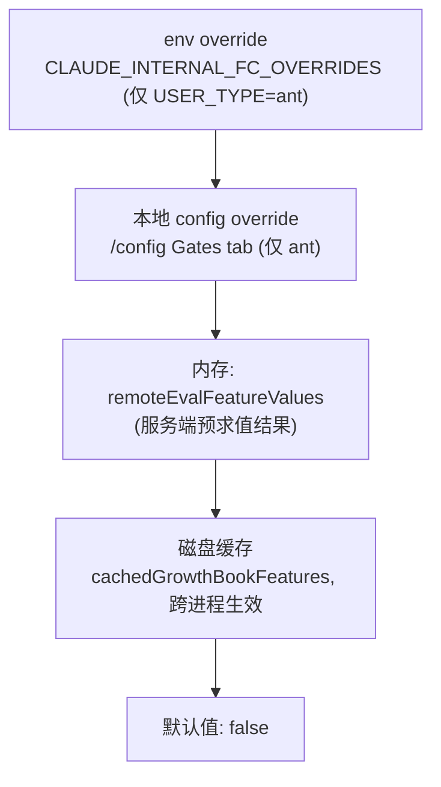

# Memory system - Claude Code - 03 - Recall switch

---

关于 Recall, 你说"Claude Code 在这里有**两套模式**，由 `tengu_moth_copse` 这个开关切换". 这个开关的切换时机是怎样的? 是由用户手动启用开关, 还是说由 Harness 自己看时机调整呢?

---

核实完了。结论比较明确：**两者都不是**——它是 Anthropic 服务端下发的实验/放量开关，客户端只是读和缓存。下面是证据链。

## 一、这个 key 在客户端只有"读"，没有"写"

全仓库搜索 `tengu_moth_copse`，一共 4 处，全是读取：

| 位置                                                                                                                                         | 用途                                                      | 何时读                   |
| -------------------------------------------------------------------------------------------------------------------------------------------- | --------------------------------------------------------- | ------------------------ |
| [memdir.ts:423](/home/fishandrice/Backend/claude-code/claude-code-2.1.88-source/src/memdir/memdir.ts:423)                                     | `skipIndex`：提示词不再要求维护 `MEMORY.md` 索引      | 组系统提示词时           |
| [extractMemories.ts:367](/home/fishandrice/Backend/claude-code/claude-code-2.1.88-source/src/services/extractMemories/extractMemories.ts:367) | 同上，抽取 agent 的提示词变体（写文件即可，不用更新索引） | 每次后台抽取时           |
| [claudemd.ts:1146](/home/fishandrice/Backend/claude-code/claude-code-2.1.88-source/src/utils/claudemd.ts:1146)                                | `filterInjectedMemoryFiles`：索引不再注入上下文         | 每轮装配 user context 时 |
| [attachments.ts:2367](/home/fishandrice/Backend/claude-code/claude-code-2.1.88-source/src/utils/attachments.ts:2367)                          | 预取总闸门：不开就完全不跑                                | 每回合开始时             |

没有任何 `settings.json` 字段、CLI flag 或面向用户的环境变量去设置它。同时也没有任何自适应逻辑（比如"记忆文件超过 N 个就切换模式"）——`isAutoMemoryEnabled()` 那类才读 settings/env，这个只读 GrowthBook。

## 二、值从哪来：一条四级优先链

`getFeatureValue_CACHED_MAY_BE_STALE`（[growthbook.ts:734](/home/fishandrice/Backend/claude-code/claude-code-2.1.88-source/src/services/analytics/growthbook.ts:734)）的解析顺序：

关键点是第 3 步：GrowthBook 以 `remoteEval: true` 模式工作，**规则求值发生在服务端**，客户端拿到的就是已经算好的 `value`。请求带上这些属性用于定向（`getUserAttributes`）：`id`/`deviceID`（设备指纹）、`sessionId`、`organizationUUID`、`accountUUID`、`userType`、`subscriptionType`、`rateLimitTier`、`appVersion`、非官方端点的 `apiBaseUrlHost` 等，并以 `cacheKeyAttributes: ['id','organizationUUID']` 作为缓存键。

也就是说：**谁进预取模式是服务端按用户/组织/设备维度分桶决定的**。而且载荷里如果某个 feature 的 `source === 'experiment'` 且带 `experimentResult.variationId`，客户端会把 (experimentId, variationId) 记下来，并在该 flag 第一次被读取时上报一次曝光事件（`logExposureForFeature` → `logGrowthBookExperimentTo1P`）。这套机制的存在说明：这些 `tengu_*` key 有相当一部分是**A/B 实验变体**，而不是简单的功能开关——这也正好解释了"两套召回模式并存"的意义：对照组用索引注入，实验组用相关性预取，然后比效果。

刷新节奏（[growthbook.ts:1013](/home/fishandrice/Backend/claude-code/claude-code-2.1.88-source/src/services/analytics/growthbook.ts:1013)）：外部构建 **6 小时**、内部（ant）构建 **20 分钟**；另外 auth 变化时会销毁重建 client（`refreshGrowthBookAfterAuthChange`）。每次成功载荷都同步写磁盘缓存，所以进程重启后即使还没联网也能读到上次的值——这就是函数名里 "MAY_BE_STALE" 的含义。

顺带一个边界：GrowthBook 整体依赖 1P 事件日志（`isGrowthBookEnabled()` → `is1PEventLoggingEnabled()`）。如果这条链路不可用，所有 flag 都退化为默认值。而 `moth_copse` 的默认值是 `false`——**预取是新分支，索引注入是基线**，这符合"新路径默认关闭、灰度放量"的常规做法。

## 三、如果值中途翻转，什么时候生效

这点值得注意，因为 4 个读取点分布在不同生命周期，而其中两个有缓存：

- **系统提示词的 memory section** 走 `systemPromptSection('memory', () => loadMemoryPrompt())`（[prompts.ts:495](/home/fishandrice/Backend/claude-code/claude-code-2.1.88-source/src/constants/prompts.ts:495)）。`systemPromptSection` 是 `cacheBreak: false` 的普通 section——同一次会话内缓存，不每轮重算。所以中途翻转通常不会改写已经建立的提示词，要等缓存被清（进入/退出 worktree、settings 同步、compact 等会走 `resetGetMemoryFilesCache` / `clearMemoryFileCaches`）。
- **user context** 里的索引注入判断是每次装配时读，但 `getUserContext` 本身是 memoize 的，同样在一次会话内基本不变。
- 只有预取闸门（每回合）和抽取器（每次运行）是高频读。

所以实际效果是：**服务端改配置 → 客户端最迟在下一次会话（或缓存被清之后）整体切换**；刷新间隔只是决定了"什么时候能拿到新值"，会话级缓存才决定了"什么时候行为真的变"。理论上存在短暂的子系统不一致窗口（例如提示词还写着索引会自动加载，而预取路径已经打开），但因为上述缓存，这个窗口在实践中很窄。

## 四、我不能确认的部分

- **线上实际分桶比例、以及今天生产到底是模式 A 还是 B**：求值在服务端，本地源码看不到配置内容，只能看到默认值是 `false`。
- 这 4 处读取是否被刻意要求"同时翻转"（例如同一次会话内保持一致的约定）：代码里没有这样的注释或断言。就代码而言，这套 flag 的设计是"一个语义开关贯穿所有相关子系统"，但没有强制一致性的机制。
