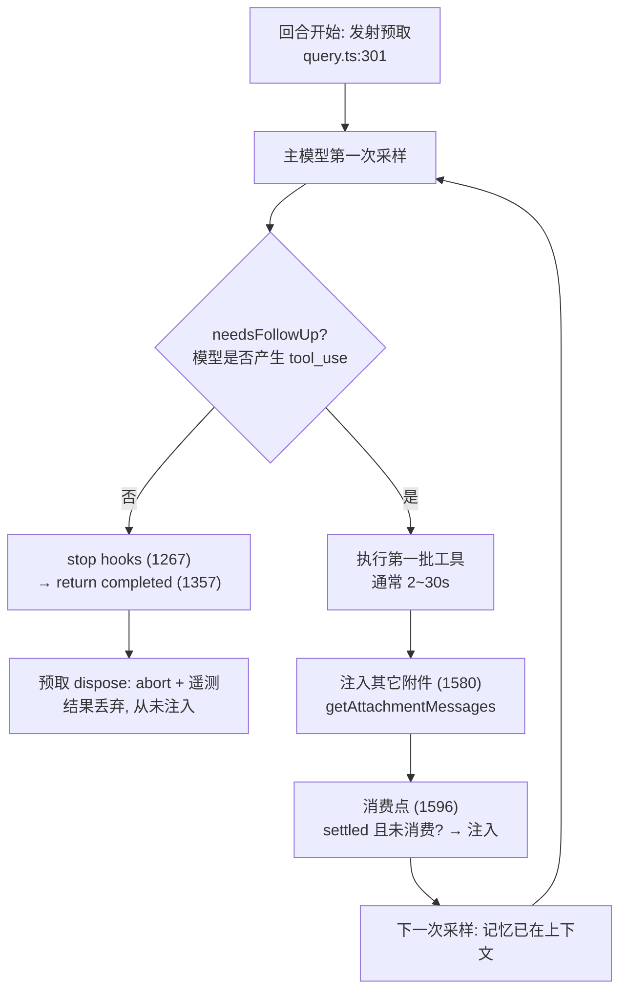

# Memory system - Claude Code - 04 - Prefetch recall limitation

---

那这个预取不是很鸡肋吗: 对于这一轮, 要么是主 Agent 任务已经跑了一半, 预取模型才慌慌张张把该用的记忆发过来; 要么是主 Agent 已经做完了, 预取模型把该用的记忆发过来也没用了.
预取模型取过来的记忆, 是一直都在上下文里, 还是说在这轮结束等待用户查收时, 如果进行下一轮, 先前取来的记忆就从上下文中拿走, 要使用记忆, 也是使用后续预取用的记忆?

---

先回答你的第二个问题（"是不是当轮结束就撤走"）：**不会撤走**。注入的记忆会一直留在上下文里，直到上下文压缩把它清掉。而这个事实也基本决定了"鸡肋不鸡肋"的答案。

另外我在核实过程中发现一个事实，需要修正上一轮讲解里的时序直觉：**没有工具调用的回合，预取根本不会被消费，结果直接丢弃**。这比"送晚了"更极端——是"根本不送"。

## 一、注入的记忆是常驻的，不是"当轮燃料"

三条源码证据：

1. **消费点把附件并入消息流**。`query.ts:1596-1616` 在消费预取时，对每条记忆执行 `createAttachmentMessage` → `yield msg` → `toolResults.push(msg)`。`toolResults` 随后并入 `messagesForQuery`（`query.ts:1584` 的附件注入用的是 `[...messagesForQuery, ...assistantMessages, ...toolResults]`），成为下一轮迭代、以及下一个用户回合 `state.messages` 的一部分。它是一条 `isMeta` 用户消息：对模型可见、对用户界面隐藏，**不是临时注入后回收**。
2. **去重逻辑建立在"历史里能查到"的前提上**。`collectSurfacedMemories(messages)`（`utils/attachments.ts:2251`）每回合扫描历史消息里的 `relevant_memories` 附件，得出"已展示路径集合"与"累计字节数"。如果每轮结束就撤走，这个函数无从存在。
3. **注释直接说明了生命周期**。`utils/attachments.ts:2245-2250` 写着：之所以扫消息而不是在 `toolUseContext` 里记账，是因为"compact 之后旧附件从上下文中消失，计数器自然归零，所以重新召回是合理的"。反过来说就是：**在压缩之前，它们一直都在上下文里**。

由此，`RELEVANT_MEMORIES_CONFIG.MAX_SESSION_BYTES = 60 * 1024`（`utils/attachments.ts:279-289`）的含义就清楚了：一个会话里最多注入约 3 批（每批 ≤5 文件 × 4KB ≈ 20KB），超过就彻底停止预取，理由是"最相关的记忆已经在上下文里了"。

所以设计假设是：**一次注入，服务本次会话剩余的所有回合**，而不是服务"这一轮"。这也解释了为什么"没赶上就跳过"是可接受的——它丢掉的不是唯一一次机会。

## 二、准确的时序（含一处修正）

主循环结构（`query.ts`）如下：

判定依据：

- `needsFollowUp` 在流式过程中被设置：出现 `tool_use` 块时置 `true`（`query.ts:834`），消息结束时置 `false`（`query.ts:728`、`907`）。
- `if (!needsFollowUp)`（`query.ts:1062`）这一整段包含错误恢复、stop hooks（`1267`，也是后台抽取 / dream 的触发点）、token 预算检查，最后 `return { reason: 'completed' }`（`1357`）。**这段路径里没有任何 `getAttachmentMessages` 调用**——全文件仅一处，在 `query.ts:1580`，位于工具执行之后。
- 因此消费点（`1596`）只在"本轮有工具调用"时可达。

| 回合类型                           | 预取结果                                                      | 记忆何时对模型可见                           |
| ---------------------------------- | ------------------------------------------------------------- | -------------------------------------------- |
| 纯问答（模型直接回答，无工具调用） | 丢弃（`Symbol.dispose` abort + 遥测），从不注入             | 本回合看不到新记忆，只能靠此前回合已注入的   |
| 有工具调用                         | 第一批工具结束后注入，`consumedOnIteration = turnCount - 1` | 从本轮第二次采样开始，并常驻到会话结束或压缩 |

一次有工具调用的回合大致时间线：

| 时刻     | 事件                                                                                                           |
| -------- | -------------------------------------------------------------------------------------------------------------- |
| t=0      | 用户提交；预取发射（`startRelevantMemoryPrefetch`，`utils/attachments.ts:2361`）；主模型第一次采样同时开始 |
| t=0~1.5s | 扫描记忆目录（`scanMemoryFiles`）→ 一次 Sonnet 选择器调用（`sideQuery`，`max_tokens: 256`）             |
| t≈1.5s  | 预取就绪（`settledAt` 置位）                                                                                 |
| t=1~10s  | 主模型流式输出 + 第一批工具执行                                                                                |
| t≈10s   | 消费点：`settledAt !== null && consumedOnIteration === -1` → 注入                                           |
| t>10s    | 第二次采样：记忆进入上下文，影响本轮剩余所有迭代                                                               |

消费点的"零等待"语义：没就绪就跳过，本轮下一次迭代再检查；一个回合最多消费一次；回合结束仍未消费则被 abort（teardown 遥测见 `utils/attachments.ts:2430-2447`：`hidden_by_first_iteration`、`consumed_on_iteration`、`latency_ms`）。

**对你描述的修正**：第二种情形（"主 Agent 已经做完了，记忆才送过来"）在这个实现里不会发生。因为那时回合已经走完 `!needsFollowUp` → `return completed`，消费点根本不被访问，预取被 abort 丢弃，什么都不会注入。真实情况是二元的：**要么在有工具调用的迭代里赶上（多数情况），要么整个回合都不注入**。

## 三、那么"鸡肋"这个判断成不成立

分三种情形，结论不同。

**情形 1：纯问答回合 → 预取零收益，且白花一次 API 调用。**
这是你批评里最站得住的部分，而且是结构性的、非偶发：注入点恒在"第一次工具批次之后"，因此任何不需要工具的回合都拿不到新记忆。这一轮唯一的"贡献"是它没往上下文里塞东西。生产上应靠 `tengu_memdir_prefetch_collected`（含 `consumed_on_iteration = -1`）观察这个比例，具体数值不在本地仓库。

**情形 2：多步工具回合 → 不是"任务跑了一半"，而是"第一批探索性操作之后"。**
真实编码任务里第一批工具调用通常是探索性的（读文件、grep、列目录），而记忆内容绝大多数是**约束与偏好**（"测试必须打真库不用 mock"、"用户偏好某种分支命名"、"发版冻结日期"、"oncall 面板地址"）。这类信息作用于"接下来怎么写代码"这个决策点，而不是"第一句话怎么开口"。赶上第二次采样，仍有大量迭代受益。若回合只有一两轮迭代，预取确实可能迟到；但编码场景的长回合是常态，它是赶得上的。

**情形 3：跨回合 → 常驻带来的复利，最容易被忽略。**
既然注入后常驻，那次小模型调用的收益就不限于当轮：本会话后续所有回合（**包括后续的纯问答回合**）都能看到它。60KB 是**会话级**预算而非"每轮 20KB 预算"，正说明他们算的是会话账。反过来看，这也让"本轮没赶上"的代价变得可接受——同一会话里迟早会出现工具回合。

**一个重要的缓解因素**：模式 B（`tengu_moth_copse`）并没有砍掉"模型自己去找记忆"这条路。系统提示仍保留 `## When to access memories` 与 `## Searching past context`（后者由 `tengu_coral_fern` 控制，给出 `grep -rn "<search term>" <memoryDir> --include="*.md"` 的具体命令）。所以预取是**加速器**，不是唯一通路：它的增量价值是"把主题文件正文自动带进来，不必先花工具轮次去找"。

## 四、为什么不用更"不鸡肋"的方案

| 方案                                  | 代价                                   | 证据                                                                                                             |
| ------------------------------------- | -------------------------------------- | ---------------------------------------------------------------------------------------------------------------- |
| 阻塞式预取（第一次采样前 await）      | 每轮固定多一次 API 往返延迟            | 相邻的技能发现路径注释：原阻塞版本"生产上 97% 的调用什么都没找到"，于是改成预取 + 收集点等待（`query.ts:327`） |
| 全量注入记忆目录                      | 上下文成本不可控（主题文件长度无上限） | 单文件 4KB / 单轮 5 文件 / 会话 60KB 三层上限反证                                                                |
| 只注入索引，由模型自行 grep（模式 A） | 要花工具轮次，且模型不一定去查         | 模式 A 即基线实现（`getClaudeMds` 注入 `MEMORY.md`）                                                         |

所以这个设计本质是：**用一次"可以随时放弃"的小调用，去填两个工具批次之间的时间空档**。它赌的是"长回合里工具执行时间 > 选择器延迟"，这个赌注在编码场景通常成立。

## 五、它真正薄弱的地方

- **首轮响应结构性缺席**。无论多快，注入点都在第一次工具批次之后。若用户的问题是一次性回答型的（"我们当初为什么不用 X 方案"），记忆在该回合完全缺席——而这类问题恰恰常对应某条 `feedback` / `project` 记忆。
- **收益完全押在 `description` 上**。选择器只看 filename + type + description + mtime，看不到正文。description 含糊 = 不可召回。
- **关键遥测数值不可见**。`logMemoryRecallShape`（`MEMORY_SHAPE_TELEMETRY`）、`tengu_memdir_prefetch_collected` 存在，但数值不在仓库中；"预取命中率多少"这一唯一有说服力的证据无法从本地源码得出。
- 一个读码注意点：`hidden_by_first_iteration` 的表达式是 `settledAt !== null && consumedOnIteration === 0`（`utils/attachments.ts:2436`），即"已就绪且在第一次迭代就被消费"。字段名与表达式之间的语义不算直白，我不替它下结论。

## 六、源码位置速查

| 位置                                                 | 内容                                                                                  |
| ---------------------------------------------------- | ------------------------------------------------------------------------------------- |
| `query.ts:301`                                     | 回合开始发射预取（`using` 绑定，作用域退出即 abort）                                |
| `query.ts:1062` / `1357`                         | `!needsFollowUp` 分支：stop hooks → `return completed`（预取不被消费）           |
| `query.ts:1580` / `1596-1616`                    | 唯一附件注入点 / 预取消费点（零等待、每回合一次）                                     |
| `utils/attachments.ts:2361-2400`                   | `startRelevantMemoryPrefetch` 门控与发射                                            |
| `utils/attachments.ts:2196-2241`                   | `getRelevantMemoryAttachments`（目录选择、合并、`slice(0,5)`）                    |
| `utils/attachments.ts:2251`                        | `collectSurfacedMemories`（扫消息算去重集合与累计字节）                             |
| `utils/attachments.ts:2279-2320`                   | `readMemoriesForSurfacing`（200 行 / 4KB 截断）                                     |
| `utils/attachments.ts:2327`                        | `memoryHeader`（年龄 / 陈旧性头部，创建时定死以保 prompt cache）                    |
| `utils/attachments.ts:2520`                        | `filterDuplicateMemoryAttachments`（并登记 `readFileState`，避免重复读与假 diff） |
| `utils/attachments.ts:269/277/288`                 | `MAX_MEMORY_LINES=200` / `MAX_MEMORY_BYTES=4096` / `MAX_SESSION_BYTES=60KB`     |
| `memdir/findRelevantMemories.ts:18/39/77`          | 选择器系统提示 /`findRelevantMemories` / `selectRelevantMemories`                 |
| `memdir/memoryScan.ts:21/22/35/84`                 | 200 文件上限 / 30 行 frontmatter /`scanMemoryFiles` / `formatMemoryManifest`      |
| `utils/messages.ts:3708`                           | `relevant_memories` 渲染为 `isMeta` 用户消息 + `<system-reminder>`              |
| `memdir/memdir.ts:423`、`utils/claudemd.ts:1146` | `tengu_moth_copse`：索引维护指令与索引注入同时关闭                                  |
