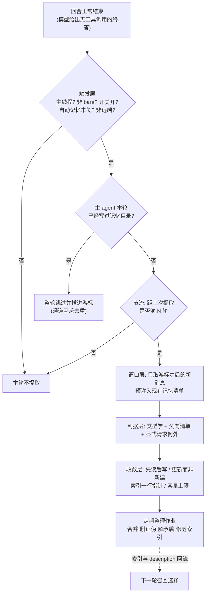

# Memory system - Claude Code - 05 - 提取判据：哪些记忆该存、哪些不该存

---

Claude Code 在提取记忆这部分是怎么做的? 它如何确定哪些记忆应当提取, 哪些记忆不应该提取?

---

## 一、先纠正一个预期：没有"记忆分类器"，判据是三层的

"哪些该提取、哪些不该提取"在 Claude Code 里不是一次打分或一次分类。它由三层叠加而成，而且三层的性质完全不同：

| 层 | 作用 | 由谁执行 | 能否被静态检查 |
|---|---|---|---|
| 触发层 | 这一轮要不要跑提取 | 代码门控（开关、模式、节流、互斥） | 能，全是布尔判断 |
| 窗口层 | 提取者能看到哪段对话 | 代码（游标 + 消息计数）+ 提示词指令 | 部分能 |
| 判据层 | 这段对话里哪句话算"记忆" | **模型自身**，依据写死在提示词里的类型学与负向清单 | 不能，只有提示词文本 |
| 收敛层 | 存进去之后怎么不变垃圾 | 提示词约束（先读清单、更新而非新建）+ 容量上限 + 定期整理作业 | 部分能（容量、敏感词） |

所以"哪些不该提取"这个问题，绝大部分答案不是代码规则，而是一段自然语言清单；代码只负责保证"不越权的写入"和"不要写进垃圾"这两件事的物理边界。下文按这四层展开。

## 二、触发层：什么时候才有资格"判断该不该存"

这几个门控按便宜到贵的顺序短路，任何一个不满足就直接返回，不产生模型调用：

1. **只有主线程**。子 agent 的回合结束钩子不触发提取——否则每个子 agent 都会产出自己的记忆副本。
2. **不是 bare / SIMPLE 模式**。脚本化 `-p` 调用被明确排除，理由是"不要让后台 fork 在退出阶段抢资源"。
3. **远端开关打开**。提取能力由两个远端开关共同决定：一个总开关，以及"非交互会话是否也要提取"的单独开关（交互式会话不受第二个开关限制）。这两个值来自服务端下发，仓库里看不到真实灰度人群。
4. **自动记忆没有被关掉**。判定优先级是：环境变量显式关闭 → 环境变量显式打开 → SIMPLE 模式 → 远端模式但没有持久目录 → `settings.json` 里的 `autoMemoryEnabled`（支持项目级 opt-out，即恶意仓库可以关，但不能借此改路径）→ 默认开启。
5. **不是远端模式**。
6. **节流**：每 N 个合格回合才跑一次，N 来自远端开关，缺省为 1（即每轮都跑）。被节流的回合不只是不调模型，连"扫描现有记忆清单"这一步都省掉。
7. **并发合并**：如果上一次提取还没结束，这次调用不排队也不并发，而是把上下文暂存为"尾随运行"（只保留最新一份），当前跑完后补跑一次，并且尾随运行不受节流限制。

紧接着是**通道互斥**：本轮主 agent 自己是否已经往记忆目录里写过文件（扫游标之后的 assistant 消息里的写入类工具调用，看目标路径是否落在记忆目录内）。写过就整轮跳过，并把游标推进到本轮末尾。注意这是**回合级去重**，不是内容级去重：主 agent 只写了一条记忆，后台提取这一轮的其余内容也不会再被考虑。

还有两个容易忽略的边界：
- **失败不推进游标**，所以出错的那些消息会在下一轮重新被考虑——代价是可能重复提取，收益是不会漏。
- **游标因压缩而消失**时（被 context compaction 剪掉），消息计数会退化为"全部可见消息"，而不是返回 0。这是一个防呆：否则一次压缩就会让本会话此后再也不提取。

## 三、窗口层：允许被判断的材料范围

- 提取者拿到的是**主对话的完美 fork**：同一份系统提示、同一段消息前缀，因此命中主对话的 prompt cache。它并不是"只看到增量"，整段历史都在上下文里。
- 但提示词强制把注意力收窄：开头就说"分析上面最近约 N 条消息"（N 是游标之后的可见消息数），并且重复强调"只能使用这 N 条消息的内容"，**禁止**去 grep 源码、读代码确认某个模式存在、跑 git 命令。
- 明确要求"不要为了验证而浪费回合"，配合 5 轮硬上限和"第 1 轮并行读、第 2 轮并行写、不要交错"的效率要求，把提取者塑造成一个"只做归纳，不做调查"的角色。

这条限制的副作用要写清楚：**提取内容不经过事实验证**。模型可能把一句猜测写成记忆，也可能把已经过时的结论固化下来。系统用两个下游机制兜底——整理作业会删除被证伪的条目；召回侧则在提示词里要求"记忆里点名的文件/函数/开关都要先查证，记忆写着 X 存在不等于 X 现在存在"，并对超过一天的记忆附加"这是 N 天前的快照"的时效提示。

## 四、判据层：真正决定"该不该存"的四个来源

### 4.1 封闭的四类型（正向判据）

类型集合是封闭的四项，缺一不可、也没有第五项：用户画像、反馈、项目上下文、外部指针。每种类型都配了三样东西——**保存时机触发语**、**使用场景**、**正例（few-shot）**。触发语就是判据的操作化定义：

- **用户画像**：任何关于用户角色、偏好、职责、知识水平的信息。例子里给的是"我是数据科学家，在看日志现状""写了十年 Go，第一次碰这个仓库的 React 一侧"。附带一条价值观约束：不要写会构成负面评价、或与当前协作无关的用户记忆。
- **反馈**：任何时候用户纠正你的做法（"不是这样""别做 X"）**或者**认可一个不显然的做法（"对，就这样""正好，继续保持"，或默许一个不寻常选择）。这里有两个设计要点：一是明确要求"从失败和成功同时记录"，理由是只记纠错会让人越来越保守、逐渐偏离用户已经认可的路线；二是对"安静的认可"专门提醒——纠错容易发现，认可是无声的，需要主动留意。
- **项目上下文**：谁在做什么、为什么、什么时候之前完成——即代码与 git 里推不出来的动机与协作状态。附带一条时效性规则：**相对日期一律转绝对日期**（"周四"写成具体日期），否则记忆过一段时间就无法解释。
- **外部指针**：外部系统的位置与用途（Linear 的哪个项目、Grafana 的哪个面板、Slack 的哪个频道）。

反馈与项目这两类还规定了**正文结构**：先写规则或事实，再写一行"为什么"和一行"什么时候适用"。理由写得很直白——知道为什么，未来的自己才能在边界情况上做判断，而不是机械照搬一条规则。另外项目类明确说"这类记忆衰减很快"，所以"为什么"同时也是判断"它是否还成立"的依据。

### 4.2 负向清单（硬性排除项）

这是"哪些不该提取"最直接的答案，五条，且刻意写成"可推导性"而不是"重要性"：

1. 代码模式、约定、架构、文件路径、项目结构——读当前项目就能拿到。
2. Git 历史、最近的改动、谁改了什么——`git log` / `git blame` 才是权威。
3. 调试解法、修复配方——修复已经在代码里，上下文在提交信息里。
4. 任何已经写在 CLAUDE.md 里的内容。
5. 临时任务细节：进行中的工作、暂时状态、当前对话上下文。

### 4.3 显式请求的例外条款（唯一被反向覆盖的一条）

通常"用户明确要求记住"是最高优先级——但对上面五条不成立。清单末尾专门加了一段：**即使你被明确要求保存，这些排除项依然生效**；如果用户让你存一份 PR 列表或活动总结，应该反问"其中哪部分是令人意外的、不显然的"——那才是值得留下的东西。

源码注释记录了这条的来历：它是评测驱动的，改之前那类 case 通过率是 0/2，改完 3/3，动机是防止记忆退化成"活动流水账"。这是整个判据层里少数能直接看到"判据是被评测迭代出来"的证据。

### 4.4 共享记忆特有的判据（团队维度）

开了团队记忆后，同一套类型学之上多一层**去向判断**（私有还是团队），并且是按类型给默认值的：

- 用户画像：**永远私有**。
- 反馈：默认私有；只有当它明显是"每个贡献者都该遵守的项目规约"（测试策略、构建不变量）才进团队，个人风格偏好留在私有。并且要求：存之前先确认它不与已有的团队反馈冲突，冲突时要么不存，要么显式写出"这次覆盖前一条"。
- 项目：私有或团队皆可，但强烈偏向团队。
- 外部指针：通常团队。

团队记忆上还叠了一条敏感信息禁令（永不保存 API key、凭据）。这一条**同时有代码强制**：写文件与编辑文件两个工具在入参校验阶段会检查目标路径是否属于团队记忆目录，是的话跑一遍秘密扫描（高置信度密钥前缀规则），命中就直接拒绝这次写入并让模型自己删掉敏感内容重试。这也是整条链路上唯一一处"内容级"的写入拦截——私有记忆没有任何内容检查。

## 五、收敛层：判据之外，四条反向塑造"提取什么"的约束

这些不是判据，但会实际改变模型的选择，属于容易漏掉的一半答案：

1. **先看清单再写**。提取提示词里预注入"现有记忆文件清单"（每行一项：类型标签、文件名、修改时间、一行描述），来自对记忆目录的 frontmatter 扫描（按修改时间从新到旧，最多 200 条）。并要求"写之前先看这份清单，能更新已有文件就不要新建近似重复"。预注入本身是为了省掉一个 `ls` 回合。
2. **描述字段是召回接口**。文件头的描述被明确要求"写具体，因为未来会话用它来判断相关性"。下一轮召回时，一个小模型（Sonnet）就是拿用户的提问 + 这份清单（文件名 + 描述）来挑最多 5 个文件，并且被要求"不确定有用就不要选"。也就是说：**提取时怎么写描述，直接决定这条记忆未来会不会被读回来**，判据和召回在这里闭成一个环。
3. **索引容量硬顶**。`MEMORY.md` 只是索引，每条一行（约 150 字符以内，指向主题文件），上限 200 行且 25KB，超出会被截断并在上下文里留下"索引超限，只加载了一部分"的告警。索引是每轮都进上下文的，所以容量约束反过来逼提取必须收敛：琐碎条目会挤掉重要条目，条目的"值不值得占一行"变成一条隐性判据。
4. **长期会话换范式**。在助手模式（KAIROS，会话近似常驻）下，同样的判据被拆成两段：会话里只往当天的日志文件**追加**带时间戳的条目（"什么该记"= 用户纠正与偏好、关于用户的事实、代码里推不出的项目上下文、外部指针、用户明确要求记的内容 + 同一份负向清单），索引由夜间整理从日志蒸馏，模型不被允许直接改索引。即：**该不该记**和**该不该进索引**被分开了。

然后是整理作业（dream）：时间闸门（默认 24 小时）+ 会话数闸门（默认 5 个被改动过的会话）+ 进程锁，四阶段是"先看现状 → 收信号（日更日志、与当前代码矛盾的旧记忆、必要时窄查 transcript）→ 合并进已有主题文件、相对日期转绝对、"今天查出来证伪了就改源头" → 修剪索引、降级过长的索引行、解决互相矛盾的条目"。

这套分工解释了为什么提取判据可以偏宽：**提取负责召回，整理负责精度**。提取时做跨记忆的矛盾消解太贵（还要读全部既有文件），所以放到低频的整理作业里做。

## 六、条件与边界

- **主 agent 通道不受触发层限制**。它的系统提示里始终带着完整的保存规范（同一套四类型 + 负向清单 + 显式请求条款 + 何时该访问 + 拿不准就别存之外的结构要求）。所以即使后台提取被关掉或节流，模型仍会自己写；两条通道共享判据，只是触发时机不同（一个在回合中随手写，一个在回合结束后补漏）。这也解释了为什么互斥只能是回合级的：判据重复没关系，重复劳动才有关系。
- **会话记忆（SessionMemory）是另一个机制**，不属于本篇：它按固定十段模板（会话标题、当前状态、任务规格、文件与函数、工作流、错误与纠正、系统文档、经验、关键结果、工作步骤）填一份摘要供压缩使用，判据是"哪个段落有新信息"，还明确禁止把调试过程、CLAUDE.md 已有内容写进去。它的边界是"本会话内有效"，与跨会话的自动记忆不是一回事。
- **提取者的能力被物理限制**：只放行读、检索、只读 shell（明确排除 `rm`）、以及**记忆目录内**的写入；MCP、子 agent、可写 shell 全部拒绝。5 轮上限 + 禁止验证，"大范围排查式提取"在结构上不可能。
- **不存在的机制**：私有记忆没有任何内容级校验（不检查是否写了代码模式、是否与既有记忆重复、是否含密钥）；去重完全靠模型按清单自觉，再加上整理作业事后收口。
- **路径安全**：自动记忆目录本身接受环境变量与设置覆盖，但路径校验会拒绝相对路径、根目录与近根目录、Windows 盘根、UNC 网络路径、含空字节的路径；仓库内提交的项目级设置被刻意排除在"改路径"之外，只允许它做开关。
- **线上默认值不可判定**：总开关、节流轮数、非交互是否提取、索引形态（是否省略索引步骤）都由远端开关控制，仓库只能给出缺省值。

## 七、设计取舍

**为什么判据写在提示词里，而不是写成分类器？** 因为判据本身是"什么对未来的对话有用"这种语义判断，无法用特征工程表达；写成文本后，改判据 = 改一段文案，可以做 A/B、可以按 case 回归评测。代价是判据随模型版本漂移、不能形式化验证，也无法向用户保证"这条一定不会被存"。源码注释里保留的评测记录（0/2 → 3/3、2/3 等）以及"同一个句子放在不同位置效果差三倍"的观察，说明他们确实是在按 case 迭代文案，而不是在加代码规则。

**为什么硬边界是"可推导性"而不是"重要性"？** "重要"需要价值判断，模型和用户很难对齐；"能不能自己查出来"是可自证的——模型知道自己能 grep、能 git log、能读 CLAUDE.md。把边界定在可推导性上，就把一个模糊的取舍问题换成了一个近乎机械的判定，也顺带解释了为什么 git 历史和调试配方被整类排除：它们不是"不重要"，而是"随时可重建"。

**为什么回合级互斥而不做内容级去重？** 内容级去重要先读全部既有记忆再比对，成本高、还容易在两个近似条目之间反复横跳。用"主 agent 这轮写过就整轮跳过"换来的实现极便宜（扫 tool_use 的 file_path），代价就是同一轮里主 agent 没写到的内容要等下一轮——而下一轮的游标已经越过去了，等于放弃。这是明确的取舍，注释里写的是"避免重复劳动"。

**为什么提取和整理要分开？** 提到每次回合结束都做"合并、解矛盾、删证伪"会让每个回合都背上一次全量阅读；放到 24 小时 / 5 个会话触发的低频作业里，就可以承担昂贵的跨记忆推理。代价是记忆在两次整理之间可能自相矛盾。

**为什么用索引行数而不是文件数来限制容量？** 文件多不是问题（扫描上限 200，召回只挑 5 个），每轮必进上下文的是索引。限制"入口长度"比限制"库大小"更贴近真实成本。

## 八、证据分级

**已证实（源码可直接确认）**
- 触发链的每一道门控与短路顺序：主线程、bare 模式、两个远端开关、自动记忆开关优先级、远端模式、节流轮数缺省 1、并发时的尾随运行合并。
- 通道互斥的实现方式（扫游标之后的写入类工具调用是否落在记忆目录）与"跳过时仍推进游标"。
- 游标成功后才推进、失败保留；游标丢失时退化为全量计数的防呆。
- 提示词要求"只用最近 N 条消息""不要求证、不许 grep/读码/git"、5 轮上限、并行读写的回合安排。
- 四类型封闭集 + 每类的时机触发语、使用场景、正例、正文结构（规则/事实 + 为什么 + 何时适用）、项目类相对日期转绝对日期、用户类禁止负面评价式记录。
- 负向五条清单的原文，以及"显式请求也不覆盖排除项、改为追问什么令人意外"的条款与其评测来历注释。
- 团队维度：按类型的私有/团队默认、私有反馈与团队反馈冲突时的处理要求、敏感信息禁令；以及写/编辑工具入参校验里的团队记忆秘密扫描拦截。
- 预注入记忆清单（frontmatter 扫描、按修改时间倒序、上限 200、每行含类型/文件名/时间/描述）；索引单行指针 + 200 行 / 25KB 上限 + 截断告警。
- 提取者权限白名单（只读 shell、记忆目录内写、其余拒绝）。
- 助手模式的追加式日志范式与其"什么该记"清单；整理作业的四道闸门与四阶段提示词（合并、日期绝对化、删除被证伪、修剪索引、解矛盾）。
- 召回侧的小模型选择逻辑（最多 5 个、不确定就不选）与"记忆陈旧需先查证"的漂移警示、超过一天记忆的时效提示。

**合理推断**
- "判据之所以定在可推导性上，是为了把模糊的价值判断换成可自证的机械判定"——文案与注释方向一致，但没有设计文档直接表述。
- "提取偏宽、整理收窄"的分工是有意为之——两套机制的形态强烈支持，但没有一句话说明这个分工。
- "描述字段写得好坏影响下轮召回，从而形成质量闭环"——结构上必然成立（召回选择器只看文件名与描述），但没有任何地方把它写成设计意图。
- 索引容量上限被当作隐性的"值不值得占一行"判据——是约束的必然推论，但没有提示词明说。

**无法确认**
- 各远端开关（总开关、节流轮数、非交互提取、索引形态、团队记忆灰度）线上的真实取值与人群；同一版本仓库内的缺省值不等于用户实际行为。
- 评测里各 case 的具体构造与通过标准：注释只保留结论数字。
- 私有记忆在真实使用中的误存率、以及整理作业对误存的实际清理效果：需要有运行数据才能判断。

## 源码依据

| 文件 | 关键位置 | 作用 |
|---|---|---|
| `src/query/stopHooks.ts` | `handleStopHooks` 中 `!isBareMode()` 分支、`isExtractModeActive()`、`feature('EXTRACT_MEMORIES')`、`!toolUseContext.agentId` | 回合结束触发提取的门控 |
| `src/memdir/paths.ts` | `isAutoMemoryEnabled()`、`isExtractModeActive()`、`validateMemoryPath()` | 自动记忆开关优先级、提取总开关、记忆目录路径安全校验 |
| `src/services/extractMemories/extractMemories.ts` | `initExtractMemories()` 闭包状态、`runExtraction()`、`countModelVisibleMessagesSince()`、`hasMemoryWritesSince()`、`createAutoMemCanUseTool()`、`maxTurns: 5`、`tengu_bramble_lintel`、`drainPendingExtraction` | 游标与窗口、通道互斥、节流、权限白名单、预算、尾随运行 |
| `src/services/extractMemories/prompts.ts` | `opener()`、`buildExtractAutoOnlyPrompt()`、`buildExtractCombinedPrompt()` | 提取提示词：窗口限制、禁止验证、清单预注入、显式请求条款 |
| `src/memdir/memoryTypes.ts` | `MEMORY_TYPES`、`TYPES_SECTION_INDIVIDUAL` / `TYPES_SECTION_COMBINED`（`when_to_save`、`body_structure`、examples）、`WHAT_NOT_TO_SAVE_SECTION`、`WHEN_TO_ACCESS_SECTION`、`TRUSTING_RECALL_SECTION`、`MEMORY_DRIFT_CAVEAT`、`MEMORY_FRONTMATTER_EXAMPLE` | 四类型判据、负向清单、评测注释、正文结构要求 |
| `src/memdir/memdir.ts` | `buildMemoryLines()`、`buildMemoryPrompt()`、`buildAssistantDailyLogPrompt()`、`loadMemoryPrompt()`、`MAX_ENTRYPOINT_LINES` / `MAX_ENTRYPOINT_BYTES`、`truncateEntrypointContent()`、`buildSearchingPastContextSection()` | 主 agent 侧同一套判据、索引容量、助手模式日志范式 |
| `src/memdir/teamMemPrompts.ts` | `buildCombinedMemoryPrompt()` | 私有/团队双目录版判据与敏感信息禁令 |
| `src/memdir/memoryScan.ts` | `scanMemoryFiles()`、`formatMemoryManifest()`、`MAX_MEMORY_FILES = 200` | 清单扫描与格式化（提取与召回共用） |
| `src/memdir/findRelevantMemories.ts` | `SELECT_MEMORIES_SYSTEM_PROMPT`、`selectRelevantMemories()` | 召回侧按描述择优（最多 5 个） |
| `src/memdir/memoryAge.ts` | `memoryAge()`、`memoryFreshnessText()` | 陈旧记忆的时效提示 |
| `src/services/autoDream/autoDream.ts`、`consolidationPrompt.ts` | 闸门顺序（时间/会话数/锁）、四阶段提示词 | 提取之后的收敛与整理 |
| `src/services/teamMemorySync/teamMemSecretGuard.ts`、`secretScanner.ts` | `checkTeamMemSecrets()`、`scanForSecrets()` | 团队记忆写入的秘密扫描拦截 |
| `src/tools/FileWriteTool/FileWriteTool.ts`、`src/tools/FileEditTool/FileEditTool.ts` | `validateInput` 中调用 `checkTeamMemSecrets()` | 唯一的内容级写入拦截 |
| `src/services/SessionMemory/prompts.ts` | `DEFAULT_SESSION_MEMORY_TEMPLATE`、`getDefaultUpdatePrompt()` | 对比：会话内摘要的十段模板与填写判据 |
