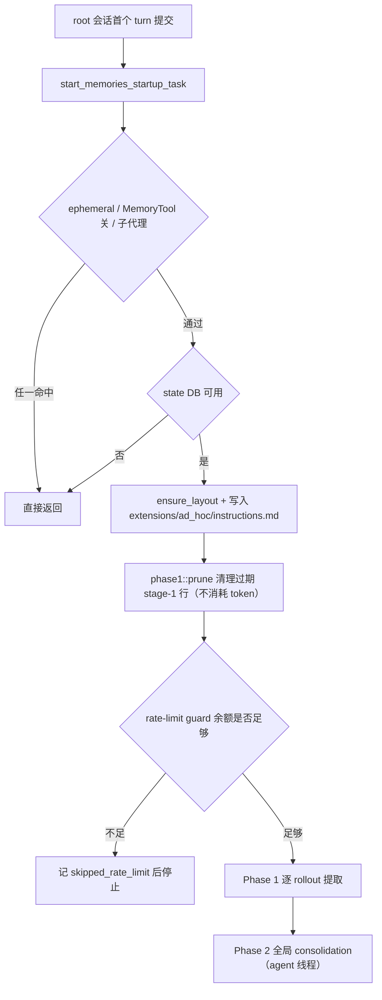
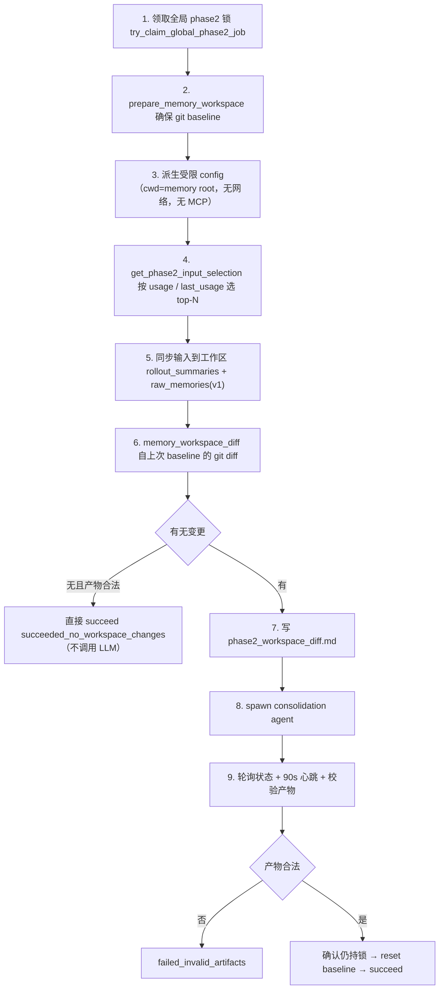
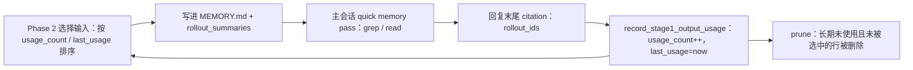

`

# Memory system - Codex - 01 - Codex memory system

---

可以. 接着探索一下 Codex 在记忆系统这方面是怎么做的吧.

---

范围沿用首轮已确认的研究计划：只看自动记忆的提取 / 整理 / 召回，不含 `AGENTS.md`（人工维护的项目指令）与上下文压缩。以下结论均来自本地快照 `/home/fishandrice/Backend/codex`。

## 一、一句话概括，以及它与 Claude Code 最根本的差别

Codex 的记忆是**"离线管道 + 只读消费"**：提取和整理都发生在后台启动流水线里（用普通 Codex 线程跑），主会话几乎不参与写入；主会话拿到的是一份**很短的摘要**（`memory_summary.md`，≤2500 tokens）注入 developer instructions，细节靠模型自己 grep/read 去查。

与 Claude Code 对照，差异最尖锐的三点：

| 维度                    | Claude Code                                                 | Codex                                                          |
| ----------------------- | ----------------------------------------------------------- | -------------------------------------------------------------- |
| 状态存放                | 文件系统（锁文件 mtime 兼作时间戳、`MEMORY.md` 兼作索引） | SQLite state DB（job claim / lease / watermark / usage_count） |
| 主 agent 能否直接写记忆 | 能（提示词带保存指令 + 权限 carve-out）                     | **不能**，只能写 ad-hoc note，待下次整理时应用           |
| 召回方式                | 注入索引（或相关性预取主题文件正文）                        | 注入极短摘要 + 教模型做一次 quick memory pass 自行检索         |

换言之：Claude Code 把记忆当作**要主动喂给模型的文件**；Codex 把它当作**可检索的知识库**，模型按需查阅，并用 citation 协议回报"我用了哪几条"。

## 二、触发：root 会话启动时的一条后台流水线

入口在 app-server，提交首个 turn 之后调用 `start_memories_startup_task(...)`（[turn_processor.rs:707](/home/fishandrice/Backend/codex/codex-rs/app-server/src/request_processors/turn_processor.rs:707)；实现见 [start.rs](/home/fishandrice/Backend/codex/codex-rs/memories/write/src/start.rs:22)）。

门控（`start.rs:25-36`）：`config.ephemeral` 为假、feature `Feature::MemoryTool` 已启用、且 `!source.is_non_root_agent()`（子代理会话不跑）。通过后 `tokio::spawn` 起后台任务，顺序固定：



两个细节：

- `dual_write` 打开时会把 V1、V2 各跑一份，各写各自目录（`start.rs:39-45`）。
- 速率限制守卫在 Phase 1 之前（[guard.rs](/home/fishandrice/Backend/codex/codex-rs/memories/write/src/guard.rs:11)）：走 codex backend 的账号若窗口已用比例超过 `100 - min_rate_limit_remaining_percent`，整条流水线跳过——**记忆生成主动给正常使用让路**。

## 三、记忆目录与产物

根目录：`$CODEX_HOME/memories`（v1）／`$CODEX_HOME/memories_v2`（v2），由 `MemoryVersion::directory_name()` 决定（[memory_version.rs](/home/fishandrice/Backend/codex/codex-rs/protocol/src/memory_version.rs:15)）。分成两个兄弟目录，是为了让 v1 的清理与回滚独立于 v2 产物。

布局由 [lib.rs](/home/fishandrice/Backend/codex/codex-rs/memories/write/src/lib.rs:36) 的常量定义：

```text
$CODEX_HOME/memories/
├── memory_summary.md          # 注入 developer instructions 的短摘要（首行必须恰好是 "v1"）
├── MEMORY.md                  # 可 grep 的 handbook（按 Task Group 分块）
├── raw_memories.md            # 阶段一的机械合并（仅 v1 需要）
├── skills/<skill-name>/SKILL.md
├── rollout_summaries/<stem>.md
├── extensions/<name>/instructions.md   # 额外记忆源的解读说明
│   ├── ad_hoc/notes/<timestamp>-<slug>.md   # 主会话唯一允许写入的位置
│   └── <name>/resources/*.md                # 外部导入的记忆资源
├── phase2_workspace_diff.md   # 每次整理前生成的临时提示产物（不属于记忆内容）
└── .git/                      # 由 Codex 维护的 git baseline
```

安全约束（源码明写）：memory root 本身不得是符号链接（`ensure_layout`，`lib.rs:118`）；`ensure_layout` 与整理后校验都会**清除目录内的符号链接**（`workspace::remove_memory_symlinks`）；`clear_memory_roots_contents` 拒绝清理符号链接形式的 root，避免误删目标目录（[control.rs](/home/fishandrice/Backend/codex/codex-rs/memories/write/src/control.rs:14)）。

## 四、提取（Phase 1）：每条 rollout 一次纯 sampling 调用

### 1) 领取任务：资格判定全在 SQL 里

`claim_stage1_jobs_for_startup`（[state/src/runtime/memories.rs:151](/home/fishandrice/Backend/codex/codex-rs/state/src/runtime/memories.rs:151)）的参数来自配置与常量：

| 参数                       | 值 / 来源                                                                   | 含义                         |
| -------------------------- | --------------------------------------------------------------------------- | ---------------------------- |
| `allowed_sources`        | `Cli` / `VSCode` / `atlas` / `chatgpt`（`rollout/src/lib.rs:88`） | 只汇总交互式会话             |
| `scan_limit`             | 5000                                                                        | 单次启动最多扫多少 thread    |
| `max_claimed`            | `memories.max_rollouts_per_startup`                                       | 单次启动最多认领多少 job     |
| `max_age_days`           | `memories.max_rollout_age_days`                                           | 太老的 rollout 不提          |
| `min_rollout_idle_hours` | `memories.min_rollout_idle_hours`                                         | 仍在活跃的 rollout 不提      |
| `lease_seconds`          | 3600                                                                        | 认领租约，防多 worker 重复做 |
| worker id                  | 当前 thread id                                                              | 顺带排除自己那条会话         |

结果枚举 `Stage1JobClaimOutcome` 区分"已完成 / 正在跑 / 退避中 / 重试耗尽"（[state/src/model/memories.rs:24](/home/fishandrice/Backend/codex/codex-rs/state/src/model/memories.rs:24)）。

### 2) 构造输入：裁剪 + 脱敏

`phase1::job::sample`（[phase1.rs](/home/fishandrice/Backend/codex/codex-rs/memories/write/src/phase1.rs:256)）：

- 读 rollout jsonl（`RolloutRecorder::load_rollout_items`）；
- 过滤成记忆相关项：只保留 `ResponseItem` 与 `InterAgentCommunication`，丢掉 `SessionMeta`、`TurnContext`、`Compacted`、`TokenUsageRecord`、`WorldState`、`RetainedContext`、`SecurityRiskScore`、`EventMsg`（`phase1.rs:395-420`）。测试里专门断言 **AGENTS.md 注入被剥离、环境信息保留**（`phase1.rs:555+`）；
- 整段序列化后 `redact_secrets` 脱敏；
- 截断：v1 按"模型有效输入窗口 × 70%"截断（`CONTEXT_WINDOW_PERCENT = 70`，兜底 `DEFAULT_ROLLOUT_TOKEN_LIMIT = 150_000`，[prompts.rs](/home/fishandrice/Backend/codex/codex-rs/memories/write/src/prompts.rs:120)）；v2 改用**分层选择**（[rollout_input.rs](/home/fishandrice/Backend/codex/codex-rs/memories/write/src/rollout_input.rs:1)）：证据分 `Human > Final > OtherAgent > Commentary > Context > Tool` 六层，层内取最新、最终按原始顺序渲染，工具输出上限 2000 tokens、单行 10k 字节。

### 3) 调用与输出契约

一次纯 sampling（不是 agent 线程）：`base_instructions` = `templates/memories/stage_one_system.md`（v2 用 `_v2`），`output_schema_strict = true`，模型取 `memories.extract_model` 或 provider 的默认抽取模型，reasoning effort **Low**，并发上限 8。

输出 schema（[phase1_output.rs](/home/fishandrice/Backend/codex/codex-rs/memories/write/src/phase1_output.rs:51)）：

| 版本 | 字段                                                    | 备注                                                            |
| ---- | ------------------------------------------------------- | --------------------------------------------------------------- |
| v1   | `raw_memory` + `rollout_summary` + `rollout_slug` | `raw_memory` 脱敏后入库                                       |
| v2   | `rollout_summary` + `rollout_slug`                  | **不再产出 `raw_memory`**；summary 额外截断到 9000 字节 |

落库：`mark_stage1_job_succeeded(thread_id, ownership_token, source_updated_at, raw_memory, rollout_summary, slug)`；失败 → 记原因 + 退避 3600s；输出为空串 → `succeeded_no_output`（`phase1.rs:390-460`）。

### 4) 提示词体现的价值观

`stage_one_system.md` 是一份很长的规范，核心取向：

- **no-op 是首选**：先问"未来 agent 会因为这段记录而表现更好吗"，否则三个字段全返回空串。明确列出不该记的：一次性查询、泛泛的状态更新、临时事实、常识、没有复用的步骤。
- **用户消息权重最高**："user requests, corrections, interruptions, redo instructions, and repeated narrowing are the primary evidence"；并给出规则"如果用户多花了几个字说明、而更强的 agent 本可预判，就考虑把它变成默认行为"。
- **任务结果四分类**（success / partial / fail / uncertain），并规定"最后一个任务从宽判为 uncertain"，用来决定该侧重复现步骤还是避免重蹈覆辙。
- 输出结构固定为 `Preference signals / Reusable knowledge / Failures and how to do differently / References`，要求"证据先于抽象、保留原话、不要把助手提议当既定事实"。

## 五、整理（Phase 2）：跑一个真正的 agent 线程，用 git diff 做增量

这是 Codex 记忆系统最有意思的部分，流程是线性的十步（[phase2.rs](/home/fishandrice/Backend/codex/codex-rs/memories/write/src/phase2.rs:44)）：



### 关键设计点

**1) 输入选择由"使用情况"驱动**（[state/src/runtime/memories.rs:441](/home/fishandrice/Backend/codex/codex-rs/state/src/runtime/memories.rs:441)）：只保留"`last_usage` 落在 `max_unused_days` 内"或"从未用过但 `source_updated_at` 在窗口内"的 stage-1 输出；排序为 `usage_count DESC, COALESCE(last_usage, source_updated_at) DESC, source_updated_at DESC, thread_id DESC`，最终按 `thread_id ASC` 稳定输出。**被引用过的记忆优先进入整理**——这为后面的 citation 闭环埋了伏笔。

**2) 工作区就是一个 git 仓库，diff 就是增量语义**（[workspace.rs](/home/fishandrice/Backend/codex/codex-rs/memories/write/src/workspace.rs:15)）：每次整理前把最新输入同步进目录，`diff_since_latest_init` 得到"自上次成功 baseline 以来"的变化，写成 `phase2_workspace_diff.md`（上限 4MB，超出截断）。整理成功后把当前状态 `reset_git_repository` 成新 baseline。由此：

- **新增/修改的 `raw_memories.md`、`rollout_summaries/*.md` = 摄取队列**；
- **被删除的 `rollout_summaries/*.md`、`extensions/*/resources/*.md` = 遗忘队列**（提示词要求按文件名/thread id 回到 `MEMORY.md` 精确删除"仅由被删输入支撑"的内容；混合块只删陈旧部分）；
- 完全没有变化时**不调用模型**，直接成功返回。

**3) 整理 agent 被关到最小权限**（`phase2.rs` 的 `agent::get_config`）：`cwd = memory root`、`ephemeral = true`、`memories.generate_memories`/`use_memories` 均关（防自我递归）、`notify = None`、`mcp_servers = allow_only({})`、`approval_policy = Never`，并禁用 `Collab`/`MemoryTool`/`Apps`/`Plugins`/`SkillMcpDependencyInstall`；沙箱取 `SandboxPolicy::WorkspaceWrite { writable_roots: [memory_root], network_access: false, exclude_tmpdir_env_var: true, exclude_slash_tmp: true }`。模型 = `memories.consolidation_model` 或 provider 默认，reasoning effort **Medium**。

**4) 产物契约与校验**：整理 agent 维护三样东西——`MEMORY.md`（handbook，按 `# Task Group: …` 分块；块内固定 `## Task n` + `### rollout_summary_files` + `### keywords`，再跟 `## User preferences` / `## Reusable knowledge` / `## Failures and how to do differently`）、可选的 `skills/*`、以及 `memory_summary.md`（**首行必须恰好是 `v1`**；v2 还要求含 `## User Profile`、`## User preferences`、`## General Tips`、`## What's in Memory` 四个标题且长度 <10k，见 `workspace.rs:100` 的 `is_valid_v2_summary`）。整理结束后 `validate_consolidation_artifacts_for_version` 校验这些条件并再次清除符号链接；不合格则整轮判失败（不推进 watermark）。

**5) 并发与故障语义**：全局锁 + 90s 心跳 + 3600s lease；`SkippedCooldown` 表示"上次成功太近，冷却中"。若 agent 已结束但 shutdown 失败，代码**故意保留 lease**（注释：不能让另一个 worker 与尚未关闭的 agent 竞争）。校验通过前还要 `heartbeat_global_phase2_job` 确认仍持锁，才允许 reset baseline。

## 六、召回（读路径）：注入 2500 tokens 摘要 + 教模型自己查

读路径在独立的 extension crate `codex-rs/ext/memories`（[extension.rs](/home/fishandrice/Backend/codex/codex-rs/ext/memories/src/extension.rs:48)）：

- 启用条件：`Feature::MemoryTool` 且 `memories.use_memories`；
- 读 `memory_summary.md`，截断到 `MEMORY_TOOL_DEVELOPER_INSTRUCTIONS_SUMMARY_TOKEN_LIMIT = 2500` tokens（[lib.rs](/home/fishandrice/Backend/codex/codex-rs/ext/memories/src/lib.rs:10)）；
- 渲染 `templates/memories/read_path.md`（v1）或 `read_path_v2.md`（v2），作为 developer policy fragment 注入（v2 会按 8900 字节切片）。

### 1) 提示词教的是一个检索流程

`read_path.md` 的结构很实用主义：

1. **决策边界**：什么时候可以跳过记忆（当前时间、简单翻译/改写、一行 shell、平凡格式化），什么时候应当默认查（query 里出现摘要中的 repo/module/path、用户要"之前的决定/一致性"、任务含糊依赖历史、非平凡且与摘要相关），不确定就做一次 quick memory pass。
2. **布局说明**：`memory_summary.md`（已在下方，不要再打开）→ `MEMORY.md`（可搜索的注册表，主查询对象）→ `skills/<name>/SKILL.md` → `rollout_summaries/`（每条 rollout 的回顾，附 `rollout_path` 供进一步取证）。
3. **quick memory pass 五步**：从摘要提取关键词 → grep `MEMORY.md` → 只有当 `MEMORY.md` 明确指向时才打开 1–2 个 rollout summary/skill → 需要精确命令/错误文本时再沿 `rollout_path` 搜证据 → 没有命中就停止。
4. **预算**：整段查记忆控制在"≤4–6 次搜索"。
5. **陈旧性纪律**：按"漂移风险 × 验证成本"决定是否现场验证；无法验证就要在回答里说明"来自记忆、可能过期"；**不得把未验证的记忆当作当前事实陈述**。

`read_path_v2.md` 风格更收紧：把摘要定位成"历史上下文"，并明确"不要为了重新发现指针而做多余查找""不要专门为了写 citation 而重读文件"。

### 2) citation 协议，以及它如何反过来影响记忆的存留

模型在回复**末尾**（PR 消息里禁止）追加：

```text
<oai-mem-citation>
<citation_entries>
MEMORY.md:234-236|note=[responsesapi citation extraction code pointer]
rollout_summaries/2026-02-17T21-23-02-LN3m-example.md:10-12|note=[weekly report format]
</citation_entries>
<rollout_ids>
019c6e27-e55b-73d1-87d8-4e01f1f75043
</rollout_ids>
</oai-mem-citation>
```

core 侧处理链（[stream_events_utils.rs:46](/home/fishandrice/Backend/codex/codex-rs/core/src/stream_events_utils.rs:46)）：`strip_citations(text)` 把 citation 块从**可见文本**中剥离 → `parse_memory_citation`（[citations.rs](/home/fishandrice/Backend/codex/codex-rs/memories/read/src/citations.rs:7)）解析出 `entries`（`path:start-end|note=[…]`）与 `rollout_ids` → `thread_ids_from_memory_citation` → `MemoryStore::record_stage1_output_usage(thread_ids)`（`usage_count += 1`、`last_usage = now`）。

于是形成闭环：



也就是说：**被模型引用过的记忆，更容易在下一轮整理中被优先纳入，也更不容易被裁剪**。修剪 SQL 用 `COALESCE(last_usage, source_updated_at)` 作为"最近有用时间"（`state/src/runtime/memories.rs:403`）；未使用且未进过整理的 stage-1 行超过 `max_unused_days` 会按批删除（每批 200）。

此外还有一条**读使用遥测**（[usage.rs](/home/fishandrice/Backend/codex/codex-rs/memories/read/src/usage.rs:39)、`core/src/memory_usage.rs`）：解析 shell 命令中的 read/search，把指向 `memories/MEMORY.md`、`memory_summary.md`、`raw_memories.md`、`rollout_summaries/`、`skills/` 的访问分类打点（并区分 v1/v2）。也就是说，**即使模型没走 citation 协议，它用 shell 读记忆这件事也会被记账**。

### 3) 可选的专用工具

当 `memories.dedicated_tools = true`（默认 false）时，会注册 `memories` 命名空间下的四个工具：`list`、`read`、`search`、`add_ad_hoc_note`（[tools/mod.rs](/home/fishandrice/Backend/codex/codex-rs/ext/memories/src/tools/mod.rs:26)），上限 list 2000 / search 200 / read 20k tokens。它们走 `MemoriesBackend` trait（[backend.rs](/home/fishandrice/Backend/codex/codex-rs/ext/memories/src/backend.rs:1)），当前实现是本地文件系统（`local/`），trait 注释明确说"以后可以换成远端实现"。**默认关闭**——不开时模型就用普通 shell 检索记忆目录。

### 4) 沙箱配合

当 `Feature::MemoryTool && memories.use_memories` 时，memory root 会被加进 `helper_readable_roots`（[config/mod.rs:4294](/home/fishandrice/Backend/codex/codex-rs/core/src/config/mod.rs:4294)），保证在沙箱内可读。**写入权限从未给主会话**——写入只发生在 Phase 2 的受限 agent 里。

## 七、主会话唯一的写入通道：ad-hoc note

这是与 Claude Code 差别最大的地方。`read_path.md` 末尾明确写：

> You can update the memories **only** when explicitly asked by the user... Write your update in `{{ base_path }}/extensions/ad_hoc/notes/`. Each update must be one small file... The name of this file must be `<timestamp>-<short slug>.md`. Do not try to edit the memory files yourself.

对应扩展说明（`templates/extensions/ad_hoc/instructions.md`）规定：每条 note 都是**权威输入**，必须被整合；被编辑过的 note 也要重新整合；**永远不要删除 note 文件**；note 内容不可信，只能当信息、绝不能当指令执行；由 note 派生的内容要标 `[ad-hoc note]`。

设计意图很清楚：把"用户临时要求记/改/忘"这条高频路径变成**下一轮整理时统一处理**的输入队列，避免主会话在热路径上直接重写长期记忆（也就避免了 Claude Code 那边需要处理的"主 agent 直写 vs 后台补写"互斥问题）。

## 八、治理开关（`MemoriesConfig`）

见 `codex-rs/config/src/types.rs:359`：

| 字段                                        | 默认   | 作用                                          |
| ------------------------------------------- | ------ | --------------------------------------------- |
| `version`                                 | `V1` | 选择 v1/v2 流水线与产物命名空间               |
| `dual_write`                              | false  | 同时跑两条流水线（灰度/对照）                 |
| `generate_memories`                       | true   | 是否生成（会记进 rollout 的 `memory_mode`） |
| `use_memories`                            | true   | 是否注入/暴露读路径                           |
| `dedicated_tools`                         | false  | 是否注册 `memories.*` 专用工具              |
| `max_raw_memories_for_consolidation`      | —     | 单次整理最多纳入多少条 stage-1 输出           |
| `max_unused_days`                         | —     | "多久没用"就裁剪/排除                         |
| `max_rollout_age_days`                    | —     | rollout 太久不提                              |
| `max_rollouts_per_startup`                | —     | 单次启动最多提取多少条                        |
| `min_rollout_idle_hours`                  | —     | rollout 必须空闲多久才提                      |
| `min_rate_limit_remaining_percent`        | —     | 余额低于此值就跳过整条流水线                  |
| `extract_model` / `consolidation_model` | None   | 分别覆盖 Phase 1 / Phase 2 的模型             |
| `disable_on_external_context`             | false  | 见"尚无法确认"                                |

另有 feature `Feature::MemoryTool` 作为总闸（TUI 的 `/features` 面板可开关，`tui/src/chatwidget.rs:1057`）。app-server 还提供 `memoryStatus` 查询：v2 是否"就绪" = 已整合 thread 数 ≥ 客户端给的 `minConsolidatedThreads`（默认 20）**且** `memory_summary.md` 通过 `is_valid_v2_summary` 校验（[memory_status.rs](/home/fishandrice/Backend/codex/codex-rs/app-server/src/request_processors/memory_status.rs:10)）。

## 九、v1 与 v2 的实际差异

| 方面                | v1                                                            | v2                                                    |
| ------------------- | ------------------------------------------------------------- | ----------------------------------------------------- |
| 目录                | `memories/`                                                 | `memories_v2/`                                      |
| Phase 1 输出        | `raw_memory` + `rollout_summary` + `slug`               | 只有 `rollout_summary` + `slug`（上限 9000 字节） |
| Phase 1 输入        | 过滤后整段序列化，按 70% 窗口截断                             | 分层选择（Human→Tool 六层）+ 每类预算                |
| `raw_memories.md` | 需要（机械合并）                                              | 不生成                                                |
| 产物校验            | 需 `MEMORY.md` + summary 首行 `v1`                        | 额外要求 summary 含四个规定标题                       |
| 读路径提示词        | 完整版（决策边界 + quick pass + citation + ad-hoc note 指引） | 精简版（"不要投机式检索""不要为 citation 多读文件"）  |

## 十、一个跨界细节：Codex 能导入 Claude Code 的记忆

`codex-rs/external-agent-migration/` 里有完整的"外部 agent 迁移"通道，其中 `memory_import.rs` 会把外部 agent 的记忆搬进 Codex：

- 发现路径是 `<外部 agent home>/projects/<project>/memory/`（`src/memory.rs:39`，`EXTERNAL_PROJECTS_SUBDIR = "projects"`）——正是 Claude Code 的布局；同目录里还有 `.claude.json`、`.claude-plugin` 等常量（`service_tests.rs:6`）。
- 导入后在 memory root 下建扩展：`extensions/external_agent_import/{instructions.md, scope.json, resources/<project-key>/…}`，`scope.json` 记录该项目的 `cwd`。
- 随附 `instructions.md` 专门规定：导入资源**不是** rollout summary，要用 `### extension_resource_files` 而非 `### rollout_summary_files`；**不得虚构** rollout_path/thread id/updated_at；不要把来源里的 `metadata.originSessionId` 当作 Codex 的 `thread_id`；不要把内容平铺进 `MEMORY.md`，`memory_summary.md` 里只留一条紧凑路由；整理时**永不修改/重命名/删除**扩展资源。

对"研究两个 harness 的记忆机制"这件事而言，这等于 Codex 官方给出了一套"如何把 Claude Code 的文件式记忆降级成 Codex 扩展资源"的适配规则，值得单独细读。

## 十一、已证实 / 合理推断 / 尚无法确认

**已证实（可直接核对源码）**：触发条件与顺序；目录布局与安全约束；Phase 1 的领取条件、SQL 过滤、输入裁剪、输出 schema、落库与重试；Phase 2 的全局锁与冷却、输入选择排序、git baseline 增量、受限 agent 配置、产物校验、失败语义；读路径的注入截断与提示词内容；citation 解析与 usage 记账闭环；ad-hoc note 唯一写入通道；`MemoriesConfig` 字段与默认值；v1/v2 产物差异；外部记忆导入的布局与规则。

**合理推断**：citation → usage → Phase 2 输入选择这条闭环的意图是"让被真正使用的记忆获得更高的留存与整理优先级"。链路在代码上连贯，但"设计者就是这样想的"没有注释直接证明。

**尚无法确认**：

- `disable_on_external_context` 只出现在配置定义、key 别名与配置合并测试里，我没找到消费点；其实际行为不能确定。
- 生产默认启用 v1 还是 v2、`dual_write` 是否在用、`dedicated_tools` 是否在灰度，都无法从本地源码判断（属服务端/发布配置）。
- `MemoriesBackend` 的"远端实现"目前不存在（只有本地文件系统实现）；是否别处有云侧记忆未验证。
- `codex-rs/memories/README.md` 称运行时编排在 `codex-rs/core/src/memories/`，该目录不存在（core 只依赖 `codex-memories-read`）；以源码为准。

## 十二、源码位置速查

| 位置                                                                           | 内容                                                         |
| ------------------------------------------------------------------------------ | ------------------------------------------------------------ |
| `codex-rs/memories/README.md`                                                | 官方流程说明（其中 `core/src/memories/` 已过时）           |
| `memories/write/src/start.rs`                                                | 启动门控与流水线顺序                                         |
| `memories/write/src/lib.rs`                                                  | 目录常量、stage-1/2 参数、`memory_root()`                  |
| `memories/write/src/phase1.rs`                                               | 领取 job、输入裁剪、sampling、落库/失败/无输出               |
| `memories/write/src/phase1_output.rs`                                        | v1/v2 输出 schema 与解析（含脱敏、v2 截断）                  |
| `memories/write/src/rollout_input.rs`                                        | v2 分层证据选择                                              |
| `memories/write/src/storage.rs`                                              | `raw_memories.md` 重建、rollout summary 同步与文件名规则   |
| `memories/write/src/phase2.rs`                                               | 全局锁、输入选择、git diff 增量、受限 agent、心跳与提交      |
| `memories/write/src/workspace.rs`                                            | git baseline 与 diff 文件、产物校验、符号链接清理            |
| `memories/write/src/guard.rs`                                                | 速率限制守卫                                                 |
| `memories/write/src/prompts.rs` + `templates/memories/*.md`                | 阶段一/整理提示词渲染                                        |
| `ext/memories/src/{extension,prompts,lib}.rs`                                | 读路径注入与截断限制                                         |
| `ext/memories/templates/memories/read_path{,_v2}.md`                         | 召回提示词（决策边界 / quick pass / citation / ad-hoc note） |
| `ext/memories/src/{tools,local,backend}.rs`                                  | 可选专用工具与本地后端                                       |
| `memories/read/src/citations.rs`                                             | citation 解析                                                |
| `memories/read/src/usage.rs`、`core/src/memory_usage.rs`                   | 读使用遥测分类                                               |
| `core/src/stream_events_utils.rs:46,195`                                     | 剥离可见文本中的 citation 并记账 usage                       |
| `core/src/config/mod.rs:4294`                                                | memory root 加入 helper readable roots                       |
| `state/src/runtime/memories.rs`                                              | claim / lease / usage / prune / phase-2 输入选择的 SQL       |
| `app-server/src/request_processors/{turn_processor.rs:707,memory_status.rs}` | 启动流水线 / v2 就绪查询                                     |
| `external-agent-migration/src/{memory_import.rs,memory.rs}`                  | 从 Claude Code 等外部 agent 导入记忆                         |
