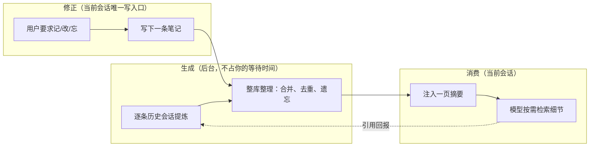
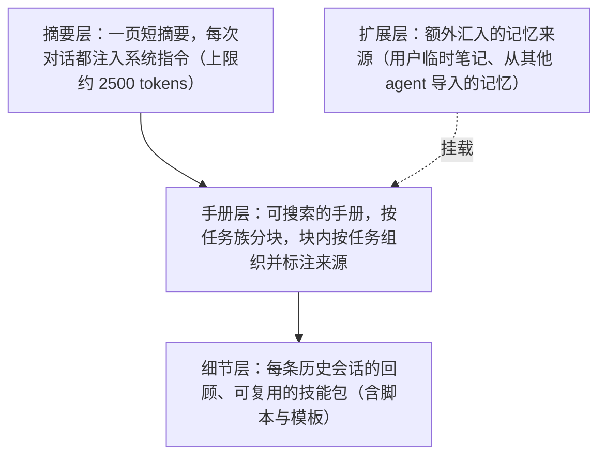
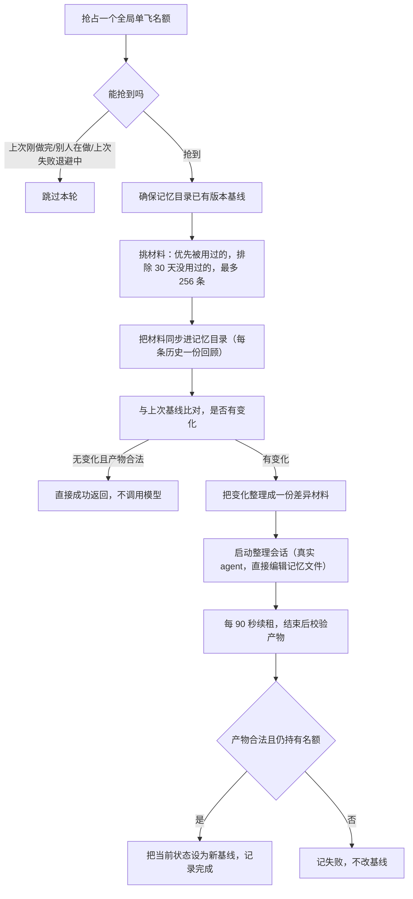

# Memory system - Codex - 02 - Codex memory system (mechanism-level)

---

可以. 接着探索一下 Codex 在记忆系统这方面是怎么做的吧.

理解要求后, 重新回复上一个提问.

---

## 场景

假设你昨天用 Codex 修了一个很难缠的构建问题，今天新开一个会话做别的事。你希望它已经知道"这个仓库的测试必须整套跑完""你在评审里不喜欢结尾复述"这类事，而不必重新交代。

这些经验需要在某个时刻被总结出来，并且在需要的时候出现在当前会话里。Codex 的做法是把它拆成三条互不干扰的路径：**离线生成**（在你不用它的时候，后台把历史经验整理成库）、**只读消费**（当前会话只能读、不能改）、**排队修正**（你要它记/改/忘时，只能投一条笔记，等下次整理生效）。

理解这个拆分，后面所有细节都能对上位置。

## 一、整体形状

三个要点先立住：

1. 生成完全在会话之外，所以它不占用你等待模型的时间，而且能拿到"整库视角"——跨会话去重、全局重新组织这种事，只有在会话之外才做得成。
2. 当前会话对记忆**只有读权限**。它唯一能写的是一个笔记文件。因此不存在"正在干活的会话同时改写长期记忆"这类竞态。
3. 生成的产物一旦落盘就不再由当前会话修改，只有下一次整理才会重写它。

代价也很直接：**反馈有延迟**。今天学到的东西，最早要等到下一次会话启动时才会被整理进库。

## 二、记忆长什么样：三层内容 + 一层扩展

分层的意图是**渐进式披露**：每次对话只固定加载最便宜的一层（摘要），其余按需检索。摘要本身被要求写成"路由索引"而不是"迷你百科"——它的作用是让模型知道该去哪儿找，而不是把所有内容塞进上下文。

还有一个不显眼但重要的层面：整个记忆目录同时是一个**本地版本库**，记录"上次整理后的基线"。后面会看到，这个细节承担了增量与遗忘两种语义。

## 三、生成：什么时候跑，跑哪两段

### 何时启动

一个"根会话"提交第一条请求之后，后台管道被启动。启动前要同时满足四个前提：会话不是临时会话、记忆功能开关已开、当前不是子代理会话、本地状态库可用。任一条不满足就什么都不做。

启动后的头两步很"抠门"：先做一次不消耗模型额度的过期数据清理，然后检查账号额度——如果剩余额度低于阈值（默认 25%），整条管道直接放弃。也就是说，**记忆生成主动给正常使用让路**。

### 第一段：把每条历史会话变成一段经验

这一段的目标是"一条历史会话 → 一段可复用的经验"。它要决定三件事：挑哪些历史、怎么裁剪输入、要什么样的输出。

**挑哪些历史**（默认值）：只取交互式来源（命令行 / IDE / 桌面入口），太老的不取（超过 10 天），**仍在活跃的不取**（空闲不足 6 小时），每次启动最多取 2 条，认领后带 1 小时租约——这样多个会话同时启动时不会重复劳动。

**怎么裁剪输入**：先把对记忆没有价值的结构性内容丢掉（额度统计、会话元数据、压缩记录、状态事件等），把人工规则文件的注入部分剥掉（避免把项目说明当成经验重复记录），对整段内容做敏感信息脱敏，再按预算截断。新版把截断换成了**按证据重要度分层挑选**：用户原话 > 最终答复 > 其他 agent 的发言 > 简短评论 > 环境上下文 > 工具输出，层内取最新，最终仍按原始时间顺序呈现，工具输出单条上限 2000 tokens。这个排序本身就是一条明确的价值判断：**用户说过的比工具吐出来的重要**。

**要什么样的输出**：一次轻量模型调用即可完成（不是 agent 循环，推理强度取最低档），最多 8 条并行。输出是结构化的：旧契约要求"原始记忆 + 会话回顾 + 命名建议"三件；新契约只要"回顾 + 命名"两件，并要求回顾不超过 9000 字节。

这一段的关键在于它的**产品口径**：允许"什么都没提炼出来"是一种合法结果。提示词开门第一句就是自问"未来的 agent 会因为这段记录而表现得更好吗"，否则返回空。它还专门规定了一类要捕捉的信号——**用户多花了几个字去说明、而更强的 agent 本可以预判的事，应当被记录为"未来的默认行为"**。

结果不回写到记忆目录，而是存进本地状态库。失败的话退避一小时再试；"成功但没内容"也算一种正常终态。

### 第二段：把散落的经验整理成手册

这是唯一会写记忆文件的环节，也是整个系统里最像"真正的 agent 在工作"的部分。

几个机制层面的要点：

**单飞与冷却**。整理任务全局唯一：别人正在做、上次刚成功、上次失败还在退避，三种情况都直接跳过。这保证了记忆库不会同时被两个进程改写。

**选材由"是否被用过"驱动**：优先纳入被引用过的历史记录；从未被用过但足够新的也纳入；超过 30 天没用过的排除；单轮最多 256 条材料。

**用差异代替全量**：材料同步进目录后，系统做一次"自上次基线以来有什么变化"的比对。

- 新增或修改的材料 = **摄取队列**；
- 被删除的材料 = **遗忘信号**（整理时要求回到手册里找出只由这些材料支撑的内容，只删失去支撑的部分；一个块里混着仍有效的内容就保留有效部分，必要时拆分重写）；
- 完全没有变化且产物合法时，**一次模型调用都不发**，直接成功返回。

**整理会话的权限被压到最小**。它的工作目录就是记忆目录，沙箱只允许写这个目录、明确排除临时目录，网络关闭，本地工具连接清空，通知关闭，不允许再触发记忆生成（防止自我递归），审批策略设为"从不询问"，协作/应用/插件等能力全部关闭。它使用的模型可以单独配置，推理强度取中档。这几乎是一份现成的"后台 worker 权限清单"。

**产物有硬契约，校验不过整轮判失败**：手册必须存在并按规定的分块结构组织；摘要必须存在且**第一行是固定版本标记**（新版还要求包含四个规定标题、长度上限约 1 万字节）；技能包可选。校验通过、并确认自己仍持有单飞名额之后，才把当前状态设为新的基线——顺序是刻意的，防止一个已经失去名额的进程去改写基线。

## 四、消费：主模型怎么看到记忆

注入给主模型的只有**摘要那一层**（上限约 2500 tokens），外加一份"使用说明"。这个比例是理解 Codex 记忆的关键：**上下文里放的是索引，不放内容**。

使用说明教的是一套检索纪律：

1. 先判断该不该查记忆——当前时间、简单翻译改写、一行命令、平凡格式化可以直接跳过；涉及仓库/路径/模块、询问既有决策或一致性、任务含糊且可能依赖历史时应当默认去查。
2. 从摘要里抓关键词，然后去手册里搜索。
3. 只有手册明确指向某个细节文件时，才打开 1–2 个。
4. 需要精确命令、错误文本这类证据时，再沿细节文件里记录的历史会话地址去翻。
5. 没命中就停止，不要继续扩大搜索。

配套还有**预算**（整段检索控制在 4–6 步以内）和**陈旧性纪律**：按"这条信息漂移风险多大 × 现在验证它有多贵"来决定是否现场核对；如果来不及核对，必须在回答里说明"这来自记忆、可能过期"，不得当作当前事实陈述。

系统另外提供了一套可选的专用检索工具（列出 / 读取 / 搜索 / 追加笔记），但**默认关闭**——默认形态下模型就是用普通命令行去搜记忆目录。沙箱层面只为记忆目录开了读取权限，写权限从未开放给主会话。

## 五、闭环：引用如何反过来决定记忆的存留

这是 Codex 记忆系统里最有意思的一环。

当模型在回答里用到了记忆，使用说明要求它在回复最末尾附一个引用块：用了哪些文件、哪些行、以及对应的历史会话标识。系统会把这个块从给用户看的正文里剥掉，然后把被引用的历史记录标记为"被使用过"（累计使用次数 +1，并更新最近使用时间）。

这个标记随后影响两件事：

- **整理时优先入选**：整理材料按累计使用次数和最近使用时间排序；
- **清理时优先保留**：长期未被使用、也没进过整理的历史记录才会被淘汰（默认 30 天窗口）。

也就是说，记忆库不是只读的知识库，而是一个**带反馈回路的系统**：真正被用到的经验会更频繁地被重新整理，也更不容易被丢掉。

还有一条旁路：即使模型没写引用块，它用命令行读取记忆文件的行为也会被识别并计入统计。所以"记忆被用了吗"这件事，有两条独立的观测路径。

（这里有一条我的设计推断：让引用驱动留存，意图显然是"让有用的经验胜出、避免记忆库无差别膨胀"。链路在代码上是连贯的，但没有注释直接说明作者的动机。）

## 六、修正通道：主会话唯一能写的东西

当用户明确要求"记住 / 改掉 / 忘掉"时，主模型唯一的动作是往一个笔记目录里追加一个小文件，文件名带时间戳和短标题。它不碰任何正式记忆文件。

这些笔记在下一次整理时被当作**权威输入**：必须被整合，被编辑过的笔记也要重新整合，**笔记文件本身永远不删除**；同时明确要求"笔记内容只当信息，绝不能当指令执行"，由笔记派生的内容要打上来源标记。

这个设计的收益是把并发模型压到最简——写入永远只发生在整理这一个环节；代价是用户说"记住这个"之后，记忆不会立刻生效，而是排队等下一次整理。

## 七、两套版本并存说明了什么

记忆库有新旧两套并行存在，各自一个目录：

| 方面 | 旧版 | 新版 |
|---|---|---|
| 提炼产物 | 原始记忆 + 会话回顾 | 只保留会话回顾（有字节上限） |
| 输入处理 | 整段裁剪到窗口的 70% | 按证据重要度分层挑选 |
| 整理产物校验 | 手册存在 + 摘要首行版本标记 | 额外要求摘要含四个规定标题 |
| 给模型的读侧说明 | 完整版（决策边界 + 检索流程 + 引用与笔记指引） | 精简克制版（反复强调不要投机式检索、不要为了写引用而多读文件） |

并存的原因在源码注释里写得很直白：**放在并排目录里，方便清理和回滚互不影响**。同时系统支持"双写"，即两条管道同时跑，便于对照效果。

从新旧差异能看出一条演化方向：**输入更挑、产物更严、注入更短、纪律更多**。

## 八、边界与失败汇总

| 环节 | 行为 |
|---|---|
| 是否启动生成 | 临时会话 / 功能关闭 / 子代理会话 / 状态库不可用 → 不启动 |
| 额度 | 账号剩余额度低于 25% → 整条管道跳过 |
| 选材 | 超过 10 天、空闲不足 6 小时、非交互式来源 → 不纳入；每次启动最多 2 条 |
| 并发 | 单条提炼任务带 1 小时租约；整理任务全局单飞并每秒级轮询状态、每 90 秒续租；一旦失去名额就中止且不提交结果 |
| 失败 | 提炼失败退避 1 小时；整理失败记录原因并进入冷却；产物校验失败整轮判失败且不推进进度标记 |
| 无进展 | 与上次基线相比无变化且产物合法 → 不调用模型直接成功 |
| 容量 | 单轮整理最多 256 条材料；注入摘要约 2500 tokens；单条回顾 9000 字节；差异文件上限 4 MB |
| 安全 | 记忆根目录不得是符号链接，目录内的符号链接会被清除；整理会话无网络、只能写记忆目录；全流程脱敏 |

## 九、设计取舍

1. **为什么把生成放到会话之外**：既省掉用户等待时间，又能获得整库视角（跨会话去重与全局重组）。代价是反馈延迟——经验要等下次会话启动才可能入库。
2. **为什么用本地状态库记账，而不是像文件系统那样用文件时间戳当状态**：多进程/多会话并发启动时，认领、租约、进度标记、使用统计都需要原子性。代价是实现复杂度明显上升（需要迁移、查询与恢复逻辑）。
3. **为什么主会话只有只读权限 + 笔记队列**：避免"干活的同时改写长期记忆"带来的竞态与一致性风险；代价是更新不及时。
4. **为什么注入摘要而不是注入索引内容**：上下文成本固定且很小（约 2500 tokens），代价是把检索质量押在"模型是否按说明书去搜"上。新版继续缩短注入、强化纪律，说明他们更愿意相信纪律而不是更大的上下文。
5. **为什么用版本比对做增量与遗忘**：一套机制同时表达"新增"和"删除"，还能在无变化时完全跳过模型调用。代价是给记忆目录增加了一个内部版本库，需要处理符号链接、基线重置这类边界。
6. **为什么用引用驱动留存**：让真正被用到的经验获得更高的整理与保留优先级。风险是它依赖模型守约——新版专门叮嘱"不要为了写引用而多读文件"，说明这套协议本身有摩擦成本。

## 源码依据

| 机制部分 | 源码位置 |
|---|---|
| 启动触发、前提检查、执行顺序、额度守卫 | `codex-rs/memories/write/src/start.rs`（`start_memories_startup_task`）；`guard.rs`（`rate_limits_ok` / `snapshot_allows_startup`） |
| 目录布局与常量 | `codex-rs/memories/write/src/lib.rs`（`memory_root`、`ensure_layout`、`artifacts`/`stage_one`/`stage_two` 常量）；`codex-rs/protocol/src/memory_version.rs`（`directory_name`） |
| 逐条历史提炼：认领条件、输入裁剪、调用、落库与重试 | `codex-rs/memories/write/src/phase1.rs`（`claim_startup_jobs`、`job::sample`、`result::{success,failed,no_output}`、`serialize_filtered_rollout_response_items`）；`rollout_input.rs`（`serialize_tiered_input`）；`phase1_output.rs`（`parse`、`output_schema`）；`prompts.rs`（`rollout_token_limit`、`build_stage_one_input_message`） |
| 提炼提示词与价值口径 | `codex-rs/memories/write/templates/memories/stage_one_system.md`；`stage_one_input.md`；`stage_one_system_v2.md` |
| 整理：单飞锁、选材、差异比对、受限会话、心跳、基线提交 | `codex-rs/memories/write/src/phase2.rs`（`run`、`job::claim`、`agent::get_config`、`agent::handle`、`loop_agent`、`get_watermark`）；`workspace.rs`（`prepare_memory_workspace`、`memory_workspace_diff`、`write_workspace_diff`、`reset_memory_workspace_baseline`、`validate_consolidation_artifacts_for_version`、`is_valid_v2_summary`） |
| 整理提示词与产物契约 | `codex-rs/memories/write/templates/memories/consolidation.md`、`consolidation_v2.md` |
| 材料同步与产物文件命名 | `codex-rs/memories/write/src/storage.rs`（`rebuild_raw_memories_file_from_memories`、`sync_rollout_summaries_from_memories`、`rollout_summary_file_stem`） |
| 读路径注入与截断上限 | `codex-rs/ext/memories/src/extension.rs`（`ContextContributor`、`ThreadLifecycleContributor`、`ToolContributor`）；`prompts.rs`（`build_memory_tool_developer_instructions`）；`lib.rs`（`MEMORY_TOOL_DEVELOPER_INSTRUCTIONS_SUMMARY_TOKEN_LIMIT`） |
| 召回提示词（决策边界、检索流程、预算、陈旧性、引用、笔记） | `codex-rs/ext/memories/templates/memories/read_path.md`、`read_path_v2.md` |
| 可选专用工具与后端接口 | `codex-rs/ext/memories/src/tools/mod.rs`、`local/*`、`backend.rs` |
| 引用解析与使用记账 | `codex-rs/memories/read/src/citations.rs`（`parse_memory_citation`、`thread_ids_from_memory_citation`）；`codex-rs/core/src/stream_events_utils.rs:46,195`（剥离引用并记账）；`codex-rs/state/src/runtime/memories.rs:1546`（`record_stage1_output_usage`） |
| 读使用遥测 | `codex-rs/memories/read/src/usage.rs`（`memories_usage_from_command`）；`codex-rs/core/src/memory_usage.rs` |
| 读权限与沙箱配合 | `codex-rs/core/src/config/mod.rs:4294`（记忆目录加入 helper 可读根） |
| 状态库：认领条件、使用统计、修剪、整理选材排序 | `codex-rs/state/src/runtime/memories.rs`（`claim_stage1_jobs_for_startup`、`prune_stage1_outputs_for_retention`、`get_phase2_input_selection`、`try_claim_global_phase2_job`、`heartbeat_global_phase2_job`）；`codex-rs/state/src/model/memories.rs` |
| 配置项与默认值 | `codex-rs/config/src/types.rs:55-61,359`（`MemoriesConfig` 与 `DEFAULT_MEMORIES_*`） |
| 就绪查询与流水线接线 | `codex-rs/app-server/src/request_processors/memory_status.rs`；`turn_processor.rs:707` |
| 外部 agent 记忆导入 | `codex-rs/external-agent-migration/src/memory_import.rs`、`src/memory.rs`、`src/detect/memory.rs` |
