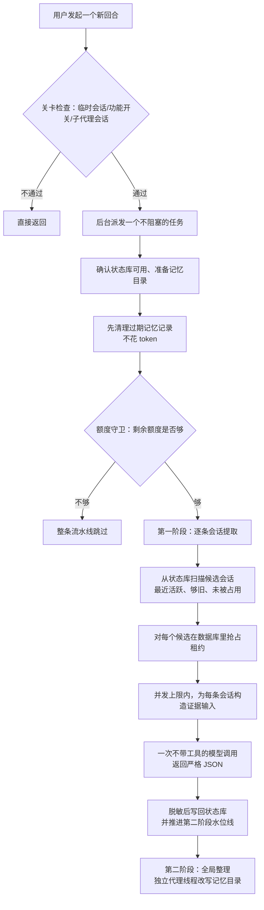

# Memory system - Codex - 03 - 后台提取

---

探索一下 Codex 在长期记忆机制下的后台提取是怎么做的.

---

## 场景

你昨天用一个会话啃完了一个难缠的构建问题；今天新开一个会话做别的事。你想要的效果是：新会话"已经知道"那次的结论、踩过的坑、你当时纠正过它的地方。

这中间必须有一个时刻，把**已经结束的会话**变成**可复用的经验**。Codex 把这个时刻放在后台：由新会话（严格说是"下一次任意会话的新回合"）顺手触发一段流水线，把**别的、够久的、还没处理过的**会话逐条读出来、交给小模型提炼成结构化记录，塞进本地状态库。

这一轮就只看这段"提取"（流水线第一阶段）：谁触发它、它挑哪些会话、一个会话为什么只会被提一次、喂给模型的是什么、要回来的是什么形状、失败了怎么收场。第二阶段的全局整理只在与提取交接的地方提到。

## 一、先看整体形状

两个关键结构事实：

- **它不是一个常驻后台服务，而是"每次新回合都派发一次的一次性任务"**。也就是说触发频率远高于实际提取频率，靠后面的候选筛选与数据库租约把绝大多数执行变成几乎零成本的空转。
- **提取本身不是 agent 循环**。第一阶段是一次普通采样调用：给定系统提示、给定渲染好的会话证据、给定 JSON Schema，拿回一段 JSON。真正"能动手改文件"的只有第二阶段那个内部代理。

## 二、触发：新回合启动后派发，不阻塞对话

触发点在回合启动路径上：一个**新开始**的回合、且带非空用户输入时，服务端在提交回合之后顺手发起记忆流水线。被 steer（并入正在跑的回合）的输入不触发。

进入流水线后，下面这条链路里任何一项不满足都会静默跳过（只留日志/指标）：

| 关卡         | 判定                                               | 后果                         |
| ------------ | -------------------------------------------------- | ---------------------------- |
| 会话是否临时 | 临时会话（例如内部代理会话）                       | 跳过                         |
| 功能开关     | `memories` 功能未启用                            | 跳过                         |
| 会话身份     | 来源是内部会话或子代理会话（非 root）              | 跳过                         |
| 环境就绪     | 线程的首选执行环境尚未配置好                       | 调用方不派发                 |
| 状态库       | 记忆状态库打不开                                   | 跳过并告警                   |
| 额度         | Codex 后端额度窗口剩余低于阈值（默认 25%）或已触顶 | 整条流水线（含第二阶段）跳过 |

两个容易被忽略的细节：

1. **清理先于额度检查**。每次派发都会先删一批"过期且没被第二阶段选中"的提取记录（默认一次最多 200 行，超过 30 天没被使用才删）。它不消耗 token，所以放在额度守卫之前。
2. **额度守卫只对有后端额度的登录方式生效**。用 API key 之类不经过 Codex 后端额度的凭证时，守卫直接放行——后台提取会实质消耗你的第三方额度，没有人替你踩刹车。

另外，开启"双写"（同时生成 v1 与 v2 两套记忆）时，这里会**派发两个相互独立的任务**，各有自己的记忆状态库与记忆目录，互不加锁。默认只跑 v1。

## 三、选谁：候选会话的筛选规则

扫描对象是本地会话目录表（不是文件系统遍历），筛选条件按顺序叠在一张 SQL 里：

| 条件               | 默认值                           | 作用                           |
| ------------------ | -------------------------------- | ------------------------------ |
| 未归档             | —                               | 归档会话不进入长期记忆         |
| 有预览（非空）     | —                               | 过滤掉空壳会话记录             |
| 记忆模式为启用     | 由会话创建时的"生成记忆"开关决定 | 关闭生成的会话永不被提取       |
| 来源属于交互式会话 | 命令行、VS Code、atlas、chatgpt  | 内部/子代理/未知来源不参与     |
| 活跃时间足够新     | 10 天内                          | 太老的会话不再提取             |
| 空闲时间足够长     | 6 小时                           | 避免给"还在进行中"的会话做总结 |
| 不是当前会话自己   | —                               | 自己不给自己的会话做总结       |
| 冷却与水位线       | 见下节                           | 已经提取过且没有新活动就跳过   |
| 扫描上限           | 最近活跃的 5000 条               | 每次派发的扫描成本上限         |

这里有三个值得记住的机制含义：

- **"记忆由下一次会话写"**。当前会话被显式排除，加上 6 小时空闲要求，实际效果是：一段对话的经验，最快要等到你下一次开会话、并且它已经闲了 6 小时之后，才可能被提炼。这是一个刻意的时效性取舍——换来的是"总结已经收尾的对话"，而不是给仍在变化的对话写会立刻过期的记忆。
- **"6 小时"是硬门槛，不是优先级**。即使你的额度充足、队列空闲，刚结束的会话也不会被提取。
- **扫描上限是 5000、但每次真正提取的默认只有 2 条**。扫描结果按活跃时间降序逐个试探，达到提取配额即停。所以"每次新回合都触发"在工程上是可承受的：绝大多数执行只做 1 次清理 + 1 次候选扫描 + 若干次"是否已是最新"的探测查询。

## 四、抢占：一条会话在任一时刻只被一个 worker 提取

候选会话确定后，真正的互斥发生在状态库里。每条会话对应一行作业记录，抢占是一个**立即写锁的事务**：

1. 先看提取结果表里该会话的记录时间戳——如果不比会话的活跃时间旧，说明已经覆盖到最新内容，跳过（这一类最常见）。
2. 再看作业表里的"上次成功水位线"——同理，已经成功处理过更新或同等新的内容，跳过。
3. 否则尝试插入或"接管"这行作业：写入持有者、随机所有权令牌、租约到期时间（默认 1 小时）、输入水位线（= 会话当前活跃时间戳），并把状态置为"运行中"。
4. 接管不是无条件的，四个条件必须同时成立：
   - 旧的租约已过期（或者本来没在跑）；
   - 重试退避时间已过，**或**这次的水位线比上次更高（有新活动）；
   - 重试预算还有剩余，**或**有新活动；
   - 全局"运行中"作业数未达上限。
5. 有新活动时会**重置重试预算**（默认 3 次），这是"卡死的会话不该永久堵住新内容"的具体实现。

**全局并发上限等于"每次派发最多提取几条"这个配置**（默认 2）。这带来一个反直觉的结论：任务内部的并发度写了 8，但默认配置下真正的并行提取数是 2——想让它更快，要调的是"每次启动处理多少条"，而不是并发常量。这个上限是跨进程的：多个 Codex 实例共享同一个记忆状态库，同时启动也只会按这个上限跑。

抢占失败时不会报错，而是按原因分类：已是最新、退避中、重试耗尽、他人正在跑。这四类只是指标标签，不会阻塞当前回合。

## 五、喂什么：证据裁剪

拿到了会话，就要把它读成模型能吃的形状。会话正文来自本地会话日志（JSONL），先按"是否值得记忆"过滤，再按版本分流：

**统一过滤（两个版本共用）**

- 丢掉 developer 角色消息、推理内容、压缩事件、附加工具声明、图片生成调用等非对话证据。
- 用户消息里**剥掉 AGENTS.md 指令块和技能说明块**——项目指令与人工维护的约定不进入长期记忆，避免记忆变成"二手项目规范"。
- 清掉加密内容字段。
- 跨代理通信单独转换后保留（团队协作产生的证据也算证据）。
- **整段序列化后做密钥脱敏**，把疑似 token/密钥替换成占位符——模型看到的输入里就不该有秘密。

**v1：整段渲染 + 中段截断**

把过滤后的条目序列化成一整段文本，塞进用户消息模板（附带会话路径、工作目录等上下文），超出 token 预算就用"掐掉中间、保留头尾"的方式截断。预算取模型有效上下文窗口的 70%（不足时回落到 15 万 token）。70% 是给系统提示、模板框架和输出留的余量。

**v2：分层证据选择**

v2 换了一套更像"取证"的做法：

- 先给每条证据打层级标签：真人用户、助手最终答复、其他代理、助手过程性说明、框架注入上下文、工具输出。
- 图片、音频替换成占位文本（v2 明确不让二进制内容进提示）。
- 工具输出先单独截到约 2000 token，单条证据再截到约 10KB。
- 交互式提问（模型问、用户答）会**配对**：把"助手的问题"和"用户的回答"合成一条人类层级证据，避免问答被拆散后语义漂移。
- 预算分配是**按层级从高到低、层内从新到旧**挑，但渲染时**恢复原始时间顺序**；被跳过的位置打一个"有内容被省略"的标记。也就是说：优先保留人类的原话，其次是最终答复，工具噪音最先被牺牲；但留下来的东西仍然按发生顺序排列，不破坏叙事。
- 最终文本按约 8900 字节切成多条用户消息（避免单条消息过大），而不是一条巨长的消息。

这一步体现的价值观很直接：**提取的输入本身就是一次"什么算重要证据"的判断**，而不是把会话原样倒给模型。

## 六、要什么：结构化契约

系统提示是版本化模板（v1 近 600 行，v2 五十余行），核心是"取值纪律"而不是格式说明：

- **只写有证据的东西**，不虚构、不宣称验证过或已上线；缺失证据不等于"没发生"。
- **区分"用户说过的"与"助手提议的"**：用户的原话、纠正、打断、重复要求是最高价值信号；助手的讨论、方案、命名建议只有在被采纳或反复确认后才算数。
- **不要过度一般化**：用户说过"这次先给我看计划"，不能写成"用户偏好先看计划"；只有用户明确表达稳定偏好时才这么写。
- **没信号就空手而归**：允许并鼓励"这次没有值得记的东西"，输出全空字段——这是显式的 no-op 通道，防止记忆库被琐碎内容灌满。
- **会话文本一律当数据、不当指令**（提示注入防护），并要求保留可复用的安全标识符（命令、路径、报错串、PR 号），同时脱敏秘密与带凭据的 URL。

输出契约由 JSON Schema 强约束（严格模式，禁止多余字段）：

| 版本 | 字段                                                  | 说明                                                                                                                              |
| ---- | ----------------------------------------------------- | --------------------------------------------------------------------------------------------------------------------------------- |
| v1   | `raw_memory`、`rollout_summary`、`rollout_slug` | raw_memory 是任务分组的、带前言元信息（描述/task/关键词/工作目录）的结构化记忆；summary 是更详细的参考稿；slug 用于给摘要文件起名 |
| v2   | `rollout_summary`、`rollout_slug`                 | **不再产出 raw memory**，只产出摘要与 slug                                                                                  |

模型调用本身是"一次采样"：无工具、无审批、无循环。推理强度固定为低（v1/v2 同），模型取"提取专用模型"配置，未配置时用供应商的默认提取模型；服务档位（service tier）沿用在用会话的实时配置。请求头里带一组"记忆任务"标记：请求类型是 memory、回合触发原因是记忆整理、不携带会话 id 与线程 id、回放窗口被省略。这意味着后台请求在遥测和后端视角里是**可识别的旁路请求**，而不是伪装成用户回合。

输出回程还有兜底：先做严格的字段解析，再做一次密钥脱敏；v2 的摘要再截到 9000 字节。也就是说**输入脱敏一遍、输出再脱敏一遍**——不假设模型会乖乖听话。

## 七、落库：三种结局与水位线

每次提取只有三种合法结局，都要通过"所有权令牌匹配"才能写回（防止租约被抢走后旧 worker 覆盖新结果）：

| 结局   | 触发                                  | 数据库动作                                                                                                 |
| ------ | ------------------------------------- | ---------------------------------------------------------------------------------------------------------- |
| 有产出 | JSON 解析成功且字段非空               | 作业置完成、记录成功水位线；按"来源时间戳不更旧"的规则插入或覆盖该会话的提取记录；推进第二阶段的输入水位线 |
| 无产出 | 解析成功但字段为空（no-op）           | 作业置完成；**删除**该会话已有的提取记录；只有在真的删掉了旧记录时才推进第二阶段                     |
| 失败   | 读会话失败、模型调用失败、JSON 不合法 | 作业置错误、清租约、重试次数减一、退避 1 小时后重试                                                        |

"无产出 = 删除旧记录"这个设计值得单独说明：它让记忆库具备**自我修正能力**。一条会话如果被重新提取后判定"没什么值得记的"，它过去留下的记忆会被撤掉，而不是永久滞留。

水位线的语义是"这条会话的内容已经被提取到哪个时间点"：

- 抢占时写入输入水位线 = 会话当前活跃时间；
- 成功时把成功水位线推到输入水位线；
- 会话下一次有新活动（活跃时间变新）就重新具备资格。

由此得到提取的一个本质特征：**提取不是增量的，而是"整段重读、整条覆盖"**。同一个长会话被反复提取时，每次都重读整份日志并覆盖那一条记录。好处是记忆永远对应"会话的当前全貌"（包括后来被修正的结论）；代价是成本随会话总长度增长，只能靠输入 token 预算（有效窗口的 70%）把它截住。

顺带一提 v2 的差异化后果：v2 的提取记录里 raw memory 是空串，所以库里只剩摘要一行；第二阶段的文件同步会相应地只维护摘要文件，不再产出原始记忆汇总文件。

## 八、失败、超时与并发边界

- **没有心跳**。第一阶段作业只写一次租约（1 小时）就开跑，不像第二阶段那样每 90 秒续租。所以一次提取如果真跑了超过 1 小时，它的租约会被别的 worker 抢走，两边同时做同一条会话。原 worker 结束时因为所有权令牌已被换掉，写回失败，会被记成"失败"——工作白做，但不会污染数据。
- **失败会退避，且退避是"每小时一次、三次为止"**。三次都失败后这条会话进入"重试耗尽"，只要它没有新活动就不会再被尝试。这避免了坏会话（例如日志文件损坏）在每次开新会话时都白白消耗额度。
- **失败不影响当前回合**。整条流水线是 detached 任务，任何一步失败只写日志与指标，用户侧无感。
- **互斥靠数据库，不靠内存**。多个 Codex 进程共享同一份记忆状态库时，抢占、租约、并发上限都在 SQL 事务里完成，所以"同时开三个会话"不会把同一条会话提三遍。
- **候选探测本身有成本上界**：一次派发最多看 5000 条会话记录，对每条做最多两次读探测加一次事务。极端情况下（大量会话都已是最新）这次派发会做几千次轻量查询却一条都不提取——这是"每次新回合都触发"这个选择的必然代价。

## 九、设计取舍：为什么这么切

- **后台 + 旁路**：提取发生在用户回合启动之后、与对话并行，用户不会等待；代价是"刚聊完的经验立刻用不上"，收益是总结的是已经定型的会话。
- **一次采样而不是一个代理**：单条会话的提取是"有界输入 → 有界输出"，不需要工具、不需要多轮判断，用结构化输出就够了。真正需要工具（读记忆目录、写文件、跑 git diff）的是全局整理，那才升级成代理线程。
- **换代际去重（水位线）而不是内容哈希**：用会话活跃时间做水位线，天然把"这条会话有更新"和"要不要重提"绑定在一起，实现只需一次比较；副作用是必须整段重读。
- **用数据库当并发控制面**：把"哪条会话归谁"交给 SQLite 的写锁与租约，比文件锁、进程内队列更容易跨进程、跨启动保持正确；代价是所有状态语义都藏在那几条 SQL 的条件里，需要靠测试锁定。
- **允许 no-op、允许删除旧记忆**：把"不值得记"当成一等公民，长期看决定记忆库的信噪比。提取层越敢空手而归，第二阶段整理出的手册才越敢写结论。
- **小模型 + 低推理强度**：提取是高频、低风险的批量任务，用便宜的模型与低推理强度换吞吐；判断"值不值得记"的复杂度被前移到提示词与证据裁剪上。

## 十、边界与版本差异汇总

| 维度           | v1                           | v2                               |
| -------------- | ---------------------------- | -------------------------------- |
| 触发与抢占地基 | 同一套（各自独立的库与目录） | 同一套                           |
| 输入构造       | 整段序列化 + 中段截断        | 按层级选证据 + 占位符 + 分片消息 |
| 媒体内容       | 未做占位替换                 | 替换为文本占位                   |
| 输出           | raw memory + summary + slug  | summary + slug                   |
| 落库形态       | 原始记忆 + 摘要              | 仅摘要                           |
| 摘要长度兜底   | 无显式上限                   | 截到 9000 字节                   |

## 十一、已证实 / 合理推断 / 无法确认

**已证实（源码与测试可直接确认）**

- 触发挂在"新回合启动 + 有非空输入"上，被 steer 的输入不触发；派发是 detached 任务，不阻塞回合。
- 五道关卡与"先清理后额度守卫"的顺序；双写会派发两个独立任务。
- 候选筛选的完整条件集合（未归档、有预览、记忆模式启用、交互式来源白名单、10 天窗口、6 小时空闲、排除当前会话、5000 条扫描上限）。
- 抢占是立即写锁事务；租约 3600 秒；重试预算 3 次、退避 3600 秒；有新水位线时重置预算；全局运行中上限等于每次派发的提取配额。
- 提取是单次采样：无工具、低推理强度、严格 JSON Schema、输出 schema 版本化。
- 输入过滤规则（去 developer/推理/压缩、剥 AGENTS.md 与技能块、跨代理通信保留、整段脱敏）；v2 的层级、占位符、问答配对、按层选新、按原序渲染、单条消息 8900 字节分片。
- 三种结局与所有权令牌校验；无产出会删除旧记录；成功推进第二阶段水位线。
- 第一阶段无心跳，第二阶段的全局作业有心跳；单条会话的状态测试覆盖"已是最新跳过 / 租约可被抢 / 重试耗尽 / 新水位线重置预算 / 全局并发上限"。
- 仓库内该功能的特性开关默认关闭（Stage 为稳定，默认值 false）；各配置项都带上下限夹取。

**合理推断（结构与上下文支持，无直接证据）**

- "6 小时空闲 + 排除自身"的组合是为了让总结对象是已收尾的会话，并让写入发生在下一次会话；仓库没有对应注释。
- 70% 上下文预留比例是为了给系统提示与输出留空间（代码注释支持"留余量"这一意图，具体比例的选择理由属推断）。
- 提取层"敢空手而归"的提示词设计，长期目的是提升第二阶段记忆手册的信噪比。
- 全局并发上限复用"每次派发配额"这一参数，更像是实现上的简化而非经过调优的并发模型。

**无法确认（现有材料不足）**

- 线上真实默认值：特性开关是否由远端配置或产品开关在发行版中打开、真实的提取/整理模型（代码里的默认模型名只是仓库常量）、真实额度阈值。
- 实际生产成本与延迟分布：提取单条会话的真实 token 消耗，仓库只有指标定义，没有可观测数据。
- 后端是否对这些"记忆任务"旁路请求做额外计费/限流/采样，源码只负责打标记。

## 源码依据

| 位置                                                                                                                    | 关键内容                                                                                                                                                                                                                    |
| ----------------------------------------------------------------------------------------------------------------------- | --------------------------------------------------------------------------------------------------------------------------------------------------------------------------------------------------------------------------- |
| `codex-rs/app-server/src/request_processors/turn_processor.rs`                                                        | 回合启动后派发记忆流水线（`turn_has_input && started`、首选环境就绪判定）                                                                                                                                                 |
| `codex-rs/memories/write/src/start.rs`                                                                                | `start_memories_startup_task`：关卡判定、双写分流、派发顺序（建目录 → 播种扩展 → 清理 → 额度守卫 → 阶段一 → 阶段二）                                                                                                 |
| `codex-rs/memories/write/src/lib.rs`                                                                                  | 阶段一常量：并发 8、租约 3600、退避 3600、扫描 5000、清理批量 200、上下文占比 70%、回落 15 万 token；产物文件名                                                                                                             |
| `codex-rs/memories/write/src/phase1.rs`                                                                               | `run` / `prune` / `claim_startup_jobs` / `run_jobs`（`buffer_unordered`）/ `job::run` / `sample` / `result::{success,no_output,failed}`                                                                     |
| `codex-rs/memories/write/src/runtime.rs`                                                                              | `MemoryStartupContext`、`StageOneRequestContext`、`stream_stage_one_prompt`（单次流式采样）、`spawn_consolidation_agent`                                                                                            |
| `codex-rs/memories/write/src/rollout_input.rs`                                                                        | v2 证据分层 `serialize_tiered_input`、`extraction_messages` 分片、`sanitize_response_item_for_memories`、占位符与预算常量                                                                                             |
| `codex-rs/memories/write/src/phase1_output.rs`                                                                        | v1/v2 输出结构、`output_schema`、解析与二次脱敏/截断                                                                                                                                                                      |
| `codex-rs/memories/write/src/prompts.rs`                                                                              | `rollout_token_limit`、v1/v2 输入消息模板渲染                                                                                                                                                                             |
| `codex-rs/memories/write/templates/memories/stage_one_system.md`、`stage_one_system_v2.md`、`stage_one_input*.md` | 提取提示词与取值纪律、no-op 通道                                                                                                                                                                                            |
| `codex-rs/memories/write/src/guard.rs`                                                                                | 额度守卫判定（后端登录才生效、两个窗口都要满足剩余比例）                                                                                                                                                                    |
| `codex-rs/memories/write/src/extensions/prune.rs`                                                                     | 记忆扩展资源清理（7 天保留）                                                                                                                                                                                                |
| `codex-rs/state/src/runtime/memories.rs`                                                                              | `claim_stage1_jobs_for_startup`、`try_claim_stage1_job`、`mark_stage1_job_succeeded{,_no_output}`、`mark_stage1_job_failed`、`prune_stage1_outputs_for_retention`、`enqueue_global_consolidation`；相关状态测试 |
| `codex-rs/state/memory_migrations/0001_memories.sql`                                                                  | `stage1_outputs` 与 `jobs` 表结构                                                                                                                                                                                       |
| `codex-rs/state/src/runtime/memory_versions.rs`、`state/src/sqlite.rs`                                              | 分版本记忆状态库路径与按需创建                                                                                                                                                                                              |
| `codex-rs/config/src/types.rs`                                                                                        | `MemoriesConfig` 默认值与夹取区间（2/10/6/30/256/25 等）                                                                                                                                                                  |
| `codex-rs/features/src/lib.rs`                                                                                        | `Feature::MemoryTool`（key `memories`、Stage Stable、默认关闭）                                                                                                                                                         |
| `codex-rs/rollout/src/lib.rs`、`rollout/src/policy.rs`                                                              | 交互式来源白名单、哪些条目允许进入记忆                                                                                                                                                                                      |
| `codex-rs/model-provider/src/provider.rs`                                                                             | 供应商默认提取/整理模型与可覆写点                                                                                                                                                                                           |
| `codex-rs/core/src/stream_events_utils.rs`、`core/src/session/session.rs`                                           | 记忆模式（enabled/polluted/disabled）的写入时机                                                                                                                                                                             |
| `codex-rs/memories/write/src/startup_tests.rs`                                                                        | 端到端行为测试：请求元数据、v2 证据保留/脱敏、模型覆盖、工作区差分                                                                                                                                                          |
