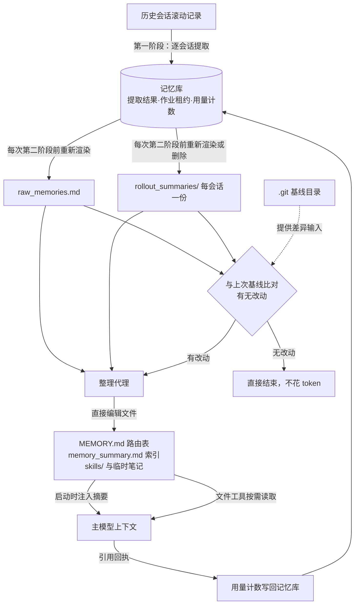

# Memory system - Codex - 04 - SQLite 与记忆目录：谁是可信来源

---

对于记忆系统来说, SQLlite 中的存档就是唯一可信来源吗?

---

## 一句话回答

不是。Codex 的记忆系统是**两段式、双存储**的：第一阶段（逐会话提取）的产物以 SQLite 为权威，第二阶段（全局整理）的产物以 `~/.codex/memories/`（及 v2 的 `memories_v2/`）目录下的文件为权威，**模型真正读到的记忆完全来自文件，一行都不来自数据库**。

更准确的说法是分工：

| 层 | 权威存储 | 文件/DB 的角色 |
|---|---|---|
| 第一阶段产物（每会话原始记忆 + 会话摘要 + slug） | SQLite | 渲染出的 `raw_memories.md`、`rollout_summaries/*.md` 是**只读视图**，每次都从库重建 |
| 第二阶段产物（`MEMORY.md` 路由表、`memory_summary.md` 紧凑索引、`skills/`、临时笔记） | 记忆目录文件 | 库里**没有对应表**，只有水位线、选中标记、用量计数 |
| "第二阶段该不该跑" | 记忆目录的 git 工作区状态 | 库里的水位线是记账，不参与判脏 |
| 模型上下文里的记忆 | 记忆目录文件 | 启动时读 `memory_summary.md` 注入，其余靠文件工具按需读取 |

## 场景

上一轮看过 Codex 用 SQLite 存了七类本地状态。落到记忆上就有一个很自然的问题：既然提取结果是写进库的，那"我的记忆到底存在哪、哪个是准的、能不能删库重来"。

这个问题的答案直接决定了三件实用的事：能不能手工改记忆、删了库会不会丢记忆、以及数据库与磁盘不一致时模型看到的是哪一份。

## 机制展开

### 三个存储面

三个面各管一段：**记忆库**管"哪些会话被提取过、提取出了什么、谁在用"，**记忆目录**管"最终沉淀下来的可读记忆长什么样"，**目录里的 git 基线**管"自上次成功整理以来发生了什么变化"。三者用途完全不同，因此谈不上哪一个是"唯一"的。

### 第一阶段：库是权威，文件是渲染结果

提取成功后写回的是库表（每会话一行：原始记忆、会话摘要、slug、生成时间、使用次数、是否被第二阶段选中）。而 `raw_memories.md` 与 `rollout_summaries/` 这两个看起来像"记忆本体"的东西，是从这些行**整体重写**出来的：

- 每次第二阶段开始前，先按当前选中集合重新生成 `raw_memories.md`：按会话 ID 升序拼装，每段带上更新时间、工作目录、滚动记录路径和对应摘要文件名。选中集合为空时写一句占位文本。
- `rollout_summaries/` 与之同步：保留下来的写文件，不再被选中的**删文件**。摘要文件名由会话与 slug 推导，所以同一会话重新提取后旧的摘要文件会被清掉。
- 这两步都是"全量对齐选中集合"，不是增量补写。库里没有对应文件摘要的状态位，反过来文件里也没有"这一行来自库的第几版"。

这带来一个直接后果：**`raw_memories.md` 不是可以手工维护的知识库，它是数据库的打印视图。** 手改它会在下一轮被覆盖。

### 第二阶段：文件是权威，库只记账

整理阶段由一个内部代理在记忆目录里直接编辑文件（无网络、无审批、只允许本地写）。它产出的是人可读的层次结构：

- `MEMORY.md`：可检索的**路由层**，按项目/主题指路，而不是把所有内容摊平。
- `memory_summary.md`：紧凑的全局索引，被注入上下文的那一份。文件首行必须是一个固定的格式标记，否则视为无效产物。
- `skills/` 与被迁移进来的外部资源：细节层，按需展开。

这些内容库里没有镜像表。库里与第二阶段相关的只有四样记账数据：全局整理作业的行与租约、已消费输入的完成水位线、每条第一阶段结果的"是否被选中"标记、以及一个"已整理会话数"的计数器（v2 的"就绪"判定会同时检查这个计数器和一个格式合法的 `memory_summary.md` 是否存在）。

**最反直觉的一点：判定"第二阶段要不要跑"靠的不是数据库水位线，而是记忆目录的 git 工作区是否脏。** 每次整理前会把当前选中集合渲染成文件、清理过期摘要，然后在库外初始化一个 git 基线仓库，用"上次成功整理后的基线 → 当前工作区"的差异来判断：没有差异就直接标记成功退出，一个 token 都不花；有差异才把这份差异渲染成一份固定的 diff 文件，连同路径一起交给整理代理。库里的水位线仍然会更新，但注释里写得很明确——它只用于记账，不参与判脏。

这也解释了一个容易误判的现象：即使库里新增了第一阶段结果，只要渲染后文件与基线一致（比如摘要内容没变），第二阶段就不会启动代理。

### 读路径：模型看到的是文件

会话启动时，读取扩展把记忆目录下的 `memory_summary.md` 读出来，按 2500 token 上限截断，渲染进开发者指令，并附上记忆目录的绝对路径与读取纪律（按需读 `MEMORY.md`、按需展开细节文件）。文件不存在或内容为空就整段不注入。

另有一套可选的专门读写工具（列举 / 读取 / 搜索记忆目录），默认关闭；关闭时模型就是用普通文件读取工具去读磁盘上的记忆——同样是文件。

两者相加的结论很清楚：**进入上下文的每一个字节都经过文件系统，没有一条路径从记忆库直接进上下文。**

### 反馈闭环：用量计数回流到库

模型在回答里引用记忆时，代码会解析出被引用的来源会话，把对应库行的使用次数加一、最近使用时间刷新。第二阶段挑选输入时按"使用次数优先、最近使用次之"排序，并忽略超过默认 30 天没被用过的行。所以这里形成了一个闭环：**文件被读 → 产生引用 → 计数写回库 → 影响下一轮谁还能被选中进文件**。这条链路里文件是入口，库是权重表。

### v1 与 v2 是两套并列的目录 + 库

两个版本各有自己的记忆目录（`memories` / `memories_v2`）和各自的记忆库文件，共用同一份会话目录。开启双写时会派发两个互不加锁的独立任务；默认只跑 v1。v2 的第一阶段产物不再包含完整的原始记忆，只保留摘要（有长度上限），也就是说 v2 把"细节"更多地推给了文件层。

## 条件与边界

**记忆库不是可随意重建的缓存。** 会话目录库坏了可以备份重建再回填，因为权威数据在 JSONL 里；记忆库被配置成同样的"备份后重建"，但它丢的东西**不能从文件反推**——`raw_memories.md` 只是选中集合的打印视图，`rollout_summaries/` 是逐条摘要的副本，两者都不含完整的库行字段（使用次数、选中标记、原始记忆全文的独立副本）。要真正恢复，只能重新提取，而重新提取有两个硬约束：候选会话只在最近 10 天内，且行数据超过 30 天未使用就会被清理。**结论：删库会永久丢掉第一阶段的历史记录，但已经沉淀进 `MEMORY.md` 的内容不受影响**（因为在文件里）。这实际上是一个有意的分工：库管"还没被消化的原料"，文件管"已经消化的成品"。

**库与文件会短暂不一致。** 第一阶段写完库之后、第二阶段跑完之前，文件里没有新内容。这个窗口可能很长（第二阶段要等下次启动、且要 Git 有差异），期间模型读到的仍是旧记忆。所以"记忆更新"的正确心智模型是"两次启动、两次消费额度"，而不是"提取完就能用上"。

**手工编辑是被允许且被预期的。** 因为文件是权威，你直接改 `MEMORY.md` 或删某个细节文件，下一轮就会以"工作区有差异"的形式进入整理代理的输入，代理据此更新或删除相应记忆。这也是设计上把最终层放在文件而非库里的主要理由之一。

**删除会话的传播是两级的。** 删会话时同步删掉记忆库里该会话的行；下一轮第二阶段因为选中集合变化，会删除对应的摘要文件；但 `MEMORY.md` 里由这些内容衍生出的条目，只能靠 diff 的"文件被删除"信号提示代理去清理——是提示，不是自动级联。

**无法确认**：线上默认是否已切到 v2、双写是否对某些账号开启、以及远端是否下发了不同的保留天数。这些都在服务端或配置层，仓库里看不出来。

## 设计取舍

**为什么第一阶段放库。** 那个阶段做的全是关系型判断：从几千条会话里按来源/时间/空闲时长/是否已提取/是否已被别的进程租走做筛选，跨进程互斥靠租约，用量和选中状态要排序和统计。这些用文件实现要么退化成扫盘，要么要靠锁文件拼凑。库在这里不是"顺手"，是唯一可行的形状。

**为什么第二阶段放文件。** 整理阶段的工作性质是"读一堆材料、写一份人类也看得懂的文档，并且随时修改既有文档"。让代理直接编辑 Markdown，比让它生成结构化记录再渲染成文档要自然得多；更重要的是，文件让"这次改了哪些东西"变成一个可计算的东西——把目录本身做成 git 仓库，差异就是天然输入，代理只需要读一份 diff 就知道该动哪里。用库的话，得自己发明一套变更追踪。

**为什么两者之间用"全量渲染"而不是增量同步。** 渲染视图每次按选中集合整体重写，逻辑简单且永远收敛；代价是文件内容会和库产生"重建即可能抖动"的风险——所以渲染时特意按会话 ID 稳定排序，避免因为使用次数变化导致文件顺序乱跳、把无意义的顺序变化当成"有改动"喂给代理。

**为什么把摘要文件做成注入入口而不是注入 `MEMORY.md`。** `MEMORY.md` 是路由表，可能很长且按项目分区；每轮都全量注入会吃掉上下文预算。摘要文件是一个被刻意限长的紧凑索引，注入上限 2500 token，其余靠模型按路径去读。这也是"记忆是渐进披露的"这一取向在存储层的体现。

## 证据分级

- **已证实**：`raw_memories.md` 与 `rollout_summaries/` 由库行重建且会清理多余文件；第二阶段无对应库表、靠记忆目录 git 差异判脏；整理代理直接编辑目录内文件；注入来源是 `memory_summary.md` 且上限 2500 token；引用会写回使用次数并影响第二阶段选取；记忆库与记忆目录的版本化双份（v1/v2）；30 天未使用清理、10 天候选窗口、备份重建的恢复模式；手工编辑文件会被当作差异输入。
- **合理推断**：分层的动机（原料 vs 成品、"库管筛选、文件管可读"）由函数命名、注释与代码结构推得，没有单一文档直接这么说。
- **无法确认**：线上默认版本与双写开关、远端保留策略。

## 源码依据

| 位置 | 关键内容 |
|---|---|
| `codex-rs/memories/write/src/storage.rs` | 从库行重建 `raw_memories.md`（稳定升序、带摘要文件引用）、按选中集合同步/删除 `rollout_summaries/` |
| `codex-rs/memories/write/src/workspace.rs` | 记忆目录作成 git 基线：准备、取差异、写 diff 文件、成功后重置基线；产物合法性检查（`MEMORY.md` 存在、摘要首行格式标记、v2 摘要规则） |
| `codex-rs/memories/write/src/phase2.rs` | 第二阶段流程：按库选取输入、渲染文件、依据工作区差异决定是否启动代理、维护水位线 |
| `codex-rs/memories/write/src/phase1.rs` | 第一阶段写库、按未使用天数清理旧行（默认 30 天，最多 200 行/次） |
| `codex-rs/memories/write/src/startup_dual_write_tests.rs` | v1/v2 两套目录与两套库的独立派发 |
| `codex-rs/memories/README.md` | 两阶段职责、第二阶段用工作区差异而非水位线判脏、选中快照标记的写入时机 |
| `codex-rs/state/src/runtime/memories.rs` | 库内所有记忆相关操作：选中、使用计数、水位线、已整理计数、清理与按会话删除 |
| `codex-rs/state/memory_migrations/*.sql` | `stage1_outputs`、`jobs`、`consolidation_progress` 三张表 |
| `codex-rs/ext/memories/src/prompts.rs` | 注入路径：读 `memory_summary.md`、2500 token 截断、渲染开发者指令 |
| `codex-rs/ext/memories/src/extension.rs` | 读取扩展装配（功能开关 + 是否使用记忆 + 版本目录） |
| `codex-rs/ext/memories/src/local/ad_hoc_note.rs` | 临时笔记写入记忆目录的 `extensions/ad_hoc/notes/`，不落库 |
| `codex-rs/core/src/stream_events_utils.rs` | 引用解析后写回使用计数 |
| `codex-rs/app-server/src/request_processors/memory_status.rs` | v2 就绪判定：库内已整理计数 + 磁盘摘要文件格式同时满足 |
| `codex-rs/protocol/src/memory_version.rs` | v1/v2 目录命名 |
| `codex-rs/config/src/types.rs` | 记忆参数默认值：每次启动 2 条、10 天窗口、6 小时空闲、30 天未使用清理、256 条整理输入上限 |
