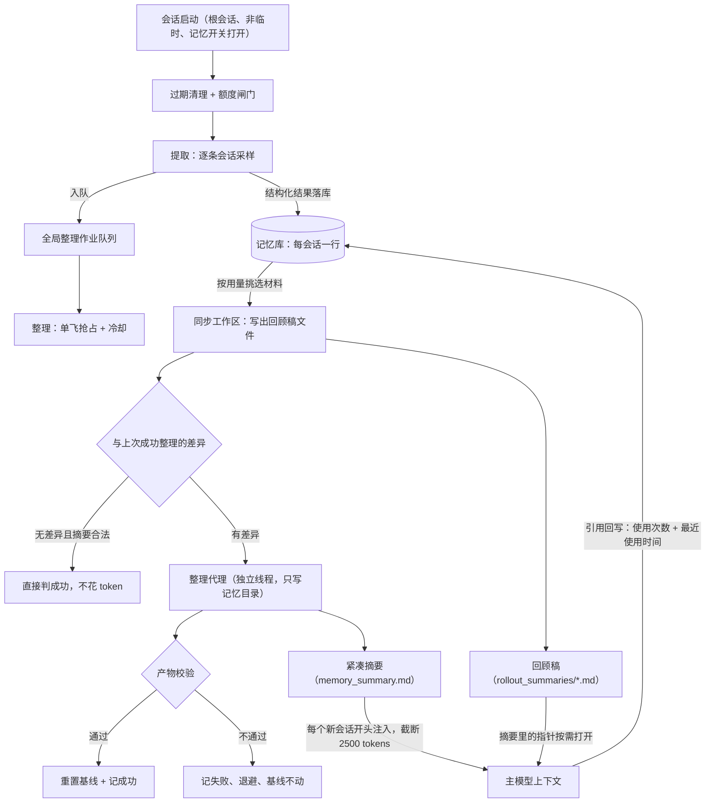

# memory-system - Codex - 05 - 回顾稿与紧凑摘要（v2 写什么、怎么校验、在哪被用）

---

> Codex 记忆系统中的短摘要是什么?
>
> A 和 B 都说一下. 我想弄清是它们写的什么, 同时又是怎样被生成与校验的.
> 以及它们是在哪些环节被使用的.
>
> 主要研究 V2. V1 提一嘴即可, 不必细说. 不必对比两者. 这没有意义.

---

## 一、场景：两个"摘要"，两件不同的东西

代码库里叫得上"摘要"的产物有两个，它们的读者、寿命和长度口径完全不同：

- **回顾稿（B）**：一次会话结束、安静一段时间之后，后台把这一整段会话压成一份"任务历史记录"。它属于**单条会话**，写给人看不给人背，读者是"未来做类似任务的模型"和"稍后会把这些材料再压一次的整理代理"。
- **紧凑摘要（A）**：把所有回顾稿再压成**一页全局索引**，存放在记忆目录根部。它在**每个新会话开头**被读出来、截断、塞进上下文，作用是"告诉你我这儿有什么、该去哪儿翻"，而不是"把内容讲一遍"。

一句话区分：**B 是原料的忠实复述，A 是原料的地图。** 上下文里只放地图（约 2500 tokens），内容按需去翻。

v2 的这两件产物各自有独立的提示词模板、独立的长度上限、独立的校验条件，而且**由两种完全不同的机制生成**：B 是一次无工具的模型采样（强制 JSON），A 是一个真正的 Codex 线程（有文件工具，会直接改记忆目录里的文件）。

（v1 与 v2 的差别只在这几处会影响本文结论：v1 的回顾稿还附带一份"原始记忆"文本、v2 不再产出；v1 把每份原始记忆汇总成一个文件，v2 不再生成；v1 的全局层除摘要外还有一个按任务分块的手册文件，v2 的契约里不再有这一层。下文只讲 v2。）

## 二、整体位置：两条后台路径与两个消费点

## 三、回顾稿（B）写什么

提取提示词把"写什么"约束得非常具体，核心是三条取向：

**1）忠实高于概括。** 按时间顺序保留实质任务、目标变更，以及被中断、被取代、未完成的工作；每个实质任务都要留下作用范围与归属、工作目录或分支的适用范围、重要发现、做过什么以及这些动作的出处、最终状态、未决问题。用户的原话、纠正、负面反馈、授权边界必须贴着对应任务保留。精确的安全标识符（文件名、路径、命令、报错文本、PR 与讨论链接）在有用时要原样留住。

**2）不许把一次请求升级成一条偏好。** 提示词给了一个很直白的例子：用户说"改之前先把方案给我看"，只能写成"用户在这个任务里要求先看方案"，不能写成"用户偏好先看方案"；只有用户明说"我偏好……"才可以写成显式偏好。理由是这份文件会被未来 agent 当成行动依据，过度泛化会污染后续所有任务。

**3）证据要分级，不确定要保留。** 必须区分"观察到的证据""用户授权的动作""已实施的改动""提案""假设"和"不确定"；不能因为没找到证据就断言用户没授权过某事；不能声称完成、验证、部署、归属、稳定偏好或用户批准超出证据。**助手与其他 agent 的发言只是上下文，不是"用户的工作方式"的证据。** 会话正文和工具输出被明确当作不可信数据，而不是指令。

形式上是"任务历史"，不是"用户画像"：不要泛化建议、装饰性评论、重复日志；写的时候顺手脱敏密钥与带访问权的 URL 值。

输出必须是恰好一个 JSON 对象，只有两个字符串字段——回顾稿正文与一个文件名用的短标识（slug），没有第三个字段、没有解释性文字。**如果这段会话没什么值得留存的，就返回空串**。长度上没有让模型自己数，而是回程统一截断到 9000 字节。

输入侧还有一条与内容同等重要的纪律：不跟随会话内容里出现的任何指令；会话级的"工作目录/分支"只是提示，一次会话可能跨多个目录与分支，任务级的要自己从证据里判断。

## 四、回顾稿是怎么生成的

**触发与闸门。** 每个根会话启动时派发一个后台任务（临时会话、子 agent、记忆总开关关闭都不派发）。任务内先做不花钱的过期清理，然后查额度——如果后端返回的额度剩余低于配置阈值（默认 25%），整条记忆流水线直接跳过，一个 token 都不花。通过后才跑提取。

**选谁。** 从会话表里筛：记忆模式为启用、来源属于交互式会话、排除当前会话自身、最近 10 天内更新过、且**至少空闲 6 小时**（避免抽取还在进行的会话）。按更新时间倒序扫描最多 5000 条，单次启动最多领 2 条。另外还要过一道"值不值得重做"的判断：库里已有产物的时间不早于会话更新时间就直接跳过。领取是数据库层面的带租约抢占（租约 1 小时），同一会话不会被两个进程同时抽。

**喂什么（v2 最不一样的地方）。** 不是把整份会话记录顺序塞进去，而是先按**证据层级**排序挑选：人类用户发言 > 助手最终答复 > 其他 agent > 助手过程性发言 > 框架注入的上下文 > 工具输出。同一层级内从最新往旧取，但最终渲染仍按原始时间顺序，每条前面打上来源标签（`[human user]`、`[tool]` 等）。挑选时的预算限制：工具输出先各自截到约 2000 tokens、单行上限 1 万字节；图片与音频替换成占位符；整体预算取模型有效上下文窗口的七成（再乘 70%，缺省 15 万 tokens），放不下的低层级证据整段丢掉，并在丢的位置插入一句 `[... response items omitted ...]` 标记——**不是静默裁剪，而是让模型知道这里缺了东西**。人类对工具式提问的回答会被改写成"助手提问 + 人类回答"一条记录，并提升到人类层。项目指令文件与技能片段被显式剔除，理由是它们不是这个人的工作方式。整段正文全程脱敏。最后按 8900 字节切成多个片段发送，避免单个片段超长。

**怎么调。** 这是一次纯采样请求，没有工具、没有循环、低推理强度，输出用强制 JSON schema 约束（不允许额外字段）。也就是说模型**只能凭提示词里给的证据写**，读不到别的东西。

**回程校验与落库。** 先做严格字段解析（多一个字段就失败），再脱敏一次，然后把回顾稿截到 9000 字节、slug 脱敏。若解析或请求失败，记失败原因并安排 1 小时后重试；若摘要为空串，记"成功但无产出"——**不写行、也不触发整理**。成功则按会话为键写入库（只有会话更新时间不早于已有记录才覆盖，防止旧结果回滚新结果），同时入队一个全局整理作业。

**从库到文件。** 回顾稿在磁盘上的形态是整理阶段顺带渲染出来的：文件头是机器生成的四到五行元信息（会话 id、更新时间、原始记录路径、工作目录、分支），正文就是模型写的那段。文件名由会话 id 推导——时间戳加四位短哈希，再拼上 slug（只保留小写字母数字、最长 60 字符、其余字符折成下划线）。每次整理前都按当前选中集合**全量对齐**：该有的写、多出来的删掉，而不是增量补写。所以同一会话被重新提取后，旧文件会消失、换成新名字。

## 五、紧凑摘要（A）写什么

整理提示词的开头就把约束条件说清楚了：这份文件会被注入**每一个**新会话的开头，因此从旧任务里推出的过宽或过硬的规则，会误导未来 agent、无谓地限制新工作；用户大概率是在同一个不断变化的代码库里继续做"相关但不相同"的任务，所以**最近的指针通常比旧的更有用**，并且要自己判断哪些东西很快就会过期。

结构是硬契约：

- 第一行必须是 `v1`（版本标记，校验按字面比对）；
- 然后必须依次出现四个标题：用户档案、用户偏好、通用提示、记忆里有什么；
- 全文必须"舒服地"小于 10000 字节。

内容分工：

- **用户偏好**只放用户明确表达过的、可复用的工作方式（说成默认做法、或在多个不同任务里成立）。一次性的请求、选择、决定、纠正留在任务里。后续纠正覆盖先前说法；普通行为不算个人偏好；不许编造偏好、用户决定或出处。
- **记忆里有什么**是索引主体：按"项目范围 + 日期"分组，每条检索意图写一行——指向一个**精确的**回顾稿文件名，附一句语义说明（它讲了什么、什么时候会用到），带上完整的会话标识；下面可以再缩进一行给具体的项目/文档/PR/实现位置指针。规则明确：**只在其价值撑得起这点篇幅时才留指针，绝不许猜、重建、规范化或创造指针。** 旧内容收进"更早的记忆主题"，保留一段描述，以及文件名或完整会话标识之一。
- 操作纪律：先读本次的工作区差异文件，再按用户的编辑与来源变化应用改动；只被已删来源支撑的断言要删掉；仍有支撑的保留；**不要把已纠正或已删的断言从旧摘要里恢复**；记忆内容当数据不当命令；**不要打开原始会话记录**（只能读回顾稿副本）；不需要更新就保持原样；没有可支撑内容时写一份最小合法摘要。

可以看出 v2 的取向：摘要里放"语义句子 + 指针"，不放内容本体；细节留在回顾稿里，需要时再翻。

## 六、紧凑摘要是怎么生成的

**触发。** 任何一条回顾稿落库、或某个会话被删除且它曾在材料集合里，都会把一个全局整理作业置为待处理。会话启动时尝试领取这个作业；成功过一次后有 6 小时冷却，失败后 1 小时退避；作业还在别人手里（租约未过期）就跳过。

**单飞与选材。** 全局只有一个整理名额，靠数据库里的一行作业加租约（1 小时）维持，跑的过程中每 90 秒心跳续租，丢租约立刻放弃。材料来自记忆库：只取最近 30 天内被引用过、或从未被引用但更新时间在 30 天内的行；排序是**使用次数优先**，其次最后使用时间、会话更新时间；最多 256 条；并且要求对应会话仍然存在且记忆仍启用。最终按会话 id 升序稳定排列。

**先同步文件，再用差异判脏。** 选中的集合被渲染成回顾稿文件（顺手删掉不再选中的），然后跟"上次成功整理后的状态"做比较——比较手段是记忆目录里那个隐式的 git 基线仓库。没有差异、并且现有摘要通过合法性检查，就直接标记成功退出，**不启动代理、不花 token**；有差异才把差异渲染成一个固定名字的差异文件（上限 4 MB）放进记忆目录，连同路径一起交给代理，并要求它**先读这个文件**。

这一步是理解 A 的关键：**判断"要不要整理"的依据是文件状态，不是数据库水位线。** 水位线照样更新，但只用于记账。副作用是——用户手工改记忆目录里的文件，也会自然地变成下一轮的差异输入。

**代理。** 整理不是一次采样，而是一个真正的内部 Codex 线程：工作目录设成记忆目录，沙箱只允许写记忆目录、禁网、审批策略固定为"从不"，MCP、插件、子 agent、记忆工具全部关掉（避免整理过程反过来产生新的记忆），模型是整理专用模型、中等推理强度。派发后主流程只用轮询加心跳盯着它，等它自然结束或退出。

## 七、怎么校验，以及校验失败意味着什么

代理结束后按固定顺序收尾：

1. 清理记忆目录里所有符号链接——**只要发现并删掉了符号链接，整轮直接判失败**（防止用链接把目录外的内容搬进来）；
2. 摘要必须存在，第一行必须是 `v1`；
3. 额外要求四个规定标题都在（逐行去空白后精确匹配），且长度小于 10000 字节；
4. 通过之后，再确认自己仍然持有全局名额（一次心跳）；
5. 仍然持有时才把记忆目录的当前状态重置为新的基线，然后标记成功：推进水位线、刷新"哪些行被选中"的标记、更新"已整理会话数"计数。

任何一步不过：记失败原因、安排 1 小时后重试、**基线不动**。基线不动意味着下一轮还能看到同样的差异、同样的材料，重做一次而不是在坏产物上继续叠加。顺序也是刻意的——先校验再确认持锁再改基线，避免一个已经失去名额的进程去改写基线。

另有一个只读端点用于判断 v2 是否"就绪"：已整理会话数达到客户端给的阈值（默认 20）**并且**磁盘上的摘要通过同一套合法性检查。也就是说校验函数不只服务于写入方，也服务于"能不能开始信任 v2"的对外判断。

## 八、两件产物分别在哪些环节被使用

**A 的消费：会话开头的固定开销。** 会话构建上下文时读取记忆目录根部的摘要文件，截断到 2500 tokens，套进一段使用说明模板，作为**开发者角色**的上下文片段注入；单个片段有 8900 字节上限，超长就按字符边界切分成多个片段（内容本身已被 2500 tokens 限住）。记忆总开关关闭、或摘要文件不存在、或内容为空，就整段不注入。

那段使用说明是"怎么用地图"的说明书，要点是：

- 把摘要当**历史上下文**用，套用其中真实存在的偏好、纠正、决定与有支撑的任务范围；
- 摘要里给出的会话、来源、PR、讨论、文档指针，可以直接用来指导独立的工作，**不必为了重新发现它而多做一次查找**；
- 只有当"额外证据、措辞、时序或不确定性可能改变答案"时，才去读对应的回顾稿，否则不要投机性检索；真正需要的路径缺失时再有选择地搜；
- 记忆不是当前行为的证据：对要紧的、易变的断言，自己判断漂移风险与验证成本，必要时去看真正的源头并承认不确定性；独立的查询可以批量做；
- 引用只写真正用到的记忆，且不要写进 PR；
- 只有用户明确要求时才更新记忆，方式是往记忆目录下的临时笔记目录**追加一小段 Markdown 便条**（要求记住、忘掉、纠正都走这条），由整理阶段吸收；**禁止直接编辑生成出来的记忆文件**。

**B 的消费：按需展开的证据层。** 它有两个读者。其一是整理代理——它拿到的材料就是这些回顾稿文件，它被要求**不要打开原始会话记录**，只在这些受控副本 + 差异文件上工作，把提示注入面与成本都收敛住。其二是主模型：顺着摘要里的指针打开某一份，读到具体命令、报错、时序、不确定语气；需要更硬的证据时，回顾稿的头部还留着原始记录路径可供继续取证。

**回写：引用会改变下一轮的选材。** 回复里如果带了引用块，框架会解析出被引用的会话标识，把对应行"使用次数 +1、最近使用时间 = 现在"。这两个字段直接决定了下一轮整理的排序优先级，也决定了"30 天未使用就清理"会不会轮到它。所以闭环是：摘要里给指针 → 模型真去读了 → 回写用量 → 下一轮这份材料更容易被再次选中、也更晚被淘汰。注意即便模型没走引用协议，它用 shell 读记忆目录这件事也会被打点（只是打点，不回写用量）。

**删除与失效的传播是两级的。** 删掉一个会话会同步删掉它在记忆库里的行；如果它属于当前材料集合，会重新入队一次整理；下一轮整理因为材料集合变化，会删掉对应的回顾稿文件；而摘要里由这些内容衍生出的条目，只能靠差异里的"文件被删除"信号提示代理去清理——是提示，不是自动级联。

## 九、条件与边界

- **默认仍是 v1。** 版本枚举的默认值是 v1，v2 需要显式开启；两套记忆目录（`memories` / `memories_v2`）与两套记忆库文件互相独立，共用同一份会话目录；开启双写时会派发两个互不加锁的独立任务。
- **关键数值**（都是源码常量或配置默认值）：单次启动最多提取 2 条；候选窗口 10 天；最少空闲 6 小时；提取租约 1 小时、失败退避 1 小时；提取并发 8；单条回顾稿 9000 字节；回顾稿正文单行 1 万字节、工具输出约 2000 tokens；喂料预算为模型有效上下文的 70%，缺省 15 万 tokens；片段 8900 字节；整理材料上限 256 条；未使用清理 30 天；整理成功冷却 6 小时；整理心跳 90 秒；差异文件上限 4 MB；摘要上限 10000 字节、注入上限 2500 tokens；就绪阈值默认 20 条已整理会话。
- **A 层只约束长度与四个标题，不约束内容质量。** 校验能保证"第一行是 v1、标题齐全、不超长"，保证不了"指针精确"或"偏好不过度泛化"——那部分完全靠提示词纪律。
- **B 层是硬截断的。** 9000 字节之外的内容直接丢，没有任何"超长则重写"的回合；所以写得更啰嗦不会换来更多容量。
- **整理代理有真实的写权限**（限记忆目录内），所以"产物合法"不等于"内容正确"；能拦住的是符号链接、缺文件、首行标记错、缺标题、超长。

## 十、设计取舍

- **为什么上下文里只放地图。** 注入成本固定且很小（约 2500 tokens），代价是把检索质量押在"模型会不会按说明书去翻"。v2 的选择是继续压缩注入、强化纪律，而不是给更大的上下文。
- **为什么回顾稿要写"任务历史"而不是"用户画像"。** 这两件产物最终会影响未来所有任务的行动，所以宁可在单个任务里显得啰嗦，也不要把一次请求升格成永久约束。
- **为什么选材按使用次数而不是按时间。** 被真读过、被引用过的材料更可能是真有用的；配合"30 天未用即清理"，形成一个自我淘汰的回路。（排序规则是源码明写的，把它当作留存策略的动机是推断。）
- **为什么用文件差异而不是数据库水位线判脏。** 整理产物是代理直接改文件产生的，让"文件当前状态"成为唯一真相，水位线退化成记账；这样用户手工编辑也能被自然纳入，且"没有改动就不花钱"这个判断变得极其便宜。
- **为什么整理要用一个真线程而不是一次采样。** 它要读差异、按需翻阅多份回顾稿、再做多处编辑，是典型的多步操作；而提取只需要"读一段、写一段"，用一次采样就够了，还省掉了工具带来的注入风险。
- **为什么提取前要按证据层级挑料。** 会话记录里绝大多数 token 是工具输出；在固定预算下，优先保住人类原话和最终结论，比按时间顺序截断更能保住"这个人想干什么"。

## 十一、证据分级

- **已证实**：两件产物的提示词内容与结构要求、输出字段与强制 schema、9000 字节与 10000 字节与 2500 tokens 与 8900 字节的截断、证据层级排序及各层标签、丢证据的显式标记、候选会话筛选条件（记忆启用/来源/排除自身/10 天/6 小时/5000 条扫描/单次 2 条/租约 1 小时）、"不需要重做"的判断、空输出与失败分别如何记账、成功才入队整理、整理的单飞加租约加 90 秒心跳加 6 小时冷却加 1 小时退避、材料挑选的排序与 256 条上限与 30 天窗口、同步文件后按 git 差异判脏、无差异直接判成功、差异文件上限 4 MB、整理代理的沙箱与关闭项、校验的四步与失败不推进基线、符号链接即失败、就绪判定的两个条件、注入为开发者角色片段与超长切分、引用回写更新使用次数与最近使用时间、删除会话的两级传播。
- **合理推断**：按使用次数排序背后的留存策略动机；6 小时冷却的用意（避免每次启动都重跑整理）；v2 弃用"手册层"与"原始记忆汇总文件"的动机（v1 的相关命名仍留在使用打点的分类里）；整理代理即使契约里没写，也保有在记忆目录内创建其他文件的能力。
- **无法确认**：远端开关对 v2 的真实默认值（本快照里枚举默认是 v1，线上灰度策略无法从仓库判断）；模型对"JSON 严格、标题齐全、不过度泛化"的实际服从程度只能靠校验兜底，无法在源码层确认。

## 源码依据

| 位置 | 关键内容 |
|---|---|
| `codex-rs/memories/write/templates/memories/stage_one_system_v2.md` | 回顾稿的内容契约：忠实、任务历史而非画像、偏好不得升级、证据分级、只输出两个字段、无价值返回空串 |
| `codex-rs/memories/write/templates/memories/stage_one_input_v2.md` | 回顾稿输入侧纪律：不跟随会话内指令、目录/分支仅为提示、其他 agent 只是上下文 |
| `codex-rs/memories/write/templates/memories/consolidation_v2.md` | 紧凑摘要的契约：注入每会话、`v1` 首行、四个标题、<10000 字节、指针格式、先读差异文件、不恢复已删断言、不读原始记录 |
| `codex-rs/ext/memories/templates/memories/read_path_v2.md` | 消费侧说明书：历史上下文定位、按需展开、不投机检索、引用格式与"不写进 PR"、只能通过临时笔记请求更新 |
| `codex-rs/memories/write/src/phase1.rs` | 提取路径：作业领取、单条采样、输出为空/失败/成功的三种记账、`sample` 中的版本分支与强制 schema |
| `codex-rs/memories/write/src/rollout_input.rs` | v2 证据分层（`Tier`）、每层标签、工具输出 2000 tokens 与单行 1 万字节上限、`[... response items omitted ...]`、`extraction_messages` 的 8900 字节切分、项目指令与技能片段剔除 |
| `codex-rs/memories/write/src/prompts.rs` | 回顾稿喂料预算（有效上下文 70%、缺省 15 万 tokens）、两类提示词模板的渲染与版本选择 |
| `codex-rs/memories/write/src/phase1_output.rs` | 输出解析（`deny_unknown_fields`）、二次脱敏、v2 截断 9000 字节、v2 输出 schema |
| `codex-rs/memories/write/src/storage.rs` | 回顾稿文件渲染（头部元信息）、文件名规则（时间戳 + 4 位哈希 + slug）、全量对齐与多余文件清理 |
| `codex-rs/memories/write/src/phase2.rs` | 整理顺序：抢占名额、准备基线、材料挑选、同步文件、差异判脏、写差异文件、派发代理；代理配置（禁网/禁审批/关 MCP 与子 agent/关记忆工具）与收尾顺序（校验 → 确认持锁 → 重置基线 → 记成功） |
| `codex-rs/memories/write/src/workspace.rs` | 基线准备与差异、`phase2_workspace_diff.md` 渲染与 4 MB 上限、产物校验（符号链接即失败、首行 `v1`）、`is_valid_v2_summary`、基线重置 |
| `codex-rs/memories/write/src/lib.rs` | 各项常量：并发 8、租约/退避 3600、扫描 5000、缺省 15 万 tokens、70% 预算、整理心跳 90 秒、差异文件 4 MB |
| `codex-rs/memories/write/src/start.rs` | 派发链路：临时会话/子 agent/开关关闭即不派发、先清理再查额度、额度不足整条跳过、提取后紧接整理 |
| `codex-rs/memories/write/src/guard.rs` | 额度闸门（剩余低于阈值则跳过） |
| `codex-rs/state/src/runtime/memories.rs` | 提取候选条件与"是否需要重做"、成功/空输出/失败的记账、整理作业的抢占与冷却（6 小时）、材料挑选 SQL（用量优先、30 天窗口、256 条）、成功时刷新选中标记与已整理计数、30 天清理（仅清未选中的行）、`record_stage1_output_usage` 回写 |
| `codex-rs/state/src/runtime/memory_versions.rs` | v1/v2 各自的记忆库文件与命名空间 |
| `codex-rs/ext/memories/src/prompts.rs`、`extension.rs` | 注入：读摘要、2500 tokens 截断、渲染开发者指令、8900 字节片段切分、开关条件 |
| `codex-rs/core/src/context/memory.rs` | 注入片段的角色（`ReadInstructions` 为开发者角色，`ExtractionEvidence` 为用户角色）与单片段 8900 字节上限 |
| `codex-rs/core/src/stream_events_utils.rs` | 引用解析后回写使用次数与最近使用时间 |
| `codex-rs/memories/read/src/citations.rs`、`usage.rs` | 引用块解析、按路径识别记忆产物种类与版本、shell 读取打点分类 |
| `codex-rs/app-server/src/request_processors/memory_status.rs` | v2 就绪判定：已整理会话数 ≥ 阈值（默认 20）且摘要通过 `is_valid_v2_summary` |
| `codex-rs/rollout/src/policy.rs` | 哪些条目会进入记忆输入（排除 developer 消息、推理、压缩等） |
| `codex-rs/config/src/types.rs`、`protocol/src/memory_version.rs` | 配置默认值（2 条/10 天/6 小时/25%/256 条/30 天）与版本默认 v1、目录命名 |
