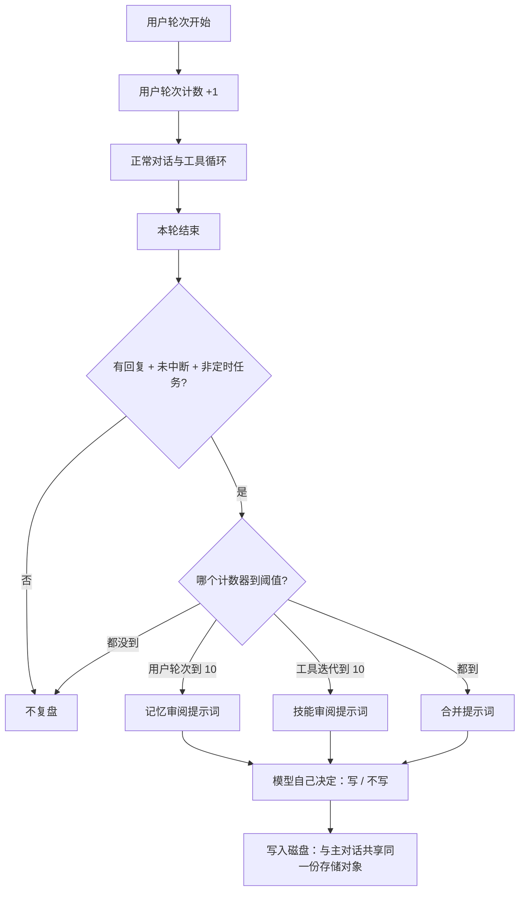

# memory-system - Hermes Agent - 01 - 记忆提取：三条写入通道，以及"有效性"被外包给了谁

---

我主要关心 Hermes 的记忆系统, 在提取, 召回, 和整理这三方面是怎么做的. 提取是怎么确保提取的记忆是有效的, 应该提取的记忆呢? 召回又是怎样将有效的记忆注入进上下文的? 记忆文件过期/失效/合并/更新, 这个部分的记忆整理又是怎么做的? 分成三篇笔记, 分别研究这个机制.

---

## 一句话结论

Hermes 没有独立的"记忆抽取管线"。提取是**三条写入通道并列**：主模型在对话中自己调用记忆工具（主力）、每 10 个用户轮次分叉一个瘦 agent 做复盘（补充）、以及外部记忆服务按轮/按会话边界自己抽取（旁路）。"提取什么才有效"这件事几乎完全**写成提示词里的选题纪律**，再用一组**结构约束**（字符预算、精确去重、注入扫描、写入审批、谁能写）来兜底——它没有任何**对事实本身的事后校验**。

## 场景：三个会写记忆的时刻

用户说了一句"以后别给我加总结段落"，或者在调试中发现"这个仓库的测试必须带 `-n 4`"。此后三件事可能发生：

1. 当轮的主模型判断这句话值得记住，调用一次 `memory` 工具，把条目写进两个 Markdown 存储之一。
2. 如果这一轮没写，但距离上次复盘已经过去 10 个用户轮次，轮末会在后台分叉一个 agent，重放对话快照，专门问一句"这段对话里有什么值得存进记忆/skill"。
3. 如果配置了外部记忆服务（Honcho、mem0、Hindsight 等），这一轮的用户与助手文本还会被送到服务端做它自己的事实抽取；会话结束和上下文压缩前还各有一个额外的抽取时点。

三条通道写入的是**同一个"记忆"概念**，但存储、判据、失败语义完全不同。理解 Hermes 的提取，等于理解这三条通道各自的触发条件和它拿到的约束。

## 机制展开

### 通道 A：主模型主动写（主力路径）

记忆不是后台系统挖出来的，而是模型在正常对话轮里"顺手"写下的。这条路成立的前提有三个：当前会话的工具集里包含 `memory`、内置存储对象存在、目标存储没有被配置关掉。

这一通道的"提取规范"由两处文本承担：

- **工具描述**（模型每次都能看到）：明确写了什么时候该存（用户表达了偏好、纠正、个人细节，或者你学到了关于其环境/约定/流程的稳定事实）、优先级（用户偏好与纠正 > 环境事实 > 流程）、满了怎么办（用一次批量操作删旧加新）、两个目标的分工（`user` 记"用户是谁"，`memory` 记"我的笔记"）、以及一份明确的跳过清单（琐碎信息、可随时重新发现的事实、原始数据堆、任务进度、已完成工作日志、临时 TODO——这些应该用会话检索去找，而不是记忆）、最后一句"可复用的流程属于技能，不属于记忆"。
- **系统提示里的行为准则**：进一步规定写法——写成**陈述句事实**而不是对自己的命令（"用户偏好简洁回复"✓，"总是简洁回复"✗），并给了一条很硬的新鲜度判据：**一周内会过时的事实不该进记忆**；同时列出典型反例（PR 号、issue 号、commit SHA、"已修复 X"、"第 N 阶段完成"、文件计数）。

这条通道的本质是：**把"该不该记"的判断交给模型，把"记成什么样"变成可检查的写作规范**。

### 通道 B：周期复盘（每 10 个用户轮次）

主模型常常专注于任务本身而忘了写记忆，所以 Hermes 在轮末补了一个"事后审阅"：分叉一个轻量的 agent，把当前对话快照重放给它，让它自己判断要不要写。

触发条件（缺一不可）：

- 记忆侧：用户轮次计数达到 `nudge_interval`（默认 10）；会话是 resume 出来的，则用历史用户轮数取模恢复计数，避免每次恢复都重置成 0。技能侧用的是另一个计数器——距上次技能复盘经过的**工具迭代次数**（默认同为 10），两者可以分别触发，也可同时触发（此时用合并提示词）。
- 当前会话真的有 `memory` 工具，并且存储对象非空（技能侧则要求有技能管理工具）；
- 本轮有最终回复、没有被打断；
- 会话不是 cron 驱动的（cron 明确跳过复盘，避免无人值守时自动写盘）；
- 全局开关 `auxiliary.background_review.enabled` 没有关掉。

复盘 fork 有几个值得注意的设计：

- **它继承主模型的运行时**（同 provider、同模型、同缓存前缀、同系统提示），只有当配置显式指定了另一个模型时才路由到别处；路由时会把老对话压成摘要以减少冷启动开销。
- **工具面被收窄到只管记忆与技能**，别的工具一律运行时拒绝；并且明确禁掉了它自己的复盘计数（避免复盘套复盘）。
- **它的写入落在与主对话共享的同一个存储对象上**，所以写完后主对话侧的工具响应能看到新状态；但主对话的系统提示里那块记忆是会话开始时冻结的，不会因此变化（见第 02 篇）。它是完全隔离于会话库的：不复用主会话的持久化路径，避免把自己的"审阅提示"写进用户的真实 transcript。
- **预算是显式的**：单次复盘有聚合输入 token 上限（默认 60 万），用于封住"重放整段对话 + 自己多轮工具调用"的病态成本。
- **失败是静默的**：复盘最佳努力，异常被吞掉，用户最多看到一条动作摘要。

记忆审阅的提示词很短，只问两件事：用户有没有透露关于自己（人格、欲望、偏好、个人细节）的东西；用户有没有表达对你行为的期待、工作风格。技能审阅的提示词则相反——非常长，明确要求"主动"、给出信号清单（用户纠正了风格/流程、非平凡技巧、加载过的技能被证明过时）、给出优先顺序（先改本次加载过的技能 → 再改现有伞形技能 → 再加支撑文件 → 最后才新建），并列了一份"不要记"的负名单（环境相关的失败、对工具能力的负面断言、已自行恢复的临时错误、一次性任务叙事、没跑通就写成功流程）。

这份"记忆 vs 技能"的分工是这个设计的核心判断：**关于用户的事实进记忆，关于这类任务怎么做进技能**。提示词里反复强调用户抱怨时"只写记忆不够，必须改进管这类任务的技能"。

### 通道 C：外部记忆服务自己抽取（旁路）

一旦启用外部 provider，抽取就从"模型可选行为"变成"系统固定动作"：

- **每轮结束**：把本轮用户文本与助手文本交给服务端，由服务端自己做事实抽取（mem0 之类显式 `infer=True`）。这一路是后台线程、串行（一轮必须早于下一轮落库），并且**被中断的轮次不同步**——用户没看到完成的对话不算事实。
- **会话边界**（`/new`、退出、网关会话过期）：把整段会话交给服务端做一次批量抽取。CLI 的实现特意把这个 LLM 抽取放到后台串行队列，与新会话切换同队，避免"晚到的会话结束"被错误归属到新会话。
- **上下文压缩前**：给 provider 一次"检查点"机会，把即将被摘要掉的内容抽出去。较新的 provider 可以声明支持失败即中止（fail-closed），保证压缩不会在抽取失败时静默丢掉证据。
- **镜像写入**：模型通过内置工具写的每一条记忆，也会被转发给 provider（带来源元数据：前台/后台复盘、会话 id、平台、工具名），让两套存储不至于完全各说各话。

所以"外部服务"并不是替代内置记忆，而是**在同一个概念上再叠一层自治抽取**。

## "有效性"到底靠什么保证

这是本主题真正的问题。Hermes 的答案可以拆成四层，但请注意第四层是空的。

### 第 1 层：选题纪律（自然语言，非强制）

上面提到的工具描述、行为准则、审阅提示词构成三层文本约束：什么该记、什么不该记、正例与反例、成文风格。它们的共同点是把"有效性"定义为**降低未来的用户纠偏次数**——提示词原话是"最有价值的记忆是那条能让用户不必再纠正或提醒你的"。

### 第 2 层：用结构约束替代判断力

- **两个存储的分工被写进工具契约**：目标是枚举值，被关掉的一侧会从枚举里消失，模型无法往不存在的存储里写。
- **字符预算制造取舍压力**：默认 2200 字符（约 800 token）与 1375 字符（约 500 token）。新条目要进来，就必须有旧条目让位——这让"重要性排序"变成每次写入都会发生的动作，而不是一次性的分类。
- **精确重复被直接拒绝**：与某条已存在条目字面完全相同的写入返回"已存在，未新增"。加载时也会去重（保留首次出现）。
- **注入/窃密模式扫描**：条目内容在写入前要用一份共享的威胁模式库（严格模式）扫描；命中即拒。理由是记忆会进系统提示且是"会话内冻结"的——一条被污染的记忆会污染整个会话，并且一直留着直到被显式删除。加载时也会扫，命中的条目在**进入系统提示时**被替换成 `[BLOCKED: ...]` 占位符，但磁盘上的原文保留（让用户看得见、删得掉，而不是被静默吞掉）。
- **谁能写被收窄**：委派出去的子 agent 的工具白名单里明确没有 `memory`（不许写共享记忆文件）；cron 会话保留记忆但跳过自动复盘；被中断的一轮不触发复盘、不同步外部 provider。
- **写入审批闸门（默认关闭）**：打开后，前台写入走行内确认；后台复盘与网关会话没有交互通道，只能把写入**暂存**成 pending 记录（JSON，落盘，可跨进程重启），由用户 `/memory pending | approve <id> | reject <id>` 处置。这条设计直接针对"后台 agent 自作主张写入错误假设"这类投诉。
- **满载失败要能退出**：同一轮里失败（超容量、匹配不到）连续 3 次后，工具返回终止性结果并要求模型停止重试、先去回答用户——"记忆副作用绝不能阻塞本轮回复"。

### 第 3 层：写下之后的不变量

写入成功后的响应刻意是**终止性**的：只回报用量百分比、条目数、"已保存，不要重复"，不回显全量条目。原因是实测中回显会诱发模型"再找点东西修"的重复调用（第一次调用就是对的，后面又重发 5 次）。

### 第 4 层：空的——没有任何事实校验

以下机制**不存在**，需要明确指出：

- 没有来源引用（条目不记录"这句话是用户在哪一轮说的"）；
- 没有与新条目做语义/模糊相似度比较，只有字面完全相等才算重复；
- 没有时间戳、没有"有效期"、没有置信度；
- 没有二次模型或规则去验证"这条偏好是否真的成立"；
- 没有"用户是否确认过"的门槛（除非用户自己打开审批闸门）。

也就是说，一条记忆的"有效性"最终由三样东西决定：模型的判断力、字符预算逼出来的取舍、以及用户事后是否清理。

## 条件与边界

| 环节 | 默认值 / 条件 | 备注 |
|---|---|---|
| 内置存储开关 | `memory.memory_enabled`、`user_profile_enabled` 默认都开 | 都关时不构造存储，工具也不出现 |
| 字符上限 | 2200（memory）/ 1375（user） | 按**字符**而非 token，配置可覆盖 |
| 自动复盘频率 | 记忆侧每 10 个用户轮次；技能侧每 10 次工具迭代 | `memory.nudge_interval` / `skills.creation_nudge_interval`，0 关闭 |
| 复盘开关 | `auxiliary.background_review.enabled` 默认开 | 配置读取失败时**加载即放行**并告警 |
| 复盘模型 | 默认继承主模型 | 可单独指定 provider/model（此时会压缩老对话） |
| 复盘输入预算 | 60 万 token | `max_input_tokens`，0 或负值 = 不限 |
| 写入审批 | 默认关 | `memory.write_approval` |
| 外部 provider | `memory.provider` 为空 = 只用内置 | 同时只允许一个外部 provider |
| 不提取的场合 | 无最终回复、被打断、cron 会话、子 agent、平凡提示词（外部侧） | — |

## 设计取舍

- **为什么不做独立抽取管线**：Hermes 的两条硬约束是"会话级提示缓存神圣"和"核心工具数量极贵"。一个后台抽取系统要么改历史、要么加常驻工具，都会撞上这两条。把提取做成"模型可选的工具调用 + 轮末分叉"是在不动前缀、不加工具的前提下最便宜的接法。
- **为什么用轮次而不是时间**：一轮对话的"信息增量"与时间无关，与用户发言次数相关；用轮次还能在 resume 后按历史用户轮数取模恢复，避免恢复即重置。
- **为什么把有效性写成提示词**："用户是否会被这条记忆帮到"是开放式判断，硬编码规则只能覆盖反例（PR 号、过期事实），无法覆盖正例。Hermes 选择把反例写成清单、把正例写成原则。
- **代价**：有效性完全依赖模型服从这些提示词，没有任何强制；而"精确去重 + 无相似度比较"意味着语义重复的条目会一直累积到容量上限才被迫处理（见第 03 篇）。

## 证据分级

- **已证实**：三条通道的触发条件、默认值、工具契约与跳过清单、注入扫描与占位符替换、写入审批与 pending 暂存、子 agent 与 cron 的例外、复盘预算与共享存储对象、终止性响应与每轮失败上限。
- **合理推断**：`nudge_interval = 10` 与"单次复盘约 3 万 token"的成本考量有关（源码注释提到 fork 成本，但没有给出该默认值的推导过程）；"选题纪律主要靠提示词"是本报告对文本强度的判断，源码没有声明这一点。
- **无法确认**：真实运行时模型的服从率、复盘实际写出条目的质量分布、审批闸门开启后的实际使用比例——这些需要线上数据。

## 源码依据

| 位置 | 关键点 |
|---|---|
| `tools/memory_tool.py` | `MEMORY_SCHEMA`（1262 起）里的 WHEN/PRIORITY/IF FULL/TARGETS/SKIP；`memory_tool()`（1086）；`MemoryStore.add/replace/remove/apply_batch`（414/473/544/586）；`_MAX_CONSOLIDATION_FAILURES_PER_TURN`（174）；`_scan_memory_content`、`_sanitize_entries_for_snapshot`、`load_from_disk`（227） |
| `agent/background_review.py` | `_MEMORY_REVIEW_PROMPT`（465）、`_SKILL_REVIEW_PROMPT`/`_COMBINED_REVIEW_PROMPT`；`spawn_background_review_thread`（1666）；复盘 fork 构造与 `skip_memory=True`、共享 `_memory_store`（~1290-1330）；`_review_input_token_budget`（246）、`_REVIEW_MAX_INPUT_TOKENS_DEFAULT`（222） |
| `agent/turn_context.py` | 轮次计数与复盘触发（790-797）、resume 计数恢复（748-749）、每轮重置满载失败计数（661） |
| `agent/turn_finalizer.py` | 轮末分叉条件（780-810：有回复/未中断/非 `skip_background_review`） |
| `agent/agent_init.py` | 存储构造与 `nudge_interval` 读取（1851-1890）、外部 provider 装配与 `agent_context="primary"`（1900-1990） |
| `agent/prompt_builder.py` | `MEMORY_GUIDANCE` / `USER_PROFILE_GUIDANCE`（185-221） |
| `agent/tool_executor.py` | `memory` 工具特判：注入 `store=agent._memory_store` 并镜像到 provider（2165-2185） |
| `agent/memory_manager.py` | `notify_memory_tool_write`（1225）、`on_memory_write`（1171）、`_memory_tool_result_succeeded`（1208） |
| `run_agent.py` | `_sync_external_memory_for_turn`（4479-4540：中断即跳过、平凡提示词不预热） |
| `tools/write_approval.py` | 闸门决策矩阵与 pending 存储（230-270、文件头注释） |
| `tools/delegate_tool.py` | `DELEGATE_BLOCKED_TOOLS` 含 `memory`（49-59）、子 agent `skip_memory=True`（1985） |
| `hermes_cli/config_defaults.py` | `memory` 段默认值（2005-2035） |
| `tools/threat_patterns.py` | 共享威胁模式库（严格作用域） |
