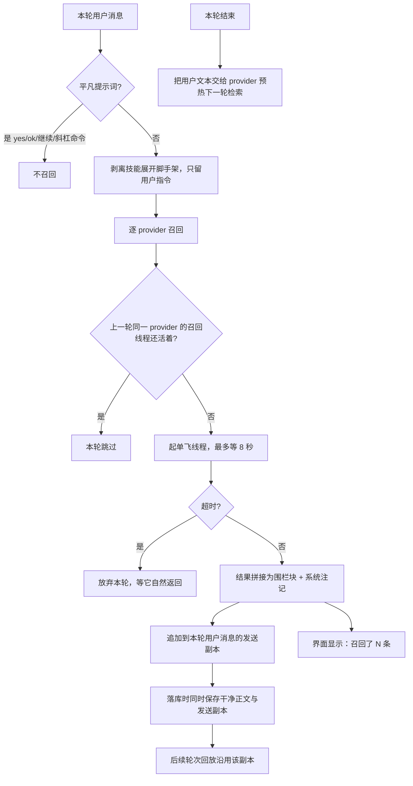

# memory-system - Hermes Agent - 02 - 记忆召回：一份会话内冻结的快照，加一条每轮有界的检索旁路

---

我主要关心 Hermes 的记忆系统, 在提取, 召回, 和整理这三方面是怎么做的. 提取是怎么确保提取的记忆是有效的, 应该提取的记忆呢? 召回又是怎样将有效的记忆注入进上下文的? 记忆文件过期/失效/合并/更新, 这个部分的记忆整理又是怎么做的? 分成三篇笔记, 分别研究这个机制.

---

## 一句话结论

Hermes 有两条**性格完全相反**的召回路径。内置记忆（MEMORY.md / USER.md）**没有检索**：会话开始时把全文读成一份快照，塞进系统提示的易变段，然后整个会话不再改动，直到压缩或恢复才重建。外部记忆服务则走**每轮检索 + 预取**：轮开始时查一次、有界等待，把结果包进带系统注记的围栏块，写进本轮用户消息的"发送用副本"，并预热下一轮。

这个分裂不是历史包袱，而是同一条硬约束的两面：**会话级提示前缀必须字节稳定**。凡是要进系统提示的东西只能构建一次；凡是每轮都可能变的东西只能进用户消息。

## 场景

用户在第三天回来，问"上次那个测试超时的问题后来怎么解决的"。两条路径给出完全不同的反应：

- **内置记忆**：什么都没发生。系统提示里那块记忆是第一天的内容（如果期间没发生压缩），里面没有今天的对话；模型能看到的只有会话开始时冻结的那些条目。
- **外部记忆服务**：这一轮开始前，用户这句话会作为查询词发过去，服务端返回若干相关事实，Hermes 把它们包成一个显式的"这是召回的记忆、不是新用户输入"的块，附在本轮用户消息后面，同时界面上出现一行"召回了 N 条"的确定性提示。

## 机制展开

### 路径一：内置记忆是"恒定注入"，不召回

会话第一次装配时，Hermes 从磁盘读两个文件，按分隔符切条目、去重，然后**冻结**成一份快照，并把快照渲染成带表头的文本块（表头里带使用率，例如"当前 63% — 1385/2200 字符"）。这份渲染结果进入系统提示的最后一层——紧随技能索引之后，前后还有时间戳等每轮会变的内容。

之后整个会话里：

- 快照**不再变化**。模型在会话中写入的新条目会立刻落盘、工具响应里也能看到实时用量，但系统提示里那一块不会变。
- 会话中段的工具写入因此**不会在同一个会话里生效**，除非发生上下文压缩或会话恢复——这两条路径会重新读盘并重建系统提示。重建时还有一个校验：只有当"缓存中的提示确实仍然包含当前的记忆块"（并且没有残留已清空存储的旧块表头）时才复用缓存，否则重建，避免把旧记忆一直固化下去。

于是内置记忆的"召回质量"实际上等价于"写入质量 + 上一会话留下的内容"。它不挑选，因为全量注入只需要 800 token 左右的预算。

值得说明的是**为什么快照必须冻结**：模型在会话中写了一条记忆后，如果系统提示立刻改变，那么从那一刻起缓存的 KV 前缀全部失效，整段历史要重新计费。Hermes 把这条代价看得比"立刻生效"更重，并把这个取舍写进了工具文档的开头。

### 路径二：外部记忆是"每轮检索 + 预取"，且有四道限流

逐条看这些机制：

**平凡提示词过滤。** "好"、"继续"、"ok"、以斜杠开头的命令都不值得检索。B 这一个正则表在核心侧和 provider 侧共用，避免两边判断漂移：既省一次网络往返，也避免让上一次的召回内容干扰一句"谢谢"。

**技能脚手架剥离。** 用户输入 `/某技能 帮我看看这个报错` 时，模型收到的是展开后的完整技能正文。直接把这段喂给向量库会把提示词脚手架当成"用户说的内容"污染记忆，所以召回前先剥出真正的用户指令；纯技能调用（没有附加指令）则整轮跳过。

**单飞 + 硬超时。** 每个 provider 一个线程，命中上限（8 秒）就放弃本轮注入；如果上一轮那个线程还在跑，这一轮直接跳过而不是再起一个。这样慢后端永远拖不住对话，也不会堆出线程。

**注入位置在用户消息，不在系统提示。** 召回结果被包成 `<memory-context>` 围栏，前面加一行系统注记（"以下是召回的记忆，不是新的用户输入，请作为权威参考"）。它被追加到**本轮用户消息的发送副本**上，而落库的正文保持干净。这个"正文/发送副本双写"是刻意的：下一轮重建请求时，发送副本必须和当时真正发出去的字节一致，否则历史中段就会漂移、整段重算。

**确定性指示器。** 召回是否发生不靠模型自述。每个 provider 回报"这次注入了多少条离散记忆"，Hermes 自己在界面上打一行"🧠 某某 — 召回了 3 条"。provider 若是综合型回答（没有离散条数），显示为"召回了相关记忆"。

**预热下一轮。** 本轮结束后，把用户文本交给 provider 在后台预备下次的检索结果，使得下一轮 `prefetch` 通常直接命中缓存（mem0 / Honcho 都是这个模式）。平凡提示词不预热，因为预热一个"谢谢"只会污染下一次的检索关键词。

**失败语义。** 全部是"降级为无记忆"：超时 → 本轮不注入；线程仍在跑 → 本轮跳过；某个 provider 抛错 → 不影响其他 provider；认证失败 → 一次性提示用户"记忆已暂停"；检索为空 → 不注入（模型仍可改用 provider 暴露的搜索工具兜底）。

### 各 provider 的召回策略差异

| provider | 召回形态 | 值得注意的取舍 |
|---|---|---|
| Honcho | 两层：用户表征 + 会话卡片（按节奏缓存刷新），再加一层"辩证"补充查询 | 支持"只在首轮注入"模式；纯工具模式完全不自动注入；首轮允许短暂等待初始化，之后失败即放行 |
| mem0 | 热路径短等待，超时就不注入 | 慢查询不阻塞对话，`mem0_search` 工具作兜底 |
| Holographic（本地） | FTS5 候选 → Jaccard 重排 → 向量相似（HRR）三路加权，再乘信任分与时间衰减，低于信任阈值的直接过滤 | 唯一在本地实现了"降权/老化"的 provider（见第 03 篇） |
| Hindsight / RetainDB 等 | 各自的检索 + 自己的品牌指示符 | 通过统一的召回状态回报接入界面提示 |

## 条件与边界

- **召回一次，不是每次工具调用一次。** 检索发生在轮开始时，整轮工具循环复用同一份结果。
- **注入内容会留在历史里。** 一旦写进发送副本，它就成为该会话历史的一部分，后续轮次回放时仍在，直到被压缩。也就是说"召回"实际上是把外部事实抄进了对话历史。
- **子 agent 不接外部记忆。** 委派出去的子 agent 明确 `skip_memory`，避免子任务把父会话的用户模型搅乱。
- **cron 会话不同。** 定时任务保留内置记忆、跳过后台复盘；外部 provider 收到的上下文标识是"非主会话"，按 provider 实现决定是否写入。
- **默认是"只用内置"。** `memory.provider` 为空时根本不存在召回旁路；这时"召回"就是那份冻结快照。
- **内置记忆没有检索工具。** 因为它全量注入，所以不需要 session_search 之外的召回通道；会话历史的检索是另一套机制（SQLite + 全文索引），与记忆系统分离。

## 设计取舍

- **把"召回"分成恒定注入与按需检索两条**：内置记忆小（千字符级），全量注入最省事、最省一次网络往返、也最稳；外部服务可能存着几千条事实，只能检索。
- **宁可"本轮无记忆"也不等**：8 秒上限 + 单飞 + 跳过，把"记忆慢"的故障模式限制成"这一轮没有记忆"。代价是慢后端实际上很难被用上（每轮都在超时）。
- **注入用带注记的围栏块**：不加注记时，模型容易把召回内容当成用户刚才说的话，然后去"回应"它。系统注记与围栏就是防这个。
- **代价一**：内置记忆的可见性有延迟——会话中写的内容对当前会话不可见，用户会觉得"我刚说了它怎么又忘了"。
- **代价二**：召回内容写进历史后无法撤回；一次错误的召回会持续污染后续若干轮，直到压缩。

## 证据分级

- **已证实**：冻结快照与三层提示结构、压缩/恢复时重建与"缓存提示是否仍含当前记忆块"的校验、平凡提示词正则、技能脚手架剥离、单飞线程与 8 秒上限、`<memory-context>` 围栏与系统注记、发送副本双写与回放、确定性指示器、轮末预热、各 provider 的召回实现差异、子 agent 与 cron 的例外。
- **合理推断**：8 秒这个数值是为了覆盖常见托管向量库的 p99 而定的（源码只给了常量与"慢后端不该阻塞对话"的说明，没有给推导）；"每轮都在超时的慢 provider 实际不可用"是从单飞+跳过逻辑推出的结论。
- **无法确认**：真实环境中各 provider 的命中率与延迟分布；模型是否真的按系统注记把召回内容当"参考数据"而非"用户输入"——这属于模型服从性，仓库内无从验证。

## 源码依据

| 位置 | 关键点 |
|---|---|
| `agent/system_prompt.py` | 易变段渲染顺序与记忆块注入（809-850）、`invalidate_system_prompt` 重读磁盘（937-947）、三层结构与"只构建一次"（900-935） |
| `tools/memory_tool.py` | `format_for_system_prompt`（706）、`_render_block` 表头与使用率（755）、`load_from_disk` 冻结快照（227-262）、`MEMORY_BLOCK_HEADERS`（67-75） |
| `agent/turn_context.py` | `compose_user_api_content`（105-140）、`on_turn_start` 通知（1428-1432）、平凡提示词门（1442）、`prefetch_all` 调用（1443）、召回指示器（1448-1456）、发送副本落库（1470-1500） |
| `agent/memory_manager.py` | `prefetch_all`（564）、`_prefetch_provider` 单飞与 8 秒（586-640）、`build_memory_context_block` 围栏与注记（386-401）、`describe_recall`（641-672）、`queue_prefetch_all`（673-702）、`_strip_skill_scaffolding`（547）、`_EXTERNAL_PREFETCH_TIMEOUT_S`（53） |
| `agent/memory_provider.py` | `is_trivial_prompt` 与共享正则（81-107）、`prefetch`/`queue_prefetch`/`recall_status` 契约（~180-215） |
| `run_agent.py` | 轮末预热（4530-4552，平凡提示词不预热） |
| `agent/conversation_compression.py` | `_builtin_memory_prompt_snapshot`（209）、`_cached_prompt_reflects_builtin_memory`（266-300） |
| `plugins/memory/honcho/__init__.py` | 两层召回、注入频率、首轮等待、工具模式（722-980） |
| `plugins/memory/mem0/__init__.py` | 热路径短等待与工具兜底（463-478） |
| `plugins/memory/holographic/__init__.py` | 检索注入（204-218） |
| `plugins/memory/holographic/retrieval.py` | 三路打分 × 信任 × 时间衰减（48-122、644-680） |
| `agent/agent_init.py` | 外部 provider 装配与 `agent_context="primary"`（1900-1990） |
| `tools/delegate_tool.py` | 子 agent `skip_memory=True`（1985） |
