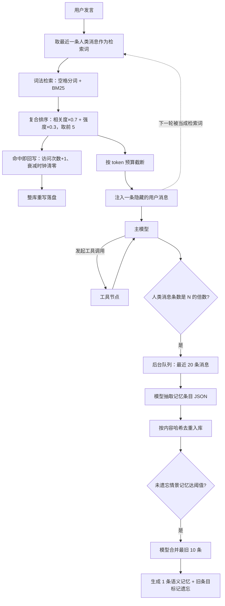

# memory-system - Poirot - 01 - 长期记忆：一条被动的读写旁路

---

> 探索一下 poirot 的长期记忆是怎么做的?
>
> 范围确认：走端到端管道（写入 → 编码 → 存储 → 召回 → 注入 → 衰减/遗忘/合并）；同时关心设计意图与真实可用性；“默认关闭”作为背景带过，不追原因。

---

## 场景

用户在第 3 轮说过“后端用 Rust，不用 Python 异步”，第 4 天开新会话时希望 Agent 不用再问一遍。这就是长期记忆要解决的问题：**跨进程、跨会话存活，并在需要时被自动取回上下文**。

Poirot 对这个问题的回答很克制：它不引入向量库，真相源是一个 Markdown 文件；它不给模型“记一笔”的工具，也不给用户查看记忆的命令；写入只在后台线程里发生，读取只在每次模型调用前发生。**记忆是一条完全被动的旁路**——模型既不能主动写，也不能主动查，用户也看不见里面有什么。

这个选择的后果有好有坏，下面按“读 → 写 → 衰减 → 存储”的顺序展开，然后在第 8 节集中列出这套实现今天真正会出问题的地方。

## 一句话机制

每次模型调用前，拿最近一条人类消息当检索词，用 BM25 在 Markdown 记忆库上做一次词重叠检索，把分数最高的 5 条按“相关度 0.7 + 强度 0.3”排序后，伪装成一条**用户消息**塞进上下文；每累计若干条人类消息后，后台线程让模型从最近 20 条消息里抽几条“值得记住的事”，按内容哈希去重入库；当未被遗忘的情景记忆攒够一定数量，再让模型把它们合并成一条语义记忆。

## 读路径：一次模型调用里发生了什么

**第一步，取检索词。** 从当前消息列表从后往前找第一条人类消息，把它的文本整段当查询。没有额外的查询改写、没有关键词抽取、没有历史会话压缩，就是用户刚才那句话（原样，包含所有标点和口语）。

**第二步，词法检索。** 全部记忆按类型、最小强度粗筛后，逐条算 BM25 分数。分词方式是“转小写 + 按空格切”，这一点决定了后面第 8 节最严重的问题：中文句子中间没有空格，整句会成为一个 token。

**第三步，混合排序。** 每条候选算一个复合分：`相关度 × 0.7 + 当前强度 × 0.3`，其中相关度是原始 BM25 值（未归一化），强度是按艾宾浩斯公式在查询时刻惰性算出来的。取前 5 条。注意这里的“最小强度”阈值默认是 0，也就是**衰减只影响排序，不影响是否召回**——一条强度衰减到 0.02 的记忆照样会被捞出来，只是排在后面。

**第四步，命中即强化。** 被召回的 5 条会各自写回一次：访问次数 +1、最近访问时间置为当前时间。由于强度是按“距上次访问多少小时”算的，这等于**每次召回都把这条记忆的衰减时钟清零**，记忆越常被想起就越不会淡。写回是逐条进行的，而底层存储的更新方式是“整个记忆文件重新序列化并覆盖写”（见第 6 节）。

**第五步，按预算裁剪并注入。** 把命中项拼成一段 `[score=… strength=…] 内容` 的文本，按 token 预算（默认 2000 token ≈ 8000 字符）从上往下累加，超了就停。然后作为一条 `name="memory_recall"`、带 `hide_from_ui` 标记的用户消息返回，由图的 reducer 追加进消息列表。状态里另存一份索引（只有 id、分数、强度），内容不重复存。

**注入位置是刻意的：** 走用户消息而不是系统提示，理由是系统提示位于缓存前缀，任何变动都会让提示缓存整体失效；走用户消息则每次调用独立成段，前缀不变。这条消息也不挂进工具调用配对，所以不会破坏“工具调用—工具结果”的结构。

**但这条消息不会被移除。** 模型读过之后，它仍留在消息列表里，之后每一轮都跟着走，而且下一轮“从后往前找第一条人类消息”时，它自己就成了新的检索词——这是第 8 节的第二个大问题。

## 写路径：后台线程的抽取与合并

**触发。** 每次模型回复后统计消息列表里的人类消息条数，当条数是触发间隔（默认 10）的整数倍时，把最近 20 条消息打成一个任务丢进无界队列，立即返回，不阻塞主流程。

**抽取。** 后台守护线程取出任务，让模型读这 20 条对话，要求返回一个 JSON 数组，每项包含内容、类型（情景/语义/过程）和重要性。解析成功后逐条写入记忆库。

**去重靠内容哈希。** 记忆 id = `SHA256(内容 + 类型)` 前 16 位。同一条内容、同一类型重复写入会命中已存在的记录并直接返回旧记录，因此重复抽取不会产生重复条目。这是这套设计里最省事也最有效的一环。

**合并。** 抽取完成后，统计“未被遗忘的情景记忆”总数，一旦达到阈值就把最旧的 10 条（按创建时间）交给模型合并成一段文字，生成一条**语义记忆**，那 10 条旧记忆不删除，只标记为已遗忘并记下“被合并到哪个 id”。语义记忆的初始强度更高、衰减更慢，重要性取旧条目最大值再 +0.1（上限 1.0）。

**失败即放弃。** 模型返回的不是合法 JSON、编码抛错、合并抛错，一律只写日志、跳过，不重试，也不回滚。整个链条没有“事务”概念，接受最终一致。

## 衰减、遗忘、关联：只落地了一半

设计上有一套认知科学味道的机制：

| 机制 | 设计 | 实际状态 |
|---|---|---|
| 衰减 | 强度 = 基准 × (1-衰减率)^小时 + log(1+访问次数)×0.1 + 重要性×0.05，惰性计算 | 已落地，但只参与排序（30% 权重） |
| 遗忘 | 30 天未访问，或强度低于 0.1 → 应遗忘 | 判定函数存在，**没有任何调用方** |
| 关联 | 记忆之间建双向关联，超 20 条按强度淘汰最弱 | 已实现，**没有任何调用方**（无人建关联） |
| 再巩固 | 更新某条记忆的内容，保留强度，记 diff | 已实现，**没有任何调用方** |

三档衰减参数的差异很大：情景记忆基准 0.7、每小时衰减 10%；语义记忆 0.8、每小时 2%；过程记忆 0.9、每小时 0.5%。按这个速率算，一条从未被想起的情景记忆大约 **21 小时**后就落到 0.1 的遗忘阈值以下（这是公式推算，不是实测）。但因为遗忘没有接线，它不会被清理，也不会被过滤——只是排序时几乎拿不到那 30% 的分。

结果是：**这套系统实际上只有“编码 → 合并 → 检索”三个动作在跑**，遗忘与关联是带着测试的死代码。

## 存储形态与写放大

真相源是单个 `traces.md`：每条记忆用 `<!-- trace: id -->` 分隔，正文前是 YAML frontmatter（除内容外的全部字段），再是内容本身。进程启动首次用到记忆时才读文件建内存索引；之后所有读操作走内存字典。

写操作有个关键特性：**新增是追加，更新是整文件重写**。每一次“更新”（包括每一次召回强化）都要把内存里所有记忆重新 YAML 序列化一遍，再覆盖整个文件。没有临时文件 + 原子改名，没有备份，崩溃在覆盖中途就是全库丢失。

召回又会触发 5 次更新，于是**每次模型调用 = 5 次全库重写**，还要顺带把被更新条目的倒排索引删掉重建一遍。实测（300 条记忆、176 KB 文件）：一次召回的检索耗时 **1.2 秒**，其中几乎全部来自 5 次全库重写（单独测 5 次更新也是 1.2 秒），BM25 本身可忽略。而这次检索是在异步钩子里同步执行的，会直接挡住事件循环。

## 条件与边界

- **谁能开**：只有 `POIROT_MEMORY_USE` 非空（一般填 `default`）才装配整套东西；Docker 镜像与 compose 默认就是打开的，直接跑源码默认关闭。
- **存哪里**：`storage_path` 相对路径按项目根锚定，默认 `.poirot/memory/traces.md`。
- **哪些开关真的有效**：召回开关与 token 预算在**建图时**被中间件拷走（换模式/换模型重建图才生效）；衰减、遗忘参数与合并间隔是每次调用现读全局配置。另有两点名不副实：“阶段二总开关（`phase2.enabled`）”和“会话结束时触发”这项配置**从未被读取**，是装饰性的；合并间隔这一个字段被用在两个完全不同的地方——中间件的触发频率，和后台合并所需的情景记忆条数阈值。
- **生命周期**：记忆提供者与后台 worker 都是进程内全局单例，懒加载、双检锁。切换模型或 expert/default 会重建图，但复用同一个提供者与 worker，所以记忆库不丢；进程退出时只关 worker（等 5 秒），**队列里没处理完的任务直接丢弃**，队列本身无界、无重试、无上限告警。
- **容量**：没有上限。既没有 TTL 清理，也没有容量淘汰，唯一的“减少”是合并时把旧条目标记为遗忘（文件里还在）。文件与内存索引只会单向增长，而每次召回的成本与文件大小成正比。
- **谁能看见**：CLI 与 TUI 都没有记忆相关的命令或面板，工具列表里也没有记忆读写工具。也就是**只有注入这一条通道**，用户和模型都没有旁路。

## 真实可用性：按严重度分档

以下问题都能从代码直接推出，前三条还做了独立复现（只跑记忆模块，不启动 Agent，不写仓库）。

### 致命（今日即可观察到）

**1. 中文基本检索不到。** 分词是“转小写 + 空格切分”。记忆内容“项目代号是夜莺，部署在日本东京的机房”整句成为一个 token，查询“东京机房在哪”也是另一个 token，零重叠 → 零召回。实测：中文长句查询对中文记忆返回 0 条；“Rust 后端”能命中，纯粹因为 `Rust` 恰好是空格隔开的一段。也就是说，这套记忆对**中文自然语言请求**几乎等于不存在，只在“用户原话与记忆原话高度复现（含空格切分一致）”时有效。加 jieba 的注释在代码里出现多次，但一直是“留后续”。

**2. 每次召回 1.2 秒（300 条记忆），且阻塞模型调用。** 成因是上面说的 5 次全库重写。记忆越多越慢，而记忆只增不减，所以这条曲线是单调恶化的。在一个工具循环里，模型每被调用一次就付一次这个成本。

**3. 注入的消息会变成下一次的检索词。** 注入的是一条人类消息，且留在状态里；下一轮“取最后一条人类消息”抓到的是这条 `[Recalled Memories] [score=…] 内容` 块，于是用它去检索记忆——它显然与已有记忆高度重叠，于是再把同一批记忆注入一遍。实测用注入格式的文本作查询，仍能命中同一条记忆（相关度 1.726）。后果是同一轮里每多一次模型调用就多一段重复记忆，上下文持续膨胀，模型还会看到多条“用户说：我要记住这些”的伪轮次。别的中间件（待办提醒、停滞提示、反思）同样注入人类消息，同样会被当成检索词，所以这不止是记忆自己的问题。

### 严重（会静默损坏数据或行为）

**4. 合并可能清空全部可检索记忆。** 合并时没有检查模型返回内容是否为空。若模型返回空串（截断、超时、只返回思考内容都会导致），会写入一条**内容为空**的语义记忆，同时把 10 条情景记忆全部标记遗忘。空内容记忆没有 token，永远检索不到；旧条目被过滤掉，也没有任何“取消遗忘”的入口。实测：10 条情景记忆 → 合并传空串 → 库中仅剩一条空记忆，检索返回 0 条。这是不可逆的记忆丢失路径。

**5. 沉淀的触发点与“轮次”无对应关系。** 计数统计的是“人类消息条数”，而注入的隐藏消息也是人类消息。于是计数被注入加速，触发点随工具循环次数漂移：可能在一轮对话的中途触发，也可能因为召回为空（不注入）而在同一轮里对**每一次模型回复**都满足条件、重复投递同一个任务。重复任务不是靠编号去重，而是靠内容哈希——重复的模型抽取调用照付，只是写库时被哈希挡住。这对一次推理只有 10 次模型调用的默认间隔来说，等于凭空多出若干倍的抽取开销。

**6. 短会话什么也记不住。** 写入完全依赖“累计 10 条人类消息”这一条件，没有会话结束时的兜底（配置项写着“会话结束时触发”，没有实现）。一次只聊三五句就退出的使用方式，长期记忆永远为空。

### 次要（设计未落地 / 表达不一致）

- **向量与图是空壳**：两个适配器只有协议定义，检索器从不读取相关配置，“Markdown + 向量 + 图三层叠加”在代码里只有第一层。
- **用户画像是空壳**：画像协议存在，无实现、无调用方。
- **复合分数不是复合分数**：BM25 值未归一化，实测相关度可到 1.7，复合分算出来 1.4，超出“0~1”的约定。由于相关度是求和项（查询词越多越大），实际上“相关度 70%、强度 30%”的权重基本被相关度的量纲吃掉，强度只起同分时的微调作用。
- **状态里的召回索引与实际注入不一致**：预算裁剪只影响注入文本，状态里的 `recalled_memories` 仍记录全部命中；预算极小时甚至只注入一个空标题行，状态却认为已经召回了 5 条。
- **持久化的强度字段是只写的**：写回时用的是“访问次数加一之前”算出的强度，而且后续衰减从不读这个字段（每次重算）。它只影响人眼查看文件时的观感。
- **子 Agent 也在写记忆**：叶子 Agent 复用同一套中间件与同一个后台 worker，它自己的内部对话（含委派目标）也会被计入触发条件并参与抽取，来源只标 `worker:<thread_id>`。
- **并发只是“不崩”**：存储的写有锁，但索引更新在锁外，检索也是无锁读内存；单进程下不会损坏结构，但可能读到旧索引，重复更新同一条记忆时有轻微错乱风险。
- **一处恒真的类型判断**：类型过滤写成了“实例是它自己的类型”这种恒真条件，靠枚举恰好能跑通，换成字符串过滤会直接抛异常。

## 设计取舍

- **为什么不用向量库**：单文件 Markdown 可读、可 diff、可人工修，且不需要额外服务；代价是只能做词法匹配，而分词器又停在“空格切分”，于是把代价放大成了“中文不可用”。这是“可维护性优先”在中文场景下的典型反噬。
- **为什么注入走用户消息**（代码注释明确给出）：保护提示缓存前缀；系统提示任何改动都会让缓存整体失效，用户消息每次独立。
- **为什么工具层不含 LLM**（代码反复强调的不变量）：编码、合并、再巩固只接受外部传入的文本，LLM 调用只发生在中间件与后台线程。好处是存储层可单测、可 mock；代价是“语义压缩”的质量完全取决于上层 worker 的提示词与容错。
- **为什么沉淀是后台异步**：抽取要调模型，放在主循环里会拖慢每次回复；代价是任务可能丢（退出、失败不重试），以及无法保证“这一轮的记忆已经写好”。
- **为什么用内容哈希做 id**（推断）：这是在不引入去重服务的前提下，成本最低的幂等手段；副作用是“内容略有改写就是另一条记忆”，所以模型每次重述同一件事都会新增一条。
- **为什么召回复用一个 Markdown 文件**（推断）：与技能库、报告目录保持同一种“文件即真相”的世界观，便于人工排查；但这个世界观与大模型的上下文成本并不匹配——重写整个文件只为更新一个访问计数，是典型的“存储层过度简化导致上层付出数量级代价”。

## 全景图

图中两条虚线路径是这版实现的主要成本来源：注入消息回流成检索词（第 3 条问题），以及每次命中都要整库重写（第 2 条问题）。

## 证据分级

| 结论 | 等级 | 依据 |
|---|---|---|
| 读取发生在每次模型调用前，写入发生在后台线程 | 已证实 | 中间件按 hook 挂载 + 装配点；架构文档与代码一致 |
| 中文长句查询返回 0 条 | 已证实 | 静态读码 + 独立复现（只跑记忆模块，临时目录） |
| 召回一次耗时≈1.2s（300 条），主因是 5 次整库重写 | 已证实 | 独立复现：召回 1.22s / 5 次更新 1.23s |
| 注入消息会被用作下一轮检索词 | 已证实（机制） | 取词逻辑不区分消息来源；注入消息按普通人类消息保存 |
| 空合并结果会清空可检索记忆 | 已证实 | 独立复现：10 条情景→1 条空记忆，召回 0 条 |
| 遗忘/关联/再巩固无调用方 | 已证实 | 全仓检索：仅测试与定义 |
| `phase2.enabled`、`session_end` 未被读取；间隔字段一字段两用 | 已证实 | 全仓检索 + 两个读取点 |
| 退出时队列任务被丢弃、队列无界无重试 | 已证实 | 循环条件与关闭逻辑 |
| 同一轮内重复投递沉淀任务 | 已证实（机制） | 计数条件在每次模型回复后都成立；去重只发生在写库 |
| CLI/TUI/工具都没有记忆入口 | 已证实 | 全仓检索：这些目录不引用记忆 |
| 衰减速率导致情景记忆约 21 小时落到 0.1 以下 | 合理推断 | 公式代入推算，未跑时钟实验 |
| 复合分数“70/30”名不副实 | 合理推断 | 实测相关度 1.7、复合分 1.4；权重被量纲主导 |
| 为什么这样设计（可维护性优先、与文件即真相的世界观一致） | 合理推断 | 注释与模块组织支持，无设计文档可查（`design_docs/` 未入库） |
| 线上默认是否开启、真实会话里是否真的开了 10 轮 | 无法确认 | 取决于部署环境与会话长度 |

## 源码依据

| 位置 | 关键内容 |
|---|---|
| `poirot/backend/agents/memory/config.py` | 配置字段与默认值、启动期不可变字段集合 |
| `poirot/backend/agents/config/loader.py` | `_build_memory_config`：环境变量到配置 |
| `poirot/backend/app/bootstrap.py` | 装配点：配置同步、懒加载提供者、启动 worker、`atexit` 注册 |
| `poirot/backend/agents/memory/bootstrap.py` | 提供者/worker 生命周期、存储方法包装（增量索引） |
| `poirot/backend/agents/memory/strategies/default/strategy.py` | `build_default_provider`：store/retriever/manager 组装 |
| `poirot/backend/agents/memory/strategies/default/manager.py` | `encode`(143)、`consolidate`(274)、`reconsolidate`(395)、`associate`(214)、内容哈希 id |
| `poirot/backend/agents/memory/strategies/default/store.py` | `_load`(82)、`add`(223)、`_rewrite_file`(247)、`update`(257)、`batch_update`(268) |
| `poirot/backend/agents/memory/strategies/default/retriever.py` | `retrieve`(90)、`_default_tokenize`(165)、`on_trace_*`(170-181)、BM25 公式 |
| `poirot/backend/agents/memory/strategies/default/decay.py` | `compute_strength`(39)：艾宾浩斯公式 + 钳制 |
| `poirot/backend/agents/memory/strategies/default/forget.py` | `should_forget`(48)：TTL + 强度双规则（无调用方） |
| `poirot/backend/agents/middlewares/memory_recall_middleware.py` | `abefore_model`(70)、`aafter_model`(113)、`_extract_query`(127)、`_format_recall`(144) |
| `poirot/backend/agents/middlewares/memory_consolidation_middleware.py` | `aafter_model`(53)：人类消息计数与任务投递 |
| `poirot/backend/agents/memory/worker.py` | `_process`(109)、`_extract_and_encode`(119)、`_maybe_consolidate`(151)、`shutdown`(91) |
| `poirot/backend/agents/leader/factory.py` | 中间件挂载位置与参数透传（沙箱之后、求助/工具配对之前） |
| `poirot/backend/agents/state/reducers.py` | `merge_memory_recalled`：只存索引、按 id 去重 |
| `poirot/backend/tests/v1/unit/memory/` | 单测覆盖各层；沉淀用例只用纯人类消息，未覆盖注入消息 |
