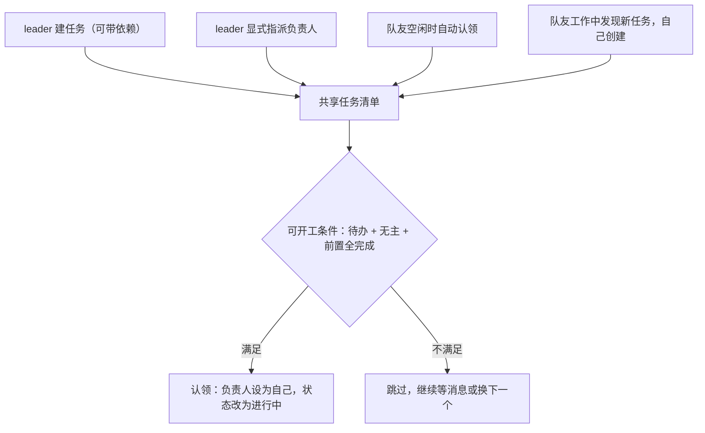
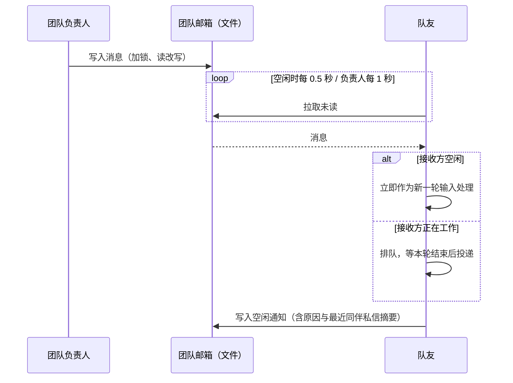
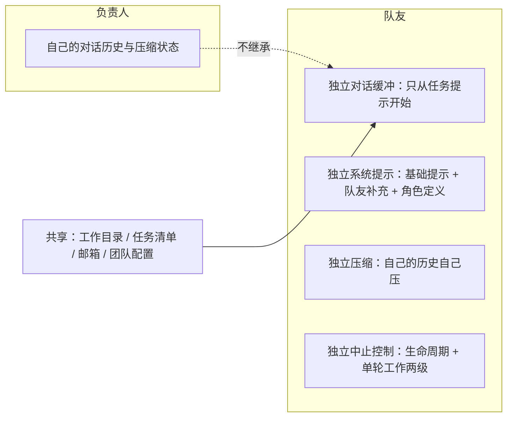

# Multi-agent - Claude Code - 02 - Persistent teammate collaboration

---

只需要探究 "常驻队友/团队" 是怎么做的就可以. 
这一轮重点关注这几点:
1. 如何确认什么时候开启常驻队友机制
2. 多 Agent 任务间分配靠什么决定
3. 多 Agent 间的通信机制
4. 多 Agent 间的上下文隔离
5. 多 Agent 同时工作时, 并发问题怎么处理

---

## 场景

你让 Claude 做一个横跨前后端的功能。它判断这活可以拆开并行，于是建了一个团队：自己当负责人，派两个队友分别做前端和后端。三个人从此要回答四个问题：谁做什么、怎么说话、各自看到多少上下文、同时动手会不会打架。

Claude Code 的答案非常"操作系统化"：**共享一个任务清单当调度总线，共享一批文件当通信通道，上下文各管各的，冲突靠文件锁加任务所有权来收敛**。下面按你列的五个问题展开。

## 一、什么时候开启常驻队友机制

这里有两层，必须分开看。

**第一层是能力开关（硬约束）**：团队相关工具只有在"多 agent 协作"开关打开时才存在。内部构建默认开启；外部构建必须显式启用（环境变量或启动参数），并且还受一个远端开关约束——远端关掉就整体不可用。所以在多数外部用户的默认配置下，这套机制连工具都不会出现。

**第二层是"要不要开团队"（软判断）**：开关打开之后，没有任何代码去检测"这个任务够不够复杂"。是否建团队完全由模型按提示词判断，提示词给的标准是：

- 用户明确要求用团队/分组/多个 agent；
- 用户表达了"希望 agent 之间协作、配合"；
- 任务复杂到能从并行中获益（例如前后端同时做、重构的同时保持测试通过、研究+规划+实现分阶段）；
- **拿不准时，倾向于建团队**。

也就是说：**机制可用性由 harness 决定，是否启用由模型决定**。没有自动阈值、没有任务规模估算、没有成本预算检查。

开启后还有几条结构性限制，它们同样是"什么时候开启"的一部分：

- 一个 leader 同一时间只能带一个团队；
- 团队与任务清单是一一对应的（建团队时会新建并重置一份任务清单，编号从 1 开始）；
- 团队名冲突时不会报错，而是自动换一个随机词名；
- **队友不能再派生队友**（团队是扁平的），进程内的队友也不能派生后台 agent。这是有意控制扇出规模。

## 二、任务怎么分配：共享清单 + 三条通道

分配不是靠一个中心调度器发号施令，而是靠一份**所有成员都能读写的任务清单**。谁做什么由三条通道共同决定：

**通道一：leader 显式指派。** 把某条任务的负责人改成某个队友的名字即可（任何成员都能改负责人，不限于 leader）。负责人发生变化时，系统会给新负责人投递一条分配通知，包含任务编号、标题和描述。

**通道二：队友自动认领。** 队友在两种时机主动找工作：刚被派生的那一刻，以及之后每次空闲等待时。它会在清单里找"待办 + 无主 + 前置全部完成"的任务，抢到后把状态改成进行中，并把任务内容格式化成一段提示交给自己执行。

**通道三：队友自己建任务。** 工作中发现新工作时，队友可以自己创建任务（同样进同一份清单），再决定自己做还是留给别人。

几个决定"分给谁"的细节：

- **优先级偏好是提示词约定的**："多个任务可选时优先编号更小的"，理由是较早的任务常常为后面的任务铺垫上下文。代码里并不按编号排序，只是提示词这么要求。
- **能否开工是读时判定的**：认领时才检查前置是否全部完成；待办或进行中的前置都算阻塞。
- **空闲等待有严格的优先顺序**：先看用户直接注入的消息，再看关闭请求（优先于普通消息，避免被消息洪流饿死），再看 leader 的消息（优先于同伴消息），然后才是同伴消息，最后才去任务清单找新活。这个顺序体现了"用户意图 > 收尾 > 领导指令 > 同伴闲聊 > 找活"的价值排序。

## 三、通信机制

通信是**文件邮箱 + 轮询拉取**，不是内存队列，也不是事件推送。这样做的直接好处是：进程内队友和独立进程队友可以用同一套语义，进程崩了消息也不丢。

**存储**：每个成员一个收件箱文件，消息带发送者、正文、时间戳、颜色和已读标记；写入时先加文件锁，再读改写，避免两个发送者同时写导致丢消息。

**发送方式**：

- 按名字发给某个成员（推荐）；
- 广播给全体（提示词明确说它随团队规模线性变贵，只在确实人人都需要时用）；
- 跨会话通信（本机另一个会话的套接字、或跨机器的远程桥接），属于可选特性。

**投递时机**：接收方空闲时，消息立即变成新一轮输入；接收方正在工作的时候，消息排队到本轮结束再投递——**通信不会打断正在进行的工作**。队友发来的消息在上下文里会被包裹成带发送者标识的标签，便于模型区分"这是谁说的"。

**空闲通知**：每个队友在一轮结束后会向负责人发一条空闲通知，说明是"可用/被中断/失败"，并可附上最近一次同伴私信的摘要。只在状态从"忙"变为"空闲"时发一次，避免刷屏。提示词还专门叮嘱负责人：队友空闲是常态，不要因为队友发完消息就空闲而误判它出问题了。

**协议消息**：除了普通文本，消息还可以是结构化的协议请求，例如关闭请求/响应、计划批准响应。计划批准**只接受来自团队负责人的响应**，其他人的批准会被忽略（防止队友伪造授权）。关闭请求会交给队友的模型决定，而不是由系统直接杀死。

**权限请求是另一条通道**：队友需要用户批准某个操作时，不是在群里喊，而是写入一对"待处理/已处理"的请求文件（带锁），或者（进程内队友）直接桥接到负责人界面的确认对话框。负责人处理后再写回结果，队友轮询取结果。

**两条硬规则**（都写在提示词里）：纯文本输出对其他 agent 不可见，必须用消息工具；不要用结构化 JSON 汇报状态，状态用任务更新表达。

## 四、上下文隔离

隔离做得很彻底：**队友不继承负责人的对话历史**。

具体边界：

| 隔离 | 共享 |
|---|---|
| 对话历史：队友从零开始，只拿到任务提示 | 工作目录（默认同一份仓库） |
| 系统提示：独立的提示组装（基础 + 队友沟通补充 + 自定义角色提示） | 任务清单目录 |
| 压缩：队友的历史超阈值时由它自己压缩，且压缩过程不污染负责人的文件读缓存 | 邮箱目录 |
| 中止：队友有自己的生命周期中止器，另有每轮独立的工作中止器（负责人按一次 Esc 只停当前这一轮，不会杀掉整个队友） | 团队配置文件 |
| 权限模式：队友以默认权限模式起步，不继承负责人可能的"跳过审批"模式 | 界面状态（运行体列表、颜色等） |
| 记忆：按 agent 类型隔离，不随团队共享 | |

进程内与独立进程两种形态的差别主要在"怎么隔离"：

- **进程内**：同一进程，用异步上下文（AsyncLocalStorage）给每个队友隔离身份、团队、中止器，避免并发覆盖全局状态；对话、压缩、中止各自独立。
- **独立进程**：真正的独立会话，通过启动参数继承模型、权限模式、设置文件、插件目录等，通过环境变量传递身份（名字、团队、颜色、是否必须先进入计划模式）。

另外还有一层可选的工作区隔离：派生 agent 时可以显式要求"在临时 git worktree 里工作"，这时队友拿到的是仓库的一份独立副本。默认不开启。

## 五、并发问题怎么处理

分四个层面看，前三个有机制保障，第四个基本没有。

**1) 元数据的并发写：加锁。**

| 数据结构 | 保护方式 |
|---|---|
| 任务清单：新建任务（要读全局最大编号再分配） | 整份清单加锁 |
| 单个任务更新 | 单条任务加锁 |
| 认领任务 | 单条任务加锁；需要"忙碌检查"时改为整份清单加锁，把检查和认领合成一次原子操作 |
| 邮箱写入/标记已读 | 单个收件箱加锁，读改写 |
| 权限请求写入/处理 | 请求文件加锁 |

锁是重试式的（短间隔重试约 30 次，总等待约 2.6 秒），预算按"十来个 agent 同时抢"的规模校准。这与任务清单研究里看到的是同一套锁设施。

**2) 工作分配层面的并发：靠所有权。** 同一时刻一条任务只有一个负责人；认领是原子操作，抢输的人拿不到。队伍结构是扁平的（队友不能再派队友），也限制了并发扇出。

**3) 交互层面的并发：靠排队。** 负责人忙碌时收到的队友消息不会打断当前回合，而是排队到回合结束；队友空转时按固定优先级取消息；关闭请求优先处理，避免被消息淹没。

**4) 文件系统层面的并发：没有专门机制。**

- 队友默认与负责人共用同一个工作目录，**没有文件级锁**，也没有"某文件正在被编辑"的互斥。两个队友同时改同一个文件，系统不会阻止，最终以谁后写为准。
- 真正能避免这件事的只有两样：任务划分（提示词要求把工作拆成不重叠的任务）和显式请求的 worktree 隔离。
- 团队配置文件（成员列表等）的更新是直接读改写、没有加锁，理论上存在两个成员同时更新的竞争窗口（成员变更不频繁，实际影响有限，但这是源码里真实存在的薄弱点）。

所以准确的说法是：**它保证"不会有两个 agent 抢到同一个任务"，但不保证"不会有两个 agent 改同一个文件"**。

## 六、设计取舍

**用共享清单当总线，而不是中心调度器。** 好处是解耦：leader 只管建任务和指派，队友自己找活，任何一方卡住都不至于让整个系统停摆。坏处是没有全局视角的负载均衡——容易出现"一个队友连做三条、另一个一直空转"，只能靠 leader 观察和手动指派来纠正。

**所有跨进程状态都用文件 + 锁。** 简单、可调试、崩溃后可恢复，进程内与进程外两种形态能复用同一套语义。代价是轮询延迟（负责人 1 秒、队友 0.5 秒）、以及大量小文件读写。

**上下文隔离选"从零开始"。** 队友不理解全局，需要 leader 把任务写清楚——提示词里甚至专门有一条"永远不要委派理解，只委派执行"。换来的是队友的上下文干净、不会被主对话的历史噪音带偏。

**软硬约束分得很清楚。** 硬约束是：能力开关、任务锁、扁平队伍、权限模式。软约束是：何时组队、优先做编号小的任务、不要抢同一个文件、空闲是正常的。这个分界对应的是失败成本：错一次代价很大的行为放进硬约束，错了可以纠正的行为交给提示词。

## 源码依据

| 机制部分 | 源码位置 |
|---|---|
| 协作能力开关（内部默认开；外部需显式启用 + 远端开关） | `src/utils/agentSwarmsEnabled.ts`（`isAgentSwarmsEnabled`） |
| 何时组队的提示词、团队与任务清单的对应关系、成员发现、指派与收尾流程 | `src/tools/TeamCreateTool/prompt.ts` |
| 建团队（单团队限制、重名处理、写团队文件、重置任务清单、登记 leader 团队名） | `src/tools/TeamCreateTool/TeamCreateTool.ts` |
| 团队文件结构、成员增删、权限模式批量更新 | `src/utils/swarm/teamHelpers.ts` |
| 队友身份解析（进程内异步上下文优先于进程环境） | `src/utils/teammate.ts`、`src/utils/teammateContext.ts` |
| 队友主循环：初始认领、执行一轮、转入空闲、发空闲通知、等待消息/关闭/任务 | `src/utils/swarm/inProcessRunner.ts`（`runInProcessTeammate`、`tryClaimNextTask`、`waitForNextPromptOrShutdown`、`sendIdleNotification`） |
| 空闲等待的优先级（用户注入 > 关闭请求 > leader 消息 > 同伴消息 > 任务清单） | `src/utils/swarm/inProcessRunner.ts`（`waitForNextPromptOrShutdown` 内部分支） |
| 队友系统提示补充与工具注入 | `src/utils/swarm/inProcessRunner.ts`（`TEAMMATE_SYSTEM_PROMPT_ADDENDUM` 拼接、团队工具注入）、`src/utils/swarm/teammatePromptAddendum.ts` |
| 派生路径与后端选择（进程内 / tmux / iTerm2）、继承的启动参数 | `src/tools/AgentTool/AgentTool.tsx`、`src/tools/shared/spawnMultiAgent.ts`、`src/utils/swarm/spawnUtils.ts`、`src/utils/swarm/backends/registry.ts` |
| 禁止队友再派队友、进程内队友禁止派后台 agent | `src/tools/AgentTool/AgentTool.tsx`（相关校验分支） |
| 邮箱存储与加锁读改写 | `src/utils/teammateMailbox.ts`（`writeToMailbox`、`readUnreadMessages`、`markMessageAsReadByIndex`） |
| 消息发送、广播、关闭与计划批准协议 | `src/tools/SendMessageTool/SendMessageTool.ts`、`prompt.ts` |
| 负责人侧收件与投递（空闲立即提交、忙碌排队） | `src/hooks/useInboxPoller.ts` |
| 权限请求通道（待处理/已处理文件 + 加锁；进程内桥接 UI） | `src/utils/swarm/permissionSync.ts`、`src/utils/swarm/leaderPermissionBridge.ts` |
| 上下文隔离（子代理上下文、文件读缓存克隆、中止器继承策略） | `src/utils/forkedAgent.ts`（`createSubagentContext`）、`src/tools/AgentTool/runAgent.ts` |
| worktree 隔离选项 | `src/tools/AgentTool/AgentTool.tsx`（`isolation` 参数与 worktree 创建分支） |
