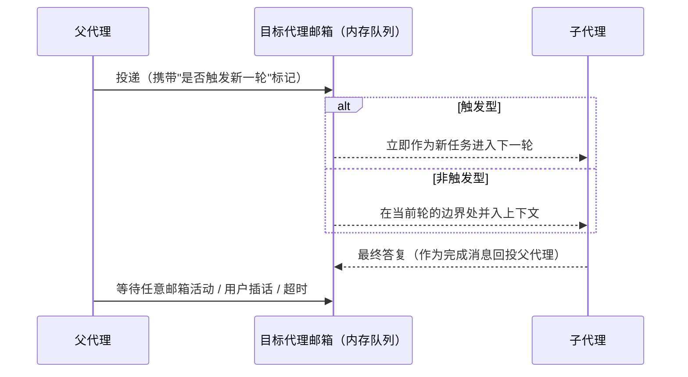

# Multi-agent - Codex - 02 - Persistent teammate collaboration

---

Codex 在常驻队友/团队这方面, 又是怎么做的呢?
* 如何确认什么时候开启常驻队友机制
* 多 Agent 任务间分配靠什么决定
* 多 Agent 间的通信机制
* 多 Agent 间的上下文隔离
* 多 Agent 同时工作时, 并发问题怎么处理

---

## 场景

你让 Codex 做一件很大的事。它决定拆开：先把一个子代理派出去做调研，自己继续写代码；调研完了再让同一个代理接着做下一件事；中途发现方向不对，把它打断；晚上关掉终端，第二天回来还希望这个"团队"能接着干活。

要回答这五个问题，先记住 Codex 与 Claude Code 的一个根本区别：**Claude Code 用一份共享任务清单当调度总线，Codex 没有任务池**。Codex 的模型是"一棵代理树 + 一套管理平面"：谁派生了谁、谁现在空闲、消息排队在哪、上下文复制多少，都有显式结构；但"下一步做什么"始终由父代理决定，孩子不会去公共池子里抢活。

## 一、什么时候开启

同样分两层，但判断依据和 Claude Code 不同。

**能力层（硬开关）**：多 Agent 是一个稳定特性，**默认开启**；新版实现是另一个特性，**默认关闭**。版本选择有一条明确优先级：显式打开新版 > 全局关闭 > 模型元数据指定的版本 > 旧版开关 > 关闭。也就是说，同一台机器上不同模型可能跑不同的多 Agent 实现。

**行为层（是否主动委派）**：新版多 Agent 才有"委派模式"，由三样东西决定，优先级从高到低：

1. 配置里写死的模式提示；
2. 模型元数据自带的模式提示；
3. 推理强度——**只有最高档（Ultra）才默认进入"主动委派"**，其余档位默认是"必须用户明确要求才派生"。

两种模式的文字会作为开发者层指令注入，且互相声明失效：进入主动模式时会说"之前那条要求用户显式请求的指令不再适用"，反之亦然。也有例外：内部会话和某些子代理来源不注入这套模式指令。

还有几条结构性限制：

- 子代理**可以继续派生子代理**，形成递归树（与 Claude Code 的扁平团队相反）；
- 每个代理有稳定路径（形如根/子/孙），用来寻址和按前缀列举；
- 没有找到专门的"最大深度"配置，层级只被总并发槽位间接约束。

## 二、任务怎么分配

**没有共享任务池，也没有认领机制。** 分配完全靠父代理显式下发，只有三种动作：

| 动作 | 语义 |
|---|---|
| 派生 | 新建一个代理，附带初始任务，开始执行 |
| 追加任务 | 给已有代理一条新任务；若它空闲就立即开始新一轮，若它正在跑则在消息边界或当前工具调用结束后送达 |
| 发消息 | 只投递信息，不触发新一轮；适合补充上下文、提醒、回答 |

除此之外：

- **角色不是任务，而是能力与身份**。派生时可以指定角色，角色可以覆盖开发者指令、模型、推理强度、人格、服务等级，也可以收紧工具与技能（只能减，不能加）。它决定"这个代理是谁、能做什么"，不决定"它现在做哪件事"。
- **父子关系是唯一的组织结构**。关系边持久化在本地状态库里（只有"打开/关闭"两种状态），用于恢复、列举和关闭整棵子树；它不表达任务依赖。
- **另有一块共享留言板**（按频道、帖子、订阅组织的讨论面），用于跨代理/跨会话的公开讨论，也不是任务队列。

所以"任务分给谁"的答案非常直接：**父代理自己决定，并把任务推给孩子**。好处是没有中心调度器的竞态，坏处是父代理天然成为瓶颈——它必须亲自决定每一步。

## 三、通信

通信是**内存邮箱 + 唤醒信号**，而不是文件轮询（这一点与 Claude Code 相反）。

关键语义：

- 每条消息带一个"是否触发新一轮"的标记。触发型渲染成"新任务"，非触发型渲染成"消息"。这两种在提示词里是不同的事件类型，模型能区分"这是让我干活"还是"这是给我的情报"。
- 消息在接收方那里以**分析通道的结构化消息**出现：带发送者、目标、类型和正文，而不是混在普通对话里。
- 子代理的最终答复会作为一条**完成消息**回投给父代理，完成消息**不触发**父代理的新一轮——它只是进入邮箱。父代理要么在下一次运行时看到它，要么主动"等待"。
- 等待工具会阻塞当前代理的这一轮，直到三件事之一发生：任意邮箱有活动、用户插话、超时。默认 30 秒，最短 10 秒，最长 1 小时。**它只返回"谁有动静"的摘要，不返回消息内容**——内容本身已经在邮箱里，避免重复搬运。
- 投递是尽力而为：完成结果投递失败只记指标，不重试。
- 邮箱在会话被卸载时不会丢：待投递的邮件会转到运行时暂存，代理被重新加载时再取出。
- 另有一条独立的"留言板"通道，提供建频道、发帖、订阅、分页读取等操作，属于讨论面而非点对点消息。

与 Claude Code 的对比：Claude Code 是"文件邮箱 + 双方轮询"（有延迟、但跨进程天然可恢复）；Codex 是"内存队列 + 唤醒"（低延迟、但依赖运行时把邮件转移好）。两者都把"用户插话"当作高优先级事件。

## 四、上下文隔离

每个代理都是**独立的会话线程**：有自己的对话历史、自己的压缩、自己的模型与推理强度、自己的工具与沙箱配置。共享的是容器、文件系统与工作目录。

最值得注意的是**上下文继承只有两档**：

- `all`（默认）：复制父代理的对话；
- `none`：只给初始任务，从零开始。

v1 对应的是一个布尔开关。

"复制对话"并不是逐字照搬，而是**有损复制**：

| 保留 | 丢弃 |
|---|---|
| 系统/开发者/用户消息 | 工具调用与工具结果 |
| 助手给出的阶段结论与最终答复 | 推理内容 |
| 少量额外的工具/配置更新项 | 压缩记录、世界状态、代理间通信 |

这样做的目的是让子代理拿到"人话层面"的上下文，但不把大量工具噪音和中间推理带过去。另有一个配置项可以让复制变成"完整前缀"，代价是体积。

其他隔离边界：

- **模型**默认继承父代理；只有明确要求才覆盖。若选择完整历史复制，则**不允许覆盖模型与推理强度**——要覆盖就得改成"不继承历史"。
- **角色**在两种继承模式下都生效：它覆盖的是这个子代理的指令与能力，而不是父代理的配置。
- **记忆**属于根会话的机制，子代理会话不参与记忆生成（此前研究已确认），因此子代理不会往长期记忆里写东西。
- **文件系统不隔离**：开发者提示词明确告诉所有代理"大家共用同一个目录，任何人的改动对其他人立即可见"。这与 Claude Code 默认共享工作目录的情况一致，但 Codex 把它写进了指令，让模型有意识。

## 五、并发怎么办

Codex 的并发控制分为"准入、占用、回收"三段。

**准入：硬性槽位。**

| 版本 | 上限 | 说明 |
|---|---|---|
| 旧版 | 默认 6 个线程 | 可配置 |
| 新版 | 默认 4（含自己）→ 实际 3 个子代理 | 可配置 |

新版还有一层"执行容量"：只有子代理会话计入，父代理不计。容量满时**派生直接失败**并返回"达到上限"，而不是排队等待。提示词里会把"当前有几个可用并发槽位"直接告诉模型。

一个容易踩的点：**已完成的代理仍然占着槽位，直到被显式关闭**。所以工具描述会提醒"不需要了就关掉"。

**占用：派生过程本身也有保护。**

- 派生时先建线程、把父子关系写入状态库，再投递初始输入；如果中途被取消，子线程会被关闭、持久化数据被丢弃，不留孤儿。
- 父子关系先落库再交输入，保证"能看到这个孩子"和"它真的开始干活"之间不会出现不可恢复的中间态。

**回收：驻留与驱逐。** 新版子代理默认是"驻留"的：空闲可以被驱逐以释放内存，驱逐时把待投递邮件和运行环境保存下来，需要时再恢复。这使"晚上关掉、第二天继续"成为可能，也让并发上限不必等于内存占用。

**文件层面的并发：没有保护。** 所有代理共享同一个工作目录，没有文件锁、没有"这个文件我在改"的声明。两个人同时改同一个文件，系统不会阻止，后写者覆盖先写者。能缓解的只有：父子层级下的任务划分、角色限权、以及"打断/关闭"这种人工干预。

## 六、设计取舍

**Codex 选择"管理平面"而不是"共享任务池"。** 它把复杂度花在身份、关系、邮箱、驻留、恢复上，换来的是精确的生命周期控制：可以打断、可以等、可以恢复、可以关整棵子树。代价是没有自组织的负载均衡——所有决策都压在父代理身上。

**Claude Code 选择"文件总线"。** 队友自己认领任务，天然并行、可跨进程；代价是粒度粗（没有打断、没有按消息类型区分触发），且文件锁与轮询带来延迟。

**两者共同的缺口是文件系统并发**：都只说"大家共享目录"，都没有文件级互斥。真正做并行写代码时，这是最先出问题的地方。

## 源码依据

| 机制部分 | 源码位置 |
|---|---|
| 版本选择与开关（显式新版 > 全局关闭 > 模型元数据 > 旧版开关 > 关闭） | `core/src/config/mod.rs:1635-1661`；`features/src/lib.rs`（`Feature::Collab` 默认开、`Feature::MultiAgentV2` 默认关） |
| 并发上限（旧版 6 / 新版 4 含自身） | `core/src/config/mod.rs:255-259,1367-1420` |
| 主动/显式委派模式的选择与注入 | `core/src/session/multi_agents.rs:77-110`；`core/src/context/multi_agent_mode_instructions.rs`；`prompts/src/model_messages/multi_agent.rs` |
| 角色基础提示与消息协议（分析通道、任务名、发送者） | `prompts/src/model_messages/multi_agent.rs:1-84` |
| 工具契约（派生/发消息/追加/等待/列举/关闭/打断/恢复） | `core/src/tools/handlers/multi_agents_spec.rs` |
| 派生参数（`fork_turns` all/none、模型与推理强度覆盖限制） | `core/src/tools/handlers/multi_agents_spec.rs:610-684` |
| 派生流程（建线程、写关系边、投递初始输入、取消清理） | `core/src/agent/control/spawn.rs:676-980`；`core/src/agent/control/spawn_guard.rs` |
| 有损历史复制（保留对话、丢弃工具/推理/压缩） | `core/src/agent/control/spawn.rs`（`keep_forked_rollout_item`、`prepare_forked_history`） |
| 父子关系图（SQLite，Open/Closed） | `agent-graph-store/src/{types.rs,local.rs}` |
| 内存邮箱与唤醒信号 | `core/src/agent/control/mailbox.rs`；`core/src/agent/control/delivery.rs` |
| 消息投递语义（QueueOnly vs TriggerTurn） | `core/src/tools/handlers/multi_agents_v2/{send_message.rs,followup_task.rs}` |
| 等待工具（邮箱活动/用户插话/超时，默认 30s、10s–1h） | `core/src/tools/handlers/multi_agents_v2/wait.rs`；`core/src/tools/handlers/multi_agents_common.rs` |
| 完成消息回投（不触发新一轮） | `core/src/agent/control/completion.rs`；`core/src/session_prefix.rs`（`format_inter_agent_completion_message`） |
| 打断与关闭 | `core/src/tools/handlers/multi_agents_v2/interrupt_agent.rs`；`core/src/agent/control/legacy.rs`（`close_agent`） |
| 驻留与驱逐（空闲回收、邮件转移、环境保存） | `core/src/agent/control/residency.rs` |
| 执行容量（仅子代理受限、满则报错） | `core/src/agent/control/execution.rs`；`core/src/agent/registry.rs` |
| 角色加载与应用（可覆盖指令/模型/强度，只能收紧工具与技能） | `core/src/agent/role.rs`；`agent-roles/src/{loader.rs,discovery.rs,agent_role_config.rs}` |
| 共享留言板（频道/帖子/订阅；本地 SQLite 或远端 HTTP） | `ext/agent-message-board/src/*`；`agent-message-board-client/src/*` |
| 共享工作目录的显式告知 | `prompts/src/multi_agent_instructions.rs:19-27`（"All agents share the same directory…"） |
