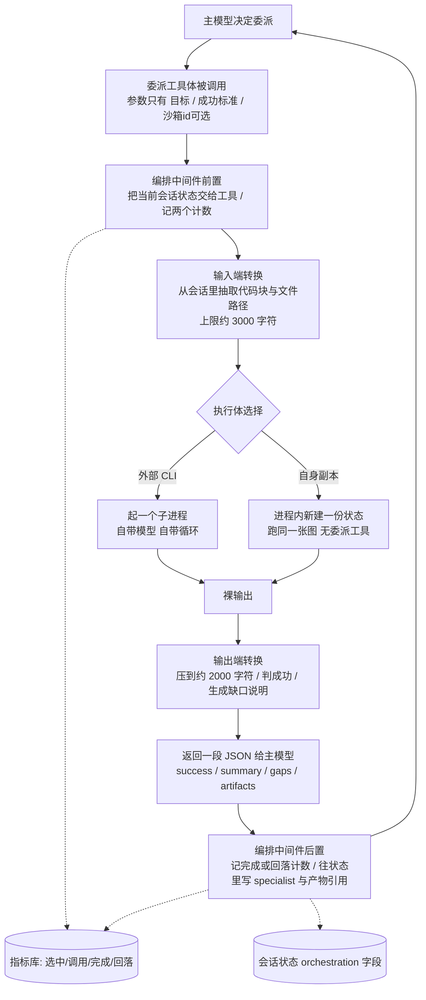

# multi-agent - Poirot - 01 - 委派式多 Agent 的装配、执行与结果回流

---

探索一下 poirot 的 multi-agent 是怎么做的?

> 范围确认：只研究委派主链路（谁决定委派 → 工具被调用后按什么顺序做什么 → 上下文怎么压缩 → 子 Agent 怎么跑 → 结果怎么回到主循环 → 失败怎么处理），不含沙箱机制本身，也不以「开关默认值 / 纸面能力 vs 实际会跑的能力」为主线。重点回答「Poirot 到底把哪些功能做出来了」。

---

## 一句话结论

Poirot 的多 Agent 不是「多个 Agent 互相协作」，而是**一个 Leader 图 + 把外部 CLI 当成一次性工具来调用**：

- 委派对象是**工具**（`delegate_to_<名字>`），不是节点、不是队友、不是任务池；
- 谁来干由**主模型自己决定**，提示词里只有一段静态路由建议，没有独立的选人组件；
- 一次委派 = **一次阻塞的工具调用**：抽取窗口很小的上下文 → 起一个子进程（或在进程内起一份全新副本来跑同一张图）→ 把输出压成一段 JSON → 作为工具结果回到主循环；
- 子 Agent 之间**互相不可见**，没有消息、没有共享任务、没有并发协调；自拷贝子副本被刻意做成「叶子」，不能再往下派。

所以它实现的是一套**「委派契约 + 结果契约 + 打点」**，而不是协作协议。

## 一、谁能被委派：装配期就决定了

委派能力在**启动装配时**就定型了，不是运行时按需发现。启动流程遍历配置里的 specialist 名单，对每个名字做三连检查：

1. **可执行体在不在**：pi 额外有一条「没装就后台自动安装」的路径（首次启动时安装未完成，本进程里直接判为不可用）；
2. **凭证在不在**：codex 读它自己的登录文件、claude 读自己的 OAuth 凭证（含过期判断）、pi 接受任意一个 provider 的 API key 或凭证文件；
3. **能不能构造出执行体**。

三项里任一不满足，该 specialist **直接不注册**——随之而来的是：没有对应工具、提示词里也不出现、模型根本不知道它存在。日志里会打印一段安装/配置指引，但主流程不中断。

一个值得注意的后果：**「委派对象」是由环境（装了哪些 CLI、有哪些 key）决定的**，而不是由模型或配置单方面决定。同一份提示词在不同机器上会看到不同的候选名单。

装配完成后，每个注册进来的 specialist 会被生成一个同名工具，工具名就是它的身份；再叠一个可选的「自拷贝」入口。工具全部无条件挂进主图（不参与内置工具的 core/deferred 分组过滤）。

## 二、谁决定委派：软路由（一段提示词 + 一个工具）

没有任何「路由器」组件去判断任务该给谁。做法是：

- 只要注册表非空，系统提示词里就**条件注入**一段路由段（注册表为空则完全不注入，避免扰动提示词前缀）；
- 路由段的内容是：列出每个 specialist 对应的工具名 + 一段「什么该委派、什么不该委派」的原则——写/改/测代码交给 coding specialist、研究和多源搜集自己做、同类并行子任务交给自拷贝、简单问答直接答、委派失败过一次就换上下文重试或自己做；
- 之后完全由模型发起工具调用。

这里有两处粗糙的地方，会直接影响实际行为（已证实）：

- 路由段给每个 specialist 生成的描述是同一个模板句「delegate coding task to ⟨名字⟩」，**不看 specialist 声明的能力**。于是能力被声明为「代码评审」的 claude 也被描述成写代码的，模型只能靠名字猜；
- 路由段里「自拷贝入口」是**无条件追加**的一行，即使自拷贝并没有注册；反过来，如果自拷贝是以 specialist 身份注册的，它会同时出现在「specialist 列表」和那行「并行子任务」里，语义重复。

另外，代码里定义了「按能力列举 specialist」的接口，但生产路径只有提示词在用（不带能力过滤）；没有给模型一个「列出可用 specialist」的工具。

## 三、一次委派的完整时序

细节按阶段拆开：

**① 前置：状态交接与计数。** 中间件先把当前会话状态放进一个上下文变量，供工具体读取（工具体自己拿不到图的状态）。同时给「选中」和「调用」两个计数器各加一——因为 Poirot 没有独立的「挑选」步骤，这两个计数在实现上恒等，选择率与调用率不可区分。

**② 输入端：把会话压成一小段上下文。** 每个 specialist 配一个输入端转换器，从会话状态里抽「它可能用得上的一点点东西」：

- 规则型（codex / claude / pi）：固定取出目标与成功标准，再抓最多 2～3 个代码块，以及最多 10 个文件路径（来源是观察记录、消息正文或已有产物路径）；
- 语义型（自拷贝）：接口上留了「用模型提炼上下文」的开关，但装配时**没有注入模型**，实际走的永远是规则回退路径——把原始需求 + 最近 5 条发现拼起来。

两端都有上限（约 3000 字符），超出直接截断。设计意图很清楚：**不让子 Agent 把主会话搬走**。代价是子 Agent 往往只拿到碎片，这也是后面「失败率高」的根因之一。

**③ 执行体：三种完全不同的跑法。** 见下一节。

**④ 输出端：把裸输出压回主上下文。** 通用地板校验是「输出非空 + 文本里不含危险命令样式 + 产物列表非空」，各 specialist 再叠自己的启发式：pi 解析「做了什么 / 是否达标 / 缺口」三段并看达标段有无否定词；codex 抓「N passed」测试字样；claude 要求出现建议类动词。压缩上限约 2000 字符，超出截断。判失败时生成一段「成功标准未满足 + 输出尾部 200 字」的缺口说明。

**⑤ 回流：只回一段 JSON。** 返回给主模型的是结构化结果：`success` / `summary` / `specialist` / `gap_analysis` / `artifacts`（路径 + 类型）。裸输出不会进主上下文，这也意味着**子 Agent 的过程对主模型不可见**，只看到一个结论。

**⑥ 后置：打点 + 产物登记。** 中间件按 JSON 里的 `success` 记「完成」或「回落」，并把 specialist 名字与产物引用写进会话状态里的编排字段（按路径、按名字去重追加）。

**⑦ 失败处理：一切异常转「错误工具结果」。** 工具体内部捕获超时/崩溃/启动失败，返回带 `error.type` / `error.message` / `suggestion` 的 JSON；中间件再兜一层未被捕获的异常，也转成带 error 状态的工具消息。目的写在注释里：保住「工具调用必有结果」的配对完整性，避免严格后端 400，同时让模型自己决定重试、换人还是自己做。

这个「一切失败都变成一段可读文本」的选择很重要——它让委派失败不会毁掉会话，但也让失败与「成功却被判错」在指标里混在一起（见第五节）。

## 四、三种执行体：借别人的循环 vs 自己的循环

| | pi | codex | claude | 自身副本 |
|---|---|---|---|---|
| 形态 | RPC 模式子进程，逐条读事件流 | ACP 协议子进程（依赖 python 侧 ACP 包 + npx 启动器） | 一次性命令行调用，取标准输出 | 进程内，复用主 Agent 的图构造 |
| 送进去什么 | 目标 + 上下文摘要 + 成功标准 + 「三段式输出格式」要求 | **只有目标**（工作目录用产物目录） | **只有目标** | 全新状态：目标 + 上下文摘要 + 父沙箱 id |
| 工具面 | 禁用它自带的读写/执行工具，改为通过沙箱桥接接回 Poirot 的工具 | 新会话时把沙箱 MCP 服务注册进去 | 代码里写了「注册 MCP 服务」的函数，但**没有任何调用点** | 继承主 Agent 的整套中间件，但去掉委派工具与编排中间件 |
| 超时 | 配置里有，**实际没有生效**（没有计时器，读取输出会一直等） | 生效（等待请求完成） | 生效（子进程超时） | 只有递归预算（步数×2），没有墙上时间超时 |
| 步数上限 | 不适用（循环由对方管） | 不适用 | 不适用 | 作为递归预算使用，超限转「超过步数」错误 |
| 结果 | 从事件流拼文本 + 取 token 用量 | 拼文本增量 | 标准输出原文 | 取最后一条消息内容 |

三条外部路径的**协议完全不均质**：pi 走事件流、codex 走 ACP 会话、claude 直接吃标准输出。因此「上下文摘要」「成功标准」「沙箱工具」这三样东西，在三条路径上的到达率各不相同——只有 pi 是三项齐全的，codex 有工具没上下文，claude 两样都缺。这不是设计上的分级，而是实现进度不一致留下的孔洞（已证实）。

自拷贝那一条的定位是「叶子」：状态全新（不继承消息与观察），只带目标与摘要，沙箱沿用父级标识；构造时**不注入委派工具、不挂编排中间件**，所以结构上不可能再往下派。递归深度被硬性限制为 1 层。

## 五、结果判定：一个永远为假的「地板」

这里有一处必须写清楚的事实（已证实，且影响所有外部委派的行为）：

通用地板校验要求**产物列表非空**才算成功。而三个外部执行体**从不产出产物**——它们只返回一段文本，代码里没有任何从输出里解析产物路径的逻辑；产物列表恒为空元组。于是：

- 无论子 Agent 干得多好，`success` 都是 `false`；
- 主模型每次看到的结果都是「失败 + 缺口说明 + 建议换上下文重试或自己做」；
- 编排计数里「完成」永远为 0，「回落」等于调用次数——健康度指标因此恒为「退化」。

单元测试没有暴露这一点，因为测试里给 mock 的 specialist 显式塞了产物引用。

也就是说，**「程序化评估地板」这项功能只完成了判定框架，没有完成「怎么把产物从黑盒子 Agent 里取出来」这一半**。连带后果是：路由段里「委派失败过一次就重试或自己做」的原则，会在每次委派后都被触发。

## 六、结果去了哪里：产物登记无消费者

specialist 上报的产物引用会被写进会话状态里的编排字段，并有去重合并规则（按路径、按名字）。但**生产代码里没有任何下游读取它**：最终报告合成不读、流式事件不读、CLI/TUI 也不读；只有单元测试在读。

实际效果：委派的产物只是主模型在 JSON 文本里看到的几个路径字符串；报告与交互界面里不会出现「本次由谁产出了什么」这一层信息。相比之下 `specialist` 名字与压缩摘要还能通过工具结果留在对话里，产物引用则是「写进去就沉底」。

## 七、并发、阻塞与边界

- **委派是同步工具**：执行体全是同步调用，工具本身没有异步版本。一次委派期间主循环不推进，界面看到的是一张「工具卡」从开始挂到结束（默认上限 600 秒，自拷贝 300 秒）。长任务对用户体验的冲击完全取决于这张卡挂了多久。
- **没有并发控制**：配置里有一个「最大并发」字段，但**没有任何代码读取它**，也没有信号量或队列。同一条助手消息里并发发起多个委派时，是否真的并行取决于图运行时对同步工具的调度方式（合理推断：会在线程池里并行执行）；一旦并行，多个委派共用同一份会话状态与同一个沙箱标识。
- **子进程是一次性的**：每次委派启动、结束即关，没有连接池/复用；pi 与 codex 首次调用还要承担 npx/启动器的冷启动成本。
- **自拷贝没有运行记录**：它调图时只带递归预算，没有带线程标识与运行标识，因此不会在主运行的日志目录里留下可对齐的事件；它拿到的是全新状态，但用的是同一个检查点存储。
- **委派失败不会中断图**：任何异常都会被翻译成工具结果（超时 / 崩溃 + 退出码 / 启动失败 / 预算超限），模型继续决策。

## 八、自拷贝子 Agent：结构写完了，执行链接错了

这是本轮最值得记录的一处（两条独立路径都已证实跑不通）：

1. **以 specialist 身份注册的路径**：执行体调用「主 Agent 工厂」返回对象的 `invoke`，但那个对象只提供 `run`（它是对编译后图的薄壳，没有转发 `invoke`）。于是每次委派在真正开跑前就抛属性错误，被包成「崩溃」错误返回。
2. **独立工具路径**（仅当注册名单里排除了自拷贝时才会启用）：工具体调用执行体的 `spawn`，而执行体只实现了 `invoke`——协议里声明了 `spawn`，实现里没有。同样抛属性错误，由中间件兜成错误工具消息。

两条路径都只被 mock 测过（测试里注入的是假 Agent），所以「叶子角色、隔离状态、共享沙箱、递归预算」这些设计属性在代码里成立，但**真实链路上没有任何一次自拷贝跑完过**。

## 九、设计取舍

- **把子 Agent 做成「工具 + 静态路由段」**：好处是不用改图、不用编排节点、加一个 specialist 只需注册；坏处是委派质量完全取决于模型对一段固定文本的理解，而且这段文本与 specialist 的真实能力脱钩。
- **两端都有字符上限的上下文转换**：保护主上下文不被撑爆、控制成本；代价是子 Agent 常常缺少必要上下文，失败被计成「能力不行」。
- **把外部 CLI 当黑盒，只约束接口**：不必自己实现多套循环与模型配置，还能复用用户已有的登录态；代价是协议不均质——「上下文是否送达、超时是否生效、工具是否真的接上」在三条路径上各不相同，无法用同一套断言保证。
- **失败一律转工具结果**：保住会话连续性、避免配对断裂；代价是失败与误判混进同一组计数，健康度信号失去区分度。
- **自拷贝刻意做成叶子并共享沙箱**：避免递归爆炸和产物分裂；代价是子副本实质上不是「轻量子 Agent」，而是「带全套中间件的另一份主 Agent」，成本与噪声都不低。

## 十、证据分级

**已证实（源码可直接确认）**

- 委派＝工具 + 系统提示词条件注入的路由段；无独立路由/选人组件；工具参数只有目标、成功标准、可选沙箱标识。
- 装配期做「可执行体 + 凭证 + 构造」三连检查，缺一项就不注册；pi 有后台自动安装路径。
- 上下文抽取与结果压缩各有字符上限；自拷贝的「模型提炼」路径未注入模型，恒走规则回退。
- 三种外部执行体协议不同；codex 与 claude 只把目标送进去，上下文摘要与成功标准被丢弃；claude 的沙箱 MCP 注册函数无调用点。
- pi 的超时未实现（无计时器）；超时参数只出现在异常构造里。
- 通用地板校验要求产物非空，而外部执行体从不产出产物 → 外部委派恒判失败、计数恒记回落。
- 编排字段（specialist 与产物引用）写入后无任何生产消费方。
- 「最大并发」配置无人读取；无并发控制设施。
- 自拷贝的两条路径分别调用不存在的 `invoke` / 不存在的 `spawn`，结构上必然失败。
- 叶子角色限制通过「不注入委派工具 + 不挂编排中间件」实现，递归深度因此为 1。

**合理推断（结构支持，未运行验证）**

- 同一条助手消息里的多个委派可能被并行执行（同步工具在线程池中调度），从而并发争用同一会话状态与同一沙箱标识。
- 子 Agent 与主 Agent 共用检查点存储但子 Agent 不带线程标识，跨次委派之间可能存在状态累积或与主线程检查点空间重叠的风险；由于无法运行环境，无法确认具体表现。

**无法确认（材料不足）**

- 各 provider 与 CLI 版本下，pi/codex/claude 三条真实链路能否完整跑通（未安装 CLI、未联网调用）。
- 用户实际开启/关闭了哪些 specialist，以及在没有产物的前提下主模型被误导后实际会怎么补救（需要真实模型行为）。
- 模型提炼上下文那条路径若注入模型后质量差异多大（未启用）。

## 源码依据

| 关注点 | 位置 | 关键入口 |
|---|---|---|
| 装配与禁用策略 | `poirot/backend/agents/multiagent/bootstrap.py` | `setup_multiagent`、`_load_specialist`、`_warn_specialist_disabled` |
| 委派工具与结果 JSON | `poirot/backend/agents/multiagent/tools.py` | `make_specialist_tool`、`make_subagent_tool`、`set_current_state` |
| 编排中间件打点与错误兜底 | `poirot/backend/agents/multiagent/middleware.py` | `OrchestrationMiddleware.wrap_tool_call` / `awrap_tool_call` |
| 数据契约 | `poirot/backend/agents/multiagent/types.py` | `SpecialistRequest`、`SpecialistRawResult`、`SpecialistResult`、`ArtifactRef` |
| 提示词路由段 | `poirot/backend/agents/leader/prompts.py` | `_build_specialist_routing_section` |
| 工具挂载 | `poirot/backend/agents/leader/factory.py` | `make_lead_agent` 中 specialist 工具追加、`_build_middlewares` 挂载位置 |
| pi 执行体（RPC） | `poirot/backend/agents/multiagent/runtimes/pi_runtime.py` | `invoke`、`_run_rpc_session`、`_build_command`、`_build_prompt`、`_build_env` |
| codex 执行体（ACP） | `poirot/backend/agents/multiagent/runtimes/codex_runtime.py` | `invoke`、`_run_acp_session`、`_build_mcp_config` |
| claude 执行体（CLI） | `poirot/backend/agents/multiagent/runtimes/claude_code_runtime.py` | `invoke`、`_build_command`、`configure_mcp`（无调用点） |
| 自拷贝执行体 | `poirot/backend/agents/multiagent/runtimes/subagent_runtime.py` | `invoke`（调用不存在的 `agent.invoke`）、`_create_isolated_state` |
| 自拷贝契约与缺失实现 | `poirot/backend/agents/multiagent/subagent.py` | `SubagentProvider.spawn`（协议声明）；`SubagentRuntime` 未实现 |
| 叶子角色构造 | `poirot/backend/app/bootstrap.py` | `bootstrap_runtime` 内 `_subagent_factory`（不注入委派工具与编排中间件） |
| 输入端转换 | `poirot/backend/agents/multiagent/summarizers/context/*.py` | `PiContextSummarizer`、`CodexContextSummarizer`、`ClaudeCodeContextSummarizer`、`SelfCopyContextSummarizer` |
| 输出端转换与成功判定 | `poirot/backend/agents/multiagent/summarizers/result/*.py` | `BaseResultSummarizer._evaluate_success`（产物非空门槛）、各 specialist 子类 |
| 指标库 | `poirot/backend/agents/multiagent/metrics.py` | `record_selection` / `record_invoked` / `record_completion` / `record_fallback`、`health_check` |
| 编排状态合并 | `poirot/backend/agents/state/reducers.py`、`poirot/backend/agents/state/types.py` | `merge_orchestration`、`OrchestrationState`（无下游消费者） |
| pi 后台安装 | `poirot/backend/agents/multiagent/installer/pi_installer.py` | `ensure_installed`、`status` |
| 凭证检测 | `poirot/backend/agents/multiagent/credentials/*.py` | `PiCredentialProvider`、`CodexCredentialProvider`、`ClaudeCredentialProvider` |
| 沙箱桥接扩展（pi 侧工具定义） | `poirot/backend/agents/multiagent/extensions/pi-sandbox-bridge/index.ts` | 8 个 `poirot_*` 工具定义与转发 |
