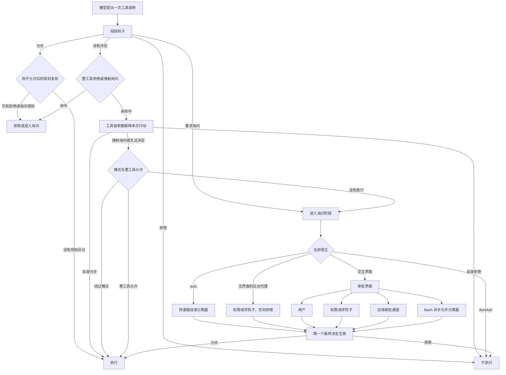

# Permission system - Claude Code - 01 - 权限档位与审批判定

---

> 探究一下 Claude Code 的权限审批系统是怎么做的. 怎么确定哪些行动需要审批, 哪些行动自动放行? 都有哪些权限档位可用?

---

## 结论先说

Claude Code 的权限系统不是先给每个自然语言动作贴一个“安全/危险”标签，再统一决定是否询问。它判断的单位是**一次具体的工具调用及其参数**：

1. 工具先解释自己的输入。比如 Bash 会拆命令、检查路径和重定向；文件工具会解析真实路径；网页工具会检查域名。
2. 显式拒绝、显式询问、安全检查和必需交互优先于模式放行。
3. 模式随后决定剩余操作能否自动通过。
4. 如果仍没有结论，默认结果就是询问。
5. 到了询问阶段，`dontAsk` 会把询问改成拒绝，`auto` 会交给分类器，后台代理则走钩子或自动拒绝，交互界面则等待用户、钩子、远端审批或异步分类器中的第一个最终决定。

可用档位在外部模式集合里是 `default`、`acceptEdits`、`plan`、`bypassPermissions`、`dontAsk` 五个；源码另外有一个受构建开关和远端门控控制的内部 `auto`。`dontAsk` 可以配置，但不在 Shift+Tab 的主循环里。`bypassPermissions` 也不是字面意义上的“所有检查都消失”：显式拒绝、显式询问、敏感路径检查和必须交互的工具仍然有效。

## 场景

假设模型在同一轮里想完成四件事：读取项目中的文件、修改一个源文件、运行测试、再访问一个网页。

这四件事不会共享一个笼统的“是否危险”判断：

- 项目内读取通常直接通过；
- 修改默认要确认，但切到 `acceptEdits` 后通常直接通过；
- 读命令会自动放行，普通的测试命令默认要确认；如果沙箱开启且允许沙箱内自动放行，测试命令可以自动通过；
- 访问代码文档站点可以自动通过，访问任意新域名则默认询问。

可见，“什么算需要审批”首先取决于**哪个工具、输入是什么、当前模式是什么、有哪些规则**，而不是只取决于“读”还是“写”。

## 一、判定单位是一次工具调用

权限系统接收的是工具名和已经解析过的参数，输出四种内部结果：允许、拒绝、询问，以及“本工具没有结论，交给后续层处理”的透传。透传最终也会被归一为询问。

一个容易被忽略的默认值：**工具如果没有实现自己的权限检查，构建工具时的默认结果就是允许**。通用权限层仍然会检查显式规则，但不会替这个工具理解命令、路径或远端资源。这意味着细粒度的动作分类主要落在各工具实现里，而不是一个中央的“危险动作表”里。

因此不同工具会呈现很不一样的默认行为：

| 行动（没有额外规则时） | 默认模式下的典型结果 | 原因与模式变化 |
|---|---|---|
| 在工作目录或其附加目录中读取文件、Glob、Grep | 自动放行 | 读取路径检查通过 |
| 读取工作目录外的文件 | 询问 | 路径超出允许范围；可选择会话级读取授权 |
| 在工作目录内编辑、写入文件 | 询问 | 默认写入需要确认；`acceptEdits` 下通常自动放行 |
| 编辑 `.git/`、`.vscode/`、`.idea/`、`.claude/`、shell 启动文件等 | 询问 | 独立安全检查；`acceptEdits` 仍会询问 |
| Bash 只读命令 | 自动放行 | Bash 的只读校验通过 |
| Bash 的文件系统修改命令 | 询问 | `acceptEdits` 会自动放行其中的 `mkdir`、`touch`、`rm`、`rmdir`、`mv`、`cp`、`sed`，但仍先做路径和命令约束检查 |
| 其他 Bash 命令 | 询问 | 包括普通的构建、测试、安装、联网命令；沙箱自动放行是另一条路径 |
| 访问预批准开发资源域名 | 自动放行 | 只对网页抓取器生效；不是通用网络白名单 |
| 访问其他网页域名 | 询问 | 可按域名保存允许规则 |
| 网页搜索 | 询问 | 本快照的搜索工具明确要求先授权 |
| 调用 MCP 工具 | 询问 | 可授权单个工具、整个服务器或通配服务器 |
| 启动子代理 | 默认模式自动放行 | 子代理内部每次工具调用仍会重新检查 |
| 向用户提问、退出计划模式 | 必须交互 | 即使处于绕过权限模式也不能静默完成 |
| 更新任务清单、读取配置项等元数据操作 | 视工具而定，常为自动放行 | 例如配置读取自动放行、配置写入询问 |

这张表的重点是“没有规则时”的典型行为，不是固定清单。一条规则、一次模式切换或一个钩子都可能改变结果。

### 文件权限的读与写不是对称的

文件读取和编辑共用路径权限体系，但写入更严格：

- 读规则和写规则分开检查；
- 写权限隐含读权限，但显式读取拒绝或读取询问优先；
- 路径会同时检查原始路径和解析后的符号链接路径；
- 工作目录、附加工作目录、计划文件、临时草稿等内部路径有不同处理。

文件类细粒度规则按“读”和“编辑”两种语义归一。也就是说，路径规则不是要求用户分别给每一种文件编辑工具写一套，而是由文件工具共享同一套读写语义。

## 二、真正的主判定顺序

下面的顺序比“模式决定一切”更接近实现。前面的阶段可以压过后面的阶段。

### 1. 先跑 PreToolUse 钩子

钩子可以拒绝、要求询问、允许，或者只修改输入而不做决定。

钩子允许有一个重要限制：它仍要再经过显式拒绝、显式询问和安全检查。因此，配置里的强制询问规则不会被一个宽松的 PreToolUse 钩子静默抹掉。反过来，显式拒绝也不会走到后续的用户审批。

### 2. 检查整工具级规则

先看有没有“整个工具一律拒绝”的规则，再看有没有“整个工具一律询问”的规则。整工具拒绝还会在装配工具池时直接把工具从模型可见列表中过滤掉；内容级拒绝则只能在具体调用时判断。

### 3. 交给工具解释本次输入

这是系统最灵活、也最关键的一层：

- Bash 拆分子命令，检查命令前缀、通配规则、只读性、路径、输出重定向和复杂语法；
- 文件工具检查工作目录、危险路径、内部可写路径、读写规则和模式；
- 网页抓取工具检查预批准域名和域名规则；
- MCP 工具使用服务器名、工具名或通配规则；
- 配置工具区分“读配置”和“改配置”；
- 子代理工具只判断“是否允许启动”，子代理内部的工具再分别判断。

如果工具直接拒绝，流程结束。如果工具返回询问，且原因是显式询问规则、敏感路径安全检查或工具必须交互，后面的绕过模式也不能把它静默改成允许。

### 4. 模式放行

在显式拒绝和强制询问都没有拦住之后：

- `bypassPermissions` 直接允许；
- 从绕过权限启动后进入 `plan`，也会保留这条绕过能力；
- 否则检查是否存在整工具允许规则；
- 仍然没有结论，就回到“询问”。

因此可以把优先级概括为：

> 显式拒绝 > 强制询问/安全检查/必需交互 > 绕过模式 > 整工具允许与工具自身的自动允许 > 默认询问

`ask` 不是“永久拒绝”。它只是进入询问阶段的信号；之后是否真的弹窗，取决于当前是 `dontAsk`、`auto`、后台代理还是交互界面。



### 5. 询问阶段是并发竞争

交互模式下，界面并不会串行等待所有审批来源：

- 本地用户可以在对话框中允许、拒绝、带反馈拒绝，或修改输入；
- PermissionRequest 钩子可以给出最终允许或拒绝；
- 远端会话可以把同一个请求送到另一端审批；
- Bash 的允许分类器可以在用户动手之前异步判断；
- 中止信号可以取消整组等待。

这些来源用“先完成者获胜”的方式解决竞争，避免已经执行的操作又被另一个迟到的审批结果改写。审批结果也不只是布尔值，它可以带回修改后的参数，后续执行会使用更新后的输入。

这里的 Bash 异步分类器与 `auto` 档的分类器不是同一个机制：前者是在已有询问上按描述性的 Bash 允许规则判断，受独立构建开关控制；后者是整个 `auto` 模式的决策器。

## 三、权限档位

### 外部用户可配置的五档

| 档位 | 机制含义 | 会自动通过什么 | 仍会拦住什么 |
|---|---|---|---|
| `default` | 标准模式 | 工作目录内读取、只读 Bash、工具自身允许的元数据操作、已有的允许规则 | 默认的写入、一般 Bash、MCP、未预批准网页等；敏感路径仍询问 |
| `acceptEdits` | 在标准模式上自动接受文件编辑 | 允许工作路径内的文件写入；允许路径内的 `mkdir`、`touch`、`rm`、`rmdir`、`mv`、`cp`、`sed` | 显式拒绝/询问、敏感路径安全检查、非文件类 shell 命令、MCP 等 |
| `plan` | 先探索、形成计划，再请求退出并执行 | 读取和内部计划文件写入；从绕过模式进入时还会保留绕过 | 普通写入和一般工具调用通常仍会询问；退出计划需要审批 |
| `bypassPermissions` | 跳过默认提示 | 在显式拒绝、强制询问、安全检查和必需交互之后，其余调用直接通过 | 上述高优先级约束；可从策略或远端开关禁用；启动需要危险模式确认 |
| `dontAsk` | 不弹权限问题 | 已有规则、只读路径、工具自身允许的操作 | 所有原本需要询问的操作都会被改成拒绝 |

`acceptEdits` 并不是只允许“文本编辑”。Bash 模式适配器明确把一组文件系统命令列入自动允许集合；它们仍要先通过路径约束，所以在允许工作目录之外不会直接通过。这个范围比名字给人的直觉更大，尤其是删除和移动命令。

`plan` 更接近“工作流约束 + 普通权限检查”，不是一个统一的写入沙箱。可执行权限路径中没有发现对所有写工具的一刀切拒绝；普通写入仍会走到询问。系统提示词明确要求模型只改计划文件，计划文件本身还有内部路径放行；如果用户从 `bypassPermissions` 进入计划模式，代码还会继续保留绕过条件；如果用户显式启用“计划期间使用 auto”，原本的询问还可以进入分类器。另一个细节是 SDK 的模式描述写成“计划模式不实际执行工具”，但源码中的读取工具仍会执行，文档描述比实现更绝对。

`bypassPermissions` 的可用性不是无条件的：

- 会话要以危险跳过参数启动、显式允许该选项，或由设置把默认模式设为该档；
- 企业策略和远端门控都可以禁用；
- 第一次启用会出现危险模式确认；
- 若禁用，命令行或设置里的该档位会被跳过并回退到下一个有效来源。

### 内部 `auto` 档

`auto` 只存在于启用转录分类器构建能力的产品形态中，不在外部模式集合内，也不应视为所有用户都可选的普通档位。

它的行为是：当核心判定得出“需要询问”时，先在 `acceptEdits` 语义下重跑工具检查（子代理与 REPL 除外），很多工作目录内编辑因此无需调用分类器；然后检查工具安全允许列表；最后把对话上下文和待执行动作交给独立分类器，由分类器决定允许或拒绝。

它有四个重要边界：

- 显式拒绝仍然优先，分类器不能推翻拒绝；
- 显式 `ask` 规则在 `auto` 下是“进入自动判断”的信号，不是固定弹窗；快速路径或分类器仍可能放行它；
- 进入该模式时会临时移除过于宽泛的 shell 或子代理允许规则，离开时恢复，防止允许规则绕过分类器；
- 分类器不可用时源码的缺省策略是失败关闭，但该开关可由远端配置改变；
- 连续 3 次或累计 20 次分类器拒绝后，交互模式会退回人工审批，无界面模式会中止，避免在拒绝循环里持续消耗。

### 启动时选哪一个

模式来源按优先级尝试：危险跳过参数、`--permission-mode`、设置中的默认模式，最后才是 `default`。被禁用的 `bypassPermissions` 会被跳过。`--allow-dangerously-skip-permissions` 只是让该档位在会话中可选，不会一开始就进入绕过模式。

Shift+Tab 的外部循环大致是：

```text
default -> acceptEdits -> plan -> bypassPermissions（若可用）-> default
```

`dontAsk` 不在这个循环中，但可以通过命令行或设置指定。内部构建的循环会用 `auto` 替代部分档位。`bypassPermissions` 是否出现在循环里，取决于启动参数和策略。

## 四、规则、来源与“始终允许”

### 规则结构

权限规则只有三种行为：允许、拒绝、询问。规则值有两种形态：

- `Tool`：作用于整个工具；
- `Tool(content)`：把内容交给工具解释。

内容语义由工具决定，不能跨工具套用：

| 工具族 | 内容示例 | 解释 |
|---|---|---|
| Bash | `Bash(npm run:*)`、`Bash(git *)` | 前缀或通配匹配子命令 |
| 文件读写 | `Edit(src/**)`、`Read(/path/**)` | 类 gitignore 的路径模式 |
| 网页抓取 | `WebFetch(domain:example.com)` | 域名规则 |
| MCP | `mcp__server`、`mcp__server__*`、`mcp__server__tool` | 服务器、服务器通配或单工具 |
| 子代理 | `Agent(Explore)` | 特定子代理类型 |

整工具规则和内容规则的优先级不完全相同。例如“整个 Bash 工具一律询问”会在进入 Bash 参数判断之前生效；而内容级拒绝、内容级询问和安全检查又会优先于绕过模式。因此不能只看一条规则是 allow 还是 deny，还要看它作用在整工具还是具体内容上。

### 规则来源

权限规则可以来自：

- 用户级设置；
- 项目共享设置；
- 项目本地设置；
- 命令行参数文件；
- 企业管理设置；
- `--allowedTools` / `--disallowedTools` 等命令行规则；
- 命令配置；
- 当前会话临时规则。

不同来源的允许、询问、拒绝规则会一起参与判定。这里不是简单地“后加载的 allow 覆盖先加载的 deny”：行为优先级先保证拒绝和强制询问，来源优先级主要用于展示、可编辑性与管理策略。企业设置可以开启“只接受托管规则”，此时其他来源的权限规则会被清掉，并且在权限框中隐藏“始终允许”选项。

设定级细粒度文件规则会按规则的来源解析相对路径，所以同名路径规则在用户设置和项目设置中可能指向不同根目录。

### 用户点“允许”后记了什么

“允许”没有统一含义，具体动作由工具给出的授权建议决定：

- 只允许这一次：不写入规则；
- Bash 的“以后不再询问”：通常把命令精确值或可编辑的 `命令前缀:*` 写入项目本地设置；
- 文件写入的“本次会话都允许编辑”：通常把会话模式切到 `acceptEdits`，而不是只给一个文件加规则；
- 工作目录外的读取或写入：可能添加会话级目录访问规则；
- 网页抓取：按域名写入项目本地规则；
- 普通工具：可能直接写入“整个工具允许”的项目本地规则。

因此，不同权限框里看起来相似的“始终允许”，实际可能分别表示“修改会话模式”“添加路径规则”“添加命令前缀规则”或“允许整个工具”。

## 五、容易误判的边界

### Bash 不是一条字符串就是一个动作

Bash 会先尝试做结构化解析，再按子命令判断：

- 任意一个子命令被拒绝，整条命令拒绝；
- 只有所有子命令都允许，整条命令才自动通过；
- 有一个子命令需要询问，整次调用通常需要询问；
- 输出重定向会额外做路径检查，不能靠拆掉重定向绕过；
- 前缀允许规则不会匹配复合命令，防止 `cd:...` 之类的规则顺带放行后半段；
- 无法可靠静态解析的复杂结构会直接询问，而不是猜测其安全性。

这解释了为什么“允许了 `npm run`”并不等于允许 `npm run test && curl ...`。

### 沙箱是另一条自动放行通道

沙箱默认关闭。开启沙箱且保留默认的“沙箱内自动允许 Bash”设置后，未被排除的 Bash 命令可以在沙箱中自动执行，显式拒绝和询问规则仍然优先。

沙箱自动放行不等于绕过规则，也不等于允许脱离沙箱执行；它只是让“命令是否需要人工确认”与“命令是否被系统级沙箱限制”联动起来。

### PreToolUse 与 PermissionRequest 的权限不同

- PreToolUse 的允许不能压过显式拒绝或强制询问；
- PermissionRequest 只在系统已经决定询问后运行，它可以给出最终允许或拒绝；
- 显式拒绝不会走到 PermissionRequest；
- 在交互模式中，PermissionRequest 与用户、远端审批和异步分类器竞争；在后台代理中，它是弹窗不可用时的最后机会。

### 无界面环境没有“默认弹窗”

后台异步子代理会显式标记“不能展示权限提示”。此时原本需要询问的操作先交给 PermissionRequest 钩子；仍无决定就自动拒绝。

打印模式或 SDK 场景可以把询问转交给外部审批协议或提示工具；如果没有可用的审批通道，`ask` 无法变成人工允许，执行层会按拒绝处理。

### 默认允许新工具是一个设计风险

工具基类的缺省权限结果是允许。这使新增工具可以默认工作，但也意味着工具作者必须主动实现参数级检查，否则通用规则之外的操作不会被自动识别为敏感。与 Bash 对复杂语法失败关闭、文件工具对敏感路径失败关闭相比，这是一个不同方向的默认值。

## 六、设计取舍

这套机制的核心取舍是**把动作语义分散给工具，把跨工具的策略集中在权限层**。

集中层知道“拒绝优先、询问如何处理、模式如何绕过、审批从哪里来”，但不知道 `rm` 的含义、某个 URL 是否可信、某个 MCP 服务器是否危险。工具层知道这些，却不应各自实现一套用户授权持久化。两者组合后，能力扩展较自然，但安全边界也更依赖工具作者是否恰当地实现检查。

模式与规则同时存在，则提供了两级控制：模式适合表达“这一段时间我整体接受的交互成本”，规则适合表达“这几个命令、路径或域名例外”。代价是用户必须理解两者叠加的顺序，尤其是 `ask` 在不同模式下可能变成弹窗、分类器判断或拒绝。

审批阶段的并发竞争优先降低等待成本，让自动判断、钩子、远端和本地操作同时进行；代价是行为具有竞态语义，最终由第一个完成决定的来源获胜，而不是固定按“用户最后确认”处理。

## 七、证据分级

| 结论 | 等级 | 依据 |
|---|---|---|
| 外部模式有五个，内部另有 `auto` | 已证实 | 模式集合、模式配置和外部/内部划分均直接可见 |
| 外部 Shift+Tab 默认循环不含 `dontAsk` | 已证实 | 模式循环没有进入 `dontAsk` 的分支 |
| 拒绝与强制询问优先于模式绕过 | 已证实 | 主判定顺序和注释明确将其放在绕过之前 |
| `bypassPermissions` 仍会受拒绝、询问、安全检查和必需交互约束 | 已证实 | 多个提前返回分支位于绕过判断之前 |
| `acceptEdits` 会自动允许部分 Bash 文件系统命令 | 已证实 | Bash 模式适配器列出固定命令集合，且路径检查先于该放行 |
| 工作目录外读取默认询问、工作目录内读取默认允许 | 已证实 | 文件读取权限路径的直接分支 |
| 默认工具权限结果为允许 | 已证实 | 工具构建默认值 |
| `plan` 没有统一的写工具硬拒绝，主要靠提示词、普通询问和计划文件放行 | 已证实代码路径；实际执行仍取决于模型服从度和用户审批，属于合理推断 | 权限核心没有 plan 专用拒绝分支；计划提示要求不得编辑；计划文件有内部放行 |
| `auto` 的生产可用性、实际模型和远端失败策略 | 无法确认 | 受构建期功能、GrowthBook 门控、模型能力和组织策略影响 |
| 线上实际启用的预批准网页域名和用户设置 | 无法确认 | 域名集合在源码中可见，但是否被当前发行版使用仍受构建与版本影响 |
| 分类器在真实对话中的准确率 | 无法确认 | 只能看到分类器输入构造、调用和失败处理，无法验证线上模型行为 |

本快照没有可运行的测试目录，因此上述判断以静态源码为主，没有用测试执行反证。

## 源码依据

以下路径均相对 `claude-code-2.1.88-source` 快照。

| 机制 | 源码位置与关键锚点 |
|---|---|
| 模式、规则、决策与权限上下文类型 | `src/types/permissions.ts`：`EXTERNAL_PERMISSION_MODES` L16-38、决策结构 L225-314、`ToolPermissionContext` L427-440 |
| 模式标题、外部映射及内部 `auto` | `src/utils/permissions/PermissionMode.ts`：`PERMISSION_MODE_CONFIG` L42-89 |
| 主判定顺序与 `dontAsk`/`auto` 转换 | `src/utils/permissions/permissions.ts`：`hasPermissionsToUseTool` L473-960、规则子集 L1071-1155、`hasPermissionsToUseToolInner` L1158-1312 |
| 外部模式集合与 SDK 描述 | `src/entrypoints/sdk/coreSchemas.ts`：`PermissionModeSchema` L337-348 |
| 模式初始化与绕过权限可用性 | `src/utils/permissions/permissionSetup.ts`：`initialPermissionModeFromCLI` L689-817、初始化上下文 L872-1000 |
| Shift+Tab 模式循环 | `src/utils/permissions/getNextPermissionMode.ts`：L34-74 |
| 设置中的 `allow`/`deny`/`ask`、默认模式与绕过开关 | `src/utils/settings/types.ts`：`PermissionsSchema` L42-82 |
| 设置来源与启用规则 | `src/utils/settings/constants.ts`：`SETTING_SOURCES` L7-22、`getEnabledSettingSources` L159-170 |
| 规则加载与托管规则限制 | `src/utils/permissions/permissionsLoader.ts`：L31-144 |
| 规则字符串解析 | `src/utils/permissions/permissionRuleParser.ts`：L85-150 |
| 规则格式校验 | `src/utils/settings/permissionValidation.ts`：`validatePermissionRule` L58-240 |
| 整工具匹配、MCP 服务器通配、按内容索引 | `src/utils/permissions/permissions.ts`：L122-146、L213-270、L362-390 |
| 整工具拒绝在工具池装配时过滤 | `src/tools.ts`：L262-310 |
| 工具默认权限结果 | `src/Tool.ts`：`TOOL_DEFAULTS` L753-770 |
| 文件读取、写入、危险路径与内部路径 | `src/utils/permissions/filesystem.ts`：危险文件/目录 L57-79、`checkPathSafetyForAutoEdit` L620-662、读取 L1030-1200、写入 L1205-1475 |
| `acceptEdits` 下的 Bash 命令集合 | `src/tools/BashTool/modeValidation.ts`：L7-114 |
| Bash 子命令、沙箱、路径和整条命令汇总 | `src/tools/BashTool/bashPermissions.ts`：单命令判定 L1050-1170、沙箱放行 L1270-1364、主流程 L1663-1845、子命令汇总 L2239-2475 |
| 文件权限框的“本次会话”选项 | `src/components/permissions/FilePermissionDialog/permissionOptions.tsx`：L53-155 |
| 文件会话授权实际改成 `acceptEdits` | `src/utils/permissions/filesystem.ts`：`generateSuggestions` L1414-1475 |
| Bash 的临时/持久规则选项 | `src/components/permissions/BashPermissionRequest/BashPermissionRequest.tsx`：L342-405 |
| 权限更新持久化 | `src/utils/permissions/PermissionUpdate.ts`：`supportsPersistence` L208-216、`persistPermissionUpdate` L222-349 |
| 审批界面与并发来源 | `src/hooks/toolPermission/handlers/interactiveHandler.ts`：L57-470 |
| PreToolUse 允许仍受规则约束 | `src/services/tools/toolHooks.ts`：`resolveHookPermissionDecision` L332-430 |
| 执行前钩子与最终拒绝 | `src/services/tools/toolExecution.ts`：L800-930、L995-1010 |
| 后台代理无提示时的处理 | `src/utils/permissions/permissions.ts`：L400-470、L932-953；`src/tools/AgentTool/runAgent.ts` L414-449 |
| 沙箱开关与自动允许默认值 | `src/utils/sandbox/sandbox-adapter.ts`：L462-476、L532-536 |
| 自动模式安全工具列表 | `src/utils/permissions/classifierDecision.ts`：L56-98 |
| Bash 描述性允许规则分类器 | `src/utils/permissions/bashClassifier.ts`：L24-40 |
| 自动模式分类器输入 | `src/utils/permissions/yoloClassifier.ts`：`classifyYoloAction` L1012-1040 |
| 自动模式拒绝上限 | `src/utils/permissions/denialTracking.ts`：L12-43 |
| WebFetch 预批准域名与域名规则 | `src/tools/WebFetchTool/WebFetchTool.ts`：L50-180；`src/tools/WebFetchTool/preapproved.ts` L14-158 |
| WebSearch 默认透传，最终归一为询问 | `src/tools/WebSearchTool/WebSearchTool.ts`：L209-219 |
| MCP 工具默认透传，最终归一为询问 | `src/tools/MCPTool/MCPTool.ts`：L56-61 |
| AgentTool 在非自动模式直接允许启动 | `src/tools/AgentTool/AgentTool.tsx`：L1281-1297 |
| 必需交互工具 | `src/tools/AskUserQuestionTool/AskUserQuestionTool.tsx` L155、L182-187；`src/tools/ExitPlanModeTool/ExitPlanModeV2Tool.ts` L185-239 |
| 计划模式提示词与计划文件放行 | `src/utils/messages.ts` L3227-3231；`src/utils/permissions/filesystem.ts` L1479-1500 |
| 计划模式的上下文保存与恢复 | `src/utils/permissions/permissionSetup.ts`：`prepareContextForPlanMode` L1446-1492 |
| 绕过模式启动确认 | `src/interactiveHelpers.tsx`：L218-223 |
| 模式与绕过相关命令行参数 | `src/main.tsx`：L976-990 |

