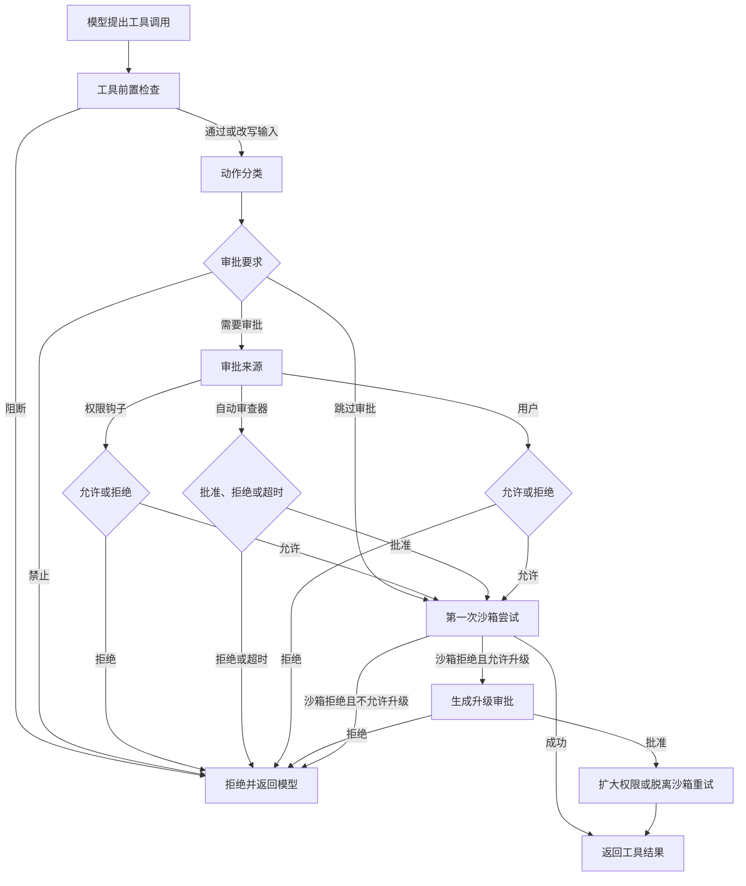

# Permission system - Codex - 01 - 审批策略与沙箱权限

---

> 探究一下 Codex 的权限审批系统是怎么做的. 怎么确定哪些行动需要审批, 哪些行动自动放行? 都有哪些权限档位可用?

---

## 结论先说

Codex 的权限系统不是一条“权限档位越高，询问越少”的单一阶梯，而是两套正交控制叠加：

1. **审批策略**决定什么时候停下来问人、把问题交给自动审查，或者直接拒绝。
2. **权限配置档**决定命令实际能读写哪些路径、能不能联网、是否完全脱离沙箱。

一次普通命令在 `workspace-write` 沙箱里通常不会弹窗，因为它会被直接放进沙箱执行；真正触发审批的往往是危险命令、明确要求越出沙箱、补丁写到可写范围之外、网络策略要求确认、非只读 MCP 工具，或模型主动申请额外权限。

因此，“自动放行”可能意味着两件完全不同的事：

- 命令被判断为安全，允许在受限沙箱中运行；
- 命令被允许完全脱离沙箱运行。

外部用户最常见的选择是四个界面预设：Read Only、Ask for approval、Approve for me、Full Access。它们只是把审批策略、审查者与权限配置打包在一起；底层仍可分别配置 `on-request`、`never` 等审批策略，以及 `:read-only`、`:workspace`、`:danger-full-access`、自定义权限配置等沙箱范围。

## 场景

用户让 Codex 修复一个失败测试。它先读取项目、应用补丁、运行测试，然后可能清理构建目录或访问网络。

在默认的 Ask for approval 档中：

- 读取文件通常自动进行；
- 工作区内的补丁通常自动应用；
- `npm test` 这类普通命令通常自动在沙箱中运行；
- `rm -rf build` 会因为命中危险命令检查而询问；
- 补丁写工作区外会询问；shell 在未声明升级时通常先被沙箱拒绝，再由模型显式申请扩大权限；
- 命令明确要求脱离沙箱时会询问；
- 网络访问是否询问取决于权限配置和网络策略；
- 破坏性、open-world 或缺少安全元数据的 MCP 工具通常会询问。

这说明“是否需要审批”不是按工具名一刀切，而是由动作类型、命令内容、目标路径、当前权限配置和审批策略共同决定。

## 一、为什么不能只看“权限模式”

Codex 至少有四层相关配置：

| 层 | 回答的问题 | 典型取值 |
|---|---|---|
| 审批策略 | 遇到需要确认的动作时，是否允许询问 | `on-request`、`never`；内部还有 `untrusted`、`granular` |
| 审查者 | 允许询问时，谁来审查 | 用户，或自动审批审查器 |
| 权限配置档 | 动作实际被限制到什么范围 | 只读、工作区写、完全访问、外部沙箱、自定义档 |
| 工具级策略 | 具体工具如何解释“需要确认” | shell 的 execpolicy、补丁路径检查、MCP 注解策略 |

界面上的 Read Only / Ask for approval / Approve for me / Full Access 是这些字段的组合，而不是运行时唯一的枚举。理解 Codex 时，先看底层三轴，再看预设，结论会稳定得多。

| 组合例子 | 实际效果 |
|---|---|
| `on-request` + 工作区写 | 普通命令与工作区内补丁静默执行；越界、危险命令和按策略需要确认的网络/MCP 动作询问 |
| `never` + 工作区写 | 全程不弹审批，但普通命令仍在工作区沙箱里；危险命令和越界补丁直接失败 |
| `on-request` + 无沙箱 | 普通命令不受沙箱限制，但危险命令仍会询问 |
| `never` + 无沙箱 | 即 Full Access 预设：不提示、无外层沙箱；已知危险命令仍可能被硬拒绝 |

## 二、一次工具调用的判定链

### 1. 工具前置钩子先处理

PreToolUse 钩子可以阻断本次调用，也可以改写输入，但它本身不是“自动允许”通道。它更接近调用前的强制检查点。

如果这里阻断，后续审批和沙箱都不会发生。

### 2. 工具运行时生成审批要求

不同动作有不同判定器：

- shell 类工具解析命令行、查 execpolicy 规则、检查危险命令，并读取本次请求是否想越出沙箱；
- 向已经运行的终端写入输入时，如果该终端以扩大后的权限启动，也会单独产生审批动作；
- 补丁工具检查所有目标路径是否都在可写范围内；
- MCP 工具检查服务器配置和工具注解；
- 网络代理对 host、协议与策略做判断；
- 权限申请工具直接生成“是否授予额外权限”的请求。

结果不是简单的“允许/拒绝”，而是三种内部意图：

- **跳过审批**：可以直接进入沙箱尝试；
- **需要审批**：先找到审批来源；
- **禁止**：连审批机会都没有，直接返回拒绝原因。

### 3. 需要审批时，按固定来源顺序处理

审批来源的优先级是：

1. PermissionRequest 钩子；
2. 若启用了自动审查，则交给自动审批审查器；
3. 否则请求用户确认。

钩子可以直接允许或拒绝；多个钩子中任何拒绝都优先，只有全部不拒绝时保留允许。自动审查器不能处理 `never` 审批策略下的请求，因为 `never` 的目标就是在出现请求时直接拒绝。

普通拒绝通常变成一条工具错误返回模型，模型可以继续换方案；只有用户选择取消或终止时，当前 turn 才会整体结束。

### 4. 执行器选择沙箱并做第一次尝试

权限配置决定第一次尝试是否放在 Codex 管理的沙箱中、是否由外部沙箱负责，或完全不套外层沙箱。

普通命令“没有询问”并不代表没有约束。它可能只是被允许在沙箱内失败：例如写入不可写路径时，命令返回沙箱拒绝，模型得到错误后再决定是否申请更宽权限。

### 5. 沙箱拒绝后是否重试

某些运行时允许在拒绝后重试：

- 补丁在获批后可以重试到无沙箱执行；
- shell 显式请求升级时会先询问，再脱离沙箱；
- 普通 shell 命令在 `on-request` 下即使被沙箱拒绝，也不会自动把每一次失败升级成用户提示；
- 网络被拒绝时，只有网络策略给出的“可询问 host”上下文才会进入网络审批。

这一区分避免每条越界命令都弹出权限框，也意味着“沙箱失败”和“需要用户授权”不是同一个信号。

## 三、哪些行动自动放行

### Ask for approval 档下的典型结果

界面上的 Ask for approval 使用工作区写权限配置、`on-request` 审批策略和用户审查者。在没有额外配置时：

| 动作 | 典型行为 | 实际控制点 |
|---|---|---|
| 普通 shell 命令，不再申请额外权限 | 自动在沙箱中执行 | 权限配置限制实际读写与网络 |
| `rm` 带 force 选项 | 询问 | 危险命令启发式；`never` 下直接禁止 |
| shell 显式要求脱离沙箱 | 询问 | 请求带有 sandbox override 标志 |
| shell 申请扩大的文件或网络权限 | 询问 | 在同一沙箱内扩大本次命令权限 |
| 工作区内的补丁 | 自动应用 | 所有目标都在可写范围内 |
| 工作区外或受保护元数据路径的补丁 | 询问 | 补丁路径检查 |
| 网络目标被策略标为 ask | 询问 host | 网络代理与 host 规则 |
| 破坏性、open-world 或缺少注解的 MCP 工具 | 询问 | MCP 工具注解与服务器批准模式 |
| 模型调用 `request_permissions` | 询问 | 请求额外文件或网络权限 |
| 读取文件或查看图片 | 自动在文件系统权限下执行 | 权限配置中的读权限 |

“普通 shell 命令”不是按白名单逐个列出的。对没有被 execpolicy 规则命中的命令，系统会落到默认判定：

- 受限沙箱中，且命令没有请求越界：允许；
- 不受限或外部沙箱中，且命令不危险：允许；
- 命令请求越界：询问；
- 命中危险命令启发式：`on-request` 下询问，`never` 下禁止。

因此 `npm test`、构建命令和普通脚本通常会直接运行，而 `rm -rf` 会被单独识别。

### 补丁的自动与询问

补丁安全判断看的是目标路径，而不是只看“是否编辑”：

- 所有新增、删除、更新和移动目标都在可写根内，且沙箱可用时，自动通过；
- 任一目标超出可写根，或碰到工作区内被额外保护的元数据目录，进入询问；
- `never` 或关闭沙箱升级审批的 `granular` 配置会把这类请求直接拒绝。

工作区写权限默认保护项目根下的 `.git`、`.agents`、`.codex`、`.aws`。因此“工作区可写”不等于“连仓库元数据也能改”。

### 网络不是“命令审批”的附庸

权限配置里有独立的网络开关。即使文件系统是工作区写，网络也可以保持关闭。网络代理还可以按 host、协议和规则给出允许、拒绝或询问。

网络审批允许：

- 只允许本次；
- 本会话允许该 host；
- 持久写入 host 允许或拒绝规则。

所以“命令被批准”不一定意味着“命令里的任意网络请求都被批准”。

### MCP 有自己的默认保守策略

MCP 工具默认使用 Auto 批准模式：

- 明确标记破坏性：询问；
- 明确标记只读：通常跳过 MCP 审批；
- 未标记只读，且缺少安全注解：询问；
- 可写但不是破坏性：仍按注解与 open-world 提示判断。

服务器可以把策略改成 `prompt`（全问）、`writes`（只读不问，其他问）或 `approve`（不问）。

## 四、可用档位

### 界面预设

| 预设 | 权限配置 | 审批策略 | 审查者 | 主要效果 |
|---|---|---|---|---|
| Read Only | 只读 | `on-request` | 用户 | 读和普通沙箱命令直接运行；补丁与显式升级按策略询问，未声明的 shell 写入由沙箱拒绝 |
| Ask for approval | 工作区写 | `on-request` | 用户 | 工作区内编辑和普通命令直接运行；越界、危险命令和部分网络/MCP 动作询问 |
| Approve for me | 工作区写 | `on-request` | 自动审查 | 与上一档范围相同，但把应询问的动作交给自动审批审查器 |
| Full Access | 无外层沙箱 | `never` | 不适用 | 不弹审批，文件系统与网络默认不限制 |
| 自定义 profile | 用户/企业配置 | 单独配置 | 单独配置 | 可定义路径、glob、网络域名与继承关系 |

这里的 `auto` 是源码里“默认工作区预设”的旧 id，不等于自动审查。自动审查是审查者字段，界面标签是 Approve for me。

快速切换通常只覆盖 Read Only 与 Ask for approval（以及可用时的 Approve for me）。Full Access 和自定义配置从 `/permissions` 菜单中选择。

`Approve for me` 依赖自动审查能力与相关企业要求；Full Access 也可以被托管要求禁用或隐藏。

### 底层审批策略

| 审批策略 | 含义 |
|---|---|
| `on-request` | 默认策略。模型和系统规则共同决定何时请求；普通受限沙箱命令可直接运行 |
| `never` | 不出现审批。普通命令仍受沙箱限制；危险命令和需要审批的越界动作会变成拒绝 |
| `untrusted` | 内部策略。未显式允许的 shell 命令都询问；由“不可信项目”推导，不允许用户直接写入配置 |
| `granular` | 按“沙箱升级、execpolicy 提示、技能脚本、权限申请、MCP elicitation”等类别逐项允许或拒绝 |

命令行只直接暴露 `on-request` 与 `never`。`on-failure` 是 `on-request` 的兼容别名。`granular` 的某一类为 false 时，相应请求不是静默通过，而是自动拒绝。

### 权限配置档

| 配置 | 文件系统 | 网络 | 说明 |
|---|---|---|---|
| `:read-only` | 根目录可读，无写根 | 默认关闭 | 名称容易误解：它限制写入，不等于只允许读取工作区 |
| `:workspace` | 根目录可读；工作区、临时目录和附加目录可写 | 默认关闭 | 受保护的项目元数据仍保持只读 |
| `:danger-full-access` | 无外层文件系统沙箱 | 默认启用 | 运行时映射为无沙箱配置 |
| External | 外部环境负责隔离 | 可配置 | Codex 不叠加自己的文件系统沙箱 |
| 命名自定义配置 | 任意 read/write/deny 路径和 glob | 域名、socket、代理规则 | 可通过配置文件继承与组合 |

`:read-only` 与 `:workspace` 都给了根目录读取权限。界面文案强调“读取工作区”，但底层权限模型允许整盘读取，除非配置里另有 deny 条目。这是一个界面概括与代码语义之间的重要差异。

工作区写默认包含当前工作区、Unix 的 `/tmp`、用户 `TMPDIR`，以及显式附加的写目录。网络仍是独立开关。

### 项目信任的影响

- 可信项目：默认工作区写，`on-request`；
- 明确不可信项目：默认仍是工作区写（平台沙箱可用时），但审批策略变成内部的 `untrusted`，并且项目级配置、hooks 和 execpolicy 不加载；
- 未知信任状态：默认只读权限配置；
- Windows 上没有可用沙箱后端时，工作区写会降级为只读。

这些是默认推导，显式配置和企业要求可以继续收窄。

## 五、规则、授权记忆与持久化

### Shell 命令规则

Shell 的细粒度规则来自 execpolicy：

- 规则按命令 token 前缀匹配；
- 决策有 `allow`、`prompt`、`forbidden`；
- 多条规则同时命中时采用最严格结果；
- shell wrapper 和 `bash -lc` 等结构会被解析到内部命令；
- 未命中规则时落入审批策略与危险命令启发式；
- 项目不可信时，项目级规则不加载。

用户选择“以后不再询问这个前缀”时，会把允许前缀规则写入 `<CODEX_HOME>/rules/default.rules`，因此可以跨会话保留。普通“仅本次”不写规则。

这条前缀规则授予的是更强的“明确允许”语义：当整条命令的所有分段都由 execpolicy 的 allow 规则覆盖时，第一次尝试可以跳过沙箱。换言之，它不只免掉审批，还可能在缺少 denied-read 限制时把匹配命令视为完全信任。`ApprovedForSession` 的临时缓存没有这层持久规则语义。

### 会话审批缓存

“本会话不再询问”按动作缓存：

- 命令通常按完整 argv、cwd、TTY 和权限请求等键缓存；
- 一次补丁涉及多个文件时，逐文件缓存；
- 已有缓存命中时跳过提示，但仍会验证具体动作。

这类缓存只活在当前会话，不持久化。

### 权限和网络授权

- 模型申请额外文件/网络权限时，用户可授予本次 turn 或整个 session；
- 授予的 turn 权限会应用到后续同类 shell 命令；
- 网络 host 可以只允许一次、本会话允许，或写入持久 host 规则；
- MCP 工具可以只允许一次、本会话允许，或在配置允许时持久批准。

## 六、几个容易误判的边界

### `never` 不等于 Full Access

`never` 只表示“不要弹审批”：

- 在受限沙箱中，普通命令仍被沙箱限制；
- 补丁写到可写范围之外会直接拒绝；
- 需要升级沙箱的请求会直接拒绝；
- 危险命令会直接禁止；
- 仍需要 MCP 批准的工具若没有其他预批准路径，也会被拒绝。

真正的 Full Access 预设还同时选择了无文件系统沙箱和网络开启。

### Full Access 也不是“没有策略”

危险命令启发式仍会在没有任何 execpolicy 允许规则命中时生效。`rm` 带 force 选项在 `never` 下会得到禁止，而不是自动执行。显式规则可以改变这个结果，但“完全访问”描述的是默认沙箱和提示，不是所有安全检查全部消失。

### 普通命令的自动执行依赖沙箱

`on-request` 下普通命令之所以不询问，是因为系统认为沙箱会兜底。沙箱不可用、平台后端关闭或权限配置无法可靠表达时，系统会转得更保守。

### 模型可以主动请求更多权限

Shell 调用可以携带三种权限意图：

- 使用当前权限；
- 在沙箱内临时扩大文件或网络权限；
- 完全脱离沙箱执行。

审批通过后，第三种才会脱离沙箱；含 denied-read 规则的配置还会拒绝用“脱离沙箱”绕过这些读限制。

### 自动审查不是无审核

Approve for me 只是把应询问的动作交给另一个模型审查。它看当前对话、用户授权、动作内容和风险，仍可以批准、拒绝或转回用户。审批前置钩子仍优先于自动审查。

### `codex exec` 没有交互式审批面

非交互 `codex exec` 默认强制 `never`，避免等待一个不存在的用户输入。只有在配置了自动审查时，它才会撤掉这个人造默认值，让待审批动作进入自动审查。

App-server/SDK 客户端可以通过协议展示审批，不适用这个限制。

## 七、设计取舍

这套系统最核心的取舍是**沙箱优先，审批处理边界情况**。如果每个命令都询问，用户会被训练成机械点“允许”；如果在受限沙箱中直接执行普通命令，只把危险、越界和跨域动作交给用户，审批才更像真正的风险关口。

代价是自动执行与自动授权容易混淆。用户看到命令没有弹窗，可能以为它没有任何限制，实际上它可能只是被允许在沙箱里运行。界面预设把审批策略和沙箱配置打包，降低了配置负担，也隐藏了它们其实是独立轴。

把 shell 规则、补丁路径、MCP 注解和网络策略分别实现，能表达各工具的真实语义；代价是规则来源多、记忆方式不同，用户很难用一句“允许这个工具”覆盖所有场景。

自动审查能减少打断，但它把安全判断转交给模型审查器，且必须依赖超时、拒绝和严格的用户授权上下文。源码可以证明路由与失败路径，不能证明真实场景中的判断质量。

## 八、证据分级

| 结论 | 等级 | 依据 |
|---|---|---|
| 审批策略与权限/沙箱配置是两条独立轴 | 已证实 | 类型定义、预设结构和配置解析分别保存两者 |
| TUI 预设把审批策略、审查者和权限配置打包 | 已证实 | 内置预设与权限菜单直接组合三个字段 |
| 受限沙箱中的普通 shell 命令默认不询问 | 已证实 | execpolicy 未命中时的默认决策直接返回允许 |
| 危险命令与越界请求会触发询问或拒绝 | 已证实 | 危险命令启发式、sandbox override 与 `never` 分支 |
| `:read-only` 与 `:workspace` 默认可读整个根目录 | 已证实 | 两者都以 `:root` 的 read 条目开始 |
| 工作区写包含工作区、临时目录和附加写根 | 已证实 | 工作区写权限构造器 |
| `never` 仍保留沙箱、危险命令和越界拒绝 | 已证实 | 多个默认判定与拒绝分支 |
| `codex exec` 默认无审批，自动审查时可保留 `on-request` | 已证实 | 非交互配置构造与测试 |
| 自动审查的生产可用性与审查质量 | 部分已证实、部分无法确认 | 路由、超时和拒绝路径可见；真实模型能力与线上配置不可从源码确认 |
| 线上用户实际使用哪套配置和信任状态 | 无法确认 | 取决于本地配置、企业要求、平台沙箱可用性与项目信任 |

源码与测试只做了静态阅读，没有在被研究仓库中执行构建或测试。

## 源码依据

以下路径相对 `/home/fishandrice/Backend/codex`。

| 机制 | 源码位置与关键锚点 |
|---|---|
| 审批策略和细粒度审批类别 | `codex-rs/protocol/src/protocol.rs`：`AskForApproval` L1092-1142 |
| 沙箱策略与网络访问 | `codex-rs/protocol/src/protocol.rs`：`SandboxPolicy` L1178-1390 |
| 审批结果与用户选项 | `codex-rs/protocol/src/protocol.rs`：`ReviewDecision` L4245-4315 |
| 权限配置与内置档 | `codex-rs/protocol/src/models.rs`：内置 id L410-416、`PermissionProfile` L422-435、读写档构造 L483-557、网络映射 L681-690 |
| 文件系统策略、根读取与受保护元数据 | `codex-rs/protocol/src/permissions.rs`：受保护名称 L46-52、read-only L622-630、workspace-write L819-871、根读取判断 L913-934 |
| 工作区/只读/完整访问预设 | `codex-rs/utils/approval-presets/src/lib.rs`：L28-71 |
| TUI 权限菜单与预设组合 | `codex-rs/tui/src/chatwidget/permissions_menu.rs`：L52-120、L161-217 |
| TUI 快速权限切换范围 | `codex-rs/tui/src/chatwidget/permission_shortcuts.rs`：L6-115 |
| 审批动作类型 | `codex-rs/core/src/tools/approvals.rs`：`ApprovalAction` L65-145 |
| 审批来源优先级与钩子优先 | `codex-rs/core/src/tools/approvals.rs`：`request_approval` L439-510 |
| 审批、沙箱尝试、失败后重试的编排 | `codex-rs/core/src/tools/orchestrator.rs`：`run` L127-575 |
| 默认审批要求 | `codex-rs/core/src/tools/sandboxing.rs`：L196-231、权限升级 L249-304、审批缓存 L44-80 |
| Execpolicy 决策与严格度 | `codex-rs/execpolicy/src/decision.rs`；`codex-rs/execpolicy/src/policy.rs` L388-409 |
| Execpolicy allow 的沙箱绕过语义 | `codex-rs/core/src/exec_policy.rs` L286-460；`codex-rs/core/src/tools/sandboxing.rs` L249-304 |
| Shell 未命中规则的默认判定 | `codex-rs/core/src/exec_policy.rs`：`render_decision_for_unmatched_command_for_platform` L770-852 |
| 审批策略拒绝 granular/never 提示 | `codex-rs/core/src/exec_policy.rs`：L216-245 |
| Shell 运行时接入 execpolicy | `codex-rs/core/src/unified_exec/process_manager.rs` L1478-1515；`codex-rs/core/src/tools/runtimes/unified_exec.rs` L146-195 |
| Shell 权限意图 | `codex-rs/protocol/src/models.rs`：`SandboxPermissions` L62-91 |
| 危险命令启发式 | `codex-rs/shell-command/src/command_safety/is_dangerous_command.rs` L37-155 |
| 补丁路径安全判断 | `codex-rs/core/src/safety.rs`：`assess_patch_safety` L67-125、写路径约束 L146-180 |
| 补丁进入审批或自动通过 | `codex-rs/core/src/apply_patch.rs`：L20-61 |
| MCP 工具批准模式 | `codex-rs/config/src/mcp_types.rs`：`AppToolApproval` L28-50 |
| MCP 注解审批规则 | `codex-rs/core/src/mcp_tool_call.rs`：L2465-2498 |
| MCP 审批入口与 never 处理 | `codex-rs/core/src/mcp_tool_call.rs`：L1488-1625 |
| MCP full-access/never 自动批准 | `codex-rs/codex-mcp/src/mcp/mod.rs`：L91-110 |
| 网络 host 审批与持久规则 | `codex-rs/core/src/tools/network_approval.rs`：L760-950；`codex-rs/core/src/network_policy_decision.rs` |
| PreToolUse 只能阻断/改写 | `codex-rs/hooks/src/events/pre_tool_use.rs`：L24-145 |
| PermissionRequest 钩子允许/拒绝 | `codex-rs/hooks/src/events/permission_request.rs`：L36-165 |
| 自动审查路由 | `codex-rs/ext/guardian-reviewer/src/routing.rs`：L54-62；`codex-rs/tui/src/chatwidget.rs` L462-464 |
| 自动审查功能开关 | `codex-rs/features/src/lib.rs`：L1830-1836 |
| 用户审批选项与会话/持久授权 | `codex-rs/tui/src/bottom_pane/approval_overlay.rs`：L811-919、L1015-1075 |
| 项目信任与默认审批/权限 | `codex-rs/core/src/config/mod.rs` L3820-3875；`codex-rs/core/src/config/permissions.rs` L72-92 |
| 非交互 exec 的 never 默认 | `codex-rs/exec/src/lib.rs` L589-595、L779-815；`codex-rs/exec/tests/suite/approval_policy.rs` |
| CLI 审批参数 | `codex-rs/utils/cli/src/approval_mode_cli_arg.rs`；`codex-rs/tui/src/cli.rs` L73-77 |
| 自定义权限配置结构 | `codex-rs/config/src/permissions_toml.rs`：L23-130、L278-345 |
| 关键测试证据 | `codex-rs/core/src/safety_tests.rs`；`codex-rs/core/src/mcp_tool_call_tests.rs` L380-440；`codex-rs/core/src/exec_policy_tests.rs`；`codex-rs/core/src/tools/sandboxing_tests.rs` |

