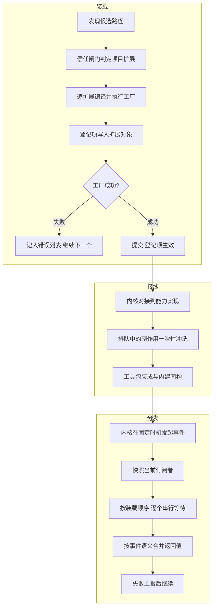

# plugin-system - Pi - 01 - 扩展程序机制：进程内热插拔的装载、注册面与事件分发

---

> Pi 以轻量内核, 插件灵活著称. 但是具体来看, Pi 的插件化是怎么做的?

> 主要看 extensions. 别的不看.

---

## 场景

先说清楚 Pi 所说的 "extension" 到底是什么，因为这个词在 Pi 里对应一组很具体的机制，而不是一个模糊的"可插拔"概念。

一个 Pi 扩展就是一个**导出默认工厂函数的 TypeScript/JavaScript 模块**。这个模块被加载进 Pi 进程本身，拿到一个 `ExtensionAPI` 对象，然后在这个对象上登记它想做的事情：加一个模型可调用的工具、加一个斜杠命令、订阅某个生命周期事件、注册一个模型供应商、接管一段渲染。

由此决定了两件事，后面所有机制都是它们的推论：

1. **没有进程边界**。扩展和内核同权限、同内存。所以"轻量内核"不是靠隔离换来的，而是靠**内核只保留必须知道的东西，其余全部通过注册面和事件钩子外挂**。
2. **不是"插件调用内核 API"，而是"内核在固定钩子点上回访插件"**。控制权方向是反转的：内核不认识任何具体扩展，扩展靠订阅获得能力。

本文只讲 extensions 这一条机制线，不涉及 MCP（进程外协议）、codemode（沙箱执行）、技能与提示模板（非代码资源）。

## 一句话模型

Pi 的扩展机制 = **一次装载（发现 → 编译 → 工厂执行 → 提交）+ 一张注册面（工具/命令/快捷键/flag/渲染器/供应商/事件订阅）+ 一套分发骨架（快照订阅者 → 串行 await → 按事件语义合并结果）**。三个部分各自独立，可以单独理解。

## 机制展开

### 一、装载：从磁盘到"这个扩展存在"发生了什么

**发现**。候选来源按固定顺序拼接：项目目录下的 `.pi/extensions/`、用户目录下的 `~/.pi/agent/extensions/`、配置与已安装 Pi 包解析出的路径、命令行 `-e/--extension` 显式给出的路径（含 `builtin:<名字>` 这种指向内置扩展的伪路径）。去重后得到一份有序路径列表。

单个目录的发现规则刻意做得很窄：**只扫一层**，直接是 `.ts`/`.js` 文件就收；是子目录且含 `index.ts`/`index.js` 就收那个入口；子目录里有 `package.json` 且声明了 `pi.extensions` 字段，就按声明的相对路径收，声明的入口优先于 `index.*`。不再往下递归。这是有意的取舍——多文件实现要么自带入口，要么自带清单，不要靠猜。

**编译**。扩展可以是源码状态直接跑，靠 jiti 在导入时转换，用户不需要先编译。解析策略分三种情况，取决于 Pi 自己跑在什么形态下：源码运行时用工程 tsconfig 路径 + 注入的模块；打包成单文件二进制时只能用注入的模块并禁用原生加载（因为磁盘上没有这些包）；普通 Node 发行版用模块别名表。三种情况都保证扩展 `import` 到的 Pi 包是**宿主自己那一份**，而不是扩展自己 `node_modules` 里可能存在的另一个版本——同一进程里两个 pi-ai 实例会直接破坏类型判断与注册表。

**缓存**。同一个工作目录内，已导入的工厂函数会被复用（同一个扩展文件在一次会话里不会重复求值）；切换工作目录或 reload 时整份缓存清空。这让重复加载变便宜，但也意味着扩展模块的顶层代码**不保证每次装载都重新执行**。

**执行与隔离**。逐个扩展执行工厂，每个扩展的失败被单独捕获：记一条错误（路径 + 消息）进结果，然后继续下一个。所以一个坏扩展不会让 Pi 起不来，它只是不存在。这个"缺席"是静默的，只能从错误列表或交互界面的诊断里看到。

**提交**。工厂执行期，注册类调用（登记工具、命令、事件）直接写进这个扩展的对象；凡是依赖"会话已经存在"的动作（发消息、改激活工具集、注册供应商、注册 MCP server）则先排队——加载期的这些方法实际上是会抛错的占位实现，工厂里调用它们会被记为待办，等内核对空之后一次性冲洗。由此得到一条硬边界：**加载期只能"登记"，不能"作用"**。

### 二、信任闸门：为什么项目扩展要先被问到

项目目录里的扩展是仓库作者写的代码，运行即拿到完整权限。所以装载分两趟：

第一趟**强制把项目设为不可信**再加载，于是只有用户级、全局、命令行显式指定的扩展进来。这些扩展有机会响应"是否信任这个项目"这个问题：按装载顺序问下去，第一个给出"信任/不信任"的答案生效，答"未决定"就继续问下一个，答错就记错误并继续。若没有任何扩展作答，才退到"记住的选择 → 配置默认值 → 弹窗询问（无界面则视为不信任）"。

第二趟按判定结果正式加载，此时项目扩展才被加入。

这个顺序不是实现细节，而是模型的一部分：**回答"这个项目可信吗"的能力必须来自已经可信的代码**。项目扩展永远没有机会为自己背书。

### 三、注册面：一个扩展到底能改什么

把注册项按"改动强度"分四类，比按 API 罗列更好理解：

| 强度 | 内容 | 说明 |
|---|---|---|
| 新增能力 | 工具、斜杠命令、命令行 flag、键盘快捷键、消息/条目/工具渲染器、模型供应商、MCP server、虚拟模型 | 只在扩展侧存在，内核只负责把它们纳入统一注册表 |
| 观察 | 大多数生命周期事件 | 只通知，返回值被忽略 |
| 改写/中止 | 少数事件有返回值语义（上下文变换、工具参数、工具结果、输入文本、供应商标头与载荷、系统提示） | 语义逐事件定义，不统一 |
| 接管 | 可替换的内置扩展 | 第三方注册了同名工具/命令/flag，内置扩展整份不加载 |

**冲突策略是一张分散的表**，且大多没有对应"报错"：

- 工具同名：先装载的赢，后者的注册被忽略（不报错）。
- 命令同名：不覆盖，后者自动改名为 `名字:2`、`名字:3`。
- flag 同名：第一个的默认值生效。
- 快捷键：内建"保留位"（中断、清屏、退出、模型切换、聚焦编辑器等）不可抢占，抢了直接跳过并告警；非保留位可抢，但会告警；两个扩展抢同一个键，后装载的赢并告警。
- 模型供应商同名：覆盖。
- MCP server 同名但属于不同扩展：抛错（因为背后是真实连接，不能含糊）。
- 内置扩展被替换：整份不加载，并给出"某扩展注册了同名 X，所以内置 Y 未加载"的告警。

**内置扩展只有四个**：llama.cpp、codemode、tool-search、mcp。文件读写、shell 这些基础工具属于内核，不是扩展。这一点直接回答了"轻量内核"在数据上意味着什么：内核 = 循环 + 少量基础工具 + 一个钩子点枚举；产品级功能（脚本执行、工具检索、MCP 接入）已经外挂到扩展层，而且这三者都被显式标记为"可被替换"——它们是扩展面表达能力的证明，同时也是留给用户的替换点。

### 四、分发：中枢是"快照 + 串行 + 语义合并"

所有事件走同一副骨架：

1. 在派发开始时对全部扩展的订阅者**拍快照**。派发进行中新增或删除订阅不影响本轮。
2. 按**装载顺序 × 单个扩展内的注册顺序**逐个 await。没有并发。
3. 每个事件有自己的专属分发函数，决定回调返回值怎么合并。

第 3 点是这套机制真正的复杂度所在。把事件按合并语义分类，比记事件名有用得多：

| 语义 | 合并方式 | 典型事件 |
|---|---|---|
| 通知型 | 返回值忽略 | 会话开始/结束、消息开始/流式更新、工具执行三段、模型切换、UI 提示 |
| 链式变换 | 后者看到前者的输出 | 上下文变换（对话消息）、工具结果改写、输入文本变换、系统提示改写 |
| 收集型 | 全部收集累加 | 启动期要注入的自定义消息、扩展提供的技能/提示/主题路径 |
| 覆盖型 | 最后一个返回值赢 | 缓存预热决策、供应商请求载荷 |
| 短路型 | 第一个有效返回即结束 | 工具调用是否阻断、项目信任答案、输入是否被"已处理" |
| 边界型 | 共享一份草稿，可请求"再来一轮" | 轮次结束、代理即将静置 |

链式变换里有两个细节值得单独记住：

- **上下文变换分成两档**。普通档只把"对话消息"给扩展看，扩展改完之后内核把系统消息（提示词与工具声明）重新接回头部；除非扩展真的改动了对话，否则一点不动，这样能保住供应商侧的前缀缓存。另一档是"整份转录交给你"，用于确实需要重排整个请求的场合，代价是扩展得自己保证系统消息在位置 0。
- **工具结果改写是补丁式**。每个 handler 只返回它要改的字段，没返回的沿用上一个 handler 的结果；但如果只替换了文本内容而没同时给出结构化内容，结构化内容会被丢弃——因为两者可能已经不一致。

**失败策略按风险分级**，这是整套机制里最需要"逐事件读文档"的地方：

- 观察/变换类 handler 抛错：捕获、上报、继续（相当于这次改写没发生）。
- 工具调用前置钩子抛错：**阻断该次工具调用**（fail-safe），因为无法断定它是否安全。
- 用户直接敲的 shell 命令的接管 handler 抛错：**不再回落到本地执行**（fail-closed）。
- 工具自身执行抛错：变成一条给模型的错误工具结果，不影响其它工具。
- 工具结果改写 handler 抛错：上报并继续，结果是原样的。

**上下文对象每次派发新建**，属性是惰性求值的 getter，指向 runner 的当前状态。reload 或会话替换后 runner 被标记失效，旧上下文对象上的任何调用立刻抛"此上下文已过期"，而不是悄悄改到已经废弃的状态上。

### 五、工具这条主链

工具是最常用的扩展点，链条值得完整走一遍：

**注册即同构**。扩展注册的工具在进入内核前被包装成和内建工具完全一样的结构，执行时注入扩展上下文。循环层面看不出哪个来自扩展——这是"扩展工具等于内建工具"的实现基础，也是为什么工具调用拦截必须放在会话层而不是包装层：包装层只负责适配上下文，拦截对所有工具统一。

**执行前拦截可以改参数**。工具调用事件里拿到的是**已通过 schema 校验的参数对象**，扩展原地修改它就能改变实际执行的参数。注意这是引用别名，改完不会再校验一次——这是"允许拦截"与"保持校验"之间有意选的一边。

**工具可以调用工具**。工具执行上下文提供"执行另一个工具"的能力，这条调用会走完全相同的校验、拦截与事件链，只是调用 id 变成 `父id/序号`，并且**不进入转录**：结果只回到调用者手里，由调用者自己决定怎么上报。会话侧保留一份受限记录（最多 256 条、单次参数超 8 KiB 或参数合计超 32 KiB 就省略、错误截断到 500 字符，丢过东西就打上"不完整"标记），供压缩时列出涉及文件、以及导出 HTML 时使用。嵌套调用的 token 用量逐层累加到发起者的工具结果上，所以发起者报的是"自己"的用量，不重复计算。

**暴露档位决定模型怎么够到工具**。默认 `direct`（激活即声明给模型）；`model-only`（声明给模型但不能被其它工具调用）；`codemode`（注册即可被脚本调用，不声明给模型）；`deferred`（同上，但要靠工具检索找出来）；`hidden`（注册了但不可达——因为工具**无法注销**，"撤销"只能靠重新注册覆盖成 hidden）。这五档把"能看见"和"能调用"拆成两个正交问题，随后由"载荷装配"钩子补最后一刀：编排型工具可以在自己激活时改写其它工具的声明描述、甚至把某些激活工具的声明从请求里藏掉（激活集不变，转录仍声明，所以切分支/恢复之后状态还在）。

**渲染也是可插拔的**，而且支持"给还没注册的工具"提供渲染（例如恢复会话时 MCP server 尚未连上，工具实现不存在但历史里有调用记录）。渲染解析器按装载顺序链式询问，每个都能选择"交给我"或"让下一个来"。

### 六、生命周期与重载

`reload` 的顺序是完整可读的一套协议：

先给旧扩展发"会话关闭（原因：重载）"，让它们释放资源；然后**立刻把旧 runner 标记失效**，此后旧上下文一律抛错；接着重读设置、清缓存、重新发现与装载、重建 runner、重新包装工具（旧工具集合不保留，重载前激活的工具名作为"待定"传递过去，扩展重新注册时再解析）；最后发"会话开始（原因：重载）"，并让扩展补报它要加的资源路径（技能/提示/主题目录）。

会话替换（新建、分叉、切换文件）走同一套失效逻辑，但把"替换之后才能用的新上下文"通过回调交回给扩展，避免扩展抓着旧上下文继续用。

工厂执行期被明确要求**不要启动进程、socket、watcher、定时器**，因为有些调用只装载扩展而不开启会话；长生命周期资源应该挂在会话开始事件上，并在会话关闭里做幂等清理（取消、重载、会话替换、进程退出可能汇聚到同一条清理路径）。

## 条件与边界

这个模型在以下情形会明确咬人，属于"知道就好、不必抱怨"的边界：

1. **权限等于整个进程**。扩展能读到提示词、工具参数、文件系统、凭据、会话历史。所以信任模型不是"能力裁剪"，而是"来源判断"——用户级目录与项目目录被区别对待，就是为了让来源判断有落点。
2. **没有卸载**。一次装载的扩展不能在运行中移除。禁用只能发生在装载前（配置、信任、显式路径替换），或者靠"注册同名项覆盖成 hidden"这种变通。所以"中途换一套扩展"实际是 reload。
3. **优先级等于装载顺序**。工具同名先到先得、快捷键后到者胜——这些规则的输入都是路径解析顺序，而不是某个显式声明的优先级字段。想让某扩展赢，靠的是它被装载得更早。
4. **串行 await 会把扩展的耗时算进主链**。供应商流式事件明确按流顺序逐个等待，慢 handler 直接拖慢流消费。反过来，工具调用之间的并行发生在工具层，与事件派发无关——所以"同一助手消息里的工具调用可以并行"这句和"事件串行"并不矛盾。
5. **错误默认不阻断流程**。除工具调用前置钩子与用户 shell 接管两类，坏 handler 表现为"这个功能静默没生效 + 一条错误记录"。这是可运维性与可调试性之间的取舍，代价是扩展作者需要自己保证错误可见。
6. **内置扩展可被整份替换**。如果第三方注册了 `codemode` 这个工具名，内置 codemode 扩展不会加载，连它的命令和 flag 一起消失。这是"扩展面足够强"的证明，也是配置文件层面容易踩的坑。

## 设计取舍

**为什么是进程内，而不是沙箱或子进程。** 扩展要改的东西包括系统提示、上下文消息、工具参数与结果、请求头与载荷、终端渲染、会话树导航——把这一整套跨进程暴露，需要定义一份巨大的协议，且每次往返都要序列化。Pi 选了另一条路：承认扩展是"可信代码"，把隔离成本换成表达力，把安全成本交给信任闸门。代价很明确：项目目录里的扩展在获得信任前不能运行，且一旦运行就没有退路。同一仓库里 MCP 与 codemode 分别提供了"进程外"和"沙箱内"两种较弱但更安全的形态，三档并存本身就是这套取舍的注脚。

**为什么是事件，而不是插件继承内核或中间件链。** 事件模型让内核只需要维护"钩子点枚举"和"合并语义"，不需要知道任何扩展；扩展之间也解耦（除非通过共享事件总线显式通信）。代价是合并语义必须逐事件定义，于是产生了一组容易记混的规则：有的链式、有的覆盖、有的短路。这是这套设计的真实复杂度所在——不在装载，而在语义。

**为什么装载要分两阶段（登记 / 提交）。** 因为动作方法依赖会话，会话依赖信任判定，而信任判定需要先加载一批扩展来回答。要打破这个循环，只能允许存在"已经装载但还不能起作用"的中间态，于是有了"注册立即生效、动作先排队、绑定后冲洗"的两阶段提交。

**为什么把产品级功能做成内置扩展。** codemode、工具检索、MCP 三者都是用公开的注册面写出来的，没有用私有通道。这有两个收益：证明扩展面能表达真实功能；给出可替换点，让第三方整体接管某个能力域（例如用另一个 MCP 实现替换内置的）。

**代价清单**：契约面巨大（扩展类型定义两千余行，这是接口宽度而不是实现复杂度的度量）；装载顺序成为隐式 API，任何调整发现顺序的改动都是行为变更；错误默认不阻断，使"部分功能静默失效"成为常态。

## 证据分级

**已证实（源码或测试可直接确认）**

- 发现规则（一层、文件/目录入口、`pi.extensions` 清单、清单优先于 `index.*`）、来源顺序、去重。
- 三种运行时解析策略、模块缓存与失效、jiti 导入、扩展自身 `node_modules` 可解析。
- 单扩展失败隔离（记错误继续）、工厂非函数或缺默认导出报错。
- 加载期动作方法为抛错占位、注册项排队后在绑定时冲洗；供应商注册排队与无效注册上报。
- 信任两趟加载（先强制不可信再判定）、`project_trust` 首个 yes/no 生效、未决定继续、出错记录继续。
- 冲突策略：工具先到先得、命令自动改名、flag 首个默认值、快捷键保留位与告警、MCP 同名不同主抛错、内置扩展可替换时整份不加载并告警。
- 分发骨架：快照订阅者、串行 await、逐事件合并语义、错误分级策略、`user_bash` 失败不回落、上下文变换后系统消息还原、工具结果补丁式合并中"只换文本丢结构化内容"的后果。
- 上下文对象惰性、reload/会话替换后失效抛错。
- 工具包装同构、参数原地修改后不再校验、嵌套调用 id 规则与记录上限（256 条 / 8 KiB / 32 KiB / 500 字符）、用量逐层累加、五档暴露、载荷装配钩子、渲染器链式解析。
- reload 顺序与 `session_start` 原因值。

**合理推断（结构与注释支持，无直接测试）**

- 装载顺序即优先级的用意：代码注释明确"保留全部扩展、冲突按装载顺序处理"，但没有文档声明这是兼容性契约。
- 上下文变换后还原系统消息是为了保住供应商侧前缀缓存：注释只说明"未改动的对话保留全部系统消息，以维持缓存前缀"，缓存收益的具体数值无法从仓库确认。
- 两趟信任加载的动机（"回答信任问题的代码必须先可信"）由注释"强制不可信的项目设置以完成引导装载"支撑，属设计意图推断。
- 事件串行是为了让链式语义确定：多处代码体现这一点，但没有任何注释把它写成原则。

**无法确认**

- 线上默认信任策略的实际取值：配置默认值存在（询问/总是/从不），但用户环境与发行版可能覆盖。
- 官方推荐的扩展清单与生态状况；仓库内只有示例，不能反映实际使用分布。
- 历史演进意图（为何某些事件选覆盖而非链式），仓库不含此类设计记录。

## 源码依据

| 相对路径 | 关键位置 |
|---|---|
| `packages/coding-agent/src/core/extensions/loader.ts` | `createExtensionRuntime`（加载期抛错占位与排队）、`createExtensionAPI`（注册/动作/提交/丢弃）、`loadExtensionModule`（三种解析策略与缓存）、`resolveExtensionEntries`、`discoverExtensionsInDir`、`discoverAndLoadExtensions`（来源顺序与去重） |
| `packages/coding-agent/src/core/extensions/runner.ts` | `ExtensionRunner.bindCore`（能力对接、排队冲洗、MCP 变更监听）、`emit` 及各 `emitXxx`（合并语义）、`snapshotEventHandlers`、`restoreSystemMessages`、`emitProjectTrustEvent`、`getAllRegisteredTools`（先到先得）、`resolveRegisteredCommands`（重名改名）、`getShortcuts`（保留位与告警）、`createContext`/`createToolContext`/`createCommandContext`、`invalidate` |
| `packages/coding-agent/src/core/extensions/types.ts` | `ExtensionAPI`（完整注册面）、`ExtensionEvent`（事件全集）、各 `*EventResult`（返回值语义）、`ToolDefinition`（暴露/载荷装配/渲染/执行模式）、`Extension`、`ExtensionRuntime` |
| `packages/coding-agent/src/core/extensions/wrapper.ts` | `wrapRegisteredTool`/`wrapRegisteredTools`（工具同构包装） |
| `packages/coding-agent/src/core/extensions/virtual-modules.ts` | 打包运行时的模块注入表 |
| `packages/coding-agent/src/core/resource-loader.ts` | `reload`（两趟信任、缓存清理、最终装载）、`loadProjectTrustExtensions`、`loadFinalExtensionSet`、`loadExtensionPaths`（内置扩展装载与 `hidden`/`replaceable`）、`omitReplacedExtensions`（内置替换）、`detectExtensionConflicts`（冲突诊断） |
| `packages/coding-agent/src/core/project-trust.ts` | `resolveProjectTrusted`（扩展作答 → 记忆 → 默认值 → 询问的优先级） |
| `packages/coding-agent/src/core/agent-session.ts` | `_installAgentToolHooks`/`_beforeToolCall`/`_afterToolCall`（工具拦截与失败阻断）、`_bindExtensionCore`（能力实现）、`_applyToolLoadout`（载荷装配）、`_refreshToolRegistry`（工具注册表重建）、`reload`（关闭 → 失效 → 重载 → 开始） |
| `packages/coding-agent/src/core/nested-tool-calls.ts` | `NESTED_CALL_LIMITS`（256 / 8 KiB / 32 KiB / 500 字符）、嵌套调用记录与用量汇总 |
| `packages/coding-agent/src/extensions/index.ts` | 内置扩展清单（llama.cpp、codemode、tool-search、mcp）与 `replaceable` 标记 |
| `packages/agent/src/agent-loop.ts` | `prepareToolCall`（校验后调用前置钩子、原地修改参数直接生效、阻断转错误结果） |
| `packages/coding-agent/test/extensions-discovery.test.ts` | 发现规则与装载失败的预期行为 |
| `packages/coding-agent/test/extensions-runner.test.ts` | 冲突策略、错误上报、边界草稿链、工具结果补丁合并、信任事件、供应商排队 |
| `packages/coding-agent/docs/extensions.md` | 面向使用者的契约说明（与源码一致，但个别细节以源码为准，例如嵌套调用记录上限的字段含义） |
