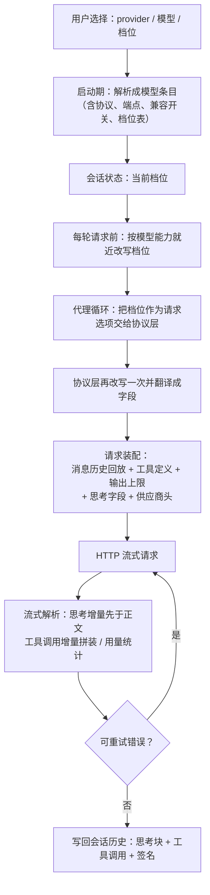

# provider-compatibility - Pi - 01 - OpenCode Go 供应商接入与思考强度传递

---

我想研究的是 1 -- 就是在本地使用 Pi 作为 Coding Agent, 并用 OpenCode Go 作为模型提供商, 并使用 deepseek-v4.1-flash 作为默认模型. 同时允许调整模型思考强度.

我想研究以上这个机制是怎么做的. 是怎么兼容的.

我希望在本地 JadeCode 上搬一下这个机制, 所以我想查看在兼容上都有哪些点需要做. 因此这次我不是单纯地想要了解这个机制的运作过程, 而是想知道源码级的实现是怎样的.

（补充确认：JadeCode 仓库在 `/home/fishandrice/Backend/JadeCode`，需要在笔记末列出 JadeCode 要实现哪些点；目录名使用 `provider-compatibility`（拼写已改正）。）

---

## 1. 场景：Pi 里"换一个供应商"到底换了什么

在 Pi 里把后端换成 OpenCode Go、模型换成 `deepseek-v4.1-flash`、并且能调思考强度，看起来是三件事，实际是三层不同的机制：

1. **供应商层**：把一个"名字 + 密钥来源 + 模型清单 + 协议适配器集合"注册进模型目录；
2. **模型条目层**：每个模型自带它该走哪种线协议、哪个 base URL、有哪些兼容开关、支持哪几档思考强度；
3. **请求装配层**：把"用户选的思考强度"翻译成具体请求字段，并处理历史回放、头、字段名、错误。

Pi 的兼容做法不是"给 OpenCode Go 写一个专用适配器"，而是：**供应商只声明数据，真正的兼容差异全部落在"每个模型条目自带的兼容开关"上**。理解这一点，后面所有细节都能归位。

一个关键前提：Pi 的模型清单（每个模型走哪个协议、哪些模型在售）不是手写的，是构建期从 models.dev 抓取后生成的，生成的 JSON 数据目录被 `.gitignore` 排除（`packages/ai/src/providers/data/`）。所以仓库里能看到的是**供应商注册代码 + 生成脚本里的修正规则**，看不到 `deepseek-v4.1-flash` 这一条的最终字段值。这一点直接决定了本报告的证据分级（见第 6 节）。

---

## 2. 机制展开

### 2.1 供应商 = 一份声明，而不是一段逻辑

OpenCode Go 在 Pi 里的注册体量非常小：一个 25 行的文件就完成了接入。它声明了四件事：

- **身份**：provider id 为 `opencode-go`，显示名 "OpenCode Go"；
- **鉴权**：API key，环境变量 `OPENCODE_API_KEY`（与 OpenCode Zen 共用同一个变量）；
- **模型清单**：来自生成好的 catalog（只有聊天模型，没有分类器模型；相比之下 Zen 变体额外挂了分类器协议）；
- **协议表**：同时挂载四套线协议的适配器——Anthropic Messages、OpenAI Chat Completions、OpenAI Responses、Google Generative AI；每一套都套了一层"注入会话头"的装饰。

模型条目自己决定走哪一套，供应商不决定。这就是为什么同一个 `opencode-go` 下既有走 Anthropic 协议的模型（如 MiniMax M2.7，历史上就因为它不认 Chat Completions 而切到 Anthropic 协议），也有走 Chat Completions 的模型。

对应的两个基础路径（构建期按变体拼出来）：

| 变体 | 基础路径 | 说明 |
|---|---|---|
| `opencode`（Zen） | `https://opencode.ai/inference` | Chat Completions / Responses 再会拼 `/v1`；Anthropic 协议不拼（SDK 自己拼 `/v1/messages`） |
| `opencode-go` | `https://opencode.ai/inference/go` | 同上 |

历史备注：早先用的是 `opencode.ai/zen/...` 路径，后来因 Gemini 模型 404 整体迁到 `inference` 前缀——这解释了为什么老测试里的示例 base URL 还写着 `/zen/v1`。

### 2.2 模型清单是"数据 + 修补规则"

生成脚本对 OpenCode 两个变体的处理顺序值得注意，因为它体现了兼容策略的骨架：

1. 按 models.dev 的 `npm` 包名猜协议：
   - `@ai-sdk/openai` → OpenAI Responses；
   - `@ai-sdk/anthropic` → Anthropic Messages；
   - `@ai-sdk/google` → Google Generative AI；
   - `@ai-sdk/alibaba` → Chat Completions + Anthropic 风格缓存标记；
   - 其它/缺失 → Chat Completions。
2. **逐模型的硬修正**（因为 models.dev 的元数据与真实端点行为不一致）：
   - OpenCode Go 的 `qwen3.5-plus` / `qwen3.6-plus` 被 models.dev 标成 Anthropic 协议，实际 Go 只从 `/v1/chat/completions` 提供，于是强制改成 Chat Completions，并把思考表达方式改成 Qwen 特有的顶层 `enable_thinking`；
   - `kimi-k2.6` 在 Go 上只接受 Anthropic 风格的 thinking 对象，于是把思考表达方式改成 DeepSeek 风格、并关掉"能力位"式的 `reasoning_effort`；
   - Zen 的 `grok-build-0.1` 关掉 `reasoning_effort`；
   - Chat Completions 一律使用 `max_tokens` 字段名；
   - 少数模型（含 `opencode-go:kimi-k2.6`）被登记为"不支持长缓存保留"，发请求时不再附带长保留字段。
3. `deepseek-v4.1-flash` 有一条专门分支：用 models.dev 给出的 `reasoning_options.effort` 值集合，生成这个模型的"思考档位映射"。这条分支存在的原因很具体：通用规则只覆盖 id 里含 `deepseek-v4`（不带 `.1`）或 `deepseek-v4-flash` 的模型，`deepseek-v4.1-flash` 那个点号让通用规则匹配不上，于是必须显式补一次。
4. 最后一轮全局修补：凡走 Chat Completions 且 id 含 `deepseek-v4` 的模型，一律打上"DeepSeek 思考格式 + 历史里必须回放 reasoning 内容"的兼容标记；例外是 OpenRouter 与 Zen（它们保留原生 effort 语义），而 **OpenCode Go 不在例外里**——也就是说 Go 上的 DeepSeek 模型按最严格的 DeepSeek 兼容模式处理。

### 2.3 思考强度：三态映射表 + 就近改写

Pi 内部把思考强度抽象成 7 档：`off / minimal / low / medium / high / xhigh / max`。每个模型可以带一张"档位映射表"，值是**三态**：

- **未设置**：使用供应商默认行为（该档可请求，由服务端兜底）；
- **`null`**：该档不支持；
- **字符串**：该档要发出去的服务商原生值（例如 `"max"`）。

对 `opencode-go/deepseek-v4.1-flash`，Pi 的测试断言其可用档位恰好是 `low / high / max`（没有 off、没有 minimal/medium/xhigh）。这张表由 models.dev 的 effort 值集合生成：`off` 只有在服务商给出 `none` 时才可用，否则记为不支持；`xhigh` 与 `max` 还额外要求"显式声明"才算可用。

**不支持档位的处理方式是"就近改写"，不是报错**：请求 off 会向上找到最近可用的 low；请求 medium 会向上找到 high；请求 xhigh 会向上找到 max。这条规则的后果很实用也很容易被忽视——**在 Go 的 DeepSeek 上，"关掉思考"这个动作实际上不存在**，用户以为关了，实际发出去的是最低档 low。

### 2.4 一次请求的路径

每一层都做"就近改写"是刻意的：上层不知道模型能力细节，下层保证不发出模型不认的档位。代价是"用户请求"与"实际发出"之间可能有偏差，所以响应消息里会记录**请求的档位**，部分协议还会额外记录**服务商实际使用的档位**，用于事后核对（Chat Completions 这条路径只记录请求档位）。

### 2.5 档位翻译成什么字段

翻译不是按供应商写死，而是按"模型的思考表达方式"分支。OpenCode Go 的 DeepSeek 模型走 DeepSeek 分支，行为是：

- 档位是"开着的"（这里 7 档里除 off 都算开）→ 请求体加 `thinking: { type: "enabled" }`；
- 档位被翻译成服务商原生值后写进顶层 `reasoning_effort`（于是这个模型只会出现 `low` / `high` / `max` 三种字符串）；
- off 的写法（`thinking: { type: "disabled" }`）虽然存在，但因为映射表把 off 记为不支持、且会被就近改写成 low，**这个模型实际上永远走不到"关闭"那条分支**。

作为对照，同一条路径上还有别的表达方式（同一份适配器里并列存在，按模型选择）：Qwen 用顶层 `enable_thinking` 布尔值、GLM 用 `thinking.enabled/disabled` + effort、OpenRouter 用嵌套的 `reasoning.effort`、部分自建服务用 `chat_template_kwargs`、还有基于 token 预算的"思考预算"写法。**兼容的本质就是这张"表达方式 × 档位映射"的二维表**，而不是某个供应商的专属代码。

### 2.6 历史回放：思考内容怎么带回去

多轮工具调用时，思考内容要不要回放、以什么字段回放，是兼容差异最大的地方。Pi 的做法是给模型打标记，让"消息转换"阶段按标记决定：

- DeepSeek 系模型（含 OpenCode Go 的 DeepSeek）要求 assistant 消息带 `reasoning_content`；如果这一轮没有思考内容，就补一个空字符串，避免服务端因为缺字段而拒绝；
- 读取流式增量时按 `reasoning_content` → `reasoning` → `reasoning_text` 的顺序取第一个非空字段（有些代理会把同一段内容放两份）；
- **OpenCode Go 专属补丁**：如果服务端把思考放在 `reasoning` 字段，Pi 会把思考块的签名归一成 `reasoning_content`，这样回放时仍然写回 `reasoning_content` 而不是 `reasoning`。这条补丁只针对 `opencode-go`，因为实测就是它这么返回。

### 2.7 会话级头：为什么需要"会话粘性"

OpenCode 的服务端需要每会话的路由标识（代码注释称之为"必需的每会话路由头"，具体用途——路由、计费归属还是缓存分区——仓库里没有说明，属于推断），因此 Pi 会为它注入两个头：

- `x-opencode-session`：会话 id（协议层与会话层各注入一次，后者在没带 id 时不伪造，且调用方显式覆盖时保留调用方值——这是一个回归测试覆盖过的点）；
- `x-opencode-client: pi`：客户端标识。

其余常规头（OpenAI 那套 `session_id` / `x-session-affinity`）对 OpenCode **不发**，因为它的兼容配置里没开这个开关。另外 OpenCode 不使用 `store` 字段、不使用 `developer` 角色，也基本不能用 OpenAI 的 `prompt_cache_key` / `prompt_cache_retention`（只有被登记为支持长保留的模型才带 24h 保留）。

### 2.8 一次完整请求里还有什么

抛开思考强度，OpenCode Go 的 Chat Completions 请求还有这些固定内容：

- 输出上限用 `max_tokens`（不是 `max_completion_tokens`），且被钳到"上下文窗口 − 已用估算 − 安全余量"与模型输出上限的较小值；
- 工具定义用 `function` 形式，**不带 `strict` 字段**（该供应商未被验证支持严格模式）；
- 历史里有工具调用但本轮没有工具时，会补一个空 `tools` 数组（有些代理要求）；
- 流式要 `stream_options.include_usage`；
- 工具调用 id 会做归一化处理（代理链路可能出现超长/非法 id）；
- 错误重试策略是"沿用官方 SDK 语义"：408 / 409 / 429 / 5xx 与网络错误可重试，尊重 `x-should-retry` 与 `retry-after`，超过延迟上限则报错而不是死等。

---

## 3. 条件与边界

1. **默认模型不是自动的**。`opencode-go` 在 Pi 里登记的默认模型是 `kimi-k3`，不是 `deepseek-v4.1-flash`。把用户指定模型设成默认要靠"设置里的默认 provider/模型"或启动参数；显式指定后，会话内切换模型/档位会写入会话记录，恢复会话时按记录还原，不改动全局默认。
2. **模型不在目录里怎么办**。Pi 允许"未知模型 id 作为自定义模型使用"：它继承该供应商默认模型的协议、端点与兼容开关，只替换 id 与名字，并提示"使用自定义模型 id"。也就是说：若目录里没有 `deepseek-v4.1-flash`，你会得到一个**协议与兼容开关都来自别的模型**的条目——档位表也会跟着继承，思考能力很可能对不上。这是移植时最容易踩的坑。
3. **档位是"上取整"**。用户请求任何不支持的档位都不会失败，会被静默改成更接近的高档。这对"我想省钱所以关思考"的场景是反直觉的。
4. **端点语义与协议绑定**。Chat Completions 需要 `/v1` 前缀；Anthropic 协议不要自己加 `/v1/messages`（SDK 拼）。同一供应商两种协议路径不同，配错会 404 而不是明确报错。
5. **供应商级开关会随目录数据漂移**。长缓存保留、严格工具模式、思考字段名这些标记都来自生成期的修补规则；升级 Pi 版本后同一模型的行为可能变化。参考资料里已见到多次针对单模型的补丁提交（低档位、思考关闭参数、reasoning 字段归一、长缓存保留）。
6. **仓库里看不到模型条目的最终值**。数据 JSON 不在版本库内，`/inference/go` 下 `deepseek-v4.1-flash` 的具体协议因此属于"依据生成规则推断"，需要用实测确认（第 7 节给出探测步骤）。

---

## 4. 设计取舍

**为什么把兼容差异做成"每个模型的数据"，而不是"每个供应商的代码"？**
同一个代理（OpenCode Go）后面挂着 DeepSeek、Qwen、Kimi、MiniMax、GLM、GPT、Gemini 等几十个模型，它们的协议与思考表达方式并不一致。按供应商写代码会立刻退化成按模型写代码；把差异下沉成模型条目上的若干开关，供应商注册就能保持十几行，新增模型基本只需要数据更新。

**为什么档位映射是三态而不是布尔？**
"关掉思考"在不同服务商有四种含义：发 `disabled`、不发任何字段、发 `none`、根本不允许关。三态（未设置 / 不支持 / 原生值）能同时表达这四种，而布尔只能表达两种。

**为什么"就近改写"而不是直接报错？**
Pi 把档位当作用户偏好而非硬契约：换模型、恢复会话、切换档位都可能跨能力边界。报错会让"Ctrl+Shift 切模型"这种高频操作频繁中断；就近改写保证请求总能发出去，并用"请求档位 + 实际档位"两个字段留下可追溯性。代价是静默偏差——这也是 JadeCode 需要自己决定策略的地方。

**为什么保留"每次请求都再改一次档位"的两处改写？**
会话层改写服务于 UI 与持久化（显示给用户的就是能用的档位）；协议层改写服务于直接调用协议层（不经过会话）的场景。两层都做，才能保证任何调用路径都不会发出非法档位。

**为什么会话头单独抽一个装饰器？**
它必须在"所有协议适配器"之前生效，而且早先的实现把它和"缓存保留"绑在一起，导致 `cacheRetention: none` 时会话头丢失（这是个修过的 bug）。抽成装饰器后，四套协议自动获得同一行为，并保留了"调用方显式覆盖优先"、"没有会话 id 就不伪造"的语义。

---

## 5. 证据分级

**已证实（源码/测试直接可见）**

- 供应商注册内容：id、显示名、`OPENCODE_API_KEY`、四套协议适配器、会话头装饰、会话头语义（大小写不敏感的调用方覆盖优先、无 id 不伪造）；
- Zen 与 Go 的基础路径为 `https://opencode.ai/inference` 与 `.../inference/go`，Chat Completions/Responses 拼 `/v1`，Anthropic 不拼；
- 逐模型修补规则：Qwen 3.5/3.6 Plus 强制 Chat Completions + `enable_thinking`；Kimi K2.6 用 DeepSeek 风格 thinking 且关闭 `reasoning_effort`；Chat Completions 一律 `max_tokens`；部分模型关闭长缓存保留；
- `opencode-go/deepseek-v4.1-flash` 的可用档位为 `low / high / max`（单元测试直接断言）；
- 档位映射生成规则：effort 值集合 → 三态映射；`off` 仅在服务端给出 `none` 时可用；`xhigh`/`max` 需显式声明；
- 档位不支持的处置是"向上就近改写"；
- DeepSeek 系（含 Go）打上"思考格式 = DeepSeek"与"历史必须回放 reasoning 内容"，OpenCode Go 不在"保留原生 effort"的例外名单里；
- 到处存在的"就近改写"（会话层 + 协议层各一次）；响应会记录请求档位与服务商实际档位；
- 会话头 `x-opencode-client: pi` 由 coding-agent 层注入；OpenAI 那套会话亲和头对 OpenCode 不发；
- `store` / `developer` 角色 / 严格工具模式对 OpenCode 不发，工具用 `function` 形式；
- 重试策略：408/409/429/5xx 与网络错误、尊重 `x-should-retry` 与 `retry-after`；
- 未知模型 id 会继承该供应商默认模型条目（含协议与兼容开关）。

**合理推断（结构支持，但缺最终数据）**

- `opencode-go/deepseek-v4.1-flash` 走 **Chat Completions**，base URL 为 `https://opencode.ai/inference/go/v1`。依据：所有针对 Go 上 DeepSeek 的兼容修补（`thinking` 对象、`reasoning_content` 回放、`max_tokens`）都只存在于 Chat Completions 适配器；生成期把"DeepSeek 兼容标记"施加给所有 Chat Completions 且 id 含 `deepseek-v4` 的条目，而该模型的档位表来自专门分支，说明它同样在 Chat Completions 条目集合里。
- 该模型的档位映射表具体为：`off=不支持, minimal/medium/xhigh=不支持, low="low", high="high", max="max"`。依据：测试断言的可用集合 + `off` 仅有 `none` 才可用的规则。
- 该模型支持 1M 上下文与较大输出上限（与直连 DeepSeek 同类模型一致）。这条只影响默认输出额度与溢出判定，不影响协议兼容。

**无法确认**

- OpenCode Go 是否也为该模型暴露 Anthropic `/v1/messages` 端点（若暴露，移植可以选择复用现有 Anthropic 客户端，大幅减少工作量）；
- 服务端对该模型的 effort 值域是否真的只有三段（仓库只能看到 models.dev 的声明与 Pi 的实测断言，无法看到服务端实现）；
- 该端点的上下文溢出错误文本（决定"超限自救"的关键词表）；
- 是否存在未在 Pi 中修过的行为差异（例如空工具数组是否必需、`reasoning_content` 空串是否必须）。

---

## 6. 源码依据

| 位置 | 内容 |
|---|---|
| `packages/ai/src/providers/opencode-go.ts` | 供应商注册：id、显示名、`OPENCODE_API_KEY`、四套协议适配器、模型清单来源 |
| `packages/ai/src/providers/opencode-headers.ts` | 会话头装饰器；调用方覆盖优先、无会话 id 不伪造 |
| `packages/ai/src/providers/opencode-go.models.ts` | 生成好的 catalog 入口（真正的数据在 gitignore 的 `providers/data/`） |
| `packages/ai/scripts/generate-models.ts:2252-2335` | Zen/Go 基础路径、按 `npm` 猜协议、逐模型修补、`max_tokens`、`deepseek-v4.1-flash` 档位表 |
| `packages/ai/scripts/generate-models.ts:3119-3138` | DeepSeek 兼容标记的全局施加与例外名单（Go 不在例外内） |
| `packages/ai/scripts/generate-models.ts:483-499` | 不支持长缓存保留的 OpenCode 模型集合 |
| `packages/ai/scripts/models-dev-reasoning-options.ts:20-32` | effort 值集合 → 三态档位映射 |
| `packages/ai/src/models.ts:1230-1265` | 可用档位计算与就近改写算法 |
| `packages/ai/src/api/simple-options.ts` | 上下文相关的输出上限钳制、思考预算默认值 |
| `packages/ai/src/api/openai-completions.ts:738-755` | 协议层再次改写档位；`off` 转成"不发送" |
| `packages/ai/src/api/openai-completions.ts:800-1000` | 请求装配：`max_tokens`、`store`、缓存字段、按表达方式分派的思考字段（含 DeepSeek 分支） |
| `packages/ai/src/api/openai-completions.ts:590-620` | 流式思考增量解析与 OpenCode Go 的 `reasoning` → `reasoning_content` 归一 |
| `packages/ai/src/api/openai-completions.ts:1330-1400` | assistant 历史回放：思考签名、`reasoning_content` 空串补全 |
| `packages/ai/src/api/openai-completions.ts:1484-1518` | 工具 schema 转换：`function` 形式、按兼容开关决定是否带 `strict` |
| `packages/ai/src/api/openai-completions.ts:1600-1700` | 从 provider/baseURL 自动推断兼容开关，再被模型自带开关覆盖 |
| `packages/ai/src/env-api-keys.ts:113-114` | Zen 与 Go 共用 `OPENCODE_API_KEY` |
| `packages/ai/src/utils/provider-retry.ts:1-60` | 可重试状态码、`x-should-retry`、`retry-after` |
| `packages/agent/src/agent.ts:465-475`、`agent-loop.ts:180-240,380-410` | 会话档位进入请求选项；响应记录请求档位 |
| `packages/coding-agent/src/cli/args.ts:167-175,302-325` | `--thinking` 参数与 `provider/id:级别` 简写 |
| `packages/coding-agent/src/core/model-resolver.ts:45-50,296-307,445-545,550-600` | 各供应商默认模型、未知 id 的"自定义模型"继承、启动模型优先级 |
| `packages/coding-agent/src/core/agent-session.ts:2565-2712` | 档位设置/循环/可用档位、每模型档位覆盖、会话持久化 |
| `packages/coding-agent/src/core/provider-attribution.ts:64-90` | 注入 `x-opencode-session` 与 `x-opencode-client: pi` |
| `packages/coding-agent/src/core/sdk.ts:340-375` | 请求头合并、超时与重试参数注入 |
| `packages/coding-agent/docs/models.md:31-35`、`docs/settings.md:11-17` | 档位选择、每模型/全局默认档位、会话记录语义 |

---

## 7. JadeCode 需要实现哪些点

前置判断：JadeCode 目前是 **Anthropic Messages 单协议**，思考强度已经存在但形态完全不同（可选档位由客户端硬编码、按主机名区分、用 `thinking.type` + `output_config.effort` 表达）。Pi 的机制搬到 JadeCode，本质上是三件事：**加协议、把"供应商/模型能力"从主机名硬编码改成数据、把档位表达对齐到 `reasoning_effort`。**

### 7.1 必须先验证（决定工作量，一小时以内）

1. 用 `OPENCODE_API_KEY` 探测 `POST https://opencode.ai/inference/go/v1/chat/completions`，模型 `deepseek-v4.1-flash`，带 `thinking: {type:"enabled"}` + `reasoning_effort:"low"`；
2. 同一把 key 探测 `POST https://opencode.ai/inference/go/v1/messages`（Anthropic 协议）。**若 200**，JadeCode 可以只改思考字段与端点识别，不必新增协议客户端；**若 404/400**，则必须实现 Chat Completions 客户端（7.3）；
3. 探测三档 `low / high / max` 是否都被接受、`medium` 与 `off` 是否被拒或忽略（决定档位表）；
4. 故意超长上下文，抓错误文本（决定溢出关键词表）。

### 7.2 配置与身份层（必做）

- `AppConfig` 目前只有 apiKey / baseUrl / model / maxTokens；需要增加**供应商语义**（例如 `provider: "opencode-go"`），否则所有行为只能靠 URL 猜。对应现状：`AnthropicSdkLlmClient` 用 `api.deepseek.com` 主机名决定思考档位与 `thinking.type` 取值，`opencode.ai` 会落到"只有 default 一档"的分支。改数据驱动，避免再加一个主机名分支。
- base URL 语义要写清：Chat Completions 需要显式 `/v1`，Anthropic 协议不要带 `/v1/messages`（SDK 拼）。JadeCode 现有注释已说明 SDK 会拼 `/v1/messages`，迁移时要区分两种协议，不能让同一个 `baseUrl` 字段承担两种语义。

### 7.3 协议层（若 7.1 第 2 步失败则必做）

新增一个 `LlmClient` 实现（OpenAI Chat Completions 流式），与现有 Anthropic 客户端并列，都只暴露内部 `CompleteRequest` / `ModelResponse`：

- **请求装配**：`system` → 首条 system 消息；工具 → `function` 形式（不发 `strict`）；输出上限用 `max_tokens`；`stream: true` + 流式用量。
- **消息转换**：assistant 文本必须是纯字符串（数组形式会被某些模型镜像成嵌套输出）；工具调用 → `tool_calls`；工具结果 → `role: "tool"` + `tool_call_id`；连续多结果需要拆成多条 tool 消息。
- **流式解析**：`delta` 里先取思考再取正文；工具调用按 index 增量拼装参数 JSON；`finish_reason` 映射到内部 stopReason；`usage` 可能出现在 chunk 顶层或 `choice` 内，两处都要认。
- **思考回放**：assistant 历史带 `reasoning_content`，缺失时补空串（Pi 的 DeepSeek 兼容标记就是这样做的）；内部 `ThinkingBlock.signature` 目前承载 Anthropic 签名，需要能表达"这段思考应回放为 `reasoning_content`"这一语义，否则多轮工具调用会被服务端拒绝。
- **思考内容提取**：把 `reasoning_content` / `reasoning` 都当思考增量；JadeCode 侧需要决定是否像 Pi 那样把签名归一为 `reasoning_content`（若服务端真的把思考放 `reasoning`，不回放会丢失上下文连续性）。

### 7.4 思考强度（必做，且是本次目标的核心）

- **档位表按模型而非主机**：为 `deepseek-v4.1-flash` 登记 `low / high / max`，`off/minimal/medium/xhigh` 不可用。JadeCode 现有 `thinkingChoices()` 返回的是枚举全集的子集，语义已经接近 Pi 的映射表，但取值来源要改成"供应商档案 + 模型能力表"。
- **请求字段换成 `reasoning_effort`**：当前实现发的是 `thinking.type` + `output_config.effort`（Anthropic 形状）。Chat Completions 上应发 `thinking: {type: "enabled"}`（开启时）+ 顶层 `reasoning_effort: "low"|"high"|"max"`。
- **关闭思考不存在**：这个模型没有 off。JadeCode 现在遇到不在 `thinkingChoices()` 里的值会**直接抛错**，而 Pi 是**就近改写成 low**。二选一必须显式决定：改写成 low（与 Pi 一致，但用户以为关了其实没关）或拒绝并提示（更诚实，需要 UI 支持）。建议：保留抛错语义，同时在可用档位里不展示 off，避免"静默降级"。
- **`default` 的语义**：JadeCode 用 `DEFAULT` 表示"不发参数"，并提供 `thinkingLabel` 让界面显示成服务商默认档位（DeepSeek 上是 `high`）。这套设计可以直接复用：OpenCode Go 上的 default 就是服务端默认（很可能等价于 high），显示文案需要跟着供应商档案走，而不是按主机名判断。
- **辅助请求**（压缩/摘要）现在用"支持 off 就发 off，否则发 default"的策略。这个模型不支持 off，会退化成 default——需要确认压缩请求也能接受思考开销，或者显式选最低可用档 low。

### 7.5 会话粘性头（必做）

发请求时加 `x-opencode-session: <会话 id>`（JadeCode 已有会话 id 概念），可选加 `x-opencode-client: jadecode`。注意三点：所有协议都要带；没有会话 id 时不要伪造；调用方显式配置了同名头要保留调用方值。若不加，请求多半仍能成功，但依赖该头的会话级功能（路由/归属一类）行为会偏——属于"不报错但行为不对"的坑，具体影响面需实测确认。

### 7.6 模型能力数据（必做的最少部分）

- `ModelMetadataResolver` 只对 `api.deepseek.com` 与 `api.anthropic.com` 两个官方主机做参数发现。`opencode.ai` 会被判为"未适配端点"，输出上限靠 `maxTokens` 手动值或未知回退。迁移时要么加一条 OpenCode 的目录查询适配，要么在配置里显式提供上下文/输出上限（JadeCode 已有手动覆盖机制，可以直接用）。
- 需要一份最小能力表：上下文窗口、输出上限、是否支持思考、可用档位。这四项决定了 Pi 里"输出上限钳制 + 档位表"两个机制，缺一个就会出现"请求被服务端拒绝"或"档位选不到"。

### 7.7 边界与失败路径（必做，容易漏）

- **缓存字段**：不要发 `prompt_cache_key` / `prompt_cache_retention`；不要把 OpenAI 的会话亲和头（`session_id` / `x-session-affinity`）发给 OpenCode。
- **不发的字段**：`store`、`developer` 角色、工具 `strict` 字段——Pi 对这些都关着。
- **上下文溢出识别**：`ContextCompactor.isContextOverflow` 只认 `prompt_too_long` 与 `too many tokens` 两个子串。Chat Completions 的典型错误文本（如 maximum context length / context_length_exceeded）**不匹配**，超限自救会失效。迁移时必须补关键词。
- **重试**：JadeCode 需要在协议层或客户端层补"408/409/429/5xx + 网络错误可重试，尊重 `retry-after`，超过延迟上限直接失败"的策略；否则一次限流就会把整个任务打断。
- **未知模型 id**：如果只改配置里的 `model` 字符串而目录里没有这条记录，JadeCode 不会像 Pi 那样"继承同供应商默认条目"，只会用一份没有协议/档位信息的配置——所以供应商档案必须是显式数据，不能依赖目录命中。

### 7.8 不建议照搬

- models.dev 抓取与代码生成流水线（JadeCode 只需要一份几十行的静态能力表）；
- 分类器模型、图像模型、思考 token 预算、缓存预热、跨供应商会话交接；
- 四协议并行挂载（JadeCode 只需要 Anthropic + Chat Completions 两套）。

### 7.9 建议实施顺序

1. **先探测**（7.1）→ 确定是否要写新协议客户端；
2. **再拆耦合**：把"供应商行为"从主机名判断改成配置/档案驱动，档位表变成模型数据（此时行为不变，纯重构，可用现有 DeepSeek 端点回归）；
3. **接入 OpenCode Go**：端点 + 会话头 + `max_tokens` + `reasoning_effort`；
4. **补齐边界**：思考回放、溢出关键词、重试、辅助请求的档位降级；
5. **验收**：同一任务下 low/high/max 三档各跑一轮，确认请求体字段与响应里的思考增量、工具调用连续性、以及"请求档位 vs 实际档位"可观测。
