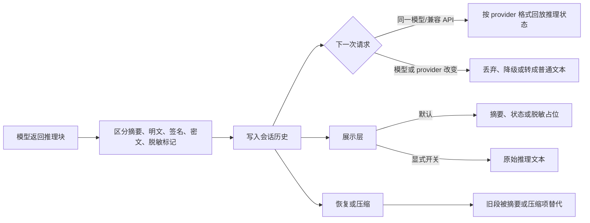

# reasoning-propagation - comparison - 01 - 思维链回传机制

---

Pi, Codex 和 Claude Code 会把思维链回传吗?

---

## 结论先行

会，但“回传”需要分成四层看：

| 回传环节 | 结论 |
|---|---|
| 模型是否下发推理内容 | 三者都能接收，但收到的可能是摘要、明文推理、脱敏块、签名或加密载荷，不等于完整的隐藏思维链 |
| 是否写入会话记录 | 三者都会把收到的推理块或推理项写入各自的会话历史 |
| 下一轮是否再次交给模型 | 三者都会，且通常是整套 active history 的一部分；但受模型切换、压缩、失败消息过滤和 provider 格式影响 |
| 是否展示给用户 | 不保证。通常默认只展示摘要、脱敏占位或状态；原始推理需要额外开关，或被 provider 直接省略 |

所以最准确的说法是：

> Pi、Codex 和 Claude Code 都会把 provider 返回的“推理状态”回放给模型，以保持工具调用续轮和跨轮连续性；它们通常不会把模型内部完整思维链原样展示给用户。客户端能保存和回传的，只是 provider 实际下发的文本、摘要、签名和加密块。

## 场景

用户让 Agent 执行一个需要多步工具调用的任务。模型先思考，再调用工具；工具结果返回后，模型继续调用下一次工具，最后给出回答。

这里至少有两种连续性：

1. **模型连续性**：同一轮工具循环内，后一次模型调用需要知道前一次调用的推理状态，否则可能出现工具调用与推理项不配对、签名失效或上下文断裂。
2. **用户可见性**：用户是否需要看到模型为什么这样做。

两者不是同一个问题。一个 harness 可以完整保存并回放推理块，却在界面上只显示“Thinking…”；也可以在界面上展示摘要，但不把摘要当作下一轮的独立普通文本重新发送。

## 机制展开

### 1. 三者收到的东西并不一样

Codex 的响应项里有一类独立的推理项，可能同时包含三段信息：

- 给用户看的推理摘要；
- 可选的明文推理内容；
- provider 生成的加密内容。

Codex 请求 OpenAI Responses API 时会主动要求返回加密推理内容，因此 OpenAI 路径通常依赖“摘要 + 加密状态”保持连续性，而不是依赖可读的完整思维链。非 OpenAI 请求会清理多数普通消息和工具项的加密字段，但推理项与压缩项例外，仍保留各自的加密载荷；推理项本身也继续留在历史中。

Claude Code 接收的是 Anthropic 风格的 `thinking` 或 `redacted_thinking` 内容块。普通思考块带有思考文本和签名；脱敏思考块没有可读文本，只有一段不透明数据。签名不是给人看的推理，而是服务端验证“这个思考块确实来自该模型和这次轨迹”的凭证。

Pi 在统一模型层使用同一种思考块表示，里面可以放可读文本、provider 专属签名、脱敏标记。不同 provider 的落地形式不同：

- Anthropic 路径回放 `thinking` 和 `redacted_thinking`；
- OpenAI Responses 路径把序列化后的推理项重新放进输入；
- Google 路径依赖 thought signature，且只在同 provider、同模型时保留；
- OpenAI-compatible 路径可能回放 `reasoning_details`，也可能回放 `reasoning_content` 一类字段。

因此，“三者都会回传”不等于“三者回传同样的内容”。共同点是回放推理状态，差异在于各 provider 的封装格式和可读性。

### 2. 推理块如何进入下一轮

Codex 的下一轮请求直接来自当前历史快照。推理项不是旁路日志，而是历史消息的一部分；构造请求时，历史被格式化后整体交给模型。OpenAI 请求还会声明需要推理加密内容。只要历史窗口没有被压缩或回滚替换，推理项就会随其他历史项一起再次发送。

Claude Code 的下一轮请求会先对消息链做归一化，再转换成 API 消息参数。归一化会处理工具调用配对、尾随思考块、孤立思考消息等问题，但不会无条件删除所有思考块；正常路径下，思考块和签名会随 assistant 消息一起回放。内部构建在模型 fallback 时会主动剥离签名块；源码注释还指出凭据变化也可能使签名失效，但快照中可确认的自动剥离调用点主要是内部 fallback。

Pi 的 Agent 核心在每次模型调用前把消息转换成 LLM 消息，默认原样传递标准 assistant 消息。真正决定是否仍保留思考块的是 provider 适配前的统一变换：只有生产者与消费者是同一 provider、同一 API、同一模型时，思考块才进入请求；换模型时直接丢弃，避免把别的模型的签名或可读思考当成新模型自己的上下文。

### 3. 保存与恢复

三者都把推理状态写入本地会话记录，但存储形态不同：

- Codex 把推理项作为 rollout 响应项持久化，恢复时重新投影历史；
- Claude Code 把 assistant 消息整体写入会话 JSONL，消息内容数组中可包含思考块；
- Pi 把完整 assistant 消息追加到会话树 JSONL，思考文本和签名都在消息对象里。

因此，恢复会话时，推理块通常也一起恢复。但“恢复到本地记录”不等于“下一次一定回放”：压缩会把旧记录排除出模型视图，切换模型会让 Pi 丢弃旧思考块，Claude Code 的签名失效路径也可能剥离它们。

### 4. 用户究竟能看到什么

Codex 默认展示推理摘要，不展示原始推理。原始推理只有显式打开对应设置后才进入界面事件。无头 JSONL 输出也只输出摘要；如果把原始推理打开，终端的人类可读输出会优先使用原始内容，否则退回摘要。

Claude Code 的交互式首方路径更严格：默认会给 API 加“思考脱敏”能力，服务端返回不可读的脱敏思考块，界面只显示一个思考状态占位；即使收到普通思考块，普通对话视图也会隐藏已完成的思考，只有在 transcript、verbose 或流式思考的短暂展示窗口中才可能看到。SDK/print 路径不做同样的交互式脱敏，因此 `stream-json` 消息中可能带完整的 assistant 思考块。

Pi 默认更直接：思考块可见，且可以在界面里点击折叠或展开；但 `-p` 的纯文本输出只打印最终文本，`--mode json` 和 RPC 会转发包含思考块的消息事件。Pi 是否真的显示可读推理，仍取决于 provider 返回的是摘要、完整文本还是脱敏块。

### 5. 压缩后的边界

压缩是三者差异最大的地方。

Codex 的默认远端压缩会用供应商返回的加密压缩项替换旧窗口，旧推理项不再逐条回放；压缩后保留的近期消息和重新渲染的上下文仍可能带推理项。

Claude Code 的整段压缩会把旧消息替换成一份摘要消息，压缩后保留的尾部消息仍可带思考块；摘要请求本身关闭思考。它的上下文管理还可能按 API 侧规则清理旧思考轮次，长时间缓存失效后只保留最后一轮思考。

Pi 的压缩同样用摘要替换旧段，且明确在摘要输入中省略思考内容；压缩后保留的近期消息仍保留思考块。原因是可读思考通常是推理摘要，且换模型后未必仍属于“当前模型的活上下文”，把它塞进摘要请求可能比被摘要的原文还大。

## 条件与边界

| 条件 | Codex | Claude Code | Pi |
|---|---|---|---|
| 默认是否请求思考 | 取决于模型与推理强度；默认摘要为自动 | 支持思考的模型默认开启，除非用户关闭 | 支持推理的模型默认请求 medium |
| 默认用户可见性 | 推理摘要可见，原始内容默认不可见 | 交互式首方默认脱敏；普通视图隐藏已完成思考 | 默认显示思考块 |
| 是否有原始内容 | 只有 provider 实际下发时才保存 | 只有非脱敏路径或设置允许时才可读 | 取决于 provider；Anthropic 默认请求摘要显示 |
| 是否持久化 | 是，rollout 保存推理项 | 是，会话 JSONL 保存消息内容块 | 是，会话树 JSONL 保存完整消息 |
| 跨轮回放 | 是，除非被压缩或回滚 | 是，除非被压缩、尾部/孤立清理或签名失效剥离 | 是，仅同一 provider/API/模型 |
| 换模型 | 不按模型逐个过滤推理项；模型切换前通常先压缩旧窗口 | 内部构建的 fallback 会剥离签名块 | 旧模型思考块直接丢弃 |
| 工具续轮 | 推理项随历史进入后续请求 | 思考块必须与同一次 assistant 轨迹保持配对 | 思考块随 assistant 消息进入工具循环 |
| 压缩 | 旧窗口由加密压缩项替代 | 旧消息由摘要替代，尾部思考可保留 | 旧消息由摘要替代，尾部思考可保留 |
| 失败或中断 | 只有完成的响应项进入历史 | 流式 fallback 会清理孤儿消息；恢复时过滤孤立思考 | 已结束但错误/中止的 assistant 消息会在回放时跳过 |

还有两个容易混淆的点：

1. **“保存在磁盘”比“回放给模型”更宽。** 失败尝试、被压缩掉的旧段、换模型前产生的思考，都可能仍留在本地文件中，但不会进入下一次请求。
2. **“可读文本”不等于“真实完整思维链”。** 服务端可能只返回摘要、thought summary 或脱敏块；客户端源码无法还原服务端没有下发的部分。

## 设计取舍

**回放推理状态，而不是把推理当普通聊天文本。** 推理块常带有模型绑定签名，直接当文本回放会污染新模型的可见上下文；保留结构化块能让 provider 自己校验和恢复状态。代价是每个 provider 都要维护不同格式，且切换模型时必须主动丢弃不兼容状态。

**默认不公开原始思考。** 这降低了隐私、训练数据泄漏和提示注入风险，也避免用户把摘要误认为完整推理。代价是调试和可解释性变差，需要额外开关或 transcript 视图。

**把压缩边界当作真正的上下文边界。** 旧推理不会无限增长，而是被摘要或加密压缩项替代；近期工具调用链仍保留，避免压缩破坏正在进行的任务。代价是压缩后模型无法逐字看到旧推理，只能依赖摘要。

**Pi 更强调本地可观察性，Claude Code 更强调交互式脱敏，Codex 更强调服务端加密状态。** 这是由各自 provider 策略和产品定位决定的，不是三者对“思维链”概念有不同的本体论。

## 证据分级

**已证实**

- Codex 的推理项包含摘要、可选明文和加密内容，并会被持久化；请求 OpenAI Responses 时会要求推理加密内容。
- Codex 默认显示推理摘要，原始内容由显式开关控制；无头 JSONL 只输出摘要。
- Claude Code 会解析 `thinking`、`redacted_thinking` 及其签名，并把 assistant 消息内容块传入下一轮 API 请求。
- Claude Code 交互式首方默认启用思考脱敏；普通视图隐藏已完成思考，transcript/verbose 和流式窗口存在例外。
- Claude Code 会话 JSONL 保存完整 assistant 消息内容；恢复和压缩路径会过滤尾部、孤立思考块。
- Pi 的统一思考块包含文本、签名和脱敏标记；Agent 核心和会话持久化都不会主动删除思考内容。
- Pi 只在同一 provider、同一 API、同一模型时回放思考；换模型时丢弃旧思考块。
- Pi 的 OpenAI Responses、Anthropic、Google 和 OpenAI-compatible 适配器分别以不同格式回放思考状态。
- 三者压缩后的旧历史都会离开模型视图，保留段的思考块是否能回放取决于各自边界。

**合理推断**

- 三者保留推理块的主要动机是工具调用连续性、provider 签名校验和缓存/上下文一致性；源码注释能支持这一动机，但具体线上收益比例无法从仓库确认。
- Claude Code 的交互式脱敏与 Pi 的可读思考默认值，分别反映了“降低暴露面”和“本地可观察性优先”的产品取舍。

**无法确认**

- provider 服务端实际是否总是返回摘要、明文或加密内容；本地源码只能确认客户端如何处理。
- Codex 线上默认模型是否总是支持推理摘要、实际返回哪些字段，以及服务端是否在特定账户上关闭思考。
- Claude Code 在用户中途关闭思考后，API 是否接受历史中的旧思考块；快照中的注释描述了约束，但客户端没有统一的“关闭思考即剥离”路径。
- Pi 各 provider 的真实输出形态和默认 `thinkingDisplay` 服务端行为；适配器只定义了客户端请求和回放规则。

## 源码依据

以下路径均相对各自仓库根目录。

| 项目 | 路径 | 关键位置 |
|---|---|---|
| Codex | `codex-rs/protocol/src/models.rs` | `ResponseItem::Reasoning` 定义（约 1069 行） |
| Codex | `codex-rs/codex-api/src/sse/responses.rs` | 推理摘要、推理文本与输出项解析（约 379–476 行） |
| Codex | `codex-rs/core/src/session/turn.rs` | 历史请求输入、模型切换前压缩、推理流事件（约 511、1342、3049、3125 行） |
| Codex | `codex-rs/core/src/stream_events_utils.rs` | 完成的推理项写入会话历史（约 96、315 行） |
| Codex | `codex-rs/core/src/session/mod.rs` | `record_conversation_items` 与 rollout 写入（约 3602 行） |
| Codex | `codex-rs/rollout/src/policy.rs` | 推理项持久化策略（约 80 行） |
| Codex | `codex-rs/core/src/client.rs` | 请求构造、`reasoning.encrypted_content`、非 OpenAI 只清理非推理/压缩项的密文（约 956–1034 行） |
| Codex | `codex-rs/core/src/context_manager/history.rs` | `for_prompt` 历史投影（约 603 行） |
| Codex | `codex-rs/core/src/session/step_settings.rs` | 默认推理摘要解析（约 63 行） |
| Codex | `codex-rs/core/src/compact.rs` | 压缩请求沿用推理设置并记录压缩输出项（约 790–845 行） |
| Codex | `codex-rs/core/src/config/mod.rs` | `hide_agent_reasoning`、`show_raw_agent_reasoning` 默认值（约 699–703、4529–4532 行） |
| Codex | `codex-rs/tui/src/chatwidget/protocol.rs` | 原始推理事件的显示开关（约 143 行） |
| Codex | `codex-rs/exec/src/event_processor_with_human_output.rs` | 摘要/原始推理的终端选择（约 485 行） |
| Claude Code | `src/services/api/claude.ts` | 思考块解析、签名累积、assistant 消息生成（约 2030–2210 行） |
| Claude Code | `src/services/api/claude.ts` | `assistantMessageToMessageParam` 保留内容块（约 633 行） |
| Claude Code | `src/utils/messages.ts` | `normalizeMessagesForAPI`、尾部/孤立思考过滤（约 1989、4781、4991 行） |
| Claude Code | `src/utils/messages.ts` | `stripSignatureBlocks`（约 5066 行） |
| Claude Code | `src/utils/betas.ts` | 交互式首方默认启用思考脱敏（约 264–276 行） |
| Claude Code | `src/utils/settings/types.ts` | `alwaysThinkingEnabled` 与 `showThinkingSummaries` 设置（约 696、956 行） |
| Claude Code | `src/query.ts` | 思考回放约束注释与内部 fallback 剥离（约 152–161、928 行） |
| Claude Code | `src/utils/sessionStorage.ts` | 消息记录、JSONL 写入队列（约 606、650、1408 行） |
| Claude Code | `src/components/Message.tsx` | `thinking`/`redacted_thinking` 的显示条件（约 524–541 行） |
| Claude Code | `src/components/Messages.tsx` | 流式思考的短暂显示窗口（约 382、714 行） |
| Claude Code | `src/services/compact/compact.ts` | 压缩摘要请求关闭思考、压缩后消息重建（约 328、1293–1305 行） |
| Claude Code | `src/services/compact/apiMicrocompact.ts` | API 侧思考轮次清理（约 71–86 行） |
| Claude Code | `src/cli/print.ts` | `stream-json` 输出（约 848–884 行） |
| Pi | `packages/ai/src/types.ts` | `ThinkingContent` 与签名/脱敏字段（约 420 行） |
| Pi | `packages/coding-agent/src/core/messages.ts` | `convertToLlm` 原样传递标准消息（约 148 行） |
| Pi | `packages/coding-agent/src/core/agent-session.ts` | `message_end` 持久化完整 assistant 消息（约 1148 行） |
| Pi | `packages/coding-agent/src/core/session-manager.ts` | `appendMessage` 与 JSONL 追加（约 1187、1204 行） |
| Pi | `packages/ai/src/api/transform-messages.ts` | 同模型才保留思考；跨模型丢弃（约 125–135 行） |
| Pi | `packages/ai/src/api/openai-responses-shared.ts` | 序列化推理项回放（约 278–285 行） |
| Pi | `packages/ai/src/api/openai-responses.ts` | 请求 `reasoning.encrypted_content`（约 398–408 行） |
| Pi | `packages/ai/src/api/anthropic-messages.ts` | `thinking`/`redacted_thinking` 回放、默认摘要显示（约 1294、1442–1477 行） |
| Pi | `packages/ai/src/api/google-shared.ts` | thought signature 的同 provider/同模型限制（约 116–161、233–267 行） |
| Pi | `packages/ai/src/api/openai-completions.ts` | `reasoning_details`/`reasoning_content` 回放（约 1312–1393 行） |
| Pi | `packages/coding-agent/src/core/defaults.ts` | 默认思考级别 medium（约 3 行） |
| Pi | `packages/coding-agent/src/core/settings-defaults.ts` | 默认显示思考块（约 27 行） |
| Pi | `packages/coding-agent/src/modes/interactive/components/assistant-message.ts` | 思考块渲染与折叠（约 118–150 行） |
| Pi | `packages/coding-agent/src/modes/print-mode.ts` | 纯文本只输出最终文本；JSON 输出完整事件（约 110、150 行） |
| Pi | `packages/coding-agent/src/modes/rpc/rpc-mode.ts` | RPC 转发完整会话事件（约 355 行） |
| Pi | `packages/coding-agent/src/core/compaction/utils.ts` | 摘要输入明确省略思考（约 114 行） |
| Pi | `packages/agent/test/e2e.test.ts` | 思考内容块保留测试（约 243 行） |
| Pi | `packages/ai/test/transform-messages-cross-model-thinking.test.ts` | 跨模型思考丢弃测试（约 38 行） |
| Pi | `packages/ai/test/openai-responses-reasoning-replay-e2e.test.ts` | OpenAI Responses 推理回放测试（约 17 行） |
