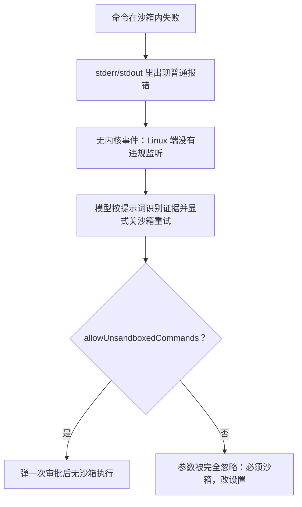

# Sandbox - Claude Code - 01 - Linux 运行时沙箱：逐命令字符串包装与挂载白名单

---

探索一下 Codex 和 Claude Code 的运行时沙箱是怎么做的.

（本轮范围约定：覆盖强制层、失败与降级、工具覆盖面；不展开网络出站白名单/代理策略；只看 Linux，不看 macOS 与 Windows；只做源码静态推断，不做运行验证。）

---

## 结论先说

- 沙箱是**逐条命令的字符串包装**：把待执行命令拼成 `bwrap <参数> -- <shell> -c '<包装后的脚本>'`。没有守护进程、没有容器、没有常驻沙箱会话，每条命令都新建一次命名空间与挂载视图。
- 真正的实现**不在本仓库**，而在依赖包 `@anthropic-ai/sandbox-runtime`（随 `node_modules` 一起存在于快照里）。Claude Code 侧只做两件事：把设置与权限规则翻译成"读允许/读拒绝/写允许/写拒绝/网络域名"五张清单，以及决定"这条命令要不要包"。
- Linux 上的强制手段是 bubblewrap（文件系统视图 + PID / 网络命名空间）加一个**预编译的 seccomp 过滤器**；过滤器只拦"创建 Unix socket"，而且必须在沙箱内的 socat 桥启动**之后**才套上。
- 文件系统模型是"整盘只读 + 写白名单 + 危险文件/目录黑名单"，读侧是"默认全可读 + 显式读黑名单"。默认并不最小化，可用性优先。
- 只有 shell 类工具被包。Read / Edit / Write / Glob / Grep / WebFetch 等内置工具在主进程内存里直接跑，不经过内核边界。
- Linux 上没有内核级违规上报通道：拒绝只能靠命令的普通报错文字被模型（或用户）看出来，然后按提示词要求"立刻显式关沙箱重试"，此时走一次人工审批。

## 场景

沙箱默认不开启（`sandbox.enabled` 缺省为 false）。开启之后，模型跑 `npm test` 会先进沙箱；如果测试要写 `~/.npm` 之外的某个位置，进程会拿到 `EPERM`；模型被提示词要求识别这类"操作不被允许"的信号，然后带 `dangerouslyDisableSandbox: true` 重跑一次——这一步会弹审批。整条链条里没有一步是内核主动通知的。

## 一、开关与档位（决定"包不包"）

| 设置项 | 缺省 | 作用 |
|---|---|---|
| `sandbox.enabled` | false | 总开关 |
| `sandbox.failIfUnavailable` | false | 依赖缺失时是否启动即失败；false 时只警告，命令**不沙箱**执行 |
| `sandbox.autoAllowBashIfSandboxed` | true | 沙箱化的命令是否自动放行（跳过审批） |
| `sandbox.allowUnsandboxedCommands` | true | 模型的 `dangerouslyDisableSandbox` 参数是否生效 |
| `sandbox.excludedCommands` | 空 | 命中就不进沙箱；注释自述"不是安全边界" |
| `sandbox.enabledPlatforms` | 未设置 | 未公开的平台白名单，可按平台关闭 |

依赖检查是硬条件：缺 `bwrap` 或 `socat` 视为**错误**（沙箱不可用），缺 seccomp 产物（预生成 BPF 或应用器）只是**警告**（降级为"不拦 Unix socket"）。平台支持列表包含 Linux 与 WSL2，WSL1 明确不支持。

这里有一个容易被忽略的安全后果：`enabled=true` 但依赖缺失时（且 `failIfUnavailable=false`）沙箱会静默不生效。源码里专门为此加了一个"启动时解释为什么沙箱没起来"的函数，注释直白地写着"用户配了 allowedDomains 却什么都没生效，这是安全陷阱"。

## 二、一条命令怎么被包起来

参数顺序是固定的：

1. `--new-session --die-with-parent`。
2. 文件系统挂载参数（见下一节）。
3. `--dev /dev`（永远补上）。
4. `--unshare-pid`，再按"弱嵌套沙箱"开关决定是否 `--proc /proc`（注释说明：不隔离 PID 就能逃逸；不挂新 `/proc` 就能读到宿主进程信息，但部分无特权容器不允许挂）。
5. 需要限制网络时 `--unshare-net`。
6. `-- <shell> -c <命令字符串>`。

命令字符串本身可能再被包一层：需要限制网络时，先在沙箱内后台起两个 socat 监听（3128 HTTP、1080 SOCKS），把本地端口转发到绑进命名空间的 Unix socket，然后用 `trap` 在退出时杀掉它们；真实命令交给 seccomp 应用器执行。

注意这里的分层顺序是被逼出来的：socat 必须能创建 `AF_UNIX` socket，用户命令不能。所以 seccomp 不能出现在外层 bwrap 的参数里，只能在"桥建好之后"由内层应用器套上。

三段实现细节：

- **包装是字符串拼接**，用 shell 转义库把每段引起来，最终由外层 shell 再解析一次。好处是与现有 Bash 工具无缝；代价是"沙箱参数"与"用户命令"共享同一层 shell 解析，行为依赖转义库。
- **cwd 追踪也在沙箱内做**：命令尾部会写一个 `cwd-<id>` 文件到沙箱可写的临时目录，命令结束后由主进程读回、更新会话 cwd。所以沙箱模式下 tmp 目录必须可写。
- **命令结束后清理**：bwrap 为"不存在的拒绝路径"在宿主上创建的空文件/空目录必须由主进程删除（否则工作区里会出现幽灵 dotfile）；这套清理在每个沙箱命令结束后同步执行。

## 三、文件系统视图怎么拼

基线二选一：有写限制时 `--ro-bind / /`（整盘只读），没有时 `--bind / /`（整盘可写）。真正复杂的是在只读根上叠白名单与黑名单。

**写侧（黑名单包在白名单里）**

1. 对每个 `allowWrite`：先规范化（展开 `~`、相对路径转绝对、解析符号链接），跳过 `/dev/*`（`--dev /dev` 已覆盖）、跳过不存在的路径；**如果路径本身是符号链接且解析到预期边界之外，整条授权直接作废**——因为 bubblewrap 会跟随符号链接，`--bind` 一个链接等于授权它的目标。
2. 对每个 `denyWrite`：若它在某个白名单路径内 → `--ro-bind` 扣回只读；不在白名单内则不必处理（本来就只读）。
3. 对**不存在**的 `denyWrite`：只有当"最近存在祖先"落在白名单内时才处理——把 `/dev/null`（叶子路径）或空目录（中间组件）挂到**第一个不存在的组件**上，目的是阻止"先建目录再写"。空目录与空文件的区分是为了别让中间组件看起来像文件、破坏需要穿越它的工具。挂上去的占位会在宿主上真的创建文件，因此要跟踪并在命令结束后清理。
4. 对路径里存在**可写符号链接组件**的拒绝路径：不挂它的解析目标，而是把 `/dev/null` 挂到那个符号链接本身。理由和上面一样：解析结果是快照，沙箱内可以先换掉链接。

**读侧（拒绝清单）**：目录 → 直接 `--tmpfs` 盖住（内容消失）；文件 → `--ro-bind /dev/null`。`allowRead` 可以把被盖住区域里的子路径用 `--ro-bind` 重新绑回来（"读允许覆盖读拒绝"）。Linux 上 bubblewrap 不认 glob，所以 glob 模式在主进程里先展开成具体路径（用结点 `readdirSync` 递归或 ripgrep）。

**默认黑名单的两层来源**

- 依赖包内置的"危险文件/目录"：`.gitconfig`、`.gitmodules`、`.bashrc`、`.bash_profile`、`.zshrc`、`.zprofile`、`.profile`、`.ripgreprc`、`.mcp.json`，以及 `.vscode`、`.idea`、`.claude/commands`、`.claude/agents`；`.git` 只拦 `hooks/` 与（默认）`config`，因为 git 操作本身需要写 `.git`。这些还会用一次 ripgrep 扫描把子目录里的同名危险文件也找出来（有深度上限，默认 3 层）。
- Claude Code 侧追加：所有设置来源的 `settings.json`、托管设置目录、`.claude/skills`（注释解释技能与 commands/agents 同权限，必须同保护）、以及"裸仓库"隐患——若 cwd 里出现 `HEAD` / `objects` / `refs` / `hooks` / `config`，无沙箱执行 `git` 时会被当成裸仓库从而触发 `core.fsmonitor` 之类的执行路径。处理方式是分两路：文件已存在就 `denyWrite`（就地只读绑定）；不存在则记下来，**命令结束后由主进程删除**——因为用 `/dev/null` 占位会留下 0 字节 stub 并破坏 `git log HEAD`。

## 四、seccomp 只拦一件事

Linux 的 seccomp 过滤器功能很窄：**拦 `socket()` / `socketpair()` 创建 `AF_UNIX`**。它不拦截继承来的 fd 上的 `bind`/`connect`/`sendto`，也不拦 `SCM_RIGHTS` 传递 fd——这些限制写在源码注释里，属于已知边界。

过滤器形态是预生成的 BPF 字节码（`vendor/seccomp/{x64,arm64}/unix-block.bpf`），由一个小的 `apply-seccomp` 程序用 `prctl(PR_SET_NO_NEW_PRIVS)` + `PR_SET_SECCOMP` 装载后 exec 用户命令。只支持 x64 与 arm64：32 位 x86 上 socket 操作走 `socketcall` 多路复用，现有过滤器绕不过去，所以源码直接拒绝启用（而不是"启用但无效"）。

这套东西的存在理由不是"限制网络"（网络由 `--unshare-net` 全有或全无地处理），而是防止沙箱内命令创建任意 Unix socket 去访问宿主服务（例如各种 daemon 的 socket）。

## 五、拒绝之后发生什么

Linux 上没有违规上报通路：违规存储只有 macOS 的日志监控在写入，`annotateStderrWithSandboxFailures` 在 Linux 上是空操作（查不到匹配命令的违规记录）。于是"知道被沙箱拦了"这件事被外包给模型：

- Bash 工具提示词里显式列出"沙箱导致失败的证据"：文件/网络操作出现 `Operation not permitted`、目标路径访问被拒、连接非白名单主机失败、Unix socket 连接错误。
- 同时给出行为要求：一旦看到这些证据就**立刻**用 `dangerouslyDisableSandbox: true` 重试（"别问，直接做"），并简要说明哪条限制可能导致了失败、提示用户可以用 `/sandbox` 管理。
- 该参数是否生效取决于 `allowUnsandboxedCommands`；为 false 时提示词改为"所有命令必须在沙箱内运行，参数被策略禁用"。
- 用户自己敲的 `!cmd` 命令走的是显式关沙箱路径（由用户发起的命令不进沙箱）。

沙箱还和权限系统硬耦合：**沙箱化 + `autoAllowBashIfSandboxed` 会跳过工具级 ask 规则与命令级审批**。也就是说沙箱在这里被当成一条"自动放行通道"——只要命令进了沙箱，就可以不问用户直接执行。显式 deny/ask 规则仍优先（且复合命令会先拆分逐个匹配，避免第一个子命令命中规则就整条逃逸）。

## 六、覆盖面：只有 shell

| 执行面 | 是否经过内核沙箱 |
|---|---|
| Bash 工具 | 是 |
| PowerShell 工具（Linux 上经 `/bin/sh` 包装） | 是 |
| 后台任务 / 子代理发起的命令 | 是（复用同一条 shell 执行路径） |
| `!` 用户命令 | 否（显式关沙箱） |
| Read / Edit / Write / Glob / Grep / WebFetch 等内置工具 | 否，主进程直接执行，只受应用层权限与路径校验约束 |

这一条差异比想象中重要：本实现的安全模型是"**shell 里的任意命令是唯一的不可信执行面**"，而工具自身的文件读写被当作可信代码执行，靠规则与路径校验约束。所以"沙箱开着"并不等于"所有文件操作都被内核边界保护"。

## 七、条件与边界

- **依赖与版本**：需要 `bwrap`、`socat`、`rg`（或自定义 ripgrep 配置）；缺 `bwrap` 直接判为不可用。
- **加固参数缺失**：包装里没有 `--unshare-user`、没有 `--cap-drop ALL`、没有 `--unshare-ipc`，也没有 `--as-pid-1`。是否建用户命名空间完全依赖 bubblewrap 的默认行为（以及是否 setuid 安装）。与 Codex 的显式参数列表相比，这里更依赖宿主 bubblewrap 的默认策略。
- **`--tmpfs` 掩码的语义**：被拒目录用 `--tmpfs` 盖住后，位置上是"空的"，并且是否可写取决于内外 uid 映射——隐藏内容成立，但"不可写"不成立（在 Codex 的对照实现里这里用的是 `000` 权限 + remount-ro，语义明确得多）。这一条是从 bubblewrap 语义推断的，未实测。
- **占位清理的竞争窗口**：清理逻辑按"仍然是空文件/空目录"判断后删除，理论上与沙箱内进程存在竞争；源码注释只强调"防止幽灵 dotfile"，没有讨论安全后果。
- **字符串包装的固有成本**：真实命令仍要经过一层 shell 解析；转义依赖库的行为决定了引号、换行、heredoc 的边界。
- **快照不可运行**：本仓库是源码快照，没有构建配置；`@anthropic-ai/sandbox-runtime` 也只有编译后的 `dist`，`vendor/seccomp/` 下的预生成 BPF 与 `apply-seccomp` 二进制在快照中**不存在**，只能看到加载逻辑与回退分支。因此"实际跑起来是否生效"无法从源码确认。

## 八、设计取舍

- **把沙箱做成独立包**：可跨产品复用、可单独测试、可用全局 npm 安装兜底；代价是能力边界由包决定，主仓只能翻译配置，且包与主仓的版本一致性、产物完整性（seccomp 二进制）成了新的失败面。
- **逐命令字符串包装而不是常驻沙箱会话**：实现成本低、和现有 Bash 工具完全兼容；代价是每条命令重建命名空间与挂载（挂载参数甚至每次重算一遍 ripgrep 扫描），无法在沙箱内保持长会话，且每次都有一批需要清理的宿主痕迹。
- **读宽写窄**：工具链通常要读全盘才能工作，所以把边界压在"写"和"危险配置文件"上。这是可用性优先的显式选择，源码里也用 "WARNING: 默认写路径刻意宽" 之类的注释承认了。
- **Linux 侧坦然接受弱于 macOS**：域名级限制靠代理（不是内核边界）、Unix socket 只能"禁创建"、拒绝没有事件上报。补偿手段不是更多内核机制，而是**提示词 + 人工审批 + 一个专门的 `/sandbox` 设置面**。
- **把"沙箱化"当成自动放行的理由**：这条耦合很激进——沙箱换来的是"不打扰用户"，而不是"更少能力"。反过来也意味着沙箱一旦静默失效（依赖缺失 + `failIfUnavailable=false`），自动放行仍在生效，这正是那个"启动时解释原因"函数要堵的洞。

## 九、与 Codex 的关键差异

（详细机制见 `sandbox/codex/01-linux-runtime-sandbox.md`）

- 包装层数：这里是一条字符串到底（bwrap → 可选 socat → seccomp 应用器）；对照实现是"主进程拼参数 + 外层助手 + bwrap + 内层助手自检"。
- 基线不同：这里是"整盘只读 + 写白名单"；对照实现的受限读可以从空 tmpfs 根长出来。
- 掩码语义不同：这里被拒目录是普通 tmpfs（空但可能可写）；对照实现用 `000` + remount-ro。
- 覆盖面不同：这里只包 shell；对照实现连自身文件读写也可能进沙箱。
- 失败反馈不同：这里靠提示词让模型自己认错并重试；对照实现有启发式识别 + 结构化违规事件 + 编排层两次尝试。

## 十、证据分级

**已证实（源码可直接确认）**

- bwrap 参数字典序、`--dev`/`--unshare-pid`/`--proc`/`--unshare-net` 的位置与条件，以及"弱嵌套沙箱"开关的作用。
- 写白名单/黑名单的构造顺序、符号链接与不存在路径的两种特殊处理、占位文件的跟踪与清理。
- 读黑名单的 tmpfs / `/dev/null` 两种形态与 `allowRead` 回填、glob 在 Linux 上先展开。
- 危险文件/目录清单、`.git` 的分项处理、设置文件与 `.claude/skills` 与裸仓库隐患的追加规则。
- seccomp 只拦 `AF_UNIX` socket 创建、`apply-seccomp` 的两步（`no_new_privs` + `PR_SET_SECCOMP` + exec）、不支持 32 位 x86 的理由。
- 各设置项与其缺省值、依赖缺失的"错误 vs 警告"分级、`failIfUnavailable` 的语义与"静默失效"补丁。
- `shouldUseSandbox` 的三条排除（未启用、显式关闭且策略允许、命中排除命令）、复合命令先拆分再匹配。
- 沙箱化命令自动放行会跳过工具级 ask 规则；显式 deny 仍优先；`!` 命令显式关沙箱。
- Linux 端没有违规监听（违规存储只由 macOS 日志监控喂），所以注释输出函数在 Linux 上是空操作。
- `wrapWithSandbox` 只被 shell 执行路径调用（Bash / PowerShell）。

**合理推断（结构支持但未实测）**

- `--tmpfs` 掩码后"空位置可写"的实际后果；用户命名空间是否建立取决于 setuid 安装方式，源码没有显式选择。
- 占位清理与沙箱内进程竞争的可用性。
- ripgrep 扫描与挂载构造的开销对交互延迟的具体影响（源码只给了"每次命令都跑一次"的事实）。
- 提示词里"立刻重试"的行为要求，模型服从程度无法从源码判断。

**无法确认**

- 线上远端开关（`tengu_sandbox_disabled_commands` 等 GrowthBook 键）的真实取值与内部行为。
- `vendor/seccomp/` 预生成产物在真实发行包里是否齐全（快照中缺失，只能看到加载与降级分支）。
- 发行版实际打包的 `@anthropic-ai/sandbox-runtime` 版本是否与本快照一致。

## 源码依据

| 相对路径 | 关键位置 |
|---|---|
| `src/utils/sandbox/sandbox-adapter.ts` | `convertToSandboxRuntimeConfig`（设置→清单翻译）、`isSandboxingEnabled`、`getSandboxUnavailableReason`、`areUnsandboxedCommandsAllowed`、`cleanupAfterCommand`（含裸仓库文件清理） |
| `src/tools/BashTool/shouldUseSandbox.ts` | `shouldUseSandbox`、`containsExcludedCommand`（复合命令拆分与包装命令剥离） |
| `src/utils/Shell.ts` | `exec` 中的沙箱包装、sandbox tmp 目录、cwd 追踪文件、命令后清理 |
| `src/utils/shell/bashProvider.ts` | 沙箱模式下的 cwd 文件路径 |
| `src/tools/BashTool/BashTool.tsx` | `dangerouslyDisableSandbox` 输入字段、`annotateStderrWithSandboxFailures` 调用 |
| `src/tools/BashTool/bashPermissions.ts` | `checkSandboxAutoAllow`（沙箱自动放行及其与 deny/ask 的优先级） |
| `src/utils/permissions/permissions.ts` | `hasPermissionsToUseToolInner` 中"沙箱化可绕过工具级 ask 规则"的分支 |
| `src/tools/BashTool/prompt.ts` | `getSimpleSandboxSection`（沙箱提示词、失败证据清单、`dangerouslyDisableSandbox` 行为要求、`$TMPDIR` 约定） |
| `src/utils/processUserInput/processBashCommand.tsx` | 用户 `!` 命令显式 `dangerouslyDisableSandbox: true` |
| `src/entrypoints/sandboxTypes.ts` | 设置项 schema 与缺省语义（`failIfUnavailable`、`allowUnsandboxedCommands`、`enabledPlatforms`） |
| `node_modules/@anthropic-ai/sandbox-runtime/dist/sandbox/linux-sandbox-utils.js` | `wrapCommandWithSandboxLinux`、`generateFilesystemArgs`、`linuxGetMandatoryDenyPaths`、`buildSandboxCommand`、`initializeLinuxNetworkBridge`、`cleanupBwrapMountPoints`、`checkLinuxDependencies` |
| `node_modules/@anthropic-ai/sandbox-runtime/dist/sandbox/sandbox-manager.js` | `wrapWithSandbox`（读写清单组装）、`initialize`、`annotateStderrWithSandboxFailures`、`cleanupAfterCommand` |
| `node_modules/@anthropic-ai/sandbox-runtime/dist/sandbox/generate-seccomp-filter.js` | 预生成 BPF / `apply-seccomp` 的查找与架构限制 |
| `node_modules/@anthropic-ai/sandbox-runtime/dist/sandbox/sandbox-utils.js` | `DANGEROUS_FILES`、`getDangerousDirectories`、`getDefaultWritePaths`、`normalizePathForSandbox`、`expandGlobPattern` |
| `node_modules/@anthropic-ai/sandbox-runtime/dist/sandbox/sandbox-violation-store.js` | 违规存储（仅 macOS 日志监控喂入） |
