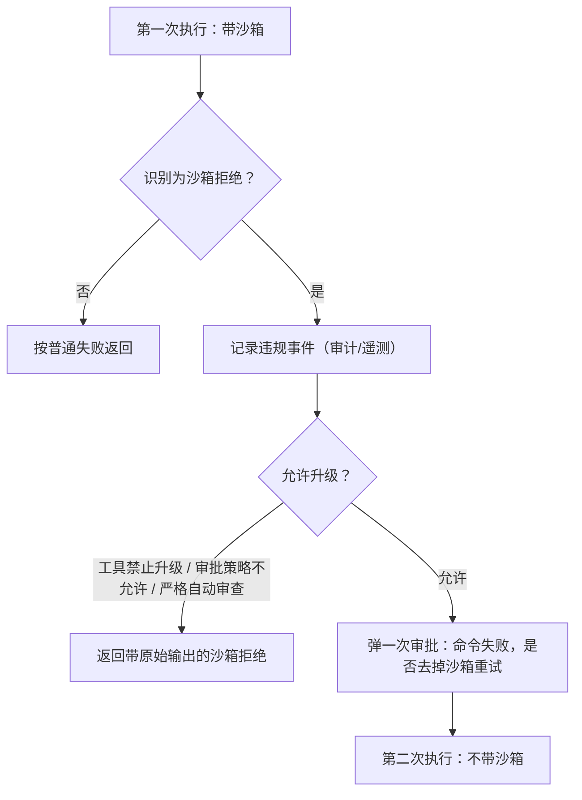

# Sandbox - Codex - 01 - Linux 运行时沙箱：双层包装、挂载合成与失败降级

---

探索一下 Codex 和 Claude Code 的运行时沙箱是怎么做的.

（本轮范围约定：覆盖强制层、失败与降级、工具覆盖面；不展开网络出站白名单/代理策略；只看 Linux，不看 macOS 与 Windows；只做源码静态推断，不做运行验证。）

---

## 结论先说

- Codex 的 Linux 沙箱不是"一个开关"，而是一条翻译链：**权限档案（文件系统条目 + 网络策略）→ 沙箱类型 → 命令行包装 → 内核强制**。真正做强制的是子进程，不是 Codex 主进程。
- 默认实现是两层：**bubblewrap 建命名空间与文件系统视图**，然后在沙箱内部**重新执行自己**，再叠加 **seccomp + no_new_privs**。顺序不能颠倒，因为第一层可能依赖 setuid 提权，第二层却要求 `no_new_privs` 已置位。
- 文件系统视图由**挂载顺序**决定：先给一个基线根（只读整盘，或空 tmpfs 加只读白名单），再按可写根逐层 bind，最后用只读 bind 与被拒掩码把保护点"扣回去"。后挂载覆盖先挂载，所以顺序本身就是策略。
- 它要防的不止"乱写文件"：还包括沙箱内进程反向连 Codex 自己的控制 socket、在被拒目录里**新建**文件、以及通过可写符号链接绕过只读保护。
- 内核拒绝不会被上报。Codex 靠**退出码 + 输出关键字**猜，猜中后再由编排层决定是否弹一次人工审批、去掉沙箱重跑一遍。
- 覆盖面比"shell 命令"宽：补丁应用与 Codex 自己的文件读写也在沙箱语义内（后者靠"把文件操作也包成一个在沙箱里运行的 helper"实现）；但 MCP 工具调用不在，它把权限档案作为元数据交给 MCP server，由 server 自己沙箱化子进程。

## 场景

在只读档下让模型跑 `cargo test`。命令本身没写错，但 `target/` 写不进去，进程拿到 `EPERM`，退出码非零。接下来发生的事能直接反映整个机制的形状：谁决定了"要沙箱"、沙箱怎么被拼出来、失败怎么被识别、以及谁有权把沙箱摘掉。

## 一、从权限档位到沙箱参数

三个概念是正交的，混在一起看就会得出错误结论：

| 概念 | 含义 | 影响什么 |
|---|---|---|
| 权限档案 | 文件系统条目列表 + 网络策略 + 执行者（托管/禁用/外部） | 允许什么 |
| 沙箱类型 | 平台实现（Linux、macOS、Windows…） | 用什么强制 |
| 沙箱偏好 | 自动 / 必须 / 禁止 | 这次调用要不要套 |

文件系统条目是"路径 × 访问 × 缺失行为"的三元组。路径既可以是具体路径，也可以是特殊标记：整盘根、项目根（可带子路径）、`/tmp`、`TMPDIR`、`minimal`（只读系统目录）。访问是读、写、拒绝。

于是三个常见档位其实只是条目的不同组合：

- **只读**：整盘根一条 `read`。
- **工作区可写**：整盘根 `read`，项目根 `write`，再加 `/tmp` 与 `TMPDIR` 的写，然后把 `.git`、`.agents`、`.codex`、`.aws` 这些工作区元数据目录显式扣回只读。
- **完全访问**：整盘根直接 `write`。

是否真的套沙箱，由一条单独的判定给出，而不是由"档位名字"决定：

1. 有托管网络需求 → 必须。
2. 网络被禁 → 必须（除了"执行者自己已经提供了沙箱"这种外部情形）。
3. 网络开着 → 只有当文件系统被限制到"不是全盘可写"时才必须。

这条判定解释了一个容易被误读的现象：**"完全访问 + 网络开放"时根本不套 bubblewrap**；而"完全访问 + 网络禁用"时仍会套一层 seccomp 来做网络拦截。沙箱在这里是"策略里存在需要内核强制的缺口"的结果，不是一个独立开关。

## 二、一条命令被包装的四段

1. **主进程合成参数**：把权限档案序列化成一段 JSON，连同"命令工作目录""策略工作目录""是否走遗留模式""托管网络上下文"一起拼成助手进程的命令行，最后用 `--` 分隔真正的命令。
2. **外层助手**：选一个 bubblewrap（系统自带的、或随包附带的），把权限档案翻译成一串挂载参数，然后 exec。
3. **bubblewrap**：建用户、PID、IPC、必要时网络命名空间，按顺序做挂载，把 `/proc` 换成新的，然后 exec `--` 之后的命令——也就是**同一个助手进程**，带"应用 seccomp 后执行"标志。
4. **内层助手**：先自检（进程没有残留 capability；fd 挂载没有被偷换），再置 `no_new_privs`、装 seccomp 过滤器，fork 出真正的命令，父进程转发信号并等待退出。

助手本身用固定文件名自我识别（`codex-linux-sandbox` 这个 argv0）；如果实际不是这个文件名，bubblewrap 支持 `--argv0` 就改 argv0，不支持就退化成"用当前进程路径重新执行"。

这一层的工程细节值得单独记住：外层要转发 HUP/INT/QUIT/TERM 给 bubblewrap 子进程，内层要转发给用户命令，两层都在 fork 前后屏蔽/恢复信号掩码；子进程还会 `setpgid` 自成进程组，并设置"父进程死亡即发 SIGTERM"（同时检查父进程在设置前就已消失的竞态），避免 Codex 退出后沙箱进程变成孤儿继续跑。

## 三、文件系统视图怎么拼

挂载顺序在源码注释里被显式写成六个阶段，可以按"基线 → 授权 → 保护 → 兜底"理解：

1. **基线**：两条路。策略要求"整盘可读"时用 `--ro-bind / /`；要求"受限读"时从 **空 tmpfs 根** 起步，只把白名单里的根以只读方式挂回来，并在 `:minimal` 语义下叠加一组系统目录（`/bin`、`/usr`、`/etc`、`/lib*`、Nix store 等）。这意味着"受限读"是真的从空文件系统长出来的。
2. **设备树**：`--dev /dev` 提供标准设备节点；如果后面又把 `/` 整个 bind 成可写，必须重建一次 `/dev`（并补 `--bind-try /dev/shm`），否则设备节点会被覆盖掉。
3. **被拒祖先**：位于可写根**之外**、但又**是可写根祖先**的拒绝路径，先掩掉，再为深层可写子目录补建挂载点父目录，让"被拒目录里的可写子目录"能被重新打开。
4. **可写根**：按路径深度排序逐个 `--bind`；对符号链接根，绑定它的真实目标；如果已经在可写根里 bind 了 `/`，就跳过会撤销掩码的别名重复绑定。
5. **只读扣回**：对每个可写根，把它的只读子路径（工作区元数据、显式只读规则）用 `--ro-bind` 扣回。若该子路径与更深一层的可写根共享，则延后到那一层处理，避免被"更深更宽"的绑定覆盖。
6. **拒绝掩码**：可写根内部的拒绝路径在 bind 之后掩掉；与可写根无关的拒绝路径最后统一掩掉。

掩码本身有两种形态，用哪种取决于"里面还有没有被显式重开的可写子目录"：

- 没有 → `--perms 000 --tmpfs <path> --remount-ro <path>`：不可读也不可写。
- 有 → `--perms 111 --tmpfs`，先在 tmpfs 里补建子目录挂载点，再 remount 成只读：能穿越进被重开的子目录，但看不到被拒目录的内容。

**不存在**的保护路径另有处理：把 `/dev/null`（或空目录）挂到**第一个不存在的路径组件**上。这不是为了"隐藏"，而是为了**阻止创建**——如果只写一条 deny 规则，沙箱内进程完全可以先 `mkdir` 再写。代价是这些占位挂载会在宿主上真的创建空文件/空目录，所以父进程在子进程退出后要按"仍然是空文件/空目录"的条件清理。

还有一类"防创建"不靠挂载：某些元数据路径（例如工作区里的 `.git`）在策略上应保持不存在，助手会在子进程运行期间**监控并即时删除**它们；一旦真的被创建过，即使命令本身退出码是 0，也会被改判为失败退出。

三个刻意的 fail-closed 选择：

- **拒绝路径跨过可写符号链接时直接报错**，而不是去解析并绑定符号链接的当前目标。理由是解析结果是启动瞬间的快照，而沙箱内进程可以先把符号链接换掉，再让保护指向别处。
- **可写符号链接根**同理：只在能确定目标稳定时才绑定，否则整条豁免作废。
- **控制 socket 掩码**：Codex 自己的 app-server socket 目录在每次覆盖它的挂载之后都要重新用 `000` tmpfs 盖回去。否则沙箱内命令可以直接连上控制 socket，绕过整套边界。这条也说明沙箱威胁模型里包含"对抗 Codex 自身"。

跨环境残留也在这层处理：WSL 的 Windows 互操作 socket 目录、WSLg 的重复发行版根，都会在受限视图下被掩掉；WSL1 因为建不了用户命名空间，直接被判为不支持。

## 四、系统调用过滤只做"不该碰的那部分"

seccomp 这一层不重复文件系统策略，只处理三件事：

| 模式 | 触发条件 | 拦什么 |
|---|---|---|
| 网络隔离 | 网络被禁（且不是托管代理路由） | `connect`/`accept`/`bind`/`listen`/`sendto`/`sendmmsg`/`shutdown`/`getpeername`/`getsockname`/`getsockopt`/`setsockopt`/`recvmmsg`；`socket`/`socketpair` 只允许 `AF_UNIX` |
| 代理路由 | 托管网络需要走本地桥 | 只允许 `AF_INET`/`AF_INET6`（用于连本地桥），`socketpair` 只允许 `AF_UNIX` |
| 仅拦 VM socket | 文件系统受限但网络开放 | `socket`/`socketpair` 拒绝 `AF_VSOCK`（WSL2 下它能把命令送回 Windows 侧执行） |

所有模式都会额外禁掉 `ptrace`、`process_vm_readv/writev`，以及 `io_uring` 三件套——理由写在注释里：`io_uring` 可以绕过 `socket()` 直接建 `AF_VSOCK`，所以只要能建 socket 家族限制，就必须连 `io_uring` 一起关。

默认动作是放行，命中规则返回 `EPERM` 而不是杀进程。于是被拒的进程看到的是普通"操作不被允许"的错误，而不是被内核打死。`recvfrom` 被刻意保留放行，注释说明是为了让 `cargo clippy` 之类依赖 socketpair 的工具还能工作。

`no_new_privs` 是条件开启的：只有"需要装 seccomp"或"遗留 Landlock 文件系统模式"时才置位。原因很实际——很多发行版的 bubblewrap 是 setuid 的，提前置位会让它没法提权建命名空间。

## 五、拒绝之后发生什么

内核不会告诉 Codex"这是沙箱拒绝的"。识别是启发式：

1. 退出码 0 或未套沙箱 → 不是拒绝。
2. Linux 上退出码等于 `128 + SIGSYS` → 认为是 seccomp 拒绝。
3. 输出（stdout/stderr/合并流任意一处）包含 `operation not permitted`、`permission denied`、`read-only file system`、`seccomp`、`sandbox`、`landlock`、`failed to write file` → 认为是拒绝。
4. 退出码 2/126/127 视为普通 shell 错误（内建误用、不可执行、命令不存在），排除。

识别成功后，编排层做的事固定为三步：

几个边界值得记住：

- 升级闸门有三道：工具自己是否允许失败后升级、审批策略是否允许"无沙箱重试"（严格档与"从不需要审批"档都不允许）、以及是否处于"严格自动审查"（此时第一次沙箱尝试的自动审查不覆盖第二次无沙箱重试，必须重新走一遍）。
- 拒绝路径上仍会把原始输出带回给模型，只是被包成"沙箱拒绝"错误；模型看到的是失败原因，不是被截断的静默失败。
- 拒绝事件会按后端分别记录（Linux 沙箱、托管网络代理、macOS、Windows 各一路），并按"拒绝/升级成功/超时/信号"打点。也就是说违规数据是**遥测**，不是控制流的一部分：它不驱动策略变更，只喂给观测与人工判断。
- 沙箱不可用时不是静默放行：Linux 上找不到系统自带 bubblewrap 就找随包的静态 bubblewrap（构建期注入了摘要时先做 SHA256 校验再执行，校验失败直接以专用退出码终止）；连它也没有，就在 exec 时明确报错，而不是退化成无沙箱执行。

## 六、哪些执行面在沙箱里

| 执行面 | 是否经过内核沙箱 | 机制 |
|---|---|---|
| shell 命令（含交互式 PTY 会话） | 是 | 包装成助手进程命令行 |
| 补丁应用 | 是 | 补丁由 Codex 侧的文件系统抽象写入 |
| Codex 自己的文件读写（说明文件、技能、审查器读文件等） | 条件性 | 当策略不允许"整盘读/整盘写"时，这些操作改由一个**在沙箱内运行的文件助手进程**执行 |
| MCP 工具调用 | 否 | 把权限档案与助手路径作为 capability 元数据传给声明支持该能力的 MCP server，由 server 自行沙箱化其子进程 |
| 远端执行器上的命令 | 由执行器本地强制 | 控制端只传权限档案，不传自己平台的包装器；执行器侧把沙箱偏好固定为"必须" |

"条件性"这一行是 Codex 与纯 shell 包装型实现最实质的差别：文件读写是否进沙箱由同一条判定决定（"是否整盘可读/可写"），因此只读档下 Codex 自己读文件也会走沙箱内的助手，写入则一定走。这一点在远程执行器上尤其重要——控制端不假设执行器有文件系统权限，而是把"沙箱里做"这件事显式编码进请求。

## 七、Linux 侧的条件与边界

- **bubblewrap 版本**：系统 bubblewrap 必须支持 `--perms`，否则整条被跳过；`--argv0` 与 `--ro-bind-fd` 则按 `--help` 探测结果决定是否走兼容路径（旧版本会把 fd 挂载翻译成 `/proc/self/fd/N`，并在内层校验挂载对象确实是那个 fd）。
- **用户命名空间**：容器里被禁用时只是警告 + 提示；WSL1 直接拒绝。
- **PID 隔离**：默认新建 PID 命名空间并挂新 `/proc`；容器拒绝 `--proc` 时会先跑一次探针，失败则退化为不挂 `/proc`。另有一个启动期选项可改为"复用调用者的 PID 命名空间"，注释明确它只能由受信执行器启动路径选择，因为那等于允许向同名用户的其他进程发信号。
- **遗留 Landlock 路径已经半退役**：只有"全盘可写"时才会用到它；文件系统受限时助手会拒绝该模式，理由是 Landlock 无法隔离 app-server 的 socket。也就是说今天 Linux 上的文件系统隔离事实上只有 bubblewrap 一条路。
- **读拒绝的 glob 需要外部扫描器**：bubblewrap 只认具体路径，所以助手要在沙箱**外**跑一个 `rg` 把 glob 展开成具体匹配，并且要求这个 `rg` 本身在"策略不允许当前用户改写"的位置——否则就等于让被限制的对象自己提供展开结果。展开有匹配数上限（8192）。
- **选项拼装的硬约束**：内层模式与遗留模式互斥；遗留模式下若有文件系统限制直接 panic；`--verify-fd-mount` 只允许出现在内层。

## 八、设计取舍

- **用"命令行重写 + 挂载合成"而不是容器或虚拟机**：没有守护进程、启动成本近乎零、能直接用宿主工具链；代价是安全边界完全押在宿主内核特性（命名空间、seccomp）与 bubblewrap 版本上，能力探测失败时只能退化或报错。
- **两层而不是一层**：第一层可能需要 setuid（bubblewrap 建命名空间），第二层需要 `no_new_privs`（seccomp 前提）。合并成一层就必须二选一，所以拆开，并在内层重新自检"没有残留 capability"。
- **用挂载掩码而不是权限位**：挂载由内核视图强制，不受被沙箱进程 chmod/chown 影响；代价是挂载点会在宿主上留下痕迹，必须配套清理与"防创建"逻辑。
- **承认拒绝识别是猜**：所以保留人工审批作为兜底通道，而不是指望内核事件驱动控制流。启发式误判的代价是"多问一次用户"，而不是"静默破坏策略"。
- **把违规做成遥测而非策略输入**：策略由权限档案与审批决定，违反事件只用于观测与事后分析，避免"运行时行为反过来改权限"的隐式回路。
- **对 Codex 自身也设防**：掩掉控制 socket 这一条说明设计者把"沙箱内进程可能尝试控制宿主 agent"当作真实威胁，而不是只防外部恶意代码。

## 九、与 Claude Code 的关键差异

（详细机制见 `sandbox/claude-code/01-linux-runtime-sandbox.md`）

- Codex 的受限读可以"从空文件系统长出来"（tmpfs 根 + 白名单只读根）；对照实现的默认是"整盘只读 + 写白名单"。
- Codex 对"被拒目录"用 `000` 只读掩码；掩码之后那个位置既不读也不写。对照实现用普通 tmpfs，位置上仍是空的、可写的。
- Codex 自己读文件也会进沙箱（条件性），对照实现只包 shell 类工具。
- Codex 有两层助手 + 自检；对照实现是"一条包装字符串"到底，另配一个预编译的 seccomp 应用器。

## 十、证据分级

**已证实（源码可直接确认）**

- 权限档案 → 沙箱类型的判定与"是否需要沙箱"的三条规则。
- 四段包装流程、内层自检（capability 与 fd 挂载）、信号转发与进程组处理。
- 挂载六阶段顺序、两种掩码形态、`/dev/null` 占位防创建、占位清理、跨可写符号链接 fail-closed、控制 socket 掩码。
- seccomp 三种模式的规则集合与 `EPERM` 返回、条件性 `no_new_privs`。
- 拒绝识别启发式（含 `128+SIGSYS` 与关键字、2/126/127 排除）、编排层两次尝试与三道升级闸门。
- 系统/随包 bubblewrap 的选择与探测、随包 bubblewrap 的可选摘要校验。
- 文件系统助手进程的沙箱化路径、MCP 的沙箱状态元数据能力、远端执行器的"沙箱偏好=必须"。

**合理推断（结构支持但无直接注释）**

- "用挂载掩码而不是 chmod"、"用占位挂载而不是忽略缺失路径"这类设计动机，来自代码注释与失败模式推理，不是文档明文。
- 清理挂载点时"按仍为空文件/空目录判断"与沙箱内进程之间是否存在可实际利用的竞争窗口，源码没有讨论。
- 各档位在真实产品界面里的映射（只读/询问/完全访问）与底层权限档案的对应关系，部分在既有权限笔记里由界面层推断。

**无法确认**

- 线上托管的网络策略默认值、企业配置里权限档案的实际取值（远端配置不可见）。
- 若干行为是否默认开启（feature 闸门与远端配置共同决定）。
- 自动审查（guardian）与沙箱拒绝联动的完整细节，只在编排层看到"严格审查下不允许复用第一次审批"这一处。

## 源码依据

| 相对路径 | 关键位置 |
|---|---|
| `codex-rs/sandboxing/src/manager.rs` | `SandboxManager::select_initial`、`should_sandbox`、`transform`、`ensure_linux_bubblewrap_is_supported`、`get_platform_sandbox` |
| `codex-rs/sandboxing/src/policy_transforms.rs` | `effective_permission_profile`、`should_require_platform_sandbox`、附加权限的合并/裁剪 |
| `codex-rs/protocol/src/permissions.rs` | `FileSystemSandboxPolicy::read_only`、`workspace_write`、`has_full_disk_read_access`/`has_full_disk_write_access`、`PROTECTED_METADATA_PATH_NAMES`、`get_writable_roots_with_cwd_impl` |
| `codex-rs/sandboxing/src/landlock.rs` | `create_linux_sandbox_command_args_for_permission_profile`（助手命令行形态） |
| `codex-rs/sandboxing/src/bwrap.rs` | `find_system_bwrap_in_path`、`find_executable_in_search_paths`（沙箱外二进制的可信选择）、`is_wsl1` |
| `codex-rs/linux-sandbox/src/linux_run_main.rs` | `run_main`（四段流程）、`run_bwrap_with_proc_fallback`、内层自检与 seccomp 应用、`run_bwrap_in_child_with_synthetic_mount_cleanup`、`exit_with_wait_status_or_policy_violation` |
| `codex-rs/linux-sandbox/src/bwrap.rs` | `create_bwrap_flags`、`create_filesystem_args`（六阶段挂载）、`append_unreadable_root_args`、`append_read_only_subpath_args`、`append_daemon_socket_masks`、`append_protected_create_targets_for_writable_root`、`expand_unreadable_globs_with_ripgrep` |
| `codex-rs/linux-sandbox/src/seccomp.rs` | `apply_permission_profile_to_current_thread`、`install_network_seccomp_filter_on_current_thread`、`install_filesystem_landlock_rules_on_current_thread` |
| `codex-rs/linux-sandbox/src/launcher.rs` | `exec_bwrap`（`--as-pid-1`）、系统 bwrap 能力探测、fd 挂载兼容翻译 |
| `codex-rs/linux-sandbox/src/bundled_bwrap.rs` | 随包 bwrap 的发现与 `verify_digest` |
| `codex-rs/sandboxing/src/denial.rs` | `is_likely_sandbox_denied`、关键字与快速排除退出码 |
| `codex-rs/sandboxing/src/violation.rs` | 违规事件的归一化与原因分类 |
| `codex-rs/core/src/exec.rs` | `finalize_exec_result`（拒绝识别与违规记录） |
| `codex-rs/core/src/tools/orchestrator.rs` | 两次尝试、升级闸门、`build_denial_reason_from_output`、`sandbox_outcome_from_tool_error` |
| `codex-rs/core/src/tools/runtimes/apply_patch.rs` | 补丁在沙箱语义下的执行与拒绝判定 |
| `codex-rs/exec-server/src/local_file_system.rs` | `file_system_for_reads` / `file_system_for_writes`（何时改用沙箱内文件系统） |
| `codex-rs/exec-server/src/fs_sandbox.rs` | 文件助手作为沙箱命令被启动 |
| `codex-rs/core/src/mcp_tool_call.rs` | `augment_mcp_tool_request_meta_with_sandbox_state` |
| `codex-rs/file-system/src/lib.rs` | `should_read_from_sandbox`、`should_write_into_sandbox` |
| `codex-rs/sandboxing/src/linux_pid_namespace.rs` | `Isolate` / `Inherit` 两种 PID 命名空间策略 |
| `codex-rs/cli/src/main.rs` | `sandbox` 子命令（`codex sandbox linux -- …`，调试入口） |
