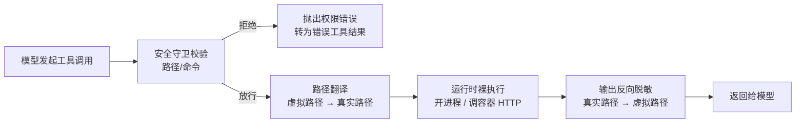
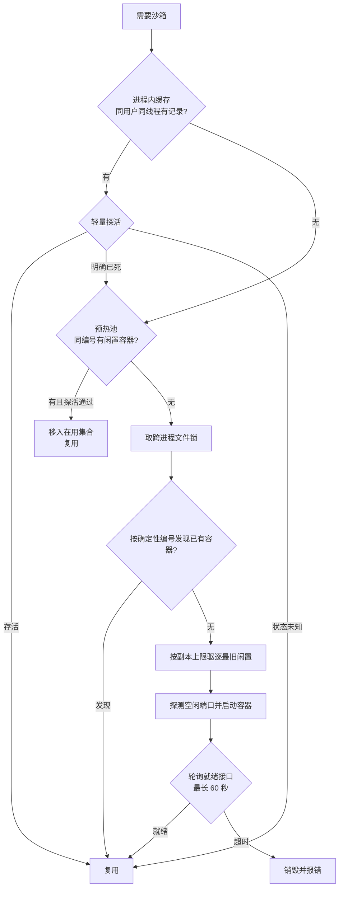
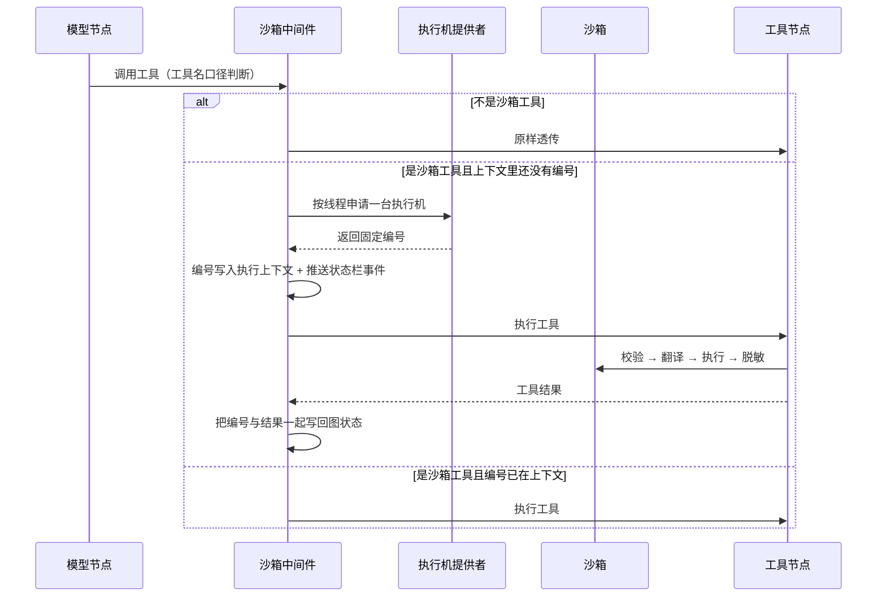

# sandbox - Poirot - 01 - 沙箱：一台可替换的执行机，以及它对外露出的那层皮

---

> poirot 的沙箱机制是怎么做的?
>
> 范围确认：隔离怎么实现 + Agent 怎么用，两块都写；产物导出与 specialist 共用沙箱也要说；不把“开关默认关闭”作为论述重点，按“已经打开”来写。

---

## 场景

模型要跑一段 Python 生成图表、要 `pip install`、要把 30 个 CSV 合并成一个 xlsx。这些都是真实副作用：写磁盘、装依赖、可能跑坏命令。Harness 因此需要一个地方承载这些动作，并且要回答四个问题：

1. 命令和文件操作到底在哪台机器、哪个目录里执行；
2. 模型看到的是哪个路径，和宿主真实路径怎么对得上；
3. 哪些动作应当被拒绝，拒绝之后模型看到什么；
4. 生成的文件怎么交到用户手里。

Poirot 的答案不是“一个隔离环境”，而是**一台可替换的执行机 + 三层固定编排**：执行机（本地进程或容器）可以整台换掉，但“先校验、再翻译路径、再执行、最后把输出里的真路径抹回虚拟路径”这个顺序永远不变。模型与宿主之间的全部接触面，都收敛到 6 个工具上。

## 一句话机制

模型调用沙箱工具时，中间件才第一次去申请一台执行机（懒获取），拿到一个由「用户 + 线程」哈希出的固定编号；随后每次调用都走「守卫校验 → 路径翻译 → 运行时裸执行 → 输出反向脱敏」四步；执行机分两档——本地档就是在宿主上开子进程、靠**路径白名单**约束，容器档就是起一个 all-in-one 容器、靠**容器边界**约束外加“只许往持久卷写”；`present_files` 被调用后，中间件把虚拟路径反解成宿主路径、复制到固定产出目录、注册到本机 HTTP 下载服务，并把下载链接追加进工具结果。

## 装配：沙箱是“有或全无”的一整块

沙箱不是默认恒在的能力，而是一整套由配置里一个 provider 标识决定存不存在的子系统。标识为空时，不只是工具消失，连“轮末释放”“产物服务”这些配套都不存在；标识命名了一个 provider 类时，装配阶段一次性完成下面四件事，然后一直复用到进程退出：

1. **建 provider**：按标识动态导入并实例化。构造参数里带一份路径映射表——把三个虚拟目录 `/mnt/poirot/user-data/{workspace,uploads,outputs}` 分别固定到项目目录下的三个真实目录，全部可写；配置里额外的挂载项接在后面。
2. **建工具集**：以 provider 为闭包造出 6 个工具（`bash`、`read_file`、`write_file`、`list_dir`、`str_replace`、`present_files`）。配置里关掉“允许宿主 bash”时，`bash` 干脆不注册，剩 5 个。
3. **注册退出清理**：把 provider 挂到进程退出钩子上，只注册一次，多个 provider 累积。
4. **起产物下载服务**：监听 `127.0.0.1`，从 18080 起逐个端口试探，最多试 10 个；全部占用就直接抛异常，这一步失败会连带整个装配失败（不像 MCP、技能那样只记日志继续）。

工具进的是“内置工具 + 沙箱工具”的合并字典。构建图时，内置工具先按分组过滤（轻量模式只留核心组，扩展模式留核心组 + 深度组），但随后会把能力注册表里的**全部**工具补回去，因此沙箱工具在两种模式下都在。沙箱工具在提示词里没有任何说明文字——模型对“该往哪个目录写、写完怎么交付”的全部认知，来自工具自身的文档字符串，尤其是 `present_files` 那段“文件必须在 `/mnt/poirot/user-data/` 下，其他位置宿主拿不到”。

## 三层编排：一次调用固定四步

沙箱对象本身不含执行逻辑，只是一个组合体：一个运行时（裸执行）、一个路径翻译器、一个安全守卫。它的每个操作方法都按同一顺序展开，这个顺序是硬约束，注释里反复强调：

为什么要“反向脱敏”：模型永远只看到虚拟路径，宿主上的真实目录（项目绝对路径、临时目录、容器宿主卷）从不进入上下文。好处是同一套工具文档、同一段提示词、同一个 specialist 桥接在本地档和容器档通用；代价是宿主路径只在两个地方短暂暴露——产物复制和错误信息。

反向脱敏归翻译器，不归守卫。这是刻意的分工：守卫只做“能不能”，翻译器做“在哪”。注释把这条写成了不变量，测试也按这个切口分。

## 本地档：没有隔离，只有白名单

本地档的执行机就是宿主机的子进程与 Python 标准库文件操作，没有命名空间、没有 cgroup、没有只读根。它能提供的全部约束来自守卫和路径翻译：

- **路径翻译**：拿虚拟路径去和映射表做最长前缀匹配，拼出真实路径后 `resolve()`，再检查解析结果是否仍在映射根之下——这一步专门用来挡符号链接逃逸；越界转成权限错误。命令串里的虚拟路径也用带 shell 边界意识的正则做替换，避免 `/mnt/poirot/skills` 误匹配 `/mnt/poirot/skills-extra`。
- **路径校验**：先拒任何含 `..` 段的路径；再要求路径必须落在映射前缀内；写操作额外检查映射是否只读（默认三个目录都可写）。
- **命令校验**：先扫一遍危险模式黑名单（`rm -rf /`、`rm -rf ~`、`$HOME`、`/*`、格式化文件系统、往块设备 `dd`、fork bomb、`curl|sh`、`wget|sh`、`eval`、`exec`、`source`），命中即拒；然后用 shell 分词解析命令，分词失败就按“畸形引号”直接拒绝（fail-closed）；最后逐个检查以 `/` 开头的参数——只放行 `/bin/`、`/usr/`、`/lib/` 三个系统前缀和三个映射前缀，其余绝对路径全部拒绝。刻意不放行 `/tmp`。
- **审计分级**：外面再包一层分级器，把命令分三档——破坏性的一律拒（本地/容器都一样），危险但不直接破坏的（`sudo`、`chmod 777`、`curl|sh`、`eval`、`exec`）记一条警告日志后交内层；其余直接交内层。这条设计在容器档才真正“放行”，本地档因为内层还有一套更严的黑名单，实际仍会被拦。

本地档的生命周期极简：编号是 `sha256("用户:线程")` 取前 8 位十六进制，同一线程永远算出同一个编号；申请时若已在缓存里就提到队首，不在就现造一个并放进 LRU（容量 256，超了淘汰最旧的一台，淘汰时在锁外关闭）；释放是空操作，缓存不清。运行时连 `close()` 都是空操作，因为子进程没有持久连接。

几个容易被误读的行为：

- **非零退出码 = 异常**：命令返回非零时抛命令错误，异常信息只有“退出码 N”，**stdout/stderr 都不带**。所以本地档里模型跑失败一条命令，只能拿到一句“命令失败，退出码 1”，看不到报错正文。
- **没有工作目录参数**：子进程继承 Poirot 进程的当前目录。也就是说相对路径命令作用在启动目录上，而不是沙箱映射根上。
- **相对路径不过守卫**：守卫只检查以 `/` 开头的参数，所以 `rm -rf .`、`echo x > somefile` 这类相对路径动作不受白名单约束。命令超时 600 秒，超时也转成命令错误。
- **文件搜索有防滥用护栏**：目录列举是按层 BFS 加剪枝（超深度不下钻、超条数就停），避免 `node_modules` 十万文件把进程拖死；内容搜索跳过 `.git`、`node_modules`、`__pycache__` 等一大串目录，跳过 1MB 以上大文件，每行截断到 200 字符；正则搜索拒绝超过 200 字符的模式和“嵌套量词”（`(a+)+` 这类灾难回溯写法）。文件通配则没有这些过滤，是标准的递归匹配后按上限截断。

## 容器档：三层缓存、预热池与空闲回收

容器档把执行机换成一台容器：镜像里跑着一个 HTTP 运行时，Poirot 通过一个 SDK 客户端调它执行命令、读写文件。容器名是确定性的 `前缀-编号`，宿主上一个真实目录被挂到容器内的 `/mnt/poirot/user-data`，所以容器内的虚拟路径**就是**挂载后的物理路径——路径翻译在这一档退化成直传（`translate_path` 原样返回），只有产物导出时才需要反向解析回宿主。

申请一台容器分三层，逐层降级：

细节上值得记的：

- **探活只看容器状态，不打 HTTP**：明确“已停”才丢弃；“问不出来”按未知处理，宁可保留也不误杀。
- **跨进程协调用文件锁**：锁文件按编号命名放在容器根目录下，拿到锁之后再检查一次进程内缓存、再发现、再创建。这一层是为“同一线程被两个进程驱动”准备的，因为确定性编号意味着两边会算出同一个容器名。
- **幂等创建**：创建前先发现，发现即复用；容器名冲突时再发现一次。
- **端口**：容器内固定 8080，宿主端口从配置的起始端口（默认 18000）开始探测空闲端口；Docker 也可能在真正启动时报告端口被占，这时把起点后移一位重试，最多 10 次。
- **启动参数**：后台运行 + 停止后自动删除 + 只绑定 `127.0.0.1` + 关掉 seccomp 限制 + 注入编号与线程号两个环境变量 + 挂载持久卷（+ 配置里的额外挂载）。没有限制内存、没有限制 CPU、没有禁网。
- **启动即就绪探测**：对容器的 `/v1/sandbox` 每秒轮询一次，最长 60 秒，超时就销毁并抛错，不会留半死容器。
- **释放 = 进预热池**：轮末释放时不销毁，只把容器从“在用集合”挪进预热池并记时间戳。预热池不做预创建——没有后台任务提前起容器，它只是“释放后暂不销毁”的复用缓冲。配置里那个“副本数”实际语义是“在用 + 闲置的总数上限”，超了只逐出最旧的闲置项，不会停掉在用的。
- **空闲回收**：一个后台线程每 60 秒扫一次。在用容器以“最近一次取用时间”计，闲置容器以“释放时间”计，超过空闲阈值（默认 600 秒）就销毁；销毁前会再发现一次，如果同编号的容器已经被别的线程换成了新的（创建时间/容器 ID 不同），就跳过销毁。阈值配 0 则不启动这个线程。
- **启动即认领孤儿**：provider 构造时列出机器上所有带该前缀且在跑的容器，全部收进预热池（跳过没有 URL 的）。这是“重启进程后同线程能接上原容器”的关键一步。
- **退出清理三条路**：进程退出钩子、`SIGTERM`/`SIGINT`/`SIGHUP` 处理（装不上就忽略，比如不在主线程）；清理时先停空闲检查线程，再销毁在用与闲置全部容器，且只做一次。
- **多平台**：macOS 上若存在 Apple 的容器命令行则用它（挂载语法不同），否则 Docker；项目在 Windows、daemon 在 WSL2 时，docker 命令前缀 `wsl -d <发行版> --`，宿主路径 `D:\x` 自动翻成 `/mnt/d/x`。

容器里的运行时是纯 HTTP 客户端，除了几个由 SDK 限制带来的补丁：

- 所有操作（连读文件、列举目录）都过同一把进程内互斥锁——因为容器内是一个持久的 shell 会话，并发执行会互相破坏；
- 命令输出里出现某个已知的 SDK 断链特征串时，新建一个会话重试一次，仍出现就报错；
- 目录列举没有专用端点，退化成在容器里跑 `find`；
- 内容搜索没有服务端实现，改成先列文件、再逐文件调用搜索端点；
- 下载有 100MB 上限，且要求路径无 `..` 段并在持久卷前缀内。

## 与 Agent 循环的接合：懒获取、状态恢复、共用

沙箱和 Agent 循环之间只通过一个中间件接触。这个中间件挂在“MCP 审计之后、记忆召回之前”，只实现三个钩子：

要点：

- **懒获取是硬编码的**：没有“整轮开始”钩子，所以只要这一轮没碰沙箱工具（比如只做联网搜索），就一台执行机都不会起。副作用是“第一次沙箱调用要等容器启动”，中间件会把“已获取”作为一个实时事件推给前端状态栏，而不是等状态快照轮询。
- **编号存在图状态里**：第一次获取后，中间件把编号写进状态字段并合并消息。合并规则是幂等 + fail-closed：同一个编号重复合并没问题，两个不同编号同时写入直接抛异常（因为编号是确定性推导的，出现分歧说明是 bug 而不是并发竞争）。空值不清空。
- **跨轮靠状态恢复**：每次模型调用前，中间件检查执行上下文里有没有编号；没有就尝试从图状态里恢复。同一进程里的下一轮因此不会重新申请。进程重启后状态本身丢了，但编号是确定性推导的，重新申请还是会算出同一个，容器档就能靠“发现已有容器”接上。
- **子 Agent 共用父沙箱**：自身副本子 Agent 复用同一张图定义，状态里的编号已经存在，于是它一进模型节点就恢复出编号、执行时直接跳过申请，操作的是和父 Agent 同一台执行机、同一个持久卷。这是刻意的（子任务的产物要让父 Agent 能读到），也意味着隔离边界不是“每个 Agent”，而是“每个线程”。
- **轮末释放**：整轮结束钩子按状态里的编号释放。本地档是空操作；容器档是“移入预热池”，容器继续跑着等下一次复用。

## 工具面：6 个入口与它们的真实约束

模型能看到的沙箱动作只有 6 个，其中 5 个是“直接转发给沙箱对象”，1 个（字符串替换）是复合操作：

| 工具 | 行为 | 被加上的额外约束 |
|---|---|---|
| `bash` | 在沙箱里执行命令 | 输出超过 10000 字符截断并附省略提示；“允许宿主 bash”关掉后此工具不存在 |
| `read_file` | 读文本 | 无额外约束（受守卫与运行时约束） |
| `write_file` | 写文本，可追加 | 非追加写且内容超过 5MB 直接拒绝，提示改用追加分块；自动建父目录 |
| `list_dir` | 列目录，输出转缩进树 | 默认深度 2，运行时层面还有条数上限 |
| `str_replace` | 读 → 替换 → 写 | 包在按“沙箱编号 + 虚拟路径”的进程内锁里；找不到目标串报错 |
| `present_files` | 声明产物 | 路径必须带 `/mnt/poirot/user-data/` 前缀，否则整批拒绝并提示先复制过去 |

守卫在容器档的取向和本地档正好相反：**读几乎不限制，写必须落在持久卷内**。写文件要求路径以 `/mnt/poirot/user-data/` 开头；`bash` 则用正则抓重定向目标（`> x`、`>> x`），只检查绝对路径形式的目标是否在该前缀下。注释里明确承认这三处不覆盖：`cd` 之后的相对路径不解析、`tee` 不检查、相对路径重定向不检查——兜底靠容器边界本身。

这个“写必须落挂载区”的动机值得单独说：容器是 `--rm` 的，停止即删除，写进容器内其他位置的产物会随着容器消失；只有宿主挂载的持久卷能跨容器存活，也才能被宿主复制出去。换句话说，这条守卫不是在防破坏，而是在保证**产物的可交付性**。

被拒绝时模型看到什么：一条错误工具结果，内容是守卫抛出的那句话，例如“危险命令被拦截：rm -rf /”或“写路径必须在 /mnt/poirot/user-data/ 之下”。模型据此改路径或换命令重试。工具层自己不捕获沙箱异常，统一由工具账本中间件把异常转成错误消息并记账。

值得注意的是主 Agent 手上**没有** `glob` 和 `grep` 工具——这两个能力只存在于沙箱对象和给 specialist 用的 MCP 桥里。主 Agent 想做内容搜索只能走 `bash` 里的 `grep -r`。

## 产物导出：从虚拟路径到可点击链接

`present_files` 工具本身只做前缀校验并回一句“已声明 N 个文件”，真正的动作全在中间件的调用后逻辑里：

几处细节：

- **复制而不是原地服务**：所有产物被 `shutil.copy2` 到项目根下的固定产出目录，保留元数据。理由是用户总知道去哪里找文件，且任何格式都能下载（不需要为每种格式做预览路由）。
- **双重兜底**：复制失败只记警告，不中断；如果副本没落地但宿主原路径存在，就把原路径注册给下载服务。
- **下载服务是内存注册表**：`GET /artifacts/<编号>/<文件名>` 走注册表查真实路径，查不到 404，路径里含 `..` 直接 403，扫不到文件 404，返回 `inline` 处置。服务绑 `127.0.0.1`，进程退出即失效，重启后旧链接全部失效。
- **产出目录与容器卷根目录锚点不同**：产出目录锚在项目根，而中间件传给容器 provider 的卷根目录锚在**当前工作目录**。正常情况下两者一致；从别的目录启动就会分叉（卷解析按启动目录算，产出复制按项目根算）。这一条属于实现层面的不一致，不影响主流程但要留意。

## 跨 Agent 共用：同一个沙箱借给外部 CLI

多 Agent 打开时，主 Agent 可以把任务委派给外部的 pi / Codex / Claude Code 进程。这三者自带模型、自带的 ReAct 循环、自带工具集，本来会各自在宿主上乱跑；Poirot 的做法是把**自己的沙箱**以 MCP 服务的形态借给它们：

- 委派工具只暴露三个参数，其中沙箱编号是可选参数；不传就取当前线程状态里的编号。于是 specialist 默认和 lead 操作同一台执行机。
- 每个 specialist 进程会拿到一份“启动一个 stdio MCP 服务”的命令行，参数里带沙箱编号；容器档还会追加容器 URL 与卷根目录，让它连的是 lead 那台容器。
- 这个 MCP 服务暴露 8 个接口——比主 Agent 多两个（`glob`、`grep`），全部直接转调沙箱对象的方法，因此同样经过守卫与路径翻译，不重新实现一遍安全逻辑。生命周期是“每次委派启动一个，结束就关”。
- 外部 CLI 侧禁用了自带工具，改用这个桥接服务，所以它们的读写都落在同一个持久卷里。

一个真实的落差：容器档会因为“有容器 URL”而构造容器运行时；本地档拿不到 URL（本地 provider 没有这个概念），specialist 侧回落到“本地运行时 + 空映射表的守卫”。空映射表意味着白名单为空，除 `/bin`、`/usr`、`/lib` 外所有绝对路径都被拒——于是本地模式下 specialist 通过桥接读写文件基本都会被拒，只有跑系统路径命令可行。这是代码路径上可以直接确认的行为，不是推测。

## 条件与边界

- **一整套能力随 provider 标识生灭**：标识为空时工具、中间件、下载服务都不存在；不是“工具在但调用失败”。
- **并发模型**：本地档每台执行机无共享状态，只有缓存字典加锁；容器档因为容器内是持久 shell，读、写、列举、搜索、下载全部过同一把锁，同一容器上的并发工具调用会退化成串行。`str_replace` 的读-改-写还额外有一把按文件的锁，但注释明确承认它只在进程内，多进程下存在“读到旧内容再覆盖”的竞态。
- **容量上限**：本地档 256 台 LRU；容器档上限由副本数决定且只逐出闲置；空闲阈值默认 600 秒；就绪探测 60 秒；端口重试 10 次；容器内命令的空闲等待 1800 秒（SDK 层）；下载 100MB；单次写 5MB（非追加）；命令输出展示 10000 字符；单条命令超时 600 秒（本地档）。
- **失败降级**：容器创建后不就绪会销毁并报错（不留半死容器）；销毁失败只记日志不抛；探活返回“未知”时不误杀；退出清理反复执行只生效一次。
- **超时与取消**：容器档的异步申请专门处理了“等待锁期间被取消”的路径，避免对未持有的锁做释放。

## 设计取舍

**为什么是组合而不是继承。** 换执行平台时只替换运行时、翻译器、守卫三件中的某几件（K8s 后端是保留的空壳，只实现了会返回“未知”的那一个方法）。核算过的好处是“编排逻辑写一遍、平台适配写 N 遍”，代价是三个组件必须是可自由配对的，于是接口被压到极小：运行时只负责裸执行和抛统一异常类型，翻译器只管路径，守卫只管能不能。

**为什么模型只看到虚拟路径。** 一旦把宿主真实路径暴露给模型，同一段提示词、同一份工具文档在本地档与容器档就要写两套；反向脱敏让“路径”成为一套与执行平台无关的词汇。代价是宿主路径在错误信息和产物复制两处必须临时反解，且反解失败要静默降级。

**为什么编号是确定性哈希。** 让“同一个线程 = 同一台执行机”在跨进程、跨重启后依然成立，从而支持发现已有容器、跨进程复用、重启接续；代价是同一线程被两个进程同时驱动时会被算到同一个容器上，必须用文件锁和“销毁前二次确认”来补。

**为什么懒获取。** 容器启动是秒级成本（就绪探测上限 60 秒），只在真的调用沙箱工具时才付这笔钱。代价是首个沙箱调用有明显的等待，所以“已获取”要做成实时事件推给前端。

**为什么释放不销毁。** 复用比重建便宜，预热池就是为“同一线程的下一次调用”准备的缓冲。代价是需要一套后台回收（空闲扫描 + 上限驱逐 + 孤儿认领 + 退出清理）来兜住容器泄漏，这也是这块代码量最大的原因。

**为什么两档的守卫方向相反。** 本地档没有内核边界，只能靠白名单把可写面收到三个目录；容器档已经有了内核边界（命名空间 + cgroup），守卫就退化成“保证产物落在持久卷里”。同一个守卫接口下两种完全不同的策略，是这个抽象唯一说得通的用法。

## 证据分级

**已证实（源码可直接确认）**

- 三组件组合与固定编排顺序，脱敏归翻译器、守卫只做校验。
- 编号公式 `sha256(用户:线程)[:8]`，本地与容器两档各自独立实现但公式相同；容器档在使用前校验编号格式（8 位小写十六进制）以防反序列化带入路径穿越。
- 本地档 LRU 容量 256、释放为空操作、非零退出码转异常且不带输出、命令超时 600 秒、白名单为三个映射前缀 + `/bin /usr /lib`、黑名单与 fail-closed 分词。
- 容器档三层缓存、预热池不做预创建、副本数语义为总量上限且只逐出闲置、空闲扫描 60 秒/默认阈值 600 秒、启动即认领孤儿、退出三条清理路径、就绪探测 60 秒、端口重试 10 次、`--rm` 加关闭 seccomp、无内存/CPU/网络限制参数。
- 中间件懒获取、编号写入图状态并以 fail-closed 合并、跨轮从状态恢复、子 Agent 共用、轮末释放。
- 6 个工具的额外约束（输出 10000 字符、写 5MB、路径前缀必须 `/mnt/poirot/user-data/`），以及主 Agent 没有 `glob`/`grep`。
- 产物流程：反解宿主路径 → 复制到固定产出目录 → 注册内存注册表 → 链接追加进工具结果；下载服务端口 18080 起、`..` 拒绝、`inline` 处置。
- specialist 通过 stdio MCP 桥共用沙箱，桥暴露 8 个接口；本地档因拿不到 URL 而回落空映射表守卫。
- 系统提示词里没有任何沙箱相关说明，模型只能从工具文档字符串获知路径规则。

**合理推断（结构支持，无直接证据）**

- 关闭 seccomp 限制是为了兼容 all-in-one 镜像里的运行时（注释只描述行为，没有给出动机）。
- 容器档“只允许写持久卷”的首要目的是产物可交付，而非防破坏（注释文字与代码行为都指向交付，但没有任何设计文档可查）。
- 本地档相对路径不受约束，配合“无工作目录参数”，意味着本地模式下 `bash` 实际能改动启动目录下的项目文件。
- 缺少内存/CPU 上限，意味着单个沙箱里的异常进程可以影响整机（代码层面确认缺少参数，影响程度依赖镜像与宿主）。

**无法确认**

- 镜像内部的实际权限（是否以 root 运行、容器内是否有额外限制）——镜像不在仓库里。
- 中间件里申请失败抛出的异常，是否会被工具节点的错误处理兜住转成错误消息（取决于 LangGraph 工具节点对中间件链异常的处理边界，未在测试中覆盖）。
- 配置项的线上真实取值（本报告按“已启用”描述）。

## 源码依据

| 路径 | 关键位置 | 说明 |
|---|---|---|
| `poirot/backend/agents/sandbox/sandbox.py` | `Sandbox.execute_command` / `read_file` / `write_file` / `get_host_path` / `close` | 四步编排；脱敏归翻译器 |
| `poirot/backend/agents/sandbox/contracts/sandbox_runtime.py` | `SandboxRuntime` 协议与 docstring | 裸执行契约、统一异常类型 |
| `poirot/backend/agents/sandbox/contracts/sandbox_provider.py` | `SandboxProvider`（`acquire` / `get` / `release` / `get_sandbox_info` / `shutdown`） | 生命周期契约；`acquire_async` 默认 `to_thread` |
| `poirot/backend/agents/sandbox/contracts/sandbox_backend.py` | `SandboxBackend`（`create` / `destroy` / `is_alive` / `discover` / `list_running`） | 基础设施 CRUD 契约与不变量 |
| `poirot/backend/agents/sandbox/contracts/path_translator.py`、`security_guard.py` | 两个协议 | 翻译与校验的分工边界 |
| `poirot/backend/agents/sandbox/local/local_sandbox_provider.py` | `_deterministic_sandbox_id`、`acquire`、`release` | 哈希编号、LRU 256、释放空操作 |
| `poirot/backend/agents/sandbox/runtimes/local_runtime.py` | `exec_command`、`_scan_bfs`、`grep`、`_validate_regex_pattern` | 子进程执行、超时、BFS 剪枝、ReDoS 防护 |
| `poirot/backend/agents/sandbox/guards/local_security_guard.py` | `_DANGEROUS_PATTERNS`、`validate_path`、`validate_command` | 白名单 + 黑名单 + fail-closed 分词 |
| `poirot/backend/agents/sandbox/guards/audit_guard.py` | `_classify`、`validate_command`、`_audit` | block / warn / pass 三档分级 |
| `poirot/backend/agents/sandbox/guards/docker_path_guard.py` | `_REDIRECT_PATTERN`、`validate_path` | 写路径与重定向目标必须在持久卷内 |
| `poirot/backend/agents/sandbox/translators/local_path_translator.py` | `_resolve_path_with_mapping`、`translate_command`、`mask_output` | 最长前缀匹配、shell 边界正则、反向脱敏 |
| `poirot/backend/agents/sandbox/translators/docker_path_translator.py` | `reverse_translate` | 容器档虚拟路径 → 宿主卷路径 |
| `poirot/backend/agents/sandbox/docker/docker_sandbox_provider.py` | `acquire` / `_acquire_internal`、`_reuse_in_process`、`_reclaim_warm`、`_discover_or_create`、`_create_sandbox`、`_enforce_replicas`、`release`、`_cleanup_idle`、`_reconcile_orphans`、`_register_signal_handlers` | 三层缓存、预热池、空闲回收、孤儿认领、信号清理 |
| `poirot/backend/agents/sandbox/docker/local_container_backend.py` | `create`、`_start_container`、`_format_mount`、`discover`、`destroy`、`is_alive`、`list_running` | 容器 CLI 参数、端口重试、确定性命名 |
| `poirot/backend/agents/sandbox/docker/executor.py` | `LocalDockerExecutor`、`WslDockerExecutor.translate_path` | 本地 / WSL2 调用与路径转换 |
| `poirot/backend/agents/sandbox/docker/readiness.py` | `wait_for_sandbox_ready(_async)` | 就绪轮询 |
| `poirot/backend/agents/sandbox/docker/cross_process_lock.py` | `open_lock_file` / `lock_file_exclusive` / `unlock_file` | 跨进程文件锁 |
| `poirot/backend/agents/sandbox/runtimes/docker_runtime.py` | `exec_command`、`list_dir`、`grep`、`download_file`、`close` | HTTP 运行时、互斥锁、会话重试、下载上限 |
| `poirot/backend/agents/sandbox/integration/tools.py` | `make_sandbox_tools`、`_truncate_output`、`WRITE_FILE_MAX_BYTES`、`_make_present_files_tool` | 6 个工具与工具层上限 |
| `poirot/backend/agents/sandbox/integration/context.py` | `set_sandbox_id` / `get_sandbox_id` | 执行上下文（ContextVar）传递编号 |
| `poirot/backend/agents/sandbox/integration/bootstrap_sandbox.py` | `register_sandbox_shutdown` | 进程退出清理注册 |
| `poirot/backend/agents/sandbox/integration/config.py` | `SandboxConfig` | 配置字段全集 |
| `poirot/backend/agents/sandbox/utils/sandbox_id.py` | `validate_sandbox_id` | 编号格式校验 |
| `poirot/backend/agents/middlewares/sandbox_middleware.py` | `abefore_model`、`awrap_tool_call`、`_register_artifacts`、`aafter_agent` | 懒获取、状态恢复、产物复制与注册、轮末释放 |
| `poirot/backend/agents/state/reducers.py` | `merge_sandbox` | 编号写入的幂等 / fail-closed 合并 |
| `poirot/backend/agents/artifacts/server.py` | `ArtifactServer.start` / `register` / `_make_handler` | 本机下载服务与注册表 |
| `poirot/backend/app/bootstrap.py` | `_load_sandbox_provider`、`_build_path_mappings`、`bootstrap_runtime` 内沙箱段落 | 反射装配、路径映射、下载服务启动 |
| `poirot/backend/agents/leader/factory.py` | `_build_middlewares` 的沙箱段落、`make_lead_agent` 的工具合并 | 中间件挂载位与工具补回 |
| `poirot/backend/agents/agent_tools/available.py` | `SANDBOX_TOOL_NAMES`、`_tool_group` | 沙箱工具分组 |
| `poirot/backend/agents/multiagent/tools.py` | `_extract_sandbox_id`、`make_specialist_tool`、`make_subagent_tool` | 委派时的编号来源 |
| `poirot/backend/agents/multiagent/mcp/specialist_mcp_server.py` | `_tool_definitions`、`call_tool`、`_create_sandbox`、`main` | 8 接口 stdio MCP 桥与运行时选择 |
| `poirot/backend/agents/multiagent/runtimes/__init__.py` | `append_sandbox_url_args` | 容器 URL 与卷根目录透传 |
| `poirot/backend/agents/multiagent/runtimes/pi_runtime.py` | `_build_env`、`_resolve_mcp_endpoint` | specialist 侧的 MCP 端点注入 |
| `poirot/backend/agents/config/loader.py` | `_build_sandbox_config` | 环境变量 → 配置字段 |
| `poirot/backend/agents/sandbox/utils/search.py`、`file_operation_lock.py` | `IGNORE_PATTERNS`、`get_file_operation_lock` | 搜索忽略集、按文件锁（进程内） |
| `poirot/backend/tests/v1/unit/sandbox/` | `test_local_security_guard.py`、`test_docker_path_guard.py`、`test_docker_sandbox_provider.py`、`test_middleware.py`、`test_stage*_integration.py` | 守卫、三层缓存、中间件、端到端（容器档在无 docker 时跳过） |
