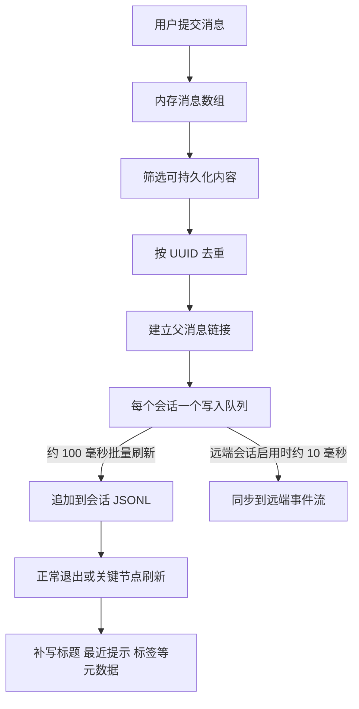
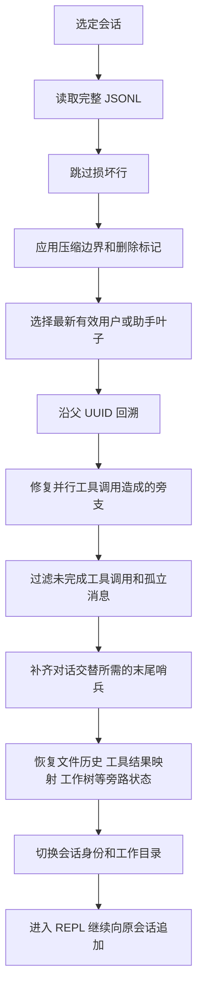

# 会话历史持久化与 `/resume` 恢复 - Claude Code - 01 - 会话历史持久化与恢复机制

## 用户提问原文

> Claude Code 的会话历史持久化与 /resume 恢复会话是怎么做的?

## 结论先行

Claude Code 没有把会话存进数据库。主会话历史是**每个会话一个追加式 JSONL 文件**，文件放在按工作目录映射出的项目目录里。每条消息都带自己的 UUID 和指向上一条消息的 `parentUuid`，恢复时从最新的有效叶子沿父链回溯，重建出一条会话分支。

`/resume` 不是简单地把 JSON 数组反序列化回界面。它实际做了三件事：

1. 用轻量元数据扫描会话列表，让用户选择目标会话；
2. 解析完整历史，应用压缩边界、删除标记和父子链修复，选出要继续的那条分支；
3. 恢复消息之外的状态，包括文件回退历史、已读文件缓存、工具结果替身映射、工作树、代理设置、模式和部分任务状态，然后把当前会话身份切换到目标会话并继续向原文件追加。

这套设计的核心是把“**历史日志**”和“**当前视图**”分开：磁盘保留追加式事件流，恢复时重新计算当前视图。压缩和删除标记只改变恢复时选中的链，不要求原地重写整份历史。

## 场景：一次会话关闭后，下一次为什么还能接着做

用户退出终端后重新执行 `claude --resume`，希望模型继续看到此前的用户要求、助手回答、工具调用与结果，也希望编辑器侧的文件回退、工作目录和未完成任务不丢。

Claude Code 同时维护了几类不同的“历史”，它们不能混为一谈：

| 历史类型 | 默认位置 | 用途 | 是否驱动 `/resume` |
|---|---|---|---|
| 主会话记录 | `~/.claude/projects/<目录映射>/<session-id>.jsonl` | 保存用户、助手、工具结果、压缩摘要和会话状态 | 是 |
| 输入提示历史 | `~/.claude/history.jsonl` | 上箭头、`Ctrl+R` 搜索曾经输入过的提示词 | 否 |
| 文件回退备份 | `~/.claude/file-history/<session-id>/` | 文件检查点与回退 | 恢复时作为旁路状态加载 |
| 子代理记录 | `~/.claude/projects/<目录映射>/<session-id>/subagents/` | 子代理自己的对话与恢复 | 不进入主会话 `/resume` 列表 |
| 大工具结果 | `~/.claude/projects/<目录映射>/<session-id>/tool-results/` | 存放被移出上下文的大段工具输出 | 主记录保存引用和替身记录 |
| 活跃进程登记 | `~/.claude/sessions/<pid>.json` | `claude ps`、并发检测和活跃会话识别 | 只用于辅助判断，不是会话正文 |

默认配置目录由 `CLAUDE_CONFIG_DIR` 决定；未设置时是 `~/.claude`。会话目录名不是原样保存路径，而是把工作目录中的非字母数字字符统一替换为 `-`。例如 `/home/me/project` 会落到类似 `~/.claude/projects/-home-me-project/` 的目录。过长的路径会被截断并附加哈希，避免超过文件系统单个目录名的长度限制。

输入提示历史是另一条独立通道：它记录提示文本、项目、会话 ID 和粘贴内容引用，交互读取窗口最多显示 100 条。它服务于输入框回忆，不负责恢复助手回复或工具结果。

会话文件的权限是 `0600`，目录是 `0700`，这让历史默认只对当前用户可读。

## 机制展开

### 1. 一个会话文件里到底有什么

主文件是 JSONL：每行一个独立 JSON 对象，按时间追加。普通对话行大致包含：

- 消息类型：`user`、`assistant`、`attachment` 或 `system`；
- 消息自身的 UUID；
- 父消息 UUID；
- 会话 ID、工作目录、程序版本、Git 分支和时间戳；
- 是否是子代理旁路消息；
- 原始消息内容，包括文本、思考块、`tool_use` 和 `tool_result`。

压缩边界还额外保留一个“逻辑父节点”：物理上它把 `parentUuid` 置空，成为恢复链的新根；逻辑上仍记录压缩前最后一条消息，方便诊断和某些恢复逻辑识别压缩发生的位置。

除普通消息外，同一个文件还会追加控制性记录：

| 记录 | 作用 |
|---|---|
| `custom-title` | 用户设置的会话标题 |
| `last-prompt` | 最近一次有意义的用户提示，供恢复列表显示 |
| `tag` | 会话标签 |
| `mode` | 普通模式或协调者模式 |
| `worktree-state` | 最后进入或退出工作树的状态 |
| `file-history-snapshot` | 某个消息位置对应的文件备份快照 |
| `content-replacement` | 哪些工具结果已经从完整内容替换成上下文中的短替身 |
| `summary` | 历史摘要或压缩摘要 |
| `compact_boundary` | 压缩边界标记 |
| `marble-origami-commit/snapshot` | 上下文折叠的提交记录与最近一次暂存状态 |

这些控制记录和普通消息共用同一个追加日志，因此恢复时只需要顺序读取一个文件，就能同时得到“对话内容”和“与对话相关的状态变化”。

### 2. 写入路径：先进入队列，再批量追加

交互式 CLI 会把消息状态的变化交给记录钩子；SDK 和非交互路径则在进入模型请求前先把当前消息交给记录流程。两者最终都走同一个“去重、补父子关系、入队、追加”的写入器。

写入器有三个重要行为：

1. **第一次真正建文件是懒加载的。** 新建会话在第一条用户或助手消息出现前，只缓存元数据，不急着创建空 JSONL；这样可以避免启动后就留下只有标题、没有对话的空会话。
2. **同一文件的写入被串行化。** 每条记录先进入内存队列，约 100 毫秒后成批追加；单批上限约 100 MB。文件不存在时会创建目录，然后继续追加。
3. **同一个消息 UUID 只写一次。** 恢复、压缩后保留消息、React 重复渲染都可能再次提交同一条消息；写入器通过已记录 UUID 集合去重，避免日志重复膨胀。

普通正常退出会先刷新写入队列，再把标题、标签、最后提示、模式、工作树等元数据重新追加到文件尾部。压缩完成时也会重新追加这些元数据，原因是恢复列表只读取文件头尾的一段窗口；元数据如果被后续大量消息推到窗口之外，列表就会退回显示旧标题或第一条提示。

这里有一个值得注意的实现细节：记录用户消息的调用虽然通常被 `await`，但底层追加是投递到异步队列，真正落盘由队列稍后完成。源码中的注释表达了“用户消息一旦被接受就应可恢复”的设计意图，但代码层面的强保证是“已经进入内存队列”，不是“已经完成磁盘同步”。因此硬杀进程、崩溃或断电仍可能丢掉尚未刷新的最后一批消息。正常退出路径会优先刷新会话数据，并给它约 2 秒的清理预算。

### 3. 会话列表：只读文件头和文件尾

恢复列表不解析每个完整历史文件。它先扫描项目目录，取得每个 JSONL 的大小和修改时间，再对候选文件读取开头和结尾各 64 KB：

- 文件头用于识别是否子代理会话、原始工作目录、是否有团队名，以及首个有意义的用户提示；
- 文件尾用于读取最新标题、标签、最近提示、Git 分支和 PR 关联；
- 标题优先使用用户标题，其次才是自动生成标题；
- 如果无法从头部提取第一条提示，列表会给出兜底名称，而不是直接丢弃会话。

初次只丰富约 50 个最近的会话，用户继续滚动时再逐步加载。这个设计直接决定了为什么标题、标签和最近提示要被重复追加到 EOF：它们必须保持在“尾部窗口”中。

恢复列表会过滤子代理会话和团队内部会话，并且 `/resume` 的交互选择器会排除当前会话。默认先显示当前仓库及其工作树，用户可以切换到“所有项目”。

### 4. `/resume` 如何选出目标会话

不同入口最终都汇聚到同一个恢复加载器，但选择方式不同：

| 入口 | 选择规则 |
|---|---|
| `claude --continue` | 取当前目录最近一条可恢复会话，并尽量跳过仍在后台写入的活跃会话 |
| `claude --resume` | 没有参数时打开选择器；参数是 UUID 时按 ID 恢复；参数是标题时先做精确标题匹配；匹配不到或有歧义时把参数当作搜索词 |
| 会话内 `/resume` | 打开同一仓库会话选择器或按 UUID/标题定位，成功后当场切换会话，不重启进程 |
| `--fork-session` | 复用历史内容，但生成新的会话 ID，后续写入新文件 |
| `--resume-session-at` | print 模式下只恢复到指定消息位置，把其后的消息切掉 |
| 跨项目恢复 | 不同项目通常不直接切换，而是提示先 `cd` 到原目录再恢复；同仓库工作树可以直接恢复 |

跨目录限制来自一个事实：会话依附于工作目录，模型看到的文件、项目设置、`CLAUDE.md`、技能和工作树都按目录解析。只恢复消息但不恢复目录，会让“继续”发生在一个语义不同的环境里。

### 5. 恢复主链：从最新叶子回溯出一条分支

恢复读取时先解析所有行。格式损坏的单行会被跳过；如果整个文件不可读，恢复逻辑会得到空历史，最终表现为“没有找到会话”或“没有有效会话链”，而不是把损坏内容交给模型。

接下来处理两类历史折叠信息：

- **压缩边界**：正常压缩不会改写旧行，而是在文件后面追加边界和摘要。大文件加载时，普通边界之后的内容可以只从边界后开始读，以减少内存；如果边界声明了需要保留的旧消息段，则还要把该段重新接回摘要。小文件会读全量，但重建链时仍会在边界的空父指针处停止。因此模型看到的是“摘要 + 压缩后保留内容”，完整旧历史仍留在磁盘上供审计或后续工具读取。
- **删除标记**：某些上下文删除操作会在边界元数据里记录被删除的消息 UUID。恢复时删除这些节点，并把幸存节点的父指针跨过空洞重新接上，避免恢复出已经被用户移除的长历史。

之后从终端节点中找最新的用户或助手叶子。恢复不假设最后一行就是最后一条消息，因为最后一行可能是标题、工作树或压缩边界。找到叶子后沿着 `parentUuid` 一路回溯，再反转成从根到叶的顺序。

流式输出可能把一条助手消息拆成多个内容块，多个并行工具调用也可能形成同一 message ID 下的兄弟节点。简单的单链回溯会漏掉其中一个分支，因此恢复器还会做一个后处理：把同一助手消息 ID 的兄弟块以及它们对应的工具结果重新拼回主链，保证并行工具调用不会在恢复后丢一半。

最后做对话层清理：

- 过滤没有对应结果的未完成工具调用，避免恢复后 API 因悬空 `tool_use` 报错；
- 过滤孤立的 thinking-only 消息和只含空白的助手消息；
- 如果最后一条有效消息是用户消息，补一个合成的助手哨兵，使消息序列在 API 层仍然合法；
- 在需要自动续跑的 SDK 场景中，可以根据“上次是否在工具调用中途中断”再决定是否自动重新提交提示。

### 6. 恢复的不只是消息

把消息链交给 REPL 之前，Claude Code 还会恢复一组与会话绑定的旁路状态：

1. **会话身份和工作目录**：把当前会话 ID 和会话文件所在项目目录一起切换，避免 ID 与路径不同步；如果目标会话来自工作树，则尝试切回该工作树。
2. **标题、标签、模式、代理名称和颜色**：从尾部元数据恢复，并在后续退出时继续保留。
3. **文件回退历史**：恢复每个消息位置对应的备份快照；如果换了会话 ID，还会把旧会话的备份文件硬链接到新会话目录。
4. **已读文件缓存**：从历史里的读取结果重建“模型曾经看过哪些文件及版本”，避免恢复后编辑工具认为文件从未被读取。
5. **工具结果替身映射**：大工具输出可能只以短替身留在上下文中；恢复时重建“工具调用 ID → 替身”的映射，让提示缓存和后续压缩做出与原来一致的选择。
6. **技能状态**：恢复器会从历史里的技能附件恢复已调用技能；外部构建会过滤大部分附件，因此实际可用性取决于对应附件是否被写入历史。
7. **任务和计划**：旧版 TodoWrite 状态可以从最后一次工具调用反推；交互式新版任务系统另有文件持久化，不能笼统说所有任务都从 JSONL 恢复。
8. **会话开始钩子**：恢复时会重新执行会话开始钩子，并把钩子产生的消息追加到恢复后的上下文。
9. **成本和部分运行状态**：从会话关联的配置或账本恢复，而不是全部塞进对话 JSONL。

恢复成功后，非 fork 路径会继续使用原会话 ID 和原 JSONL；新的消息只是继续追加到文件尾部。fork 路径则保留读到的历史内容，但使用新的会话 ID，在 REPL 挂载后把历史复制写进新的 JSONL。

### 7. 压缩之后为什么还能恢复

压缩是“在追加日志中增加一个恢复边界”，不是把旧日志重写成摘要。恢复链以边界为新的根，摘要成为模型可见的新起点，压缩后保留的消息重新接到摘要或边界之后。

这带来两个直接结果：

- 恢复时模型看到的是压缩后的上下文，不会把压缩前全部内容重新塞回窗口；
- 磁盘上的旧行仍然存在，历史文件会随着时间变大，因此需要独立的按时间清理策略。

默认保留期是 30 天，可通过 `cleanupPeriodDays` 调整；设为 `0` 会关闭会话持久化。后台清理会删除过期的 JSONL、`cast` 录制、会话目录中的大工具结果、计划文件和文件回退备份。

## 条件与边界

| 条件 | 实际行为 |
|---|---|
| 最后一条消息是用户消息 | 恢复时补一个合成的助手哨兵，保持 API 对话结构合法；某些 SDK 自动续跑模式会再把中断提示重新入队 |
| 工具调用只有 `tool_use`、没有 `tool_result` | 恢复时过滤掉未完成的助手工具调用，避免悬空调用 |
| 压缩过多次 | 只恢复最后一个有效边界之后的主链；旧内容仍留在文件里 |
| 历史被局部删除 | 按边界记录删除指定 UUID，并把幸存消息重新接链 |
| 文件末尾有半行或缺换行 | JSONL 解析跳过坏行；恢复使用最后一条有效用户/助手叶子 |
| 父子链出现环 | 停止回溯并返回已收集的部分历史，避免无限循环 |
| 父子链中引用了不存在的消息 | 链在该点截断，之后的恢复可能表现为历史缺失 |
| 进程被硬杀或断电 | 异步写队列和未显式同步的页缓存可能丢失最后一段；正常退出会优先刷新 |
| 两个进程同时写同一个会话 | 主写入器只有进程内串行队列，源码主路径没有看到跨进程文件锁；并发恢复同一会话存在交错追加风险 |
| 上下文过大 | 写入没有按轮次截断文件；加载大文件时会从最后压缩边界之后读，避免把整个文件都解析进内存 |
| 会话来自另一个项目 | 交互式恢复通常提示先切到原目录，或只允许同仓库工作树直接恢复 |
| 子代理历史 | 存在独立子目录和独立恢复路径，默认不出现在主会话恢复列表 |
| 远端或 CCR 会话 | 可先从远端事件流补齐本地 JSONL，再复用同一恢复流程；远端服务的默认开关和保留策略不能仅凭本地源码判定 |
| 关闭持久化 | `--no-session-persistence`、测试环境、`cleanupPeriodDays: 0` 或相关环境开关会让记录直接跳过 |

## 设计取舍

**追加日志而不是可更新数据库。** 追加日志实现简单、崩溃后仍能保留前缀、天然适合流式输出；代价是要用 UUID 图、压缩边界和删除标记重建视图，且文件会持续增长。

**父子链而不是数组下标。** 会话可能出现分叉、压缩、并行工具调用和局部删除。UUID 父链让恢复可以只选择一条分支，而不要求物理行完全连续；代价是每次恢复都要做链完整性和旁支修复。

**轻量列表与完整恢复分离。** 列表只读文件头尾，避免每次打开 `/resume` 都解析几十个几 MB 的会话；代价是标题等关键展示信息必须反复追加，且首条提示必须能从有限窗口里提取。

**先恢复视图，再恢复状态。** 消息链是主状态，文件回退、工作树、已读缓存和工具结果替身是旁路状态。任何一边损坏都不应阻止读取对话，但缺失的旁路状态会让“继续工作”的体验下降。

**批量异步写入换性能。** 高频流式消息如果每条都同步落盘，会拖慢 UI 和 API 主循环；队列和批量追加降低了写放大。代价是持久化语义变成最终一致，异常终止时存在窗口。

## 证据分级

**已证实**

- 主会话使用按目录映射的 JSONL 追加文件；
- 消息带 UUID、父 UUID 和会话元数据；
- 写入有进程内每文件队列、约 100 毫秒刷新和 UUID 去重；
- 恢复从最新有效叶子回溯父链，并处理压缩边界、删除标记和并行工具结果；
- 列表读取 stat 与头尾 64 KB 元数据；
- 文件历史、工具结果替身、工作树、模式和已读缓存有独立恢复逻辑；
- 默认 30 天清理，`cleanupPeriodDays: 0` 关闭持久化；
- 子代理记录和主会话恢复列表分离。

**合理推断**

- 硬杀进程时，异步队列中尚未刷新的最后一段消息可能丢失；
- 主写入器没有跨进程锁，两个进程恢复同一会话并同时追加时存在交错风险；
- 重复追加标题和最近提示，主要是为了让轻量尾部扫描始终能读到展示元数据；
- 恢复列表的性能设计优先于单会话历史的可读性，因此日志会持续变大。

**无法确认**

- 远端 CCR 服务端如何过滤压缩事件、如何决定保留期，以及线上默认开关；
- 不同文件系统、容器或网络盘上的实际持久化时序与掉电语义；
- 生产发行版里是否有本地源码之外的并发保护或额外的会话索引；
- 具体用户配置和功能开关是否改变了本文描述的默认路径。

## 源码依据

以下路径相对于 Claude Code 2.1.88 源码快照根目录：

| 源码位置 | 关键函数/行 | 说明 |
|---|---|---|
| `src/utils/envUtils.ts` | `getClaudeConfigHomeDir`，约 9-14 行 | 默认 `~/.claude` 与 `CLAUDE_CONFIG_DIR` |
| `src/utils/sessionStoragePortable.ts` | `LITE_READ_BUF_SIZE` 17 行；`readSessionLite` 256 行；`sanitizePath` 311 行；`resolveSessionFilePath` 403 行；`readTranscriptForLoad` 717 行 | 目录映射、头尾读取、压缩边界扫描 |
| `src/utils/sessionStorage.ts` | `getTranscriptPath` 202 行；写入队列约 530-700 行；`insertMessageChain` 993 行；`appendEntry` 1128 行；`recordTranscript` 1408 行；`buildConversationChain` 2069 行；`loadFullLog` 2949 行；`loadTranscriptFile` 3472 行；`INITIAL_ENRICH_COUNT` 4577 行；`getSessionFilesLite` 4975 行；`enrichLogs` 5077 行 | 主写入、去重、链重建、完整加载和列表加载 |
| `src/QueryEngine.ts` | 约 436-460 行；1070-1080 行 | 用户输入进入模型前记录会话，结果前刷新 |
| `src/hooks/useLogMessages.ts` | 约 20-150 行 | 交互式消息变化的增量记录 |
| `src/types/logs.ts` | `SerializedMessage` 8 行；`TranscriptMessage` 221 行；`Entry` 297 行 | 会话记录结构 |
| `src/commands/resume/resume.tsx` | `filterResumableSessions` 191 行；`call` 194 行 | 交互式 `/resume` 选择、UUID 与标题匹配 |
| `src/screens/ResumeConversation.tsx` | `ResumeConversation` 67 行；`onSelect` 178 行 | 启动时恢复选择器与切换流程 |
| `src/screens/REPL.tsx` | `resume` 回调 1735 行；已读缓存恢复约 1971 行 | 会话内 `/resume` 的完整状态切换 |
| `src/utils/conversationRecovery.ts` | `deserializeMessagesWithInterruptDetection` 164 行；`loadConversationForResume` 456 行 | 恢复加载、消息清理、中断检测、技能与钩子 |
| `src/utils/sessionRestore.ts` | `restoreSessionStateFromLog` 99 行；`restoreWorktreeForResume` 332 行；`processResumedConversation` 409 行 | 旁路状态、工作树、会话身份和代理恢复 |
| `src/utils/messages.ts` | `filterUnresolvedToolUses` 2795 行；`createCompactBoundaryMessage` 4530 行 | 未完成工具调用清理与压缩边界结构 |
| `src/utils/fileHistory.ts` | `fileHistoryRestoreStateFromLog` 888 行；`copyFileHistoryForResume` 922 行 | 文件回退快照与备份迁移 |
| `src/utils/toolResultStorage.ts` | `getToolResultsDir` 102 行；`reconstructContentReplacementState` 960 行 | 大工具结果目录与替身状态重建 |
| `src/history.ts` | `history.jsonl` 约 115、299 行；`addToHistory` 411 行 | 输入提示历史，独立于会话恢复 |
| `src/utils/cleanup.ts` | `cleanupOldSessionFiles` 155 行；`cleanupOldFileHistoryBackups` 305 行 | 默认 30 天清理 |
| `src/utils/concurrentSessions.ts` | `registerSession` 59 行 | 活跃进程登记与会话切换后的 PID 文件同步 |
