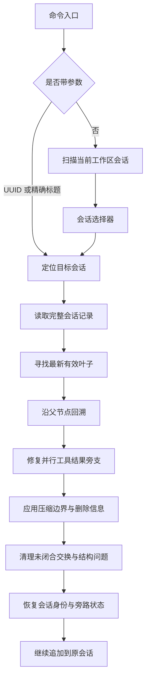

# 会话历史与恢复 - Claude Code - 02 - `/resume` 端到端机制与 Jade Code 复刻边界

---

> 我想在 Jade Code 中复刻 /resume 的功能. 我应该从哪些角度来研究 Claude Code 的 /resume?
>
> 做吧

---

## 结论先行

Claude Code 的 `/resume` 不是“把一份聊天记录重新显示出来”这么简单。它把恢复拆成三个彼此独立、最后才汇合的平面：

1. **发现与会话选择**：从会话目录和轻量元数据构造可恢复列表，排除子代理、团队内部会话和当前会话。
2. **模型可见历史的重建**：读取追加式记录，从最新有效叶子沿父链回溯；压缩边界和删除标记决定当前分支；未闭合工具调用、孤立思考消息和末尾的对话结构在交给模型前被修复。
3. **运行时与旁路状态切换**：切换会话身份、项目目录、工作树、文件回退、已读文件缓存、工具结果替身、Agent 设置、成本和 hooks，然后把消息数组交给下一轮 REPL。

复刻到 Jade Code 时，真正需要先补的不是选择器，而是**稳定的会话身份和持续事件日志**。Jade Code 现有的 `.transcripts` 只是压缩时的历史快照，不是可恢复的会话日志；`SessionRuntime` 的模型历史目前只存在于内存，进程结束后无法接续。

## 场景：为什么一次“继续”会牵动这么多状态

用户退出 REPL 后重新打开，希望模型继续看到此前的用户请求、助手回复和工具结果；同时希望“继续工作”发生在正确的目录、Agent 配置和对话分支上。会话内执行 `/resume` 时，当前进程还持有旧会话的加载状态、成本、工作树和旁路缓存，因此它比启动时恢复多了一步“原子切换”。

这里至少有三个不能混用的东西：

| 状态平面 | 作用 | 能否只靠聊天消息恢复 |
|---|---|---|
| 持久会话记录 | 保存消息、压缩边界、元数据和旁路事件 | 是，主要事实来源 |
| 当前模型视图 | 下一次请求实际发送的消息数组 | 需要从记录中重新计算和清理 |
| 运行时状态 | 会话 ID、目录、工作树、成本、权限与工具环境 | 部分需要额外恢复或重新计算 |

## 机制展开

### 1. 两个入口，最后走到同一个恢复契约

在 2.1.88 源码快照里，`/resume` 有两条入口：

- **交互式 REPL 内**：斜杠命令无参数时打开选择器；带参数时按 UUID 或用户设置的精确标题定位。选中后调用 REPL 提供的恢复回调。
- **CLI 启动时**：`claude --resume` 没有值时进入启动选择器；有值时按会话 ID、路径或搜索入口加载，然后进入 REPL。

斜杠命令的参数行为比“搜索”更窄：

1. 参数是合法 UUID 时，先在同一仓库及其工作树的首批会话记录中查找；找不到再直接读取该 ID 的会话文件。
2. UUID 不匹配时，只在用户标题功能开启时做**精确标题匹配**。一个匹配就恢复，多个匹配则要求回到 `/resume` 选择器。
3. 参数不是 UUID、标题也不精确匹配时，返回“未找到”；它不会把任意参数当作全文搜索词。

启动选择器和会话内选择器也不完全相同。启动选择器支持渐进加载更多记录；会话内 `/resume` 的首屏加载没有继续加载回调，因此在当前快照里只看到首批最多约 50 条已丰富记录。

### 2. 选择器看到的是什么

选择器不是打开每个 JSONL 文件完整解析，而是先扫描目录、按修改时间排序，再只读每个候选文件的头部和尾部窗口：

- 头部用来判断是否子代理会话、原始项目路径、团队身份和第一个有意义的提示；
- 尾部用来取得最新用户标题、标签、最近提示、Git 分支和 PR 关联；
- 初次只丰富少量最近会话，之后按需继续读取；
- 子代理会话、团队内部会话和当前会话会被过滤。

选择界面支持按键筛选标题、分支、标签和 PR，支持预览、重命名；在当前快照中，所谓“深搜索”和“让 Claude 帮找会话”的入口被写死为关闭，不能因为源码里存在这些函数就认为它们在发行版中可用。

跨项目选择在当前外部构建中通常不会直接切换目录，而是提示用户先执行类似 `cd <项目目录> && claude --resume <id>` 的命令。源码中保留了“同仓库工作树直接恢复”的分支，但它受内部身份条件限制。

### 3. 从选中到恢复：消息链如何重建

恢复读取的是追加式 JSONL，而不是一个固定长度的数组。每条普通消息带有自己的 UUID、父消息 UUID、会话 ID、时间戳和工作目录。恢复时先建立“从 UUID 到消息”的映射，再找最新的有效用户/助手叶子，沿父指针回溯，最后反转成从根到叶的顺序。



这条链有三个容易忽略的工程点：

- **压缩边界是新根**。压缩不会删除旧行，而是在日志中追加边界和摘要；边界的物理父节点为空，逻辑父节点仍指向压缩前最后一条消息。因此模型看到的是摘要和压缩后保留的内容，而磁盘上仍保留旧历史。
- **链不等同于文件顺序**。最后一行可能是标题、模式或边界事件，真正的叶子要从用户/助手消息中找。链还可能因为并行工具调用形成多个兄弟节点，恢复器需要把被单链遍历漏掉的工具结果重新接回。
- **损坏是预期输入**。解析器跳过格式损坏的行；父节点不存在时链会截断；循环链检测后返回部分历史。恢复不应该把坏文件直接当成合法消息发送给模型。

消息清理发生在链重建之后：没有对应结果的助手工具调用会被移除；孤立的思考消息、只有空白的助手消息会被过滤；如果最后一条有效消息是用户消息，会补一条合成助手哨兵，使对话结构对 API 仍然合法。工具调用中途中断时，SDK 路径还会把“继续上次工作”的提示转成可自动续跑的输入状态；交互式路径主要使用清理后的消息和末尾哨兵。

### 4. 会话内切换不只是替换消息数组

交互式 `/resume` 的恢复回调大致按以下顺序执行：

1. 清理并反序列化目标消息；
2. 触发当前会话的 SessionEnd hooks，再触发目标会话的 SessionStart hooks；
3. 恢复计划、文件回退、已读文件状态、上下文折叠和部分待办状态；
4. 恢复 Agent 类型、显示名称和颜色；
5. 保存当前会话成本，取得目标成本；
6. 原子切换会话 ID 与项目目录，重置会话文件指针；
7. 恢复标题、标签、模式和工作树，并采用目标会话已有的文件；
8. 重建工具结果的替身映射，最后把消息数组交给 REPL。

因此，恢复的边界不是“消息内容”，而是“消息加一组与消息位置相关的旁路状态”。模型可见历史是主状态；文件回退、已读缓存、工具结果替身、成本和模式是辅状态。辅状态缺失不一定会让对话打不开，但会让恢复后的编辑、压缩、成本统计或工作目录行为与原来不同。

### 5. 哪些状态持久化，哪些重新计算

| 状态 | 处理方式 | 复刻时的含义 |
|---|---|---|
| 用户、助手、工具结果消息 | 从 JSONL 恢复并清理 | 必须有稳定的消息记录 |
| 压缩边界与摘要 | 追加记录，恢复时作为新根 | 不能把压缩后的数组当成唯一事实 |
| 标题、标签、模式、Agent 设置 | 从记录元数据恢复 | 影响选择器和下一轮行为 |
| 文件回退、已读文件缓存 | 旁路恢复 | 需要单独设计，不属于聊天文本 |
| 工具结果替身映射 | 根据消息和替换记录重建 | 影响后续压缩与提示缓存 |
| 系统提示、工具池、MCP 连接 | 启动时按当前环境重新计算 | 不应该假装冻结旧运行时 |
| 权限与设置 | 使用当前配置；消息中的旧模式只做有限恢复 | 恢复会话不等于恢复旧安全策略 |
| 成本与部分任务状态 | 从独立存储或历史反推 | 旧版 todo 与新版任务系统要分开看 |
| 排队中的用户输入、后台进程 | 不恢复 | 进程退出后不能假装任务还在运行 |

这给出一个重要的复刻原则：**持久化事实，重新计算环境**。把系统提示、工具列表和 MCP 连接整体序列化会快速过期；只恢复消息和真正属于会话的旁路状态，通常更稳。

## 条件与边界

- **选择器大小**：会话内 `/resume` 的当前快照没有继续加载入口，首批记录之后可能不可见；启动选择器有渐进加载。复刻时不要只看“有列表组件”就认为已支持完整历史。
- **跨目录**：会话与工作目录、项目说明、技能和工作树绑定。只恢复消息而不恢复语义环境，会让“继续”发生在错误的项目里；当前外部构建倾向于要求用户先切换目录。
- **未完成工具调用**：恢复时必须决定丢弃、截断还是合成结果。直接交给模型会违反工具调用协议。
- **压缩后的文件**：旧记录仍在磁盘；恢复链只读取最后一个有效边界之后的部分。大文件还有按边界截断读取的优化，不能假设每次恢复都会解析完整文件。
- **损坏与半行**：格式损坏的单行会被跳过；文件末尾可能留下半行。恢复要保留清晰的“少了一段历史”状态，而不是静默拼接。
- **并发写入**：主写入器只保证进程内串行追加；没有看到跨进程文件锁。两个进程恢复同一会话并同时追加可能交错。
- **入口差异**：交互式 `/resume` 和启动选择器并不完全共用加载器。源码中交互式路径直接清理已加载的完整日志，而启动路径走集中恢复函数；后者还会恢复技能附件状态并做恢复一致性检查。复刻时应收敛成一个恢复契约，避免两个入口产生不同的历史。
- **功能开关**：深搜索、Agentic 搜索等分支在当前快照的 UI 代码中被写死为关闭；生产版本是否还有其它开关无法从本地快照确认。

## 对 Jade Code 的复刻映射

### Jade Code 当前事实

Jade Code 已经有一个很适合接恢复的单一会话运行器，但还缺少恢复所需的持久化基础：

- `SessionRuntime` 的模型历史是私有内存列表，构造时从空开始；程序退出后历史和队列都不会恢复。
- `.transcripts` 下的现有 `transcript-*.jsonl` 是压缩或归档时写出的一次性快照，文件名是随机临时名，不是按会话身份持续追加的日志。
- TUI 的 `TuiState` 保存显示条目，不是模型历史；恢复不能只把卡片重新画出来。
- TUI 控制器当前只认识 `/help`、`/theme`、`/model`，没有 `/resume`，也没有会话选择器。
- `ReplCommand` 没有 `--resume` 参数；`TuiApplication` 只创建一个 `SessionRuntime`，控制器持有的是固定的运行时引用。
- `TodoManager` 是内存账本；`TaskStore` 持久化的是任务图，不是对话历史。
- `ToolExchangeProtocol` 对工具调用与结果配对要求严格，恢复器不能把半批工具结果直接交给模型。

### 不存在 `/resume` 时的最小架构

建议把“会话存储”从压缩归档中独立出来，作为会话运行器的协作者：

```text
<workspace>/.transcripts/
└── sessions/
    └── <session-uuid>/
        ├── session.json       # 会话清单：版本、工作区、标题、创建/更新时间、模型
        ├── events.jsonl       # 持续会话事件：必须可顺序重放
        └── session.lock       # 可选：防止两个进程同时写同一会话
```

`events.jsonl` 不必记录每次流式 token。只在模型历史真正发生状态变化时追加：

- 用户请求；
- 完整助手消息；
- 完整工具结果批次；
- Stop 续跑输入；
- 合并到末条用户消息的后台通知；
- 压缩器返回的整份替换历史；
- 可选的错误、修复和元数据事件。

这比照搬 Claude Code 的 UUID 父链更小，但保留了最重要的恢复语义：顺序追加、压缩边界、可重建的完整模型视图。MVP 可以把压缩结果直接记成 `history_replaced`，保存压缩器返回的完整消息列表；以后若要支持分支、回滚或部分删除，再引入消息 ID、父事件 ID 和边界事件。这样不会在第一步就为了分支模型付出全部复杂度。

### 运行器需要一个“初始历史”和“日志出口”

Jade Code 的 `SessionRuntime` 是唯一修改历史的线程，这是很好的不变量。改造应在这个不变量上做：

- 构造函数接受一个已恢复的消息列表和一个会话日志对象；
- 现有的 `apply(ModelReply)`、`apply(ToolBatch)`、`apply(Continue)` 和 `apply(SessionEvent)` 在修改内存历史后，同步记录对应的追加操作；
- `HistoryPrepared` 记录为整份替换，后台通知记录为末条替换，避免重放时丢失合并语义；
- `close()` 在关闭执行器之前刷新日志和清单，避免“任务结束但恢复文件还停在上一轮”；
- 日志写入失败不能静默地宣称会话可恢复；应在界面明确显示降级状态，或者在任务完成前失败。

Jade 的历史变化频率远低于 Claude 的流式内容块记录：一次模型回合通常只有一条助手消息、一批工具结果和少数通知。因此第一个版本可以使用同步追加或简单的单写者缓冲，不必先复制 Claude 的 100ms 批量写入队列。正确性优先于写入吞吐。

### 恢复时先修复，再启动运行器

Jade 目前没有 Claude 那样复杂的旁路状态，恢复算法可以更直接：

1. 读取会话清单和事件日志，跳过格式损坏的尾部行；
2. 依序重放事件，遇到 `history_replaced` 就以新列表为当前历史；
3. 用 `ToolExchangeProtocol.validateHistory` 检查工具调用与结果的配对；
4. 如果只有最后一个工具交换未闭合，为缺失的调用补上明确的“上次会话中断，结果未记录”工具结果；如果更早的结构已经损坏，拒绝恢复并保留原文件；
5. 如果末尾是用户消息，补一个合成的助手哨兵，避免下一次用户输入形成不合适的连续用户消息；
6. 从最后成功的历史重建 TodoManager 的最近一次 `todo_write` 状态；
7. 重新装配当前模型、工具、技能、权限、MCP 和 cron，不把旧运行时对象直接反序列化。

这条“先修复，再装配”的顺序很重要。Jade 的压缩器、记忆和工具执行器都假设历史是合法的；先把半截历史塞进去，错误会拖到第一次模型请求才暴露。

### 选择器与运行时切换

最小可用版本可以先做“启动时恢复”，再做“会话内切换”：

1. **启动时**：`jade repl --resume <uuid>` 直接加载；无参数时列出当前工作区的会话，选完后用恢复历史创建唯一的运行器。
2. **会话内**：增加 `/resume` 到命令候选和提交分流；选择器读取清单，不读取每个完整日志。
3. **切换限制**：Jade 目前没有可靠的单轮取消协议，因此第一版应在 `SessionRuntime.isBusy()` 时拒绝切换，提示用户等当前任务结束；不要直接关闭一个正在执行工具或等待后台的运行器。
4. **会话宿主**：把 `TuiApplication` 中固定的 `SessionRuntime` 改为一个能关闭旧运行器、创建新运行器的小型宿主。界面状态仍由 UI 线程维护，恢复历史通过 UI 事件或初始化方法注入，业务线程不直接改 TuiState。
5. **显示恢复**：把最终模型历史映射成用户、助手、工具调用和工具结果的显示卡片；流式片段和工具耗时无法从历史恢复时，显示为普通已完成记录，不伪造实时状态。

第一版会话列表建议只列当前工作区，缺少目录就明确说明。跨工作区的全局索引、同仓库工作树和“先 cd 再恢复”可以作为后续能力；它们不是把消息读出来就能自动解决的。

### 条件、失败与验证边界

- 会话 ID 必须是内部生成的 UUID；用户输入只用于定位，不能直接拼成任意文件路径。
- 同一会话应有一个进程级写锁；没有锁时至少检测已有锁定文件并拒绝覆盖。
- 现有压缩快照不能被当作新会话日志；两者的生命周期和恢复语义不同。
- 恢复不应重放工具执行，只重放“历史采用”事件；文件副作用不能因为恢复而重做。
- 排队中的用户输入、后台命令和正在运行的队友不应恢复；它们属于旧进程的运行时，而不是可重放的聊天事实。
- 恢复后的模型配置可能与旧会话不同。至少显示当前模型；若希望严格复现旧环境，需要把模型和关键配置写入清单并明确“沿用旧值还是使用当前值”的产品规则。
- 当前源码快照没有可运行的 Claude Code 测试；上述行为以静态源码和调用链为证据，实际发行版还受构建开关和配置影响。

## 设计取舍

**追加日志而不是可覆盖数据库。** 追加日志容易保留崩溃前的合法前缀，也方便把显示历史和模型历史分开；代价是文件会增长，需要压缩边界或替换事件来控制当前视图。

**消息链而不是直接数组下标。** 父链能表达压缩、分支和局部删除，但要求恢复时处理缺父、循环、并行工具结果和未闭合交换。Jade 第一版若只做单线会话，可以用顺序事件；但要把消息 ID 和父事件 ID 留在数据结构里，否则以后加分支会重写存储层。

**选择器只读清单，恢复时才读完整日志。** 这能让 `/resume` 打开得快，但清单必须维护好标题、时间和首条提示；不能让每次列表刷新都扫描大文件。

**恢复事实，重新计算环境。** 消息、压缩边界和显式旁路状态应持久化；系统提示、工具池、MCP、权限和技能扫描应按当前工作区重新建立。两者混在一起，会让旧配置悄悄覆盖用户现在的安全设置。

## 证据分级

**已证实**

- 斜杠 `/resume` 有“无参数选择器”和“UUID/精确标题直接恢复”两条路径；带普通搜索词时不会自动做全文搜索。
- 选择器排除子代理、团队内部会话和当前会话；会话内 `/resume` 当前只填充首批记录，没有继续加载回调。
- 会话内恢复通过 REPL 的恢复回调切换会话；启动选择器通过集中恢复函数加载后进入 REPL。
- 恢复会重建父链、应用压缩边界、处理损坏行和并行工具结果，并清理未闭合工具调用与末尾消息结构。
- 会话内恢复会切换会话身份、项目目录、工作树、元数据、成本、已读状态和工具结果替身；排队输入和后台进程不在恢复范围内。
- 当前快照的深搜索/Agentic 搜索 UI 分支被写死为关闭。
- Jade Code 的 `SessionRuntime` 历史从空内存列表开始；现有 transcript 存储是压缩快照，不是持续会话日志；TUI 没有 `/resume`，运行器在应用启动时固定创建。

**合理推断**

- Claude Code 的两个恢复入口存在调用路径差异，尤其是技能附件状态和恢复一致性检查；复刻时应收敛为一个恢复契约，避免长期行为漂移。
- 交互式 `/resume` 的首批列表限制会随实现变化，当前源码能证明“没有继续加载入口”，不能证明所有发行版永远如此。
- Jade 在一个会话回合结束后同步追加事件，足以支撑学习项目的恢复能力；只有在高频流式消息也进入日志时，才需要更复杂的批量写队列。

**无法确认**

- 生产发行版中各功能开关和远端配置的真实默认值；
- 不同文件系统、网络盘和异常断电条件下的持久化时序；
- 当前源码快照之外的测试覆盖和额外并发保护。

## 源码依据

以下 Claude Code 路径相对于 `claude-code-2.1.88-source` 根目录；Jade Code 路径相对于 `/home/fishandrice/Backend/JadeCode`。

| 源码位置 | 关键函数/行 | 说明 |
|---|---|---|
| `src/commands/resume/resume.tsx` | `filterResumableSessions` 191；`call` 194-274 | 选择器、UUID、精确标题、直接读取和无匹配错误 |
| `src/components/LogSelector.tsx` | 192、348-443、1357-1413 | 深搜索开关、标题/分支/标签/PR 过滤、选择器渲染 |
| `src/screens/REPL.tsx` | `resume` 回调 1735-1948 | 会话内 `/resume` 的完整切换顺序 |
| `src/screens/ResumeConversation.tsx` | `onSelect` 178-297 | 启动选择器的渐进加载、加载和 REPL 挂载 |
| `src/utils/conversationRecovery.ts` | `deserializeMessagesWithInterruptDetection` 164-252；`loadConversationForResume` 456-596 | 消息清理、中断检测、集中恢复结果 |
| `src/utils/sessionStorage.ts` | 198-225；606-675；1408-1449；2069-2094；2949-3055；3472-3675；4526-4568；4975-5104 | 会话路径、写队列、链重建、完整日志、轻量列表与过滤 |
| `src/utils/sessionRestore.ts` | `restoreSessionStateFromLog` 99-150；工作树 332-400；`processResumedConversation` 409-487 | 文件历史、待办、工作树、会话身份和启动路径 |
| `src/utils/messages.ts` | `filterUnresolvedToolUses` 2795-2841；`createCompactBoundaryMessage` 4530-4555 | 未闭合工具调用与压缩边界 |
| `src/utils/crossProjectResume.ts` | `checkCrossProjectResume` 20-75 | 跨目录恢复的命令/工作树判断 |
| Jade Code `src/main/java/com/jadecode/session/SessionRuntime.java` | 50-102、183-196、600-660、787-827 | 内存历史、固定构造、状态采用和关闭行为 |
| Jade Code `src/main/java/com/jadecode/bootstrap/JadeCodeFactory.java` | 218-235、300-345 | 每次创建新运行器、工具与存储装配 |
| Jade Code `src/main/java/com/jadecode/context/TranscriptStore.java` | 16-85 | 压缩快照以随机临时文件一次性写出 |
| Jade Code `src/main/java/com/jadecode/cli/tui/TuiController.java` | 25-29、107-115、145-171 | 固定运行时、命令候选和本地命令分流 |
| Jade Code `src/main/java/com/jadecode/cli/tui/TuiApplication.java` | 45-100、127-145 | 单运行器生命周期和 UI 事件循环 |
| Jade Code `src/main/java/com/jadecode/messages/ToolExchangeProtocol.java` | `validateHistory` 165-225 | 恢复时必须满足的工具交换完整性 |
| Jade Code `src/main/java/com/jadecode/todo/TodoManager.java` | 23-79 | 仅内存、整体替换的计划账本 |
| Jade Code `src/main/java/com/jadecode/cli/ReplCommand.java` | 12-20 | 当前没有 `--resume` 参数 |
