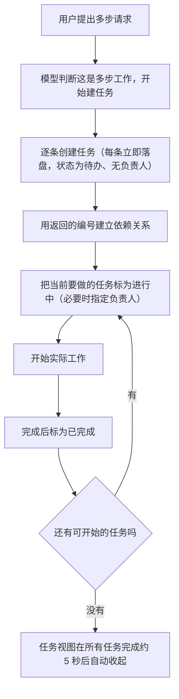

# Task system - Claude Code - 02 - Task list mechanism

---

Claude Code 中有类似 `learn-claude-code` s10 那节所说的 Task System 功能吗？如果有，它是怎么做的。

---

## 结论先说

**有**，而且和 s10 已经不只是"类似"——它同样是"每个任务一条持久化记录 + 三态 + 负责人 + 依赖图"的结构，跨会话保留。但它在几个关键判断上与 s10 明显不同：**依赖不做环校验、悬空依赖被当作不阻塞、完成后不主动计算"刚解锁了谁"、认领不是独立动作而是"改负责人"**。逐条对照见第九节。

## 场景

用户说："给设置页加个暗色模式，改完跑测试，最后更新一下文档。"

这句话里其实有三件有先后关系的事，还有"谁在做"的问题。早先的机制（一张整表替换的清单）只能记住"还有什么没做"，记不住"B 要等 A 做完"和"这条由谁负责"。于是这套新机制把"清单"换成了"一批任务记录"，每条记录自己带状态、负责人和依赖。

下面沿着这次请求的真实执行顺序走一遍。

## 一、第一次运行：从建任务到完成

四个环节值得单独说明。

**创建**：模型可以一次建一条，工具会把系统分配的编号返回给它。任务一创建就落盘，不存在"只在内存里"的中间态。

**建立依赖为什么必须分两步**：模型在一条回复里可能同时发出多个工具调用，而这些调用的参数在任何一个结果产生之前就已经定好了——所以第二条创建调用拿不到第一条刚分配的编号。因此依赖只能在任务创建之后、用已知的编号单独补上。这一点与 s10 的说明完全一致。

**认领与开工**：状态从"待办"改到"进行中"的这一步，就是"认领"。如果没人指定负责人，任务在协作模式下会被自动填上当前 agent 的名字；在普通单机会话里，负责人通常留空。

**完成**：把状态改成"已完成"。这一步可能被外部钩子拦住（见第七节）。

**解锁下游不需要专门操作**：谁被解锁这件事不是"完成时算好再通知"，而是**读的时候才算**——只有当某个任务真的要被认领/开始时，系统才会回头检查它的前置是不是都已完成。列表输出里也会把已完成的前置从"被阻塞于"一栏里过滤掉，所以模型看一眼列表就知道现在能做什么。

## 二、任务记录长什么样

每条任务是一个独立的小文件，结构如下（这里是机制语言，不是字段清单）：

| 内容         | 说明                                                                                           |
| ------------ | ---------------------------------------------------------------------------------------------- |
| 编号         | 连续整数，**永不复用**。删除或整体重置后用一条"水位线"记录历史最大值，下次分配继续往上加 |
| 标题         | 一句话的行动描述                                                                               |
| 详细描述     | 供后续接手者（或未来的自己）理解要做什么                                                       |
| 进行中用语   | 可选的现在进行时短句，界面转圈动画会用它当动词                                                 |
| 状态         | 待办 / 进行中 / 已完成                                                                         |
| 负责人       | 认领者的名字或标识；未认领为空                                                                 |
| 依赖（双向） | "我阻塞谁"和"我被谁阻塞"两份列表，由一次"建立阻塞关系"的操作同时写两边                         |
| 附加元数据   | 任意键值，可合并更新；内部标记可用来把某些任务从列表里隐藏                                     |

有两处与 s10 不同：

- **编号是连续整数而不是随机串**，并且用"水位线"保证删除/重置之后不会重发旧编号；
- **依赖是双向记录的**（s10 只存"被谁阻塞"，被阻塞者之外的另一侧需要现算）。

"删除"不是第五个工具，而是更新工具里状态字段的一个特殊取值（相当于"这条不要了"）。删除时会顺手把其他任务里指向它的依赖引用清掉，避免留下悬空边。

## 三、任务什么时候会回到模型眼前

一个容易被误解的点：**任务列表并不常驻上下文**，它不进系统提示、也不进用户上下文。模型想看任务，只能自己调用查询工具。

系统只有一种主动行为：如果**连续 10 个助手回合都没有碰过任务**（既没创建也没更新），并且**距离上次提醒也已经过了 10 个回合**，就会追加一条提醒，附带当前任务的一行式概览（编号、状态、标题），并提示"该用创建工具补任务、用更新工具改状态；列表过时也可以清理"。这条提醒还会明确要求模型**不要向用户提起这条提醒本身**。

提醒在几种情况下会被抑制：内部账号、工具箱里已有另一种被指定为主通信渠道的工具、以及任务更新工具不可用时都不发。

界面侧有三处配合：创建或更新任务会自动展开任务视图；所有任务完成约 5 秒后自动收起；进行中任务的"进行中用语"会成为转圈动画显示的文字。

## 四、什么条件下才能开始一个任务

认领一个任务要同时满足：任务存在、尚未完成、没有被别人认领、**前置任务全部已完成**。

这里有两处细节值得注意：

- "前置完成"的判定比较严格：前置任务只要不是"已完成"（哪怕它已经"进行中"）就算还在阻塞。
- **指向已不存在任务的依赖不算阻塞**。删除任务时引用会被清理，即使残留了悬空引用，判定时也只会检查真实存在的任务——所以悬空依赖等于"自动放行"。这一点与 s10（把缺失的前置视为不可开始）刚好相反。

另外，**系统不做环检测**：把 A 设成阻塞 B、同时把 B 设成阻塞 A，是能被写进去的。s10 明确拒绝自依赖与环。就机制而言，这里把正确性的责任交给了模型和提示词（提示词要求开工前先确认阻塞列表为空），而不是由存储层保证。

还有一条"忙碌约束"：某些自动认领路径要求一个 agent 同时只能持有一个未完成任务。这条约束**只在自动认领与协作路径里生效**，通过工具手工改负责人时并不检查。

## 五、并发：为什么要自己写锁

任务可能存在多个进程同时在读写（多个会话、多个协作 agent）。为此机制做了三件事：

| 场景                                     | 处理方式                                                               |
| ---------------------------------------- | ---------------------------------------------------------------------- |
| 创建（要"读全局最大编号 → 分配下一个"） | 对整个任务列表加排它锁                                                 |
| 整体重置                                 | 对列表加锁，先把当前最大编号写进水位线，再清空所有任务文件             |
| 单条更新                                 | 只对那一条任务加锁                                                     |
| 认领且需要检查"我是否手头已有任务"       | 对列表加锁，把"检查"和"认领"合成一次原子操作，避免检查与写入之间的竞态 |

锁是**重试式**的：短间隔重试约 30 次，总等待上限约 2.6 秒。源码注释说明了这个预算的来由——按"十来个 agent 同时抢锁"的规模估算，最后一个调用者大约需要等 900 毫秒。也就是说，这个数值是按协作规模校准的，而不是随手取的。

变更的传播分两条路：同一进程内用内部信号通知界面立即刷新；跨进程靠监听任务目录（50 毫秒去抖，另加 5 秒兜底轮询，防止文件系统事件丢失）。

## 六、外部机制可以在任务生命周期的两端插手

创建与完成这两个动作都会触发外部钩子：

- **创建被拦截**：钩子返回阻断错误时，刚创建的任务会被删掉，错误原样返回给模型——相当于"这条任务不允许存在"。
- **完成被拦截**：钩子返回阻断错误时，状态不会改变，完成动作失败。

此外还有一条"验证提醒"：当主线程 agent 刚刚把一张 3 条以上的任务表全部关闭、而这些任务的标题里都没有出现与"验证"相关的字样时，工具结果会追加一句话，要求它在写最终总结前先发起一个验证动作，并强调"不能靠自己在总结里列注意事项来代替验证结论"。这条提醒受功能开关控制。

这些钩子与提醒把"任务表"从一个纯记录结构，变成了可以被外部策略约束的工作流载体。

## 七、协作场景下的额外语义（只看任务清单这一侧）

当会话与团队/多 agent 协作相关时，同一份任务清单会承载分工信息：

**清单归属的解析顺序**：显式指定的清单标识 → 进程内队友上下文里的团队名 → 队友进程的环境标识 → 团队创建时登记的团队名 → 当前会话标识。这个顺序的意义是：**同一个团队的所有成员看到的是同一份清单**，而不是各自会话各一份。

在此之上：

- 队友把任务标成"进行中"却没写负责人时，系统会自动把负责人填成该队友，好让列表能把"任务"和"人"对上。
- 负责人发生变化时，会给新的负责人投递一条分配通知（含任务编号、标题、描述）。
- 由任务所有权可以直接推导每个成员是"忙"还是"空闲"（手上有未完成任务即忙）。
- 队友退出或被终止时，它名下未完成的任务会被退回"无人认领"状态，并生成一条说明，提醒重新分配。

还有一种"任务模式"：可以让一个进程盯住某份清单，自动认领"无主且未被阻塞"的任务，把它格式化成一段提示提交给自己处理，一次只处理一条；如果提交失败会把认领退回去。

这些协作能力共用一个开关：内部构建默认开启，外部构建需要显式启用并且还受远端开关约束。

## 八、与早先那套清单机制的关系

快照里同时保留着旧机制（整表替换的清单），二者由同一个开关决定谁生效：

- **交互式会话默认走新的任务清单**；
- **非交互（脚本化/SDK）默认走旧的清单**，除非显式用环境变量强制切到任务清单；
- 恢复会话时，只有在使用旧机制的情况下才从历史记录里重建清单——也就是说新机制的恢复完全依赖磁盘上的任务文件，不依赖对话历史。

这解释了为什么新机制要做持久化：它的目标状态是"会话被压缩、中断甚至换进程之后，进度仍然在"。

## 九、与 s10 的逐条对照

| 维度             | s10（教学实现）                | Claude Code                                        |
| ---------------- | ------------------------------ | -------------------------------------------------- |
| 存储             | 每个任务一个 JSON 文件         | 同样每个任务一个文件，另加编号水位线与锁文件       |
| 编号             | 随机 8 位十六进制              | 连续整数，永不复用                                 |
| 状态             | 待办 / 进行中 / 已完成         | 相同（另有一个"删除"作为更新动作的取值）           |
| 依赖             | 只记"被谁阻塞"                 | 双向记录（我更清楚"我阻塞谁"）                     |
| 环/自依赖校验    | 校验并拒绝                     | **不校验**                                   |
| 悬空依赖         | 视为不可开始                   | 视为不阻塞（并在删除时清理引用）                   |
| 认领             | 独立操作                       | 通过"把负责人设为自己"完成；另有一条自动认领路径   |
| 完成后解锁提示   | 主动算出并告知刚解锁的下游任务 | 不计算，改为提示模型自己去列表查看                 |
| 允许开工的判定   | 提供专门的检查                 | 合进认领前置校验与列表过滤（列表隐藏已完成的前置） |
| 生命周期         | 跨会话保留                     | 相同，且不依赖对话历史恢复                         |
| 与外部机制的联动 | 无                             | 创建/完成钩子、周期提醒、验证提醒、界面联动        |
| 并发保护         | 排他写入                       | 细粒度锁 + 重试预算 + 进程内信号 + 跨进程目录监听  |

## 十、设计取舍

**它选择"存储层只保证基本一致性，语义正确性交给模型"**。不校验环、悬空依赖自动放行、忙碌约束只在自动路径生效——这些都是同一个取向：把存储做得简单、可并发、不会因为模型的奇怪输入而卡死；把"这样建依赖合不合理"交给模型判断。代价是模型写出相互阻塞的环时，系统不会报错，只会表现为"这些任务都做不了"。

**它把"解锁"从事件改成了视图**。s10 完成时会算一遍谁被解锁并显式告知；这里不计算，而是在列表里隐藏已完成的前置。"不做通知、只改视图"的好处是不需要维护反向索引与通知链路，坏处是模型必须主动看一眼列表才知道有新工作。

**它把状态从上下文搬到磁盘**。任务不进系统提示，只在长期闲置时提醒一次。这既省上下文，也避免了"清单被反复重写导致缓存失效"，但代价是模型很容易忘记自己还有任务表。

## 源码依据

| 机制部分                                                                                                                              | 源码位置                                                                                                                                                                                                                                                                      |
| ------------------------------------------------------------------------------------------------------------------------------------- | ----------------------------------------------------------------------------------------------------------------------------------------------------------------------------------------------------------------------------------------------------------------------------- |
| 任务数据模型、状态集合、编号分配与水位线、列表级/任务级锁、认领与忙碌检查、删除与引用清理、重置、清单归属解析、团队忙闲推导与退出退回 | `src/utils/tasks.ts`（`TaskSchema`、`createTask`、`updateTask`、`deleteTask`、`listTasks`、`blockTask`、`claimTask`、`claimTaskWithBusyCheck`、`resetTaskList`、`getTaskListId`、`getAgentStatuses`、`unassignTeammateTasks`、`isTodoV2Enabled`） |
| 创建工具（含创建钩子拦截后删除任务、界面自动展开）                                                                                    | `src/tools/TaskCreateTool/TaskCreateTool.ts`、`prompt.ts`                                                                                                                                                                                                                 |
| 更新工具（字段增量更新、状态含删除、完成钩子、负责人变更通知、依赖两阶段写入、验证提醒、队友完成提示）                                | `src/tools/TaskUpdateTool/TaskUpdateTool.ts`、`prompt.ts`                                                                                                                                                                                                                 |
| 列表工具（隐藏内部任务、过滤已解决前置、一行式输出）                                                                                  | `src/tools/TaskListTool/TaskListTool.ts`、`prompt.ts`                                                                                                                                                                                                                     |
| 查询工具（完整描述与双向依赖）                                                                                                        | `src/tools/TaskGetTool/TaskGetTool.ts`、`prompt.ts`                                                                                                                                                                                                                       |
| 周期性任务提醒的触发条件与抑制条件                                                                                                    | `src/utils/attachments.ts:254-257`（`TODO_REMINDER_CONFIG`）、`getTaskReminderTurnCounts`、`getTaskReminderAttachments`                                                                                                                                               |
| 提醒在上下文中的渲染形态                                                                                                              | `src/utils/messages.ts:3680`（`case 'task_reminder'`）                                                                                                                                                                                                                    |
| 任务视图状态、监听与自动收起、转圈动词                                                                                                | `src/hooks/useTasksV2.ts`、`src/components/Spinner.tsx:162-169`、`src/state/AppStateStore.ts:95`                                                                                                                                                                        |
| 自动认领（任务模式）与 CLI 入口                                                                                                       | `src/hooks/useTaskListWatcher.ts`、`src/screens/REPL.tsx:4070`、`src/main.tsx:1140`                                                                                                                                                                                     |
| 协作场景下的认领与退出处理、完成钩子的兜底执行                                                                                        | `src/utils/swarm/inProcessRunner.ts:636`、`src/query/stopHooks.ts:345-363`                                                                                                                                                                                                |
| 创建/完成钩子的执行与错误格式化                                                                                                       | `src/utils/hooks.ts`（`executeTaskCreatedHooks`、`executeTaskCompletedHooks`、`getTaskCreatedHookMessage`、`getTaskCompletedHookMessage`）                                                                                                                          |
| 协作开关                                                                                                                              | `src/utils/agentSwarmsEnabled.ts`（`isAgentSwarmsEnabled`）                                                                                                                                                                                                               |
| 旧机制（整表替换清单）与开关关系、恢复路径                                                                                            | `src/tools/TodoWriteTool/prompt.ts`、`src/utils/sessionRestore.ts:140`                                                                                                                                                                                                    |
