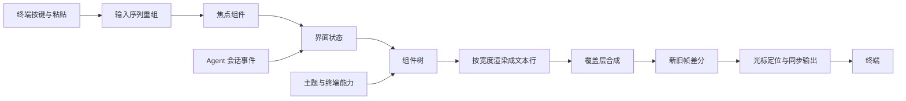
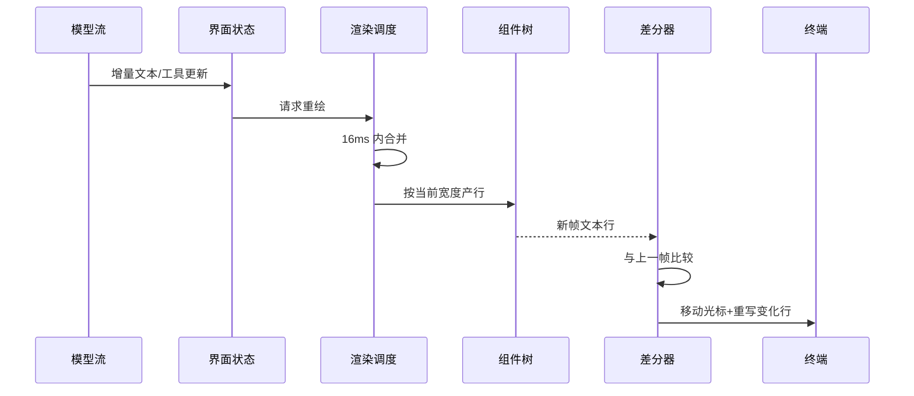

# TUI - Pi - 01 - 内联终端界面的渲染机制与 Java 复刻蓝图

---

解析一下 Pi 的 Cli 前端 UI 是怎么做的. 我希望在 Jade Code 上用 Java 复刻一个出来.

已确认的复刻范围：主屏内联形态；消息流、流式回复、工具卡片、状态栏、多行输入、选择器、主题；不做会话树。Jade Code 的编码由用户完成，本文只给机制解析与落地设计。

---

## 先说明一个源码与观察的冲突

仓库当前版本的默认交互模式是**备用屏全屏**，不是主屏内联。配置默认值写的是 `fullscreen`，命令行帮助也把 `fullscreen` 标为默认；`regular` 才是主屏内联模式。你之前观察到 Pi 是内联，可能来自 `--tui-mode regular`、个人设置或不同版本。

这不影响复刻目标：两种模式共用同一套终端输入、组件树、消息组件、选择器和主题，只替换最外层的渲染器。下面以 `regular` 渲染器为主；全屏模式只在对比边界时提到。

## 场景：界面要同时承受三股流

Pi 的交互界面同时面对三股流：

1. 用户在底部持续输入，可能多行、粘贴大段文本、使用自动补全；
2. 模型在后台持续返回增量文本，工具在后台持续产生输出；
3. 终端本身会改变宽度、改变高度、报告颜色能力，甚至在 SSH 或 Termux 下表现异常。

界面不能在每次增量到达时清屏重画，否则会闪烁、打断输入、破坏终端历史；也不能只像普通日志那样顺序打印，否则状态栏、工具结果和正在生成的回复无法原地更新。Pi 的方案是：把界面表示成一棵“按宽度产出文本行”的组件树，再由渲染器把新旧两帧做差分，只改写终端上真正变化的部分。

## 总体结构



可以分成三层理解：

- **终端适配层**：原始模式、尺寸、按键序列、粘贴标记、颜色与图形能力。
- **通用 TUI 层**：组件契约、容器、焦点、覆盖层、差分渲染、光标。
- **业务界面层**：把会话事件翻译成消息卡片、工具卡片、状态、编辑器和选择器。

## 启动与输入：先把终端的“字节流”变成完整事件

交互模式启动时，终端进入原始模式，关闭行缓冲和回显；同时打开括号粘贴，终端会把粘贴内容包在开始/结束标记之间，编辑器据此把整段粘贴当成一次输入，而不是每个换行都提交。

按键序列并不总是完整到达。一个方向键、一个鼠标事件或一个功能键可能被拆成多个数据块，因此输入层会先缓存并重组，直到识别出完整序列再分发。粘贴内容也会被重新包上标记后交给编辑器。

Pi 还会尝试协商增强键盘协议，以获得修饰键、按下/释放事件和更准确的按键区分；如果终端不支持，则退回到另一套兼容编码。协商结果通过终端回复来判断，并有超时兜底，避免不支持协议的终端卡在启动阶段。

完整事件进入界面后，先经过全局输入监听器，再根据当前焦点交给某个组件。焦点通常落在编辑器或选择器上；覆盖层出现时，焦点会被覆盖层接管，关闭后恢复到之前的焦点。按键引起的重绘走“立即渲染”路径，避免被帧率节流拖慢。

## 渲染循环：请求合并、组件产行、差分输出

界面不会在每次状态变化时直接写终端，而是先登记“需要重绘”。渲染请求会在很短的时间窗口内合并，默认最小帧间隔约 16 毫秒；模型流式输出再密集，也最多按这个节奏刷新。键盘输入优先级更高，会打断等待中的节流帧，立即渲染。

一帧的流程是：

1. 以当前终端宽度调用组件树，得到一组文本行；
2. 把覆盖层合成到对应位置；
3. 从行中提取光标标记，得到真实光标应该所在的行列；
4. 给每行补上样式重置，防止颜色或超链接泄漏到下一行；
5. 与上一帧逐行比较，找出第一处和最后一处变化；
6. 只移动光标、清除并重写变化区间；
7. 把整段输出包在“同步输出”控制序列中，让终端原子地应用这一帧；
8. 更新上一帧、光标位置和可视区起点。

如果没有变化，只更新光标位置，不写任何内容。如果变化只发生在尾部，就从变化处重写到末尾。旧行比新行多时，会清除多余行并把光标移回内容末尾。



## 内联模式的核心：历史不可变

主屏内联渲染器把整篇内容看成一个很长的行数组，但终端实际只能寻址最近的一个视口。渲染器维护三个关键状态：

- 上一帧的完整行数组；
- 当前视口在整篇内容中的起始行；
- 终端硬件光标的真实行号。

当新内容追加到尾部时，如果目标行已经落在视口下方，渲染器会把光标移到底部，写出若干换行，让旧内容被终端推入 scrollback，然后只绘制新增的行。已经进入 scrollback 的行不再重画。

这就是内联模式的核心约束：**已经提交给终端历史的内容必须保持不变**。一旦某一行发生变化，而它又位于当前视口上方，渲染器无法回到那一行修改，只能清屏、清 scrollback、把整篇内容重新打印一遍。终端宽度变化也会触发整篇重排，因为所有换行位置都可能改变。

因此：

- 用户消息、已完成的助手消息、已完成的工具卡片在提交后不再改动；
- 正在生成的助手消息、仍在运行的工具卡片和输入区属于“可变尾部”；
- 主题切换、压缩后重建历史、窗口宽度变化可能触发整篇重绘；
- 内联模式保住了终端原生的历史、搜索和复制，但代价是历史行不能重排。

高度变化通常也会触发整篇重绘，以保持视口对齐；Termux 在软键盘弹出/收起时会改变高度，源码对这种情况做了例外，避免每次切换都重放历史。

## 组件树与布局

组件契约非常简单：给定终端宽度，返回若干文本行；可选地处理键盘和鼠标；可选地声明自己需要光标。容器只是按顺序拼接子组件的行。没有复杂的保留式布局树，也没有动画对象；每一帧都重新产行。

主屏内联模式把界面平铺成一条纵向流：

1. 文档区：启动头部、已加载资源、聊天记录；
2. 待发送消息区；
3. 状态区；
4. 编辑器上方的扩展组件；
5. 编辑器；
6. 编辑器下方的扩展组件；
7. 页脚。

全屏模式则把这些区域放进一个固定高度的纵向布局：上方是可滚动的会话视口，下方是固定的输入坞。输入坞内部再纵向排列待发送消息、状态、编辑器、页脚。复刻内联模式时不需要实现这套全屏布局。

编辑器不是终端自带的行编辑。它有独立的文本状态、软换行、光标位置和滚动偏移；可视高度最多占终端高度的 30%，最少保留 5 行。光标位置通过一个零宽标记写进渲染结果，渲染器找到标记后把硬件光标移到那里，这样输入法候选框能跟随光标。若终端不支持硬件光标，组件会在光标位置画一个反色方块作为替代。

编辑器上方和下方各有一条横线作为边框。Pi 的编码代理把“正在工作”“重试中”“压缩中”等状态嵌进编辑器上边框：空间足够时显示完整文字，空间不足时退化成旋转指示器。这样状态提示不会额外占用一行，也不会离输入区太远。

页脚负责长期信息：当前目录、git 分支、会话名、输入/输出 token、缓存命中率、费用、上下文占用比例、当前模型和思考级别。它会缓存统计结果，只有会话、叶子节点、条目数量或模型变化时才重新扫描，避免每帧遍历全部历史。

## 消息流与工具卡片

会话事件被翻译成界面动作：

| 会话事件     | 界面动作                                     |
| ------------ | -------------------------------------------- |
| 回合开始     | 显示工作指示器，向终端报告进度               |
| 助手消息开始 | 在聊天区尾部创建一个流式消息组件             |
| 助手消息增量 | 更新流式组件；发现新的工具调用时创建工具卡片 |
| 助手消息结束 | 定稿流式组件，标记工具参数已完整             |
| 工具执行开始 | 标记对应工具卡片进入执行中                   |
| 工具执行增量 | 用部分结果更新工具卡片                       |
| 工具执行结束 | 写入最终结果、错误状态和耗时                 |
| 回合结束     | 清理未完成的流式组件和挂起工具               |

用户消息和助手消息都以 Markdown 组件呈现。助手消息内部按内容块顺序排列文本、思考块和错误提示；思考块可以折叠，点击可以展开。消息首尾还会写入终端语义提示标记，方便终端识别“一个提示区域”的边界。

流式助手消息每次收到增量都会重建自己的内容子组件，而不是在旧文本上做局部拼接。这样实现简单，Markdown 结构变化（例如代码围栏刚闭合、列表层级变化）不会留下脏状态；代价是每次更新都要重新解析当前文本，所以外层必须靠帧率合并控制频率。代码围栏尚未闭合时，组件会裁掉尾部不完整的围栏字符，避免最后几个字符到达时整块闪烁。

工具卡片以工具调用 ID 为键。工具调用通常先出现在助手增量里，真正执行开始后继续复用同一张卡片。卡片有三种背景：等待/执行中、成功、失败。工具有自定义渲染器时，由工具自己决定调用部分和结果部分怎么画；没有自定义渲染器时，使用通用回退：显示调用参数，结果默认只展示前 10 行，点击卡片展开全部。工具结果不会单独再生成一张消息卡片，而是回到对应的调用卡片里。

从历史恢复时，界面会重放会话条目：先为助手消息创建卡片，再为其中的工具调用创建工具卡片，最后把后续工具结果按调用 ID 填回对应卡片。这让“调用”和“结果”在视觉上始终是一体的。

## 选择器

Pi 的内置选择器不是浮在聊天记录上的弹窗，而是**临时替换编辑器所在的输入坞**。打开时，编辑器被移除，选择器组件放进同一位置并获得焦点；关闭时，编辑器重新挂回，焦点恢复。聊天记录始终留在上方可见。

这种做法的好处是焦点和布局都稳定：选择器只接管底部区域，不需要计算浮层位置，也不会遮住历史。扩展系统需要更自由的弹窗时，可以改用覆盖层；覆盖层会被合成到当前帧上，并在打开时保存原焦点、关闭时恢复。

选择器的基本形态是列表：每项有值、主标签和可选描述；支持前缀过滤、上下移动、回车确认、Esc 取消；选中项在列表内循环，列表只显示固定数量的行，超出时显示当前位置和总数；鼠标滚轮和点击也可以选择。

模型选择器在此基础上增加了搜索框、模糊匹配和后台目录刷新。刷新有 15 秒超时，失败时保留缓存列表并显示错误；当前模型排在最前，默认模型排第二，其余按供应方排序；可以在“全部模型”和“已限定模型”之间切换；回车选择，另有一个快捷键把选择保存为默认，Esc 取消。

设置选择器、主题选择器、思考级别选择器等都是同一套模式的变体：一个可滚动的选项列表，加若干行说明，再加确认/取消回调。复刻时先把“输入坞替换 + 列表 + 确认/取消”做出来，具体选择器的差异主要是数据来源和回调。

## 主题

主题不是几张配色图，而是一组命名的样式 token。token 分成前景和背景两个槽位，覆盖：

- 基础界面：强调色、边框、成功/警告/错误、次要文字、正文；
- 消息：用户消息背景与文字、自定义消息、思考文字；
- 工具：等待/成功/失败背景、标题、输出、差异增删行；
- Markdown：标题、链接、代码、引用、分隔线、列表符号；
- 语法高亮：注释、关键字、函数、变量、字符串、数字、类型、运算符；
- 思考级别：不同级别对应的编辑器边框颜色；
- 全屏辅助：滚动条轨道与滑块、搜索命中。

token 可以为空字符串，表示“使用终端默认前景或背景”。部分 token 有回退关系，未设置时自动取另一个 token 的值。主题加载时会把 token 解析成具体颜色，并预先算好对应的 ANSI 序列；渲染热路径只做一次查表和字符串拼接。

颜色会按终端能力降级：真彩色、256 色或更少的索引色。需要“更暗”的文字时，不是简单降低透明度，而是把颜色按比例混向背景色。`system` 主题会根据终端报告的默认前景、背景和调色板即时生成。

Pi 会向终端查询默认前景、背景和 16 个调色板颜色，并用一个设备属性查询作为“回复结束”的哨兵；查询有约 100 毫秒超时，迟到的回复仍会应用。终端主动报告明暗切换时，系统主题会重新生成。

切换主题时，界面会使所有组件失效并请求重绘。由于历史行里的颜色也变了，变化通常落在视口上方，内联渲染器会走整篇重绘。这也是主题切换会重刷整段历史的原因。

## 条件、边界与失败

- **只适用于真实终端**：原始模式、尺寸变化、括号粘贴、增强键盘协议都依赖 TTY；管道或文件输入应走普通文本模式。
- **行宽是硬约束**：组件必须按给定宽度截断或换行。渲染器发现某行可见宽度超过终端宽度时会记录崩溃日志并终止界面，而不是让终端自己乱折行。
- **整篇重绘有破坏性**：宽度变化、历史区变化、主题切换会清屏并清 scrollback，再重放当前会话内容；终端里更早的 shell 历史不会保留。
- **差分成本随历史增长**：每帧都要渲染整棵组件树并逐行比较，成本与总行数相关；16 毫秒节流只是限制了频率，不改变单帧复杂度。
- **终端能力不一致**：增强键盘协议、颜色查询、图片协议、进度上报都有探测和降级；不能假设所有终端都支持。
- **退出必须恢复**：关闭光标隐藏、括号粘贴、增强键盘协议、原始模式，并把光标移到内容末尾；否则回到 shell 后键盘或显示会异常。

## 设计取舍

内联模式把“历史”交给终端，把“当前活动尾部”留给应用。它换来了原生的滚动、搜索和复制，但要求应用严格区分不可变历史与可变尾部，并在尺寸变化时接受整篇重排。全屏模式把整块画布交给应用，渲染和滚动都更自由，但用户失去了终端自带的历史与搜索。

组件“按宽度返回文本行”的契约非常小，容易组合和测试；代价是没有保留式布局、动画和局部失效机制。Pi 通过帧率合并、组件内部缓存和“只重写变化行”来弥补。

选择器放在输入坞而不是浮层，是为了让焦点、布局和关闭后的恢复都更确定；浮层则留给需要覆盖内容的扩展场景。主题使用全局 token 和预计算 ANSI，换来了渲染热路径的低成本，但主题切换必须让所有组件失效。

以上关于“为什么这样设计”的部分，源码没有逐条注释，属于合理推断。

## Java 复刻蓝图

### 分层

| 层       | Java 形态                                   | 职责                                         |
| -------- | ------------------------------------------- | -------------------------------------------- |
| 终端适配 | JLine `Terminal` 包装                     | 原始模式、尺寸、颜色能力、读写、退出恢复     |
| 输入解码 | `BindingReader`/`KeyMap` 或自建序列解析 | 把字节流拆成完整按键、粘贴和鼠标事件         |
| 界面事件 | 单线程事件队列                              | 把 Agent 线程的事件排队送到界面线程          |
| 状态     | 普通 Java 对象                              | 历史条目、流式消息、挂起工具、选择器、状态   |
| 视图     | `UiComponent` 接口                        | `List<Line> render(int width)`，可处理按键 |
| 布局     | 纵向容器                                    | 拼接文档、状态、编辑器、页脚                 |
| 渲染     | 内联差分渲染器                              | 维护上一帧、视口、光标，输出 ANSI            |
| 主题     | token 到样式的解析器                        | 明暗、降级、失效与重绘                       |

建议把“样式行”表示成带样式的片段列表，而不是直接拼接 ANSI 字符串。宽度计算只看文本片段，输出时再把样式编码成 ANSI；这样换行、截断和差分都不需要反复解析转义序列。Pi 选择在字符串里直接保存 ANSI，再用宽度函数剥离；Java 用结构化样式会更稳。

可以把核心契约压缩成下面几个类型，具体实现由 Jade Code 决定：

```java
interface UiComponent {
    List<Line> render(int width);          // 只读地产出当前帧
    default void handleKey(KeyEvent e) {}  // 有焦点时接收按键
    default void invalidate() {}           // 主题或宽度变化后清缓存
}

record Span(String text, Style style) {}
record Line(List<Span> spans) {}

final class InlineRenderer {
    private List<Line> previous;
    private int viewportTop;
    private int hardwareCursorRow;

    void render(List<UiComponent> roots, int width) {
        // 产行 → 合成覆盖层 → 解析光标 → 找变化区间
        // → 滚动/重写 → 同步输出 → 更新 previous 与光标
    }
}
```

### 内联渲染器的状态机

至少需要以下状态：

- `List<Line> previous`：上一帧的完整文档；
- `int viewportTop`：当前视口在文档中的起始行；
- `int hardwareCursorRow`：终端光标实际所在行；
- `CursorTarget cursor`：从光标标记解析出的目标行列；
- `int lastWidth`：上一帧宽度。

每帧按以下顺序处理：

1. 渲染文档并合成覆盖层；
2. 解析光标标记，剥离标记；
3. 若宽度变化，或第一处变化位于视口上方，执行整篇重绘；
4. 若只是尾部追加，先把光标移到底部，写出足够的换行把旧内容推入 scrollback，再绘制新行；
5. 否则移动光标到第一处变化，清除并重写到最后变化处；
6. 用同步输出包住整段写入；
7. 更新上一帧、视口起点和硬件光标行；
8. 把硬件光标移到编辑器光标位置。

整篇重绘要明确策略：Pi 会清屏并清 scrollback，保证重排后的历史正确；如果选择不清 scrollback，旧行会和新行重复或错位。这个取舍必须在实现前定下来。

### 输入与编辑器

Jade Code 现在已经有 JLine，但 `LineReader` 和自定义编辑器不能同时拥有 stdin。复刻 Pi 风格界面时，应当只保留一个输入所有者：

- 继续用 JLine 的 `Terminal` 负责原始模式、尺寸、能力和底层读写；
- 交互模式下不再调用 `LineReader.readLine`，改由自定义编辑器处理按键；
- 按键解码可以使用 JLine 的键位映射，也可以自建 CSI/OSC/SS3 序列解析；
- 括号粘贴要保留开始/结束标记，大段粘贴应折叠成占位标记，提交时再展开；
- 退出时恢复终端属性，并确保 `System.out`/`System.err` 不再指向旧的 `PrintAboveWriter`。

Jade Code 目前把全局输出重定向到 `PrintAboveWriter`，后台 hook 或日志可以直接打印。引入自定义渲染器后，这条路径会和渲染器争抢终端：后台输出必须改成“界面通知事件”，由界面线程决定插到历史区还是状态区，不能直接写 `System.out`。

### 线程模型

Agent 循环、模型请求和工具执行可以在工作线程或虚拟线程上运行；所有界面状态修改和终端写入必须收敛到单个界面线程。工作线程只投递不可变事件，界面线程合并事件后重绘。这样不需要给每个组件加锁，也不会出现两段输出交错。

流式文本不要每个 token 都触发一次完整渲染。可以在界面线程维护“脏标记”，由调度器按约 16 毫秒合并；键盘输入则立即唤醒渲染。

### 消息与工具的 Java 对应

- 用户消息：一个不可变的 Markdown 块，完成后不再变化；
- 助手消息：一个可变的流式块，每次更新重建内部块；
- 工具卡片：以调用 ID 为键的状态机，等待/成功/失败三态，支持折叠；
- 状态指示器：独立组件，可嵌入编辑器上边框或单独占一行；
- 页脚：缓存统计结果，只在会话版本变化时重算。

长会话下，建议给已完成的消息块按“宽度 + 内容版本”缓存渲染行；否则每帧都要重新解析全部 Markdown，成本会随历史线性增长。Pi 没有在通用层强制这个缓存，而是由部分组件自己缓存；Java 实现可以更早引入。

### 选择器与主题

先实现“替换输入坞”的选择器：保存编辑器、换成列表、获得焦点、确认或取消后恢复。这个路径不依赖覆盖层合成，足以覆盖模型、主题、思考级别和设置选择器。覆盖层可以后续再加，用于扩展弹窗。

主题先建立 token 表和单一固定主题，确保所有组件通过 token 取色；随后加入明暗主题、真彩色/256 色降级和切换时的全量失效。终端颜色查询可以后置，先支持 `COLORTERM`、`TERM`、`NO_COLOR` 和 JLine 的颜色能力判断。

### 建议的落地顺序

| 阶段 | 目标                        | 验收重点                                |
| ---- | --------------------------- | --------------------------------------- |
| 0    | 纯文本历史区 + 全量重绘     | 组件产行、宽度约束、退出恢复            |
| 1    | 内联差分渲染 + 自定义编辑器 | 输入不丢字、流式输出不闪烁、光标正确    |
| 2    | 工具卡片、状态指示器、页脚  | 工具调用/结果配对、状态切换、长输出折叠 |
| 3    | Markdown 与代码块           | 流式未闭合围栏、CJK 换行、样式不泄漏    |
| 4    | 选择器                      | 焦点接管与恢复、过滤、确认/取消         |
| 5    | 主题                        | token 覆盖、明暗切换、颜色降级          |
| 6    | 兼容性打磨                  | Windows、SSH、Termux、鼠标、粘贴、图片  |

### Java 侧最容易踩的坑

1. **UTF-16 长度不等于终端列宽**。中文、emoji、组合字符、零宽连接符都要按 grapheme cluster 计算；可用 JLine 的宽度工具处理基本宽字符，复杂 emoji 需要 ICU4J。
2. **不要在换行时切断 ANSI 序列**。用结构化样式行，或先标记转义序列再按可见列切分。
3. **不要同时保留两套输入读取**。JLine `LineReader` 与自定义原始输入只能选一个所有者。
4. **不要让后台线程直接打印**。所有输出走界面事件队列，否则会插入到错误位置并破坏差分状态。
5. **窗口变窄时历史无法重排**。必须决定是清 scrollback 重放，还是接受历史行按旧宽度显示。
6. **退出路径要覆盖异常和信号**。光标、原始模式、粘贴模式、键盘协议都要在 `finally` 或关闭钩子里恢复。
7. **长会话要缓存已完成块**。Pi 的每帧全量渲染在长会话下成本明显，Java 可以在保持契约不变的前提下加缓存。

## 证据分级

**已证实**

- 组件契约、容器拼接、覆盖层合成与焦点恢复由通用 TUI 层实现。
- 渲染请求会合并，最小帧间隔约 16 毫秒；键盘输入走立即渲染路径。
- 主屏渲染器逐行比较新旧帧，只重写变化区间；尾部追加通过写换行把旧内容推入 scrollback。
- 变化落在视口上方、宽度变化、部分高度变化会触发整篇重绘；整篇重绘会清屏并清 scrollback。
- 交互模式启动原始模式、括号粘贴，并协商增强键盘协议；输入序列会先重组。
- 编辑器有独立文本状态、软换行、光标标记、30% 高度上限和“大段粘贴折叠为标记”的行为。
- 内置选择器替换编辑器所在的输入坞；扩展选择器可以使用覆盖层。
- 消息流按“开始/增量/结束”更新流式组件；工具卡片按调用 ID 配对调用与结果。
- 主题由命名 token、前景/背景槽位、回退关系和预计算 ANSI 组成；支持系统主题和终端颜色查询。
- 仓库当前默认交互模式是 `fullscreen`，`regular` 才是主屏内联。

**合理推断**

- 16 毫秒节流是为了兼顾流式刷新与终端写入成本；源码没有直接解释这个数值。
- 选择器放在输入坞而不是浮层，主要是为了焦点与布局稳定；这是从实现方式推断的设计动机。
- 内联模式要求已完成内容不可变，是为了避免无法回写 scrollback；源码行为支持这一结论，但没有对应注释。
- 主题切换触发整篇重绘，是因为历史行颜色也变化，变化点落在视口上方。

**无法确认**

- 你实际运行的 Pi 版本、个人设置和终端环境为何表现为内联；仓库当前默认值与此不一致。
- 不同终端对增强键盘协议、同步输出、颜色查询和图片协议的真实支持程度。
- 生产环境中用户最常用的模式分布。

## 源码依据

| 机制           | 源码位置                                                                                                            | 关键内容                                                             |
| -------------- | ------------------------------------------------------------------------------------------------------------------- | -------------------------------------------------------------------- |
| 组件契约与容器 | `packages/tui/src/tui.ts:117-142`, `358-417`                                                                    | 按宽度返回文本行；容器顺序拼接子组件                                 |
| 渲染调度       | `packages/tui/src/tui.ts:981-1053`                                                                                | 16ms 合并、立即渲染、停止与清理                                      |
| 输入分发       | `packages/tui/src/tui.ts:1055-1131`                                                                               | 全局监听器、焦点、覆盖层焦点恢复、按键立即重绘                       |
| 覆盖层栈       | `packages/tui/src/tui.ts:729-842`, `1349-1422`                                                                  | 保存/恢复焦点、合成到帧、可见性与位置                                |
| 光标与行重置   | `packages/tui/src/tui.ts:1424-1484`                                                                               | 光标标记提取、伪光标、样式重置                                       |
| 终端颜色查询   | `packages/tui/src/tui.ts:1494-1516`                                                                               | OSC 10/11/4 与 DA1 哨兵、超时与迟到回复                              |
| 主屏状态       | `packages/tui/src/tui-main-screen.ts:124-133`                                                                     | 上一帧、视口、光标、最大行数                                         |
| 主屏整篇重绘   | `packages/tui/src/tui-main-screen.ts:247-320`                                                                     | 清屏/清 scrollback、同步输出、重放                                   |
| 主屏差分条件   | `packages/tui/src/tui-main-screen.ts:331-456`                                                                     | 首帧、宽高变化、收缩、变化区间、视口上方                             |
| 主屏尾部渲染   | `packages/tui/src/tui-main-screen.ts:458-568`                                                                     | 滚动推入历史、只重写变化行、清除多余行                               |
| 主屏光标       | `packages/tui/src/tui-main-screen.ts:624-655`                                                                     | 行移动、列定位、硬件光标显示/隐藏                                    |
| 终端启动与停止 | `packages/tui/src/terminal.ts:193-224`, `467-519`                                                               | 原始模式、括号粘贴、尺寸监听、恢复                                   |
| 输入序列重组   | `packages/tui/src/stdin-buffer.ts:201-264`                                                                        | 拆分完整 CSI/OSC/APC 序列、重新包装粘贴                              |
| 增强键盘协商   | `packages/tui/src/terminal.ts:288-300`                                                                            | 协议查询、DA1 兜底、兼容编码                                         |
| 编辑器渲染     | `packages/tui/src/components/editor.ts:521-631`                                                                   | 软换行、可视高度、光标标记、自动补全列表                             |
| 编辑器输入     | `packages/tui/src/components/editor.ts:696-996`                                                                   | 键位动作、历史、提交、换行、粘贴分支                                 |
| 大段粘贴       | `packages/tui/src/components/editor.ts:1260-1326`                                                                 | 超过 10 行或 1000 字符折叠为标记                                     |
| 列表选择器     | `packages/tui/src/components/select-list.ts:40-181`                                                               | 过滤、循环选择、可见窗口、滚动提示                                   |
| Markdown 渲染  | `packages/tui/src/components/markdown.ts:146-169`, `281-343`, `533-535`                                       | 未闭合围栏裁剪、按宽度换行、代码高亮                                 |
| 终端列宽       | `packages/tui/src/utils.ts:250-310`                                                                               | ANSI 剥离、grapheme 宽度、缓存                                       |
| 交互界面组装   | `packages/coding-agent/src/modes/interactive/interactive-mode.ts:622-660`, `966-990`                            | 渲染器、文档/聊天/状态/编辑器/页脚容器                               |
| 模式挂载       | `packages/coding-agent/src/modes/interactive/interactive-mode.ts:873-941`                                         | 主屏平铺挂载；全屏布局根；模式切换                                   |
| 会话事件订阅   | `packages/coding-agent/src/modes/interactive/interactive-mode.ts:3402-3410`                                       | Agent 事件进入界面处理                                               |
| 流式消息       | `packages/coding-agent/src/modes/interactive/interactive-mode.ts:3502-3602`                                       | 开始、增量、结束、挂起工具                                           |
| 工具事件       | `packages/coding-agent/src/modes/interactive/interactive-mode.ts:3608-3668`                                       | 执行开始/增量/结束与回合收尾                                         |
| 消息到组件     | `packages/coding-agent/src/modes/interactive/interactive-mode.ts:3882-4003`                                       | 用户/助手/自定义/压缩摘要等分支                                      |
| 历史重放       | `packages/coding-agent/src/modes/interactive/interactive-mode.ts:4005-4097`                                       | 工具调用与结果按 ID 配对                                             |
| 内置选择器     | `packages/coding-agent/src/modes/interactive/interactive-mode.ts:4898-4921`                                       | 替换编辑器、恢复焦点、避免过期回调                                   |
| 扩展覆盖层     | `packages/coding-agent/src/modes/interactive/interactive-mode.ts:3014-3037`                                       | 覆盖层与输入坞两种展示方式                                           |
| 全屏布局       | `packages/coding-agent/src/modes/interactive/chat-viewport.ts:22-45`                                              | 滚动会话区 + 固定输入坞                                              |
| 助手消息       | `packages/coding-agent/src/modes/interactive/components/assistant-message.ts:80-200`                              | 内容块、思考折叠、错误提示、流式状态                                 |
| 工具卡片       | `packages/coding-agent/src/modes/interactive/components/tool-execution.ts:31-101`, `142-160`, `227-300`       | 三态背景、预览 10 行、自定义/回退渲染                                |
| 用户消息       | `packages/coding-agent/src/modes/interactive/components/user-message.ts:38-70`                                    | Markdown、背景、终端语义标记                                         |
| 页脚           | `packages/coding-agent/src/modes/interactive/components/footer.ts:102-212`                                        | 统计缓存、目录/分支/token/上下文/模型                                |
| 状态指示器     | `packages/coding-agent/src/modes/interactive/components/status-indicator.ts:9-35`                                 | 旋转指示器、状态类型                                                 |
| 编辑器边框状态 | `packages/coding-agent/src/modes/interactive/components/custom-editor.ts:36-79`                                   | 状态嵌入上边框、空间不足退化                                         |
| 主题 token     | `packages/coding-agent/src/modes/interactive/theme/theme-tokens.ts:24-101`                                        | 前景/背景槽位、回退、消息/工具/Markdown/语法 token                   |
| 主题解析       | `packages/coding-agent/src/modes/interactive/theme/theme.ts:185-276`                                              | 预计算 ANSI、终端默认色、暗色混合                                    |
| 主题切换       | `packages/coding-agent/src/modes/interactive/theme/theme-controller.ts:103-109`, `146-153`, `188-223`         | 应用设置、预览、终端颜色更新与全量失效                               |
| 默认模式       | `packages/coding-agent/src/core/settings-defaults.ts:62-63`, `packages/coding-agent/src/cli/args.ts:340`        | 默认 `fullscreen`；`regular` 为内联                              |
| 键位定义       | `packages/coding-agent/src/core/keybindings.ts:25-171`                                                            | 中断、退出、模型、工具展开、会话等动作                               |
| Jade Code 现状 | `JadeCode/pom.xml:19,52-61`, `JadeCode/src/main/java/com/jadecode/cli/TerminalDisplay.java:66-125`, `134-174` | JLine 3.30.6、`LineReader`、`PrintAboveWriter`、输出重定向与恢复 |
