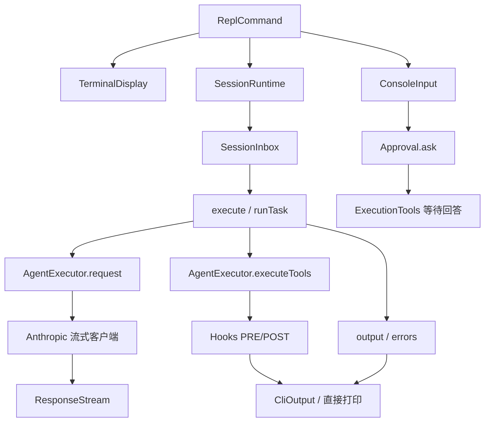
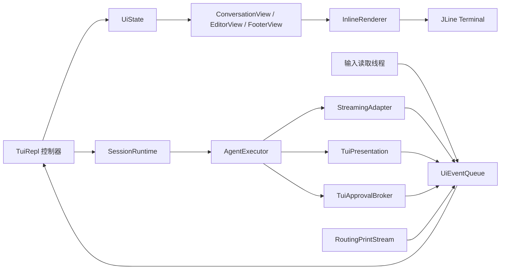

# TUI - Pi - 02 - Jade Code 的 Java TUI 架构规划（基于现有源码）

---

对于 TUI 架构的分析, 你有参考 Jade Code 当前源码吗? 我希望你据此重新生成一版 /home/fishandrice/Backend/explore-mature-agents/research-notes/tui/pi/02-java-tui-architecture.md

---

有参考。上一版读过了 REPL、`SessionRuntime`、`ConsoleInput` 和 `CliOutput`，但设计仍偏通用；这一版重新核对了 `ReplCommand`、`TerminalDisplay`、`SessionRuntime`、`AgentExecutor`、`JadeCodeFactory`、`Hooks`、`Approval`、`SubagentRuntime` 和 Anthropic 流式客户端，并按现有调用顺序重写。

## 先给结论

现有 Agent 主链路不需要重写。`SessionRuntime` 已经提供了任务提交、忙时缓冲、空输入升级、审批通道和关闭顺序；`AgentExecutor` 已经在模型流和工具生命周期上留了 `ResponseStream` 与 `Hooks` 两个观察点。TUI 应当作为第五个展示/输入适配器接进去，而不是另起一套 Agent 事件系统。

真正需要新增的只有三块：

1. 一个只负责终端读写、组件产行和差分输出的 `tui.core`；
2. 一个把现有 `ResponseStream`、`Hooks`、`output/errors`、`Approval` 翻译成界面事件的 `cli.tui` 桥接层；
3. 一个在 `ReplCommand` 中选择“TUI 或旧 REPL”的入口分支。

## 从现有源码看到的四个硬约束

### 1. 展示注册是“每个 Agent 一次”，不是全局一次

`JadeCodeFactory.create` 为 Leader 和每个队友分别调用 `assemble`。Leader 的输出闭包前缀是 `[Leader]`，队友是 `[Teammate id]`；`assemble` 内再把对应的 `output` 交给 `presentation.register`。因此 `Presentation` 的 `register` 会被调用多次，每次都可以在闭包里捕获一个 Agent 身份。

这带来一个很实际的架构选择：工具卡片的身份不必从 `Hooks` 参数里猜。只要在工厂里把输出闭包换成带 `AgentInfo` 的 `Consumer<String>` 实现，`TuiPresentation` 在 `register` 时就能拿到当前 Agent，再为它注册一组带有身份的 `PRE_TOOL_USE` / `POST_TOOL_USE` 回调。

### 2. 只有 Leader 有流式回复

`JadeCodeFactory.assemble` 给 Leader 传真实的 `Supplier<ResponseStream>`，队友固定传 `() -> ResponseStream.NONE`。所以：

- Leader 的正文增量可以形成“正在生成的助手消息”；
- 队友的正文只会以 `[Teammate id] [Reply] ...` 的形式进入 `output`，TUI 应把它显示成带身份的通知或独立消息块，而不是期待队友也有 `text()` 增量。

### 3. 工具 hook 有生命周期，但没有“被拦截”的 POST

`AgentExecutor.executeTools` 的顺序是：

```text
PRE_TOOL_USE（成员检查 → 权限检查 → 展示 hook）
  → 被拦截：直接生成 tool_result，continue
  → 允许：tool.execute
  → POST_TOOL_USE（展示 hook）
```

`SubagentRuntime` 的顺序相同，并额外触发 `SUBAGENT_TOOL`。这表示：

- 正常执行的工具可以用 `PRE` 创建卡片、`POST` 填结果；
- 被权限拦截的工具没有 `POST`，只能通过 `PermissionGate` 的直接打印或额外的错误事件显示；
- 子 Agent 的工具会使用父 Agent 的同一张 `Hooks` 表，所以它们的 `PRE/POST` 会归属于父 Agent 的展示注册；`SUBAGENT_TOOL` 可以另外显示一条归属更明确的摘要。

### 4. 仍存在绕过展示层的直接打印

`PermissionGate` 在硬拒绝时直接 `System.out.println("[Blocked] ...")`；记忆管理器在多处直接 `System.err.println("[Memory] ...")`。这与当前 `TerminalDisplay` 把 `System.out/err` 重定向到 `PrintAboveWriter` 是配套的。

TUI 不能简单“取消重定向”，否则这些输出会直接写进终端、破坏差分状态。正确做法是把全局流换成一个“按行收集、投递界面通知”的流，而不是 `PrintAboveWriter`。

## 现有调用链



关键时序：

- 用户提交后 `SessionRuntime.submitUser` 立即返回；忙时进入 `SessionInbox` 缓冲，空闲时直接执行。
- 执行线程在 `runTask` 里循环“请求模型 → 采用回复 → 执行整批工具 → 采用结果”，直到没有工具调用、没有必须等待的后台结果、`Stop` 也不要求继续。
- 模型正文通过 `ResponseStream.text` 流式到达；完整消息校验通过后才调用 `complete()`，失败调用 `failed()`。
- 最终没有流式正文时，`SessionRuntime` 用 `output.accept("[Reply] " + ...)` 兜底；因此 TUI 必须同时处理“流式条目”和“文本兜底通知”，并去重。
- 任务真正结束时触发 `TURN_END`，并带上本轮工具调用数；这是状态栏从“工作中”回到空闲的可靠信号。

## 目标架构



三条循环：

- **输入循环**：读取 JLine 原始按键、粘贴和窗口变化，只投递事件；
- **界面循环**：主线程独占 `UiState` 和终端写入，合并事件后渲染；
- **Agent 循环**：现有 `SessionRuntime` 消费线程照常运行，通过适配器投递展示事件。

## 包结构

```text
com.jadecode.tui.core
  UiComponent
  UiContext
  Line / Span / Style
  KeyEvent / KeyDecoder
  TerminalSession
  RenderScheduler
  InlineRenderer
  TuiHost

com.jadecode.tui.components
  TextView
  MarkdownView
  EditorView
  SelectListView
  SelectListModel
  SpacerView
  LoaderView

com.jadecode.tui.theme
  ThemeToken
  Theme
  ThemeManager
  ColorMode
  AnsiStyle

com.jadecode.cli.tui
  TuiRepl
  UiEvent / UiEventQueue
  UiState
  TranscriptEntry
  ConversationView
  AssistantMessageView
  ToolCallView
  NoticeView
  ApprovalView
  FooterModel / FooterView
  SelectorCoordinator

com.jadecode.cli.tui.bridge
  TaggedOutput
  TuiPresentation
  StreamingAdapter
  TuiApprovalBroker
  RoutingPrintStream
  LabelParser
```

依赖方向：

```text
tui.core ← tui.components ← tui.theme
                ↑
            cli.tui → session / llm / messages / hooks
                ↑
               cli
```

`tui.core` 不能导入 `session`、`llm` 或 `messages`。`cli.tui.bridge` 才允许认识 `ToolUseBlock`、`Hooks`、`ResponseStream` 等现有类型。

## 核心契约

```java
public interface UiComponent {
    List<Line> render(int width);
    default void handleKey(KeyEvent event) {}
    default void invalidate() {}
}

public record Span(String text, Style style) {}

public record Line(List<Span> spans) {
    public Line {
        spans = List.copyOf(spans);
    }
}

public interface Renderer extends AutoCloseable {
    void render(List<UiComponent> roots, int width, int height);
    void reset();
}
```

`Line` 保存结构化样式，不保存裸 ANSI。宽度计算只看文本，输出时再编码颜色。这样截断、换行、差分都不需要重新解析转义序列，也更容易处理中文和 emoji。

`UiContext` 向组件提供宽度、高度、主题、当前焦点和重绘请求：

```java
public interface UiContext {
    int width();
    int height();
    Theme theme();
    void requestRender();
    void requestRenderAfter(long millis);
}
```

`requestRenderAfter` 用于旋转指示器和倒计时；否则模型没有输出时状态动画不会更新。

## 界面事件

建议用密封类型，而不是继续传字符串：

```java
sealed interface UiEvent {
    record Key(KeyEvent key) implements UiEvent {}
    record Resize(int columns, int rows) implements UiEvent {}
    record Submit(String text) implements UiEvent {}
    record AssistantStarted(String messageId) implements UiEvent {}
    record AssistantDelta(String messageId, BlockKind kind, String text) implements UiEvent {}
    record AssistantCompleted(String messageId) implements UiEvent {}
    record AssistantFailed(String messageId, String error) implements UiEvent {}
    record ToolStarted(AgentInfo agent, String callId, String name, String args) implements UiEvent {}
    record ToolFinished(AgentInfo agent, String callId, String output, long durationMs) implements UiEvent {}
    record Notice(AgentInfo agent, String label, String text) implements UiEvent {}
    record Error(AgentInfo agent, String text) implements UiEvent {}
    record ApprovalRequested(ApprovalRequest request) implements UiEvent {}
    record TurnEnded(int toolCount) implements UiEvent {}
}
```

`String args` 在桥接层由 `JsonNode` 序列化，只用于展示；不要让组件直接持有工具参数对象。

## 线程与渲染

### 线程边界

| 线程 | 责任 | 禁止 |
|---|---|---|
| 界面线程（主线程） | 修改 `UiState`、处理事件、渲染、写终端 | 等待模型或工具 |
| 输入线程 | 读 JLine 按键、粘贴、窗口变化 | 修改界面状态 |
| Session 消费线程 | 现有 `runTask`、工具执行、hook | 直接写终端 |
| 模型网络流 | 产生 `ResponseStream` 回调 | 直接碰组件 |

输入线程可以用 JLine `Terminal.reader()` 阻塞读取；界面线程用 `BlockingQueue.poll` 等待事件。退出时先停止输入线程，再关闭 `SessionRuntime`，最后恢复终端。

### 帧合并

`RenderScheduler` 维护一个脏标记：

- 普通事件到达：标记脏，距离上一帧不足约 16 毫秒就等到下一个时间片；
- 键盘事件：要求立即渲染，避免输入延迟；
- 旋转指示器：由 `requestRenderAfter` 安排下一次 tick；
- 没有任何事件时不空转。

这样模型高频增量会被合并，工具结果和状态变化也能及时显示。

## 状态模型

```text
UiState
  List<TranscriptEntry> transcript
  AssistantEntry streaming
  Map<ToolKey, ToolEntry> tools
  EditorState editor
  StatusState status
  FooterState footer
  SelectorState selector
  ApprovalState approval
```

`TranscriptEntry` 建议包含：

- `UserEntry`：原文、提交时间、是否在忙时排队；
- `AssistantEntry`：`AgentInfo`、文本块、思考块、流式标记、错误；
- `ToolEntry`：`AgentInfo`、调用 ID、工具名、参数摘要、状态、输出、耗时、是否展开；
- `NoticeEntry`：`[Incoming]`、`[Background]`、`[Cron]`、`[Memory]`、`[Blocked]`、`[Subagent ...]` 等；
- `PlanEntry`：`todo_write` 的计划文本（也可以合并进工具卡片）；
- `ApprovalEntry`：待批准的工具、参数和原因。

每条带 `version`。`ConversationView` 按“条目 + 宽度 + 版本”缓存渲染行；只有流式条目和正在变化的工具条目每帧重算。这会显著降低长会话成本。

排列顺序：

1. 用户消息；
2. 助手消息；
3. 该助手消息产生的工具卡片；
4. 后续工具结果更新卡片，不新增消息；
5. 通知和计划按到达顺序插入。

## 与现有 JadeCode 的接缝

| 现有位置 | 当前行为 | TUI 接法 | 注意 |
|---|---|---|---|
| `ReplCommand.call` | 创建 `TerminalDisplay`、`SessionRuntime`、`ConsoleInput`，阻塞读任务 | 增加 TTY + `--tui` 分支，进入 `TuiRepl`；否则保留旧路径 | `run` 命令先不动 |
| `TerminalDisplay` | JLine `LineReader` + `PrintAboveWriter` + 全局输出重定向 | TUI 不复用它；新建 `TerminalSession`，不创建 `LineReader` | 两套输入不能同时存在 |
| `ConsoleInput` | 实现 `Approval`，并同步读任务/y-n | 旧路径继续用；TUI 用 `TuiApprovalBroker` 实现同一个 `Approval` 接口 | `ask` 在工具线程阻塞，UI 线程不能阻塞 |
| `CliOutput` | 标签格式化、`System.out` 打印、半行预览 | 旧路径继续用；TUI 用 `TuiPresentation` + `StreamingAdapter` | 不要在 TUI 同时注册 `CliHooks` |
| `SessionRuntime.submitUser` | 忙时缓冲，空闲直接提交，返回 future | 编辑器提交时调用；`isBusy()` 可决定用户条目是否标记“排队中” | future 完成不等于回答已显示 |
| `SessionRuntime.promoteUserBuffer` | 空输入升级待处理批次 | 编辑器空提交时调用 | 保留现有语义 |
| `SessionRuntime.output/errors` | 接收带身份前缀的整段文字 | 转发到 `UiEventSink.notice/error` | 用于 `[Reply]` 兜底、`[Incoming]`、`[Cron]` 等 |
| `ResponseStream.text/thinking` | Leader 的流式正文/思考 | `StreamingAdapter` 懒创建助手条目并追加 | 队友是 `NONE`，不要等队友增量 |
| `ResponseStream.complete/failed` | 完整响应校验通过/失败 | 标记条目完成/不完整 | 适配器要幂等，忽略结束后的迟到片段 |
| `Hooks.PRE_TOOL_USE` | 成员检查、权限检查、展示 | `TuiPresentation` 注册自己的展示 hook，发 `ToolStarted` | 权限之前的 hook 不能被展示层移动 |
| `Hooks.POST_TOOL_USE` | 工具执行后的展示 | 发 `ToolFinished`，记录耗时；`todo_write` 更新计划 | 被拦截的调用没有 POST |
| `Hooks.TURN_END` | 大轮次真正结束，带工具数 | 发 `TurnEnded`，清除工作中状态 | 不是每次工具批次都触发 |
| `Hooks.SUBAGENT_*` | 子 Agent 开始、工具、结束 | 发 `Notice`，保留身份前缀 | 子工具也会触发父 Agent 的 PRE/POST |
| `JadeCodeFactory.assemble` | 每个 Agent 创建独立 `Hooks`，调用 `presentation.register` | 用带身份的 `TaggedOutput` 让展示层知道当前 Agent | 推荐最小改动，见下一节 |
| `PermissionGate.checkWith` | 硬拒绝直接 `System.out.println("[Blocked] ...")` | 用 `RoutingPrintStream` 转成 `Error/Notice` | 不会进入 PRE/POST，不能期待工具卡片 |
| 记忆、配置等模块 | 多处直接 `System.out/err` | 同上，统一按行转事件 | 不要取消全局流后放任直写 |
| `AgentExecutor.executeTools` | 工具一次返回完整字符串 | 工具卡片先“执行中”，POST 后“完成” | 首版不需要工具增量输出 |
| `SubagentRuntime` | 使用父 Agent 的 `Hooks`，额外发 `SUBAGENT_TOOL` | 子工具卡片可归到父 Agent；额外通知说明子 Agent | 不要按调用 ID 假设全局唯一 |

## 桥接层设计

### `TaggedOutput`

这是对现有工厂最小的改动。当前 Leader/队友的输出闭包分别加 `[Leader]`、`[Teammate id]` 前缀；把这些闭包换成：

```java
record AgentInfo(String id, String role) {
    String displayName() {
        return role.equals("Leader") ? "Leader" : "Teammate " + id;
    }
}

record TaggedOutput(AgentInfo agent, Consumer<String> sink) implements Consumer<String> {
    public void accept(String text) {
        sink.accept("[" + agent.displayName() + "] " + text);
    }
}
```

`SessionRuntime`、`JadeCodeFactory` 仍把它当 `Consumer<String>` 使用，不需要改接口。`TuiPresentation.register(hooks, cwd, output)` 里判断 `output instanceof TaggedOutput tagged`，就能为当前 Agent 注册带身份的展示 hook。

如果不想改工厂，也可以先按 `[Leader]` / `[Teammate ...]` 前缀解析；但结构化工具事件没有文本前缀，推荐用 `TaggedOutput`。

### `TuiPresentation`

它替代 TUI 路径下的 `CliHooks`，不要两者同时注册，否则 `[Tool]`、`[Plan]`、`[Turn]` 会出现两份。它需要注册：

- `USER_PROMPT_SUBMIT`：可发一条工作目录通知，或只更新页脚；
- `PRE_TOOL_USE`：`ToolStarted(agent, block.id(), block.name(), block.input())`；
- `POST_TOOL_USE`：`ToolFinished(agent, block.id(), output, duration)`；
- `todo_write` 的 POST：生成计划卡片或计划通知，二选一，避免重复；
- `SUBAGENT_START/TOOL/END`：通知；
- `TURN_END`：`TurnEnded(toolCount)`。

耗时由展示层在 `ToolStarted` 时记录 `System.nanoTime()`，在 `ToolFinished` 时计算；现有工具接口不返回耗时。

### `StreamingAdapter`

每个模型请求创建一个新实例，实现 `ResponseStream`：

- 第一次 `text` 或 `thinking` 时发 `AssistantStarted(id)`；
- 后续发 `AssistantDelta`；
- `complete` 发 `AssistantCompleted`；
- `failed` 发 `AssistantFailed`；
- 结束后忽略迟到片段。

`AgentExecutor.request` 每次重试都会调用 `streams.get()` 创建新实例，所以不需要在适配器里处理重试复用。

### `TuiApprovalBroker`

实现 `Approval.ask`：

1. 复制 `ObjectNode` 参数，创建 `ApprovalRequest` 和 `CompletableFuture<Boolean>`；
2. 投递 `ApprovalRequested`；
3. 在工具线程等待 future；
4. UI 线程显示批准卡片，`y` 完成 true，`n` 完成 false；
5. 关闭时把所有未答请求按拒绝处理。

多份申请按队列一次显示一份，和现有 `ConsoleInput` 的语义一致。批准卡片出现时独占键盘，避免用户把任务文字当成 y/n。

### `RoutingPrintStream`

TUI 运行期间把 `System.out` 和 `System.err` 换成一个按行缓冲的 `PrintStream`：

- 遇到换行就把整行投递成 `Notice` 或 `Error`；
- 不直接写终端；
- 关闭时 flush 并恢复原流；
- 防止 `PermissionGate`、`MemoryManager` 等直接打印绕过界面。

这个流只做兜底。新的展示代码应优先发结构化事件，不要继续依赖字符串打印。

## 渲染器

`InlineRenderer` 维护：

```text
List<Line> previous
int viewportTop
int hardwareCursorRow
int lastWidth
int maxLinesRendered
```

每帧：

1. `ConversationView`、编辑器、页脚各自产行，`VerticalStack` 拼接；
2. 提取光标标记，得到目标行列；
3. 比较新旧行，找第一处/最后一处变化；
4. 宽度变化、历史区变化、第一处变化在视口上方时，整篇重绘；
5. 只追加尾部时，把光标移到底部，写换行把旧行推入 scrollback；
6. 否则移动光标、清行、重写变化区间；
7. 用同步输出包住整段写入；
8. 更新 `previous`、`viewportTop`、`hardwareCursorRow`；
9. 定位硬件光标。

整篇重绘需要明确是否清 scrollback。Pi 的做法是清屏并清 scrollback 后重放；如果不清，历史行的旧宽度会和新内容错位。建议首版沿用清除策略，并在帮助文本里说明“改变窗口宽度会重绘当前会话历史”。

## 视图清单

- `ConversationView`：按顺序渲染条目，缓存已完成条目。
- `AssistantMessageView`：文本、思考块、错误提示；流式时只更新自己。
- `ToolCallView`：等待/成功/失败三态，调用与结果同一卡片，输出可折叠。
- `NoticeView`：带标签和 Agent 身份的单行/多行通知。
- `PlanView`：`todo_write` 的计划文本。
- `EditorView`：多行编辑、软换行、历史、撤销、粘贴标记、自动补全。
- `ApprovalView`：批准卡片和 y/n 键位。
- `StatusView`：旋转指示器；可嵌入编辑器上边框。
- `FooterView`：目录、git 分支（如已有数据源）、模型、token/上下文统计。
- `SelectListView`：过滤、选中、滚动窗口、确认/取消。

## 主题与选择器

### 主题

先建立最小 token 集：正文、次要文字、强调、边框、错误、警告、成功、用户消息背景、助手文字、工具三态背景、工具标题、工具输出、代码、差异增删、选中背景。

`Theme` 提供 `fg(token)`、`bg(token)` 和文本属性；`ThemeManager` 持有当前主题，组件通过 `UiContext.theme()` 取用。首版可以只有深色主题，但所有组件从第一天走 token。

颜色能力来自 JLine `Terminal` 的 `max_colors`，同时尊重 `NO_COLOR` 和 `TERM=dumb`。主题切换时使所有组件失效；内联渲染器通常会因为历史颜色变化而走整篇重绘。

### 选择器

首版采用“替换编辑器输入坞”的方式：

- `SelectorCoordinator` 保存编辑器、换上选择器、设置焦点；
- 确认/取消后恢复编辑器；
- 用令牌防止过期的异步结果关闭新选择器。

现有 JadeCode 工厂从 `AppConfig` 创建一个模型客户端，没有明显的运行期模型切换接口。因此首版优先做主题选择器和帮助/命令选择器；模型选择器只有在补出真实的模型切换 API 后再接，不能只做界面上的假切换。

## 分阶段落地

| 阶段 | 改动 | 验收 |
|---|---|---|
| 0 | 增加 `TaggedOutput`、`UiEventQueue`，旧 REPL 不变 | 现有 `mvn` 构建和非 TTY 行为不变 |
| 1 | `tui.core` + `InlineRenderer` + `TerminalSession` + 纯文本历史 | 能显示历史、输入、退出恢复终端 |
| 2 | `TuiRepl` + `EditorView` + `StreamingAdapter` | 流式回复时继续输入不丢字，16ms 合并 |
| 3 | `TuiPresentation` + 工具卡片 + 状态 + 页脚 + 审批 | 调用/结果配对，阻断/记忆日志不破坏画面 |
| 4 | 选择器 + 主题 | 焦点恢复、token 全覆盖、切换重绘 |
| 5 | Markdown、CJK、Windows/SSH/Termux 打磨 | 中文/emoji 换行、粘贴、窗口变化、异常关闭 |

阶段 0 可以先只把 `TaggedOutput` 和事件队列接上，不改 `ReplCommand` 的默认路径；阶段 1 用 `--tui` 显式开启，稳定后再考虑默认切换。

## 风险清单

1. **`LineReader` 与自定义编辑器冲突**：TUI 路径只能保留一个输入所有者。
2. **直接打印**：`PermissionGate`、记忆、配置等模块仍可能写 `System.out/err`；必须用 `RoutingPrintStream` 兜底。
3. **重复注册**：TUI 路径不要再注册 `CliHooks`，否则工具、计划、轮次提示会重复。
4. **队友没有流式流**：不要把 `ResponseStream` 当成所有 Agent 的统一事件源。
5. **被拦截工具没有 POST**：批准/拒绝提示要单独设计，不能只靠工具卡片。
6. **调用 ID 作用域**：不同 Agent/会话可能复用字符串 ID，工具卡片键应包含 Agent 身份。
7. **长会话成本**：每帧全量重渲染会随历史增长；必须先实现已完成条目的宽度缓存。
8. **宽度变化重绘**：决定清 scrollback 的策略，并接受历史重排的代价。
9. **关闭顺序**：先拒绝未答审批，再停 `SessionRuntime`，最后恢复终端；否则清理日志可能丢失或写坏屏幕。
10. **`run` 命令**：首版保持纯文本，不要为了统一界面扩大改动面。

## 验证清单

- 旧 REPL 在 TTY 和非 TTY 下行为不变；
- `--tui` 下流式回复期间连续输入、粘贴、移动光标不丢字；
- 工具开始/结束卡片状态正确，失败输出可展开；
- 需要审批的工具出现卡片，y/n 后编辑器恢复焦点；
- 被硬拒绝的工具通过 `[Blocked]` 通知显示，不产生假的成功卡片；
- 记忆模块的 `[Memory]` 直接打印出现在通知区，不插入输入行；
- 队友回复以身份前缀显示，不等待队友流式增量；
- 忙碌时提交的新任务被缓冲，空提交能升级缓冲；
- 窗口变宽/变窄后布局正确，历史重绘符合预期；
- 中文、emoji、组合字符的宽度和光标位置正确；
- Ctrl+D、Ctrl+C、异常关闭后终端模式、光标、粘贴模式恢复；
- `run` 命令仍走旧路径，输出不混入 ANSI 控制序列。

## 源码依据

| 机制 | 源码位置 | 关键内容 |
|---|---|---|
| REPL 入口 | `JadeCode/src/main/java/com/jadecode/cli/ReplCommand.java:28-50` | 创建 TerminalDisplay、SessionRuntime、ConsoleInput；循环提交 |
| 终端与全局输出 | `JadeCode/src/main/java/com/jadecode/cli/TerminalDisplay.java:66-125`, `134-174` | LineReader、PrintAboveWriter、System.out/err 重定向与恢复 |
| 任务输入与审批 | `JadeCode/src/main/java/com/jadecode/cli/ConsoleInput.java:93-118`, `133-152`, `214-229` | Approval.ask、输入所有权、审批队列 |
| 旧格式化与流式预览 | `JadeCode/src/main/java/com/jadecode/cli/CliOutput.java:127-210` | ResponseStream 半行预览、80ms 刷新、System.out 输出 |
| 会话提交 | `JadeCode/src/main/java/com/jadecode/session/SessionRuntime.java:113-122`, `223-235` | submitUser 缓冲、promoteUserBuffer、submit |
| 任务主循环 | `JadeCode/src/main/java/com/jadecode/session/SessionRuntime.java:288-338`, `408-482` | runTask、模型回复、工具批次、TURN_END |
| 会话关闭 | `JadeCode/src/main/java/com/jadecode/session/SessionRuntime.java:778-807` | 停止 cron/engine/background、拒绝 future、中断消费线程 |
| 模型流 | `JadeCode/src/main/java/com/jadecode/agent/AgentExecutor.java:148-200` | 每次请求创建 ResponseStream；complete/failed 时机 |
| 工具生命周期 | `JadeCode/src/main/java/com/jadecode/agent/AgentExecutor.java:217-248` | 成员/权限/展示 hook、工具执行、POST |
| 展示工厂 | `JadeCode/src/main/java/com/jadecode/bootstrap/JadeCodeFactory.java:69-78`, `179-190` | Presentation 接口；Leader/队友身份前缀 |
| 每个 Agent 的装配 | `JadeCode/src/main/java/com/jadecode/bootstrap/JadeCodeFactory.java:203-298` | 独立 Hooks、presentation.register、权限先行 |
| Hook 语义 | `JadeCode/src/main/java/com/jadecode/hooks/Hooks.java:21-30`, `81-107` | 事件名、参数、非 null 短路 |
| 审批接口 | `JadeCode/src/main/java/com/jadecode/execution/Approval.java:12-21` | 同步 ask，返回 true/false |
| 工具块 | `JadeCode/src/main/java/com/jadecode/messages/ToolUseBlock.java:22`, `ToolResultBlock.java:20` | 调用 ID、工具名、参数、结果 |
| 硬拒绝直接打印 | `JadeCode/src/main/java/com/jadecode/safety/PermissionGate.java:122-137` | `[Blocked]` 直接 System.out，随后返回拒绝 |
| 子 Agent 工具 hook | `JadeCode/src/main/java/com/jadecode/subagent/SubagentRuntime.java:302-331` | 父 Hooks 上的 PRE/POST 与 SUBAGENT_TOOL |
| Anthropic 流式回调 | `JadeCode/src/main/java/com/jadecode/llm/AnthropicSdkLlmClient.java:89-145` | 文本/思考增量、完整消息校验后才 complete |
| JLine 依赖 | `JadeCode/pom.xml:19`, `52-61` | JLine 3.30.6、reader 与 terminal-jni |
| Pi 内联渲染 | `packages/tui/src/tui-main-screen.ts:247-568` | 差分、滚动推入历史、整篇重绘 |
| Pi 输入与编辑器 | `packages/tui/src/terminal.ts:193-300`, `packages/tui/src/components/editor.ts:521-996` | 原始模式、序列重组、编辑器光标与按键 |
| Pi 工具卡片 | `packages/coding-agent/src/modes/interactive/interactive-mode.ts:3502-3668`, `components/tool-execution.ts:31-300` | 流式消息、工具三态与折叠 |
| Pi 选择器 | `packages/coding-agent/src/modes/interactive/interactive-mode.ts:4898-4921` | 输入坞替换与焦点恢复 |
| Pi 主题 token | `packages/coding-agent/src/modes/interactive/theme/theme-tokens.ts:24-101` | 前景/背景槽位与回退 |
