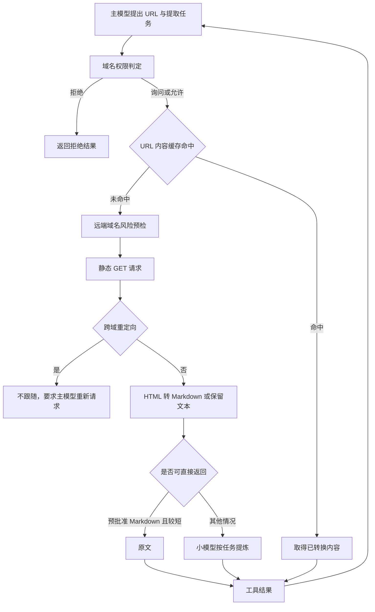

# Web Fetch - Claude Code - 01 - WebFetch 的抓取、加工与权限边界

---

探究一下 Claude Code 和 Codex 的 Fetch 工具分别都是怎么做的.

---

## 场景

当主模型需要读取一个已知 URL，而不是先做网页搜索时，Claude Code 向模型提供一个名为 `WebFetch`、界面显示为 `Fetch` 的只读工具。模型不能只传 URL，还要同时给出“要从页面里提取什么”的自然语言任务。工具最终返回的通常不是整页 HTML，而是针对该任务加工后的文本。

这套机制解决的是三个问题：让模型取得外部网页内容、把网页压缩成适合上下文窗口的文本，以及在发出任意网络请求前增加域名权限和服务端黑名单两层控制。它并不试图成为完整浏览器：没有执行页面脚本、登录态或 Cookie 的处理链。

## 机制展开

### 1. 模型看到的是一个“二段式”工具

工具输入只有两项：完整 URL 和提取提示词。工具描述把工作方式直接告诉模型：抓取页面、HTML 转 Markdown、再由一个小而快的模型按提示词处理内容。输出结构中另有响应码、内容字节数、耗时和最终 URL，但真正回到主模型的是加工后的 `result` 文本。

这让主模型只需提出目标，不必接收完整网页。代价是主模型失去了对原文大部分内容的直接可见性，只能依赖小模型的任务理解与压缩质量。

`WebFetch` 被注册为内置只读工具，并声明为并发安全。多个独立的抓取调用可以并行执行；Claude Code 的通用工具编排会按只读属性分批，并受全局工具并发上限约束。默认情况下它还属于可延迟加载的工具，在启用工具搜索时可由模型先发现再调用。

### 2. 调用前先按主机名做权限判定

权限单位是主机名，而不是完整 URL。用户允许一个域名后，该域名下的不同路径通常共享同一规则。整个权限管线先检查“拒绝整个 WebFetch”或“每次使用 WebFetch 都询问”的整工具规则；若没有整工具级结论，再调用 WebFetch 自己的域名判定。域名判定的顺序是：

1. 若主机名和路径命中内置预批准列表，直接允许，不询问用户。
2. 查主机名拒绝规则；命中则拒绝。
3. 查主机名询问规则；命中则要求用户确认。
4. 查主机名允许规则；命中则允许。
5. 没有规则时默认询问。

因此整工具拒绝优先于一切域名判定；但进入域名判定后，预批准列表先于该域名自己的允许、询问和拒绝规则。也就是说，预批准条目不会弹出普通域名确认，而一条同主机的内容级拒绝规则也不能覆盖这个前置直通分支。

预批准列表主要覆盖编程语言、框架、数据库和云服务文档站点。少数条目带路径范围，例如只批准 GitHub 的 Anthropic 组织路径，并且按路径段边界匹配，避免前缀伪装。这个列表专门服务于只读 `GET` 抓取；Claude Code 不会把它自动转成 Shell 或沙箱的通用网络白名单，以免同一域名上的上传或其他写操作获得隐式授权。

用户确认域名后，工具会建议把 `domain:<主机名>` 规则写入本地设置，后续同域请求可跳过重复确认。权限规则仍可在每次调用前重新检查，因此修改规则后会立即影响后续调用。

### 3. 未命中缓存时，先做服务端域名风险预检

真正发请求前，Claude Code 默认向 Anthropic 的域名信息服务询问该域名的 `can_fetch` 状态。预检有 10 秒超时；允许结果按主机名缓存 5 分钟，最多保存 128 个域名。被阻止或检查失败不会进入这个缓存。

这层预检和用户权限是不同职责：用户权限决定“本地是否授权访问”，服务端预检决定“该域名的公开抓取是否被产品策略允许”。企业网络若无法访问预检服务，可以显式跳过预检；否则预检失败会直接让本次抓取失败，不会静默放行。

### 4. 网络请求是受限的静态 GET

抓取使用普通 HTTP 客户端发出 `GET`，没有浏览器引擎、页面脚本执行、Cookie jar 或用户登录凭据。请求声明自己接受 Markdown、HTML 或其他内容，并带专用的 `Claude-User` User-Agent，让站点能识别这是用户发起的 Agent 抓取。

主要资源边界如下：

- URL 最长 2000 字符。
- 拒绝带用户名或密码的 URL，也拒绝没有普通点分主机名的地址。
- HTTP 会自动升级为 HTTPS。
- 单次 HTTP 请求超时 60 秒，并接受用户中断信号。
- 响应体最多 10 MiB。
- 同主机重定向最多跟随 10 跳。

代码没有显式枚举只允许 HTTP/HTTPS；非 HTTP 协议会交给 HTTP 客户端处理并通常以请求失败结束，而不是在 URL 校验阶段统一拒绝。

### 5. 重定向不跨主机自动跟随

遇到 `301`、`302`、`307` 或 `308` 时，只有当协议、端口和去除 `www.` 后的主机名都一致，工具才继续跟随。这样一次授权不会因为开放重定向而悄悄扩展到另一个域。

跨主机重定向会被当作一种正常工具结果返回。结果中明确写出原 URL、目标 URL、状态码和原提取提示词，要求主模型用新 URL 再调用一次 `WebFetch`。因此新域仍会重新经过主机权限判定。相对 `Location` 会先相对于原 URL 解析。

这种做法守住了权限边界，但会增加一次模型往返；如果用户尚未授权目标域，还会出现新的确认。

### 6. 网页先转换，再说是否交给小模型

响应内容按 Content-Type 分支：

- `text/html` 使用 HTML-to-Markdown 转换器。转换器延迟加载，并在进程内复用。
- 其他文本内容直接按 UTF-8 解码，不再转换。
- 二进制内容仍会继续走 UTF-8 解码和小模型路径，同时把原始字节保存到工具结果目录，并用 MIME 类型推断扩展名。这样 PDF、图片等至少还能由后续文件读取工具检查，不必只依赖可能失真的文本摘要。

随后有两种返回路径：

1. **预批准域名的短 Markdown 原文直返**：主机已在预批准列表中、Content-Type 为 `text/markdown`、内容不足 100,000 个 JavaScript 字符时，跳过小模型，直接把原文作为工具结果。
2. **小模型提炼**：其余内容超过 100,000 字符会先截断，并附上截断标记，再连同用户提取提示词发送给 Claude Code 的小型快速模型。小模型只被要求基于页面内容作答，返回其第一个文本块。

对于非预批准页面，提炼提示还加入引用长度、改写和歌词等版权约束；预批准的技术文档页面则允许保留必要的代码和文档摘录。

原文直返路径能保留预批准文档站点的代码和精确措辞，但页面文本会直接进入主模型上下文。小模型路径能压缩上下文，却也引入二次解释和遗漏风险；源码本身没有证明这是对网页提示注入的可靠隔离，因为页面内容仍被拼进小模型的用户提示。

### 7. 缓存保存的是转换后的内容

内容缓存按“调用时传入的原始 URL”作键，TTL 为 15 分钟，按转换后内容的 UTF-8 字节数计费，总容量 50 MiB，达到上限时按 LRU 淘汰。HTTP 升级到 HTTPS 或同主机重定向后的最终 URL 不会改写缓存键；跨主机重定向在写缓存前就返回，因此不会把目标页缓存在原 URL 下。

缓存命中会跳过服务端域名预检和实际网络请求，但仍要先经过本次调用的主机权限判定。也就是说，缓存降低了延迟和重复流量，但同一主机的权限规则仍是外层边界。

### 8. 失败如何回到模型

- URL 无效：参数校验阶段返回可读错误。
- 域名被服务端策略阻止：返回明确的域名阻止错误。
- 预检不可达或非成功响应：工具失败，不自动绕过。
- 网络超时、响应过大、请求构建失败：错误冒泡为失败的 tool result。
- 超过 10 次同主机重定向：明确报“重定向过多”。
- 网络出口代理以特定 403 标记阻止请求：转换为 `EGRESS_BLOCKED` 结构化错误，并保留域名。
- 小模型调用失败或用户中断：调用抛错，主循环把该工具调用标记为失败。

抓取失败和重定向提示不会写入网页内容缓存。工具声明的结果阈值是 100,000 字符；超出通用结果预算时，Claude Code 会保存完整结果并在上下文中放一个文件引用和预览，而不是让超大文本无界进入模型请求。

## 条件与边界

- `WebFetch` 是内置工具，但“是否在首轮工具列表中直接可见”受工具搜索和延迟加载策略影响。
- 预批准域名、路径范围、TTL、请求上限和网络策略都是静态源码事实；线上是否还通过远端配置改变工具行为，不能仅凭这份快照确认。
- 服务端域名预检的真实 `can_fetch` 数据不在仓库内，无法确认某个具体域名当前会被允许还是阻止。
- 不执行 JavaScript，因而客户端渲染、登录后页面、依赖 Cookie 的私有资源不适合该工具；工具提示本身也建议私有服务改用带认证的 MCP 工具。
- 同一域的权限只按主机名授予，通常不细到路径。只有内置预批准列表中的少数条目带路径约束。

## 设计取舍

这套设计把“页面获取”和“内容阅读”拆开：网络层负责静态抓取、转换和资源上限，小模型负责任务导向压缩，主模型拿到较短的答案。优点是上下文占用可控，也允许针对不同站点保留必要原文。

代价是抓取结果受制于提取提示词。提取提示写得过窄时，小模型可能漏掉后续追问所需的信息，主模型只能重新抓取或换提示词。跨域重定向、未知域名确认和域名风险预检也增加了延迟与交互步骤，但换来了更清晰的授权边界。

## 证据分级

### 已证实

- 工具输入、输出、只读与并发属性、权限判定顺序、预批准域名列表。
- 静态 GET、HTTP 升级、超时、大小、URL 长度、重定向规则和出口代理错误识别。
- HTML 转 Markdown、二进制落盘、15 分钟 URL 缓存和 5 分钟域名检查缓存。
- 预批准短 Markdown 原文直返，其余内容由小型快速模型按提示处理，并在 100,000 字符处截断。
- 缓存命中绕过服务端预检，但每次调用仍需经过外层工具权限检查。

### 合理推断

- 预批准短 Markdown 直返很可能用于保留文档代码与精确措辞，这是结构上最直接的解释，但源码没有单独注释说明动机。
- 小模型提炼能控制上下文，但它本身是否足以降低网页提示注入风险，不能从当前实现直接得出肯定结论。

### 无法确认

- Anthropic 服务端域名拦截表的实际内容和更新策略。
- Claude Code 发行构建中工具搜索、企业策略和远端开关的当前线上组合。
- 任意具体网页的脚本渲染、反爬和登录行为；这不是该工具承诺覆盖的范围。

## 源码依据

源码快照：Claude Code `2.1.88`，路径均相对于 `/home/fishandrice/Backend/claude-code/claude-code-2.1.88-source`。

| 相对路径 | 关键位置 | 证明内容 |
|---|---|---|
| `src/tools/WebFetchTool/WebFetchTool.ts` | `WebFetchTool`, `checkPermissions`, `call`, 约 24-307 行 | 输入输出、二段式调用、权限顺序、重定向提示、原文直返与小模型分支、结果映射 |
| `src/tools/WebFetchTool/prompt.ts` | 工具说明与 `makeSecondaryModelPrompt`, 1-45 行 | URL 和提示词模型、HTML 转 Markdown、小模型、缓存说明、版权约束 |
| `src/tools/WebFetchTool/utils.ts` | 50-128、139-243、262-529 行 | URL 缓存、域名预检、URL 校验、重定向、网络限制、转换、缓存与小型模型调用 |
| `src/tools/WebFetchTool/preapproved.ts` | `PREAPPROVED_HOSTS`, 1-166 行 | 预批准主机、路径边界及与沙箱白名单分离 |
| `src/tools.ts` | `getAllBaseTools`, 约 193-249 行 | `WebFetch` 作为基础工具进入工具池 |
| `src/services/tools/toolOrchestration.ts` | `partitionToolCalls`, `runToolsConcurrently`, 19-177 行 | 只读并发分批及全局并发上限 |
| `src/utils/http.ts` | `getWebFetchUserAgent`, 52-58 行 | 任意站点抓取使用的专用 User-Agent |
| `src/utils/mcpOutputStorage.ts` | `isBinaryContentType`, `persistBinaryContent`, 125-174 行 | 二进制识别、原字节落盘与 MIME 扩展名 |
| `src/utils/toolResultStorage.ts` | `processToolResultBlock`, `maybePersistLargeToolResult`, 205-334 行 | 大工具结果持久化和预览替换 |
| `src/components/permissions/WebFetchPermissionRequest/WebFetchPermissionRequest.tsx` | 权限选项与域名规则, 12-153 行 | 单次允许、“以后都允许此域名”和拒绝的用户界面语义 |
| `src/utils/permissions/permissions.ts` | `checkRuleBasedPermissions`, 1071-1155 行；主权限管线 1169-1250 行 | 整工具拒绝/询问先于工具自身域名判定 |
| `src/utils/sandbox/sandbox-adapter.ts` | WebFetch 域名规则转换, 172-220 行 | 域名允许/拒绝规则与沙箱网络策略之间的关系 |
