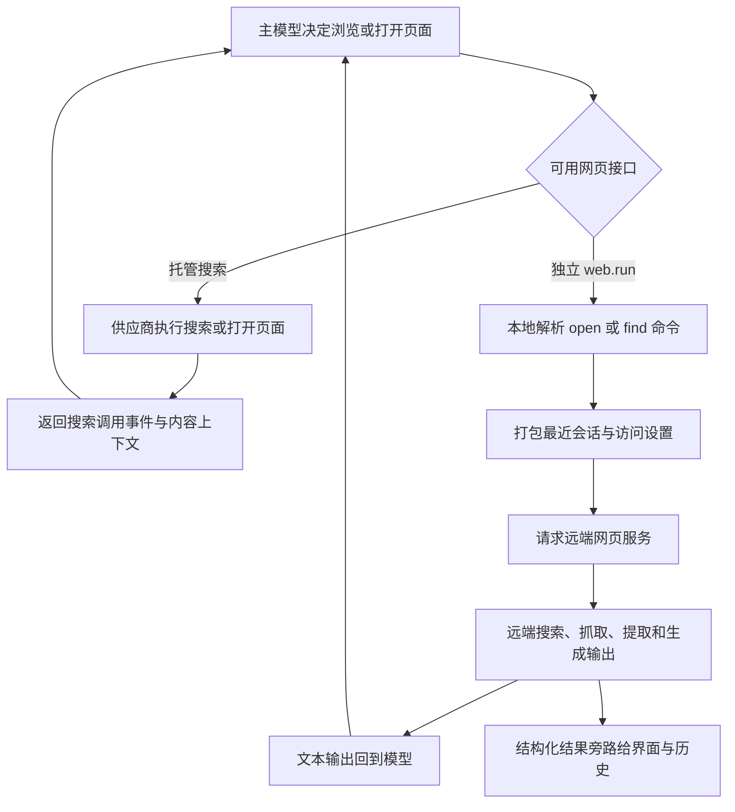

# Web Fetch - Codex - 01 - 页面读取：托管搜索与独立 web.run

---

探究一下 Claude Code 和 Codex 的 Fetch 工具分别都是怎么做的.

---

## 场景

在用户要求读取某个网页、核对最新信息，或查看搜索结果中的具体页面时，Codex 需要让模型取得网页内容。但当前源码中没有与 Claude Code `WebFetch` 同名的独立 Fetch 工具。最接近“读取指定 URL”的模型动作是 `open` / `open_page`，它属于 Codex 的网页访问能力，而不是一个本地 HTTP 抓取器。

这份笔记只研究 Codex 的页面读取机制。它有两种可能的运行形态：供应商托管的 `web_search`，以及 Codex 自己作为客户端调用的独立 `web.run`。两者的共同点是：网页和内容加工发生在远端服务；本地主要决定工具是否可用、允许何种访问级别，并把服务端返回的文本交回模型。

## 机制展开



### 1. 页面读取不是一个独立工具

Codex 的网页能力有两种工具表面：

- 托管 `web_search`：作为 Responses API 的原生工具交给模型供应商，由供应商在模型调用内部完成搜索、打开页面和内容注入。Codex 不提交单独的第二条“抓取 URL”请求。
- 独立 `web.run`：Codex 提供给模型一个命名空间工具，参数可同时包含搜索、打开、点击、页内查找、截图、金融、天气、体育和时间等命令。真正需要网页正文时，模型通常先 `search_query`，再用结果引用 `open`，也可以直接 `open` 一个完整 URL。

因此，“Fetch”在当前 Codex 中是网页工具的一个动作，而不是单独 schema、单独权限对象和单独执行器。

### 2. 两种形态互斥选择

正常路径下，Codex 先看供应商是否声明支持网页搜索。若支持独立搜索且相应功能开启，就向模型暴露 `web.run`；独立搜索实际可用时，普通托管 `web_search` 不再同时发送给模型。否则，在供应商支持托管网页搜索时发送原生 `web_search`。

独立形态的开启条件是：

1. 当前供应商具备网页搜索能力。
2. 配置中的网页搜索模式不是 `disabled`。
3. 功能开关 `standalone_web_search` 打开，或模型走 Responses Lite 路径。

这会直接改变模型看到的参数空间：托管工具没有本地参数 schema，网页动作由供应商返回；独立工具在 Codex 本地有完整的命令 schema，由 Codex 发出一次远端服务请求。

### 3. 访问模式决定能否访问实时互联网

网页访问有四档全局模式：

- `disabled`：不提供网页工具。
- `cached`：只允许搜索或读取服务端已有内容，不允许把请求扩展成实时网页访问。
- `indexed`：允许访问实时互联网，但限制为搜索索引中的 URL。
- `live`：允许实时互联网访问。

对托管工具，模式会被编码成“是否允许外部网页访问”和“是否只允许索引 URL”两个字段。对独立工具，则编码成一个外部访问设置：关闭、索引模式或开启。

模式不是只看用户配置。每轮开始前还会结合当前权限档位、供应商能力和受管策略降级或调整。例如受限的只读或沙箱档位更偏向缓存模式，供应商不允许实时外部访问时，`live`/`indexed` 会回退到可用模式；若缓存也不允许，最终可能变成 `disabled`。审查等内部任务还会强制禁用网页访问。

### 4. 模型如何表达“打开这个页面”

托管形态下，供应商回传 `web_search_call`，Codex 能识别三类动作：

- 搜索：一个查询或多个查询。
- 打开页面：一个 URL。这就是页面读取动作。
- 页内查找：URL 与文本模式。

Codex 把这些事件转换成界面和历史中的网页搜索条目。它没有拿到网页 HTML，只收到供应商已经处理好的动作事件与模型上下文。因此本地重定向策略、HTML 转换、页面缓存和正文截断都不在这条链上。

独立形态下，模型看到的 `open` 参数是：

```json
{"open":[{"ref_id":"turn0search0"}]}
```

`ref_id` 既可以是先前搜索结果提供的引用，也允许直接写完整 URL；还能附带行号，把页面定位到大致位置。页内查找则可同时对 URL 或结果引用执行。一个调用可以组合多个命令，以减少模型往返。

独立工具 schema 本身不负责验证域名、检查重定向或解析页面。它的主要工作是把这些命令序列化并交给远端网页服务。

### 5. 独立 web.run 会附带一小段会话上下文

发出远端请求前，Codex 会从当前历史中保留最近两个用户消息之间可见的对话尾部，并最多保留 1,000 token 的助手文本。图片输入、工具调用、工具结果和系统/开发者消息不会完整进入这个上下文。

请求还包括：

- 当前会话标识和模型名。
- 模型给出的网页命令。
- 搜索上下文大小、允许域名和用户大致位置等设置。
- 当前工具结果可使用的输出 token 预算。
- 线程来源标识和当前轮次的元数据请求头。

这段上下文的作用是让远端服务理解“打开它”“查找安装步骤”这类依赖前文的请求。它不是把整个对话重新发送一遍，因此很长的会话历史不会无界上传给网页服务。

### 6. 本地实际发出的是搜索服务请求

独立 `web.run` 会向供应商相对路径 `alpha/search` 发出 JSON 请求。ChatGPT 认证路径和自定义 Responses 供应商会使用各自的 base URL，但都沿用当前供应商认证；请求还会带 Codex 的线程来源和轮次元数据。

网页服务返回：

- 一段面向模型的 `output` 文本。
- 可选的结构化 `results` 列表，例如结果 URL、标题、摘要和引用标识。
- 一个可选的加密输出字段。

当前独立搜索执行器把 `output` 原样作为函数工具结果交给模型。结构化结果主要走旁路，进入界面事件并随线程历史持久化；模型消费的是文本输出。加密输出字段虽在响应类型中存在，但当前这条执行链没有把它转交给模型或后续模型请求。

因此可以确定 Codex 如何发出“打开页面”的请求，但不能仅凭客户端源码确定远端服务怎样抓取页面、是否执行 JavaScript、怎样抽取正文、是否去重、使用何种缓存和页面大小上限。

### 7. 输出预算由模型上下文策略决定

独立工具把当前工具调用的上下文截断策略换算成远端搜索请求的 `max_output_tokens`。也就是说，预算在请求时交给远端服务，让它在生成网页工具结果时控制输出长度；客户端拿到 `output` 后不再按网页字符数另做一次专用截断，而是作为通用工具文本返回。

这避免了“远端已经按预算生成，客户端再随意切一刀”的双重截断，但也意味着真正的输出边界主要由远端服务履行。具体命中多少上下文、如何分配搜索结果数量，客户端无法单独证明。

### 8. 失败会分成“可回告模型”和“终止本轮”

- 命令 JSON 无法解析时，错误以可回告模型的形式返回，让模型修正参数后重试。
- 供应商、认证或 HTTP 客户端初始化失败时，被视为致命错误，终止当前轮次。
- 搜索服务网络失败、HTTP 错误或响应 JSON 无法解析时，同样作为致命错误向上传播。
- 请求发出前会先发出“网页搜索开始”事件；请求失败时不会补发完成事件。
- 客户端没有在本工具内实现“失败后自动改用 Shell 下载”或本地正文抓取。

独立搜索请求使用当前供应商的通用 HTTP 重试配置，而不是网页工具自己的重试常量。HTTP 客户端还支持系统代理路由；有测试证明，搜索请求被重定向到另一个代理目标时，会重新解析目标路由并保留默认请求头。

### 9. 结果旁路的 UI 与持久化

完成事件包含动作、可读查询描述和结构化结果。界面据此显示“搜索了什么”或“打开了哪个 URL”，并能在会话恢复后重建网页搜索条目。结构化结果在扩展与 app-server 边界保持不透明 JSON，这样服务端返回新的结果类型时，不必等待 Codex 客户端发布新版本才能透传和保存。

这个设计把“模型需要的正文摘要”和“产品界面需要的结果卡片”分开：模型只读文本，客户端仍保留可展示的链接与元数据。工具输出还会被标记为外部上下文，使后续历史处理能够区分网页内容与用户或本地工具产生的内容。

## 条件与边界

- 当前仓库没有独立的 `fetch` 工具；把 `open` / `open_page` 当作 Fetch 等价物时，必须保留“远端执行”这一边界。
- 托管形态是否出现取决于供应商、模型和网页搜索开关；独立形态另有功能开关与供应商能力条件。
- 授权域名只是网页搜索设置，`allowed_domains` 会被传给远端；独立命令本身不执行本地 URL 白名单校验。
- 从本地调用看不到目标站点 Cookie 或用户 OAuth 凭据注入，页面访问依赖远端服务自身能力。因而不应把这条公开网页链当作通用私有资源连接器；私有文档和工作区数据应由 MCP 或应用连接器提供。
- 托管网页搜索没有每次调用的人工批准；独立 `web.run` 在当前工具注册中也是直接暴露并支持并行调用。主要控制点在每轮访问模式、供应商策略和受管要求。
- 客户端没有本地网页正文缓存。`cached` 模式表示不允许实时外部访问，但是否命中服务端缓存、缓存 TTL 和淘汰算法均由远端实现决定，仓库无法确认。
- 客户端没有本地重定向主机白名单或 10 MiB 等网页大小常量。不能把远端服务未公开的实现补猜成某个固定策略。

## 设计取舍

把抓取和内容加工放到远端，使 Codex 客户端不用维护浏览器、反爬、正文抽取和多站点兼容逻辑，也让托管模式可以直接融入模型供应商的原生网页工具。模型最常看到的是一段已经受预算约束的文本，而不是原始 HTML。

代价是本地可验证性和可控制性下降：域名风险、页面正文处理、缓存和输出质量都落在服务端；客户端只能约束“是否允许实时访问”“允许哪些域名”和“给多少输出预算”。这也解释了两个看似矛盾的事实：Codex 在机制上能打开指定 URL，但仓库里找不到一个可按 URL 审计的本地 Fetch 实现。

独立 `web.run` 把搜索、打开、点击、页内查找等动作放在同一工具中，减少多轮工具调用，并让服务端保留结果引用关系；同时增加了命令 schema、会话尾部筛选和远端服务这一层。输出预算交给服务端执行，也把最终截断责任一并转移过去。

## 证据分级

### 已证实

- 当前源码没有同名独立 Fetch 工具；页面读取由托管 `web_search` 的 `open_page` 动作或独立 `web.run` 的 `open` 命令承担。
- 独立 `web.run` 的开启条件、命令 schema、直接暴露、并行支持和对 `alpha/search` 的请求格式。
- 两种形态的互斥选择、四种访问模式及每轮降级逻辑。
- 独立请求携带最近会话尾部、模型、访问设置、输出预算和轮次元数据。
- 独立响应把 `output` 作为模型工具文本；结构化结果走界面事件和历史旁路。
- 参数解析错误回告模型，供应商/网络/响应解析错误终止本轮；客户端没有网页专用重试或本地抓取降级。

### 合理推断

- 独立工具把网页命令交给远端，很可能是为了统一页面获取、正文提炼和结果引用，而不必在每个 Codex 客户端实现站点适配；源码结构支持这一解释，但没有单独的设计说明注释。
- 把结构化结果留在旁路，很可能是为了兼顾模型上下文效率与客户端可展示性；这是对数据流的合理推断。

### 无法确认

- 远端网页服务如何抓取页面、执行 JavaScript、选择正文、去重、缓存和限制页面大小。
- 托管供应商内部如何处理 `open_page`，以及模型实际收到多少网页正文。
- `max_output_tokens` 在远端服务中的精确分配和截断算法。
- 当前发行构建实际选择托管还是独立形态；这取决于供应商能力、模型元数据、功能注册和受管配置的组合。
- 具体域名是否被远端搜索服务阻止或允许。

## 源码依据

源码版本：Codex 工作区提交 `1a69ad3237`，路径均相对于 `/home/fishandrice/Backend/codex`。

| 相对路径 | 关键位置 | 证明内容 |
|---|---|---|
| `codex-rs/ext/web-search/src/tool.rs` | `WebSearchTool`, `handle_call`, `command_action`, 41-264 行 | 独立 `web.run` 的命名空间、schema、请求组装、开始/完成事件、输出提取和动作映射 |
| `codex-rs/ext/web-search/src/extension.rs` | 配置转换、工具贡献, 42-157 行 | 工具启用条件、访问模式映射、搜索设置和线程级配置 |
| `codex-rs/ext/web-search/src/output.rs` | `SearchOutput`, 7-40 行 | 远端 `output` 作为纯文本函数结果回给模型 |
| `codex-rs/ext/web-search/src/history.rs` | `recent_input`, 10-27 行 | 最近两个用户消息与最多 1,000 token 助手上下文 |
| `codex-rs/ext/web-search/src/schema.rs` | `commands_schema`, 6-35 行 | 本地暴露给模型的命令 schema |
| `codex-rs/ext/web-search/web_run_description.md` | 1-105 行 | 搜索、打开、点击、查找等命令示例，以及引用与使用指引 |
| `codex-rs/codex-api/src/search.rs` | `SearchRequest`, `SearchCommands`, `SearchResponse`, 8-305 行 | 请求结构、打开 URL/引用、访问模式、输出预算和响应字段 |
| `codex-rs/codex-api/src/endpoint/search.rs` | `SearchClient::search`, 14-47 行 | 向 `alpha/search` 发 POST、解析远端响应 |
| `codex-rs/codex-api/src/endpoint/session.rs` | `EndpointSession::execute_with`, 48-113 行 | 供应商请求构建、认证、HTTP 客户端和重试策略接入 |
| `codex-rs/codex-client/src/retry.rs` | `RetryOn`, `run_with_retry`, 8-118 行 | 通用 429、5xx、超时和网络错误重试规则 |
| `codex-rs/core/src/tools/spec_plan.rs` | `hosted_model_tool_specs`, `standalone_web_search_enabled`, `append_extension_tool_executors`, 685-715、1198-1206、1646-1674 行 | 托管与独立网页工具的可用条件和互斥选择 |
| `codex-rs/core/src/tools/hosted_spec.rs` | `create_web_search_tool`, 14-46 行 | 托管 `web_search` 的访问模式字段 |
| `codex-rs/core/src/config/mod.rs` | `resolve_web_search_mode_for_turn`, 3141-3186 行 | 权限档位、供应商能力与受管模式约束下的每轮降级 |
| `codex-rs/protocol/src/config_types.rs` | `WebSearchMode`, `WebSearchConfig`, 371-394、438-523 行 | 四种访问模式、域名、位置与上下文大小配置 |
| `codex-rs/protocol/src/models.rs` | `WebSearchCall`, `WebSearchAction`, 1219-1243、2064-2092 行 | 托管搜索事件及 `open_page` / `find_in_page` 动作 |
| `codex-rs/core/src/event_mapping.rs` | 网页搜索事件转换, 228-239 行 | 供应商网页动作转成界面/历史条目 |
| `codex-rs/core/src/web_search.rs` | `web_search_action_detail`, 1-30 行 | 搜索、打开和查找动作的可读描述 |
| `codex-rs/tools/src/tool_spec.rs` | `ToolSpec::WebSearch`, 18-53 行 | 托管网页搜索在 Responses API 请求中的序列化形状 |
| `codex-rs/tools/src/function_call_error.rs` | `FunctionCallError`, 3-10 行 | 可回告模型错误与致命错误的分界 |
| `codex-rs/core/src/stream_events_utils.rs` | 工具错误处理, 399-430 行 | 参数错误如何回告模型、致命错误如何终止本轮 |
| `codex-rs/core/tests/suite/web_search.rs` | 32-68、319-433、493-530 行 | 缓存/实时/索引模式、权限档位切换与请求字段测试 |
| `codex-rs/core/tests/suite/web_search_system_proxy_tests.rs` | 35-181 行 | 独立搜索的系统代理、重定向后路由与结果回传测试 |
| `codex-rs/app-server/tests/suite/v2/web_search.rs` | 44-355 行 | 独立 `web.run` 的请求、认证、会话尾部、文本输出、结构化结果旁路与持久化 |
