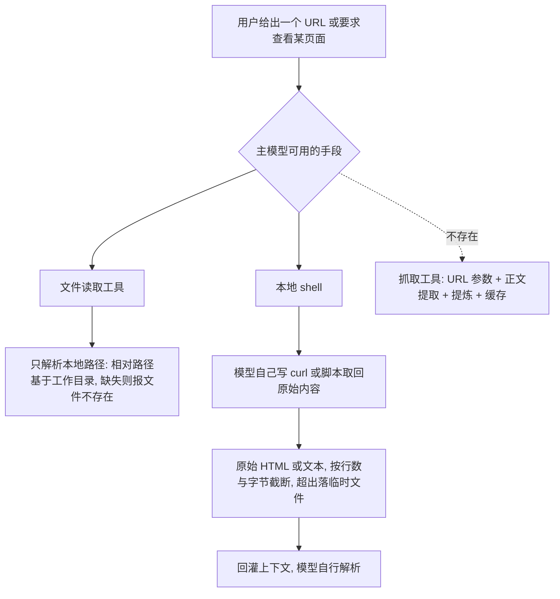

# Web Fetch - Pi - 01 - 不提供第一方网页抓取：read 只认本地路径，取网页只能借 shell

---

Pi 的 web-fetch 又是怎么做的? 调研一下

（对齐后确认：归档为独立笔记；只做“有/没有”的结论与依据，不扩到扩展/MCP。）

---

## 场景

在 Codex 里“读一个网页”是 `open` / `open_page` 动作，在 Claude Code 里是独立的 `WebFetch` 工具（本地抓取、HTML 转正文、小模型提炼、域名权限、缓存）。在 Pi 里，用户要求“看看这个链接”时会发生什么？

源码给出的答案与检索那轮同构：**Pi 没有第一方网页抓取能力**。没有抓取工具，没有 HTML 转换，没有正文提取，没有域名策略，也没有内容缓存。唯一能取到网页内容的路径是模型自己用 shell 跑 `curl` 之类的命令，拿到原始输出，交给通用的输出截断规则处理。

这份笔记记录“没有”这件事的证据结构，以及它和检索那条结论的关系。

## 机制展开

### 1. 读取工具只处理本地文件系统

内置的读取工具参数是“路径 + 起始行 + 行数”，描述里明确写的是读取文件内容、支持文本与若干图片格式、按行数和字节截断。它的执行路径只有一种：把传入的字符串当作路径，相对路径基于会话工作目录解析，然后**在文件系统上做存在性探测**。

这一点可以从它的路径解析辅助看到：解析函数先转成绝对路径，再做一次文件存在检查；不存在时依次尝试几个容错变体（macOS 截图文件名里的窄空格、NFD 分解形式、弯引号替换），全部失败才返回“文件不存在”。整条链路没有任何“以 `http`/`https` 开头则走网络”的分支，也没有协议判断。

因此把 URL 传给读取工具不会抓网页，只会得到“文件不存在”。

### 2. 工具清单里没有抓取工具

内置工具集是一个封闭枚举：读、shell、PowerShell、编辑、写、文本检索、找文件、列目录。设置文档给出同一份权威清单。抓取工具既不在枚举里，也不在“可注册但未激活”的名单里。

所以不存在“打开它”的配置项，也不存在抓取工具的暴露档位、审批规则或结果预算——因为那个工具对象根本不存在。

### 3. 模型接口层没有抓取所需的结构

模型接口的工具定义只有名字、描述、参数三项，没有供应商原生工具的表达位；消息类型里也没有“抓取结果块”或“引用标注”这类结构。抓取在这两个被研究对象里往往伴随“正文提炼后的小模型输出 + 出处标注”，Pi 这一层同样没有承载它的类型。

### 4. 提示词没有任何抓取相关约定

系统提示由身份、工具清单、规则、文档索引、工作目录组成。既没有“可以抓取网页”的声明，也没有“如何引用来源”“抓不到时怎么办”的约束，也不注入当前日期。同一份提示词同时服务于检索与抓取两条不存在的能力，空白是统一的。

### 5. 唯一的取页路径：借 shell，走通用截断

模型实际能做的只有一件事：用 shell 执行 `curl` / `wget` / 语言运行时脚本，把响应打印到标准输出。之后由**通用**规则接管：

- 输出保留末尾若干行、且不超过若干字节（与所有 shell 调用同一套阈值），超限时完整内容写入临时文件并给出路径；
- 读取工具本身也有独立的行数/字节上限，但它读的是落盘后的本地文件。

于是“读网页”在 Pi 里退化成“命令行取回文本 + 通用截断”。随之缺失的是抓取专用的那一层，逐项对照另外两个项目就很清楚：

| 抓取环节 | Claude Code 的 `WebFetch` | Codex 的 `open` / `open_page` | Pi |
|---|---|---|---|
| URL 合法性校验 | 有（协议、私有网段拦截） | 由远端服务判断 | 无（模型自己写命令） |
| HTML 转正文/Markdown | 有 | 在远端完成 | 无 |
| 正文提炼 | 有（小模型按提示词总结） | 由远端服务完成 | 无 |
| 域名权限 | 有（域名规则 + 跨域重定向确认） | 有（允许域名下发） | 无 |
| 内容缓存 | 有（按域名/URL） | 服务端缓存 | 无 |
| 结果体积预算 | 有（专门的令牌上限与截断） | 有（输出预算下发远端） | 只有通用的行数/字节截断 |
| 提示注入防御 | 有（提炼提示词里的防御约束） | 工具描述里的信任约束 | 无 |

## 条件与边界

- **“没有”只针对内置工具集**：工具是注入式的，外部工具源可以补一个抓取工具；其行为不在本次范围。
- **网络不受 harness 约束**：既然没有抓取工具，也就没有域名黑白名单、重定向策略、私有网段拦截；能否访问某个地址完全取决于模型写出的命令与运行环境（例如是否在容器内）。
- **没有正文提取**：模型拿到的是 HTML 原文或程序输出，需要自己解析；上下文里可能塞进大量标签与噪声，只能靠通用截断兜底。
- **没有缓存**：同一个页面反复读取就会反复产生网络请求。
- **没有引用机制**：答案里的来源是否可追溯，取决于模型自觉，harness 不做要求也不做校验。
- **与检索结论同构**：两轮结论共享同一组证据（封闭的工具枚举、三项式工具类型、沉默的提示词），差别只在“检索还需结果预算与引用规范，抓取还需正文提取与域名策略”——而这两组专属机制都不存在。

## 设计取舍

**为什么不做？** 从结构推断，Pi 把边界放在“通用执行能力”上：核心循环与模型接口保持最小，编码助手只注入本地工具，任何需要外部基础设施的能力（索引、抓取、正文提取、提炼、缓存、引用治理）都不进入 harness。这样工具面小、系统提示短、请求前缀稳定，换供应商也不需要为能力差异写分支。

**代价是什么？** 读网页变成模型的自选动作：策略、解析、体积控制、可信度判断全在模型侧；没有平台层的“外部内容”标记，也没有引用要求来约束结论可追溯性；同一页面重复抓取的成本由模型自行承担。

**收益是什么？** 不需要维护抓取链路，也不会背上“网页正文如何转换、如何提炼、如何防注入”这一整套治理责任；跨供应商行为一致。

## 证据分级

- **已证实**：内置工具为八项本地工具的封闭枚举，读取工具与 shell 之外没有抓取类工具；读取工具只做路径解析（相对工作目录）+ 文件存在性探测 + 若干文件名容错变体，没有 URL/协议分支；读取工具描述只承诺文本与图片文件；shell 工具与读取工具各自有行数/字节截断规则，shell 超限落临时文件；模型接口工具定义只有名字/描述/参数，消息类型无抓取结果块与引用结构；系统提示无抓取声明、无引用要求、无日期注入；`WebFetch` 字符串仅出现在 Anthropic 适配器的隐身模式工具名大小写映射表中；文档无抓取能力说明。
- **合理推断**：这套空白是有意的边界划分；主要动机是保持核心最小与跨供应商一致；代价是网页读取的治理责任整体外移给模型。
- **无法确认**：用户安装的外部工具源是否补上了抓取（不在范围）；各供应商是否可能在服务端隐式抓取并在正文中体现（客户端仓库无法判断）。

## 源码依据

源码版本：Pi 工作区提交 `4954d7605`（2026-10-15），路径相对于 `/home/fishandrice/Backend/pi`。

| 相对路径 | 关键位置 | 证明内容 |
|---|---|---|
| `packages/coding-agent/src/core/tools/index.ts` | `ToolName` 95、`allToolNames` 96-104、`createTool` 141-163 | 内置工具是封闭枚举，没有抓取工具，未注册名字直接抛错 |
| `packages/coding-agent/src/core/tools/read.ts` | 参数 schema 14-18、工具描述 94-96、`execute` 103-124 | 读取工具只接受路径与行范围，描述仅承诺文本与图片文件 |
| `packages/coding-agent/src/core/tools/path-utils.ts` | `resolveReadPathAsync` 86-110、`expandPath` 40 | 路径解析与文件存在性探测、若干文件名容错变体；无协议判断 |
| `packages/coding-agent/src/core/tools/truncate.ts` | `DEFAULT_MAX_LINES` 11、`DEFAULT_MAX_BYTES` 12、`truncateHead` 78-100、`truncateTail` 168-190、`truncateMiddle` 292 | 通用行数/字节截断规则 |
| `packages/coding-agent/src/core/tools/bash.ts` | 参数 schema 39-42、工具描述 254-256 | 通用 shell 执行器；输出截断与落临时文件 |
| `packages/ai/src/types.ts` | `Tool` 754-759、`Context.tools` 771-775 | 工具定义只有名字/描述/参数，无供应商原生工具表达 |
| `packages/coding-agent/src/core/system-prompt.ts` | `buildRules` 88-124、前言 155-156、工具清单 157-160、`<cwd>` 183 | 提示词无抓取声明、无引用要求、无日期注入 |
| `packages/ai/src/api/anthropic-messages.ts` | 隐身模式工具名表 101-121 | `WebFetch` 仅用于本地工具名的规范化，不是能力 |
| `packages/mcp/src/protocol/content.ts` | `blockToLlmContent` 79-107 | 模型可见内容只有文本与图片两种，无网页正文/引用结构 |
| `packages/coding-agent/docs/settings.md` | 44-56 | 权威表述：可用内置工具即八项 |
