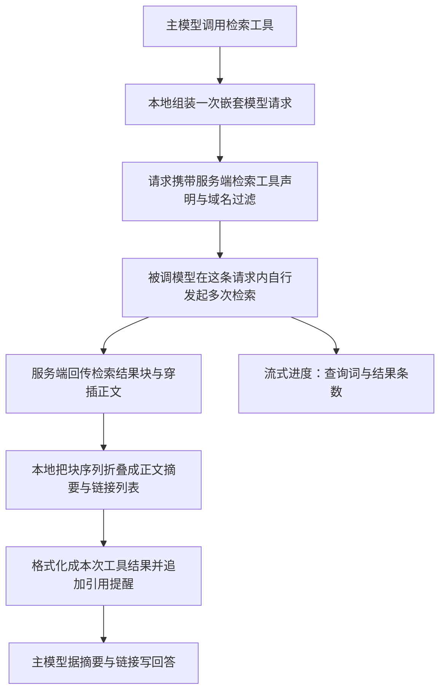

# Web Search - Claude Code - 01 - 联网检索：用一次嵌套模型请求执行检索

---

分别研究 Codex 和 Claude Code, 它们的 Web Search 功能是怎么实现的?

（范围对齐后确认：只研究“检索”，不含按 URL 抓取网页；两份独立笔记，不做对照笔记；深度按标准机制层。）

---

## 场景

用户在会话里问需要最新信息的问题，主模型决定调用 `WebSearch`。这个工具的名字听起来像一个搜索客户端，但 Claude Code 的源码里没有搜索 API 客户端、没有索引、没有抓取器。它做的事情是：**用主模型自己写出的查询词，再发起一次模型请求，并在这条请求里挂上 Anthropic 服务端的检索工具**。检索、抓页、摘要全部发生在这一次嵌套请求内部，回到本地的只有“检索结果块 + 模型写的正文”。

这个设计决定了后面所有细节：预算、权限、结果形态、引用约定、异常处理，都是围绕“一次嵌套模型调用”组织的。

## 机制展开



### 1. 工具表面很小，压力全在提示词上

工具只有三个参数：查询词、允许域名、屏蔽域名。两条校验规则：查询词不能为空；允许域名和屏蔽域名不能同时出现（否则远端语义冲突）。

工具描述（模型看到的说明）不写实现细节，而是写行为契约：

- 用它能拿到知识截止之后的信息，检索在一次 API 调用内自动完成；
- **强制**在回答末尾给出 `Sources:` 段落，用 `[标题](URL)` 列出所有相关来源，不能省略；
- 支持域名过滤；
- 检索仅在美国可用；
- 查询词里必须使用当前年月（提示词运行时注入本地月份年份），避免模型拿去年的年份去搜“最新”。

也就是说，“引用”不是服务端返回的结构化字段，而是靠提示词要求的输出格式。这一点和检索工具怎么执行完全解耦，因此后面的解析逻辑不需要关心引用。

### 2. 开关：按供应商和模型决定，默认还藏在延迟加载后面

工具是否可用由供应商决定：官方 API 上恒可用；Vertex 上要求模型名匹配 4.x 系列；Foundry 上恒可用；Bedrock 上直接不可用。Beta 头只在 Vertex 和 Foundry 路径上补发，官方路径不需要。

更隐蔽的一层是**延迟加载**：这个工具声明了“可延迟”，默认在初始工具清单里只出现名字、不出现完整 schema，模型必须先通过工具搜索把 schema 取回来才能调用。这是一个成本取舍——工具描述加 schema 占系统提示的固定开销，而检索不是每轮都要用的能力。延迟机制可以通过环境变量切回“全部内联”。

### 3. 执行：一次嵌套模型请求

调用时本地做四件事：

1. 造一条用户消息，内容是“为这个查询执行一次联网检索：<查询词>”。没有历史对话、没有附件——**嵌套请求不携带主会话上下文**。
2. 造一句系统提示：“你是一个执行联网检索工具调用的助手”。
3. 组装工具清单：主工具清单留空，另加一份“额外工具声明”，即服务端检索工具，附带允许/屏蔽域名，以及一个硬编码的上限——**单次调用最多 8 次检索**。
4. 用主循环模型发起一次普通流式请求。

这里有一个可观测的开关：如果远端灰度配置把“用便宜模型做检索”打开，本地会改用小快模型，把思考配置关掉，并强制 `tool_choice` 指向检索工具——即不允许被调模型“闲聊”，必须直接发起检索。这条分支说明存在一个成本假设：检索这一步不一定需要主模型级别的推理。

### 4. 服务端在被调模型内部完成全部检索

嵌套请求返回的内容不是一段纯文本，而是一个块序列，形状大致是：

```text
[ 检索调用块, 检索结果块, 正文文本与引用标注交错 ]   ← 每检索一次重复一组
```

服务端检索工具的行为是：被调模型在这个请求里可以连续发起多次检索（上限 8 次，可用域名过滤），每次返回一批命中（标题 + URL），并且在检索之后继续生成正文，正文里可能带引用标注。所以“检索几个来源、看多少正文、怎么概括”全部由服务端和被调模型决定，本地只拿到结果。

### 5. 本地把块序列折叠成结构化结果

本地遍历块序列，按“在正文里 / 不在正文里”的状态切换做归并：

- 遇到检索调用块：结束当前正文段，把已积累的正文作为一个字符串条目压入结果列表；
- 遇到检索结果块：把命中裁剪成 `{标题, URL}` 列表，连同这次调用的 id 压入结果列表；如果块内容是错误对象而不是数组，就压入一条 `Web search error: <code>` 文本；
- 遇到正文块：累加到当前正文段。

最终得到 `{查询词, 结果列表, 耗时}`，其中结果列表是“正文摘要字符串”和“命中列表对象”混排的数组。这个形状同时服务三件事：界面统计检索次数、工具结果格式化、会话持久化后重放。

### 6. 回灌主循环：摘要 + 链接 + 引用提醒

结果写回主循环时被格式化成一段文本工具结果：

```text
Web search results for query: "<查询词>"

<正文摘要一>
Links: [{"title": ..., "url": ...}, ...]
<正文摘要二>

REMINDER: You MUST include the sources above in your response to the user using markdown hyperlinks.
```

三个要点：

- 主模型拿到的**不是原始网页正文**，而是被调模型写的摘要加上一批链接。原始页面内容从未进入主上下文，这也是这个设计最大的性能收益——上下文里只保留“答案 + 出处”。
- 命中列表用 JSON 内联，没有排版美化；一段摘要后面的 `Links:` 对应那次检索的命中。
- 末尾那句提醒是与工具描述里的 `Sources:` 要求配对的第二道保险：即使工具描述被裁剪或模型忽略，工具结果本身也在提醒它引用来源。

### 7. 权限、并发与预算

- **权限**：工具自己不做判断，一律“交给上层”（passthrough），由权限系统转成“询问用户”，并附一条建议规则（允许该工具并写入本地设置）。所以首次使用会弹一次授权，用户可以选择“总是允许”。`WebSearch` 的权限规则不支持通配符：写 `WebSearch(关键字)` 只做字面匹配，这也限制了“按查询词精细授权”的可用性。
- **只读与并发**：标记为只读、并发安全，所以同一轮里多个检索可以并行跑，不参与写入互斥。
- **体积预算**：工具声明自己的结果上限是 10 万字符，但实际生效阈值是“声明值”和系统全局上限（5 万字符）取小。超过阈值的结果不会被直接截断丢弃，而是落盘保存，模型收到带文件路径的预览，需要时再读回来。检索结果同时属于“可清理的结果类工具”，在服务端上下文管理策略里可以被批量清掉以腾出上下文。

### 8. 进度与展示

流式过程中本地做两件事：从检索调用块的增量 JSON 里正则抠出 `query` 字段，用于“正在搜索 X”的进度行；遇到检索结果块时，取出该次调用的查询词和命中条数，用于“找到 N 条结果”。最终展示只有一行摘要：“执行了 N 次检索，用时 X”。

界面刻意不展示结果正文（源码注释明确说结果内容从不上屏），并且明确声明该工具不参与会话内文本搜索索引，避免把结果里的字符串当成可命中的对话内容。代价是：用户看不到检索结论，只能看到“搜过了”；这部分信息实际落在会话记录里。

### 9. 失败与边界

- 远端检索工具返回错误块时，不抛异常，而是把 `Web search error: <code>` 当成一条“结果文本”塞进结果列表，回给主模型——模型能看到检索失败原因并自行决定是否换查询。
- 被调模型没有发起任何检索（只写了正文）时，结果列表里只有摘要文本，主模型仍会得到一段回答，但没有任何链接。
- 嵌套请求本身失败（网络、限流、超时）会作为工具调用异常上抛，走统一的工具错误通道回告主模型；取消信号来自主循环的取消控制器，因此用户可以中途打断检索。
- 没有任何本地缓存：同一查询重复调用就是重复一次完整嵌套请求。这一点与抓取工具（有域名级缓存）形成明显差异。
- 成本统计上，服务端检索次数从响应的 `server_tool_use.web_search_requests` 累加进会话成本，检索被当作独立的计费事件而非普通 token。

## 条件与边界

- **供应商绑定**：Bedrock 上不可用；Vertex 上要模型名匹配 4.x；Beta 头只在 Vertex/Foundry 补发。
- **一次调用 8 次检索**是硬编码，不是配置项；模型想搜更多只能再发起一次工具调用（多一次嵌套请求）。
- **不携带会话上下文**：嵌套请求只有一句合成用户消息。主模型必须把必要背景写进查询词，否则被调模型只能看到孤立的一句查询。
- **结果体积受两道限制**：声明上限与全局上限取小；超出后落盘而非截断。
- **延迟加载**：默认不在初始 schema 里，需要工具搜索才能拿到；关闭工具搜索或关闭实验性 beta 时才会内联。
- **只在官方/特定云路径可用**，并且检索本身“仅美国可用”——这是提示词里的产品说明，本地没有对应校验。

## 设计取舍

**为什么用嵌套模型请求而不是直接调搜索 API？** 因为检索的价值不在于“拿回十条链接”，而在于“读几个页面、把与问题相关的部分概括出来”。把检索 + 阅读 + 概括打包进一次服务端请求，可以让主上下文只收一份摘要，这是最省 token 的形态；同时供应商侧可以自由替换检索源、抓取策略和摘要策略而不改客户端。

**代价是什么？** 三层信息损耗叠加：服务端只给被调模型一部分页面内容；被调模型只写它认为相关的摘要；主模型再基于摘要作答。任何一层判断偏了，主模型都没有原始材料可回退——它只有链接。这也是为什么工具结果末尾要加一句“必须引用来源”：引用是这条链路上唯一能追溯的东西。

**为什么嵌套请求不带历史？** 极简请求意味着请求可以被缓存/复用（相同的查询词产生相同请求），也避免把主会话的敏感上下文发给一次“检索专用”调用。代价是查询词必须自包含，主模型需要把背景压进一句查询里。

**为什么用便宜模型做检索（可选分支）？** 检索步骤的产出是“摘要 + 链接”，对推理深度要求低，对成本敏感。强制 `tool_choice` 则保证便宜模型不会把这次请求变成一次普通对话，从而保证“一次工具调用 = 一次检索”的语义。

**为什么不用结构化引用而用提示词？** 与 Codex 的取舍方向一致但落点不同：Claude Code 让格式要求同时出现在工具描述和工具结果末尾，形成“事前要求 + 事后提醒”；好处是模型在任何位置都能看到引用义务，坏处同样是没有客户端校验。

## 证据分级

- **已证实**：工具参数与两条校验规则；`Sources:` 强制引用提示词、当前年月注入、美国限定说明；按供应商的可用性判断与 Beta 头补发位置；延迟加载标记与工具搜索默认模式；执行路径为“一次嵌套模型请求 + 附加服务端检索工具 schema + 单次最多 8 次检索”；可选的小快模型与强制 `tool_choice` 分支；块序列折叠为“摘要 + 命中列表 + 耗时”；工具结果格式化与末尾引用提醒；权限 passthrough→询问、只读、并发安全；结果上限取小并落盘、可被上下文管理清理；进度事件与“只显示检索次数”的展示策略；错误块转成文本、嵌套请求失败上抛、无本地缓存、成本按服务端检索次数统计。
- **合理推断**：“省 token”是选择嵌套请求的主要动机（源码无显式说明，但结果形态与提示词设计强烈支持）；不带历史是为了请求可复用与避免泄露主会话上下文；用便宜模型是因为检索阶段对推理要求低；“仅美国可用”未在本地校验，属于产品侧限制。
- **无法确认**：服务端 `web_search_20250305` 的检索源、抓取深度、结果条数、引用标注的真实生成方式；`max_uses: 8` 是客户端上限还是服务端也会二次限制；灰度开关在生产环境中的默认取值。

## 源码依据

源码版本：Claude Code 2.1.88 源码快照，路径相对于 `/home/fishandrice/Backend/claude-code/claude-code-2.1.88-source`。该快照不可构建，结论均来自静态阅读。

| 相对路径 | 关键位置 | 证明内容 |
|---|---|---|
| `src/tools/WebSearchTool/WebSearchTool.ts` | `inputSchema` 25-43、`makeToolSchema` 76-84、`makeOutputFromSearchResponse` 86-150、工具定义 152-167、`isEnabled` 168-193、`checkPermissions` 209-222、`validateInput` 235-252、`call` 254-400、`mapToolResultToToolResultBlockParam` 401-430 | 参数与校验、单次 8 次检索上限、块序列折叠、供应商可用性、权限 passthrough、嵌套请求组装、结果格式化与引用提醒 |
| `src/tools/WebSearchTool/prompt.ts` | 1-34 | `Sources:` 强制引用、当前年月注入、域名过滤与美国限定说明 |
| `src/tools/WebSearchTool/UI.tsx` | `renderToolResultMessage` 79-100 | 只显示“检索次数 + 耗时” |
| `src/services/api/claude.ts` | `extraToolSchemas` 1385-1396、`queryModelWithStreaming` 752-780 | 额外工具声明并入请求工具数组；嵌套请求走的流式接口 |
| `src/utils/betas.ts` | 346-353 | Beta 头只在 Vertex/Foundry 补发 |
| `src/constants/betas.ts` | 9 | 检索 Beta 头常量 |
| `src/services/tokenEstimation.ts` | 290-300 | Vertex 上检索 Beta 头会导致 400，计数时被过滤 |
| `src/utils/permissions/permissions.ts` | 1299-1310 | passthrough 转成“询问用户” |
| `src/utils/settings/toolValidationConfig.ts` | 41-53 | `WebSearch` 权限规则不支持通配符 |
| `src/constants/toolLimits.ts` | 13 | 全局工具结果上限 5 万字符 |
| `src/utils/toolResultStorage.ts` | `getPersistenceThreshold` 55-84 | 声明上限与全局上限取小，超限落盘 |
| `src/services/compact/apiMicrocompact.ts` | 19-31、122 | 检索结果属于可清理的结果类工具 |
| `src/services/compact/microCompact.ts` | `COMPACTABLE_TOOLS` 41-50 | 客户端压缩同样把检索结果纳入清理名单 |
| `src/utils/toolSearch.ts` | `getToolSearchMode` 172-196、可延迟工具过滤 131-149 | 延迟加载默认开启，可延迟工具需先经工具搜索加载 |
| `src/tools/ToolSearchTool/prompt.ts` | `isDeferredTool` 62-105 | 判定哪些工具默认不出现在初始 schema 中 |
| `src/constants/tools.ts` | 55-62 | 检索工具被列入后台/异步代理允许工具集 |
| `src/cost-tracker.ts` | 271-273 | 服务端检索次数计入会话成本 |
| `src/utils/model/providers.ts` | `getAPIProvider` 6-14 | 供应商枚举决定可用性 |
