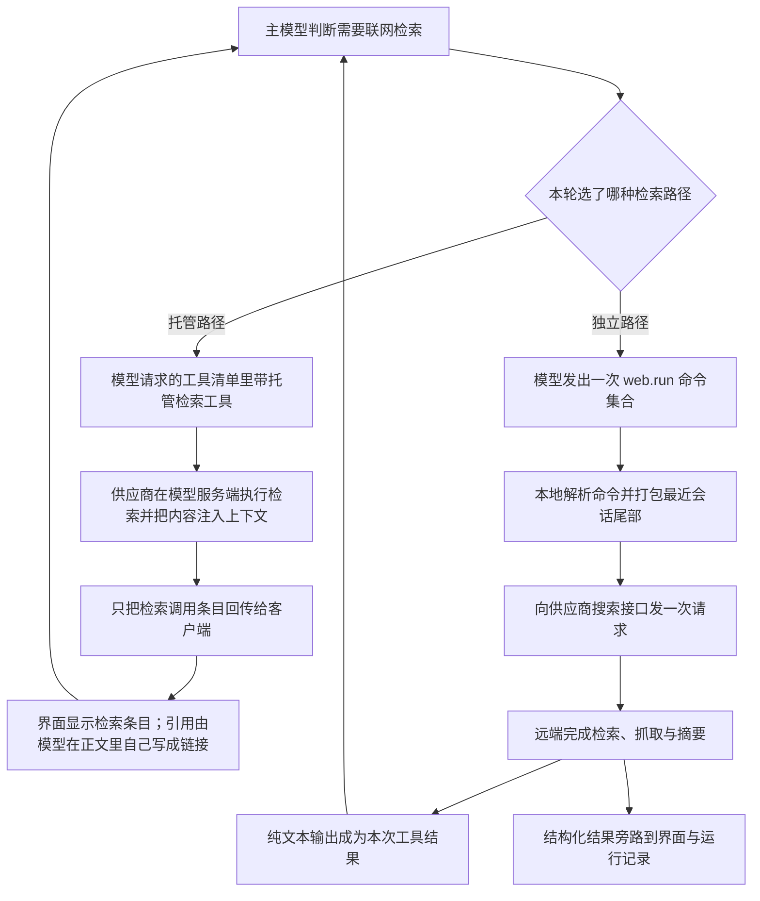

# Web Search - Codex - 01 - 联网检索：托管搜索工具与独立 web.run 两条路径

---

分别研究 Codex 和 Claude Code, 它们的 Web Search 功能是怎么实现的?

（范围对齐后确认：只研究“检索”，不含按 URL 抓取网页；两份独立笔记，不做对照笔记；深度按标准机制层。）

---

## 场景

用户在会话里问“现在最新的 X 是什么”“帮我查一下某个库的当前版本”“这件事是真的吗”，主模型判断自己需要联网检索。Codex 要让模型拿到检索结果，同时又要让用户/企业能控制“能不能联外网、能查到什么程度、结果算不算可信上下文”。

有意思的是：Codex 的“检索”不是一个工具，而是**两条互斥的实现路径**——一条把检索交给模型供应商在服务端完成，另一条由 Codex 自己作为 HTTP 客户端去调供应商的搜索接口。读代码时若不先分清这一点，会把两套开关、两套结果形态混成一套。

## 机制展开

### 1. 两条路径怎么选

每轮组装工具清单时只做一次判断，两条路径不会同时出现：

- **独立路径优先**：当供应商具备联网能力，并且满足“模型使用瘦身版请求格式”或打开了独立搜索的构建开关时，走独立路径。
- **否则走托管路径**：只要供应商声明支持托管检索，就把托管检索工具塞进模型请求；如果供应商不支持，则两个都不给。
- 两条路径互斥的直接后果是：托管工具被抑制的条件不是“用户关了搜索”，而是“独立路径已经接管”。

独立路径本身还有一道自检：扩展只有在供应商是 OpenAI、或使用 OpenAI 侧认证、或被显式标注支持独立搜索，且检索模式不是“关闭”时，才把自己的执行器注册出来。注册出来了，还要再经过上面那轮选择才可能真正出现在工具清单里。

### 2. 四档访问模式：这是理解 Codex 检索的关键

Codex 用一个枚举来表达“能查多远”，而不是一个布尔开关：

| 模式 | 含义 | 传到远端的表达 |
|---|---|---|
| `disabled` | 完全不提供检索工具 | 不生成工具 |
| `cached` | 只查供应端已有的检索缓存，不现场抓取 | 关闭外部网页访问 |
| `indexed` | 允许现场访问，但限制在可被索引的 URL | 开启外部访问并置“仅索引”标记 |
| `live` | 允许真正访问实时互联网 | 开启外部访问 |

默认值是 `cached`：未做任何配置时，模型仍然能看到检索工具，但只能吃到供应端缓存的结果，拿不到现场抓取。`--search` 这类交互式开关做的事情就是把模式改成 `live`。旧的 `web_search_request` / `web_search_cached` 构建开关已标记为弃用，现在只作为兼容层把模式翻译成 `live` / `cached`。

模式还会在每轮开始时被“降级协商”一次，方向只会更保守：

- 供应商若不支持联外网，`live` 和 `indexed` 都会被降成 `cached`；
- 已安装的企业要求层通过“允许的检索模式”列表做约束，只能收窄不能放宽；
- 一个反直觉的分支：**当外部沙箱被整体关闭（完全放开权限）时，`cached` 会被提升成 `live`**。原因可以从结构推断——既然沙箱都不拦网络了，再把检索限制在缓存里没有安全收益，只会让模型拿不到它本来就能自己抓到的内容。用户显式写 `disabled` 或 `indexed` 时不会被这个提升覆盖。

### 3. 托管路径：Codex 只负责“声明”，不负责“执行”

托管路径下，Codex 在模型请求的工具数组里放一个供应商原生工具声明，字段包括外部访问开关、仅索引标记、允许域名、大致地理位置、上下文大小（小/中/大），以及内容类型（部分模型元数据允许返回图片）。

此后的一切都发生在模型服务端：模型决定何时检索、检索几次、抓哪些页面、注入多少正文，全部在一次模型调用内部完成。客户端能观察到的只有流里回来的“检索调用条目”（含动作：搜索 / 打开页面 / 页内查找，以及查询词）。这些条目被转换成界面条目和历史条目，用来显示“搜索了什么”。

这意味着托管路径有三个结构性特点：

- **没有本地审批环节**：检索不是客户端动作，权限模型（沙箱、审批）对它没有介入点；
- **没有本地预算控制**：结果进入上下文的量由供应商控制，Codex 只能通过“上下文大小”这个粗粒度旋钮间接影响；
- **没有结构化引用**：正文里带回来的引用信息，Codex 并不解析（协议里那一层标注字段在实现中是空的），引用完全是模型按提示词约定写出来的 Markdown 链接。

### 4. 独立路径：Codex 自己调供应商的搜索接口

独立路径把“检索”变成一个普通函数式工具：命名空间 `web` 下的 `run`，暴露给模型的是一组命令而不是单个 `query` 参数：

- 网页搜索 `search_query`（可带时近天数、域名过滤）、图片搜索 `image_query`；
- 页面导航：`open`（按引用号或完整 URL 打开）、`click`（打开页内某个编号链接）、`find`（在页内找字符串）、`screenshot`（PDF 分页截图）；
- 领域数据：`finance`、`weather`、`sports`、`time`；
- 一个横跨整次调用的长度旋钮 `response_length`（短 / 中 / 长）。

工具描述显式鼓励“一次调用里塞多个命令”来省往返，并对搜索条数设了上限：单次调用最多 4 条查询，超过 3 条时必须把长度旋钮调到中或长。它还教了模型一个“误触发怎么办”的土办法——如果发现自己不该调这个工具，就发一条空查询把它消耗掉。

执行流程是：校验参数 → 打包会话尾部 → 发一次 HTTP 请求 → 拿回响应 → 发开始/完成事件。

- **会话尾部**：只保留最近两条用户消息，以及夹在其中的、最多约 1 千 token 的助手可见文本；图片、系统消息、开发者消息、环境上下文一律丢弃。也就是说远端搜索服务看到的是“最小自足上下文”，不是整段对话。
- **请求体**：会话 id、当前模型名、上述尾部、命令集合、访问设置，以及一个来自本轮截断策略的 `max_output_tokens`。Codex 在这里第一次把“检索结果的体积”纳入自己的 token 预算体系。
- **响应**：一段纯文本输出（直接作为函数结果回到模型），一份结构化的结果列表（保持为不透明 JSON，原样透传给界面与运行记录，以便远端新增结果类型时向前兼容），以及一个加密输出字段。同时上报结果负载字节数，作为检索体积的可观测指标。
- **失败**：参数解析失败按“回告模型”处理（模型可以改参数重试），网络/接口失败按致命错误处理。

独立路径的访问模式表达与托管路径一致，但企业要求层只暴露“允许域名”，没有暴露“屏蔽域名”，所以本地设置里的屏蔽域名恒为空。

### 5. 工具描述承担了大部分“检索策略”

独立路径把一份 100 多行的说明作为工具描述塞给模型，内容是真正的行为约束，而不是用法示例：

- **强制检索清单**：信息可能变化（新闻、价格、法规、日程、产品规格、体育比分、经济指标、职务人物等）、涉及花钱或花时间的推荐、用户想要引用或来源、引用了未给出内容的页面/论文、自己不确定或话题小众、高风险领域（医疗/法律/金融）、用户明确要求核查——只要你有一丝犹豫，就偏向去查。
- **引用规则**：结果里的引用号只能用于后续 `web.run` 调用，不能出现在最终回答里；最终回答用 `[标题](URL)` 形式，链接必须指向支撑该结论的页面而不是搜索结果页；引用要贴到所支撑的句子或段落之后，不能单独成行、不能集中在末尾。
- **字数与版权**：单来源逐字引用不超过 25 词（歌词 10 词，Reddit 例外），每个来源的“归因词数上限”由结果里的 `[wordlim N]` 标注给出，缺省 200 词。
- **特殊情况优先**：询问 OpenAI 产品用法时先看本地代码，需要浏览时把来源限制在官方站点；技术问题只用一手资料。

这些规则在托管路径下并不存在，因为托管路径的工具描述由供应商提供，Codex 只声明工具。

### 6. 检索结果如何进入上下文与后续状态

- **托管路径**：检索内容由服务端直接注入模型可见上下文，客户端侧的条目只用于展示；历史里记录的是“发生过一次网页调用”，而不是正文。
- **独立路径**：远端返回的纯文本输出被包装成一个函数结果项交回模型；结构化结果只走旁路。
- 独立路径的输出被标记为“包含外部内容”。这个标记会触发记忆子系统：如果配置要求“外部内容污染时停用记忆”，本次检索会把该线程的记忆模式标记为受污染。也就是说，检索结果被当作不可信输入对待，而不是普通工具输出。
- 界面层把两种路径统一成一种“网页活动”卡片：标题按动作给出可读摘要（搜索词、打开的 URL、在某页里找什么），完成时更新为完成态；结构化结果供展开查看，不塞进对话正文。

## 条件与边界

- **默认只到缓存级**：不配置时模式是 `cached`，模型能看到检索工具但拿不到现场抓取；想要实时检索必须显式设成 `live`（或使用 `--search`）。
- **托管路径依赖供应商声明**：供应商不支持托管检索就完全没有检索能力；瘦身请求格式（Lite）完全不接受托管工具，只能走独立路径。
- **独立路径默认不启用**：它挂在“开发中”阶段的构建开关后面，默认关闭；只有瘦身格式或显式开启时才会出现。
- **企业约束单向**：要求层只能给出“允许的模式集合”，实际取值必须是用户偏好、供应商能力、要求层三者的交集，取不到就退到 `disabled`。
- **每轮重算**：模式不是进程级常量，每轮根据权限档位和供应商能力重新协商，所以中途切换权限档位会改变下一轮的检索能力。
- **参数错误与接口错误分级**：坏参数回告模型（可重试），接口失败终止本轮，不会重试同一条命令。
- **结果类型向前兼容**：结构化结果在本地保持不透明，远端新增类型不会让旧客户端解析失败。

## 设计取舍

**为什么把执行放到远端？** 检索涉及索引、抓取、正文提取、摘要生成，全部是重基础设施。客户端只做两件事：声明能力边界（四档访问模式、域名过滤、上下文大小）和消费结果。代价是客户端失去预算控制和引用结构，能调的只有粗粒度旋钮。

**为什么保留两套？** 托管工具体验最省事，但它的结果形态、体积、引用都由供应商决定，且瘦身请求格式不支持托管工具；独立接口则让 Codex 能自己决定“带多少会话上下文去查”“给多少输出预算”“结构化结果怎么展示”。这也解释了为什么代码里呈现的是“独立路径优先、托管路径兜底”，而不是反过来。

**为什么引用靠提示词而不是结构化数据？** 托管工具的引用信息在协议层存在但在实现中未被消费，最终呈现完全依赖模型按描述里的格式要求写 Markdown。这让引用质量取决于模型服从性，而不是客户端渲染；好处是实现极简，坏处是无法在客户端做“引用是否真实存在”的校验。

**为什么“关闭沙箱”反而放开了检索？** 这是权限模型的一致性推论：检索模式的保守程度原本是用来匹配沙箱对网络的限制的；沙箱不存在时，用缓存模式限制模型已无意义。这一点注释未直接说明，属于从分支结构推断。

**为什么检索结果要标记为外部内容？** 网页内容是最典型的提示注入来源。用“污染记忆”这个动作把“这段上下文来自外部”变成后续可观测、可降级的状态，而不是指望模型自己判断可信度。

## 证据分级

- **已证实**：两条互斥路径及其选择条件；四档访问模式的映射与默认值；每轮降级协商与“沙箱关闭时提升到 live”；独立路径的请求结构、会话尾部裁剪（最近两条用户消息 + 约 1 千 token 助手文本）、命令集合与 4 条查询上限、开始/完成事件、结果旁路、外部内容标记；工具描述里的强制检索清单、引用规则、字数上限；托管路径不下发本地审批、不消费引用标注；坏参数回告模型、接口错误致命。
- **合理推断**：把 `cached` 提升为 `live` 的动机（与沙箱放开保持一致的收益权衡）；“独立路径优先”反映的是对预算与结果形态可控性的需求；工具描述中的强制检索清单是为了弥补模型对时效性的直觉不足。
- **无法确认**：`alpha/search` 在真实供应商侧的行为细节（检索源、缓存刷新频率、结果条数）、`cached` 与 `live` 在服务端的实际差异强度、`external_web_access` 在服务端的执行严格程度。

## 源码依据

源码版本：Codex 工作区提交 `1a69ad3237`（2026-10-13），路径相对于 `/home/fishandrice/Backend/codex`。

| 相对路径 | 关键位置 | 证明内容 |
|---|---|---|
| `codex-rs/core/src/tools/spec_plan.rs` | `hosted_model_tool_specs` 686-716、`standalone_web_search_enabled` 1198-1206、`append_extension_tool_executors` 1646-1674 | 两条路径的互斥选择条件、瘦身格式不接受托管工具 |
| `codex-rs/core/src/tools/hosted_spec.rs` | `create_web_search_tool` 14-46 | 托管工具声明字段与四档模式到外部访问开关的映射 |
| `codex-rs/tools/src/tool_spec.rs` | `ToolSpec::WebSearch` 33-53、`name` 57-65 | 托管检索工具在模型请求中的序列化形状 |
| `codex-rs/protocol/src/config_types.rs` | `WebSearchMode` 376-394、`WebSearchConfig` 493-497 | 四档模式定义与“取交集”式收窄规则 |
| `codex-rs/core/src/config/mod.rs` | `resolve_web_search_mode` 2734-2745、`resolve_web_search_mode_for_turn` 3141-3186、默认值 3882-3883、约束装配 4271-4273 | 默认 `cached`、旧开关翻译、每轮降级与沙箱关闭时提升到 `live` |
| `codex-rs/config/src/requirements_layers/stack.rs` | `allowed_web_search_modes` 232、285 | 企业要求层只能收窄检索模式 |
| `codex-rs/features/src/lib.rs` | 1236-1256 | `web_search_request` / `web_search_cached` 弃用，`standalone_web_search` 处于开发中且默认关闭 |
| `codex-rs/ext/web-search/src/extension.rs` | `From<&Config>` 42-56、`search_settings` 58-95、`ToolContributor::tools` 122-160 | 独立路径的启用条件（供应商、模式）、访问设置与工具注册 |
| `codex-rs/ext/web-search/src/tool.rs` | `spec` 59-91、`handle_call` 97-193、`parse_commands` 209-218 | `web.run` 的命名空间与描述、请求组装、开始/完成事件、结构化结果旁路与体积指标、错误分级 |
| `codex-rs/ext/web-search/src/history.rs` | `recent_input` 18-27 | 最近两条用户消息 + 1 千 token 助手文本的会话尾部裁剪 |
| `codex-rs/ext/web-search/src/output.rs` | `SearchOutput` 7-40 | 纯文本输出成为函数结果、`contains_external_context` 标记 |
| `codex-rs/ext/web-search/src/schema.rs` | `commands_schema` 6-35 | 从命令结构生成给模型看的参数 schema |
| `codex-rs/ext/web-search/web_run_description.md` | 1-105 | 命令示例、4 条查询上限、强制检索清单、引用格式、`[wordlim N]` 与版权约束、特殊情况优先 |
| `codex-rs/codex-api/src/search.rs` | `SearchRequest` 9-20、`SearchCommands` 32-66、`SearchSettings` 231-245、`SearchResponse` 298-305 | 独立接口的请求/响应结构、域名与位置设置、不透明结果列表 |
| `codex-rs/codex-api/src/endpoint/search.rs` | `SEARCH_ENDPOINT` 15、`SearchClient::search` 34-47 | 向 `alpha/search` 发 POST 并解析响应 |
| `codex-rs/model-provider-info/src/lib.rs` | `supports_standalone_web_search` 202、OpenAI 供应商默认值 562 | 供应商对独立搜索的支持声明 |
| `codex-rs/core/src/tools/registry.rs` | `contains_external_context` 分支 929-940 | 外部内容触发线程记忆污染标记 |
| `codex-rs/core/src/event_mapping.rs` | `ResponseItem::WebSearchCall` 228-239 | 托管路径的检索条目转成界面/历史条目 |
| `codex-rs/core/src/session/turn.rs` | 检索条目处理 2691、2767 | 托管检索条目不参与助手消息排序 |
| `codex-rs/tui/src/history_cell/search.rs` | `web_search_action_detail` 10-29、`WebSearchCell` 45-100 | 检索卡片的动作摘要与完成态显示 |
| `codex-rs/cli/src/main.rs` | `--search` 映射 1837-1841、2006-2008 | 交互式开关把模式设为 `live` |
| `codex-rs/core/src/config/config_tests.rs` | 6469-6640 | 默认值、偏好优先级、降级与提升行为测试 |
