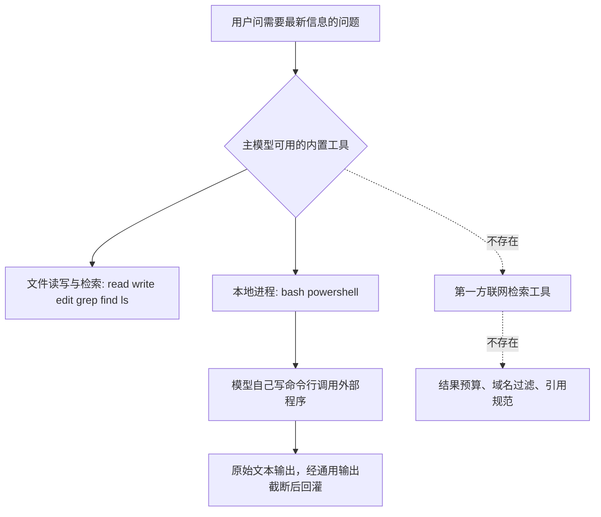

# Web Search - Pi - 01 - 不提供第一方联网检索：工具集、模型接口与提示词三层都没有入口

---

Pi 的 Web Search 是怎么实现的?

（范围确认后：只做检索、不扩到扩展/MCP；若结论是“没有”，只给有/没有的结论与依据；一份笔记，标准深度。）

---

## 场景

问“Pi 的 Web Search 怎么实现”，隐含假设是“像 Codex 有 `web_search`、Claude Code 有 `WebSearch` 那样，Pi 也有一个检索工具，只是实现方式不同”。

源码给出的答案是：**Pi 没有第一方检索能力，而且不是“关掉了”，是三层都没有对应结构**——内置工具集里没有、模型接口层无法表达、系统提示词里也没有任何联网相关的声明或约束。因此这份笔记的重点不是“检索怎么执行”，而是“没有”这件事是怎么被证实的，以及 Pi 把这件事留给了谁。

## 机制展开

### 1. 工具层：内置工具全部是本地操作

内置工具的名字是一个封闭的联合类型：读、shell、PowerShell、编辑、写、文本检索、文件名查找、列目录——八个，全部作用于本地文件系统或本地进程。工具工厂按名字分派，传入未注册的名字会直接抛错，所以“内置工具集”在结构上是封闭的、可枚举的。

默认启用的是其中四个：读、shell、编辑、写。其余三个（文本检索、找文件、列目录）和 shell 的 Windows 版本需要显式启用。设置文档给出了同样的权威表述：可用的内置工具就是这八个，除此之外能出现在工具选择里的只有内置扩展注册的工具和外部工具。

关键点在于：**“联网检索”不在这个枚举里，也不在“可以从未激活状态被唤醒”的名单里**。它不存在于工具选择这一层，因此不存在“打开它”的配置。

### 2. 模型接口层：结构上无法表达“供应商原生工具”

Pi 的模型接口层给工具定义的类型只有三项：名字、描述、参数 schema。没有“工具类型”字段，也没有给“由供应商在服务端执行的工具”留位置。

这一层约束直接传导到每个供应商适配器：

- 发往 Anthropic 的工具数组，全部由本地工具定义逐个转换而成，形状固定为“函数工具”；适配器里确实出现过字符串 `"WebSearch"`，但那是一张“把本地工具名改写成某终端工具惯用大小写”的映射表，仅在用 OAuth 令牌走隐身模式时用于命名规范化——它是命名细节，不是能力。
- 发往 OpenAI 的 Responses 接口时，工具条目同样只生成“函数”类型。

响应侧也没有对应结构：消息内容类型里没有“服务端工具调用块”“服务端工具结果块”“引用标注”这些概念。也就是说，即使某个供应商在服务端真的执行了检索并回传专属内容块，这一层也没有类型去承载它。

结论：Pi 的请求里无法携带“请你在服务端替我检索”的声明，因为类型系统不允许。

### 3. 会话与循环层：通用，不预置任何网络工具

Agent 核心循环是通用的：它只负责消息、工具调用分派、循环与事件，不知道“编码助手”“文件工具”这些概念。所有工具都由上层（CLI 组合层）注入。所以“Pi 没有检索”不是循环层做了禁用，而是循环层从来没有这个概念——它只会执行别人给它的工具。

这也解释了为什么这个结论需要限定在“内置工具集”：可注入的设计意味着外部工具源可以补上检索能力，但那属于另一条研究路径。

### 4. 提示词层：既不声明有能力，也不声明没能力

系统提示由几个可独立替换的段落组成：前言（身份与能力范围）、工具清单、规则、文档索引、工作目录。检索相关的痕迹在每一段里都不存在：

- 前言只描述“读写文件、执行命令、编辑代码、写文件”四类动作；
- 工具清单只列当前启用的工具及其一句话说明（shell 的一句说明是“执行 shell 命令，如 ls/grep/find”）；
- 规则由工具贡献的条目组成，只有“回答简洁”“明确写出文件路径”等；没有任何关于时效性、来源、引用的要求；
- 唯一与外部世界有关的环境信息是工作目录。

两个细节值得单独说明：

- **没有注入当前日期**。有的 harness 会在提示里写入今天的年月，用来提醒模型“你的知识可能过时”；Pi 只在少数与检索无关的场景（崩溃日志、会话导出、消息时间戳）使用时间，提示词里没有。
- **没有“你没有联网能力”的声明**。提示词对网络完全沉默：既不承诺能查，也不禁止去查。

这种沉默是有后果的：模型对“需要最新信息”这类请求的处理方式，完全由模型自身倾向和它自己想到的命令行决定，harness 不为它兜底。

### 5. 唯一的联网路径：借 shell 调外部程序

内置工具里唯一能触达网络的，是本地 shell（以及 Windows 版本）。它就是一个普通的本地进程执行器：执行命令、返回标准输出与标准错误、按行数和字节数做通用截断、截断时把完整输出写到临时文件。

由此形成的实际路径是：模型自己写出 `curl` / `wget` / 语言运行时脚本，自己去取网页、自己解析、自己决定看多少、自己总结。这条路径上的所有决策都在模型侧，harness 只提供三件通用保障——进程执行、输出截断、超时。

对比前面研究过的两个 harness，缺失的是**检索专用的那一层**：

| 机制 | Codex | Claude Code | Pi |
|---|---|---|---|
| 检索执行位置 | 服务端或远端搜索接口 | 嵌套模型请求内的服务端工具 | 无（模型自写命令行） |
| 结果条数/次数上限 | 有（单次调用查询条数、输出预算） | 有（单次 8 次检索） | 无 |
| 域名过滤 | 有（允许域名） | 有（允许/屏蔽域名） | 无（只能靠模型自己写） |
| 引用规范 | 工具描述强制 Markdown 引用 | 工具描述 + 工具结果末尾提醒 | 无 |
| 结果进入上下文的形态 | 服务端注入或远端摘要文本 | 被调模型写的摘要 + 链接 | 原始命令行输出 |

### 6. 容易混淆的两处命名

- `tool_search` / `searchTools()`：这是“在工具目录里找工具”（工具发现），不是找网页。Pi 的文档和工具描述里确实有“search”字样，但指向的是工具加载机制。
- 仓库自身的评测文档在描述“禁用外壳与联网工具”的评测配置时提到过 web-search 这个词，这属于对通用概念的引用，不表示 Pi 提供该工具。

另外，Pi 自己确实会联网：模型请求、OAuth 登录、包管理、崩溃上报都在发 HTTP。但这些是应用自身流量，不经过模型工具层，模型既看不到也无法触发。

## 条件与边界

- **“没有”只对内置工具集成立**：工具是注入式的，外部工具源可以补齐检索；其行为不在本次范围，本文不做结论。
- **没有网络策略层**：既然没有检索工具，也就没有“允许/禁止检索”的开关、域名黑白名单、引用校验、结果预算这些层；shell 的联网不受 harness 干预（是否受限取决于用户是否把 Pi 跑在容器里）。
- **输出只有通用截断**：命令行取回的网页内容按行数/字节被截断，超出部分落临时文件；没有“网页正文提取”这一步，模型拿到的是 HTML 或程序输出原文。
- **没有时区/日期提示**：模型无法从提示词里得知“现在是什么时候”，除非它自己执行 `date`。
- **跨供应商可移植**：因为不依赖任何供应商原生工具，换供应商不会出现“检索不可用”的分支——这一点与 Codex（供应商能力决定有无托管检索）和 Claude Code（Bedrock 上不可用）形成结构差异。

## 设计取舍

**为什么不做？** 从代码结构推断，Pi 的设计把边界划在“通用执行能力”上：agent-core 与模型接口保持最小、可替换，编码助手只注入本地工具。检索需要索引、抓取、正文提取、摘要、引用规范、结果预算这一整套基础设施，一旦做进 harness，就要跟着模型和供应商一起演进；而把它留给“模型 + 命令行 + 外部工具”，harness 就不必维护这条链路。这是一个明确的成本/能力权衡，不是遗漏：工具类型封闭、探测不到任何与检索相关的开关、提示词里连一句联网约束都没有，这种“三层一致的空白”通常是选择的结果。

**代价是什么？** 三件事没人管：检索策略（搜几次、看哪些源）、结果形态（原始 HTML 还是摘要）、引用可追溯性。模型自己写命令时也更容易被网页内容带偏——没有平台层的“外部内容”标记，也没有引用要求来约束它。

**收益是什么？** 工具面小意味着系统提示短、请求前缀稳定（对缓存友好）、跨供应商行为一致；同时避免在 harness 里维护第二套“远端执行 + 结果注入”的语义。

## 证据分级

- **已证实**：内置工具为八个本地工具的封闭联合类型，并有按名字分派、未注册即报错的工厂；默认启用读/shell/编辑/写；设置文档给出同一份清单；模型接口的工具类型只有名字、描述、参数三项；Anthropic 与 OpenAI 适配器都只生成函数型工具；`"WebSearch"` 仅出现在隐身模式的工具名大小写映射表；消息类型中没有服务端工具结果块与引用标注；系统提示只含身份、工具清单、规则、文档索引、工作目录，且没有当前日期注入、没有联网能力声明、没有引用要求；唯一可取网络的工具是本地 shell / PowerShell；CLI 没有联网相关开关；仓库评测文档提到“不暴露 shell 或联网检索工具”的配置。
- **合理推断**：这套“三层一致空白”是有意的边界划分而非未完成功能；主要动机是保持核心与模型接口的最小化与跨供应商可移植；把检索交给命令行会让引用与结果形态完全依赖模型。
- **无法确认**：用户实际安装的外部工具源是否补上了检索（不在范围，未研究）；各供应商是否可能在服务端对某些请求隐式注入检索能力（无法从客户端仓库判断）；生产环境中是否存在未公开的内置检索分支（当前快照中没有对应代码）。

## 源码依据

源码版本：Pi 工作区提交 `4954d7605`（2026-10-15），路径相对于 `/home/fishandrice/Backend/pi`。

| 相对路径 | 关键位置 | 证明内容 |
|---|---|---|
| `packages/coding-agent/src/core/tools/index.ts` | `ToolName` 95、`allToolNames` 96-104、`createToolDefinition` 118-140、`createTool` 141-163 | 内置工具集是八个本地工具的封闭枚举，按名字分派，未注册名字直接抛错 |
| `packages/coding-agent/src/core/tools/bash.ts` | 参数 schema 39-42、系统提示贡献 49-53、工具描述 255 | 通用本地 shell 执行器；无网络策略 |
| `packages/coding-agent/src/core/tools/truncate.ts` | 全文 | shell 输出按行数/字节截断、截断后落临时文件的通用规则 |
| `packages/ai/src/types.ts` | `Tool` 754-759、`Context.tools` 771-775 | 工具定义只有名字/描述/参数，无法表达供应商原生工具 |
| `packages/ai/src/api/anthropic-messages.ts` | 隐身模式工具名表 101-121、名字映射 122-127、`convertToolDefinitions` 1623-1665、工具参数装配 1266-1274 | 只发送函数型工具；`"WebSearch"` 仅为命名规范化 |
| `packages/ai/src/api/openai-responses-shared.ts` | 工具转换 408-415 | 只生成 `type: "function"` 的工具条目 |
| `packages/coding-agent/src/core/system-prompt.ts` | `buildRules` 88-124、前言 155-156、工具清单 157-160、`<cwd>` 183 | 提示词只有身份、工具、规则、文档、工作目录；无联网声明、无日期注入、无引用要求 |
| `packages/coding-agent/docs/settings.md` | 44-56 | 权威表述：可用内置工具即八项；`defaultTools` 只能从已注册工具中选择 |
| `packages/coding-agent/docs/how-pi-works.md` | 全文 | 架构说明中不含检索类工具 |
| `packages/agent/src/agent-loop.ts` | 全文 | 通用循环只分派注入的工具，不预置网络能力 |
| `packages/coding-agent/src/cli/args.ts` | 全文 | CLI 无联网检索相关开关 |
| `packages/evals/README.md` | 90 | 评测文档提到“不暴露 shell 或联网检索工具”的默认配置 |
| `packages/coding-agent/src/extensions/tool-search/tool.ts` | 34 | `tool_search` 是工具发现，与网页检索无关 |
